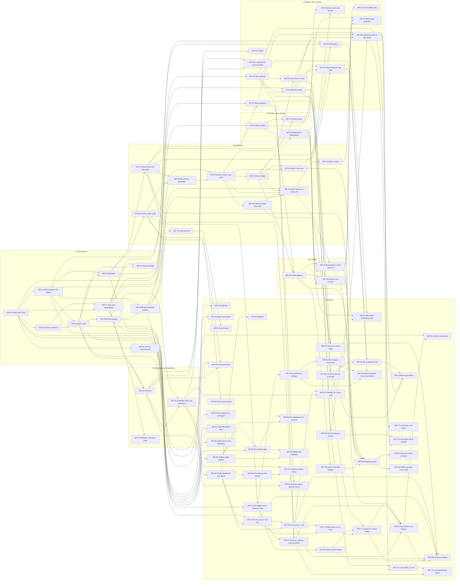

# 05 — Backlog

> Version 0.8 · Status: build baseline · Maintained by Claude Code
> v0.8.118: WP-90 (nightly e2e reliability) added at the owner's request and done in the same change (D-110), harvested from the closed e2e speed-up work (branches `claude/e2e-speed-up` and `claude/e2e-tooling`): sign in once per persona per worker; a page used only once hydrated; the test database's reset ends sessions stuck in a transaction; an infrastructure failure re-runs once and is labelled, an assertion failure never re-runs; the specs' clock in the household's zone, their own data and measured limits; the test standard in `CLAUDE.md`. WP-89 no longer carries the stuck-transaction fix.
> v0.8.117: WP-89 (the test database prepared for a pull request's preview) added at the owner's request, recorded only: a job that resets the test database, applies the pull request's migrations and loads the demo family, so a preview of a pull request with a migration works before merge. It runs no tests and never blocks anything (D-108). "Next, in order" is the owner's to set.
> v0.8.116: WP-88 (fast deploy gate; e2e nightly only) added at the owner's request and done in the same change (D-108): the deploy gate reads only the fast CI checks, e2e runs nightly and never blocks a pull request or a deploy, and a refused deploy or a red nightly run opens an issue.
> v0.8.115: WP-79 to WP-82 added at the owner's request, recorded only (D-101 to D-103): a goal's end date that can be cleared (a bug, on its own so it waits on nothing else); goals that repeat each week, month or school term, with "every day it's due" and misses allowed, each period won or missed on its own; done by a time, and tiers; perfect periods, and "every child meets it". WP-80 to WP-82 wait on one mockup. Avoidance goals (no screen time over a limit) are not covered: nothing records them.  WP-83 added at the owner's request and done in the same change: chore saves that stalled 15 s or more in two e2e runs are now checked and timed in both chores tests; their cause is open. "Next, in order" is the owner's to set.
> v0.8.114: WP-71 done (D-100): the board home on an iPad, fixed at the cause: a chore's row grows with its title and points chip, and a word in the rail goes under its icon when it doesn't fit beside it. The board's fit checks gain the iPad shapes, and, added at the owner's request, the kitchen board's 1920×1080 at Larger and Largest.
> v0.8.113: WP-78 (a lunch pick taken off by another, a bug) added at the owner's request and done in the same change: on Meals in the admin app, every "Choice of" section's radios were one group, so ticking a milk took off the entree. Two more added to it at the owner's request and done with it: "and" in a school menu joins a side like "with" (a WP-64 gap); the board picks up a new deploy by itself (D-99).
> v0.8.112: WP-71 to WP-76 added at the owner's request, recorded only (D-97, D-98), and WP-77 (WP-49's lunch test, root cause) added and done in the same change: the board home on an iPad (a bug); board layouts that adapt to the screen's shape, which WP-58 and WP-68 now build on, so WP-58 waits on it; the lunch picks one tap from Home; the lunch week as a list of days; the meal planner's days folded; Edit on a planned meal (a bug). WP-73 to WP-76 wait on one mockup. "Next, in order" is the owner's to set.
> v0.8.111: WP-70 (the board calendar's refresh timing, root cause) added at the owner's request and done in the same change (D-96): the test's own 3 s check looked last at about 2.8 s, fixed in the test; a board read after a change that failed or hung was never made again, fixed in the app; the calendar now says when it has finished drawing, and the month's test waits for it. WP-65's tally restarts with it.
> v0.8.110: WP-49 done: next week's lunches picked on the board, with the day's choices (D-95; the parent's approval screen's mockup approved by the owner). A child's change, buy or bring and the picks alike, waits for a parent on Today until the morning cut-off (8:00 am by default, set on School).
> v0.8.109: WP-64 done: the school menu by section, as options (D-94; mockup approved with WP-49's choice screens). The owner's answers for WP-49 recorded in its section; WP-49 is ready, its parent's approval screen and the morning cut-off's time to settle first.
> v0.8.108: a board in portrait or landscape added at the owner's request to WP-58's scope (D-93), recorded only: more than one L together, so WP-58 stays the iPhone and its portrait boards are WP-68 (L, its own mockup first), which follows it. WP-58's place in the order is unchanged. WP-68's orientation has **Automatic** (the default, following the screen's shape), added at the owner's request.
> v0.8.107: WP-62 done: a meal for any mix of people (D-87). Deferred: dropping `meal_plan_entry.member_id`, held empty until then.
> v0.8.106: WP-63 done: an alert when something waits for a parent (D-88).
> v0.8.105: WP-65 built (NFR-14, D-92): CAL-05's cause in the board's week (a range read again after the snapshot, so a change waited on two reads), fixed in the app; DEV-06's in the test's own time limit, fixed in the test; both now say what they saw. Merged, with the five-run tally to record.
> v0.8.104: WP-65 (first-attempt e2e passes for CAL-05 and DEV-06), WP-66 (the docs pages republished by a sub-agent, D-91) and WP-67 (stale lines in `00-README`) added at the owner's request; WP-66 and WP-67 done in the same change. WP-65 is next, ahead of everything else.
> v0.8.103: work as a planner and one worker per item (D-90): items start from the planner session; §2's prompt pattern becomes `/deliver WP-nn`; each item's PR records it as done.
> v0.8.102: WP-61 done (PR #66): chores on lunch days.
> v0.8.101: WP-62 (a meal for any mix of people), WP-63 (an alert when something waits for a parent) and WP-64 (the school menu by section) added at the owner's request, and WP-49 grows to picking a buy day's lunch choices (D-87 to D-89). The order is under the status board.
> v0.8.100: WP-61 chores on lunch days added at the owner's request, ahead of WP-58, and in review (D-86).
> v0.8.99: WP-60 merged (PR #65): previews and e2e on the test database.
> v0.8.98: WP-58 (the board on an iPhone, mockup approved) and WP-59 (a child's own phone, later) added at the owner's request; WP-60 testing made reliable, in review (D-85).
> v0.8.97: WP-57 done (PR #64): Home at a glance, and Family options in Settings.
> v0.8.96: WP-57 added at the owner's request and in review (PR #64): Home at a glance, and Family options in Settings (D-84).
> v0.8.94: WP-53 to WP-56 and SPIKE-06 added at the owner's request: polish with a layout sweep, short school days, the household's AI provider, the school calendar from a document.
> v0.8.93: WP-52 done (PR #61): the board's calendar as a time grid.
> v0.8.92: WP-52 added at the owner's request and in review: the board's calendar as a time grid (D-82).
> v0.8.91: WP-51 done (PR #60): one admin menu, with Settings.
> v0.8.90: WP-51 in review (PR #60): one admin menu, with Settings (D-81).
> v0.8.89: WP-49, WP-50 and WP-51 added at the owner's request; WP-29 waits until the owner says to start it.
> v0.8.88: WP-28 done (PR #58): meals on the board.
> v0.8.87: WP-28 in review (PR #58): meals on the board (D-80).
> v0.8.86: WP-27 done (PR #57): school menus from Nutrislice, a file or by hand.
> v0.8.85: WP-27 in review (PR #57): school menus from Nutrislice, a file or by hand (D-79).
> v0.8.84: WP-26 done (PR #56): school lunch, buy or bring.
> v0.8.83: WP-26 in review (PR #56): lunch, buy or bring (D-78).
> v0.8.82: WP-25 done (PR #55): the meal library and the weekly planner. WP-28 is ready.
> v0.8.81: WP-25 in review (PR #55): the meal library and the weekly planner (D-77).
> v0.8.80: WP-39 done (PR #53): goal payouts, payout reversal and the rule-change preview.
> v0.8.79: WP-39 in review (PR #53): goal payouts, payout reversal and the rule-change preview (D-75).
> v0.8.78: the jobs' queries stop after 60 seconds (D-76), done (PR #54). No work package changes status.
> v0.8.77: the jobs' queries stop after 60 seconds (D-76), in review (PR #54). No work package changes status.
> v0.8.76: WP-48 done (PR #52): the board's home screen on one screen, with a rail.
> v0.8.75: WP-48 in review: the home screen on one screen, with a rail, and the calendar's view chosen on the board (D-74).
> v0.8.73: WP-47 done (PR #50): the board fits its screen, and a text size per board.
> v0.8.72: WP-47 in review (PR #50): the board fits its screen, and a text size per board (D-73).
> v0.8.71: Help in the admin app (D-72) done (PR #49): the user guide at `/help` (version 0.5). No work package changes status.
> v0.8.70: Help in the admin app (D-72), in review (PR #49): the user guide at `/help`, from the menu, sign-in and setup. No work package changes status.
> v0.8.69: WP-46 done (PR #47): more icons, one icon picker and sixteen colors.
> v0.8.68: WP-46 in review (PR #47): more icons, one icon picker and sixteen colors (D-70).
> v0.8.67: fixes found while writing the user guide, done (PR #48); the user guide says what changed (version 0.3). No work package changes status.
> v0.8.66: fixes found while writing the user guide, in review (PR #48): a board's own layout kept on a second Save, Disconnect asks first, the idle return closes "Who did …?", the points form's help; the board waits 90 seconds before going home (D-71). No work package changes status.
> v0.8.65: docs (D-68), done (PR #46): the user guide and manual (`07`), and its check. No work package changes status.
> v0.8.64: docs (D-68), in review (PR #46): the user guide and manual (`07`), kept current with each user-facing change, and a check that it covers every built story. No work package changes status.
> v0.8.63: WP-45 done (PR #45): weather on the board.
> v0.8.62: WP-45 in review (PR #45): weather on the board (D-69).
> v0.8.61: WP-35 done (PR #44): the family dashboard and the home screen's layout. WP-45 is ready.
> v0.8.60: WP-35 in review (PR #44): the family dashboard and the home screen's layout (D-66, D-67). WP-45 (weather on the board, BRD-04) is split out of WP-35 and waits for it.
> v0.8.59: WP-23 done (PR #43): calendar views and per-board selection. WP-35 is ready.
> v0.8.58: WP-23 in review (PR #43): calendar views and per-board selection (D-65).
> v0.8.57: change (D-64), done (PR #42): the board's outbox sends nothing while the browser says it is offline. No work package changes status.
> v0.8.56: change (D-64), in review (PR #42): the board's outbox sends nothing while the browser says it is offline. No work package changes status.
> v0.8.55: WP-22 done (PR #41): ICS calendar sync. WP-23 and WP-29 are ready.
> v0.8.54: WP-22 in review (PR #41): ICS calendar sync (D-63).
> v0.8.53: e2e reliability done (PR #40): each spec retires its board; the bonus test checks the ledger first. No work package changes status.
> v0.8.52: fix (D-62), done (PR #39): production's jobs leave the demo family alone. No work package changes status.
> v0.8.51: fix (D-61), done (PR #38): a parent links their own sign-in from Reminders, My tasks or their page on Members. No work package changes status.
> v0.8.50: WP-20 done (PR #37): the board's shop, requests and goals. WP-31 is ready. WP-44 (offline goal projection, a fallback only, D-60) is added: ready, and nothing waits on it.
> v0.8.49: WP-20 in review (PR #37): the board's shop, requests and goals (D-59).
> v0.8.48: WP-40 done (PR #36): reminders by web push. Nothing waits on it; the owner runs the vapid-keys workflow once to switch sending on.
> v0.8.47: WP-40 in review (PR #36): reminders by web push (D-58).
> v0.8.46: WP-30 done (PR #35): bonus rules and the wishlist. Nothing waits on it.
> v0.8.45: WP-30 in review (PR #35): bonus rules and the wishlist (D-57).
> v0.8.44: WP-19 done (PR #34): goals and the progress pipeline. WP-20 and WP-39 are ready.
> v0.8.43: WP-19 in review (PR #34): goals and the progress pipeline (D-56).
> v0.8.42: WP-17 done (PR #33): streak history and insights. WP-30 is ready.
> v0.8.41: WP-17 in review (PR #33): streak history and insights (D-55).
> v0.8.40: WP-13 done (PR #32): the board works through an outage. The real 24-hour soak on the Pi stays with WP-24.
> v0.8.39: WP-13 in review (PR #32): the board works through an outage (D-54).
> v0.8.38: WP-18 done (PR #31): the rewards shop. WP-39 and WP-20 wait on WP-19 too.
> v0.8.37: WP-18 in review (PR #31): the rewards shop (D-53).
> v0.8.36: WP-12 done (PR #30): a parent's day and My tasks. WP-40 is ready.
> v0.8.35: WP-12 in review (PR #30): a parent's day and My tasks (D-52).
> v0.8.34: WP-15 done (PR #29): the rules engine. WP-17 and WP-19 are ready.
> v0.8.33: WP-15 in review (PR #29): the rules engine (D-51). WP-17 follows it.
> v0.8.32: WP-11 done (PR #28): the board's Today and check-off. The owner confirmed D-50: the board never shows why points were taken away. WP-12, WP-13 and WP-18 are ready; WP-12 and WP-18 were ready from WP-16's merge but not marked so.
> v0.8.31: WP-11 in review (PR #28): the board's Today and check-off (D-50).
> v0.8.30: WP-16 done (PR #27): the points ledger. WP-11 is ready.
> v0.8.29: WP-16 in review (PR #27): the points ledger (D-49). WP-11 waits only on it.
> v0.8.28: WP-43 done (PR #25). Y-10 lists four old failure reports: two more came from WP-43's first e2e runs, before its branch carried D-48's change.
> v0.8.27: the repository is public (D-48). Y-10: rotate the deployment-protection bypass secret, and delete two old failure reports and two setup-code runs. WP-24's backups will not be workflow artifacts.
> v0.8.26: WP-43 in review (PR #25): everyone does their own (D-47), ahead of WP-11, which now depends on it.
> v0.8.25: WP-10 done (PR #23), live in production: day close runs hourly and the status check nightly. WP-16 is ready.
> v0.8.24: WP-10 in review (PR #23): completion events, the status they drive, day close and the nightly drift check (D-46).
> v0.8.23: WP-09 done (PR #22), live in production.
> v0.8.22: WP-09 in review (PR #22): occurrences planned two weeks ahead by the database, and re-planned at once on edits without touching history (D-45).
> v0.8.21: WP-21 done (PR #21), live in production. WP-27 is ready.
> v0.8.20: WP-21 in review (PR #21): school years and day types (D-44). Regenerating occurrences when a closure changes moves to WP-09 with occurrences.
> v0.8.19: WP-08 done (PR #19), live in production. WP-21 is next.
> v0.8.18: WP-08 in review (PR #19): the family list, tags and private items (D-43).
> v0.8.17: WP-42 done (PR #17), so P0 is done: every P0 item is merged and its exit criteria pass (`04` §E). Ready now: WP-08, WP-21, WP-22, WP-24, WP-25, WP-32, WP-33.
> v0.8.16: WP-42 in review (PR #17): System Health, with errors kept per household and usage read daily (D-42).
> v0.8.15: SPIKE-02's ICS part done (`01` §5.4), so WP-22 is queued; its CalDAV part runs before WP-29. Y-6's calendar is a real one, so the spike reports counts only and its fixture is made up.
> v0.8.14: Y-6 done, so SPIKE-02 is ready (its iCloud part; the CalDAV part waits for WP-29). Y-8 is not needed before P3.
> v0.8.13: WP-06 done (PR #12), live in production. Y-9 done. The setup code shows on the setup-code run's summary page again (PR #13).
> v0.8.12: WP-05 done (PR #11). WP-06 in review (PR #12): the board keeps its own snapshot live (D-41). Your household can start in production before launch, so Y-9 is due now.
> v0.8.11: SPIKE-01 done and WP-05 in review (PR #11): boards pair in the database and heal themselves (D-40). WP-04 done (PR #10).
> v0.8.10: WP-03 done (PR #9). WP-04 in review (PR #10).
> v0.8.9: WP-07 done. WP-03 in review (PR #9): private by invitation (D-39); Y-5 is no longer a blocker; new Y-9 before launch.
> v0.8.8: WP-07 in review (PR #8): the job framework, error log and job-secret workflow; the System Health page moves to new WP-42, after WP-03 (admin sign-in), so it is built once, behind sign-in.
> v0.8.7: migrations run through `scripts/db-migrate.sh` (PR #7): PR #5's deploy stopped because PR #6's preview had applied a migration `main` did not have yet.
> v0.8.6: SPIKE-05 done: job limits, the invocation pattern and the Hobby budget are in `01` §5.6 (D-38); WP-07 takes the pattern and the job-secret workflow.
> v0.8.5: §0 lists only open owner actions; Y-1 to Y-4 move to a Done table. WP-41 done: PR #4's merge deployed on its own, and the gate's refusals are tested.
> v0.8.4: production is live and dark: the first deploy ran gate, migrate, app and smoke after the token was rescoped; keepalive wrote its first heartbeat. WP-41 closes when its own merge deploys automatically.
> v0.8.3: WP-37 done (PR #3); Y-4 done; WP-41 in progress: the first production deploy reached the app step, and the deploy token needs the project's team as its scope.
> v0.8.2: WP-37 in progress on `claude/wp-37-brand`.
> v0.8.1: Y-3 done (GitHub secrets and variables); SPIKE-01, SPIKE-05 and WP-41 wait only on Y-4.
> v0.8: one database (D-37): previews run as the demo family in the production project; Y-2 dropped (nothing to do); Y-3 and Y-4 shrink; WP-41 and SPIKE-01 wait only on Y-3 and Y-4.
> v0.7.2: branch protection is not enforced on a private repository on GitHub Free, so the deploy workflow enforces the gates (D-36). Y-1 is now the squash-only merge setting; Y-2..Y-4 give the exact steps; all GitHub secrets are repository secrets.
> v0.7.1: PR #1 merged; WP-01 and WP-02 done. WP-01's live-environment checks move to WP-41 (blocked on Y-2..Y-4); Y-1 is now branch protection.
> v0.7: WP-40 reminders (web push, switchable per person, device and item; D-35).
> v0.6: one family list (D-30..D-34): WP-08 becomes chores, tasks, tags and visibility (L); WP-09 generates one shared occurrence per due date and carries tasks over (L); WP-12 adds My tasks (L); WP-02/04 add the earns-rewards switch; WP-10, WP-11, WP-15, WP-16, WP-17, WP-19 and WP-37 take the new rules.
> v0.5.2: §0 Waiting on you lists the owner actions that unblock work; the five build artifacts are also published as interactive pages generated from these files (`pnpm docs:build`).
> v0.5: free plans (D-29): WP-01 uses a shared preview database and a keepalive; WP-24 backups are our own nightly encrypted dumps; preview-branch references replaced.
> v0.4: renamed from Work Breakdown; status board (§1); spikes are backlog items (§3); sequence changed so no finished work package needs rework (WP-37 before WP-03, WP-21 before WP-09, WP-16 before WP-11 and WP-12); WP-19 split, payouts and preview move to WP-39; WP-38 adds Sign in with Apple and passkeys; WP-01 carries the delivery pipeline (NFR-14); missing dependencies fixed.
> Companions: `01-technical-architecture.md` · `02-data-model.md` · `03-user-stories.md` · `04-requirements-traceability.md`
> Each work package (WP) is one branch and one pull request. Requirement links (`Reqs:`) and `Depends on:` lines are enforced by `check_traceability.py`; the Work packages column in `04` §B is generated from them.

---

## 0. Waiting on you

Only the owner can do these. Each row names what it unblocks; everything else on the board is Claude Code's, or waits on one of these. Secrets go straight into GitHub or Vercel settings, never into chat.

| Item | Action | Where | Unblocks |
|---|---|---|---|
| Y-7 | The Pi 5 and the 32" 4K touch panel, with the exact panel model (OQ-05b) | Hardware | SPIKE-03, then WP-14 and WP-34; launch checks L-05 and L-08 |
| Y-10 | The repository is public now (D-48), and three things from before are visible on it. (1) Rotate the deployment-protection bypass secret: Vercel → Settings → Deployment Protection → Protection Bypass for Automation, then put the new value in GitHub → Settings → Secrets → `VERCEL_AUTOMATION_BYPASS_SECRET`. The demo sign-ins' passwords follow it on the next e2e run. (2) Delete the four `playwright-report` artifacts (Actions → the failed e2e runs of Oct 9 whose reports were saved at 10:56, 15:03, 20:20 and 20:28 UTC), which hold the old value. (3) Delete the two `setup-code` runs of Oct 9 (10:54 and 11:03 UTC), whose pages show household codes; they expire 24 hours after issue | GitHub; Vercel | R-35 |
| Y-8 | Not before P3 (nothing earlier waits on it): choose the production domain after a trademark and domain check against "FamilyWize" (OQ-06b); join the Apple Developer Program when ready | Registrar; Apple | WP-38; custom SMTP for magic links beyond the Supabase team (`01` §9.10) |

**Done**

| Item | Outcome |
|---|---|
| Y-1 | Squash-only merges and automatic branch deletion are on. Branch protection is not available for a private repository on GitHub Free, so the deploy gate enforces the checks (D-36). |
| Y-2 | Dropped: previews use the one database as the demo family (D-37). |
| Y-3 | GitHub repository secrets and variables are in place, including `DEPLOY_ENABLED`; the deploy token is scoped to the project's team. |
| Y-4 | Vercel keys are in place: publishable key for Production and Preview, secret key and job signing secret for Production only. |
| Y-5 | Dropped as a blocker: the second admin joins by invite link and signs in with a password, so nobody needs to join the Supabase team. Adding them later is optional, for magic links before custom email (Y-8). |
| Y-6 | A real family calendar is published from iCloud, and its link is the repository secret `ICS_SPIKE_URL`. Because it is real, the `spike-02` workflow reports counts and checks only, and test fixtures are made up. |
| Y-9 | Supabase Auth points at production (Site URL `https://family-wise-topaz.vercel.app`, redirects `https://family-wise-topaz.vercel.app/**`), and "Allow new users to sign up" is off, so nobody can sign up through Supabase directly. Launch check L-12 confirms it end to end. |

---

## 1. Status board

Statuses: **Done** (merged to `main`) · **In progress** (branch open) · **Ready** (dependencies done) · **Queued** (waiting on dependencies) · **Blocked** (waiting on something outside the repo).

| Item | Title | Milestone | Size | Depends on | Status |
|---|---|---|---|---|---|
| SPIKE-01 | Device sessions + Realtime under RLS | P0 | S | WP-02 | Done (PR #11, `01` §5.1) |
| SPIKE-05 | `pg_cron`/`pg_net` → Vercel job limits | P0 | S | WP-01 | Done (PR #6) |
| SPIKE-02 | iCloud ICS fidelity; CalDAV with a secondary Apple ID | P1d | S | — | ICS part done (`01` §5.4); CalDAV part before WP-29 |
| SPIKE-04 | School menu platform and feed | P2 | S | — | Done: Nutrislice public JSON API (`01` §5.5) |
| SPIKE-03 | Pi 5 + 32" 4K panel: touch, kiosk flags, power, animation budget | P1a | S | — | Blocked: hardware being sourced (OQ-05b) |
| SPIKE-06 | Reading a document with AI on the free plan | P3 | S | WP-55 | Queued |
| WP-01 | Repo, CI/CD pipeline, environments | P0 | M | — | Done (PR #1) |
| WP-41 | Turn on previews, production deploys, and keepalive | P0 | S | WP-01 | Done (PR #4, #5) |
| WP-37 | Brand system and design tokens | P0 | M | WP-01 | Done (PR #3) |
| WP-02 | Tenancy schema and RLS | P0 | M | WP-01 | Done (PR #1) |
| WP-03 | Admin authentication and onboarding | P0 | M | WP-02, WP-37 | Done (PR #9) |
| WP-04 | Members UI | P0 | S | WP-03, WP-37 | Done (PR #10) |
| WP-05 | Device pairing and device auth | P0 | L | WP-03 | Done (PR #11) |
| WP-06 | Board shell, snapshot, and realtime | P0 | M | WP-05, WP-37 | Done (PR #12) |
| WP-07 | Job framework and observability | P0 | M | WP-01, WP-02 | Done (PR #8) |
| WP-42 | System Health page | P0 | S | WP-03, WP-07 | Done (PR #17) |
| WP-08 | Chores, tasks, tags, and visibility | P1a | L | WP-04 | Done (PR #19) |
| WP-21 | School year and day types | P1a | M | WP-04 | Done (PR #21) |
| WP-09 | Occurrence generator | P1a | L | WP-08, WP-21 | Done (PR #22) |
| WP-10 | Completion events, status projection, day-close | P1a | L | WP-09, WP-07 | Done (PR #23) |
| WP-43 | Everyone does their own | P1a | M | WP-10 | Done (PR #25) |
| WP-16 | Points ledger | P1a | M | WP-10 | Done (PR #27) |
| WP-11 | Board Today screen and check-off | P1a | L | WP-06, WP-10, WP-16, WP-37, WP-43 | Done (PR #28) |
| WP-12 | Admin chore operations and My tasks | P1a | L | WP-10, WP-16 | Done (PR #30) |
| WP-13 | Offline outbox and stale indicator | P1a | M | WP-11 | Done (PR #32) |
| WP-14 | Kiosk host and 4K display | P1a | M | WP-06 | Blocked: SPIKE-03 (hardware) |
| WP-15 | Rules engine package | P1b | L | WP-01 | Done (PR #29) |
| WP-17 | Streak history and insights | P1b | M | WP-10, WP-15 | Done (PR #33) |
| WP-18 | Reward catalog and redemptions | P1b | M | WP-16 | Done (PR #31) |
| WP-19 | Goals admin and progress pipeline | P1c | L | WP-15, WP-16 | Done (PR #34) |
| WP-39 | Goal payouts, payout reversal, and rule-change preview | P1c | M | WP-18, WP-19 | Done (PR #53) |
| WP-20 | Board points, shop, and goals UI | P1c | L | WP-11, WP-18, WP-19 | Done (PR #37) |
| WP-22 | ICS calendar sync | P1d | L | WP-07, WP-03 | Done (PR #41) |
| WP-23 | Calendar views and per-device selection | P1d | M | WP-22, WP-05 | Done (PR #43) |
| WP-24 | Backups, runbooks, and soak | P1d | S | WP-07 | Ready |
| WP-25 | Meal library and weekly planner | P2 | M | WP-04 | Done (PR #55) |
| WP-26 | Lunch buy or bring | P2 | S | WP-21, WP-25 | Done (PR #56) |
| WP-27 | School menu adapters and import | P2 | L | WP-21, WP-07 | Done (PR #57) |
| WP-28 | Board meals panel | P2 | S | WP-25, WP-06 | Done (PR #58) |
| WP-29 | CalDAV (secondary account) | P2 | M | WP-22 | Ready, on hold until the owner says to start (SPIKE-02's CalDAV part first) |
| WP-30 | Bonus rules and wishlist | P2 | M | WP-16, WP-17 | Done (PR #35) |
| WP-31 | Accessibility pass | P2 | S | WP-20 | Ready |
| WP-40 | Reminders (web push) | P2 | M | WP-07, WP-12, WP-37 | Done (PR #36) |
| WP-44 | Offline goal projection (board fallback) | P2 | M | WP-13, WP-15, WP-20 | Ready |
| WP-32 | Audit log viewer and coverage | P3 | S | WP-03 | Ready |
| WP-33 | Export and delete | P3 | M | WP-04 | Ready |
| WP-34 | Quiet hours and burn-in mitigation | P3 | S | WP-14 | Blocked: hardware |
| WP-35 | Family dashboard and board layout | P3 | L | WP-23 | Done (PR #44) |
| WP-45 | Weather on the board | P3 | S | WP-35 | Done (PR #45) |
| WP-46 | More icons, one icon picker, sixteen colors | P3 | M | WP-08, WP-22, WP-37 | Done (PR #47) |
| WP-47 | The board fits its screen; text size per board | P3 | M | WP-06, WP-35 | Done (PR #50) |
| WP-48 | The home screen on one screen, with a rail | P3 | M | WP-35, WP-47 | Done (PR #52) |
| WP-49 | Next week's lunches picked on the board, with the day's choices | P2 | L | WP-26, WP-27, WP-28, WP-64 | Done |
| WP-50 | A calendar for one or more people | P2 | S | WP-22, WP-23 | Ready |
| WP-51 | One admin menu, with Settings and Tags | P3 | M | WP-03, WP-08 | Done (PR #60) |
| WP-52 | The board's calendar as a time grid | P3 | M | WP-23, WP-48 | Done (PR #61) |
| WP-53 | Polish pass, with a layout sweep in CI | P3 | M | WP-51 | Ready |
| WP-54 | Short school days: early dismissal and late start | P2 | M | WP-21, WP-26, WP-28 | Ready |
| WP-55 | The household's AI provider in Settings | P3 | M | WP-51 | Ready |
| WP-56 | The school calendar from a document | P3 | L | WP-54, WP-55, SPIKE-06 | Queued |
| WP-57 | Home at a glance; Family options in Settings | P3 | M | WP-51, WP-21, WP-27 | Done (PR #64) |
| WP-58 | The board on an iPhone, from the admin app | P3 | L | WP-48, WP-20, WP-57, WP-72 | Queued: WP-72 first (iPhone mockup approved; its portrait boards, WP-68, need their own) |
| WP-59 | A child's own phone, paired as their board | P3 | M | WP-58, WP-05 | Queued (when a child has a phone) |
| WP-60 | Testing made reliable: a test database | P3 | M | WP-41 | Merged (PR #65); a week's tally to record |
| WP-61 | Chores on lunch days | P2 | S | WP-26, WP-43 | Done (PR #66) |
| WP-62 | A meal for any mix of people | P2 | S | WP-25, WP-28 | Done |
| WP-63 | An alert when something waits for a parent | P2 | S | WP-40, WP-12, WP-18 | Done |
| WP-64 | The school menu by section, as options | P2 | M | WP-27, WP-28 | Done |
| WP-65 | First-attempt e2e passes: CAL-05 and DEV-06 | P3 | S | WP-60 | Merged; its tally restarts with WP-70 (0 of 5) |
| WP-66 | The docs pages republished by a sub-agent | P3 | S | WP-01 | Done |
| WP-67 | Stale lines in `00-README` | P3 | S | WP-01 | Done |
| WP-68 | WP-58's second part: a board in portrait | P3 | L | WP-58, WP-53, WP-47, WP-48, WP-52, WP-72 | Queued (portrait mockup first) |
| WP-70 | The board calendar's refresh timing, root cause | P3 | S | WP-65, WP-23 | Done |
| WP-71 | The board home on an iPad: badges over chores, the rail clipped | P3 | S | WP-47, WP-48 | Done |
| WP-72 | Board layouts that adapt to the screen's width and shape | P3 | L | WP-71, WP-53, WP-52 | Queued (mockup first) |
| WP-73 | The lunch picks one tap from the admin app's Home | P3 | S | WP-57, WP-74 | Queued (mockup first, with WP-74 to WP-76) |
| WP-74 | The lunch week as a list of days | P2 | M | WP-49, WP-64 | Ready (mockup first, with WP-73, WP-75 and WP-76) |
| WP-75 | The meal planner's days as collapsible sections | P2 | S | WP-25, WP-62, WP-76 | Queued (mockup first, with WP-73, WP-74 and WP-76) |
| WP-76 | Edit on a planned meal | P2 | S | WP-25, WP-62 | Ready (mockup first, with WP-73 to WP-75) |
| WP-77 | WP-49's lunch test, root cause: its time limit, and the board's lunch week read again | P2 | S | WP-49 | Done |
| WP-78 | A lunch pick taken off by another; "and" in a menu; the board picks up a new deploy | P2 | S | WP-49, WP-64 | Done |
| WP-79 | A goal's end date that can be cleared | P2 | S | WP-19 | Ready (its own small mockup first) |
| WP-80 | Goals that repeat each week, month or school term | P2 | L | WP-79, WP-19, WP-39, WP-20, WP-21 | Queued: WP-79 first (mockup first, one for WP-80 to WP-82) |
| WP-81 | A goal done by a time, and goals that pay in tiers | P2 | M | WP-80 | Queued (mockup first, with WP-80 and WP-82) |
| WP-82 | Perfect periods, and a family goal every child meets | P2 | M | WP-80 | Queued (mockup first, with WP-80 and WP-81) |
| WP-83 | Chore saves timed in the chores tests, root cause open | P3 | S | WP-08 | Done (timing); the stall's cause open |
| WP-88 | Fast deploy gate; e2e nightly only | P3 | S | WP-41, WP-60 | Done |
| WP-89 | The test database prepared for a pull request's preview | P3 | S | WP-60, WP-88 | Ready |
| WP-90 | Nightly e2e reliability | P3 | M | WP-60, WP-88 | Done |
| WP-36 | Closure import and grocery-ready ingredients | P3 | M | WP-22, WP-25 | Queued |
| WP-38 | Sign in with Apple and passkeys | P3 | M | WP-03 | Blocked: production domain (OQ-06b) and Apple Developer account |

**Next, in order** (the owner's, 14 October): WP-70 (started by the owner on 14 October) and WP-65 before anything else; then (13 October) WP-62, WP-63, WP-58, WP-64 and WP-49 (mockups first for WP-64 and WP-49, together). WP-29 stays on hold.

---

## 2. How the work is chunked

- **By vertical slice, not by layer.** Each WP delivers something testable end to end (schema + API + UI + tests), except the foundation WPs.
- **Sizes:** S ≤ 2 days · M 3–5 days · L 1–2 weeks of focused builder time. No WP above L; split it instead.
- **Every WP ends with its tests:** pgTAP for schema, Vitest for pure logic, Playwright for flows. A WP is not done until its `Done when` list passes in CI and on its preview.
- **No rework by sequence.** A WP starts only when everything it renders or writes against exists: the brand system before any screen, real day types before the generator, the ledger before any screen that shows points.
- **Spikes first where they gate work.** SPIKE-01 gates WP-05 and WP-06, SPIKE-05 gates WP-07, SPIKE-02 gates WP-22, SPIKE-04 gates WP-27, SPIKE-03 gates WP-14 and WP-34.
- **Milestones** from `04` §E: P0, P1a … P1d, P2, P3. One launch after P3 (D-19).

### Starting an item

Ask the planner session (`/planner`): "Start WP-nn". It checks the item is ready and starts a worker session that runs `/deliver WP-nn` (D-90). The deliver skill (`.claude/skills/deliver/SKILL.md`) holds the definition of done. A worker reads the item's requirements in `04`, its entities in `02` and its components in `01`, prefixes commits and tests with requirement IDs, updates the affected docs and the status board in the same PR, doesn't widen scope, and lists anything it defers.

---

## 3. Dependency map

**Critical path to the kid loop:** WP-01 → 02 → 03 → 05 → 06 → 11, with 04 → 21/08 → 09 → 10 → 16 feeding 11, and WP-37 ahead of every screen.

**Parallel lanes** (different areas of the repo, low merge risk): WP-37 with WP-02; WP-07 with WP-04/05; WP-15 any time after WP-01; WP-21 with WP-08; WP-22 with WP-18/19; WP-24 any time after WP-07.

---

## 4. Spikes

### SPIKE-01 — Device sessions and Realtime under RLS
**Milestone:** P0 · **Size:** S · **Gates:** WP-05, WP-06 · **Reqs:** DEV-01, DEV-02, DEV-05
- Create a device auth user server-side, issue a session, refresh it unattended, revoke it; confirm Realtime `postgres_changes` honours `device_household_id()` and stops on revocation.
- **Done when:** findings and the chosen session mechanism are recorded in `01` §5.1.

### SPIKE-05 — Job calls within Vercel limits
**Milestone:** P0 · **Size:** S · **Gates:** WP-07 · **Reqs:** NFR-07, CAL-02, CHR-03
- `pg_cron` + `pg_net` call a signed Vercel endpoint; measure duration limits on the chosen Vercel plan for one-source-per-invocation sync.
- **Done when:** limits and the invocation pattern are recorded in `01` §5.6.
- **Outcome:** measured from the production database through pg_net (`scripts/spike-05.sh`): Hobby stops a call at 300 s; pg_net holds queued calls until its slowest call ends; a cold start costs about 0.4 s of CPU, a warm call a few ms; concurrent calls each get an instance; cron reports `succeeded` whatever the endpoint answers. Pattern: answer at once and work after the response, one minute per schedule, health from `job_run`, job secret from a workflow (D-38). Jobs fit in under 10 % of each Hobby allowance.

### SPIKE-02 — iCloud ICS and CalDAV fidelity
**Milestone:** P1d · **Size:** S · **Gates:** WP-22, WP-29 · **Reqs:** CAL-01, CAL-07, CAL-08
- Run a real published iCloud calendar through `ical.js` (recurrence across DST, all-day, cancelled and moved instances); test CalDAV with a secondary read-only Apple ID.
- ICS part done: the `spike-02` workflow reads the calendar from Y-6 (`ICS_SPIKE_URL`) and reports counts and checks only; findings are in `01` §5.4. `lib/calendar/ics.ts` (expand and scrub) is WP-22's starting point, tested on a synthetic calendar and on `icloud-shape.ics` (iCloud's shape, made-up events). The CalDAV part runs before WP-29, when a secondary Apple ID becomes an owner item.
- **Done when:** fixtures captured in the repo and findings recorded in `01` §5.4.

### SPIKE-04 — School menu platform
**Milestone:** P2 · **Size:** S · **Gates:** WP-27 · **Reqs:** MENU-02
- Identify the school's menu platform and whether it has a stable machine-readable feed.
- **Done when:** the adapter choice is recorded in `01` §5.5.

### SPIKE-03 — Pi 5 and 4K panel
**Milestone:** P1a · **Size:** S · **Gates:** WP-14, WP-34 · **Reqs:** DEV-04, DEV-07, NFR-02, NFR-03
- Touch latency and calibration, Chromium kiosk flags, screen power control, and animation frame rate at 1920×1080 logical / DPR 2 versus a 1080p fallback.
- **Done when:** the frame budget and kiosk configuration are recorded in `01` §8.

---

## 5. Work packages

### SPIKE-06 — Reading a document with AI on the free plan
**Milestone:** P3 · **Size:** S · **Gates:** WP-56 · **Reqs:** SCH-06
- Vercel Hobby takes a request body of about 4.5 MB and stops a function at its time limit (`01` §5.6). Measure, with made-up school calendars of 1, 5 and 20 pages, a photo and a Word file: whether each fits through a server action, or must go to Supabase Storage first; how long Anthropic's and OpenAI's models take to read each at low and high effort; and whether the read must run as a background job that the page waits on.
- Which types each provider reads directly (PDF, images) and which need converting first (Word); the cost of a read at each effort.
- **Done when:** the upload path, the time and the cost per document are recorded in `01`, and WP-56's design follows them.
### Phase P0 — Foundation

### WP-01 — Repo, CI/CD pipeline, and environments
**Phase:** P0 · **Size:** M · **Depends on:** — · **Reqs:** NFR-12, NFR-08, NFR-14
- pnpm monorepo (`apps/web`, `packages/rules-engine`, `packages/ui`, `packages/adapters`, `supabase`, `e2e`, `scripts`, `docs`, `brand`), TypeScript strict, ESLint, Prettier.
- CI without Docker (`01` §9.3–9.4): checks (lint, format, typecheck, Vitest, migration lint, traceability), database (native Postgres + compatibility bootstrap + pgTAP), build.
- Preview pipeline: Vercel previews per PR on the one database as the demo family (D-37); each serialized e2e run applies the PR's additive migrations and resets the demo family (`scripts/preview-db.sh`); e2e against the preview.
- Production pipeline: gate (head of `main`, from a merged PR, every CI check and e2e green; D-36) → migrate (`supabase db push`) → app (`vercel deploy --prod`) → smoke; Vercel auto production deploy off.
- Free-plan operations (`01` §9.10): keepalive heartbeat; migrations over the session pooler.
- Secrets inventory and cost ceiling written in `01` §9.8–9.9; PR template with the docs checklist.
- **Done when:** a PR runs all CI gates green without Docker, and the e2e, deploy and keepalive workflows exist and stop at a clear configuration check until their secrets exist. Running them live is WP-41.

### WP-41 — Turn on previews, production deploys, and keepalive
**Phase:** P0 · **Size:** S · **Depends on:** WP-01 · **Reqs:** NFR-14, NFR-08
- Starts once the owner has done Y-3 (GitHub secrets and variables) and Y-4 (Vercel environment variables).
- First live runs of the WP-01 workflows: apply the migrations, seed the demo family and run e2e on a preview; set `DEPLOY_ENABLED` and run migrate, then app, then smoke against production; keepalive writing to the project. The gate needs e2e green on the merged pull request, so the first production deploy comes from a pull request opened after Y-3 and Y-4.
- **Done when:** e2e passes on a preview as the demo family; a merge runs gate, then migrate, then app, then smoke against production; the gate refuses a commit that did not come through a merged pull request with every check green; keepalive writes to the project.
- **Outcome:** e2e passed on the previews of PRs #2 to #4; PR #4's merge ran gate, migrate, app and smoke on its own; keepalive wrote its heartbeat; the gate is `scripts/deploy-gate.sh`, and `ci / checks` tests every refusal (missing configuration, a token that cannot open the project, a manual run off `main`, a failed or missing check, no merged pull request, e2e not green on the preview).

### WP-37 — Brand system and design tokens
**Phase:** P0 · **Size:** M · **Depends on:** WP-01 · **Reqs:** NFR-13
- `packages/ui`: import `brand/familywise-tokens.css` and `fonts.css`; typed `Icon` (from `icons/index.json`), `Avatar`, `ChoreTile` (all seven statuses, plus the display states Overdue, Past its time, Covered by another member, Done by, and a private badge for admin views), `PointsChip`, `GoalMeter`, `Banner`, `Button`; Day and Evening theme switching (board by household-local time with manual override; admin by `prefers-color-scheme`).
- App identity: favicon, touch icon, PWA icons, and **two manifests**: board (`/board`, fullscreen, landscape) and admin (`/admin`, standalone, any orientation); head tags; board boot splash; FamilyWise page titles; service-worker precache of fonts.
- Token fixes: Evening `--success` override (Leaf 600 on the Evening surface is 2.89:1) and an OS dark-mode hook for admin.
- Guards: lint or test that fails on raw hex outside the tokens file; Playwright snapshots of tile states in both themes (computed styles: icon, word, colors and borders, so they match on every machine); axe contrast check on shells; unit test that every `OccurrenceStatus` has a tile mapping; a contrast test over every role pair the components use in both themes.
- **Done when:** a `/dev/brand` page renders the specimen from real components, and the contrast and snapshot checks run in CI.

### WP-02 — Tenancy schema and RLS
**Phase:** P0 · **Size:** M · **Depends on:** WP-01 · **Reqs:** ACC-01, NFR-04, NFR-09, NFR-12, PTS-07
- Tables from `02` §3.1 (`household`, `household_user`, `member`, `invite`, `device`, `device_pairing`, `household_settings`, `job_run`) with `household_id` everywhere, RLS enabled, and the helpers in `02` §4.5.
- Migration lint that fails CI if a `public` table lacks RLS or `household_id` (a pgTAP test over the catalog after all migrations, `supabase/tests/001_schema_lint.test.sql`).
- `member.earns_rewards`, set from the role on insert (on for a child, off for an adult) and changeable per person (D-32).
- pgTAP: cross-tenant read and write denied for admin and device; revoked device denied immediately; earns-rewards defaults.
- **Done when:** the isolation suite is green and the lint blocks a deliberately broken migration.

### WP-03 — Admin authentication and onboarding
**Phase:** P0 · **Size:** M · **Depends on:** WP-02, WP-37 · **Reqs:** ACC-01, ACC-02, ACC-03, ACC-05, NFR-04
- Supabase Auth with email + password and magic links for existing accounts, and reset by link; `@supabase/ssr` sessions, refreshed by `proxy.ts` and verified on the server on every page and action (`01` §5.10).
- No public sign-up (D-39). Setup: a one-time code from the setup-code workflow creates the household (name, timezone, week start) and its owner. Invites: a link the inviter copies or shares, token hashed and carried after `#`, one use, 7 days, the invited email only. The server creates accounts, confirmed, for a valid code or invite (production only).
- On previews only, one-tap sign-in as four demo parents (Alex, Sam, Jordan, Riley), with passwords derived from the bypass secret, so previews still hold no key that bypasses RLS (D-37).
- Audit from day one: `audit_log` written by triggers on every household table (replacing the planned `withAudit` wrapper, which a route could forget); the viewer stays in WP-32.
- **Done when:** on a preview, two demo admins sign in by password and see the same household; Alex invites Jordan, Jordan joins, and the reused link and an expired one are refused; Riley creates a household with a setup code; invite, join and household writes produce audit rows (E2E, pgTAP). The magic link and production account creation are unit-tested and checked in production at launch (L-12).

### WP-04 — Members UI
**Phase:** P0 · **Size:** S · **Depends on:** WP-03, WP-37 · **Reqs:** ACC-04, PTS-07
- CRUD for child and adult members (name, avatar, color), archive instead of delete, multiple children supported by the schema.
- Earns-rewards switch on each member (D-32), defaulting from the role.
- An adult member links to an admin's sign-in, and only to an admin of the same household (database trigger), since later work reads "who am I" from it.
- Later fix (D-61): a parent links their own sign-in in one tap from Reminders, My tasks ("Which one is you?") or their page on Members ("This is me"), through `link_my_member()`, which moves it off an archived record; a Child record says only an adult can have a sign-in.
- **Done when:** the single child profile exists, an adult profile can be linked to an admin, and the switch defaults correctly and can be changed.

### WP-05 — Device pairing and device auth
**Phase:** P0 · **Size:** L · **Depends on:** WP-03 · **Reqs:** DEV-01, DEV-02, DEV-03, NFR-04
- SPIKE-01 first.
- Pairing code issue and redeem (8 digits on the board's keypad, single-use, 10-minute TTL, hashed, wrong codes throttled), creating the board's Supabase Auth user in the database with `app_metadata` (`role=device`, `household_id`, `device_id`), so previews pair as production does (D-40).
- The board keeps its credential and signs itself in again when its session lapses.
- Device list, rename, revoke, last seen. Revocation takes effect through `device.status` in the RLS helper.
- Device write scope limited to `/api/completions` and `/api/redemptions` (routes added later); reads through RLS. A board session that calls an admin route or action gets 403 (US-102); admin pages already treat it as signed out (WP-03).
- **Done when:** a second browser pairs with a code, reads board data, and loses access within seconds of revocation (E2E).

### WP-06 — Board shell, snapshot, and realtime
**Phase:** P0 · **Size:** M · **Depends on:** WP-05, WP-37 · **Reqs:** DEV-05
- `/board` route, PWA scaffolding, `board_snapshot` function (shape from `02` §4.6, initially members only), Realtime subscription with notify-then-refetch.
- Measure admin-change-to-board latency in an E2E budget test (p95 under 3 s).
- As built (D-41): the server draws the first snapshot; the board then reads it itself on every Realtime notice (coalesced), on every (re)connect and when the network returns, and goes back to the server when it is signed out or disconnected. The shell shows the household, date and clock in household time, the connection, and the family. The theme follows household time or an admin's hold (Boards). Kiosk viewport (no pinch zoom, bounce or selection), and an error screen that retries every 30 s.
- PWA scaffolding here is the kiosk manifest, the viewport and the font-precaching service worker (WP-37); the offline app shell and the cached snapshot are WP-13.
- **Done when:** renaming a member in the admin portal shows on the paired board within the budget.

### WP-07 — Job framework and observability
**Phase:** P0 · **Size:** M · **Depends on:** WP-01, WP-02 · **Reqs:** NFR-07
- SPIKE-05 first.
- Schedules as code (`apps/web/lib/jobs/schedule.json`), synced to pg_cron and `private.job_schedule` by the deploy; a test refuses two HTTP jobs in the same minute.
- `private.call_job`: the pg_cron command for an HTTP job; reads the job secret and the app's address from Vault; off until both exist.
- `POST /api/jobs/[job]` in the SPIKE-05 pattern (`01` §5.6): `jobAuthError`, one `job_run` row per household, answer 202 at once and work after the response, catch-up from the last success, a 60 s budget per call; idempotent jobs.
- `public.job_health(household)`: each job's state from `job_run` (`ok`, `running`, `stale`, `failing`, `never`), for System Health (WP-42).
- Later fix (D-62): jobs leave the demo family alone (`household.is_demo`), so none lands in the middle of an e2e step.
- Sample hourly job `heartbeat`; `purge_history` (SQL) keeps cron history 7 days, `job_run` 90, errors 30.
- Job secret workflow: generates the secret, writes it to Vercel production, redeploys, checks production accepts it, writes Vault, then runs a heartbeat through pg_cron's path; rotation is the same workflow. Nobody sees or pastes it (D-38). Job-run workflow: runs a job now, optionally failing on purpose.
- Structured JSON logs without PII; server errors and failed jobs kept in `private.app_error` (Next.js `onRequestError`), past Hobby's one hour of logs.
- The System Health page itself needs admin sign-in, so it is WP-42, after WP-03.
- **Done when:** the hourly `heartbeat` runs in production (dark until launch) on its own schedule; a forced failure (job-run workflow) shows as `failing` in `job_health`; replaying the job is harmless and returns it to `ok`.

### WP-42 — System Health page
**Phase:** P0 · **Size:** S · **Depends on:** WP-03, WP-07 · **Reqs:** NFR-07, NFR-08
- `/admin/health` for signed-in admins: each job's state, last success and message from `job_health()`; recent server errors from `private.app_error` (time, route, message; through an admin-checked database function, never to the browser directly).
- Usage against the Free-plan limits (`01` §9.9, US-909): database size, and Vercel invocations, Active CPU and provisioned memory where the API reports them; a warning when one nears its limit.
- **Done when:** a signed-in admin sees a forced failure (job-run workflow) on the page with its message, sees it clear after a good run, and sees a seeded server error; another household's admin sees none of it (E2E and pgTAP).
- As built (D-42):
  - Errors are kept with their household, and `household_errors()` and `system_usage()` check the caller is an admin, so previews show the page without the secret key.
  - The `usage` workflow reads the Vercel account's last 30 days daily (deploy token), and the page shows the account total and FamilyWise's share.
  - Supabase usage beyond the database size needs the management API, so it is not shown.

### Phase P1a — Kid loop

### WP-08 — Chores, tasks, tags, and visibility
**Phase:** P1a · **Size:** L · **Depends on:** WP-04 · **Reqs:** CHR-01, CHR-09, CHR-10, CHR-11, CHR-13
- `chore` (`kind` chore = routine or task = to-do, optional `due_time`, `visibility`, `created_by`), `chore_assignee` (any member, several per item), `tag` and `chore_tag` (`02` §3.2); admin UI for the combined family list with filters by person, tag, due, status and kind.
- Household tag editor (name, color token, icon; rename and archive keep goals working, D-33).
- Private visibility enforced by RLS on the item and everything derived from it, including audit rows (`private.can_see_chore`, `02` §4.5, D-34).
- Zod validation of `schedule jsonb`.
- **Done when:** a parent can create the seed list (six chores plus adult tasks) on a phone in under five minutes; pgTAP proves a private item is invisible to the board and to the other admin, and visible to an assignee who signs in.
- As built (D-43):
  - `/admin/chores` lists every item the admin can see, filtered by person, tag, kind, time of day (Morning, After school, Evening, Anytime) and active or archived. Filters by an occurrence's status and due date come with occurrences (WP-09, WP-12).
  - The form is built for a phone: the common fields first, approval and day types under "More options", and "Save and add another". e2e times six chores and two adult tasks on a 390 px screen and reports it on the run's summary page.
  - `/admin/tags` adds, renames, recolors and archives tags. Tags use the six categorical colors and always show their name.
  - `save_chore()` saves an item with its assignees and tags in one transaction; only an item's creator changes who sees it.
  - The demo family has six routines, three tasks and four tags; Sam's anniversary gift is private, so Alex and the board never see it.
  - The migration runner's additive check now ignores function bodies (they run when called), so a function that deletes rows ships to previews; a `DO` block that deletes still waits for the deploy.

### WP-21 — School year and day types
**Phase:** P1a · **Size:** M · **Depends on:** WP-04 · **Reqs:** SCH-01, SCH-02, SCH-03
- `school_year`, `school_term`, `school_closure`, `member_school_profile`, `resolve_day_type` (`02` §4.4), admin UI.
- Closure and school-year edits trigger regeneration for dates after today only (D-24).
- Members without a school profile (adults) follow the household's default school year (`02` §3.5).
- **Done when:** pgTAP covers weekend, break, no_school, school_day, summer precedence; a break week produces no school-only chores; a closure added for today leaves today alone.
- As built (D-44):
  - `/admin/school` shows today's day type for each member and the school years; each year's page has a timeline of its days, its breaks and days off, its terms, and who follows it instead of the default.
  - A member follows their own school year for a date, else the default for that date. Several years may be defaults if their dates don't overlap, so next year's calendar starts on its first day.
  - `chore_day_type_matches()` gives the generator the day-type test; pgTAP shows a school-days-only item applies on no day of a break week.
  - Regenerating future occurrences when a year, closure or profile changes, and leaving today alone (D-24), need occurrences, so they are built and tested in WP-09.
  - The demo family has this school year and next, with terms and five days off; dates follow today, so the demo never goes stale.

### WP-09 — Occurrence generator
**Phase:** P1a · **Size:** L · **Depends on:** WP-08, WP-21 · **Reqs:** CHR-02, CHR-03, CHR-09, CHR-11, CHR-12, SCH-03
- `chore_occurrence` (with `status` default `scheduled`) and `chore_occurrence_assignee`: one occurrence per item per due date with a snapshot of its assignees, `kind`, `due_time`, points and approval flag; rolling-window generation using the real `resolve_day_type` (per assignee's school profile, generated if any assignee's day type matches); regeneration of only future `scheduled` occurrences on edit.
- Tasks carry over: open past-due tasks stay `scheduled` and are listed as overdue; a repeating task keeps generating while earlier ones are open (D-31).
- `v_member_occurrence`: one row per occurrence and member with the per-member status (`covered` when someone else did it).
- Regenerates `scheduled` occurrences after today when a school year, closure or school profile changes, leaving today and the past alone (D-24; moved from WP-21, which built the day types).
- **Done when:** property tests show generation is idempotent and edits never touch past occurrences or their assignee snapshots; DST fixtures pass; a shared item yields one occurrence per day; a closure added for today leaves today alone, and one added for next week removes that week's school-only occurrences.
- As built (D-45):
  - The database plans each item for today and the next 14 days. The hourly `occurrence_gen` job (minute 23) fills tomorrow to 14 days ahead; triggers re-plan at once when an item, its assignees, a member, a school year, a closure or a school profile changes. Items saved before this shipped were planned once by the migration.
  - Only occurrences nothing has happened to change, and never a past one. An item's own edit (or a member archived or restored) reaches today's occurrence in place, keeping its id for the board's check-offs: an item archived in the morning leaves today, so it is never marked missed, and someone added at 7 am has it today. A school-year change starts tomorrow (D-24).
  - Each assignee's day type is kept in the snapshot, since a child at another school can have a different one that day. A monthly day past the end of a shorter month falls on its last day. A one-off task entered after its date is open on that date and shows as overdue.
  - `/admin/chores` shows when each item is next due ("Today", "Tomorrow" or the date) and "Overdue since …" for an open task; an item's page lists the next two weeks under "Coming up", with who it is for. Filtering the list by due date and status comes with WP-12.
  - pgTAP `110_occurrences` (41 tests) includes a property test over 40 random edits: the past never changes, today's untouched occurrences always match their items and keep their ids, and generating again adds nothing. Removing the today rule makes six of them fail.
  - Vercel's "skip unaffected projects" setting is off, so a commit that changes only docs or e2e still gets a preview and its e2e run, which the deploy gate needs (`01` §9.5).

### WP-10 — Completion events, status projection, and day-close
**Phase:** P1a · **Size:** L · **Depends on:** WP-09, WP-07 · **Reqs:** CHR-04, CHR-07, CHR-09, CHR-12, NFR-06
- `chore_completion_event` (append-only, client-generated ids, `batch_id`), `normalize_completion_event` (clamp, flag for routines only, server-derived household and credit date, `done_by` validated and `rewarded` computed from the earns-rewards switch), `fold_occurrence_status` by event time, `apply_completion_event`, `close_past_due` (routines only: `scheduled` and `rejected` → `missed`; tasks carry over), and report-only `rebuild_occurrence_status` (`02` §4.1–4.2).
- `POST /api/completions` accepting batches, idempotent on `id`, with `done_by` (defaults to the profile on screen).
- `day_close` job (hourly, idempotent, catch-up) writing `missed` and `finalized_at`; nightly drift report.
- A queued check-off can arrive for an occurrence that a parent's edit removed today (the item was archived, or nobody is left assigned): the API answers that one as gone, without failing the rest of its batch (D-45).
- **Done when:** pgTAP proves immutability, replay idempotency, event-time ordering (a late-arriving earlier event never overrides a later one), the clamp, the flag rule, and that rebuild equals the stored projection after random event sequences; a closed day has no `scheduled` or `rejected` routines while open tasks survive it; a shared item credits only `done_by`.
- As built (D-46):
  - `chore_completion_event` is append-only; who recorded each event comes from the session (the board, an admin of the household, or the database itself), never the request. A board may only check off and undo, and undo only within the household's undo window, judged by event time.
  - `POST /api/completions` records a batch (up to 100) as the caller through `record_completions()`, answering each event on its own: recorded, duplicate (a replay), gone (D-45), refused (with the reason) or invalid, with the occurrence's state for the board to rebase on.
  - The fold, day close and rebuild follow `02` §4.2. `day_close` runs hourly at minute 4 and catches up; `status_check` runs nightly and fails on any drift (System Health shows it). Daily summaries and streaks join day close in WP-17; points in WP-16.
  - An item's page shows its last seven days (who did it, missed, skipped, needs review) and today's check-off under "Coming up". The demo family has a seeded week of history.
  - pgTAP `120_completion_events` (49 tests) includes a property test over 200 random events, checking each stored status against an independent fold; breaking the event-time rule fails it.
  - The migration runner's additive check now ignores grants and revokes, which read as a `truncate` before and would have held back this migration on the preview.

### WP-43 — Everyone does their own
**Phase:** P1a · **Size:** M · **Depends on:** WP-10 · **Reqs:** CHR-18, CHR-09
- `chore.assignment` (`each` or `shared`) and `chore_occurrence.member_id`: an item for several people is either one occurrence per person per day, each with its own status, credit and miss, or one shared occurrence (D-30, D-47).
- The generator and re-planning per mode: each person's own day type decides their day; switching mode follows D-45.
- The item form asks "With several people" once two or more are chosen: "Everyone does their own" (the default for a chore) or "Any one of them" (the default for a task). The list and the item page show each person's own.
- **Done when:** pgTAP shows one occurrence per person per day with that person's day type, each person's own check-off and miss, mode switches that never touch the past or anything acted on and never count a day twice, and the defaults; the random-edit property switches modes; e2e enters a chore for two people and switches it.
- As built (D-47):
  - Items saved before WP-43 stay shared until someone changes them. In the demo family, Make bed and Brush teeth are each child's own, and the seeded week shows each child's own done and missed days.
  - An item's page groups its days: "Coming up" says when each person has their own, and "Last 7 days" has a line per person ("Maya: done", "Leo: missed", "Leo: done by Maya").
  - pgTAP `130_each_person` (19 tests). Breaking the guard against counting a day twice, or ignoring the mode when re-planning today, fails it.
  - The board's Today screen (WP-11) shows each person their own tiles.

### WP-16 — Points ledger
**Phase:** P1a · **Size:** M · **Depends on:** WP-10 · **Reqs:** PTS-01, PTS-02, PTS-07
- `points_ledger`, `post_points` trigger (one earn or reversal per rewarded member of the folded event), `private.post_ledger`, `public.adjust_points` with reason and request id, `v_points_balance`, snapshot inclusion of balance and recent activity.
- **Done when:** random complete/undo/approve sequences always leave each member's balance equal to the points of the done occurrences that rewarded them plus adjustments; a member with earns rewards off never receives an earn (pgTAP/property test); no application role can insert into `points_ledger` directly.
- As built (D-49):
  - Earn and reversal reconcile rather than diff: each status change posts the difference between what the occurrence owes each member and what the ledger holds, so day close and a parent's rebuild keep the ledger right too. Check-offs from before the ledger earned their points when it arrived.
  - A parent adds or takes away points with a reason on the member's page, which shows the balance and history; Members shows each earner's balance. Not for a member who doesn't earn rewards or is archived.
  - The board's snapshot carries each rewarded member's balance and five latest entries (a private item's without its title), and the ledger is in Realtime. The board draws them in WP-11.
  - The nightly status check also fails when a member's points for an occurrence differ from what it owes them.
  - pgTAP `140_points_ledger` (73 tests), including a property test over 300 random steps (events, switches of earns rewards, adjustments, day close). Seven deliberate breaks of the ledger each fail it.

### WP-11 — Board Today screen and check-off
**Phase:** P1a · **Size:** L · **Depends on:** WP-06, WP-10, WP-16, WP-37, WP-43 · **Reqs:** BRD-01, BRD-02, BRD-03, BRD-07, CHR-04, CHR-11, CHR-12, NFR-03, PTS-02, RWD-08
- Today screen per member (today's items plus open overdue tasks, D-21); an item where everyone does their own shows each person their own tile (D-47) grouped by part of day from due times, and a Family view with a column per person; who-did-it picker for shared items (assignees first, anyone selectable, several allowed); points chip with live balance for members who earn rewards, tap to check off with optimistic UI (feedback under 100 ms), chore-done celebration (check pop, tint, points count-up; reduced motion honoured), time-boxed undo, member selector; private items never reach the board.
- Layout reserves the slots that later WPs fill (events, meals, goal meter, streak flame), so adding them is additive.
- Debounce and confirm for destructive actions; icon-first layout on the 1920×1080 logical grid with 56 px minimum targets.
- Every action works by touch, mouse click and keyboard alike; no gesture is the only way (`06` § Touch). The Playwright flow checks off once by click and once by touch.
- **Done when:** the Playwright check-off flow passes, including a rapid double tap resulting in one effective completion and the balance updating once.
- As built (D-50):
  - The board opens on everyone's day: a column per person with their balance, grouped Overdue, Morning, After school, Evening and Anytime. Tapping a person shows their own day with "2 of 4 done", their balance and their five latest points entries; it goes back to everyone after 90 seconds untouched. Beside a person's list sit the slots for the goal meter (WP-20), the streak flame (WP-17), today's events (WP-23) and meals (WP-28).
  - The whole tile is the button while an item is open: touch, click, Enter and Space alike. A tap shows Done! (or Waiting for a parent) at once and sends the check-off through the board's outbox with an id made on the board; a second tap on the same tile within half a second is ignored, and a resend counts once. WP-13 keeps the outbox across a reload and offline.
  - On a person's own screen a tap credits them. In everyone's view it credits the column's person for their own item or an item with one person; a shared item with several opens "Who did it?" (its people first, then anyone, several allowed, the column's person picked).
  - Undo is its own button under a done tile while the household's undo window lasts, and needs a second tap within 4 seconds. If the database answers that the item changed, the window passed, or the board may not do that, the board takes its guess back and says so kindly.
  - A child's check-off that earns points pops the check and counts the balance up; with reduced motion the balance changes at once. An adult's check-off doesn't celebrate. No sound yet (US-404 makes it optional).
  - The snapshot carries today's items and open overdue tasks with what a tile needs, and the household's undo window; `chore_occurrence` and `chore` are in Realtime, so a check-off or an edit anywhere reaches the board. The board reads again at the household's midnight.
  - Points a parent took away read "A parent changed your points" on the board; the reason stays in the admin app.
  - `/dev/board` draws Today from a made-up family with a stand-in for the API, for the UI suite: click, touch, keyboard, double tap, undo, the picker, celebration, reduced motion, and 56 px targets, 28 px text, no overflow and AA contrast in both themes and both views. `board.spec.ts` runs the flow on the preview against the database.
  - pgTAP `150_board_today` (13 tests): what the board sees and in what order, private, archived, done and past items left out, `checked_at`, the undo window, another household's board, and the publication.

### WP-12 — Admin chore operations and My tasks
**Phase:** P1a · **Size:** L · **Depends on:** WP-10, WP-16 · **Reqs:** CHR-05, CHR-06, CHR-08, CHR-14
- Admin day view: complete, uncomplete, skip any occurrence; late credit for past days (`admin_complete`); approval queue (approve, reject, flagged items); household approval on/off switch and per-chore override that re-resolve `scheduled` occurrences only (D-22).
- Multi-select "Not actually done" producing one `batch_id`; undo of a batch.
- My tasks on the phone: overdue, today and upcoming items assigned to me (shared ones included), quick add (family-visible task due today, assigned to me), complete with `done_by` = me.
- **Done when:** a parent unchecks four of five items in one action, the child sees them open again on the board, and exactly four reversals post to the ledger; quick add creates a task in one step and it appears on the board.
- As built (D-52):
  - **Today** (`/admin/today`). Check-offs waiting for a parent come first, from any day, with when they were checked off and a mark on one made after its day. Then the day's items by part of day, with today's overdue tasks. "Day before" and "Day after" go to any day, for late credit or skipping ahead.
  - **Per item:** Mark done (its person or one assignee; a shared item with several asks who), Skip, Uncheck, Put back, Approve, Send back, as its state allows. A routine can't be done before its day.
  - **"Not actually done"** unchecks the ticked done items as one batch. Undo, in the notice that follows, puts back what is unchanged since (`undo_uncheck_batch()`).
  - **The approval switch** is on Home. It and an item's own setting now re-resolve every `scheduled` occurrence, including one a parent has unchecked, as D-22 says (WP-09 left those with the old setting; the preview e2e found it).
  - **My tasks** (`/admin/my`). The linked member's overdue tasks, today's items and the next seven days. Mark done credits only them. Quick add makes a family task for today with no points; the button is off while it saves, so a double tap adds one.
  - **Every action** is a completion event recorded as the parent, with ids from the form, so a form sent twice records once.
  - **`/dev/admin`** draws both pages from a made-up family for the UI suite.
  - **pgTAP** `160_admin_operations` (30 tests).

### WP-13 — Offline outbox and stale indicator
**Phase:** P1a · **Size:** M · **Depends on:** WP-11 · **Reqs:** DEV-06, DEV-08, NFR-01
- Service worker (Serwist), IndexedDB snapshot and outbox (Dexie), ordered replay with idempotent ids and `occurred_at`, projected points marked as provisional.
- Stale-data indicator driven by snapshot age and `job_run`.
- **Done when:** an E2E test goes offline, checks off three chores, reconnects, and finds exactly three events; a parent action made during the outage wins over an earlier offline tap; a 24-hour offline soak passes on cached data.
- As built (D-54):
  - **IndexedDB** (`lib/board-store.ts`, Dexie): the outbox in the order events were made, the last snapshot, and the check-offs the board shows ahead of it, for the paired board only. After a reload the board shows what it did at once and sends what waited first, oldest first, with the same ids; it sends at once when the network returns.
  - **Service worker** (`packages/ui/scripts/sw.template.js`, the project's own, not Serwist): fonts precached; the build's hashed files kept as they load (cache first, the newest 400); the board's page kept, and used only when there is no network. A board that reloads offline opens on its last day.
  - **Health lines** in the board's bar (06 §7.2): "Offline: your check-offs are saved" (wifi-off, plum) while it has no network or cannot send; "Updated 12 minutes ago" (hourglass, sun) once its snapshot is over five minutes old, or "Today's list may be out of date" when planning or day closing is late or erroring (`job_health()`, through job_run's RLS). The board reads again every four minutes, so a quiet household doesn't look stale. Neither line is a second live region.
  - **Provisional points:** while offline, a balance that counts check-offs the database hasn't answered has a dashed ring and wifi-off, and reads "Not saved yet" to a screen reader.
  - **Tests:** unit tests for the outbox with a store, the store on fake-indexeddb, and the health rules; pgTAP `180_board_job_health` (4); the UI suite on `/dev/board` (three check-offs offline, a reload with no network served by the worker, sent once each on reconnect; a day offline with every timer run by Playwright's clock; the lines in both themes); `offline.spec.ts` on the preview covers the Done-when, with a parent's later uncheck winning and the board opened after a day offline. The real 24-hour soak is on WP-24's checklist.
- Later change (D-64): nothing is sent while the browser says it is offline (`navigator.onLine`); the outbox waits and sends at once on `online`, or at the next retry if that event is missed.

### WP-14 — Kiosk host and 4K display
**Phase:** P1a · **Size:** M · **Depends on:** WP-06 · **Reqs:** DEV-04, BRD-06, NFR-02
- SPIKE-03 first (hardware).
- Pi 5 image/provisioning notes: Chromium kiosk flags, route lockdown to `/board`, watchdog restart, SSD boot, screen power control.
- Logical 1920×1080 layout for the 3840×2160 panel (the board zooms itself to it since WP-47, at device scale factor 1 or 2); idle-return to the home screen after 90 seconds (D-71; a celebration playing is not cut short).
- Hardware acceptance checklist from `04` §F.
- **Done when:** the Pi boots to the board unattended, survives a power pull, and the animation budget from SPIKE-03 is met or the 1080p fallback is adopted and documented.

### Phase P1b — Rules engine, shop, streak history

### WP-15 — Rules engine package
**Phase:** P1b · **Size:** L · **Depends on:** WP-01 · **Reqs:** RWD-02, RWD-03, RWD-05, RWD-11, CHR-10, NFR-12
- `packages/rules-engine`: `evaluateGoal` and `evaluateHistory` per `02` §5 over per-member facts (`covered` is neutral; day classes use routines only; scope by tag ids); pure, no clock or I/O.
- Property tests with `fast-check` (event orderings, DST, replay) and at least 90% coverage.
- **Done when:** the coverage gate is green and the documented edge cases in `02` §5 each have a named test.
- As built (D-51):
  - `evaluateGoal` and `evaluateHistory` per `02` §5 as built, with `ENGINE_VERSION` for the derived rows. The engine is pure: no clock, no I/O, no Node APIs (the package has no Node types).
  - Today counts as good as soon as everything due today is done, and is never bad. A day waiting for a parent stays open.
  - A streak goal's target stays met once reached, while those days stay done.
  - 62 Vitest tests: a named test per edge case, and nine fast-check properties (order, time zone and daylight saving, replay, runs against an independent reading, goal streaks against history, monotone progress, neutral facts, bounds). Coverage is 100% of lines and 96.7% of branches. Seventeen deliberate breaks are each caught.

### WP-17 — Streak history and insights
**Phase:** P1b · **Size:** M · **Depends on:** WP-10, WP-15 · **Reqs:** RWD-11, RWD-12
- `member_daily_summary` and `streak_segment` for every member, written by day-close using `evaluateHistory`; late completions re-derive the affected day; reward streaks are shown only for members who earn rewards.
- Admin Insights page: current and best good streak, longest bad streak, completion rate, heatmap, most-missed chores, completion by tag, trust panel (reversal/rejection rate, time to verify); board streak flame.
- **Done when:** after 14 seeded days the insights match a hand-computed table and a rebuild produces identical rows.
- As built (D-55):
  - **History:** `member_daily_summary` and `streak_segment` through yesterday, for every member, from `evaluateHistory` over all their facts (`lib/history.ts`). A trigger marks a member when their occurrences change; day close rebuilds the marked members, and the Insights page rebuilds a marked member before it reads. The same facts leave every row identical.
  - **Insights** (`/admin/insights`): one member at a time, the last 7, 30 or 90 closed days. Streaks (good run now, best good run, longest bad streak, over all history), routines done of those that counted, a day heatmap in words as well as colour, the five most missed, completion by tag, and Checking (check-offs, unchecked by a parent, sent back, median time to check) to inform the approval switch. "Rebuild from history" for a parent.
  - **Board:** a flame and count beside each child's name (own screen and everyone's), today added once it is done, bigger at 3, 7, 14 and 30 days, glowing once on reaching one (still with reduced motion). The snapshot carries each earner's run; `streak_segment` is in Realtime.
  - **The 14 days:** pgTAP `190_streak_history` (27) seeds them with completion events and checks the facts, the history (hand-computed), the rebuild, the marks, the insights and who may; `lib/history.test.ts` puts the same days through the engine and gets the same table. The preview's demo family keeps its seeded week: `insights.spec.ts` checks Leo's, hand-computed.

### WP-18 — Reward catalog and redemptions
**Phase:** P1b · **Size:** M · **Depends on:** WP-16 · **Reqs:** PTS-03, PTS-04
- `reward_catalog_item`, `redemption`; admin catalog editor; `POST /api/redemptions` → `public.request_redemption` with the available-balance check under a member lock; `public.decide_redemption` (approve posts `spend`, deny), `public.cancel_redemption` (refund if approved), fulfil.
- **Done when:** a redemption flows requested → approved → fulfilled and two concurrent requests cannot overspend (pgTAP/integration).
- As built (D-53):
  - **Rewards** (`/admin/rewards`):
    - what was asked for, with each child's balance (Approve, or Not this time);
    - what is approved and still to give (Given, or Cancel and refund);
    - the shop, with each reward's cost, what is left and its limit;
    - lately.
  - **Adding or editing a reward:** name, cost, description, icon, an optional photo (JPEG, PNG or WebP up to 2 MB), stock, a weekly limit, and whether it is in the shop. Rewards are archived, not deleted, and a photo can be removed.
  - **Board API:** `POST /api/redemptions` asks for a reward and `POST /api/redemptions/cancel` cancels one still waiting. The board's shop screen, and its slice of the snapshot and Realtime, come with WP-20.
  - **Storage:** the `rewards` bucket is private, one folder per household under RLS. Server actions take bodies up to 3 MB for the photo. The local test bootstrap stands in for Storage's tables.
  - **Demo family:** four rewards, and a request from Leo waiting.
  - **Tests:**
    - pgTAP `170_rewards` (49 tests);
    - `scripts/redemption-race.sh`: two requests at once, run by `db:test` in CI. It fails when the locks are removed;
    - the UI suite on `/dev/rewards`;
    - `rewards.spec.ts` on the preview.

### Phase P1c — Goals

### WP-19 — Goals admin and progress pipeline
**Phase:** P1c · **Size:** L · **Depends on:** WP-15, WP-16 · **Reqs:** RWD-01, RWD-04, RWD-06, RWD-09, CHR-10
- Goal CRUD with rules (scoped to all items, tags by id, or specific items; goals only for members who earn rewards or the whole family), lifecycle jobs (scheduled → active → expired), dirty flag trigger, reconcile within 5 minutes, reversible achievement (achieved ↔ active with `unachieved` events, `celebrated_at` cleared), redeem and redemption history.
- **Done when:** a seeded goal becomes achieved, returns to active when the deciding chore is unchecked, and is achieved again; reconcile heals a deliberately dirtied goal.
- As built (D-56):
  - **Goals** (`/admin/goals`, new in the nav). Those in play come first (achieved, going, starting later), each with its rules' meters, a streak's run now and best, and "Mark redeemed" once achieved. History lists those redeemed (when, by whom), ended or cancelled, with a flag on a redeemed goal whose check-off was later undone. Each goal's page changes it, shows what happened to it and cancels it.
  - **The form.** A child who earns rewards or the whole family; start and end dates; 1 to 5 rules (things done, days with everything done, good days in a row with 0 to 3 misses a week forgiven, points earned), each counting everything, some tags or some items; all or any; an icon or a photo. Once started, who it's for and its start date stay; once finished, its rules and dates.
  - **The pipeline.** A trigger marks goals dirty. `progress_reconcile` (every 5 minutes) and the Goals page evaluate what needs it, as does a check-off in production. The rules engine works out the progress, and `save_goal_evaluation()` applies each status change once (started, achieved n, unachieved, expired, needs review). A stale read is refused and read again.
  - **Seeded:** Leo's "Movie night" (19 things done; he has 18), Maya's "Trip to the park" (5 good days in a row; reached), the family's "Pizza night" (10 days with everything done).
  - **Tests.**
    - pgTAP `200_goals` (52): the form's checks, who may, the facts, the marks, every status change once, stale reads refused, redeem, cancel and review.
    - Unit: the form, the words, the engine on a week of facts, the stale-read retry, one goal failing among several, and the job.
    - UI suite: the list and form on a phone and a laptop in both themes.
    - e2e: the done-when on the preview.
  - **Found on the way:** a file picker's built-in width pushed a phone's form wider than the screen, the shop's photo field too (WP-18). It now shrinks with the column.

### WP-39 — Goal payouts, payout reversal, and rule-change preview
**Phase:** P1c · **Size:** M · **Depends on:** WP-18, WP-19 · **Reqs:** RWD-04, RWD-10, RWD-13
- Payout execution per achievement `n` (custom, points via `private.post_goal_payout`, catalog item as an auto-approved redemption); payout reversal on un-achieve (`private.reverse_goal_payout`, cancel an unfulfilled redemption); `needs_review` flag when the reward was already fulfilled or redeemed.
- Rule-change preview computed from full history before saving; `rules_changed` and `recomputed` events.
- **Done when:** a points payout posts one bonus on achievement even if the job runs twice; unchecking the deciding chore reverses it once; re-achieving pays again as `n+1`; a fulfilled catalog payout raises the review flag.
- As built (D-75):
  - **What a goal pays** (`save_goal()`'s `payout`, the form's **What reaching it pays**): just the celebration; points, 1 to 10,000 (a family goal pays each child who earns rewards); or a reward from the shop, for a child's goal, approved at once and costing nothing (`cost_snapshot` 0). It can change until the goal finishes, and applies from the next achievement.
  - **Paying** happens in `save_goal_evaluation()` as it records `achieved`, so once, wherever the goal is evaluated (the job, the Goals page, after check-offs). Ledger entries and the request carry `goal_id` and `goal_n`.
  - **Undoing:** `unachieved` takes the achievement's points back (`reversal`) and calls off its reward if not given; a given one stays and flags the goal (`Needs a look`); `payout_reversed` logs it. Reached again, it pays as n + 1. A redeemed goal stays redeemed: flagged once when it stops being met, its points taken back, and put back (`payout_restored`) when it is met again. `settle_goal_points()` nets each child's entries for the achievement, so any number of swings comes out right.
  - **Preview** on the goal form: `goal_preview_facts()` reads the facts for the form's dates and person; the app runs the engine on the form's goal and on the saved one, and says what saving would do, with each rule now and after. Nothing is saved.
  - **Elsewhere:** Rewards shows a goal's reward under **To give** as "Reached" and the goal (no cost; Cancel refunds nothing); the board's **Asked for** shows it without a cost; Goals says what each goal pays and flags one that needs a look, in play as well as in history.
  - **Done when:** pgTAP `320_goal_payouts` (43); the preview's `goal-payouts.spec.ts`: Alex sets Maya a goal paying 10 points (previewed first), her bed reaches it and pays one bonus however often it is worked out, unchecking takes it back once, checking again pays achievement 2, and the Preview of a higher target says it would take the goal and its 10 points back, saving nothing. Unit `goals.test.ts`; the UI suite's `goals.spec.ts` and `rewards.spec.ts`.

### WP-20 — Board points, shop, and goals UI
**Phase:** P1c · **Size:** L · **Depends on:** WP-11, WP-18, WP-19 · **Reqs:** RWD-07, RWD-08, PTS-02, PTS-04
- Shop screen, request flow with pending state, recent activity and negative balance wording, goal progress meters and nudges, one-time goal celebration (reduced motion honoured).
- **Done when:** a child can earn points, request a reward, and see it approved, end to end on a preview at 3840×2160 DPR 2.
- As built (D-59):
  - **Snapshot:** each earner's `available`, `requests` (open, and settled in the last two days) and `limited` (weekly limits reached); each reward's `left` and `photo`; the household's `goals` in play with each rule's progress. The shop, requests and goals are in Realtime.
  - **Shop:** "Shop" on a child's own screen opens their shop: a card per reward with its cost and how many are left; "Ask for this" where it can be asked for, else why not; a second tap to be sure ("Yes, ask" / "Not now"). The request shows at once and holds its cost; a refusal is taken back with the reason. Asking needs the network (not queued). "Ask for it" on the wish card opens the shop on that question.
  - **Asked for:** the child's requests: "Waiting for a grown-up" (with "Call off"), "Yes! It's coming", "Not this time", "You got it!", "Called off". The Points card says what is held: "2 to spend · 25 waiting for a grown-up".
  - **Goals:** a card on a child's own screen (their goals, then the family's): a meter per rule, a streak's run now and best, when it ends, "Reached!" once reached. A nudge under the day's progress names a goal one thing, one day or a few points away, or 90% there; everyone's view nudges only for a child's own goals and shows the family's goals below the columns.
  - **Celebration:** a reached goal, full-screen, once per achievement on whichever board shows it first (`mark_goal_celebrated()` via `POST /api/goals/celebrated`); it stays until tapped or 10 seconds pass. Reduced motion: no sparks, no pop.
  - **Not built here:** the board does not project goal progress locally (no goal facts in the snapshot); a meter moves when the server next evaluates the goal. Negative balances and the projected balance offline were already built (WP-11, WP-13).
  - **Done when:** the preview's `board-shop.spec.ts` at 3840×2160 DPR 2: Maya checks off her bed on a board, asks for "Stay up 30 minutes late" from her shop, Alex approves it in the admin app, and the board shows "Yes! It's coming" and her balance down by 25, live; a one-thing goal is nudged, reached and celebrated once and recorded. pgTAP `230_board_shop_goals` (37); unit; the UI suite's `board-shop.spec.ts`.

### Phase P1d — Calendar and hardening

### WP-22 — ICS calendar sync
**Phase:** P1d · **Size:** L · **Depends on:** WP-07, WP-03 · **Reqs:** CAL-01, CAL-02, CAL-03, CAL-06, CAL-07
- SPIKE-02 first.
- Calendar source CRUD with URL in Vault; sync job (one source per invocation, conditional fetch), parse with `ical.js`, expansion window, last-good retention, sync health surface.
- Fixtures for recurrence across DST, all-day, cancelled and moved instances.
- **Done when:** fixture-based sync matches expected instances; a broken URL leaves old data and shows an error.
- As built (D-63):
  - **Calendars** (`/admin/calendars`, in the header): add a calendar by its public link (name, color, whose, shown on the boards or not); each calendar's sync in words (Synced, Can't sync with what to do and the last good sync, Not synced yet) and its next five events; edit, replace the link (never shown again), remove. No event is added or changed anywhere (CAL-03).
  - **Synced at once:** saving a link syncs it straight away with that link, on previews too.
  - **The job:** `calendar_sync` every 15 minutes (minutes 3, 18, 33, 48), each household's calendars due one at a time (`calendar_sources_due()`, `lib/calendar/sync.ts`, `save_calendar_sync()`); a file unchanged that day is skipped. A broken link is the calendar's own state, named on System Health; the run fails only when the job can't work.
  - **Done when:** `sync.test.ts` matches the expected instances of the made-up `family-sync.ics` (DST, all-day, moved, deleted and cancelled); pgTAP `260_calendar_sync` (56) and `calendar.spec.ts` show a broken link leaving the last good events and showing its error, on Calendars and System Health.

### WP-23 — Calendar views and per-device selection
**Phase:** P1d · **Size:** M · **Depends on:** WP-22, WP-05 · **Reqs:** CAL-04, CAL-05
- Day, week, month views scrollable by touch; color and member association; `device_calendar` selection UI per board with defaults for new calendars.
- **Done when:** unticking a calendar in the admin portal removes its events from the board within 3 seconds.
- As built (D-65):
  - **The board's Calendar**, a button beside the people: Week by default, Day and Month a tap away; the arrows, a sideways swipe or Today move it. Each event in its calendar's color with the avatar of whose calendar it is; a month's day shows three and "+N more" and opens as Day. A calendar failing or 45 minutes behind says so, its last good events kept. Offline, dates beyond the snapshot's two weeks show what the board has, and say so.
  - **A person's screen** lists today's events from their own calendars and the family's (the side column).
  - **Boards** (admin): "Calendars on Kitchen" per board, a tick per calendar; saving gives that board its own choice (`set_board_calendars()`), else it follows each calendar's "show on the boards". A calendar connected later stays off a board with its own choice.
  - **Data:** `device_calendar`, the snapshot's `calendar` slice and `board_calendar()` for other ranges; `calendar_source` and `device_calendar` in Realtime.
  - **Done when:** e2e `board-calendar.spec.ts` unticks School for a paired board at 3840×2160 and its events leave within 3 seconds (pgTAP `270_board_calendars`, the UI suite's `board-calendar.spec.ts`).

### WP-24 — Backups, runbooks, and soak
**Phase:** P1d · **Size:** S · **Depends on:** WP-07 · **Reqs:** NFR-10
- Nightly `backup.yml`: `pg_dump` over the session pooler, compressed and encrypted with `BACKUP_PASSPHRASE`, kept 30 days somewhere private: not as a workflow artifact, which is public while the repository is (D-48); a rehearsed restore into a throwaway Postgres on the CI runner; runbooks (restore a paused Free project, device re-pair, stuck sync, day-close catch-up, launch checklist); 7-day soak checklist, including the board's 24-hour offline soak on the Pi (NFR-01; CI simulates it, WP-13).
- **Done when:** a restore drill is completed and recorded.

### Phase P2 — Meals, menu, extras

### WP-25 — Meal library and weekly planner
**Phase:** P2 · **Size:** M · **Depends on:** WP-04 · **Reqs:** MEAL-01, MEAL-02, MEAL-03, MEAL-08
- `meal`, `meal_plan_entry`; weekly grid for breakfast, snack, lunch, dinner; multiple ordered entries per slot; copy last week with skip or overwrite.
- **Done when:** a full week can be planned in the E2E flow, including copy-week with skip and overwrite.
- As built (D-77):
  - **Meals** (`/admin/meals`, in the menu): a household week (`?week=`), each day with **Breakfast**, **Snack**, **Lunch** and **Dinner**, what is planned in order with who it's for and its note, **Change** (**Earlier**, **Later**, **Remove**) and **Add** (which fills in the day and meal of **Add to the plan**). **Add to the plan**: a meal from the library (those good for that meal first) or something written in, for **Everyone** or one person, a note. **Copy last week**: keep or replace what this week already has.
  - **Meal library** (`/admin/meals/library`): name, description, good for, recipe link, icon; edit, archive (plans keep the name), restore.
  - **Database:** `meal`, `meal_plan_entry`; `add_meal_entry()`, `move_meal_entry()`, `copy_meal_week()`; removing through RLS; boards may read both (for WP-28). The demo family has a library and this week's meals.
  - **Done when:** the preview's `meals.spec.ts`: Alex adds a meal to the library, plans a dinner every day of a week and two snacks put in order, then copies the week on with skip (a dinner already planned is kept) and with overwrite (it is replaced), and removes a copy without touching the original. pgTAP `340_meals` (29); unit `meals.test.ts`; the UI suite's `meals.spec.ts`.

### WP-26 — Lunch buy or bring
**Phase:** P2 · **Size:** S · **Depends on:** WP-21, WP-25 · **Reqs:** MEAL-04
- `lunch_override`, weekday defaults per child, per-date overrides, only on school days.
- **Done when:** the effective mode resolves correctly across a break week (pgTAP).
- As built (D-78):
  - **School lunch** on **Meals**: each child's week, a school day's **Buy** or **Bring** a tap to change, a changed day marked, other days saying why; each child's **Usual week**, Monday to Friday.
  - **Database:** `member_lunch` (the usual week, on the child), `lunch_override` (differences only); `lunch_mode()`, `lunch_week()`, `set_lunch()`, `set_lunch_defaults()`. Only children, only their school days.
  - **Done when:** pgTAP `350_lunch` (19): the effective mode across a break week, and Leo on his own school's year choosing all that week; the preview's `meals.spec.ts` sets a usual week and changes a day and back.

### WP-27 — School menu adapters and import
**Phase:** P2 · **Size:** L · **Depends on:** WP-21, WP-07 · **Reqs:** MENU-01, MENU-02, MENU-03, MENU-04, MENU-05, MEAL-05
- `menu_source`, `school_menu_day`; adapter interface with CSV and manual, plus the Nutrislice adapter (SPIKE-04, `01` §5.5) with a district → school → menu-type picker; overrides never overwritten; 28-day daily refresh; failure surfacing; menu shown on buy days.
- **Done when:** four weeks load via CSV, and a failing adapter leaves cached menus and a visible warning.
- As built (D-79):
  - **School menus** (`/admin/meals/menus`, from **Meals**): each menu with where it comes from, whose lunch it is, how its fetches are going, and its next four weeks, a day at a time to change (the parent's own from then on) or hand back to the feed; **Add a school menu** from Nutrislice (district typed, school and menu picked; fetched at once), a file, or typed in; **Load a file** looked at before loading; **Fetch now**, rename, remove. Each child's **School menu** with their usual lunches; a buy day on Meals shows the menu.
  - **Adapters:** Nutrislice (`lib/menu/nutrislice.ts`), CSV (`lib/menu/csv.ts`), typed in. MENU-02 also names SchoolCafe and Linq Connect, which no work package builds yet.
  - **Database:** `menu_source`, `school_menu_day`, `member_lunch.menu_source_id`; `save_menu_source()`, `save_menu_days()`, `clear_menu_day()`, `menu_sources_due()`, `save_menu_fetch()`, `set_child_menu()`; `lunch_week()` gives the menu on buy days. The demo family has a made-up school's menu from a file.
  - **Job:** `menu_import` daily at 10:29 UTC.
  - **Done when:** pgTAP `360_school_menus` (31) and the preview's `menus.spec.ts`: four weeks loaded from a made-up file through the page; the job's own code against a made-up Nutrislice: fetched, then failing (its menus kept, **Can't fetch** with why), then fetched again with the parent's own day kept. Unit `lib/menu/menu.test.ts`, `menus.test.ts`; the UI suite's `menus.spec.ts`.

### WP-28 — Board meals panel
**Phase:** P2 · **Size:** S · **Depends on:** WP-25, WP-06 · **Reqs:** MEAL-06
- Today's meals and a weekly read-only view on the board.
- **Done when:** the Today screen shows the day's four slots and the lunch mode.
- As built (D-80; the owner chose the mockups' option B):
  - **Home screen:** **Today's meals** at the top of Today's list's column: breakfast, snack, lunch and dinner when planned, each with its picture and, when it is one person's, their face; on lunch each child's **Buys** (the school's menu, or **No menu yet**) or **Brings** (what is planned for their lunch). None on a day with nothing; Today's list keeps at least 40% of the column. **Boards** shows or hides it (the layout's `meals` card), apart from the cards' order.
  - **Meals screen:** **Meals** in the rail, after Calendar: the household week, a column a day and a row a meal of the day, then **School lunch** (**Weekend**, **No school** on days without); today marked; nothing to tap. A person's own screen has their part of today's.
  - **Database:** `board_snapshot()` gains `meals` (the week's entries and `lunch_week()`); `meal`, `meal_plan_entry`, `member_lunch`, `lunch_override`, `school_menu_day` in Realtime.
  - **Done when:** pgTAP `370_board_meals` (8); the preview's `board-meals.spec.ts`: a board shows today's four meals and each child's lunch as `lunch_mode()` has it, a dinner changed reaches it through Realtime, and **Meals** shows each child's lunch each day of the week. Unit `board-meals.test.ts`; the UI suite's `board-meals.spec.ts`.

### WP-29 — CalDAV (secondary account)
**Phase:** P2 · **Size:** M · **Depends on:** WP-22 · **Reqs:** CAL-08
- CalDAV with app-specific password in Vault, setup guidance for a secondary read-only Apple ID, ctag/sync-token handling.
- **Done when:** a CalDAV-backed calendar syncs alongside an ICS one.

### WP-30 — Bonus rules and wishlist
**Phase:** P2 · **Size:** M · **Depends on:** WP-16, WP-17 · **Reqs:** PTS-05, PTS-06
- `points_rule` evaluation (streak milestone, perfect day) with dedupe through `private.post_points_rule_bonus`; wishlist pinning and savings meter on the board.
- **Done when:** a 7-day streak posts exactly one bonus and replay posts none.
- As built (D-57):
  - **Bonus rules** (Rewards page, "Bonus points"): a streak (2 to 365 good days in a row) or a perfect day (everything done), 1 to 1,000 points, counting from a day (today unless chosen). Each reads as the parent set it ("20 points for 7 good days in a row"); Turn off, Turn on (counts from today) and Archive (bonuses it paid stay). A rule's terms don't change once set: archive it and add another. "Pay bonuses now" pays what tonight would.
  - **Paying:** day close rebuilds the marked histories (WP-17), then `apply_points_rules()` applies every active rule to each earner's stored history: a streak bonus once per good run that reaches the length on or after its date (a run growing longer pays nothing more), a perfect-day bonus once per good day. Each bonus goes through `private.post_points_rule_bonus()` to the ledger's one writer, keyed by the rule, the member and the run's first day (or the day), from `system`, naming the rule. A bonus paid is never taken back (D-57).
  - **Wishlist:** on a child's own screen, a "Saving for" card: the reward, a meter of their balance against its cost (06 §7.2's goal meter), "N more points to go" and, with enough, "You have enough! Ask a grown-up for it." "Choose a wish" or "Change" opens the shop's rewards (the one pinned pressed, "No wish" to take it off); the pick shows at once and is sent to `POST /api/wishes`, and put back with a notice if the shop refuses it. Choosing needs the network. The Rewards page says who is saving for what. The demo family's Maya saves for Movie night.
  - **Done when:** pgTAP `210_bonus_rules_wishlist` (32): a 7-day run posts exactly one bonus and a rerun posts none; the preview's `wishlist.spec.ts` pays Leo's seeded 3-day run once and nothing on a second run.

### WP-31 — Accessibility pass
**Phase:** P2 · **Size:** S · **Depends on:** WP-20 · **Reqs:** NFR-11
- WCAG AA contrast, no color-only cues, reduced motion verified across every screen, celebration and transition built so far (the automated checks from WP-37 already run on each PR).
- **Done when:** an automated contrast check and a manual checklist pass.

### WP-40 — Reminders (web push)
**Phase:** P2 · **Size:** M · **Depends on:** WP-07, WP-12, WP-37 · **Reqs:** CHR-15, CHR-16, CHR-17
- `reminder_preference`, `push_subscription`, `reminder_delivery` (`02` §3.7), `chore_assignee.remind`, `chore.remind_lead_minutes`; RLS so each person sees only their own preferences, devices and deliveries.
- Admin service worker push handler (tapping opens the item in My tasks). Settings: turn reminders on (the permission prompt appears only after that tap), list, test and remove devices, default bell, lead time, morning time, digest, quiet hours, private titles. A bell on each item in My tasks and in the item editor.
- `reminders` job every 5 minutes (`pg_cron` + `pg_net` to a signed endpoint, `01` §5.9): household-local schedule, skips done items and anything switched off, inserts `reminder_delivery` with a dedupe key before sending, holds during quiet hours, prunes subscriptions on 404/410; daily digest.
- Needs the VAPID keys in Vercel (`01` §9.8), an owner action when this work package starts.
- **Done when:** against a mocked push service, a task due in 15 minutes produces exactly one push, completing it first produces none, switching reminders off for the person, the item or the device stops them, quiet hours hold and release once, and a private item's payload has no title (E2E, plus pgTAP for the dedupe); on a real iPhone the test notification arrives (L-10).
- As built (D-58):
  - **Reminders page** (`/admin/reminders`, in the header): on or off for me; "Turn on reminders" or "Add this device" (the browser asks only after the tap; an iPhone is told to add FamilyWise to its Home Screen first); my devices, each to test, switch off or on, or remove; when to remind me (the bell for new items, the lead time, the morning time, the digest, quiet hours, private titles).
  - **The bell** on each item still to do in My tasks, for me; an item's lead time in its editor ("As each person chose" by default).
  - **The job:** every 5 minutes, `plan_reminders()` and `claim_reminders()` in the database, web push from `lib/reminders.ts`, `finish_reminder()` for the answers (01 §5.9). Without the keys nothing is sent, and reminders waiting fail the run (System Health shows it).
  - **Keys:** the vapid-keys workflow generates the pair on the runner, writes it to Vercel (the private key Production only) and redeploys production; it refuses to replace keys that exist. **Owner action after merge:** run Actions → vapid-keys once; then turn reminders on from the iPhone's Home Screen app and send a test (L-10).
  - **Done when:** `reminders-job.spec.ts` runs the job's code on the e2e runner against the shared database and a mocked push service (decrypting each message as the browser would); pgTAP `220_reminders` (53) covers the dedupe and every rule with the job's clock passed in. The real-iPhone test waits for the keys.

### WP-44 — Offline goal projection (board fallback)
**Phase:** P2 · **Size:** M · **Depends on:** WP-13, WP-15, WP-20 · **Reqs:** RWD-07, NFR-01
- **A fallback only (D-60).** While the board is connected, its goal meters show the server's progress from the snapshot, exactly as WP-20 built them. Only while it is offline (no network, or its outbox can't send) does it project. Nothing waits on this work package.
- **The projection:** the last server progress for each goal, plus the effect of this board's own check-offs and undos still in its outbox, worked out with the rules engine (`packages/rules-engine`, as the server does): things done and points earned in each rule's scope, and today's list for a day with everything done or a run of good days. The snapshot gains what that needs: each rule's scope (tags and items) and each occurrence's tags. A rule the board can't judge from what it has stays at the server's figure.
- **Shown as not saved,** as provisional points are (06 §7.2): the projected part of a meter marked, with `wifi-off` and "Not saved yet" for screen readers. A projection never celebrates and never marks a goal reached, and a nudge is never based on it.
- **Back online,** the next snapshot replaces the projection outright (nothing is merged), so the server's answer wins: a parent's change, another board's check-off, or a check-off the database refused.
- **Done when:** in the UI suite with the network off, checking off the item that completes a 9-of-10 goal shows 10 of 10 as not saved and no celebration, and undoing it takes it back; with the network back, the server's progress shows and any celebration comes from the server; with the network on, a check-off never moves a meter before the snapshot does. Unit tests check the projection against the engine's own evaluation over the same facts.

### Phase P3 — Polish

### WP-32 — Audit log viewer and coverage
**Phase:** P3 · **Size:** S · **Depends on:** WP-03 · **Reqs:** ACC-05
- Admin viewer with filters over the `audit_log` rows written since WP-03.
- **Done when:** every mutating API route is covered by a test asserting an audit row.

### WP-33 — Export and delete
**Phase:** P3 · **Size:** M · **Depends on:** WP-04 · **Reqs:** NFR-05
- JSON/CSV export of all household data; documented deletion procedure for a child profile and a household, anonymizing events.
- **Done when:** exported data re-imports into a throwaway database in a smoke test.

### WP-34 — Quiet hours and burn-in mitigation
**Phase:** P3 · **Size:** S · **Depends on:** WP-14 · **Reqs:** DEV-07
- Scheduled dim/sleep, wake on touch, subtle pixel shifting.
- **Done when:** the panel sleeps and wakes on schedule over a 3-day hardware test.

### WP-35 — Family dashboard and board layout
**Phase:** P3 · **Size:** L · **Depends on:** WP-23 · **Reqs:** BRD-01, BRD-05, BRD-06, BRD-07
- Panel on/off and ordering. Weather moved to WP-45 (D-67).
- **Done when:** reordering panels updates the board within 3 seconds.
- As built (D-66, D-67; the owner chose "Side by side" from mockups on the board itself):
  - **The home screen is a family dashboard.** The calendar on the left two-thirds: 3, 5 or 7 days from today (5 by default), or the month with a dot per calendar on each day with events; a day's head or a month's day opens the Calendar on that day. Today's list beside it: a row per item by part of the day, overdue first, a face for each person it is for (a tap checks it off for them; "Anyone" asks who; a second tap undoes within the window). Under the calendar, cards in the layout's order: dinner and lunch (hidden until meals exist), goals, waiting for a parent, coming up (all-day events in the next three weeks).
  - **The top bar:** Home, each person with their points, Chores (the column per person, as the Family view was), Calendar. The bar and the people stay pinned while the dashboard scrolls; 90 seconds untouched, any screen goes back to the dashboard at the top. (Since WP-48 they are a rail beside a home screen that doesn't scroll, D-74.)
  - **Tiles are one height** wherever they are listed (two lines of title at most); an item with a description, or a title cut short, has "More info", which opens it in full.
  - **Layout:** the household's (`household_settings.board_layout`) and a board's own (`device.board_config.layout`), checked by `private.valid_board_layout()`, saved by `set_board_layout()`; on Boards, a "Home screen" section and, per board, "Give it its own layout" (a copy of the household's to start). Up and Down move a card and save at once; each save comes back to the layout it changed, which says so.
  - **Data:** the snapshot carries both layouts, each item's description, and three weeks ahead (was two).
  - **Tests:** pgTAP 280 (shape, who may save, a board's own, audit); the UI suite's dashboard spec at 1920×1080 in Day and Evening; e2e `board-layout.spec.ts`, the done-when timed in the board's page from the moment Up is pressed on Boards. `offline.spec` now cuts the board's network with a local proxy while offline (D-64): the route it used before let the check-offs out once on this PR's first run.

### WP-45 — Weather on the board
**Phase:** P3 · **Size:** S · **Depends on:** WP-35 · **Reqs:** BRD-04
- The temperature now and today's high in the board's bar, beside the clock, from Open-Meteo (free, no key). The household's location set once on Home by town or ZIP code, kept to about 1 km; a job reads the weather every 30 minutes into the database, so the board never calls the weather service and shows its last reading offline. °F or °C as a household setting; a layout switch to hide it.
- **Done when:** with a location set, the board shows the temperature now and today's high; with the source failing, the widget hides and nothing else on the board changes.
- As built (D-69):
  - **The place.** Set once on Home (**Weather on the boards**): a town's name through Open-Meteo's geocoding (the admin chooses from what matches, named by state and country), or a US ZIP code through Zippopotam.us (the ZIP's own centre; Open-Meteo finds a ZIP only through a town that lists it). Kept to two decimals; °F (default) or °C. Saving either reads the weather at once; **Stop showing the weather** clears it.
  - **The read.** The `weather` job (minutes 9 and 39) and Home's save call Open-Meteo's forecast (now, today's high and low, in the place's zone; 10 s at most) and store it through `save_weather()` in `weather_reading`. A failed read keeps the last good values, marked, and Home says why; a read for an old place or unit is dropped.
  - **The board.** The snapshot carries the read only while the last read worked and is under 75 minutes old; the board shows the sky (an icon and a word), the temperature and today's high beside the clock, with "Weather by Open-Meteo.com" (the licence's credit), for its own date only, unless the layout's **Show the weather beside the clock** is off. The bar is the same height with weather or without.
  - **Tests:** pgTAP 290; unit (`lib/weather`, `lib/sky`); the UI suite (`weather.spec`); e2e (`weather.spec`: the done-when with made-up weather read by the job's own code on the runner, never the real service).

### WP-46 — More icons, one icon picker, sixteen colors
**Phase:** P3 · **Size:** M · **Depends on:** WP-08, WP-22, WP-37 · **Reqs:** CHR-01, CHR-10, ACC-04, CAL-05, NFR-11, NFR-13
- The owner found the icons and colors too few for tags, chores, tasks, rewards and goals (D-70). Lucide's icons join our own; one picker with groups and a search replaces the four short lists; sixteen colors for members, tags and calendars, each legible as a line in the Evening theme.
- **Done when:** on a phone, a parent finds an icon by searching, saves a chore with it, and the board shows the chore with that icon; tags, members and calendars take any of the sixteen colors, every one at 3:1 or better as a line in both themes.
- As built (D-70):
  - **Icons:** 305, our 87 (a vacuum and an iron drawn for chores) and 218 from Lucide 1.48.0 (ISC), in twelve picker groups with everyday words (`brand/icons/lucide.json`, `groups.json`). `packages/ui/scripts/lucide.mjs` copies each into `brand/icons/lucide/` keeping only drawing elements and every attribute, and merges it into `index.json`; `--check` runs in typecheck. Near-copies of ours (music, broom, trash) are left out, and two take names of their own so no two icons sound the same (`bathtub`, `daisy`). The generated `icons.ts` holds drawings only; `icon-index.ts` holds the words and groups for the admin.
  - **One picker** (`IconPicker` in `packages/ui`) on the chore, tag, reward and goal forms: the chosen icon named, a search, group chips (each form's own group first), 44 px square tiles in a box of its own height. The app's own controls are never offered; an icon chosen before stays. Every form accepts any icon in the set (rewards and goals were limited to ten).
  - **Colors:** `--member-1..16` and `--member-N-line` (the color by day, a lighter shade in the Evening theme); event edges, calendar dots and tag and calendar swatches use the line, avatars the fill. Migration `20261011020000_sixteen_colors.sql` widens the three color checks; nothing stored changes.
  - **Tests:** unit (`icons.test.tsx`, `contrast.test.ts`), pgTAP `300_sixteen_colors` (16), the UI suite's `icons.spec.ts` on `/dev/forms` (22, including a pixel comparison of every Lucide icon with Lucide's own), and e2e `icons.spec.ts` on the preview.

### WP-47 — The board fits its screen; a text size per board
**Phase:** P3 · **Size:** M · **Depends on:** WP-06, WP-35 · **Reqs:** BRD-08
- The board zooms its 1920×1080 logical layout (D-16) to the screen it is on, so a 32" 4K panel, a 24" 1080p screen and a laptop's browser all show the same board at their own size; each board gets a **Text size** on Boards for where it hangs.
- **Done when:** on the preview, Alex sets a paired board to Larger on Boards; without a reload the board zooms to 1.15 and puts the list under the calendar, and after a reload it is still Larger.
- As built (D-73):
  - **The fit.** `boardFitScript()` runs first inside `.board` and sets `--fw-zoom` on `<html>`, which `.board` inherits: the smaller of width ÷ 1920 and height ÷ 1080, times the text size, between 0.5 and 4, and again on every resize. `.board` is zoomed by it; viewport units inside it are divided by it; `--bar-h` uses `offsetHeight` and the calendar's swipe divides pointer distance by it, so both are in the board's own px.
  - **The text size.** Smaller 0.85×, Standard, Larger 1.15×, Largest 1.3×, in `board_config.text_size` (checked), set by **Set text size** on Boards and carried by the snapshot; the board applies it through `window.__fwFit` and keeps it in `localStorage`, so its first paint, even offline, is at its size. Under 1800 board px (Larger and Largest on 16:9) the dashboard puts the list under the calendar.
  - **Tests:** pgTAP 310 and 070; unit (`board-fit`, `board`); the UI suite (`board-fit.spec`); e2e (`board-fit.spec`: the done-when).

### WP-48 — The home screen on one screen, with a rail
**Phase:** P3 · **Size:** M · **Depends on:** WP-35, WP-47 · **Reqs:** BRD-09
- The owner found the pinned bar and people row took a quarter of a laptop's screen while the dashboard scrolled under them (D-74). The people move into a rail down the left, the bar becomes one slim row, and the home screen fits the screen exactly; the calendar's view can be changed on the board itself.
- **Done when:** on the preview, a paired board at the reference panel and in a 13" laptop's window shows the rail, the bar, the calendar, today's list and every card with no page scroll; **Month** tapped on the board shows the month and saves nothing.
- As built (D-74):
  - **The shell.** `.fw-board` is a grid the height of the screen (in the board's own px, WP-47): the rail (`.fw-today__people`, Home, each person with their points, then Chores and Calendar at its foot) down the left, the bar along the top (household, date and the board's name, the weather on one line, the clock at 80 px, Live and the health lines), and the screen (`.fw-today__screen`) in the rest, scrolling inside itself. The page never scrolls; the pinned bar and `--bar-h` are gone. 90 seconds untouched, the board goes home, scrolls the screen to the top and puts the calendar back to its own view.
  - **Home.** The calendar and today's list (560 px) fill the screen; the cards (goals, waiting for a parent, coming up) sit in one row under the calendar, 300 px tall, each scrolling inside itself; today's list scrolls inside its card under its heading. Under 1800 board px (Larger and Largest, D-73) it stacks and the screen scrolls, each part as tall as it needs.
  - **The calendar's view on the board:** **Month**, **7 days**, **5 days**, **3 days** on the calendar card (`SWITCH_SPANS`), the board's own pressed; a tap changes it on that board until it goes home. Nothing is saved.
  - **Taps on the cards:** a goal opens the child's screen (a family goal, Chores); a request waiting for a parent opens the child who asked (several, Chores); an event coming up opens the Calendar on its day. Each row or goal has one button over all of it (`.fw-dash__open`), named for what it opens.
  - **Words:** a title in a narrow day is hyphenated where the browser has the language's rules, and broken only where it can't be; five and seven days use the tighter spacing seven days had. Board text stays at 28 px or more.
  - **Weather:** one line ("Partly cloudy · High 61°"); Open-Meteo's credit is in Help (A13) and on Home's Weather on the boards.
  - **Tests:** the UI suite (`dashboard.spec`: one screen, the view on the board, the idle return to the board's own view and the top, the taps on the cards; `board-fit.spec`: no page scroll on five screens; `weather.spec`: one line, no credit on the board) and e2e (`board-home.spec`: the done-when).

### WP-36 — Closure import and grocery-ready ingredients
**Phase:** P3 · **Size:** M · **Depends on:** WP-22, WP-25 · **Reqs:** SCH-04, MEAL-07
- Preview and import no-school days from a tagged calendar; structured ingredients on meals.
- **Done when:** importing a tagged calendar creates closures only after the admin confirms the preview.

### WP-38 — Sign in with Apple and passkeys
**Phase:** P3 · **Size:** M · **Depends on:** WP-03 · **Reqs:** ACC-06
- Needs the production domain (OQ-06b) and an Apple Developer account. Sign in with Apple with account linking (no duplicate users); passkey enrollment and sign-in; magic link and password stay available.
- **Done when:** both methods sign in to an existing admin account on the production domain, and cancelling either falls back cleanly.

### WP-49 — Next week's lunches picked on the board, with the day's choices
**Phase:** P2 · **Size:** L · **Depends on:** WP-26, WP-27, WP-28, WP-64 · **Reqs:** MEAL-09, MEAL-11
- The owner's family sits down on Sundays to choose buy or bring for the coming school week; they want the child to do it at the board, not a parent in the admin app. A **Lunches** screen on the board (from **Meals**, and from a child's own screen) shows a child's coming school week: each day's school menu and **Buy** or **Bring**, the usual choice already set; a tap changes a day (through `set_lunch()` as the board, with who changed it recorded). A household item, "Pick next week's lunches", can open it: tapping it on the list opens the child's coming week, and **Done** there checks the item off for them.
- Settled at WP-64's mockup (D-94, the owner's answers, 14 October): the coming week is Monday to Friday immediately after a Sunday; earlier days are locked, and today can still be changed in the morning, until a cut-off (recommended: 8:00 am by default, a household setting; its time to confirm at the start); **a parent approves a child's change** (the owner's, over the recommendation of no: the change waits on **Today** in the admin app as a check-off does, and its screen needs a mockup); an item opens Lunches through its "opens" setting, set on the item in Chores. The choice screens (the week, a day's choices, and the picks shown in place of the options) were approved with WP-64's mockup.
- **The day's choices** (D-89, the owner's): on a day the child buys, they also pick from that day's menu, read as WP-64 reads it: one option in each section whose title says "Choice of" (the entree, the milk), any number in the others (fruits and vegetables: the school offers several) (D-94). Picks are kept per child and day (`lunch_choice`: member, date, section, the options picked, who picked them) and checked against that day's menu; a menu changed after a pick keeps the pick and marks it **Menu changed**. The board then shows the picks in place of the options (Today's meals and the Meals screen), and a parent sees and can change them on **Meals**. A day changed to **Bring** drops its picks.
- **Done when:** on the preview, a weekly item opens Maya's coming week on a paired board, a day changed there shows as changed on Meals in the admin app within 3 seconds, and **Done** checks the item off for her; on a buy day she picks an entree, two fruits and a milk, and the board's home screen shows her entree that day instead of the options.
- As built (D-95; the parent's approval screen approved by the owner on 14 October, with their answers: a parent approves buy or bring **and** the picks, the cut-off 8:00 am by default, a change still waiting at the cut-off dropped, lunch changes in the approvals alert):
  - **Migration** `20261014172043_lunch_picks.sql`: `lunch_request` (a child's change, one a child and day: `waiting`, `approved` or `kept`, with its cut-off), `lunch_choice` (a buy day's picks, a row a section, the names as picked), `household_settings.lunch_cutoff` (08:00), `chore.opens` (`lunches`); `request_lunch()` (the board's; the picks checked against the menu by `private.lunch_picks()`), `decide_lunch_requests()`, `lunch_requests_waiting()`, `seen_lunch_week()`, `set_lunch_choices()`, `set_lunch_cutoff()`; `lunch_week()` gives each day's `open`, `choices`, `request` and `by_board`; `set_lunch()` and `set_lunch_defaults()` drop a bring day's picks; `private.approvals_waiting()` counts lunch changes and an alert with them opens Today. Both tables in Realtime.
  - **Board:** **Lunches** (`lunches-ui.tsx`): a child's coming week (this week on a weekday, the week after on a weekend; **Next week** a tap away), a card a school day with **Buy**/**Bring**, the picks or **Pick your lunch**, "Waiting for a parent" or "Sam kept Buy", **Locked** after the cut-off; a day's choices as buttons, a section each (**Pick one**, **Pick any**), **Save**; **Done**. Opened by an item set to (Chores: **On the board, a tap: Opens Lunches**), from **Meals** and from a child's own screen (**Pick lunches**). `POST /api/lunches`, `/api/lunches/seen`. Today's meals show the entree picked, the Meals screen all the picks, **Menu changed** where the menu no longer has one.
  - **Admin app:** Today's **Waiting for you** has **Lunch changes**, a group a child (**Approve**, **Approve both**/**Approve all**, **Keep Buy**/**Keep Bring**/**Keep as it was**), counted on Today in the menu and as a Home alert; **Meals**' lunch table shows the picks, **Changed on the board**, a change waiting (to Today) and a parent's picks form; **School** has the cut-off; **Chores** has **On the board, a tap**.
  - **Tests:** pgTAP `430_lunch_picks.test.sql` (48); Vitest `lunch-picks.test.ts`, `home-alerts.test.ts`, `board.test.ts`; UI suite `lunches.spec.ts` (the board's week, a day's choices, Done, locked days, floors and contrast; Today's lunch changes on a phone and a laptop; Meals' picks), `meals.spec.ts`; e2e `lunches.spec.ts` (**[MEAL-09][MEAL-11][US-707]** the done-when: the item opens Maya's week on a paired board, she picks a buy day, Meals shows it waiting within 3 s, a parent approves it on Today, **Done** checks the item off, and the home screen shows her entree when today is a school day).
  - A parent's "kept" line goes when the child taps **Done** on their week (the mockup said when they next open it): opening the week isn't a sign they read it.

### WP-50 — A calendar for one or more people
**Phase:** P2 · **Size:** S · **Depends on:** WP-22, WP-23 · **Reqs:** CAL-09
- A calendar belongs to **The whole family** or to any number of people, not just one (today: `calendar_source.member_id`). Its people move to `calendar_member`; each calendar's one person is carried over. On **Calendars**, choosing who it's for is **The whole family** or a tick per person. On the board, each event shows the faces of its calendar's people, and a person's screen shows the calendars that include them.
- **Done when:** pgTAP: a calendar for two people shows on each one's screen and not a third's, and an existing calendar keeps its person; on the preview, a calendar given two people on Calendars shows both faces on the board.

### WP-51 — One admin menu, with Settings and Tags
**Phase:** P3 · **Size:** M · **Depends on:** WP-03, WP-08 · **Reqs:** NFR-15
- The admin app's header lists fourteen pages as a row of links, and Tags is reached only from Chores. One menu groups them: the day (Home, Today, My tasks), the family (Chores, Members, Rewards, Goals, Meals, Insights) and **Settings**, a page of its own with School, Calendars, Boards, Tags, Reminders and Health. On a phone it opens from a menu button; on a laptop it stays beside the page. Help stays at hand.
- **Done when:** the UI suite: on a phone and a laptop every page is two taps or fewer from any other, the page you are on is marked, Tags is under Settings, and nothing scrolls sideways.
- As built (D-81; the owner chose the mockups' option A, one Settings page, Reminders in Settings, and a count on Today):
  - **The menu:** **Your day** (Home, Today, My tasks), **The family** (Chores, Members, Rewards, Goals, Meals, Insights), **Set-up** (Settings); Help, the person signed in and **Sign out** at its foot. From 1024 px it stays down the left of every page; on a phone **Menu** opens it over the page (the family's six pages two to a row), **Close** or Escape shuts it. **Today** carries how many check-offs wait for a parent, in words for a screen reader.
  - **Settings** (`/admin/settings`): a tile for School, Calendars, Boards, Tags, Reminders and Health, each with what it is for and how it stands, a line needing a look in amber with a warning icon. A page Settings holds marks Settings in the menu, with **Settings** above it to go back.
  - **Reach:** on a laptop every page is two clicks or fewer from any other; on a phone, three taps (Menu, Settings, the page) for the six Settings holds, two for the rest.
  - **Tests:** unit `settings-status.test.ts`; the UI suite's `admin-menu.spec.ts` (the groups and the page marked, Today's count, Settings' tiles and lines, the way back, Menu, Close and Escape on a phone, 44 px, AA contrast and no sideways scroll in both themes); the preview's `admin-menu.spec.ts` (Today's count as the database has it, Settings' six tiles, Tags through Settings and back).

### WP-52 — The board's calendar as a time grid
**Phase:** P3 · **Size:** M · **Depends on:** WP-23, WP-48 · **Reqs:** CAL-10
- The owner found the board's calendar crowded: all-day events stacked into each day with the timed ones, a card per event with its time on a line of its own, text large for the columns, and no hours. Lay it out as Apple Calendar does: all-day events apart, across the top; the hours down the side; an event's details at a tap, with where it is (the sync keeps an event's place for this, and nothing else more).
- **Done when:** the UI suite: a day with more all-day events than lanes shows "+N" and opens as a day with them all; the home screen's hours line up across the days; Week and Day show the hours to scale with overlaps side by side and a line at now; a tap on an event shows when, where, its calendar and whose it is; pgTAP: a sync stores an event's place and a board reads it; on the preview, an event's place from a calendar file shows in its details on a paired board.
- As built (D-82; the owner chose the mockup's rows of hours for the home screen over every hour to scale, the calendar's own text sizes, and the details with the place):
  - **All day:** lanes across the top of the days, two on the home screen and three on the Calendar (in Day, all of them two to a row); an event over several days, or a timed one of a day or more, is one bar across them; the rest count as "+N" on the day's head, which opens the day.
  - **Home (3, 5, 7 days):** a row for each hour something starts in, its hour beside it, lined up across the days; a day's events starting in that hour one under the other, reaching down to the row they end in; a skipped stretch a thin band. The heads and lanes stay; the hours scroll under them, opened where now is. Each event's start leads its title ("9:30 Dentist"), except in seven days.
  - **Calendar (Week, Day):** the hours to scale, 8 am to 8 pm at least and as far as the events go, and to now when today shows; a block's title, then its time when there's room; events at once side by side; a late event's part after midnight says "Until 1:00".
  - **Now:** a line across today, its time beside the hours in place of the nearest hour.
  - **Details:** **When**, **Where** (when it has a place), **Calendar**, **Whose** (the person, or **Everyone**), and a note when it was moved or changed on its own; **Close**, Escape or the board going home closes it.
  - **Sizes:** titles 24 px (22 px in seven days), times, hours and "+N" 20 px; blocks at least 30 px tall; the board's 28 px and 56 px everywhere else, the details included (BRD-03, D-82).
  - **Tests:** unit `board-calendar.test.ts`, `ics.test.ts`, `sync.test.ts`; pgTAP `380_calendar_location`; the UI suite's `board-calendar.spec.ts` and `dashboard.spec.ts`, with the board's floors in `e2e/support/floors.ts`; the preview's `board-calendar.spec.ts` and `calendar.spec.ts`.

### WP-53 — Polish pass, with a layout sweep in CI
**Phase:** P3 · **Size:** M · **Depends on:** WP-51 · **Reqs:** NFR-16
- The owner sees drop-downs, buttons and fields across the app, mostly in the admin app, spaced badly or overlapping. First an automated sweep: every admin page and board screen, filled with the demo family's data (and with long names and empty states), at 390, 768 and 1280 px wide (the board at its 1920×1080 canvas) in both themes, checking that no two controls overlap, nothing is clipped or scrolls sideways, and controls in a row share a baseline and a height. Then every finding is fixed at its cause (shared form and toolbar styles before single pages), with screenshots before and after.
- The sweep stays in the UI suite, so CI fails a change that brings an overlap back.
- **iPad shapes** (added at the owner's request with WP-71): the sweep also checks the board at 1180×820 and 820×1180, at Standard, Larger and Largest (the stacked layout), and at 1920×1080 at Larger and Largest, not only at its 1920×1080 canvas at Standard.
- **Done when:** the sweep finds nothing on any page at any of the three widths in either theme, and it runs in CI.

### WP-54 — Short school days: early dismissal and late start
**Phase:** P2 · **Size:** M · **Depends on:** WP-21, WP-26, WP-28 · **Reqs:** SCH-05
- A school year gets its usual start and dismissal times, set once for the year. A school day can be marked **Early dismissal** ("Out at") or **Late start** ("Starts at") with its time, on **School** (`school_day_change`, one per year and date); the day stays a school day, so chores and their times do not change.
- The board shows a banner on the day and the evening before ("Out at 12:30 tomorrow"). On an early-dismissal day there is no school lunch: `lunch_mode()` gives none, and the board and **Meals** hide buy or bring and the menu.
- **Delay today** on the admin Home: one tap and a start time marks today a late start (a two-hour delay by default).
- **Done when:** pgTAP: an early-dismissal day is a school day with no lunch, a late start keeps lunch; on the preview, **Delay today** reaches a paired board's banner within 3 seconds, and an early dismissal tomorrow shows its banner the evening before.

### WP-55 — The household's AI provider in Settings
**Phase:** P3 · **Size:** M · **Depends on:** WP-51 · **Reqs:** ACC-07
- **AI** in Settings: Anthropic or OpenAI, the household's own API key (to Vault, shown once, used only by the server, never in a snapshot, a board or a preview), a model from the provider's own list of models (read with the key, so new models appear without a release), and an effort level mapped to each provider's own setting (Anthropic's extended thinking budget or effort, OpenAI's reasoning effort), shown only for models that have one. **Test connection** makes the smallest call and shows the provider's answer in plain words. Remove clears the key from Vault.
- A server-only client (`lib/ai`) for later features, with a timeout, no logging of document text or the key, and errors kept to `private.app_error` without content.
- **Done when:** unit tests for the effort mapping and the model list; pgTAP: only an owner or admin can set or clear the key and no role can read it back; on the preview, a made-up key's **Test connection** shows the provider's refusal in plain words, and no board response holds a key.

### WP-56 — The school calendar from a document
**Phase:** P3 · **Size:** L · **Depends on:** WP-54, WP-55, SPIKE-06 · **Reqs:** SCH-06
- On **School**, **Read the school's calendar**: upload a PDF, a photo or a Word file (by the path SPIKE-06 settles); the household's AI reads it with a fixed instruction and a strict output shape: the year's first and last days, breaks, days off, early dismissals and late starts with their times, each with the page and the words it came from.
- A review list before anything is saved: each proposal new, a change to what is there, or the same as what is there; a tick for each; **Save** writes only the ticked ones, through the same functions **School** uses. The file is not kept after the read.
- Tests use made-up school calendars only; the provider is mocked in CI, and one live read runs on the preview only when the owner sets a key there.
- **Done when:** on the preview, a made-up calendar's proposals are listed with their sources, only the ticked ones are saved, and saving twice adds nothing twice.

### WP-57 — Home at a glance; Family options in Settings
**Phase:** P3 · **Size:** M · **Depends on:** WP-51, WP-21, WP-27 · **Reqs:** NFR-17, ACC-08
- The owner asked for Home to be quick actions and alerts at a glance, and for check-offs, the weather and the week's start day to move to Settings.
- **Done when:** on the preview, Home's alerts match the database, **No school today** makes today a snow day and re-plans it (Undo puts it back), and a new start day for the week is held for the next week (and **Keep** cancels it); the UI suite shows Home and Family options on a phone and a laptop in both themes with nothing overlapping.
- As built (D-84):
  - **Home:** **Needs you** (check-offs and reward requests waiting, a board not seen for 15 minutes, a calendar or school menu that fails, a job that needs a look) and **Heads-up** (no menu for next week, no school year or one ending within two weeks, weather not updating, an invite running out), each with a button to where it is dealt with (`lib/home-alerts.ts`); **Quick actions**: **Add a chore**, **Add a task**, **Add a reward**, **Add a goal**; **Add a meal** with **Plan a meal** or **New in the library**; **School today** with **No school today** (and **Undo**) or **Add a day off…**; **Refresh school menu**.
  - **No school today** (`no_school_today()`, `undo_no_school_today()`): a snow day in the school year today is in, today re-planned at once; only untouched items no longer due go.
  - **Settings → Family options:** the week (a new start day held in `household_settings` for the next week, `set_week_start()`; applied by `apply_week_start()` in the day-close job and on the admin pages), **Check-offs** (its choices now one to a line), **Weather on the boards**, **Admins**, **Invite an admin**. Its Settings tile says the start day and how check-offs count.
  - **Tests:** pgTAP `390_week_start_change`, `395_no_school_today`; unit `home-alerts.test.ts`, `schedule.test.ts`; the UI suite's `home.spec.ts` (with an overlap check) and `admin-menu.spec.ts`; e2e `home.spec.ts`, with `auth`, `admin-day` and `weather` now using Family options.

### WP-58 — The board on an iPhone, from the admin app
**Phase:** P3 · **Size:** L · **Depends on:** WP-48, WP-20, WP-57, WP-72 · **Reqs:** BRD-08
- The owner asked for an iPhone-friendly board view they can switch to from the admin app and back. Mockup approved (the "Board on iPhone" canvas): **Board view** at the top of the admin menu; on the phone, the chosen board's Home cards stacked in its own order, the calendar as a list, a tab bar (Home, Chores, Calendar, Meals), the family across the top, and **Admin** to go back.
- Signed in as the admin, not as a board, so there is no pairing and no second sign-in; the server shows **Admin** only to an admin. Everything a board does works: a parent's check-off counts at once and is recorded as done by that parent for the child, with Undo; a reward is **Given** (the stars taken at once) rather than asked for; requests waiting can be answered there. A board picker mirrors one board's layout and calendars; the phone remembers the choice.
- Phone sizes follow the admin app (16–17 px text, controls of 44 px or more), not the wall board's BRD-03 sizes, which are for reading across a room.
- **Orientation** (added at the owner's request, 14 October, D-93): WP-58's scope grows to setting each board to portrait or landscape, for example a 24" Dell monitor turned to portrait, since the phone already needs each board screen stacked for a tall screen. Together that is more than one L, so it is split: this item is the iPhone, as approved, and **WP-68** is the portrait boards (the setting, the fit and every board screen at the wall board's sizes), which follows it. The approved mockup covers the iPhone only; portrait boards need their own mockup, approved before WP-68 is built.
- **Builds on WP-72** (added at the owner's request with WP-72, D-97): the phone's layouts use WP-72's layout system rather than solving layout alone, so WP-58 now waits on WP-72. The approved iPhone mockup stands.
- **Done when:** on the preview, an admin opens Board view on a 390 px phone, checks off a child's chore that the wall board shows done within 3 s, gives a reward, switches boards, and returns to the admin app; the UI suite shows each screen on a phone in Day and Evening with nothing overlapping.

### WP-59 — A child's own phone, paired as their board
**Phase:** P3 · **Size:** M · **Depends on:** WP-58, WP-05 · **Reqs:** DEV-02
- For later, when a child has a phone: the phone is paired like a board (a code from an admin) and linked to that child, and shows WP-58's phone layout with just their list, calendar and shop ("Ask", not "Give"). A board's sign-in cannot open the admin app, so there is no way into it from the child's phone (approved in the WP-58 mockup, screen 7).
- **Done when:** a phone paired to a child shows only that child's things, asks rather than gives, and is refused every admin page.

### WP-60 — Testing made reliable: a test database
**Phase:** P3 · **Size:** M · **Depends on:** WP-41 · **Reqs:** NFR-14
- Previews and e2e move to the plan's second free Supabase project (`puoctwssryisuzakhzxj`, D-85). Each run empties it and rebuilds it from the pull request's migrations, then loads the demo family; production's database changes only on deploy. A retried test starts from a freshly loaded demo family. A pull request's results are recorded at the start of the next one, so each needs one e2e run.
- Why: of the last 40 e2e attempts on the shared database, 23 passed cleanly, 10 needed a retry and 7 failed, across 17 specs; production's jobs slowed from about 0.5 s to as much as 30 s during runs.
- **Done when:** `scripts/preview-db.test.sh` shows the reset refusing production's database and any unnamed remote one before connecting, and a second run leaving nothing of the first; a pull request's preview runs on the test database and its e2e passes; a week of e2e runs on the test database is recorded here (clean, retried, failed) against the 23/10/7 above.
- As built (PR #65): the first two runs failed in set-up (the job list, which only the deploy wrote, and `pg_cron`'s grants outliving the reset), both fixed in the PR; the third passed, 134 of 134 with no retries, in 14.7 min. The next (PR #66's first) stopped in the reset before any test, a board paired in the run before still pointing to its sign-in; fixed in PR #66.
- The week's tally (from 13 October): clean 2 (PR #65, PR #66), retried 0, failed 0; set-up failures fixed along the way 3.

### WP-61 — Chores on lunch days
**Phase:** P2 · **Size:** S · **Depends on:** WP-26, WP-43 · **Reqs:** CHR-19
- The owner's daughter empties her lunch box after school only on the days she brings lunch, and lunches are packed in the morning on those days. An item everyone does on their own can follow each child's school lunch (D-86): **More options → School lunch**: **Any day**, **Days they bring lunch**, **Days they buy lunch**. Two items, **Pack lunch** and **Empty lunch box**, both on bring days; no night-before option, and no hint on the Meals page (the owner's choices).
- It comes up for a person only when their lunch that day (`lunch_mode()`: the day's change, else their usual) is the one chosen, so never for an adult or on a day without school. A change to a child's lunch re-plans at once, today's included; one already checked off stays.
- Only an item everyone does on their own can follow lunch days; choosing them makes it so.
- **Done when:** pgTAP shows the plan following each child's lunch, an adult and weekends with none, a day's change and a new usual week re-planning at once (today too, one checked off kept) and a shared item refused; on the preview, an item made on the form with **Days they bring lunch** is planned exactly on each child's bring days for two weeks, and still after a child's day is changed.
- As built: `chore.lunch_days` (migration `20261014100000_lunch_days`), `private.occurrence_due()`, `private.replan_lunch_days()` with triggers on `lunch_override` and `member_lunch`; the form's **School lunch** choice and the list's "on days they bring lunch". Tests: pgTAP `400_lunch_days`; unit `lib/chores.test.ts`; the UI suite's `lunch-days.spec.ts`; e2e `chores.spec.ts`.

### WP-62 — A meal for any mix of people
**Phase:** P2 · **Size:** S · **Depends on:** WP-25, WP-28 · **Reqs:** MEAL-10
- The owner found a planned meal could be for **Everyone** or one person only (D-87); fixed as a bug. An entry's people move to `meal_plan_entry_member` (no rows: everyone); each entry's one person is carried over. `add_meal_entry()` takes a list; `copy_meal_week()` copies each entry's people.
- **Add to the plan:** **Everyone**, or a tick per person (ticking everyone is **Everyone**). Each entry on **Meals** names its people.
- **Board:** each person's face on the entry; a person's own screen shows the entries that include them; a lunch entry shows as packed in the school lunch of each child on it who brings that day.
- **Done when:** pgTAP: an entry for two of four people, everyone's carried over, copy keeps people, another household's member refused; on the preview, a dinner for Maya and Leo shows both faces on the board's Meals screen and is on Maya's own screen but not Sam's.
- As built: `meal_plan_entry_member` (migration `20261014110543_meal_people`), each entry's one person carried over by `private.carry_meal_people()` and `meal_plan_entry.member_id` held empty (`meal_plan_entry_member_id_moved`); `add_meal_entry()` takes `member_ids`; `copy_meal_week()` copies them; `board_snapshot()`'s entries give `member_ids`. **Add to the plan**'s **For** is **Everyone** or a tick per person (every person ticked, or none, is Everyone); **Meals** names each person; the board shows a face for each, a person's screen the entries that include them, and a lunch for children who bring goes with each of them, staying under Lunch for anyone else on it (mockup approved). Tests: pgTAP `410_meal_people` (and `340_meals`, `370_board_meals` on the new table); unit `lib/meals.test.ts`, `lib/board-meals.test.ts`; the UI suite's `meals.spec.ts` and `board-meals.spec.ts`; e2e `meals.spec.ts` (a lunch for Maya and Leo on the form, copied with its people) and `board-meals.spec.ts` (the done-when).
- Deferred: dropping `meal_plan_entry.member_id`. The app deployed before WP-62 still reads it, so it stays, empty, and a later migration drops it once WP-62's app is live.

### WP-63 — An alert when something waits for a parent
**Phase:** P2 · **Size:** S · **Depends on:** WP-40, WP-12, WP-18 · **Reqs:** CHR-20
- The owner asked for a notification when something is queued for approval (D-88). Both a check-off waiting for a parent's OK (`pending_approval`) and a reward request (`redemption` `requested`) count.
- The reminders job (every 5 minutes) plans, for each parent with notifications on and **Approvals** on (`reminder_preference.approval_alerts`, default on), one alert for what became waiting since their last alert, grouped by child ("Maya: 3 check-offs and 1 reward request waiting"; several children in one line). `reminder_delivery` gains kind `approval`, deduplicated per parent per run; quiet hours hold it, and a held alert is dropped if nothing is waiting by then. The same notification tag, so a newer alert replaces an older one. It opens **Today** (or **Rewards** when only requests wait).
- **Reminders** page: an **Approvals** switch under the person's other choices.
- **Done when:** pgTAP for the plan (one alert for several check-offs, none when switched off, held in quiet hours and dropped once cleared, never twice for the same thing); against a mocked push service, a check-off needing approval on the preview produces exactly one push to a parent with it on, and its link opens Today.
- As built (D-88; mockup approved by the owner): migration `20261014110526_approval_alerts.sql`: `reminder_preference.approval_alerts` (default true) and `approvals_on_at`; `reminder_delivery` kind `approval` with its window (`waiting_from`, `waiting_to`] (kept by a trigger); `plan_reminders()` plans one per parent per run when something they may see became waiting since their last alert or since they turned Approvals on (at most two hours back), never while one is held; `claim_reminders()` closes the window at the claim, words what still waits (`private.approvals_waiting()`, `private.approvals_line()`), opens `/admin/today` or `/admin/rewards`, and skips it with nothing still waiting. Every approval alert has the tag `approval` and `renotify` (the service worker alerts again as it replaces the older). **Approvals** in Reminders' **When to remind me**, and "approvals" in the summary line (`lib/reminder-settings.ts`). Tests: pgTAP `410_approval_alerts.test.sql` (26) and `220_reminders.test.sql` (the plan's new count); Vitest `reminder-settings.test.ts`, `reminders.test.ts`; e2e `reminders-job.spec.ts` (**[CHR-20][US-322]** exactly one push, then one for only what is new, and the link opens Today with both waiting) and `reminders.spec.ts` (Approvals saved off and read back); UI suite `ui/reminders.spec.ts`. A parent who turns it on hears only of what becomes waiting from then (as the mockup says).

### WP-64 — The school menu by section, as options
**Phase:** P2 · **Size:** M · **Depends on:** WP-27, WP-28 · **Reqs:** MENU-06
- The board shows a buy day's menu as one long line (D-89). The feed already sends each food under its section, with "or" and "with" as items of their own; the import keeps them as foods, and the board joins every name with commas, dropping the sections.
- The import reads each section's items into options: "or" ends an option, "with" joins the next item to the option before it; each stored item keeps its section and option (`school_menu_day.items`: `{name, section, option}`), and menus already fetched are read again on the next fetch. Typed-in and file menus follow the same rules ("or" and "with" in a line, "Section: item").
- **Board:** the home screen shows a buy day's entree options only ("Pizza or Chicken wrap"), within one line where it fits; **Meals** shows each section with its options. **Meals** in the admin app shows the same.
- Mockups first, with WP-49's choices, so both read the same.
- **Done when:** unit tests on made-up menus (or, with, sections, none); on the preview, a made-up feed's day shows its entree options on the board's home screen and three sections on Meals, and the long line is gone.
- As built (D-94; the mockup approved by the owner, with their answers: sides shown, one line cut short and tapped for the whole menu, a row a section on Meals, the entree the section saying entree or main, titles shortened to show):
  - **Reading:** `lib/menu/sections.ts` (`withOptions()`, `menuSections()`, `sectionLabel()`, `entreeSection()`, `entreeWords()`, `pickOne()` for WP-49), used by `readWeek()` (a feed's "or" and "with" items), `parseMenuCsv()` and `itemsFrom()` ("or" and "with" in an item or a line). A day typed in is a section a line; the form writes a day back the same way.
  - **Migration** `20261014152244_menu_options.sql`: `private.menu_items()` keeps `option` (1 to 60); `lunch_week()` gives `menu_name` and the menu on every school day, buy or bring; each feed's content hash cleared so its next fetch writes options. Days stored before are read by the same rules meanwhile. The demo family's seed menu is by section.
  - **Board:** the home screen's buy day is the entree's options with their sides on one line, cut short with "…", a 56 px tap target opening the day's whole menu (`LunchDetails`); a person's own screen the same. **Meals:** under School lunch (Buys or Brings only), **School menu** · the menu's name, then a row a section, each day's options a line each, sides in the softer colour after "with" (`weekMenus()`).
  - **Admin app:** **Meals**' School lunch and **School menus** show a day a line a section (`MenuText`), and the file preview the same.
  - **Tests:** Vitest `menu/sections.test.ts` (or, with, sections, none, stored before WP-64, a file), `board-meals.test.ts` (the home line, `weekMenus()`), `menus.test.ts`, `menu/menu.test.ts`; pgTAP `420_menu_options.test.sql` (12) and `360_school_menus.test.sql`; UI suite `board-meals.spec.ts` (**[MENU-06][US-804]** one line, the tap, the rows), `meals.spec.ts`, `menus.spec.ts`; e2e `board-meals.spec.ts` (**[MENU-06][US-804]** the done-when, through the menu_import job's own code and a made-up feed) and `menus.spec.ts`.
  - A menu with no sections can't say which is the entree: the home screen lists it with commas, as before.

### WP-65 — First-attempt e2e passes: CAL-05 and DEV-06
**Phase:** P3 · **Size:** S · **Depends on:** WP-60 · **Reqs:** NFR-14
- Added at the owner's request. Two e2e tests have needed their retry (`retries: 1` in CI, `e2e/playwright.config.ts`): the calendar's timing test in `board-calendar.spec.ts` (**[CAL-05][US-507]** unticking School takes its events off the board within 3 seconds) and the offline test in `offline.spec.ts` (**[DEV-06][NFR-01][US-205]** three check-offs offline, a reload with no network, exactly three events). e2e runs one pull request at a time (D-90), so each retry delays every item behind it.
- What the last runs show (13–14 October, test database): of five e2e runs that reached the tests, two passed cleanly in about 14.7 min and three needed retries and took 20.5–21.1 min. CAL-05 and DEV-06 retried together in one of them; the other two retried other tests (BRD-05's and DEV-05's latency budgets, a CHR-01 list entry, RWD-04's goal test) and one failed CHR-10. No test retried in more than one run. On its first attempt CAL-05's event was still on the grid at 3 s (its retry: 1.8 s), and DEV-06 hit the 30-second test timeout. In the slow runs the board heard changes in 3.5–6 s against 1–1.5 s in the clean ones. So the first question is why those runs were slow (the preview, the test database or Realtime), then whether each test waits on the right thing.
- Neither is called a flake: for each, find the cause from what the first attempt saw (the test says what it saw when it fails), and fix that cause, in the app or in the test. A 3-second budget is CAL-05's requirement and stays; it is not loosened to pass. `retries` stays as it is; the fix is that these two no longer need it.
- **Done when:** each test's cause is named in its As-built line here, with the fix; Vitest or the UI suite covers the cause where it is in app code; the pull request's e2e run passes both on their first attempt; and the next five e2e runs on `main`'s pull requests record no retry of either (tallied in this section).
- As built, CAL-05: **the cause is in the app.** The failing first attempt (13 October, 22:31 in the demo family's New York, a Tuesday) had the board's Week on Sunday 11 to Saturday 17. The snapshot's calendar covers yesterday to three weeks ahead, so a week that starts before yesterday (Tuesday to Saturday, for a Sunday week) is read on its own with `board_calendar()`, and was read again only after each snapshot read. Until that second read came back, the board kept showing the earlier range read, School included: a change heard through Realtime waited on a snapshot read, then a range read, and a burst of changes (the first Save writes a row per calendar) cancelled and restarted the range read after the second snapshot read. Every run measured that longer path (1.3–2.3 s); the slow one passed 3 s. Fix: `withSnapshot()` in `apps/web/lib/board-calendar.ts`, used by `useCalendar()` (`calendar-ui.tsx`), brings an earlier range read up to the newest snapshot at once: only the snapshot's calendars, and the snapshot's own events on every date it covers. The range is still read again for dates beyond the snapshot. The 3-second budget is unchanged. Vitest: `lib/board-calendar.test.ts` (a calendar unticked leaves the whole week, Sunday too; an event moved or gone on the snapshot's dates; an event across the snapshot's first date). The e2e test now says, when it fails, the changes the board heard, its last read and when the database had the choice.
- As built, DEV-06: **the cause is in the test.** Its first attempt failed with "Test timeout of 30000ms exceeded" and nothing more: the run kept no trace (the repository is public, D-48), so the step it was in is not known. The test itself allowed more than 30 s in its own steps: a 30 s wait for the three events, then a reload online that waits up to 30 s for **Live**, whose first join after a quiet spell can take about 20 s (as `devices.spec.ts` notes), all under Playwright's default 30 s. Its retry passed. Fix in `e2e/tests/offline.spec.ts`: the test has its own 120 s (D-92), and its five parts run as named steps timed into the run's measurements (`[DEV-06] offline, three check-offs … ms, …`), so a timeout names the step it was in and how long each before it took. No app change: nothing on the board's side was shown to be slow.
- The tally (the next five e2e runs on pull requests after this one; a retry of either counts against it): broken by run 213, so it restarts with WP-70's pull request (D-96): 0 of 5 so far. Runs 211 to 219 on 14 October: in run 213 CAL-05 needed its retry (and US-507's "ticked again" failed on its first attempt): WP-70 names the causes. In run 217 DEV-06 failed with eleven other tests, after `lunches.spec.ts`'s `afterAll` failed and the run's worker restarted (fixed in WP-49). In run 218 the board-calendar spec's `beforeAll` timed out on its retry, when the test database's pooler refused connections (`ECHECKOUTTIMEOUT`).

### WP-66 — The docs pages republished by a sub-agent
**Phase:** P3 · **Size:** S · **Depends on:** WP-01 · **Reqs:** NFR-14
- Added at the owner's request (D-91). Step 11 of the deliver skill (`.claude/skills/deliver/SKILL.md`) republishes the six docs pages, and each page has to be read before it can be republished, so every read loads a large part of the page into the worker's session for the rest of its work.
- Step 11 hands the republish to one sub-agent, started by the worker from a clean `origin/main`. The sub-agent runs `pnpm docs:build`, and for each page in `scripts/docs-site/artifacts.json` reads it and publishes the built HTML to that same URL; never a new page, never a deletion; a publish refused because the page changed is rebuilt from the latest `main` and published again. It returns one line per page (URL, published or why not) and nothing of the pages themselves. The worker reports from that list; definition-of-done line 11 is unchanged.
- **Done when:** the deliver skill's step 11 says the above; `CLAUDE.md` and D-90's description agree with it; and this item's own step 11 runs that way, its six pages republished with only the sub-agent's six lines in the worker's session.
- As built: the deliver skill's step 11 (`.claude/skills/deliver/SKILL.md`): a clean `origin/main`, one `general-purpose` sub-agent in the foreground that builds, reads and republishes each page and returns one line per page, and the worker's own steps when a session can't start a sub-agent; definition-of-done line 11 names the sub-agent, with its six `published` lines as proof. `CLAUDE.md` and D-90 needed no change: the worker still republishes, through the sub-agent. D-91 in `00`.

### WP-67 — Stale lines in `00-README`
**Phase:** P3 · **Size:** S · **Depends on:** WP-01 · **Reqs:** NFR-14
- Added at the owner's request. In `00-README.md`'s Document map, the line on the published pages links five pages and names the user guide (`user-guide.html`) as a sixth page with no link. Under Build order, the spikes line points to "`05` §3" for spikes; §3 is the dependency map and spikes are §4.
- Found while recording this item: the Document map's table counts are stale too: 87 stories (now 103), 98 requirements (now 115), 48 work packages and 5 spikes (now 67 and 6). They are fixed here as well, to the counts `pnpm trace` prints.
- **Done when:** the Document map links all six pages from `scripts/docs-site/artifacts.json`, the user guide with the others; the Build order line points to `05` §4; the table's counts match `pnpm trace`; `pnpm docs:build --check` passes.
- As built: `00-README.md`'s Document map links the User guide page with the other five, and its table says 103 stories, 115 requirements, 67 work packages and 6 spikes; Build order points to `05` §4 for spikes.

### WP-68 — WP-58's second part: a board in portrait
**Phase:** P3 · **Size:** L · **Depends on:** WP-58, WP-53, WP-47, WP-48, WP-52, WP-72 · **Reqs:** BRD-10
- Added at the owner's request (D-93), as part of WP-58's scope: "I'd like to be able to set the orientation for a given dashboard in portrait or landscape", for example the 24" Dell monitor turned on its side, taller than it is wide. WP-58 and this together are more than one L, so the portrait boards are split out here and follow WP-58 (see WP-58's section). Today every board is laid out at 1920×1080 (D-16) and zoomed to its screen (WP-47), and the board's app manifest is fixed to landscape (WP-37); on a tall screen the board is a strip across the middle.
- **The setting:** **Set orientation** on Boards, beside the text size: **Automatic** (the default: the board follows its screen's shape, portrait when taller than wide, and decides again on every resize, so a turned monitor needs no setting; added at the owner's request), **Landscape** or **Portrait** (fixed, whatever the shape); `board_config.orientation` (checked; none is Automatic), carried by the snapshot and kept in `localStorage`, so the first paint, even offline, is in the board's orientation. A change reaches the board without a reload.
- **The fit:** a portrait board zooms a 1080×1920 logical canvas to its screen (the smaller of width ÷ 1080 and height ÷ 1920, times the text size), with WP-47's limits and text sizes. The board's manifest stops forcing landscape. The picture is turned by the screen's own computer (its display setting), not by the board; on the Pi that is the kiosk's display configuration (WP-14, WP-34, blocked on hardware).
- **Every board screen in portrait,** starting from WP-58's stacked phone layouts but at the wall board's sizes (BRD-03), not the phone's: the rail and the bar; Home fitting the screen with no page scroll at Standard (BRD-09) and stacking at Larger and Largest, with the household's and a board's own layout (WP-35); the calendar about 1000 px wide (WP-52's time grid: 7 days, the month and the view switch on the board); Chores; the Calendar's Month, Week and Day and an event's details; a person's screen with points, goals and the shop (WP-20); Meals (WP-28); the dialogs ("Who did it?", More info, celebrations); and the pairing, offline and stale screens (WP-05, WP-13). Each covers what is on `main` when this starts; a board screen built after it ships in both orientations itself (D-93).
- **The layout sweep (WP-53)** gains the portrait canvas, in both themes and at each text size.
- WP-58's mockup was approved for the iPhone only. Portrait boards need their own mockup, on the demo family, approved before this is built.
- Why these dependencies: WP-58 builds the stacked layouts this reuses; WP-53's sweep is what proves portrait has no overlaps; WP-47, WP-48 and WP-52 built what this lays out again.
- **Builds on WP-72** (added at the owner's request with WP-72, D-97): the portrait layouts use WP-72's layout system, so WP-68 now waits on WP-72 too.
- **Done when:** pgTAP: `board_config.orientation` accepts only its three values and the snapshot carries it; unit tests on the orientation chosen from the setting and the screen's shape; the UI suite and the layout sweep: every board screen in portrait at 1080×1920 in Day and Evening, at Standard and Largest, with nothing overlapping, no sideways scroll, no page scroll on Home at Standard, and the board's floors (`e2e/support/floors.ts`); a landscape board unchanged; in the UI suite, an Automatic board turns portrait when its window is made taller than wide and back again, and a board set to Landscape does not; on the preview, Alex sets a paired board to Portrait on Boards and, without a reload, a 1080×1920 window shows the portrait Home, still portrait after a reload; on that board a check-off on Chores shows on the admin app within 3 s, the Calendar's Week shows the hours to scale, and a child asks for a reward in the shop.

### WP-70 — The board calendar's refresh timing, root cause
**Phase:** P3 · **Size:** S · **Depends on:** WP-65, WP-23 · **Reqs:** NFR-14, DEV-05, CAL-05
- Added at the owner's request (14 October: "start the calendar timing fix"). Three things were left unexplained after WP-65 (D-92). In e2e run 213 (14 October), CAL-05 passed on its first attempt in 2,877 ms, US-507's "ticked again" failed on its first attempt (School not back within 3 s), and on the retry CAL-05 failed: the board heard both changes but had not read its snapshot again 5 s after Save, while the database had the choice 344 ms after it. That is `main`'s WP-65 code. On `main` after WP-49 (5c66576), the UI suite's US-503 test failed and the deploy gate refused WP-49; WP-49's follow-up (9832092) made the test wait for the 10th's "+N more", which may have fixed the test without fixing the app. And WP-65's five-run tally was broken by run 213.
- Wanted: the cause or causes of the board calendar's load and refresh timing (the snapshot read, the range read, the changes Realtime brings, the screen being ready), each fixed in the app or in the test, whichever is wrong. Not "flake", no more retries, no looser budgets: CAL-05's 3 s stays. Vitest or the UI suite covers each cause in app code.
- **Done when:** each cause is named in the As-built lines here, with its fix; Vitest or the UI suite covers each one in app code; this pull request's e2e run passes CAL-05, US-507's "ticked again" and the UI suite's US-503 on their first attempt; and WP-65's tally closes, or restarts as its section says.
- As built, cause 1, **in the test** (CAL-05 and US-507's "ticked again"): the 3 s check didn't look at 3 s. `expect(…).not.toContainText(…, { timeout: 3_000 })` looks again after 20, 50, 100, 100, then every 500 ms, so its last look came at about 2.8 s (run 213's report: ten looks in 3 s), and a change at 2.8–3.0 s failed a 3 s requirement. The time it reported was the look's, up to half a second after the change: run 213's first attempt said 2,877 ms. Fix in `e2e/tests/board-calendar.spec.ts`: both tests are timed in the board's own page every 50 ms, from Save (`untilOnBoard()`, as DEV-05 is timed), for up to 10 s so a late change says how late, and the time must be 3,000 ms or less. "Ticked again" now says what the board did, as CAL-05 does.
- As built, cause 2, **in the app** (CAL-05, DEV-05): the board's read after a change had no second chance. `board_snapshot()`'s errors were dropped (the board waited for the next change), and a read that never came back held up every read after it (`coalesce()` waits for the one in flight). A change the board had heard could stay off its screen until the four-minute read (DEV-08). That matches run 213's retry, where both changes were heard and no read came back in 5 s. Run 213 didn't record whether its read failed, hung, or ran late after a late change, so the board now records each stage. Fix in `apps/web/lib/live.ts` and the board (`board.tsx`): `readSoon()` makes a failed read again at once, and starts another beside a read still out after 4 s (`READ_DEADLINE_MS`); the first back wins and the rest are aborted (`abortSignal()`); up to three reads (D-96; e2e's `retries` and the 3 s budget unchanged). Its first version aborted a read still out at 4 s and started again; on this pull request's first e2e run (a slow test database) that kept the board shop's request on "Sending…", so a slow read is now never given up. The status shows `data-heard-at`, `data-read-from`, `data-read-to` and `data-read-failed`, and both calendar tests print them with every result: when the last change was heard, and when the last read began and came back, in ms from Save. Vitest `lib/board.test.ts`: a failed read made again; one still out at 4 s joined by another, the first back winning; a slow read still first back; reads that never come back given up after 16 s; a hung read no longer holding back the change heard after it; offline, three reads and then the board waits.
- As built, cause 3, **in the app and the test** (US-503): the calendar didn't say when it had finished drawing. A month beyond the snapshot draws twice: first the snapshot's days, then the whole month when `board_calendar()` comes back (CAL-04). The page gave no sign of which, so the test read "+N more" from the first drawing and clicked after the second, by then a different day once the 10th fell outside the snapshot (from the 12th of a month). The follow-up's wait for the 10th worked only because the fixture puts eight events there. Fix: `shownCalendar()` in `apps/web/lib/board-calendar.ts` (used by `useCalendar()`) also gives `loading` while a range's first read is out, and the Calendar screen is `aria-busy` until it lands (or fails, offline). The UI suite's US-503 waits for that, then reads the first day with "+N more", whatever the date; its 2 s budget is unchanged. The Day view it opens waits the same way, and the offline test checks that a failed read leaves the screen not busy. Vitest `lib/board-calendar.test.ts`: busy while the first read is out, including after another range's read; not busy once read, or once failed; never busy for dates in the snapshot. No app race was found under it: a tap during the first drawing opens the day tapped, which reads its own range.
- WP-65's tally restarts with this pull request (D-96; recorded in WP-65's section).

### WP-71 — The board home on an iPad: badges over chores, the rail clipped
**Phase:** P3 · **Size:** S · **Depends on:** WP-47, WP-48 · **Reqs:** BRD-08, BRD-09, NFR-16
- Added at the owner's request, as a bug. On the owner's iPad ("Matt's iPad"), the board home in its stacked layout (under 1800 board px, so at Larger or Largest text on a tablet): the chore list's points badges (+2, +1, +5) sit over the next chore's title; the rail's words are cut off ("Calenda") and its icons are cut at the left edge.
- Found while recording this (to confirm in the build): a chore row has a fixed height (`.fw-dash__row`, 104 px) that its title (40 px), gap (4 px) and points chip (56 px, the board's touch floor) fill to within 4 px, and nothing clips it, so on the iPad the row's content spills onto the next one; the rail is a fixed 216 px column whose rows put a 48 px icon beside the word, centered, wider than the 192 px inside it, and its `overflow-y: auto` clips both sides. The fix is at the cause: rows that grow with what is in them, and a rail whose entries fit it (the word wraps or shrinks before anything is cut), not a fix for one screen size.
- **The board's layout checks gain the iPad shapes** (added at the owner's request): the UI suite's board fit (`e2e/ui/board-fit.spec.ts`) checks the home screen at 1180×820 and 820×1180 at Standard, Larger and Largest (the stacked layout), in Day and Evening: no two parts overlapping, no word or icon clipped in the rail, no sideways scroll. Today they check only laptop, 1080p, 4K, ultrawide and 16:10 screens. WP-53's planned sweep, which checks the board only at its 1920×1080 canvas, gains the same shapes.
- **The kitchen board at Larger and Largest** (added at the owner's request, 15 October): a photo of the owner's wall board (24" Dell, 1920×1080, Evening, at its own text size) shows a chore's points badge cut off ("+5"). Its home is stacked, so its text size is Larger or Largest (Standard at 1920×1080 is side by side). The fix covers it, and the board-fit checks add 1920×1080 at Larger and Largest, in Day and Evening. "The board at 1920×1080 unchanged" below means the Standard layout, which was already right.
- **Done when:** the UI suite fails on `main` at 1180×820 at Larger (badges over the next title, the rail clipped) and passes with the fix, at both iPad shapes and every text size, in both themes; the board at 1920×1080 is unchanged; on the preview, the board home at 1180×820 at Larger shows each chore's badge under its own title and the whole word "Calendar" in the rail.
- As built, the cause, **in the app** (`packages/ui/src/ui.css`), measured in the board's own px on `main` in Chromium and in WebKit (the iPad's engine), the same at every iPad shape, text size and theme, and on the 1080p board at Larger and Largest:
  - **Chores' rows:** a row was a fixed 104 px and its title (40 px), gap (4 px) and points chip (56 px) left 2 px under the chip and 5.5 px to the next row's title. WebKit already drew the chip a pixel taller; any browser or font that drew it a few px taller put it over the next title, and the next row's title over it ("+5" cut off). Fix: `.fw-dash__row` has a 96 px minimum and 4 px above and below its content, and the title and chip sit together, so a row is still 104 px and grows with what is in it instead of spilling (D-100).
  - **The rail:** "Calendar" with its 48 px icon and 12 px gap was 179 px, 7 px wider than its button's 172 px inside, so it reached 3.3 to 3.8 px into the padding on each side, centered; the rail clips both sides, so a browser that drew the word a little wider cut its icon at the left and its word at the right ("Calenda"). Fix: Home, Chores, Calendar and Meals have 4 px of padding at the sides and an 8 px gap, so "Calendar" fits with room to spare, and a word that doesn't fit beside its icon goes under it, never past the button's edge (D-100).
  - At 1920×1080 Standard, nothing moves but those two spaces: the rail's icon 4 px nearer its word and each chip 2 px nearer its title.
- As built, the tests: the UI suite's `e2e/ui/board-fit.spec.ts` checks the home screen at 1180×820 and 820×1180 at every text size, and at 1920×1080 at Larger and Largest, in Day and Evening (20 tests): each chore's chip at least 3.5 px above its row's edge and 8 px above the next title, each rail entry's icon and word inside its button's padding and inside the rail, the rail beside the screen, no sideways scroll. All 20 fail on `main` (chip 2 px from its row's edge, 5.4 px from the next title; "Calendar" 3.3 px past its padding on each side) and pass with the fix, in Chromium and in WebKit.
- As built, a test fix outside WP-71's own change: on this pull request's CI, WP-78's UI test "never with a dialog open" (`e2e/ui/board-update.spec.ts`) failed once; the board reloaded before Leo opened a dialog. The cause is in the test: Playwright's clock gives the page one turn after each timer, so at 5:00 `/api/health` can answer between the board's version check and that minute's own reload check, and a board idle since it started rightly reloads at once. The test assumed it couldn't until 5:10. Answering `/api/health` inside the page at once made it fail every time (5 of 5). Fix: Leo touches the board at 4 minutes, so it isn't idle when the new version is seen; it passes with the instant answer (30 of 30) and without it. The app is unchanged.

### WP-72 — Board layouts that adapt to the screen's width and shape
**Phase:** P3 · **Size:** L · **Depends on:** WP-71, WP-53, WP-52 · **Reqs:** BRD-11
- Added at the owner's request: the owner expected the board to be responsive. Today it lays out one 1920×1080 canvas (D-16) and zooms it to the screen (D-73), stacking the home screen under 1800 board px; on an iPad that is the wall panel's layout shrunk to about 0.6 (0.5 in portrait, the zoom's floor), not a layout for a tablet.
- The board picks a layout from its screen's width and shape, in the board's own px after the text size (D-97): a wall panel or a laptop keeps today's layout; a tablet in landscape and a tablet in portrait each get their own, at the board's sizes (BRD-03), with every board screen laid out for them: the rail and the bar, Home, Chores, the Calendar's views, a person's screen with the shop, Meals, the dialogs, and the pairing, offline and stale screens. The layout follows a change of shape (an iPad turned) without a reload.
- **WP-58 (iPhone) and WP-68 (portrait boards) build on it**, rather than each solving layout alone: both now depend on WP-72. The phone stays in WP-58 at the admin app's sizes, as its mockup was approved, and the portrait wall board in WP-68; both use WP-72's layout system.
- **Size:** every shape at once (tablet, phone, portrait wall panel) is more than one L, so it is split three ways: WP-72 (L) is the layout system and the tablet shapes; WP-58 (L) the phone; WP-68 (L) the portrait boards.
- **Effect on the order (a fact, not a change to "Next, in order"):** WP-58, the next item in the owner's order, now waits on WP-72, which waits on WP-71 and WP-53. Before WP-58 can start: WP-71, WP-53, WP-72's mockup and WP-72.
- Mockup first: the tablet layouts on the demo family, landscape and portrait, approved by the owner before this is built; the mockup sets where one shape ends and the next begins.
- **Done when:** unit tests on the layout chosen from width, height and text size; the UI suite and WP-53's sweep: every board screen at 1180×820, 820×1180, 1366×1024 and 1024×1366, at Standard and Largest, in Day and Evening, with nothing overlapping or clipped, no sideways scroll, and the board's floors (`e2e/support/floors.ts`); a 1920×1080 and a 3840×2160 board unchanged; a window turned from 1180×820 to 820×1180 changes layout without a reload; on the preview, the demo family's board on an iPad-sized window shows the tablet home, and a check-off there shows in the admin app within 3 s.

### WP-73 — The lunch picks one tap from the admin app's Home
**Phase:** P3 · **Size:** S · **Depends on:** WP-57, WP-74 · **Reqs:** MEAL-12
- Added at the owner's request: "We need a quick actions on the Home Screen in the admin portal that goes straight to the school lunch menu selections where we can select lunches. It's too buried in the admin portal and cumbersome to get to."
- A quick action on Home (beside Add a meal) opens the lunch week (WP-74): the current week if today is Monday to Friday, the coming week on Saturday and Sunday. It opens on the child chosen last (kept on the device); WP-74's row of children switches, with a dot on a child who still has days without a choice. With one child, there is no switcher (D-98).
- Admin app only, not the board. One mockup covers WP-73 to WP-76 (and WP-76's Edit and Remove), on the demo family, approved by the owner before any of them is built.
- **Done when:** unit tests on the week opened for each day of the week; on the preview, Alex taps the quick action on a weekday and lands on this week's lunches, and on a Saturday (the clock set in the test) on next week's, on the child they chose last; the UI suite shows Home with the quick action at 390 and 1280 px in both themes.

### WP-74 — The lunch week as a list of days
**Phase:** P2 · **Size:** M · **Depends on:** WP-49, WP-64 · **Reqs:** MEAL-13
- Added at the owner's request: "We need a better way for the lunch menu week to be displayed. Currently when viewing it on an iPhone it's a section that you have to scroll horizontally. I'm thinking we should have a stacked list with the days of the week (not including Saturday or Sunday because there is never school on those days). Each day will be expandable. Each expandable day section will show what day of the week it is, the date (the date will dynamically change based on the week), buy vs bring, and a checkmark if a lunch selection has been chosen or not. When expanded, there will be the lunch menu sections and the available selections within each section. If selections have been made, they will be shown as checked and highlighted."
- Today **School lunch** on Meals is a table, a row a child and a column a day (`lunch-section.tsx`), which scrolls sideways on a phone. It becomes a stacked list, on every screen size, of one child's Monday to Friday, with the children's faces and names in a row at the top (none for a single child), opening on the child chosen last, a dot on a child with days still without a choice (D-98).
- **All days start collapsed.** Collapsed, a day shows its weekday, its date (following the week shown), **Buy** or **Bring**, and a checkmark when its selection is complete: on a Buy day when every "Choice of" section (the entree, the milk) has a pick; on a Bring day as soon as Bring is set. Expanded: **Buy** or **Bring** can be changed at the top, and the day's menu sections are listed with their options (MENU-06); chosen options are checked and highlighted. A school closure stays in the list, greyed, says **No school**, and doesn't expand. Today stays highlighted or outlined, collapsed or expanded. Picks and changes save as they do now (WP-49), and a child's change waiting for a parent still shows as waiting.
- Admin app only, not the board. One mockup covers WP-73 to WP-76, on the demo family, approved by the owner before any of them is built.
- **Done when:** unit tests on a day's completeness (Buy with and without each "Choice of" pick, Bring, no school); on the preview, Alex opens the lunch week on a 390 px phone with nothing scrolling sideways, every day collapsed, expands a Buy day, picks an entree and a milk and sees its checkmark, sets a day to Bring and sees its checkmark, and finds a closure greyed as "No school"; the UI suite at 390, 768 and 1280 px in both themes, collapsed and expanded, today outlined.

### WP-75 — The meal planner's days as collapsible sections
**Phase:** P2 · **Size:** S · **Depends on:** WP-25, WP-62, WP-76 · **Reqs:** MEAL-14
- Added at the owner's request: "The meal planner also needs to be updates to save real estate. each day section should be expandable section. The expandable section will show what day of the week it is, the date (the date will dynamically changed based on the week), and a dynamic count of meals set (example, if there are 4 meals for a day and only 2 are set, it will show 2 of 4 set. If all meals are set, a checkmark is shown. When expanded, it will show the meal types like it does currently and what the set meals are like it does currently. There will also be an add ability like there is now. You should still be able to change a meal as well. The current day should still be highlighted/outlined like it currently is, expanded or collapsed."
- **All days start collapsed.** Collapsed, a day shows its weekday, its date (following the week), and "X of Y set", where Y is the meal types shown for that day and X how many have a meal; when all are set, a checkmark instead (D-98). Expanded: the meal types and their meals as today, **Add** as today, and every meal can still be changed (**Change**, with WP-76's **Edit** and **Remove**). Today stays highlighted or outlined as it is now, collapsed or expanded.
- Admin app only, not the board. One mockup covers WP-73 to WP-76, on the demo family, approved by the owner before any of them is built.
- **Done when:** unit tests on "X of Y set" and the checkmark; on the preview, Alex opens Meals with every day collapsed, sees "2 of 4 set" on a day with two meals, adds the other two from the expanded day and sees the checkmark, and edits a meal there; the UI suite at 390 and 1280 px in both themes, collapsed and expanded, today outlined.

### WP-76 — Edit on a planned meal
**Phase:** P2 · **Size:** S · **Depends on:** WP-25, WP-62 · **Reqs:** MEAL-15
- Added at the owner's request, as a bug: "Also fix the "change" feature on an existing meal that is entered. Right now all that does is allow me to "remove". There should be an edit capability that opens the set meal allowing me to make changes. Right now I have to delete and re-add… it's a pain in the ass."
- Today **Change** on a planned meal offers **Earlier** and **Later** (only when its meal has more than one entry) and **Remove**, and nothing edits an entry: the database has `add_meal_entry()`, `move_meal_entry()` and `copy_meal_week()`, and removing is a delete. **Change** offers two options, **Edit** and **Remove** (Earlier and Later stay where a meal has more than one entry). **Edit** opens the meal's form filled in with what was saved (the day, the meal, the library meal or what was written, the people, the note); saving updates the entry in place, keeping its place in order, and opening it again shows the last saved values.
- Recorded as its own small item, so it can ship ahead of WP-75. Its Edit and Remove choice is in the one mockup for WP-73 to WP-76, approved by the owner before it is built.
- **Done when:** pgTAP: an entry's update keeps its id and order and replaces its people, and another household can't update it; on the preview, Alex taps **Change** on a planned dinner, chooses **Edit**, finds the form filled in, changes the meal, the people and the note, saves, sees the change on the plan, and opens **Edit** again to find the saved values; the UI suite shows Change's two options and the filled form.
### WP-77 — WP-49's lunch test, root cause: its time limit, and the board's lunch week read again
**Phase:** P2 · **Size:** S · **Depends on:** WP-49 · **Reqs:** MEAL-09, MEAL-11
- Added at the owner's request (15 October: "fix in #80"), and done in the same change as WP-71 to WP-76, whose e2e run it held up. In e2e run 224 (15 October, about 00:42 UTC), WP-49's done-when test in `lunches.spec.ts` failed twice. On the first attempt, Meals in the admin app didn't show Maya's waiting change within 3 s. On the retry, the board stayed on "Pick your lunch" for 15 s after Save. The run before it (223, the same code) also failed this test's first attempt, on Playwright's 30 s test limit, and passed its retry. Every attempt since 00:00 UTC had been slow; earlier first-try passes took 1.1 to 1.5 s. Nothing in the dates was wrong: the admin page, `lunch_week()` and `request_lunch()` all use the household's time zone.
- **Done when:** this pull request's e2e run passes the test, and a slow or refused change in it says which step was slow.
- As built, cause 1, **in the test:** the test chained up to five 15 s waits under Playwright's default 30 s limit, so a slow preview ran out the test's time before an assertion could say what was slow (D-92's rule). Fix in `e2e/tests/lunches.spec.ts`: the test has its own 90 s limit; it waits for each POST to `/api/lunches` (Buy, then Save with the picks), checks it answered 200 and reports its time (`lunchPost()`); and the 3 s check on Meals keeps each reload's time and prints them when it misses. MEAL-09's 3 s budget and e2e's `retries` are unchanged.
- As built, cause 2, **in the app:** the board's Lunches screen read the week once after a change, and a read that failed was dropped, so the screen kept the week from before the change with nothing to say so (the retry's "Pick your lunch"). Fix: `readWeek()` in `apps/web/lib/lunch-picks.ts`, used by `useWeek()` in the board's `lunches-ui.tsx`, reads again after a failed read, 1 s apart, up to three reads, before giving up as before (with no week read yet, the screen says the lunches need the internet); it stops once the screen has moved on. Vitest `lib/lunch-picks.test.ts`: a failed read made again; one read when the first works; null after three, a thrown read counting as failed; no more reads once the screen has moved on.
- Not known from the run: why the preview was slow after 00:00 UTC (no trace is kept, D-48). The test now reports each step's time, so the next slow run says where.

### WP-78 — A lunch pick taken off by another; "and" in a menu; the board picks up a new deploy
**Phase:** P2 · **Size:** S · **Depends on:** WP-49, WP-64 · **Reqs:** MEAL-11, MENU-06, DEV-05
- Added at the owner's request, as a bug in production (15 October): "When a child is making their lunch selections for a day, if they choose an entree and then choose a milk, deselects the entree."
- Added at the owner's request to the same item (15 October), a WP-64 gap: a menu's "and" joins like "with". A Nutrislice entree list reads A, or, B, or, C, or, D, with, E, and, F, and "and" became an option of its own on the board's choices and the home screen's lunch line. "and" joins the next item to the option before it as a side, in a feed and in a typed-in or file line ("D with E and F").
- Added at the owner's request to the same item (15 October): the board picks up a new deploy by itself (D-99). The board reloaded only after an error, so a kiosk left open ran the version it first loaded: the owner's kitchen board still showed the menu as it was before WP-64, and no picks. It reloads itself, only with no dialog open and nobody touching it for a while, never mid-tap.
- **Done when:** the cause is named in the As-built line; the Vitest test covers picking an entree, then a milk, then fruits, keeping all of them; an e2e or UI test does the same on the board and in admin; Vitest [MENU-06] cases read a feed's "D, with, E, and, F" and a line's "D with E and F" as one option with two sides; a unit test for the deploy check, and a UI test showing the board reloads when idle and doesn't while a dialog is open; and the PR's e2e is green.
- As built, **the cause, on Meals in the admin app:** the parent's picks form (`lunch-section.tsx`) gave every option the one name `pick`, and radios that share a name are one group in the browser, so the radios of "Choice of Entree" and "Choice of Milk" were one group: ticking a milk took off the entree, and only one of the two could be saved. Fix: each section's inputs have a name of their own (`pickName()`, `pick-0`, `pick-1` …), and `parsePicksForm()` in `apps/web/lib/lunch-picks.ts` reads them all (and `pick`, so a Meals page loaded before the change still saves its picks). Reproduced on a made-up menu shaped like a school day (entree with a side, fruits and vegetables, milk) before the fix: the UI test failed with the entree unticked.
- **The board was not affected:** its picker (`togglePick()`, keyed by section title) keeps a pick in each section, and its tests passed in the owner's order before the fix. Vitest `lib/lunch-picks.test.ts`: an entree, then a milk, then two fruits all kept; the form's names one a section, read back as three sections. UI suite `e2e/ui/lunches.spec.ts`: on the board and on Meals, an entree, then a milk, then fruits, all still picked. e2e `e2e/tests/lunches.spec.ts`: Maya picks in that order on the board, and a parent does the same on Meals and saves all three sections.
- As built, **"and" in a menu:** `withOptions()` in `apps/web/lib/menu/sections.ts` reads an "and" item like "with": dropped, and the next item joins the option before it as a side. In a typed-in or file line, "and" joins only after a "with" ("Fish sticks with Fries and Coleslaw"), so a food named with "and" ("Macaroni and cheese") stays whole. Sides read "with Fries and Coleslaw" (`sidesWords()`, used by `optionWords()`, the board's choices and Meals). Vitest `lib/menu/sections.test.ts`: a feed's A, or, B, or, C, or, D, with, E, and, F as four options, the last with two sides, and the home screen's line; a stray "and" never an item; a line's "D with E and F", and "Macaroni and cheese" kept whole. A feed's days already stored read right from the next daily fetch (10:29 UTC), which stores them again.
- As built, **the board picks up a new deploy (D-99):** `DeployWatch` (`app/(board)/board/deploy-watch.tsx`, on the board) asks `/api/health` every 5 minutes which commit is deployed and, when it isn't the one the board runs (`isNewDeploy()` in `apps/web/lib/board-update.ts`), reloads once no dialog is open and nobody has touched the board for 2 minutes (`mayReload()`); a local or dev build never reloads. Vitest `lib/board-update.test.ts`; UI suite `e2e/ui/board-update.spec.ts` (on `/dev/board?deploy=…`, with Playwright's clock): an idle board reloads; it doesn't while Leo is picking, nor however long a dialog stays open; nor while someone is tapping, nor when the version is the same.

### WP-79 — A goal's end date that can be cleared
**Phase:** P2 · **Size:** S · **Depends on:** WP-19 · **Reqs:** RWD-14
- Added at the owner's request, as a bug: once an end date is chosen on a goal, it can't be taken off. The goal form's **Ends (optional)** is a plain date field (`apps/web/app/(admin)/admin/goals/goal-form.tsx`), and an iPhone's date field has no way to clear it, so a goal meant to run with no end date keeps the one picked by mistake.
- The fix: beside the end date, a **No end date** choice, and a **Clear** control on the date. Choosing No end date (or Clear) saves the goal with no end date; choosing a date again brings the field back. Where the form already locks the dates (a finished goal), this changes nothing.
- Recorded as its own small item, so it ships ahead of WP-80 and waits on nothing else. Its mockup (the end date with No end date and Clear, on the demo family) is its own, approved by the owner before it is built.
- **Done when:** unit test on the form's reading of No end date and of a cleared date (both save no end date); on the preview, Alex opens a goal of Maya's with an end date on a 390 px phone, chooses **No end date**, saves, and the goal shows no end date and stays active past the old date; opening it again shows No end date chosen; the UI suite shows the dates with and without an end date, at 390 and 1280 px in both themes.

### WP-80 — Goals that repeat each week, month or school term
**Phase:** P2 · **Size:** L · **Depends on:** WP-79, WP-19, WP-39, WP-20, WP-21 · **Reqs:** RWD-15, RWD-16
- Added at the owner's request. The owner's case: a child must bring their homework home every school day of a week. If they miss Tuesday, that week is lost and the goal starts again next Monday; it is not a streak that restarts the day after the miss. A short school week (a closure, a holiday) needs only the days the chore is due. The goal can also follow chosen weekdays, whatever the school calendar.
- **What exists today:** chores follow school days through day types (closures and breaks drop them, SCH-03), and a schedule can pick weekdays. A goal has one start and end date, a fixed target (COUNT, STREAK with misses forgiven, DAILY_ALL_DONE, POINTS) and is reached once (RWD-02, RWD-06). It doesn't repeat, size itself to a short week, or say "missed, starts again Monday".
- **Repeats** (D-101): a goal can repeat **each week** (the household's week, from its week start), **each month**, or **each school term** (the child's school year's terms; a family goal uses the household's school year). It repeats from its start date to its end date, or, with no end date (WP-79), until a parent stops it. A first or last part-period counts only the days due inside it. Every rule is worked out inside each period, so "20 things done each week" works too.
- **A new rule, "every day it's due, each period"** (D-101): its target is the number of days in the period when a chore in its scope is due for the child, as school days and chosen weekdays decide, so a 4-day week needs 4. A day counts when everything in scope due that day is done.
- **Misses allowed per period:** 0 to N, default 0 ("4 of 5 school days" is 1 allowed). Today is never a miss (RWD-05); a day is missed once it closes with a chore in scope missed.
- **A miss beyond the allowance ends that period:** the goal shows "Missed, starts again <the next period's first day>", with no part count and no restart mid-period.
- **Each period is reached and pays on its own** (an achievement each, D-75's payout and its reversal), and the goal keeps a history of its periods ("3 of the last 4 weeks"), on Goals in the admin app and on the child's screen on the board.
- **Neutral days and periods:** a period with no days due (a break) is neither won nor missed; a day a parent skipped is neutral, as today. A parent's late tick still counts, as late credit does today (D-21), even after the period has closed: the period is worked out again and can turn from missed to won, or back after a reversal (RWD-04).
- **Not covered, as a plain fact:** goals for avoiding something (no screen time over a limit) aren't part of this; nothing in FamilyWise records them.
- **Mockup first:** one mockup covers WP-80 to WP-82 (the goal form's repeat, rule, misses, by-a-time and tiers; the goal's period history; the board's goal card with "Missed, starts again Monday"; a family goal each child meets), on made-up demo-family data, approved by the owner before any of them is built.
- **Done when:** the rules engine's tests (Vitest, with named cases): a 5-day week won; a 4-day week (a closure) won with 4; Tuesday missed with 0 allowed loses the week at day close and the next Monday starts afresh; 1 allowed forgives one miss and not two; a break week neither; a skipped day neutral; today never a miss; a parent's late tick after the week turns it from missed to won, and a reversal back; a part first week; months and terms. pgTAP: the repeat and rule saved and checked, each period's outcome and achievement recorded once, its payout once and reversed once. On the preview, Alex sets Maya "Homework home every school day, each week" paying 10 points; with Monday to Thursday done and Friday a closure, the week is won and pays 10 once; next week, a missed Tuesday shows "Missed, starts again Monday <date>" on the board; Goals shows the weeks' history. The UI suite: the form, the history and the board card at the admin app's 390 and 1280 px and the board's sizes, in both themes.

### WP-81 — A goal done by a time, and goals that pay in tiers
**Phase:** P2 · **Size:** M · **Depends on:** WP-80 · **Reqs:** RWD-17, RWD-18
- Added at the owner's request.
- **Done by a time** (D-102): a rule can count only check-offs made by a set time (homework before 6 pm, bed made before school): **by each chore's due time** (chores already have `due_time`) or **by a time** set on the rule. A tick after the time still completes the chore and earns its points, but doesn't count toward the rule. The time is the check-off's own time, kept by the board when offline (DEV-06).
- **Tiers** (D-102): a goal, or each period of a repeating one, can pay at steps (3 days = 5 points, 4 = 10, 5 = 20), so partial effort earns something without lowering the full payout's bar. The highest step reached pays, not the sum of the steps. The top step pays as soon as it is reached; a lower step pays when its period or the goal's window closes, or as soon as no higher step can still be reached.
- Mockup first, with WP-80 and WP-82 (one mockup, approved by the owner before any is built).
- **Done when:** engine tests: a check-off a minute after the time doesn't count and one a minute before does, by a chore's due time and by the rule's time, offline included; a chore without a due time under "its due time"; a tier paid at the period's close, the top tier at once, only the highest step, and a reversal taking it back once; a 4-day week reaching its top step. pgTAP: the time and the steps saved and checked; each step's payout once. On the preview, Alex sets Maya's homework goal to "by 6 pm" with steps 3 = 5, 4 = 10, 5 = 20: a tick at 6:05 pm completes the chore and doesn't count; a week with 4 on time pays 10 at the week's close. The UI suite: the form's time and steps, in both themes.

### WP-82 — Perfect periods, and a family goal every child meets
**Phase:** P2 · **Size:** M · **Depends on:** WP-80 · **Reqs:** RWD-19, RWD-20
- Added at the owner's request.
- **Perfect periods** (D-103): a goal can count the periods a repeating goal (WP-80) was reached, either **in total** ("4 perfect weeks this term") or **in a row** ("3 perfect weeks in a row"); the parent chooses. A period with no days due neither counts nor breaks a run; a lost period breaks a run.
- **Every child meets it** (D-103): a family goal option, reached (each period, for a repeating goal) only when each child who earns rewards meets the rule on their own. Today a family goal counts each check-off once, whoever did it, so one child can carry the others. A child with nothing due in the period doesn't hold it back; progress shows each child's.
- Mockup first, with WP-80 and WP-81 (one mockup, approved by the owner before any is built).
- **Done when:** engine tests: in total and in a row, with a break week and a lost week; every child meets it with one child short, with all met, and with a child who has nothing due. pgTAP: the counted goal and the option saved and checked; a family goal that every child meets pays each child once. On the preview, Alex sets the family "Everyone's homework home, each week" with every child meets it: Leo's missed Tuesday leaves the week unreached though Maya made every day; and Maya's "3 perfect weeks in a row" counts her won weeks. The UI suite: the counted goal and each child's progress, in both themes.

### WP-83 — Chore saves timed in the chores tests, root cause open
**Phase:** P3 · **Size:** S · **Depends on:** WP-08 · **Reqs:** CHR-01, CHR-10, NFR-14
- Added at the owner's request (15 October: "fix in #83"), and done in the same change as WP-79 to WP-82, whose e2e runs it held up. The pull request changes only docs and tests.
- **What failed:** in e2e runs 232 and 233 (15 October, about 11:15 and 11:35 UTC), a chore save's "Saved" banner didn't show within 15 s four times: three in WP-08's test "a parent enters the family's list on a phone in under five minutes" and once in CHR-10's tag test, both in `e2e/tests/chores.spec.ts`. Otherwise, WP-08's test enters the whole list in about 16 s.
- **Not the cause:** the test's 30 s limit. The first reading blamed it, because WP-08's test saves eight items under Playwright's 30 s default against its own 300 s target (D-92). But run 233 passed the test in 16 s and then stalled on one save, so the limit only decided where it stopped.
- **Not known:** whether those saves were slow or never answered, and why. The tests didn't time a save, and the preview's server logs record nothing for them.
- **Done:** both tests time each save:
  - `save()` waits for the save's server action, checks it answered under 400 and reports its time before waiting for the banner;
  - the run's report lists every save (`WP-08 saves: …`, `CHR-10 saves: …`);
  - each test has its own limit (330 s and 120 s, D-92).
  WP-08's 300 s target and e2e's `retries` are unchanged; the app is unchanged.
- **Done when:** this pull request's e2e run passes both tests, and a slow or refused save says which item and how long it took.
- **Open:** the cause. The next run whose save stalls will report which save, its status and its time. That is where the root cause starts.

### WP-88 — Fast deploy gate; e2e nightly only
**Phase:** P3 · **Size:** S · **Depends on:** WP-41, WP-60 · **Reqs:** NFR-14
- Added at the owner's request (15 October: "reset fast gate only. E2E better not fuck with anything, ever."; then "nightly only", not after deploys), and done in the same change (D-108).
- **Deploy gate:** ships the head of `main` from a merged pull request when `checks`, `database`, `docs` and `build` passed on it and on the pull request's head. It reads no e2e result. A refused or failed deploy opens or updates one issue, "Deploy refused: <commit>", with the reason.
- **e2e:** runs nightly only, on a preview of `main` that the run builds, against the test database. Never on a pull request or after a deploy, never a required check or a deploy input; it never cancels, delays or rolls back anything. A red run opens or updates one issue per failing spec, "E2E red on main: <spec>", and does nothing else. The specs are unchanged, and none is skipped.
- **Rules:** a pull request is ready when the four checks are green and the owner approves; workers no longer wait on, queue for or re-run e2e (`CLAUDE.md`, the deliver, steward and planner skills).
- **Done when:** `scripts/deploy-gate.test.mjs` shows the gate ships with the fast checks green, refuses a red or missing check on the merge commit or the pull request's head, writes its reason, and reads no e2e result; `scripts/open-issue.test.mjs` shows one issue per title.
- **As built:** `scripts/deploy-gate.sh`, `.github/workflows/deploy.yml` (`report` job), `scripts/open-issue.sh`, `.github/workflows/e2e.yml` (`schedule` only), `e2e/playwright.config.ts` (a JSON report when `E2E_JSON` is set); tests `scripts/deploy-gate.test.mjs`, `scripts/open-issue.test.mjs`.
- **Deferred:** a pull request's preview gets no fresh test database: nothing applies its new migrations there, so a preview of a pull request with a migration can fail until the next nightly run after merge; recorded as WP-89. Open issues are not closed by a green run.

### WP-89 — The test database prepared for a pull request's preview
**Phase:** P3 · **Size:** S · **Depends on:** WP-60, WP-88 · **Reqs:** NFR-14
- Added at the owner's request (15 October: "Add to the backlog: prepare the test database for a PR's preview"). Recorded only; not built.
- **Why:** since D-108, nothing applies a pull request's new migrations to the test database. A preview of a pull request that adds a migration can show errors until the nightly run after merge (WP-88's Deferred line).
- **The item:** a job that only prepares the test database for a pull request's preview: it empties it, applies the pull request's migrations and loads the demo family, all through `scripts/preview-db.sh`, which refuses production.
- **Never:** it runs no tests, is never a required check or a deploy input, and never blocks, cancels or delays a pull request, a deploy or the nightly run. A failed job says why on its own run and nothing else.
- **Related work:** the stuck-transaction fix (`scripts/preview-db.sh` ends sessions idle in a transaction before a reset) shipped with WP-90; this job gets it by running that script.
- **Open question for the owner, when it is built:** the test database is shared with the nightly e2e run and every other pull request's preview, so the last one to prepare it wins: a preview can lose its schema when another pull request's job or the nightly run resets it.
- **Done when:**
  - on a pull request that adds a migration, the job's run shows the reset, the pull request's migrations and the demo family loaded, and its preview signs in as the demo family and shows the new schema's screen without errors;
  - `scripts/preview-db.test.sh` shows the job's path still refuses production's database;
  - the job is in no branch protection rule and no deploy gate input: `scripts/deploy-gate.test.mjs` shows the gate ships with the job red or missing;
  - a failed job leaves the pull request's four checks and its deploy unchanged.

### WP-90 — Nightly e2e reliability
**Phase:** P3 · **Size:** M · **Depends on:** WP-60, WP-88 · **Reqs:** NFR-14
- Added at the owner's request (15 October), and done in the same change (D-110). The closed e2e speed-up work (branches `claude/e2e-speed-up` and `claude/e2e-tooling`) was built for e2e on every pull request; this takes from it only what still applies to the nightly run under D-108.
- **Sign in once:** each Playwright worker signs in once per demo persona and reuses the session (`e2e/support/session.ts`, `pairBoard()` in `e2e/support/board.ts`): about 500 Auth sign-ins a run become a handful. `auth.spec.ts` still signs in itself.
- **Hydrated first:** after every page load, e2e waits until React has hydrated the page (`<html data-hydrated>`), so no admin form is submitted as a plain browser form (the cause of WP-83's stalled saves).
- **Stuck transactions:** `scripts/preview-db.sh` logs who waits on whom, ends sessions idle in a transaction for 30 s, and sets a 60 s idle-in-transaction limit on the test database, after its guard, so production is never touched.
- **Infrastructure faults labelled:** a statement timeout, a connection reset, a Supabase or Auth 5xx, or the preview not being ready re-runs that test once and labels the cause in the run summary and in the "E2E red on main: <spec>" issue. An assertion failure never re-runs. Playwright's own retry is off.
- **Specs:** browsers in the household's zone and locale, dates from the household's today (`e2e/support/day.ts`), school days a spec owns (`e2e/support/school.ts`), each test's own data, and time limits from measured runs.
- **Test standard:** in `CLAUDE.md` ("Tests") and the deliver skill's definition of done; no e2e and no burn-in on a pull request (D-108).
- **Done when:** `scripts/e2e-infra.test.mjs` tells infrastructure from assertion failures; `scripts/e2e-run.selftest.mjs` (CI `build`) shows an injected statement timeout, Supabase 5xx and Auth failure each re-run once, labelled, and pass, a second infrastructure failure red with its cause in the issue's list, and an assertion failure red and never re-run; `scripts/preview-db.test.sh` shows a session idle in a transaction ended, the waiter logged and the 60 s limit set; `e2e/ui/hydrated.spec.ts` shows pages marked hydrated; the sign-in's unit test shows Auth asked once more on 5xx and never after a refusal; the next nightly run is the proof on the real preview.
- **As built:** `scripts/e2e-run.mjs`, `scripts/e2e-infra.mjs`, `scripts/e2e-ready.sh`, `.github/workflows/e2e.yml` (the run through `e2e-run.mjs`, the preview waited for, one issue per red spec with each test's kind and cause), `e2e/playwright.config.ts` (no retries, a 90 s limit, the household's zone), `e2e/support/session.ts`, `day.ts`, `school.ts`, `board.ts`, `test.ts`, the specs in `e2e/tests/`, `apps/web/app/hydrated.tsx`, the demo sign-in's second ask (`apps/web/app/(admin)/sign-in/actions.ts`), `scripts/preview-db.sh`; tests `scripts/e2e-infra.test.mjs`, `scripts/e2e-run.selftest.mjs`, `scripts/preview-db.test.sh`, `e2e/ui/hydrated.spec.ts`, `apps/web/app/(admin)/sign-in/actions.test.ts`. The UI suite's reminders layout check now waits for hydration and for the "Turn on reminders" button's fade-in before axe reads its contrast (it read 2.13:1 mid-fade, about 1 run in 40).
- **Deferred:** the nightly run burns in no spec by itself: `scripts/e2e-run.mjs --burn-in` runs one five times, but nothing picks the changed specs for it. The idle-in-transaction limit is set on the test database, not on a role. Left out as moot since D-108: the scope classifier, the PR e2e queue and lock, any deploy-gate change and per-PR burn-in.
---

## 6. Size summary

| Milestone | Items | Notes |
|---|---|---|
| P0 | SPIKE-01, SPIKE-05, WP-01 – WP-07, WP-37, WP-41, WP-42 | One L (device auth). Done 9 October 2026. |
| P1a | SPIKE-03, WP-08 – WP-14, WP-16, WP-21, WP-43 | Five L (chores/tasks, generator, events/status, board Today, admin ops) |
| P1b | WP-15, WP-17, WP-18 | Rules engine is the long pole |
| P1c | WP-19, WP-20, WP-39 | Two L |
| P1d | SPIKE-02, WP-22 – WP-24 | ICS sync is the L |
| P2 | SPIKE-04, WP-25 – WP-31, WP-40, WP-44, WP-49, WP-50, WP-54, WP-61 – WP-64, WP-74 – WP-82 | Menu adapters, WP-49 and WP-80 are the Ls |
| P3 | SPIKE-06, WP-32 – WP-36, WP-38, WP-45 – WP-48, WP-51 – WP-53, WP-55 – WP-60, WP-65 – WP-68, WP-70 – WP-73, WP-83, WP-88 – WP-90 | WP-56, WP-58, WP-68 and WP-72 are the Ls |

Sizes are relative effort for a single builder with Claude Code, not commitments; re-estimate at each milestone.
