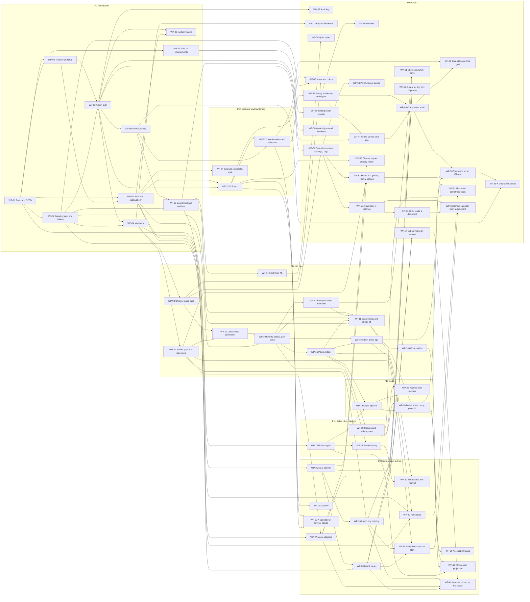

# 05 — Backlog

> Version 0.8 · Status: build baseline · Maintained by Claude Code
> v0.8.103: work as a planner and one worker per item (D-90): items start from the planner session; §2's prompt pattern becomes `/deliver WP-nn`; each item's PR records it as done.
> v0.8.102: WP-61 done (PR #66): chores on lunch days.
> v0.8.101: WP-62 (a meal for any mix of people), WP-63 (an alert when something waits for a parent) and WP-64 (the school menu by section) added at the owner's request, and WP-49 grows to picking a buy day's lunch choices (D-87 to D-89). The order is under the status board.
> v0.8.100: WP-61 chores on lunch days added at the owner's request, ahead of WP-58, and in review (D-86).
> v0.8.99: WP-60 merged (PR #65): previews and e2e on the test database.
> v0.8.98: WP-58 (the board on an iPhone, mockup approved) and WP-59 (a child's own phone, later) added at the owner's request; WP-60 testing made reliable, in review (D-85).
> v0.8.97: WP-57 done (PR #64): Home at a glance, and Family options in Settings.
> v0.8.96: WP-57 added at the owner's request and in review (PR #64): Home at a glance, and Family options in Settings (D-84).
> v0.8.94: WP-53 to WP-56 and SPIKE-06 added at the owner's request: polish with a layout sweep, short school days, the household's AI provider, the school calendar from a document.
> v0.8.93: WP-52 done (PR #61): the board's calendar as a time grid.
> v0.8.92: WP-52 added at the owner's request and in review: the board's calendar as a time grid (D-82).
> v0.8.91: WP-51 done (PR #60): one admin menu, with Settings.
> v0.8.90: WP-51 in review (PR #60): one admin menu, with Settings (D-81).
> v0.8.89: WP-49, WP-50 and WP-51 added at the owner's request; WP-29 waits until the owner says to start it.
> v0.8.88: WP-28 done (PR #58): meals on the board.
> v0.8.87: WP-28 in review (PR #58): meals on the board (D-80).
> v0.8.86: WP-27 done (PR #57): school menus from Nutrislice, a file or by hand.
> v0.8.85: WP-27 in review (PR #57): school menus from Nutrislice, a file or by hand (D-79).
> v0.8.84: WP-26 done (PR #56): school lunch, buy or bring.
> v0.8.83: WP-26 in review (PR #56): lunch, buy or bring (D-78).
> v0.8.82: WP-25 done (PR #55): the meal library and the weekly planner. WP-28 is ready.
> v0.8.81: WP-25 in review (PR #55): the meal library and the weekly planner (D-77).
> v0.8.80: WP-39 done (PR #53): goal payouts, payout reversal and the rule-change preview.
> v0.8.79: WP-39 in review (PR #53): goal payouts, payout reversal and the rule-change preview (D-75).
> v0.8.78: the jobs' queries stop after 60 seconds (D-76), done (PR #54). No work package changes status.
> v0.8.77: the jobs' queries stop after 60 seconds (D-76), in review (PR #54). No work package changes status.
> v0.8.76: WP-48 done (PR #52): the board's home screen on one screen, with a rail.
> v0.8.75: WP-48 in review: the home screen on one screen, with a rail, and the calendar's view chosen on the board (D-74).
> v0.8.73: WP-47 done (PR #50): the board fits its screen, and a text size per board.
> v0.8.72: WP-47 in review (PR #50): the board fits its screen, and a text size per board (D-73).
> v0.8.71: Help in the admin app (D-72) done (PR #49): the user guide at `/help` (version 0.5). No work package changes status.
> v0.8.70: Help in the admin app (D-72), in review (PR #49): the user guide at `/help`, from the menu, sign-in and setup. No work package changes status.
> v0.8.69: WP-46 done (PR #47): more icons, one icon picker and sixteen colors.
> v0.8.68: WP-46 in review (PR #47): more icons, one icon picker and sixteen colors (D-70).
> v0.8.67: fixes found while writing the user guide, done (PR #48); the user guide says what changed (version 0.3). No work package changes status.
> v0.8.66: fixes found while writing the user guide, in review (PR #48): a board's own layout kept on a second Save, Disconnect asks first, the idle return closes "Who did …?", the points form's help; the board waits 90 seconds before going home (D-71). No work package changes status.
> v0.8.65: docs (D-68), done (PR #46): the user guide and manual (`07`), and its check. No work package changes status.
> v0.8.64: docs (D-68), in review (PR #46): the user guide and manual (`07`), kept current with each user-facing change, and a check that it covers every built story. No work package changes status.
> v0.8.63: WP-45 done (PR #45): weather on the board.
> v0.8.62: WP-45 in review (PR #45): weather on the board (D-69).
> v0.8.61: WP-35 done (PR #44): the family dashboard and the home screen's layout. WP-45 is ready.
> v0.8.60: WP-35 in review (PR #44): the family dashboard and the home screen's layout (D-66, D-67). WP-45 (weather on the board, BRD-04) is split out of WP-35 and waits for it.
> v0.8.59: WP-23 done (PR #43): calendar views and per-board selection. WP-35 is ready.
> v0.8.58: WP-23 in review (PR #43): calendar views and per-board selection (D-65).
> v0.8.57: change (D-64), done (PR #42): the board's outbox sends nothing while the browser says it is offline. No work package changes status.
> v0.8.56: change (D-64), in review (PR #42): the board's outbox sends nothing while the browser says it is offline. No work package changes status.
> v0.8.55: WP-22 done (PR #41): ICS calendar sync. WP-23 and WP-29 are ready.
> v0.8.54: WP-22 in review (PR #41): ICS calendar sync (D-63).
> v0.8.53: e2e reliability done (PR #40): each spec retires its board; the bonus test checks the ledger first. No work package changes status.
> v0.8.52: fix (D-62), done (PR #39): production's jobs leave the demo family alone. No work package changes status.
> v0.8.51: fix (D-61), done (PR #38): a parent links their own sign-in from Reminders, My tasks or their page on Members. No work package changes status.
> v0.8.50: WP-20 done (PR #37): the board's shop, requests and goals. WP-31 is ready. WP-44 (offline goal projection, a fallback only, D-60) is added: ready, and nothing waits on it.
> v0.8.49: WP-20 in review (PR #37): the board's shop, requests and goals (D-59).
> v0.8.48: WP-40 done (PR #36): reminders by web push. Nothing waits on it; the owner runs the vapid-keys workflow once to switch sending on.
> v0.8.47: WP-40 in review (PR #36): reminders by web push (D-58).
> v0.8.46: WP-30 done (PR #35): bonus rules and the wishlist. Nothing waits on it.
> v0.8.45: WP-30 in review (PR #35): bonus rules and the wishlist (D-57).
> v0.8.44: WP-19 done (PR #34): goals and the progress pipeline. WP-20 and WP-39 are ready.
> v0.8.43: WP-19 in review (PR #34): goals and the progress pipeline (D-56).
> v0.8.42: WP-17 done (PR #33): streak history and insights. WP-30 is ready.
> v0.8.41: WP-17 in review (PR #33): streak history and insights (D-55).
> v0.8.40: WP-13 done (PR #32): the board works through an outage. The real 24-hour soak on the Pi stays with WP-24.
> v0.8.39: WP-13 in review (PR #32): the board works through an outage (D-54).
> v0.8.38: WP-18 done (PR #31): the rewards shop. WP-39 and WP-20 wait on WP-19 too.
> v0.8.37: WP-18 in review (PR #31): the rewards shop (D-53).
> v0.8.36: WP-12 done (PR #30): a parent's day and My tasks. WP-40 is ready.
> v0.8.35: WP-12 in review (PR #30): a parent's day and My tasks (D-52).
> v0.8.34: WP-15 done (PR #29): the rules engine. WP-17 and WP-19 are ready.
> v0.8.33: WP-15 in review (PR #29): the rules engine (D-51). WP-17 follows it.
> v0.8.32: WP-11 done (PR #28): the board's Today and check-off. The owner confirmed D-50: the board never shows why points were taken away. WP-12, WP-13 and WP-18 are ready; WP-12 and WP-18 were ready from WP-16's merge but not marked so.
> v0.8.31: WP-11 in review (PR #28): the board's Today and check-off (D-50).
> v0.8.30: WP-16 done (PR #27): the points ledger. WP-11 is ready.
> v0.8.29: WP-16 in review (PR #27): the points ledger (D-49). WP-11 waits only on it.
> v0.8.28: WP-43 done (PR #25). Y-10 lists four old failure reports: two more came from WP-43's first e2e runs, before its branch carried D-48's change.
> v0.8.27: the repository is public (D-48). Y-10: rotate the deployment-protection bypass secret, and delete two old failure reports and two setup-code runs. WP-24's backups will not be workflow artifacts.
> v0.8.26: WP-43 in review (PR #25): everyone does their own (D-47), ahead of WP-11, which now depends on it.
> v0.8.25: WP-10 done (PR #23), live in production: day close runs hourly and the status check nightly. WP-16 is ready.
> v0.8.24: WP-10 in review (PR #23): completion events, the status they drive, day close and the nightly drift check (D-46).
> v0.8.23: WP-09 done (PR #22), live in production.
> v0.8.22: WP-09 in review (PR #22): occurrences planned two weeks ahead by the database, and re-planned at once on edits without touching history (D-45).
> v0.8.21: WP-21 done (PR #21), live in production. WP-27 is ready.
> v0.8.20: WP-21 in review (PR #21): school years and day types (D-44). Regenerating occurrences when a closure changes moves to WP-09 with occurrences.
> v0.8.19: WP-08 done (PR #19), live in production. WP-21 is next.
> v0.8.18: WP-08 in review (PR #19): the family list, tags and private items (D-43).
> v0.8.17: WP-42 done (PR #17), so P0 is done: every P0 item is merged and its exit criteria pass (`04` §E). Ready now: WP-08, WP-21, WP-22, WP-24, WP-25, WP-32, WP-33.
> v0.8.16: WP-42 in review (PR #17): System Health, with errors kept per household and usage read daily (D-42).
> v0.8.15: SPIKE-02's ICS part done (`01` §5.4), so WP-22 is queued; its CalDAV part runs before WP-29. Y-6's calendar is a real one, so the spike reports counts only and its fixture is made up.
> v0.8.14: Y-6 done, so SPIKE-02 is ready (its iCloud part; the CalDAV part waits for WP-29). Y-8 is not needed before P3.
> v0.8.13: WP-06 done (PR #12), live in production. Y-9 done. The setup code shows on the setup-code run's summary page again (PR #13).
> v0.8.12: WP-05 done (PR #11). WP-06 in review (PR #12): the board keeps its own snapshot live (D-41). Your household can start in production before launch, so Y-9 is due now.
> v0.8.11: SPIKE-01 done and WP-05 in review (PR #11): boards pair in the database and heal themselves (D-40). WP-04 done (PR #10).
> v0.8.10: WP-03 done (PR #9). WP-04 in review (PR #10).
> v0.8.9: WP-07 done. WP-03 in review (PR #9): private by invitation (D-39); Y-5 is no longer a blocker; new Y-9 before launch.
> v0.8.8: WP-07 in review (PR #8): the job framework, error log and job-secret workflow; the System Health page moves to new WP-42, after WP-03 (admin sign-in), so it is built once, behind sign-in.
> v0.8.7: migrations run through `scripts/db-migrate.sh` (PR #7): PR #5's deploy stopped because PR #6's preview had applied a migration `main` did not have yet.
> v0.8.6: SPIKE-05 done: job limits, the invocation pattern and the Hobby budget are in `01` §5.6 (D-38); WP-07 takes the pattern and the job-secret workflow.
> v0.8.5: §0 lists only open owner actions; Y-1 to Y-4 move to a Done table. WP-41 done: PR #4's merge deployed on its own, and the gate's refusals are tested.
> v0.8.4: production is live and dark: the first deploy ran gate, migrate, app and smoke after the token was rescoped; keepalive wrote its first heartbeat. WP-41 closes when its own merge deploys automatically.
> v0.8.3: WP-37 done (PR #3); Y-4 done; WP-41 in progress: the first production deploy reached the app step, and the deploy token needs the project's team as its scope.
> v0.8.2: WP-37 in progress on `claude/wp-37-brand`.
> v0.8.1: Y-3 done (GitHub secrets and variables); SPIKE-01, SPIKE-05 and WP-41 wait only on Y-4.
> v0.8: one database (D-37): previews run as the demo family in the production project; Y-2 dropped (nothing to do); Y-3 and Y-4 shrink; WP-41 and SPIKE-01 wait only on Y-3 and Y-4.
> v0.7.2: branch protection is not enforced on a private repository on GitHub Free, so the deploy workflow enforces the gates (D-36). Y-1 is now the squash-only merge setting; Y-2..Y-4 give the exact steps; all GitHub secrets are repository secrets.
> v0.7.1: PR #1 merged; WP-01 and WP-02 done. WP-01's live-environment checks move to WP-41 (blocked on Y-2..Y-4); Y-1 is now branch protection.
> v0.7: WP-40 reminders (web push, switchable per person, device and item; D-35).
> v0.6: one family list (D-30..D-34): WP-08 becomes chores, tasks, tags and visibility (L); WP-09 generates one shared occurrence per due date and carries tasks over (L); WP-12 adds My tasks (L); WP-02/04 add the earns-rewards switch; WP-10, WP-11, WP-15, WP-16, WP-17, WP-19 and WP-37 take the new rules.
> v0.5.2: §0 Waiting on you lists the owner actions that unblock work; the five build artifacts are also published as interactive pages generated from these files (`pnpm docs:build`).
> v0.5: free plans (D-29): WP-01 uses a shared preview database and a keepalive; WP-24 backups are our own nightly encrypted dumps; preview-branch references replaced.
> v0.4: renamed from Work Breakdown; status board (§1); spikes are backlog items (§3); sequence changed so no finished work package needs rework (WP-37 before WP-03, WP-21 before WP-09, WP-16 before WP-11 and WP-12); WP-19 split, payouts and preview move to WP-39; WP-38 adds Sign in with Apple and passkeys; WP-01 carries the delivery pipeline (NFR-14); missing dependencies fixed.
> Companions: `01-technical-architecture.md` · `02-data-model.md` · `03-user-stories.md` · `04-requirements-traceability.md`
> Each work package (WP) is one branch and one pull request. Requirement links (`Reqs:`) and `Depends on:` lines are enforced by `check_traceability.py`; the Work packages column in `04` §B is generated from them.

---

## 0. Waiting on you

Only the owner can do these. Each row names what it unblocks; everything else on the board is Claude Code's, or waits on one of these. Secrets go straight into GitHub or Vercel settings, never into chat.

| Item | Action | Where | Unblocks |
|---|---|---|---|
| Y-7 | The Pi 5 and the 32" 4K touch panel, with the exact panel model (OQ-05b) | Hardware | SPIKE-03, then WP-14 and WP-34; launch checks L-05 and L-08 |
| Y-10 | The repository is public now (D-48), and three things from before are visible on it. (1) Rotate the deployment-protection bypass secret: Vercel → Settings → Deployment Protection → Protection Bypass for Automation, then put the new value in GitHub → Settings → Secrets → `VERCEL_AUTOMATION_BYPASS_SECRET`. The demo sign-ins' passwords follow it on the next e2e run. (2) Delete the four `playwright-report` artifacts (Actions → the failed e2e runs of Oct 9 whose reports were saved at 10:56, 15:03, 20:20 and 20:28 UTC), which hold the old value. (3) Delete the two `setup-code` runs of Oct 9 (10:54 and 11:03 UTC), whose pages show household codes; they expire 24 hours after issue | GitHub; Vercel | R-35 |
| Y-8 | Not before P3 (nothing earlier waits on it): choose the production domain after a trademark and domain check against "FamilyWize" (OQ-06b); join the Apple Developer Program when ready | Registrar; Apple | WP-38; custom SMTP for magic links beyond the Supabase team (`01` §9.10) |

**Done**

| Item | Outcome |
|---|---|
| Y-1 | Squash-only merges and automatic branch deletion are on. Branch protection is not available for a private repository on GitHub Free, so the deploy gate enforces the checks (D-36). |
| Y-2 | Dropped: previews use the one database as the demo family (D-37). |
| Y-3 | GitHub repository secrets and variables are in place, including `DEPLOY_ENABLED`; the deploy token is scoped to the project's team. |
| Y-4 | Vercel keys are in place: publishable key for Production and Preview, secret key and job signing secret for Production only. |
| Y-5 | Dropped as a blocker: the second admin joins by invite link and signs in with a password, so nobody needs to join the Supabase team. Adding them later is optional, for magic links before custom email (Y-8). |
| Y-6 | A real family calendar is published from iCloud, and its link is the repository secret `ICS_SPIKE_URL`. Because it is real, the `spike-02` workflow reports counts and checks only, and test fixtures are made up. |
| Y-9 | Supabase Auth points at production (Site URL `https://family-wise-topaz.vercel.app`, redirects `https://family-wise-topaz.vercel.app/**`), and "Allow new users to sign up" is off, so nobody can sign up through Supabase directly. Launch check L-12 confirms it end to end. |

---

## 1. Status board

Statuses: **Done** (merged to `main`) · **In progress** (branch open) · **Ready** (dependencies done) · **Queued** (waiting on dependencies) · **Blocked** (waiting on something outside the repo).

| Item | Title | Milestone | Size | Depends on | Status |
|---|---|---|---|---|---|
| SPIKE-01 | Device sessions + Realtime under RLS | P0 | S | WP-02 | Done (PR #11, `01` §5.1) |
| SPIKE-05 | `pg_cron`/`pg_net` → Vercel job limits | P0 | S | WP-01 | Done (PR #6) |
| SPIKE-02 | iCloud ICS fidelity; CalDAV with a secondary Apple ID | P1d | S | — | ICS part done (`01` §5.4); CalDAV part before WP-29 |
| SPIKE-04 | School menu platform and feed | P2 | S | — | Done: Nutrislice public JSON API (`01` §5.5) |
| SPIKE-03 | Pi 5 + 32" 4K panel: touch, kiosk flags, power, animation budget | P1a | S | — | Blocked: hardware being sourced (OQ-05b) |
| SPIKE-06 | Reading a document with AI on the free plan | P3 | S | WP-55 | Queued |
| WP-01 | Repo, CI/CD pipeline, environments | P0 | M | — | Done (PR #1) |
| WP-41 | Turn on previews, production deploys, and keepalive | P0 | S | WP-01 | Done (PR #4, #5) |
| WP-37 | Brand system and design tokens | P0 | M | WP-01 | Done (PR #3) |
| WP-02 | Tenancy schema and RLS | P0 | M | WP-01 | Done (PR #1) |
| WP-03 | Admin authentication and onboarding | P0 | M | WP-02, WP-37 | Done (PR #9) |
| WP-04 | Members UI | P0 | S | WP-03, WP-37 | Done (PR #10) |
| WP-05 | Device pairing and device auth | P0 | L | WP-03 | Done (PR #11) |
| WP-06 | Board shell, snapshot, and realtime | P0 | M | WP-05, WP-37 | Done (PR #12) |
| WP-07 | Job framework and observability | P0 | M | WP-01, WP-02 | Done (PR #8) |
| WP-42 | System Health page | P0 | S | WP-03, WP-07 | Done (PR #17) |
| WP-08 | Chores, tasks, tags, and visibility | P1a | L | WP-04 | Done (PR #19) |
| WP-21 | School year and day types | P1a | M | WP-04 | Done (PR #21) |
| WP-09 | Occurrence generator | P1a | L | WP-08, WP-21 | Done (PR #22) |
| WP-10 | Completion events, status projection, day-close | P1a | L | WP-09, WP-07 | Done (PR #23) |
| WP-43 | Everyone does their own | P1a | M | WP-10 | Done (PR #25) |
| WP-16 | Points ledger | P1a | M | WP-10 | Done (PR #27) |
| WP-11 | Board Today screen and check-off | P1a | L | WP-06, WP-10, WP-16, WP-37, WP-43 | Done (PR #28) |
| WP-12 | Admin chore operations and My tasks | P1a | L | WP-10, WP-16 | Done (PR #30) |
| WP-13 | Offline outbox and stale indicator | P1a | M | WP-11 | Done (PR #32) |
| WP-14 | Kiosk host and 4K display | P1a | M | WP-06 | Blocked: SPIKE-03 (hardware) |
| WP-15 | Rules engine package | P1b | L | WP-01 | Done (PR #29) |
| WP-17 | Streak history and insights | P1b | M | WP-10, WP-15 | Done (PR #33) |
| WP-18 | Reward catalog and redemptions | P1b | M | WP-16 | Done (PR #31) |
| WP-19 | Goals admin and progress pipeline | P1c | L | WP-15, WP-16 | Done (PR #34) |
| WP-39 | Goal payouts, payout reversal, and rule-change preview | P1c | M | WP-18, WP-19 | Done (PR #53) |
| WP-20 | Board points, shop, and goals UI | P1c | L | WP-11, WP-18, WP-19 | Done (PR #37) |
| WP-22 | ICS calendar sync | P1d | L | WP-07, WP-03 | Done (PR #41) |
| WP-23 | Calendar views and per-device selection | P1d | M | WP-22, WP-05 | Done (PR #43) |
| WP-24 | Backups, runbooks, and soak | P1d | S | WP-07 | Ready |
| WP-25 | Meal library and weekly planner | P2 | M | WP-04 | Done (PR #55) |
| WP-26 | Lunch buy or bring | P2 | S | WP-21, WP-25 | Done (PR #56) |
| WP-27 | School menu adapters and import | P2 | L | WP-21, WP-07 | Done (PR #57) |
| WP-28 | Board meals panel | P2 | S | WP-25, WP-06 | Done (PR #58) |
| WP-29 | CalDAV (secondary account) | P2 | M | WP-22 | Ready, on hold until the owner says to start (SPIKE-02's CalDAV part first) |
| WP-30 | Bonus rules and wishlist | P2 | M | WP-16, WP-17 | Done (PR #35) |
| WP-31 | Accessibility pass | P2 | S | WP-20 | Ready |
| WP-40 | Reminders (web push) | P2 | M | WP-07, WP-12, WP-37 | Done (PR #36) |
| WP-44 | Offline goal projection (board fallback) | P2 | M | WP-13, WP-15, WP-20 | Ready |
| WP-32 | Audit log viewer and coverage | P3 | S | WP-03 | Ready |
| WP-33 | Export and delete | P3 | M | WP-04 | Ready |
| WP-34 | Quiet hours and burn-in mitigation | P3 | S | WP-14 | Blocked: hardware |
| WP-35 | Family dashboard and board layout | P3 | L | WP-23 | Done (PR #44) |
| WP-45 | Weather on the board | P3 | S | WP-35 | Done (PR #45) |
| WP-46 | More icons, one icon picker, sixteen colors | P3 | M | WP-08, WP-22, WP-37 | Done (PR #47) |
| WP-47 | The board fits its screen; text size per board | P3 | M | WP-06, WP-35 | Done (PR #50) |
| WP-48 | The home screen on one screen, with a rail | P3 | M | WP-35, WP-47 | Done (PR #52) |
| WP-49 | Next week's lunches picked on the board, with the day's choices | P2 | L | WP-26, WP-27, WP-28, WP-64 | Queued (mockups first) |
| WP-50 | A calendar for one or more people | P2 | S | WP-22, WP-23 | Ready |
| WP-51 | One admin menu, with Settings and Tags | P3 | M | WP-03, WP-08 | Done (PR #60) |
| WP-52 | The board's calendar as a time grid | P3 | M | WP-23, WP-48 | Done (PR #61) |
| WP-53 | Polish pass, with a layout sweep in CI | P3 | M | WP-51 | Ready |
| WP-54 | Short school days: early dismissal and late start | P2 | M | WP-21, WP-26, WP-28 | Ready |
| WP-55 | The household's AI provider in Settings | P3 | M | WP-51 | Ready |
| WP-56 | The school calendar from a document | P3 | L | WP-54, WP-55, SPIKE-06 | Queued |
| WP-57 | Home at a glance; Family options in Settings | P3 | M | WP-51, WP-21, WP-27 | Done (PR #64) |
| WP-58 | The board on an iPhone, from the admin app | P3 | L | WP-48, WP-20, WP-57 | Ready (mockup approved) |
| WP-59 | A child's own phone, paired as their board | P3 | M | WP-58, WP-05 | Queued (when a child has a phone) |
| WP-60 | Testing made reliable: a test database | P3 | M | WP-41 | Merged (PR #65); a week's tally to record |
| WP-61 | Chores on lunch days | P2 | S | WP-26, WP-43 | Done (PR #66) |
| WP-62 | A meal for any mix of people | P2 | S | WP-25, WP-28 | Ready (next) |
| WP-63 | An alert when something waits for a parent | P2 | S | WP-40, WP-12, WP-18 | Ready |
| WP-64 | The school menu by section, as options | P2 | M | WP-27, WP-28 | Ready (mockups first) |
| WP-36 | Closure import and grocery-ready ingredients | P3 | M | WP-22, WP-25 | Queued |
| WP-38 | Sign in with Apple and passkeys | P3 | M | WP-03 | Blocked: production domain (OQ-06b) and Apple Developer account |

**Next, in order** (the owner's, 13 October): WP-62, WP-63, WP-58, WP-64 and WP-49 (mockups first for WP-64 and WP-49, together). WP-29 stays on hold.

---

## 2. How the work is chunked

- **By vertical slice, not by layer.** Each WP delivers something testable end to end (schema + API + UI + tests), except the foundation WPs.
- **Sizes:** S ≤ 2 days · M 3–5 days · L 1–2 weeks of focused builder time. No WP above L; split it instead.
- **Every WP ends with its tests:** pgTAP for schema, Vitest for pure logic, Playwright for flows. A WP is not done until its `Done when` list passes in CI and on its preview.
- **No rework by sequence.** A WP starts only when everything it renders or writes against exists: the brand system before any screen, real day types before the generator, the ledger before any screen that shows points.
- **Spikes first where they gate work.** SPIKE-01 gates WP-05 and WP-06, SPIKE-05 gates WP-07, SPIKE-02 gates WP-22, SPIKE-04 gates WP-27, SPIKE-03 gates WP-14 and WP-34.
- **Milestones** from `04` §E: P0, P1a … P1d, P2, P3. One launch after P3 (D-19).

### Starting an item

Ask the planner session (`/planner`): "Start WP-nn". It checks the item is ready and starts a worker session that runs `/deliver WP-nn` (D-90). The deliver skill (`.claude/skills/deliver/SKILL.md`) holds the definition of done. A worker reads the item's requirements in `04`, its entities in `02` and its components in `01`, prefixes commits and tests with requirement IDs, updates the affected docs and the status board in the same PR, doesn't widen scope, and lists anything it defers.

---

## 3. Dependency map

**Critical path to the kid loop:** WP-01 → 02 → 03 → 05 → 06 → 11, with 04 → 21/08 → 09 → 10 → 16 feeding 11, and WP-37 ahead of every screen.

**Parallel lanes** (different areas of the repo, low merge risk): WP-37 with WP-02; WP-07 with WP-04/05; WP-15 any time after WP-01; WP-21 with WP-08; WP-22 with WP-18/19; WP-24 any time after WP-07.

---

## 4. Spikes

### SPIKE-01 — Device sessions and Realtime under RLS
**Milestone:** P0 · **Size:** S · **Gates:** WP-05, WP-06 · **Reqs:** DEV-01, DEV-02, DEV-05
- Create a device auth user server-side, issue a session, refresh it unattended, revoke it; confirm Realtime `postgres_changes` honours `device_household_id()` and stops on revocation.
- **Done when:** findings and the chosen session mechanism are recorded in `01` §5.1.

### SPIKE-05 — Job calls within Vercel limits
**Milestone:** P0 · **Size:** S · **Gates:** WP-07 · **Reqs:** NFR-07, CAL-02, CHR-03
- `pg_cron` + `pg_net` call a signed Vercel endpoint; measure duration limits on the chosen Vercel plan for one-source-per-invocation sync.
- **Done when:** limits and the invocation pattern are recorded in `01` §5.6.
- **Outcome:** measured from the production database through pg_net (`scripts/spike-05.sh`): Hobby stops a call at 300 s; pg_net holds queued calls until its slowest call ends; a cold start costs about 0.4 s of CPU, a warm call a few ms; concurrent calls each get an instance; cron reports `succeeded` whatever the endpoint answers. Pattern: answer at once and work after the response, one minute per schedule, health from `job_run`, job secret from a workflow (D-38). Jobs fit in under 10 % of each Hobby allowance.

### SPIKE-02 — iCloud ICS and CalDAV fidelity
**Milestone:** P1d · **Size:** S · **Gates:** WP-22, WP-29 · **Reqs:** CAL-01, CAL-07, CAL-08
- Run a real published iCloud calendar through `ical.js` (recurrence across DST, all-day, cancelled and moved instances); test CalDAV with a secondary read-only Apple ID.
- ICS part done: the `spike-02` workflow reads the calendar from Y-6 (`ICS_SPIKE_URL`) and reports counts and checks only; findings are in `01` §5.4. `lib/calendar/ics.ts` (expand and scrub) is WP-22's starting point, tested on a synthetic calendar and on `icloud-shape.ics` (iCloud's shape, made-up events). The CalDAV part runs before WP-29, when a secondary Apple ID becomes an owner item.
- **Done when:** fixtures captured in the repo and findings recorded in `01` §5.4.

### SPIKE-04 — School menu platform
**Milestone:** P2 · **Size:** S · **Gates:** WP-27 · **Reqs:** MENU-02
- Identify the school's menu platform and whether it has a stable machine-readable feed.
- **Done when:** the adapter choice is recorded in `01` §5.5.

### SPIKE-03 — Pi 5 and 4K panel
**Milestone:** P1a · **Size:** S · **Gates:** WP-14, WP-34 · **Reqs:** DEV-04, DEV-07, NFR-02, NFR-03
- Touch latency and calibration, Chromium kiosk flags, screen power control, and animation frame rate at 1920×1080 logical / DPR 2 versus a 1080p fallback.
- **Done when:** the frame budget and kiosk configuration are recorded in `01` §8.

---

## 5. Work packages

### SPIKE-06 — Reading a document with AI on the free plan
**Milestone:** P3 · **Size:** S · **Gates:** WP-56 · **Reqs:** SCH-06
- Vercel Hobby takes a request body of about 4.5 MB and stops a function at its time limit (`01` §5.6). Measure, with made-up school calendars of 1, 5 and 20 pages, a photo and a Word file: whether each fits through a server action, or must go to Supabase Storage first; how long Anthropic's and OpenAI's models take to read each at low and high effort; and whether the read must run as a background job that the page waits on.
- Which types each provider reads directly (PDF, images) and which need converting first (Word); the cost of a read at each effort.
- **Done when:** the upload path, the time and the cost per document are recorded in `01`, and WP-56's design follows them.
### Phase P0 — Foundation

### WP-01 — Repo, CI/CD pipeline, and environments
**Phase:** P0 · **Size:** M · **Depends on:** — · **Reqs:** NFR-12, NFR-08, NFR-14
- pnpm monorepo (`apps/web`, `packages/rules-engine`, `packages/ui`, `packages/adapters`, `supabase`, `e2e`, `scripts`, `docs`, `brand`), TypeScript strict, ESLint, Prettier.
- CI without Docker (`01` §9.3–9.4): checks (lint, format, typecheck, Vitest, migration lint, traceability), database (native Postgres + compatibility bootstrap + pgTAP), build.
- Preview pipeline: Vercel previews per PR on the one database as the demo family (D-37); each serialized e2e run applies the PR's additive migrations and resets the demo family (`scripts/preview-db.sh`); e2e against the preview.
- Production pipeline: gate (head of `main`, from a merged PR, every CI check and e2e green; D-36) → migrate (`supabase db push`) → app (`vercel deploy --prod`) → smoke; Vercel auto production deploy off.
- Free-plan operations (`01` §9.10): keepalive heartbeat; migrations over the session pooler.
- Secrets inventory and cost ceiling written in `01` §9.8–9.9; PR template with the docs checklist.
- **Done when:** a PR runs all CI gates green without Docker, and the e2e, deploy and keepalive workflows exist and stop at a clear configuration check until their secrets exist. Running them live is WP-41.

### WP-41 — Turn on previews, production deploys, and keepalive
**Phase:** P0 · **Size:** S · **Depends on:** WP-01 · **Reqs:** NFR-14, NFR-08
- Starts once the owner has done Y-3 (GitHub secrets and variables) and Y-4 (Vercel environment variables).
- First live runs of the WP-01 workflows: apply the migrations, seed the demo family and run e2e on a preview; set `DEPLOY_ENABLED` and run migrate, then app, then smoke against production; keepalive writing to the project. The gate needs e2e green on the merged pull request, so the first production deploy comes from a pull request opened after Y-3 and Y-4.
- **Done when:** e2e passes on a preview as the demo family; a merge runs gate, then migrate, then app, then smoke against production; the gate refuses a commit that did not come through a merged pull request with every check green; keepalive writes to the project.
- **Outcome:** e2e passed on the previews of PRs #2 to #4; PR #4's merge ran gate, migrate, app and smoke on its own; keepalive wrote its heartbeat; the gate is `scripts/deploy-gate.sh`, and `ci / checks` tests every refusal (missing configuration, a token that cannot open the project, a manual run off `main`, a failed or missing check, no merged pull request, e2e not green on the preview).

### WP-37 — Brand system and design tokens
**Phase:** P0 · **Size:** M · **Depends on:** WP-01 · **Reqs:** NFR-13
- `packages/ui`: import `brand/familywise-tokens.css` and `fonts.css`; typed `Icon` (from `icons/index.json`), `Avatar`, `ChoreTile` (all seven statuses, plus the display states Overdue, Past its time, Covered by another member, Done by, and a private badge for admin views), `PointsChip`, `GoalMeter`, `Banner`, `Button`; Day and Evening theme switching (board by household-local time with manual override; admin by `prefers-color-scheme`).
- App identity: favicon, touch icon, PWA icons, and **two manifests**: board (`/board`, fullscreen, landscape) and admin (`/admin`, standalone, any orientation); head tags; board boot splash; FamilyWise page titles; service-worker precache of fonts.
- Token fixes: Evening `--success` override (Leaf 600 on the Evening surface is 2.89:1) and an OS dark-mode hook for admin.
- Guards: lint or test that fails on raw hex outside the tokens file; Playwright snapshots of tile states in both themes (computed styles: icon, word, colors and borders, so they match on every machine); axe contrast check on shells; unit test that every `OccurrenceStatus` has a tile mapping; a contrast test over every role pair the components use in both themes.
- **Done when:** a `/dev/brand` page renders the specimen from real components, and the contrast and snapshot checks run in CI.

### WP-02 — Tenancy schema and RLS
**Phase:** P0 · **Size:** M · **Depends on:** WP-01 · **Reqs:** ACC-01, NFR-04, NFR-09, NFR-12, PTS-07
- Tables from `02` §3.1 (`household`, `household_user`, `member`, `invite`, `device`, `device_pairing`, `household_settings`, `job_run`) with `household_id` everywhere, RLS enabled, and the helpers in `02` §4.5.
- Migration lint that fails CI if a `public` table lacks RLS or `household_id` (a pgTAP test over the catalog after all migrations, `supabase/tests/001_schema_lint.test.sql`).
- `member.earns_rewards`, set from the role on insert (on for a child, off for an adult) and changeable per person (D-32).
- pgTAP: cross-tenant read and write denied for admin and device; revoked device denied immediately; earns-rewards defaults.
- **Done when:** the isolation suite is green and the lint blocks a deliberately broken migration.

### WP-03 — Admin authentication and onboarding
**Phase:** P0 · **Size:** M · **Depends on:** WP-02, WP-37 · **Reqs:** ACC-01, ACC-02, ACC-03, ACC-05, NFR-04
- Supabase Auth with email + password and magic links for existing accounts, and reset by link; `@supabase/ssr` sessions, refreshed by `proxy.ts` and verified on the server on every page and action (`01` §5.10).
- No public sign-up (D-39). Setup: a one-time code from the setup-code workflow creates the household (name, timezone, week start) and its owner. Invites: a link the inviter copies or shares, token hashed and carried after `#`, one use, 7 days, the invited email only. The server creates accounts, confirmed, for a valid code or invite (production only).
- On previews only, one-tap sign-in as four demo parents (Alex, Sam, Jordan, Riley), with passwords derived from the bypass secret, so previews still hold no key that bypasses RLS (D-37).
- Audit from day one: `audit_log` written by triggers on every household table (replacing the planned `withAudit` wrapper, which a route could forget); the viewer stays in WP-32.
- **Done when:** on a preview, two demo admins sign in by password and see the same household; Alex invites Jordan, Jordan joins, and the reused link and an expired one are refused; Riley creates a household with a setup code; invite, join and household writes produce audit rows (E2E, pgTAP). The magic link and production account creation are unit-tested and checked in production at launch (L-12).

### WP-04 — Members UI
**Phase:** P0 · **Size:** S · **Depends on:** WP-03, WP-37 · **Reqs:** ACC-04, PTS-07
- CRUD for child and adult members (name, avatar, color), archive instead of delete, multiple children supported by the schema.
- Earns-rewards switch on each member (D-32), defaulting from the role.
- An adult member links to an admin's sign-in, and only to an admin of the same household (database trigger), since later work reads "who am I" from it.
- Later fix (D-61): a parent links their own sign-in in one tap from Reminders, My tasks ("Which one is you?") or their page on Members ("This is me"), through `link_my_member()`, which moves it off an archived record; a Child record says only an adult can have a sign-in.
- **Done when:** the single child profile exists, an adult profile can be linked to an admin, and the switch defaults correctly and can be changed.

### WP-05 — Device pairing and device auth
**Phase:** P0 · **Size:** L · **Depends on:** WP-03 · **Reqs:** DEV-01, DEV-02, DEV-03, NFR-04
- SPIKE-01 first.
- Pairing code issue and redeem (8 digits on the board's keypad, single-use, 10-minute TTL, hashed, wrong codes throttled), creating the board's Supabase Auth user in the database with `app_metadata` (`role=device`, `household_id`, `device_id`), so previews pair as production does (D-40).
- The board keeps its credential and signs itself in again when its session lapses.
- Device list, rename, revoke, last seen. Revocation takes effect through `device.status` in the RLS helper.
- Device write scope limited to `/api/completions` and `/api/redemptions` (routes added later); reads through RLS. A board session that calls an admin route or action gets 403 (US-102); admin pages already treat it as signed out (WP-03).
- **Done when:** a second browser pairs with a code, reads board data, and loses access within seconds of revocation (E2E).

### WP-06 — Board shell, snapshot, and realtime
**Phase:** P0 · **Size:** M · **Depends on:** WP-05, WP-37 · **Reqs:** DEV-05
- `/board` route, PWA scaffolding, `board_snapshot` function (shape from `02` §4.6, initially members only), Realtime subscription with notify-then-refetch.
- Measure admin-change-to-board latency in an E2E budget test (p95 under 3 s).
- As built (D-41): the server draws the first snapshot; the board then reads it itself on every Realtime notice (coalesced), on every (re)connect and when the network returns, and goes back to the server when it is signed out or disconnected. The shell shows the household, date and clock in household time, the connection, and the family. The theme follows household time or an admin's hold (Boards). Kiosk viewport (no pinch zoom, bounce or selection), and an error screen that retries every 30 s.
- PWA scaffolding here is the kiosk manifest, the viewport and the font-precaching service worker (WP-37); the offline app shell and the cached snapshot are WP-13.
- **Done when:** renaming a member in the admin portal shows on the paired board within the budget.

### WP-07 — Job framework and observability
**Phase:** P0 · **Size:** M · **Depends on:** WP-01, WP-02 · **Reqs:** NFR-07
- SPIKE-05 first.
- Schedules as code (`apps/web/lib/jobs/schedule.json`), synced to pg_cron and `private.job_schedule` by the deploy; a test refuses two HTTP jobs in the same minute.
- `private.call_job`: the pg_cron command for an HTTP job; reads the job secret and the app's address from Vault; off until both exist.
- `POST /api/jobs/[job]` in the SPIKE-05 pattern (`01` §5.6): `jobAuthError`, one `job_run` row per household, answer 202 at once and work after the response, catch-up from the last success, a 60 s budget per call; idempotent jobs.
- `public.job_health(household)`: each job's state from `job_run` (`ok`, `running`, `stale`, `failing`, `never`), for System Health (WP-42).
- Later fix (D-62): jobs leave the demo family alone (`household.is_demo`), so none lands in the middle of an e2e step.
- Sample hourly job `heartbeat`; `purge_history` (SQL) keeps cron history 7 days, `job_run` 90, errors 30.
- Job secret workflow: generates the secret, writes it to Vercel production, redeploys, checks production accepts it, writes Vault, then runs a heartbeat through pg_cron's path; rotation is the same workflow. Nobody sees or pastes it (D-38). Job-run workflow: runs a job now, optionally failing on purpose.
- Structured JSON logs without PII; server errors and failed jobs kept in `private.app_error` (Next.js `onRequestError`), past Hobby's one hour of logs.
- The System Health page itself needs admin sign-in, so it is WP-42, after WP-03.
- **Done when:** the hourly `heartbeat` runs in production (dark until launch) on its own schedule; a forced failure (job-run workflow) shows as `failing` in `job_health`; replaying the job is harmless and returns it to `ok`.

### WP-42 — System Health page
**Phase:** P0 · **Size:** S · **Depends on:** WP-03, WP-07 · **Reqs:** NFR-07, NFR-08
- `/admin/health` for signed-in admins: each job's state, last success and message from `job_health()`; recent server errors from `private.app_error` (time, route, message; through an admin-checked database function, never to the browser directly).
- Usage against the Free-plan limits (`01` §9.9, US-909): database size, and Vercel invocations, Active CPU and provisioned memory where the API reports them; a warning when one nears its limit.
- **Done when:** a signed-in admin sees a forced failure (job-run workflow) on the page with its message, sees it clear after a good run, and sees a seeded server error; another household's admin sees none of it (E2E and pgTAP).
- As built (D-42):
  - Errors are kept with their household, and `household_errors()` and `system_usage()` check the caller is an admin, so previews show the page without the secret key.
  - The `usage` workflow reads the Vercel account's last 30 days daily (deploy token), and the page shows the account total and FamilyWise's share.
  - Supabase usage beyond the database size needs the management API, so it is not shown.

### Phase P1a — Kid loop

### WP-08 — Chores, tasks, tags, and visibility
**Phase:** P1a · **Size:** L · **Depends on:** WP-04 · **Reqs:** CHR-01, CHR-09, CHR-10, CHR-11, CHR-13
- `chore` (`kind` chore = routine or task = to-do, optional `due_time`, `visibility`, `created_by`), `chore_assignee` (any member, several per item), `tag` and `chore_tag` (`02` §3.2); admin UI for the combined family list with filters by person, tag, due, status and kind.
- Household tag editor (name, color token, icon; rename and archive keep goals working, D-33).
- Private visibility enforced by RLS on the item and everything derived from it, including audit rows (`private.can_see_chore`, `02` §4.5, D-34).
- Zod validation of `schedule jsonb`.
- **Done when:** a parent can create the seed list (six chores plus adult tasks) on a phone in under five minutes; pgTAP proves a private item is invisible to the board and to the other admin, and visible to an assignee who signs in.
- As built (D-43):
  - `/admin/chores` lists every item the admin can see, filtered by person, tag, kind, time of day (Morning, After school, Evening, Anytime) and active or archived. Filters by an occurrence's status and due date come with occurrences (WP-09, WP-12).
  - The form is built for a phone: the common fields first, approval and day types under "More options", and "Save and add another". e2e times six chores and two adult tasks on a 390 px screen and reports it on the run's summary page.
  - `/admin/tags` adds, renames, recolors and archives tags. Tags use the six categorical colors and always show their name.
  - `save_chore()` saves an item with its assignees and tags in one transaction; only an item's creator changes who sees it.
  - The demo family has six routines, three tasks and four tags; Sam's anniversary gift is private, so Alex and the board never see it.
  - The migration runner's additive check now ignores function bodies (they run when called), so a function that deletes rows ships to previews; a `DO` block that deletes still waits for the deploy.

### WP-21 — School year and day types
**Phase:** P1a · **Size:** M · **Depends on:** WP-04 · **Reqs:** SCH-01, SCH-02, SCH-03
- `school_year`, `school_term`, `school_closure`, `member_school_profile`, `resolve_day_type` (`02` §4.4), admin UI.
- Closure and school-year edits trigger regeneration for dates after today only (D-24).
- Members without a school profile (adults) follow the household's default school year (`02` §3.5).
- **Done when:** pgTAP covers weekend, break, no_school, school_day, summer precedence; a break week produces no school-only chores; a closure added for today leaves today alone.
- As built (D-44):
  - `/admin/school` shows today's day type for each member and the school years; each year's page has a timeline of its days, its breaks and days off, its terms, and who follows it instead of the default.
  - A member follows their own school year for a date, else the default for that date. Several years may be defaults if their dates don't overlap, so next year's calendar starts on its first day.
  - `chore_day_type_matches()` gives the generator the day-type test; pgTAP shows a school-days-only item applies on no day of a break week.
  - Regenerating future occurrences when a year, closure or profile changes, and leaving today alone (D-24), need occurrences, so they are built and tested in WP-09.
  - The demo family has this school year and next, with terms and five days off; dates follow today, so the demo never goes stale.

### WP-09 — Occurrence generator
**Phase:** P1a · **Size:** L · **Depends on:** WP-08, WP-21 · **Reqs:** CHR-02, CHR-03, CHR-09, CHR-11, CHR-12, SCH-03
- `chore_occurrence` (with `status` default `scheduled`) and `chore_occurrence_assignee`: one occurrence per item per due date with a snapshot of its assignees, `kind`, `due_time`, points and approval flag; rolling-window generation using the real `resolve_day_type` (per assignee's school profile, generated if any assignee's day type matches); regeneration of only future `scheduled` occurrences on edit.
- Tasks carry over: open past-due tasks stay `scheduled` and are listed as overdue; a repeating task keeps generating while earlier ones are open (D-31).
- `v_member_occurrence`: one row per occurrence and member with the per-member status (`covered` when someone else did it).
- Regenerates `scheduled` occurrences after today when a school year, closure or school profile changes, leaving today and the past alone (D-24; moved from WP-21, which built the day types).
- **Done when:** property tests show generation is idempotent and edits never touch past occurrences or their assignee snapshots; DST fixtures pass; a shared item yields one occurrence per day; a closure added for today leaves today alone, and one added for next week removes that week's school-only occurrences.
- As built (D-45):
  - The database plans each item for today and the next 14 days. The hourly `occurrence_gen` job (minute 23) fills tomorrow to 14 days ahead; triggers re-plan at once when an item, its assignees, a member, a school year, a closure or a school profile changes. Items saved before this shipped were planned once by the migration.
  - Only occurrences nothing has happened to change, and never a past one. An item's own edit (or a member archived or restored) reaches today's occurrence in place, keeping its id for the board's check-offs: an item archived in the morning leaves today, so it is never marked missed, and someone added at 7 am has it today. A school-year change starts tomorrow (D-24).
  - Each assignee's day type is kept in the snapshot, since a child at another school can have a different one that day. A monthly day past the end of a shorter month falls on its last day. A one-off task entered after its date is open on that date and shows as overdue.
  - `/admin/chores` shows when each item is next due ("Today", "Tomorrow" or the date) and "Overdue since …" for an open task; an item's page lists the next two weeks under "Coming up", with who it is for. Filtering the list by due date and status comes with WP-12.
  - pgTAP `110_occurrences` (41 tests) includes a property test over 40 random edits: the past never changes, today's untouched occurrences always match their items and keep their ids, and generating again adds nothing. Removing the today rule makes six of them fail.
  - Vercel's "skip unaffected projects" setting is off, so a commit that changes only docs or e2e still gets a preview and its e2e run, which the deploy gate needs (`01` §9.5).

### WP-10 — Completion events, status projection, and day-close
**Phase:** P1a · **Size:** L · **Depends on:** WP-09, WP-07 · **Reqs:** CHR-04, CHR-07, CHR-09, CHR-12, NFR-06
- `chore_completion_event` (append-only, client-generated ids, `batch_id`), `normalize_completion_event` (clamp, flag for routines only, server-derived household and credit date, `done_by` validated and `rewarded` computed from the earns-rewards switch), `fold_occurrence_status` by event time, `apply_completion_event`, `close_past_due` (routines only: `scheduled` and `rejected` → `missed`; tasks carry over), and report-only `rebuild_occurrence_status` (`02` §4.1–4.2).
- `POST /api/completions` accepting batches, idempotent on `id`, with `done_by` (defaults to the profile on screen).
- `day_close` job (hourly, idempotent, catch-up) writing `missed` and `finalized_at`; nightly drift report.
- A queued check-off can arrive for an occurrence that a parent's edit removed today (the item was archived, or nobody is left assigned): the API answers that one as gone, without failing the rest of its batch (D-45).
- **Done when:** pgTAP proves immutability, replay idempotency, event-time ordering (a late-arriving earlier event never overrides a later one), the clamp, the flag rule, and that rebuild equals the stored projection after random event sequences; a closed day has no `scheduled` or `rejected` routines while open tasks survive it; a shared item credits only `done_by`.
- As built (D-46):
  - `chore_completion_event` is append-only; who recorded each event comes from the session (the board, an admin of the household, or the database itself), never the request. A board may only check off and undo, and undo only within the household's undo window, judged by event time.
  - `POST /api/completions` records a batch (up to 100) as the caller through `record_completions()`, answering each event on its own: recorded, duplicate (a replay), gone (D-45), refused (with the reason) or invalid, with the occurrence's state for the board to rebase on.
  - The fold, day close and rebuild follow `02` §4.2. `day_close` runs hourly at minute 4 and catches up; `status_check` runs nightly and fails on any drift (System Health shows it). Daily summaries and streaks join day close in WP-17; points in WP-16.
  - An item's page shows its last seven days (who did it, missed, skipped, needs review) and today's check-off under "Coming up". The demo family has a seeded week of history.
  - pgTAP `120_completion_events` (49 tests) includes a property test over 200 random events, checking each stored status against an independent fold; breaking the event-time rule fails it.
  - The migration runner's additive check now ignores grants and revokes, which read as a `truncate` before and would have held back this migration on the preview.

### WP-43 — Everyone does their own
**Phase:** P1a · **Size:** M · **Depends on:** WP-10 · **Reqs:** CHR-18, CHR-09
- `chore.assignment` (`each` or `shared`) and `chore_occurrence.member_id`: an item for several people is either one occurrence per person per day, each with its own status, credit and miss, or one shared occurrence (D-30, D-47).
- The generator and re-planning per mode: each person's own day type decides their day; switching mode follows D-45.
- The item form asks "With several people" once two or more are chosen: "Everyone does their own" (the default for a chore) or "Any one of them" (the default for a task). The list and the item page show each person's own.
- **Done when:** pgTAP shows one occurrence per person per day with that person's day type, each person's own check-off and miss, mode switches that never touch the past or anything acted on and never count a day twice, and the defaults; the random-edit property switches modes; e2e enters a chore for two people and switches it.
- As built (D-47):
  - Items saved before WP-43 stay shared until someone changes them. In the demo family, Make bed and Brush teeth are each child's own, and the seeded week shows each child's own done and missed days.
  - An item's page groups its days: "Coming up" says when each person has their own, and "Last 7 days" has a line per person ("Maya: done", "Leo: missed", "Leo: done by Maya").
  - pgTAP `130_each_person` (19 tests). Breaking the guard against counting a day twice, or ignoring the mode when re-planning today, fails it.
  - The board's Today screen (WP-11) shows each person their own tiles.

### WP-16 — Points ledger
**Phase:** P1a · **Size:** M · **Depends on:** WP-10 · **Reqs:** PTS-01, PTS-02, PTS-07
- `points_ledger`, `post_points` trigger (one earn or reversal per rewarded member of the folded event), `private.post_ledger`, `public.adjust_points` with reason and request id, `v_points_balance`, snapshot inclusion of balance and recent activity.
- **Done when:** random complete/undo/approve sequences always leave each member's balance equal to the points of the done occurrences that rewarded them plus adjustments; a member with earns rewards off never receives an earn (pgTAP/property test); no application role can insert into `points_ledger` directly.
- As built (D-49):
  - Earn and reversal reconcile rather than diff: each status change posts the difference between what the occurrence owes each member and what the ledger holds, so day close and a parent's rebuild keep the ledger right too. Check-offs from before the ledger earned their points when it arrived.
  - A parent adds or takes away points with a reason on the member's page, which shows the balance and history; Members shows each earner's balance. Not for a member who doesn't earn rewards or is archived.
  - The board's snapshot carries each rewarded member's balance and five latest entries (a private item's without its title), and the ledger is in Realtime. The board draws them in WP-11.
  - The nightly status check also fails when a member's points for an occurrence differ from what it owes them.
  - pgTAP `140_points_ledger` (73 tests), including a property test over 300 random steps (events, switches of earns rewards, adjustments, day close). Seven deliberate breaks of the ledger each fail it.

### WP-11 — Board Today screen and check-off
**Phase:** P1a · **Size:** L · **Depends on:** WP-06, WP-10, WP-16, WP-37, WP-43 · **Reqs:** BRD-01, BRD-02, BRD-03, BRD-07, CHR-04, CHR-11, CHR-12, NFR-03, PTS-02, RWD-08
- Today screen per member (today's items plus open overdue tasks, D-21); an item where everyone does their own shows each person their own tile (D-47) grouped by part of day from due times, and a Family view with a column per person; who-did-it picker for shared items (assignees first, anyone selectable, several allowed); points chip with live balance for members who earn rewards, tap to check off with optimistic UI (feedback under 100 ms), chore-done celebration (check pop, tint, points count-up; reduced motion honoured), time-boxed undo, member selector; private items never reach the board.
- Layout reserves the slots that later WPs fill (events, meals, goal meter, streak flame), so adding them is additive.
- Debounce and confirm for destructive actions; icon-first layout on the 1920×1080 logical grid with 56 px minimum targets.
- Every action works by touch, mouse click and keyboard alike; no gesture is the only way (`06` § Touch). The Playwright flow checks off once by click and once by touch.
- **Done when:** the Playwright check-off flow passes, including a rapid double tap resulting in one effective completion and the balance updating once.
- As built (D-50):
  - The board opens on everyone's day: a column per person with their balance, grouped Overdue, Morning, After school, Evening and Anytime. Tapping a person shows their own day with "2 of 4 done", their balance and their five latest points entries; it goes back to everyone after 90 seconds untouched. Beside a person's list sit the slots for the goal meter (WP-20), the streak flame (WP-17), today's events (WP-23) and meals (WP-28).
  - The whole tile is the button while an item is open: touch, click, Enter and Space alike. A tap shows Done! (or Waiting for a parent) at once and sends the check-off through the board's outbox with an id made on the board; a second tap on the same tile within half a second is ignored, and a resend counts once. WP-13 keeps the outbox across a reload and offline.
  - On a person's own screen a tap credits them. In everyone's view it credits the column's person for their own item or an item with one person; a shared item with several opens "Who did it?" (its people first, then anyone, several allowed, the column's person picked).
  - Undo is its own button under a done tile while the household's undo window lasts, and needs a second tap within 4 seconds. If the database answers that the item changed, the window passed, or the board may not do that, the board takes its guess back and says so kindly.
  - A child's check-off that earns points pops the check and counts the balance up; with reduced motion the balance changes at once. An adult's check-off doesn't celebrate. No sound yet (US-404 makes it optional).
  - The snapshot carries today's items and open overdue tasks with what a tile needs, and the household's undo window; `chore_occurrence` and `chore` are in Realtime, so a check-off or an edit anywhere reaches the board. The board reads again at the household's midnight.
  - Points a parent took away read "A parent changed your points" on the board; the reason stays in the admin app.
  - `/dev/board` draws Today from a made-up family with a stand-in for the API, for the UI suite: click, touch, keyboard, double tap, undo, the picker, celebration, reduced motion, and 56 px targets, 28 px text, no overflow and AA contrast in both themes and both views. `board.spec.ts` runs the flow on the preview against the database.
  - pgTAP `150_board_today` (13 tests): what the board sees and in what order, private, archived, done and past items left out, `checked_at`, the undo window, another household's board, and the publication.

### WP-12 — Admin chore operations and My tasks
**Phase:** P1a · **Size:** L · **Depends on:** WP-10, WP-16 · **Reqs:** CHR-05, CHR-06, CHR-08, CHR-14
- Admin day view: complete, uncomplete, skip any occurrence; late credit for past days (`admin_complete`); approval queue (approve, reject, flagged items); household approval on/off switch and per-chore override that re-resolve `scheduled` occurrences only (D-22).
- Multi-select "Not actually done" producing one `batch_id`; undo of a batch.
- My tasks on the phone: overdue, today and upcoming items assigned to me (shared ones included), quick add (family-visible task due today, assigned to me), complete with `done_by` = me.
- **Done when:** a parent unchecks four of five items in one action, the child sees them open again on the board, and exactly four reversals post to the ledger; quick add creates a task in one step and it appears on the board.
- As built (D-52):
  - **Today** (`/admin/today`). Check-offs waiting for a parent come first, from any day, with when they were checked off and a mark on one made after its day. Then the day's items by part of day, with today's overdue tasks. "Day before" and "Day after" go to any day, for late credit or skipping ahead.
  - **Per item:** Mark done (its person or one assignee; a shared item with several asks who), Skip, Uncheck, Put back, Approve, Send back, as its state allows. A routine can't be done before its day.
  - **"Not actually done"** unchecks the ticked done items as one batch. Undo, in the notice that follows, puts back what is unchanged since (`undo_uncheck_batch()`).
  - **The approval switch** is on Home. It and an item's own setting now re-resolve every `scheduled` occurrence, including one a parent has unchecked, as D-22 says (WP-09 left those with the old setting; the preview e2e found it).
  - **My tasks** (`/admin/my`). The linked member's overdue tasks, today's items and the next seven days. Mark done credits only them. Quick add makes a family task for today with no points; the button is off while it saves, so a double tap adds one.
  - **Every action** is a completion event recorded as the parent, with ids from the form, so a form sent twice records once.
  - **`/dev/admin`** draws both pages from a made-up family for the UI suite.
  - **pgTAP** `160_admin_operations` (30 tests).

### WP-13 — Offline outbox and stale indicator
**Phase:** P1a · **Size:** M · **Depends on:** WP-11 · **Reqs:** DEV-06, DEV-08, NFR-01
- Service worker (Serwist), IndexedDB snapshot and outbox (Dexie), ordered replay with idempotent ids and `occurred_at`, projected points marked as provisional.
- Stale-data indicator driven by snapshot age and `job_run`.
- **Done when:** an E2E test goes offline, checks off three chores, reconnects, and finds exactly three events; a parent action made during the outage wins over an earlier offline tap; a 24-hour offline soak passes on cached data.
- As built (D-54):
  - **IndexedDB** (`lib/board-store.ts`, Dexie): the outbox in the order events were made, the last snapshot, and the check-offs the board shows ahead of it, for the paired board only. After a reload the board shows what it did at once and sends what waited first, oldest first, with the same ids; it sends at once when the network returns.
  - **Service worker** (`packages/ui/scripts/sw.template.js`, the project's own, not Serwist): fonts precached; the build's hashed files kept as they load (cache first, the newest 400); the board's page kept, and used only when there is no network. A board that reloads offline opens on its last day.
  - **Health lines** in the board's bar (06 §7.2): "Offline: your check-offs are saved" (wifi-off, plum) while it has no network or cannot send; "Updated 12 minutes ago" (hourglass, sun) once its snapshot is over five minutes old, or "Today's list may be out of date" when planning or day closing is late or erroring (`job_health()`, through job_run's RLS). The board reads again every four minutes, so a quiet household doesn't look stale. Neither line is a second live region.
  - **Provisional points:** while offline, a balance that counts check-offs the database hasn't answered has a dashed ring and wifi-off, and reads "Not saved yet" to a screen reader.
  - **Tests:** unit tests for the outbox with a store, the store on fake-indexeddb, and the health rules; pgTAP `180_board_job_health` (4); the UI suite on `/dev/board` (three check-offs offline, a reload with no network served by the worker, sent once each on reconnect; a day offline with every timer run by Playwright's clock; the lines in both themes); `offline.spec.ts` on the preview covers the Done-when, with a parent's later uncheck winning and the board opened after a day offline. The real 24-hour soak is on WP-24's checklist.
- Later change (D-64): nothing is sent while the browser says it is offline (`navigator.onLine`); the outbox waits and sends at once on `online`, or at the next retry if that event is missed.

### WP-14 — Kiosk host and 4K display
**Phase:** P1a · **Size:** M · **Depends on:** WP-06 · **Reqs:** DEV-04, BRD-06, NFR-02
- SPIKE-03 first (hardware).
- Pi 5 image/provisioning notes: Chromium kiosk flags, route lockdown to `/board`, watchdog restart, SSD boot, screen power control.
- Logical 1920×1080 layout for the 3840×2160 panel (the board zooms itself to it since WP-47, at device scale factor 1 or 2); idle-return to the home screen after 90 seconds (D-71; a celebration playing is not cut short).
- Hardware acceptance checklist from `04` §F.
- **Done when:** the Pi boots to the board unattended, survives a power pull, and the animation budget from SPIKE-03 is met or the 1080p fallback is adopted and documented.

### Phase P1b — Rules engine, shop, streak history

### WP-15 — Rules engine package
**Phase:** P1b · **Size:** L · **Depends on:** WP-01 · **Reqs:** RWD-02, RWD-03, RWD-05, RWD-11, CHR-10, NFR-12
- `packages/rules-engine`: `evaluateGoal` and `evaluateHistory` per `02` §5 over per-member facts (`covered` is neutral; day classes use routines only; scope by tag ids); pure, no clock or I/O.
- Property tests with `fast-check` (event orderings, DST, replay) and at least 90% coverage.
- **Done when:** the coverage gate is green and the documented edge cases in `02` §5 each have a named test.
- As built (D-51):
  - `evaluateGoal` and `evaluateHistory` per `02` §5 as built, with `ENGINE_VERSION` for the derived rows. The engine is pure: no clock, no I/O, no Node APIs (the package has no Node types).
  - Today counts as good as soon as everything due today is done, and is never bad. A day waiting for a parent stays open.
  - A streak goal's target stays met once reached, while those days stay done.
  - 62 Vitest tests: a named test per edge case, and nine fast-check properties (order, time zone and daylight saving, replay, runs against an independent reading, goal streaks against history, monotone progress, neutral facts, bounds). Coverage is 100% of lines and 96.7% of branches. Seventeen deliberate breaks are each caught.

### WP-17 — Streak history and insights
**Phase:** P1b · **Size:** M · **Depends on:** WP-10, WP-15 · **Reqs:** RWD-11, RWD-12
- `member_daily_summary` and `streak_segment` for every member, written by day-close using `evaluateHistory`; late completions re-derive the affected day; reward streaks are shown only for members who earn rewards.
- Admin Insights page: current and best good streak, longest bad streak, completion rate, heatmap, most-missed chores, completion by tag, trust panel (reversal/rejection rate, time to verify); board streak flame.
- **Done when:** after 14 seeded days the insights match a hand-computed table and a rebuild produces identical rows.
- As built (D-55):
  - **History:** `member_daily_summary` and `streak_segment` through yesterday, for every member, from `evaluateHistory` over all their facts (`lib/history.ts`). A trigger marks a member when their occurrences change; day close rebuilds the marked members, and the Insights page rebuilds a marked member before it reads. The same facts leave every row identical.
  - **Insights** (`/admin/insights`): one member at a time, the last 7, 30 or 90 closed days. Streaks (good run now, best good run, longest bad streak, over all history), routines done of those that counted, a day heatmap in words as well as colour, the five most missed, completion by tag, and Checking (check-offs, unchecked by a parent, sent back, median time to check) to inform the approval switch. "Rebuild from history" for a parent.
  - **Board:** a flame and count beside each child's name (own screen and everyone's), today added once it is done, bigger at 3, 7, 14 and 30 days, glowing once on reaching one (still with reduced motion). The snapshot carries each earner's run; `streak_segment` is in Realtime.
  - **The 14 days:** pgTAP `190_streak_history` (27) seeds them with completion events and checks the facts, the history (hand-computed), the rebuild, the marks, the insights and who may; `lib/history.test.ts` puts the same days through the engine and gets the same table. The preview's demo family keeps its seeded week: `insights.spec.ts` checks Leo's, hand-computed.

### WP-18 — Reward catalog and redemptions
**Phase:** P1b · **Size:** M · **Depends on:** WP-16 · **Reqs:** PTS-03, PTS-04
- `reward_catalog_item`, `redemption`; admin catalog editor; `POST /api/redemptions` → `public.request_redemption` with the available-balance check under a member lock; `public.decide_redemption` (approve posts `spend`, deny), `public.cancel_redemption` (refund if approved), fulfil.
- **Done when:** a redemption flows requested → approved → fulfilled and two concurrent requests cannot overspend (pgTAP/integration).
- As built (D-53):
  - **Rewards** (`/admin/rewards`):
    - what was asked for, with each child's balance (Approve, or Not this time);
    - what is approved and still to give (Given, or Cancel and refund);
    - the shop, with each reward's cost, what is left and its limit;
    - lately.
  - **Adding or editing a reward:** name, cost, description, icon, an optional photo (JPEG, PNG or WebP up to 2 MB), stock, a weekly limit, and whether it is in the shop. Rewards are archived, not deleted, and a photo can be removed.
  - **Board API:** `POST /api/redemptions` asks for a reward and `POST /api/redemptions/cancel` cancels one still waiting. The board's shop screen, and its slice of the snapshot and Realtime, come with WP-20.
  - **Storage:** the `rewards` bucket is private, one folder per household under RLS. Server actions take bodies up to 3 MB for the photo. The local test bootstrap stands in for Storage's tables.
  - **Demo family:** four rewards, and a request from Leo waiting.
  - **Tests:**
    - pgTAP `170_rewards` (49 tests);
    - `scripts/redemption-race.sh`: two requests at once, run by `db:test` in CI. It fails when the locks are removed;
    - the UI suite on `/dev/rewards`;
    - `rewards.spec.ts` on the preview.

### Phase P1c — Goals

### WP-19 — Goals admin and progress pipeline
**Phase:** P1c · **Size:** L · **Depends on:** WP-15, WP-16 · **Reqs:** RWD-01, RWD-04, RWD-06, RWD-09, CHR-10
- Goal CRUD with rules (scoped to all items, tags by id, or specific items; goals only for members who earn rewards or the whole family), lifecycle jobs (scheduled → active → expired), dirty flag trigger, reconcile within 5 minutes, reversible achievement (achieved ↔ active with `unachieved` events, `celebrated_at` cleared), redeem and redemption history.
- **Done when:** a seeded goal becomes achieved, returns to active when the deciding chore is unchecked, and is achieved again; reconcile heals a deliberately dirtied goal.
- As built (D-56):
  - **Goals** (`/admin/goals`, new in the nav). Those in play come first (achieved, going, starting later), each with its rules' meters, a streak's run now and best, and "Mark redeemed" once achieved. History lists those redeemed (when, by whom), ended or cancelled, with a flag on a redeemed goal whose check-off was later undone. Each goal's page changes it, shows what happened to it and cancels it.
  - **The form.** A child who earns rewards or the whole family; start and end dates; 1 to 5 rules (things done, days with everything done, good days in a row with 0 to 3 misses a week forgiven, points earned), each counting everything, some tags or some items; all or any; an icon or a photo. Once started, who it's for and its start date stay; once finished, its rules and dates.
  - **The pipeline.** A trigger marks goals dirty. `progress_reconcile` (every 5 minutes) and the Goals page evaluate what needs it, as does a check-off in production. The rules engine works out the progress, and `save_goal_evaluation()` applies each status change once (started, achieved n, unachieved, expired, needs review). A stale read is refused and read again.
  - **Seeded:** Leo's "Movie night" (19 things done; he has 18), Maya's "Trip to the park" (5 good days in a row; reached), the family's "Pizza night" (10 days with everything done).
  - **Tests.**
    - pgTAP `200_goals` (52): the form's checks, who may, the facts, the marks, every status change once, stale reads refused, redeem, cancel and review.
    - Unit: the form, the words, the engine on a week of facts, the stale-read retry, one goal failing among several, and the job.
    - UI suite: the list and form on a phone and a laptop in both themes.
    - e2e: the done-when on the preview.
  - **Found on the way:** a file picker's built-in width pushed a phone's form wider than the screen, the shop's photo field too (WP-18). It now shrinks with the column.

### WP-39 — Goal payouts, payout reversal, and rule-change preview
**Phase:** P1c · **Size:** M · **Depends on:** WP-18, WP-19 · **Reqs:** RWD-04, RWD-10, RWD-13
- Payout execution per achievement `n` (custom, points via `private.post_goal_payout`, catalog item as an auto-approved redemption); payout reversal on un-achieve (`private.reverse_goal_payout`, cancel an unfulfilled redemption); `needs_review` flag when the reward was already fulfilled or redeemed.
- Rule-change preview computed from full history before saving; `rules_changed` and `recomputed` events.
- **Done when:** a points payout posts one bonus on achievement even if the job runs twice; unchecking the deciding chore reverses it once; re-achieving pays again as `n+1`; a fulfilled catalog payout raises the review flag.
- As built (D-75):
  - **What a goal pays** (`save_goal()`'s `payout`, the form's **What reaching it pays**): just the celebration; points, 1 to 10,000 (a family goal pays each child who earns rewards); or a reward from the shop, for a child's goal, approved at once and costing nothing (`cost_snapshot` 0). It can change until the goal finishes, and applies from the next achievement.
  - **Paying** happens in `save_goal_evaluation()` as it records `achieved`, so once, wherever the goal is evaluated (the job, the Goals page, after check-offs). Ledger entries and the request carry `goal_id` and `goal_n`.
  - **Undoing:** `unachieved` takes the achievement's points back (`reversal`) and calls off its reward if not given; a given one stays and flags the goal (`Needs a look`); `payout_reversed` logs it. Reached again, it pays as n + 1. A redeemed goal stays redeemed: flagged once when it stops being met, its points taken back, and put back (`payout_restored`) when it is met again. `settle_goal_points()` nets each child's entries for the achievement, so any number of swings comes out right.
  - **Preview** on the goal form: `goal_preview_facts()` reads the facts for the form's dates and person; the app runs the engine on the form's goal and on the saved one, and says what saving would do, with each rule now and after. Nothing is saved.
  - **Elsewhere:** Rewards shows a goal's reward under **To give** as "Reached" and the goal (no cost; Cancel refunds nothing); the board's **Asked for** shows it without a cost; Goals says what each goal pays and flags one that needs a look, in play as well as in history.
  - **Done when:** pgTAP `320_goal_payouts` (43); the preview's `goal-payouts.spec.ts`: Alex sets Maya a goal paying 10 points (previewed first), her bed reaches it and pays one bonus however often it is worked out, unchecking takes it back once, checking again pays achievement 2, and the Preview of a higher target says it would take the goal and its 10 points back, saving nothing. Unit `goals.test.ts`; the UI suite's `goals.spec.ts` and `rewards.spec.ts`.

### WP-20 — Board points, shop, and goals UI
**Phase:** P1c · **Size:** L · **Depends on:** WP-11, WP-18, WP-19 · **Reqs:** RWD-07, RWD-08, PTS-02, PTS-04
- Shop screen, request flow with pending state, recent activity and negative balance wording, goal progress meters and nudges, one-time goal celebration (reduced motion honoured).
- **Done when:** a child can earn points, request a reward, and see it approved, end to end on a preview at 3840×2160 DPR 2.
- As built (D-59):
  - **Snapshot:** each earner's `available`, `requests` (open, and settled in the last two days) and `limited` (weekly limits reached); each reward's `left` and `photo`; the household's `goals` in play with each rule's progress. The shop, requests and goals are in Realtime.
  - **Shop:** "Shop" on a child's own screen opens their shop: a card per reward with its cost and how many are left; "Ask for this" where it can be asked for, else why not; a second tap to be sure ("Yes, ask" / "Not now"). The request shows at once and holds its cost; a refusal is taken back with the reason. Asking needs the network (not queued). "Ask for it" on the wish card opens the shop on that question.
  - **Asked for:** the child's requests: "Waiting for a grown-up" (with "Call off"), "Yes! It's coming", "Not this time", "You got it!", "Called off". The Points card says what is held: "2 to spend · 25 waiting for a grown-up".
  - **Goals:** a card on a child's own screen (their goals, then the family's): a meter per rule, a streak's run now and best, when it ends, "Reached!" once reached. A nudge under the day's progress names a goal one thing, one day or a few points away, or 90% there; everyone's view nudges only for a child's own goals and shows the family's goals below the columns.
  - **Celebration:** a reached goal, full-screen, once per achievement on whichever board shows it first (`mark_goal_celebrated()` via `POST /api/goals/celebrated`); it stays until tapped or 10 seconds pass. Reduced motion: no sparks, no pop.
  - **Not built here:** the board does not project goal progress locally (no goal facts in the snapshot); a meter moves when the server next evaluates the goal. Negative balances and the projected balance offline were already built (WP-11, WP-13).
  - **Done when:** the preview's `board-shop.spec.ts` at 3840×2160 DPR 2: Maya checks off her bed on a board, asks for "Stay up 30 minutes late" from her shop, Alex approves it in the admin app, and the board shows "Yes! It's coming" and her balance down by 25, live; a one-thing goal is nudged, reached and celebrated once and recorded. pgTAP `230_board_shop_goals` (37); unit; the UI suite's `board-shop.spec.ts`.

### Phase P1d — Calendar and hardening

### WP-22 — ICS calendar sync
**Phase:** P1d · **Size:** L · **Depends on:** WP-07, WP-03 · **Reqs:** CAL-01, CAL-02, CAL-03, CAL-06, CAL-07
- SPIKE-02 first.
- Calendar source CRUD with URL in Vault; sync job (one source per invocation, conditional fetch), parse with `ical.js`, expansion window, last-good retention, sync health surface.
- Fixtures for recurrence across DST, all-day, cancelled and moved instances.
- **Done when:** fixture-based sync matches expected instances; a broken URL leaves old data and shows an error.
- As built (D-63):
  - **Calendars** (`/admin/calendars`, in the header): add a calendar by its public link (name, color, whose, shown on the boards or not); each calendar's sync in words (Synced, Can't sync with what to do and the last good sync, Not synced yet) and its next five events; edit, replace the link (never shown again), remove. No event is added or changed anywhere (CAL-03).
  - **Synced at once:** saving a link syncs it straight away with that link, on previews too.
  - **The job:** `calendar_sync` every 15 minutes (minutes 3, 18, 33, 48), each household's calendars due one at a time (`calendar_sources_due()`, `lib/calendar/sync.ts`, `save_calendar_sync()`); a file unchanged that day is skipped. A broken link is the calendar's own state, named on System Health; the run fails only when the job can't work.
  - **Done when:** `sync.test.ts` matches the expected instances of the made-up `family-sync.ics` (DST, all-day, moved, deleted and cancelled); pgTAP `260_calendar_sync` (56) and `calendar.spec.ts` show a broken link leaving the last good events and showing its error, on Calendars and System Health.

### WP-23 — Calendar views and per-device selection
**Phase:** P1d · **Size:** M · **Depends on:** WP-22, WP-05 · **Reqs:** CAL-04, CAL-05
- Day, week, month views scrollable by touch; color and member association; `device_calendar` selection UI per board with defaults for new calendars.
- **Done when:** unticking a calendar in the admin portal removes its events from the board within 3 seconds.
- As built (D-65):
  - **The board's Calendar**, a button beside the people: Week by default, Day and Month a tap away; the arrows, a sideways swipe or Today move it. Each event in its calendar's color with the avatar of whose calendar it is; a month's day shows three and "+N more" and opens as Day. A calendar failing or 45 minutes behind says so, its last good events kept. Offline, dates beyond the snapshot's two weeks show what the board has, and say so.
  - **A person's screen** lists today's events from their own calendars and the family's (the side column).
  - **Boards** (admin): "Calendars on Kitchen" per board, a tick per calendar; saving gives that board its own choice (`set_board_calendars()`), else it follows each calendar's "show on the boards". A calendar connected later stays off a board with its own choice.
  - **Data:** `device_calendar`, the snapshot's `calendar` slice and `board_calendar()` for other ranges; `calendar_source` and `device_calendar` in Realtime.
  - **Done when:** e2e `board-calendar.spec.ts` unticks School for a paired board at 3840×2160 and its events leave within 3 seconds (pgTAP `270_board_calendars`, the UI suite's `board-calendar.spec.ts`).

### WP-24 — Backups, runbooks, and soak
**Phase:** P1d · **Size:** S · **Depends on:** WP-07 · **Reqs:** NFR-10
- Nightly `backup.yml`: `pg_dump` over the session pooler, compressed and encrypted with `BACKUP_PASSPHRASE`, kept 30 days somewhere private: not as a workflow artifact, which is public while the repository is (D-48); a rehearsed restore into a throwaway Postgres on the CI runner; runbooks (restore a paused Free project, device re-pair, stuck sync, day-close catch-up, launch checklist); 7-day soak checklist, including the board's 24-hour offline soak on the Pi (NFR-01; CI simulates it, WP-13).
- **Done when:** a restore drill is completed and recorded.

### Phase P2 — Meals, menu, extras

### WP-25 — Meal library and weekly planner
**Phase:** P2 · **Size:** M · **Depends on:** WP-04 · **Reqs:** MEAL-01, MEAL-02, MEAL-03, MEAL-08
- `meal`, `meal_plan_entry`; weekly grid for breakfast, snack, lunch, dinner; multiple ordered entries per slot; copy last week with skip or overwrite.
- **Done when:** a full week can be planned in the E2E flow, including copy-week with skip and overwrite.
- As built (D-77):
  - **Meals** (`/admin/meals`, in the menu): a household week (`?week=`), each day with **Breakfast**, **Snack**, **Lunch** and **Dinner**, what is planned in order with who it's for and its note, **Change** (**Earlier**, **Later**, **Remove**) and **Add** (which fills in the day and meal of **Add to the plan**). **Add to the plan**: a meal from the library (those good for that meal first) or something written in, for **Everyone** or one person, a note. **Copy last week**: keep or replace what this week already has.
  - **Meal library** (`/admin/meals/library`): name, description, good for, recipe link, icon; edit, archive (plans keep the name), restore.
  - **Database:** `meal`, `meal_plan_entry`; `add_meal_entry()`, `move_meal_entry()`, `copy_meal_week()`; removing through RLS; boards may read both (for WP-28). The demo family has a library and this week's meals.
  - **Done when:** the preview's `meals.spec.ts`: Alex adds a meal to the library, plans a dinner every day of a week and two snacks put in order, then copies the week on with skip (a dinner already planned is kept) and with overwrite (it is replaced), and removes a copy without touching the original. pgTAP `340_meals` (29); unit `meals.test.ts`; the UI suite's `meals.spec.ts`.

### WP-26 — Lunch buy or bring
**Phase:** P2 · **Size:** S · **Depends on:** WP-21, WP-25 · **Reqs:** MEAL-04
- `lunch_override`, weekday defaults per child, per-date overrides, only on school days.
- **Done when:** the effective mode resolves correctly across a break week (pgTAP).
- As built (D-78):
  - **School lunch** on **Meals**: each child's week, a school day's **Buy** or **Bring** a tap to change, a changed day marked, other days saying why; each child's **Usual week**, Monday to Friday.
  - **Database:** `member_lunch` (the usual week, on the child), `lunch_override` (differences only); `lunch_mode()`, `lunch_week()`, `set_lunch()`, `set_lunch_defaults()`. Only children, only their school days.
  - **Done when:** pgTAP `350_lunch` (19): the effective mode across a break week, and Leo on his own school's year choosing all that week; the preview's `meals.spec.ts` sets a usual week and changes a day and back.

### WP-27 — School menu adapters and import
**Phase:** P2 · **Size:** L · **Depends on:** WP-21, WP-07 · **Reqs:** MENU-01, MENU-02, MENU-03, MENU-04, MENU-05, MEAL-05
- `menu_source`, `school_menu_day`; adapter interface with CSV and manual, plus the Nutrislice adapter (SPIKE-04, `01` §5.5) with a district → school → menu-type picker; overrides never overwritten; 28-day daily refresh; failure surfacing; menu shown on buy days.
- **Done when:** four weeks load via CSV, and a failing adapter leaves cached menus and a visible warning.
- As built (D-79):
  - **School menus** (`/admin/meals/menus`, from **Meals**): each menu with where it comes from, whose lunch it is, how its fetches are going, and its next four weeks, a day at a time to change (the parent's own from then on) or hand back to the feed; **Add a school menu** from Nutrislice (district typed, school and menu picked; fetched at once), a file, or typed in; **Load a file** looked at before loading; **Fetch now**, rename, remove. Each child's **School menu** with their usual lunches; a buy day on Meals shows the menu.
  - **Adapters:** Nutrislice (`lib/menu/nutrislice.ts`), CSV (`lib/menu/csv.ts`), typed in. MENU-02 also names SchoolCafe and Linq Connect, which no work package builds yet.
  - **Database:** `menu_source`, `school_menu_day`, `member_lunch.menu_source_id`; `save_menu_source()`, `save_menu_days()`, `clear_menu_day()`, `menu_sources_due()`, `save_menu_fetch()`, `set_child_menu()`; `lunch_week()` gives the menu on buy days. The demo family has a made-up school's menu from a file.
  - **Job:** `menu_import` daily at 10:29 UTC.
  - **Done when:** pgTAP `360_school_menus` (31) and the preview's `menus.spec.ts`: four weeks loaded from a made-up file through the page; the job's own code against a made-up Nutrislice: fetched, then failing (its menus kept, **Can't fetch** with why), then fetched again with the parent's own day kept. Unit `lib/menu/menu.test.ts`, `menus.test.ts`; the UI suite's `menus.spec.ts`.

### WP-28 — Board meals panel
**Phase:** P2 · **Size:** S · **Depends on:** WP-25, WP-06 · **Reqs:** MEAL-06
- Today's meals and a weekly read-only view on the board.
- **Done when:** the Today screen shows the day's four slots and the lunch mode.
- As built (D-80; the owner chose the mockups' option B):
  - **Home screen:** **Today's meals** at the top of Today's list's column: breakfast, snack, lunch and dinner when planned, each with its picture and, when it is one person's, their face; on lunch each child's **Buys** (the school's menu, or **No menu yet**) or **Brings** (what is planned for their lunch). None on a day with nothing; Today's list keeps at least 40% of the column. **Boards** shows or hides it (the layout's `meals` card), apart from the cards' order.
  - **Meals screen:** **Meals** in the rail, after Calendar: the household week, a column a day and a row a meal of the day, then **School lunch** (**Weekend**, **No school** on days without); today marked; nothing to tap. A person's own screen has their part of today's.
  - **Database:** `board_snapshot()` gains `meals` (the week's entries and `lunch_week()`); `meal`, `meal_plan_entry`, `member_lunch`, `lunch_override`, `school_menu_day` in Realtime.
  - **Done when:** pgTAP `370_board_meals` (8); the preview's `board-meals.spec.ts`: a board shows today's four meals and each child's lunch as `lunch_mode()` has it, a dinner changed reaches it through Realtime, and **Meals** shows each child's lunch each day of the week. Unit `board-meals.test.ts`; the UI suite's `board-meals.spec.ts`.

### WP-29 — CalDAV (secondary account)
**Phase:** P2 · **Size:** M · **Depends on:** WP-22 · **Reqs:** CAL-08
- CalDAV with app-specific password in Vault, setup guidance for a secondary read-only Apple ID, ctag/sync-token handling.
- **Done when:** a CalDAV-backed calendar syncs alongside an ICS one.

### WP-30 — Bonus rules and wishlist
**Phase:** P2 · **Size:** M · **Depends on:** WP-16, WP-17 · **Reqs:** PTS-05, PTS-06
- `points_rule` evaluation (streak milestone, perfect day) with dedupe through `private.post_points_rule_bonus`; wishlist pinning and savings meter on the board.
- **Done when:** a 7-day streak posts exactly one bonus and replay posts none.
- As built (D-57):
  - **Bonus rules** (Rewards page, "Bonus points"): a streak (2 to 365 good days in a row) or a perfect day (everything done), 1 to 1,000 points, counting from a day (today unless chosen). Each reads as the parent set it ("20 points for 7 good days in a row"); Turn off, Turn on (counts from today) and Archive (bonuses it paid stay). A rule's terms don't change once set: archive it and add another. "Pay bonuses now" pays what tonight would.
  - **Paying:** day close rebuilds the marked histories (WP-17), then `apply_points_rules()` applies every active rule to each earner's stored history: a streak bonus once per good run that reaches the length on or after its date (a run growing longer pays nothing more), a perfect-day bonus once per good day. Each bonus goes through `private.post_points_rule_bonus()` to the ledger's one writer, keyed by the rule, the member and the run's first day (or the day), from `system`, naming the rule. A bonus paid is never taken back (D-57).
  - **Wishlist:** on a child's own screen, a "Saving for" card: the reward, a meter of their balance against its cost (06 §7.2's goal meter), "N more points to go" and, with enough, "You have enough! Ask a grown-up for it." "Choose a wish" or "Change" opens the shop's rewards (the one pinned pressed, "No wish" to take it off); the pick shows at once and is sent to `POST /api/wishes`, and put back with a notice if the shop refuses it. Choosing needs the network. The Rewards page says who is saving for what. The demo family's Maya saves for Movie night.
  - **Done when:** pgTAP `210_bonus_rules_wishlist` (32): a 7-day run posts exactly one bonus and a rerun posts none; the preview's `wishlist.spec.ts` pays Leo's seeded 3-day run once and nothing on a second run.

### WP-31 — Accessibility pass
**Phase:** P2 · **Size:** S · **Depends on:** WP-20 · **Reqs:** NFR-11
- WCAG AA contrast, no color-only cues, reduced motion verified across every screen, celebration and transition built so far (the automated checks from WP-37 already run on each PR).
- **Done when:** an automated contrast check and a manual checklist pass.

### WP-40 — Reminders (web push)
**Phase:** P2 · **Size:** M · **Depends on:** WP-07, WP-12, WP-37 · **Reqs:** CHR-15, CHR-16, CHR-17
- `reminder_preference`, `push_subscription`, `reminder_delivery` (`02` §3.7), `chore_assignee.remind`, `chore.remind_lead_minutes`; RLS so each person sees only their own preferences, devices and deliveries.
- Admin service worker push handler (tapping opens the item in My tasks). Settings: turn reminders on (the permission prompt appears only after that tap), list, test and remove devices, default bell, lead time, morning time, digest, quiet hours, private titles. A bell on each item in My tasks and in the item editor.
- `reminders` job every 5 minutes (`pg_cron` + `pg_net` to a signed endpoint, `01` §5.9): household-local schedule, skips done items and anything switched off, inserts `reminder_delivery` with a dedupe key before sending, holds during quiet hours, prunes subscriptions on 404/410; daily digest.
- Needs the VAPID keys in Vercel (`01` §9.8), an owner action when this work package starts.
- **Done when:** against a mocked push service, a task due in 15 minutes produces exactly one push, completing it first produces none, switching reminders off for the person, the item or the device stops them, quiet hours hold and release once, and a private item's payload has no title (E2E, plus pgTAP for the dedupe); on a real iPhone the test notification arrives (L-10).
- As built (D-58):
  - **Reminders page** (`/admin/reminders`, in the header): on or off for me; "Turn on reminders" or "Add this device" (the browser asks only after the tap; an iPhone is told to add FamilyWise to its Home Screen first); my devices, each to test, switch off or on, or remove; when to remind me (the bell for new items, the lead time, the morning time, the digest, quiet hours, private titles).
  - **The bell** on each item still to do in My tasks, for me; an item's lead time in its editor ("As each person chose" by default).
  - **The job:** every 5 minutes, `plan_reminders()` and `claim_reminders()` in the database, web push from `lib/reminders.ts`, `finish_reminder()` for the answers (01 §5.9). Without the keys nothing is sent, and reminders waiting fail the run (System Health shows it).
  - **Keys:** the vapid-keys workflow generates the pair on the runner, writes it to Vercel (the private key Production only) and redeploys production; it refuses to replace keys that exist. **Owner action after merge:** run Actions → vapid-keys once; then turn reminders on from the iPhone's Home Screen app and send a test (L-10).
  - **Done when:** `reminders-job.spec.ts` runs the job's code on the e2e runner against the shared database and a mocked push service (decrypting each message as the browser would); pgTAP `220_reminders` (53) covers the dedupe and every rule with the job's clock passed in. The real-iPhone test waits for the keys.

### WP-44 — Offline goal projection (board fallback)
**Phase:** P2 · **Size:** M · **Depends on:** WP-13, WP-15, WP-20 · **Reqs:** RWD-07, NFR-01
- **A fallback only (D-60).** While the board is connected, its goal meters show the server's progress from the snapshot, exactly as WP-20 built them. Only while it is offline (no network, or its outbox can't send) does it project. Nothing waits on this work package.
- **The projection:** the last server progress for each goal, plus the effect of this board's own check-offs and undos still in its outbox, worked out with the rules engine (`packages/rules-engine`, as the server does): things done and points earned in each rule's scope, and today's list for a day with everything done or a run of good days. The snapshot gains what that needs: each rule's scope (tags and items) and each occurrence's tags. A rule the board can't judge from what it has stays at the server's figure.
- **Shown as not saved,** as provisional points are (06 §7.2): the projected part of a meter marked, with `wifi-off` and "Not saved yet" for screen readers. A projection never celebrates and never marks a goal reached, and a nudge is never based on it.
- **Back online,** the next snapshot replaces the projection outright (nothing is merged), so the server's answer wins: a parent's change, another board's check-off, or a check-off the database refused.
- **Done when:** in the UI suite with the network off, checking off the item that completes a 9-of-10 goal shows 10 of 10 as not saved and no celebration, and undoing it takes it back; with the network back, the server's progress shows and any celebration comes from the server; with the network on, a check-off never moves a meter before the snapshot does. Unit tests check the projection against the engine's own evaluation over the same facts.

### Phase P3 — Polish

### WP-32 — Audit log viewer and coverage
**Phase:** P3 · **Size:** S · **Depends on:** WP-03 · **Reqs:** ACC-05
- Admin viewer with filters over the `audit_log` rows written since WP-03.
- **Done when:** every mutating API route is covered by a test asserting an audit row.

### WP-33 — Export and delete
**Phase:** P3 · **Size:** M · **Depends on:** WP-04 · **Reqs:** NFR-05
- JSON/CSV export of all household data; documented deletion procedure for a child profile and a household, anonymizing events.
- **Done when:** exported data re-imports into a throwaway database in a smoke test.

### WP-34 — Quiet hours and burn-in mitigation
**Phase:** P3 · **Size:** S · **Depends on:** WP-14 · **Reqs:** DEV-07
- Scheduled dim/sleep, wake on touch, subtle pixel shifting.
- **Done when:** the panel sleeps and wakes on schedule over a 3-day hardware test.

### WP-35 — Family dashboard and board layout
**Phase:** P3 · **Size:** L · **Depends on:** WP-23 · **Reqs:** BRD-01, BRD-05, BRD-06, BRD-07
- Panel on/off and ordering. Weather moved to WP-45 (D-67).
- **Done when:** reordering panels updates the board within 3 seconds.
- As built (D-66, D-67; the owner chose "Side by side" from mockups on the board itself):
  - **The home screen is a family dashboard.** The calendar on the left two-thirds: 3, 5 or 7 days from today (5 by default), or the month with a dot per calendar on each day with events; a day's head or a month's day opens the Calendar on that day. Today's list beside it: a row per item by part of the day, overdue first, a face for each person it is for (a tap checks it off for them; "Anyone" asks who; a second tap undoes within the window). Under the calendar, cards in the layout's order: dinner and lunch (hidden until meals exist), goals, waiting for a parent, coming up (all-day events in the next three weeks).
  - **The top bar:** Home, each person with their points, Chores (the column per person, as the Family view was), Calendar. The bar and the people stay pinned while the dashboard scrolls; 90 seconds untouched, any screen goes back to the dashboard at the top. (Since WP-48 they are a rail beside a home screen that doesn't scroll, D-74.)
  - **Tiles are one height** wherever they are listed (two lines of title at most); an item with a description, or a title cut short, has "More info", which opens it in full.
  - **Layout:** the household's (`household_settings.board_layout`) and a board's own (`device.board_config.layout`), checked by `private.valid_board_layout()`, saved by `set_board_layout()`; on Boards, a "Home screen" section and, per board, "Give it its own layout" (a copy of the household's to start). Up and Down move a card and save at once; each save comes back to the layout it changed, which says so.
  - **Data:** the snapshot carries both layouts, each item's description, and three weeks ahead (was two).
  - **Tests:** pgTAP 280 (shape, who may save, a board's own, audit); the UI suite's dashboard spec at 1920×1080 in Day and Evening; e2e `board-layout.spec.ts`, the done-when timed in the board's page from the moment Up is pressed on Boards. `offline.spec` now cuts the board's network with a local proxy while offline (D-64): the route it used before let the check-offs out once on this PR's first run.

### WP-45 — Weather on the board
**Phase:** P3 · **Size:** S · **Depends on:** WP-35 · **Reqs:** BRD-04
- The temperature now and today's high in the board's bar, beside the clock, from Open-Meteo (free, no key). The household's location set once on Home by town or ZIP code, kept to about 1 km; a job reads the weather every 30 minutes into the database, so the board never calls the weather service and shows its last reading offline. °F or °C as a household setting; a layout switch to hide it.
- **Done when:** with a location set, the board shows the temperature now and today's high; with the source failing, the widget hides and nothing else on the board changes.
- As built (D-69):
  - **The place.** Set once on Home (**Weather on the boards**): a town's name through Open-Meteo's geocoding (the admin chooses from what matches, named by state and country), or a US ZIP code through Zippopotam.us (the ZIP's own centre; Open-Meteo finds a ZIP only through a town that lists it). Kept to two decimals; °F (default) or °C. Saving either reads the weather at once; **Stop showing the weather** clears it.
  - **The read.** The `weather` job (minutes 9 and 39) and Home's save call Open-Meteo's forecast (now, today's high and low, in the place's zone; 10 s at most) and store it through `save_weather()` in `weather_reading`. A failed read keeps the last good values, marked, and Home says why; a read for an old place or unit is dropped.
  - **The board.** The snapshot carries the read only while the last read worked and is under 75 minutes old; the board shows the sky (an icon and a word), the temperature and today's high beside the clock, with "Weather by Open-Meteo.com" (the licence's credit), for its own date only, unless the layout's **Show the weather beside the clock** is off. The bar is the same height with weather or without.
  - **Tests:** pgTAP 290; unit (`lib/weather`, `lib/sky`); the UI suite (`weather.spec`); e2e (`weather.spec`: the done-when with made-up weather read by the job's own code on the runner, never the real service).

### WP-46 — More icons, one icon picker, sixteen colors
**Phase:** P3 · **Size:** M · **Depends on:** WP-08, WP-22, WP-37 · **Reqs:** CHR-01, CHR-10, ACC-04, CAL-05, NFR-11, NFR-13
- The owner found the icons and colors too few for tags, chores, tasks, rewards and goals (D-70). Lucide's icons join our own; one picker with groups and a search replaces the four short lists; sixteen colors for members, tags and calendars, each legible as a line in the Evening theme.
- **Done when:** on a phone, a parent finds an icon by searching, saves a chore with it, and the board shows the chore with that icon; tags, members and calendars take any of the sixteen colors, every one at 3:1 or better as a line in both themes.
- As built (D-70):
  - **Icons:** 305, our 87 (a vacuum and an iron drawn for chores) and 218 from Lucide 1.48.0 (ISC), in twelve picker groups with everyday words (`brand/icons/lucide.json`, `groups.json`). `packages/ui/scripts/lucide.mjs` copies each into `brand/icons/lucide/` keeping only drawing elements and every attribute, and merges it into `index.json`; `--check` runs in typecheck. Near-copies of ours (music, broom, trash) are left out, and two take names of their own so no two icons sound the same (`bathtub`, `daisy`). The generated `icons.ts` holds drawings only; `icon-index.ts` holds the words and groups for the admin.
  - **One picker** (`IconPicker` in `packages/ui`) on the chore, tag, reward and goal forms: the chosen icon named, a search, group chips (each form's own group first), 44 px square tiles in a box of its own height. The app's own controls are never offered; an icon chosen before stays. Every form accepts any icon in the set (rewards and goals were limited to ten).
  - **Colors:** `--member-1..16` and `--member-N-line` (the color by day, a lighter shade in the Evening theme); event edges, calendar dots and tag and calendar swatches use the line, avatars the fill. Migration `20261011020000_sixteen_colors.sql` widens the three color checks; nothing stored changes.
  - **Tests:** unit (`icons.test.tsx`, `contrast.test.ts`), pgTAP `300_sixteen_colors` (16), the UI suite's `icons.spec.ts` on `/dev/forms` (22, including a pixel comparison of every Lucide icon with Lucide's own), and e2e `icons.spec.ts` on the preview.

### WP-47 — The board fits its screen; a text size per board
**Phase:** P3 · **Size:** M · **Depends on:** WP-06, WP-35 · **Reqs:** BRD-08
- The board zooms its 1920×1080 logical layout (D-16) to the screen it is on, so a 32" 4K panel, a 24" 1080p screen and a laptop's browser all show the same board at their own size; each board gets a **Text size** on Boards for where it hangs.
- **Done when:** on the preview, Alex sets a paired board to Larger on Boards; without a reload the board zooms to 1.15 and puts the list under the calendar, and after a reload it is still Larger.
- As built (D-73):
  - **The fit.** `boardFitScript()` runs first inside `.board` and sets `--fw-zoom` on `<html>`, which `.board` inherits: the smaller of width ÷ 1920 and height ÷ 1080, times the text size, between 0.5 and 4, and again on every resize. `.board` is zoomed by it; viewport units inside it are divided by it; `--bar-h` uses `offsetHeight` and the calendar's swipe divides pointer distance by it, so both are in the board's own px.
  - **The text size.** Smaller 0.85×, Standard, Larger 1.15×, Largest 1.3×, in `board_config.text_size` (checked), set by **Set text size** on Boards and carried by the snapshot; the board applies it through `window.__fwFit` and keeps it in `localStorage`, so its first paint, even offline, is at its size. Under 1800 board px (Larger and Largest on 16:9) the dashboard puts the list under the calendar.
  - **Tests:** pgTAP 310 and 070; unit (`board-fit`, `board`); the UI suite (`board-fit.spec`); e2e (`board-fit.spec`: the done-when).

### WP-48 — The home screen on one screen, with a rail
**Phase:** P3 · **Size:** M · **Depends on:** WP-35, WP-47 · **Reqs:** BRD-09
- The owner found the pinned bar and people row took a quarter of a laptop's screen while the dashboard scrolled under them (D-74). The people move into a rail down the left, the bar becomes one slim row, and the home screen fits the screen exactly; the calendar's view can be changed on the board itself.
- **Done when:** on the preview, a paired board at the reference panel and in a 13" laptop's window shows the rail, the bar, the calendar, today's list and every card with no page scroll; **Month** tapped on the board shows the month and saves nothing.
- As built (D-74):
  - **The shell.** `.fw-board` is a grid the height of the screen (in the board's own px, WP-47): the rail (`.fw-today__people`, Home, each person with their points, then Chores and Calendar at its foot) down the left, the bar along the top (household, date and the board's name, the weather on one line, the clock at 80 px, Live and the health lines), and the screen (`.fw-today__screen`) in the rest, scrolling inside itself. The page never scrolls; the pinned bar and `--bar-h` are gone. 90 seconds untouched, the board goes home, scrolls the screen to the top and puts the calendar back to its own view.
  - **Home.** The calendar and today's list (560 px) fill the screen; the cards (goals, waiting for a parent, coming up) sit in one row under the calendar, 300 px tall, each scrolling inside itself; today's list scrolls inside its card under its heading. Under 1800 board px (Larger and Largest, D-73) it stacks and the screen scrolls, each part as tall as it needs.
  - **The calendar's view on the board:** **Month**, **7 days**, **5 days**, **3 days** on the calendar card (`SWITCH_SPANS`), the board's own pressed; a tap changes it on that board until it goes home. Nothing is saved.
  - **Taps on the cards:** a goal opens the child's screen (a family goal, Chores); a request waiting for a parent opens the child who asked (several, Chores); an event coming up opens the Calendar on its day. Each row or goal has one button over all of it (`.fw-dash__open`), named for what it opens.
  - **Words:** a title in a narrow day is hyphenated where the browser has the language's rules, and broken only where it can't be; five and seven days use the tighter spacing seven days had. Board text stays at 28 px or more.
  - **Weather:** one line ("Partly cloudy · High 61°"); Open-Meteo's credit is in Help (A13) and on Home's Weather on the boards.
  - **Tests:** the UI suite (`dashboard.spec`: one screen, the view on the board, the idle return to the board's own view and the top, the taps on the cards; `board-fit.spec`: no page scroll on five screens; `weather.spec`: one line, no credit on the board) and e2e (`board-home.spec`: the done-when).

### WP-36 — Closure import and grocery-ready ingredients
**Phase:** P3 · **Size:** M · **Depends on:** WP-22, WP-25 · **Reqs:** SCH-04, MEAL-07
- Preview and import no-school days from a tagged calendar; structured ingredients on meals.
- **Done when:** importing a tagged calendar creates closures only after the admin confirms the preview.

### WP-38 — Sign in with Apple and passkeys
**Phase:** P3 · **Size:** M · **Depends on:** WP-03 · **Reqs:** ACC-06
- Needs the production domain (OQ-06b) and an Apple Developer account. Sign in with Apple with account linking (no duplicate users); passkey enrollment and sign-in; magic link and password stay available.
- **Done when:** both methods sign in to an existing admin account on the production domain, and cancelling either falls back cleanly.

### WP-49 — Next week's lunches picked on the board, with the day's choices
**Phase:** P2 · **Size:** L · **Depends on:** WP-26, WP-27, WP-28, WP-64 · **Reqs:** MEAL-09, MEAL-11
- The owner's family sits down on Sundays to choose buy or bring for the coming school week; they want the child to do it at the board, not a parent in the admin app. A **Lunches** screen on the board (from **Meals**, and from a child's own screen) shows a child's coming school week: each day's school menu and **Buy** or **Bring**, the usual choice already set; a tap changes a day (through `set_lunch()` as the board, with who changed it recorded). A household item, "Pick next week's lunches", can open it: tapping it on the list opens the child's coming week, and **Done** there checks the item off for them.
- To settle at the mockups: which week is "coming" on each day (recommended: Monday to Friday after today, so Sunday shows the next five school days); whether today and earlier days are locked (recommended: yes); whether a parent approves a change (recommended: no; Meals shows each change and who made it, as a check-off does); and how an item is linked to the screen (recommended: an item's "opens" setting, Lunches, set on the item in Chores).
- **The day's choices** (D-89, the owner's): on a day the child buys, they also pick from that day's menu, read as WP-64 reads it: one entree, one or more fruits and vegetables (the school offers several), one milk. Picks are kept per child and day (`lunch_choice`: member, date, section, the options picked, who picked them) and checked against that day's menu; a menu changed after a pick keeps the pick and marks it **Menu changed**. The board then shows the picks in place of the options (Today's meals and the Meals screen), and a parent sees and can change them on **Meals**. A day changed to **Bring** drops its picks.
- **Done when:** on the preview, a weekly item opens Maya's coming week on a paired board, a day changed there shows as changed on Meals in the admin app within 3 seconds, and **Done** checks the item off for her; on a buy day she picks an entree, two fruits and a milk, and the board's home screen shows her entree that day instead of the options.

### WP-50 — A calendar for one or more people
**Phase:** P2 · **Size:** S · **Depends on:** WP-22, WP-23 · **Reqs:** CAL-09
- A calendar belongs to **The whole family** or to any number of people, not just one (today: `calendar_source.member_id`). Its people move to `calendar_member`; each calendar's one person is carried over. On **Calendars**, choosing who it's for is **The whole family** or a tick per person. On the board, each event shows the faces of its calendar's people, and a person's screen shows the calendars that include them.
- **Done when:** pgTAP: a calendar for two people shows on each one's screen and not a third's, and an existing calendar keeps its person; on the preview, a calendar given two people on Calendars shows both faces on the board.

### WP-51 — One admin menu, with Settings and Tags
**Phase:** P3 · **Size:** M · **Depends on:** WP-03, WP-08 · **Reqs:** NFR-15
- The admin app's header lists fourteen pages as a row of links, and Tags is reached only from Chores. One menu groups them: the day (Home, Today, My tasks), the family (Chores, Members, Rewards, Goals, Meals, Insights) and **Settings**, a page of its own with School, Calendars, Boards, Tags, Reminders and Health. On a phone it opens from a menu button; on a laptop it stays beside the page. Help stays at hand.
- **Done when:** the UI suite: on a phone and a laptop every page is two taps or fewer from any other, the page you are on is marked, Tags is under Settings, and nothing scrolls sideways.
- As built (D-81; the owner chose the mockups' option A, one Settings page, Reminders in Settings, and a count on Today):
  - **The menu:** **Your day** (Home, Today, My tasks), **The family** (Chores, Members, Rewards, Goals, Meals, Insights), **Set-up** (Settings); Help, the person signed in and **Sign out** at its foot. From 1024 px it stays down the left of every page; on a phone **Menu** opens it over the page (the family's six pages two to a row), **Close** or Escape shuts it. **Today** carries how many check-offs wait for a parent, in words for a screen reader.
  - **Settings** (`/admin/settings`): a tile for School, Calendars, Boards, Tags, Reminders and Health, each with what it is for and how it stands, a line needing a look in amber with a warning icon. A page Settings holds marks Settings in the menu, with **Settings** above it to go back.
  - **Reach:** on a laptop every page is two clicks or fewer from any other; on a phone, three taps (Menu, Settings, the page) for the six Settings holds, two for the rest.
  - **Tests:** unit `settings-status.test.ts`; the UI suite's `admin-menu.spec.ts` (the groups and the page marked, Today's count, Settings' tiles and lines, the way back, Menu, Close and Escape on a phone, 44 px, AA contrast and no sideways scroll in both themes); the preview's `admin-menu.spec.ts` (Today's count as the database has it, Settings' six tiles, Tags through Settings and back).

### WP-52 — The board's calendar as a time grid
**Phase:** P3 · **Size:** M · **Depends on:** WP-23, WP-48 · **Reqs:** CAL-10
- The owner found the board's calendar crowded: all-day events stacked into each day with the timed ones, a card per event with its time on a line of its own, text large for the columns, and no hours. Lay it out as Apple Calendar does: all-day events apart, across the top; the hours down the side; an event's details at a tap, with where it is (the sync keeps an event's place for this, and nothing else more).
- **Done when:** the UI suite: a day with more all-day events than lanes shows "+N" and opens as a day with them all; the home screen's hours line up across the days; Week and Day show the hours to scale with overlaps side by side and a line at now; a tap on an event shows when, where, its calendar and whose it is; pgTAP: a sync stores an event's place and a board reads it; on the preview, an event's place from a calendar file shows in its details on a paired board.
- As built (D-82; the owner chose the mockup's rows of hours for the home screen over every hour to scale, the calendar's own text sizes, and the details with the place):
  - **All day:** lanes across the top of the days, two on the home screen and three on the Calendar (in Day, all of them two to a row); an event over several days, or a timed one of a day or more, is one bar across them; the rest count as "+N" on the day's head, which opens the day.
  - **Home (3, 5, 7 days):** a row for each hour something starts in, its hour beside it, lined up across the days; a day's events starting in that hour one under the other, reaching down to the row they end in; a skipped stretch a thin band. The heads and lanes stay; the hours scroll under them, opened where now is. Each event's start leads its title ("9:30 Dentist"), except in seven days.
  - **Calendar (Week, Day):** the hours to scale, 8 am to 8 pm at least and as far as the events go, and to now when today shows; a block's title, then its time when there's room; events at once side by side; a late event's part after midnight says "Until 1:00".
  - **Now:** a line across today, its time beside the hours in place of the nearest hour.
  - **Details:** **When**, **Where** (when it has a place), **Calendar**, **Whose** (the person, or **Everyone**), and a note when it was moved or changed on its own; **Close**, Escape or the board going home closes it.
  - **Sizes:** titles 24 px (22 px in seven days), times, hours and "+N" 20 px; blocks at least 30 px tall; the board's 28 px and 56 px everywhere else, the details included (BRD-03, D-82).
  - **Tests:** unit `board-calendar.test.ts`, `ics.test.ts`, `sync.test.ts`; pgTAP `380_calendar_location`; the UI suite's `board-calendar.spec.ts` and `dashboard.spec.ts`, with the board's floors in `e2e/support/floors.ts`; the preview's `board-calendar.spec.ts` and `calendar.spec.ts`.

### WP-53 — Polish pass, with a layout sweep in CI
**Phase:** P3 · **Size:** M · **Depends on:** WP-51 · **Reqs:** NFR-16
- The owner sees drop-downs, buttons and fields across the app, mostly in the admin app, spaced badly or overlapping. First an automated sweep: every admin page and board screen, filled with the demo family's data (and with long names and empty states), at 390, 768 and 1280 px wide (the board at its 1920×1080 canvas) in both themes, checking that no two controls overlap, nothing is clipped or scrolls sideways, and controls in a row share a baseline and a height. Then every finding is fixed at its cause (shared form and toolbar styles before single pages), with screenshots before and after.
- The sweep stays in the UI suite, so CI fails a change that brings an overlap back.
- **Done when:** the sweep finds nothing on any page at any of the three widths in either theme, and it runs in CI.

### WP-54 — Short school days: early dismissal and late start
**Phase:** P2 · **Size:** M · **Depends on:** WP-21, WP-26, WP-28 · **Reqs:** SCH-05
- A school year gets its usual start and dismissal times, set once for the year. A school day can be marked **Early dismissal** ("Out at") or **Late start** ("Starts at") with its time, on **School** (`school_day_change`, one per year and date); the day stays a school day, so chores and their times do not change.
- The board shows a banner on the day and the evening before ("Out at 12:30 tomorrow"). On an early-dismissal day there is no school lunch: `lunch_mode()` gives none, and the board and **Meals** hide buy or bring and the menu.
- **Delay today** on the admin Home: one tap and a start time marks today a late start (a two-hour delay by default).
- **Done when:** pgTAP: an early-dismissal day is a school day with no lunch, a late start keeps lunch; on the preview, **Delay today** reaches a paired board's banner within 3 seconds, and an early dismissal tomorrow shows its banner the evening before.

### WP-55 — The household's AI provider in Settings
**Phase:** P3 · **Size:** M · **Depends on:** WP-51 · **Reqs:** ACC-07
- **AI** in Settings: Anthropic or OpenAI, the household's own API key (to Vault, shown once, used only by the server, never in a snapshot, a board or a preview), a model from the provider's own list of models (read with the key, so new models appear without a release), and an effort level mapped to each provider's own setting (Anthropic's extended thinking budget or effort, OpenAI's reasoning effort), shown only for models that have one. **Test connection** makes the smallest call and shows the provider's answer in plain words. Remove clears the key from Vault.
- A server-only client (`lib/ai`) for later features, with a timeout, no logging of document text or the key, and errors kept to `private.app_error` without content.
- **Done when:** unit tests for the effort mapping and the model list; pgTAP: only an owner or admin can set or clear the key and no role can read it back; on the preview, a made-up key's **Test connection** shows the provider's refusal in plain words, and no board response holds a key.

### WP-56 — The school calendar from a document
**Phase:** P3 · **Size:** L · **Depends on:** WP-54, WP-55, SPIKE-06 · **Reqs:** SCH-06
- On **School**, **Read the school's calendar**: upload a PDF, a photo or a Word file (by the path SPIKE-06 settles); the household's AI reads it with a fixed instruction and a strict output shape: the year's first and last days, breaks, days off, early dismissals and late starts with their times, each with the page and the words it came from.
- A review list before anything is saved: each proposal new, a change to what is there, or the same as what is there; a tick for each; **Save** writes only the ticked ones, through the same functions **School** uses. The file is not kept after the read.
- Tests use made-up school calendars only; the provider is mocked in CI, and one live read runs on the preview only when the owner sets a key there.
- **Done when:** on the preview, a made-up calendar's proposals are listed with their sources, only the ticked ones are saved, and saving twice adds nothing twice.

### WP-57 — Home at a glance; Family options in Settings
**Phase:** P3 · **Size:** M · **Depends on:** WP-51, WP-21, WP-27 · **Reqs:** NFR-17, ACC-08
- The owner asked for Home to be quick actions and alerts at a glance, and for check-offs, the weather and the week's start day to move to Settings.
- **Done when:** on the preview, Home's alerts match the database, **No school today** makes today a snow day and re-plans it (Undo puts it back), and a new start day for the week is held for the next week (and **Keep** cancels it); the UI suite shows Home and Family options on a phone and a laptop in both themes with nothing overlapping.
- As built (D-84):
  - **Home:** **Needs you** (check-offs and reward requests waiting, a board not seen for 15 minutes, a calendar or school menu that fails, a job that needs a look) and **Heads-up** (no menu for next week, no school year or one ending within two weeks, weather not updating, an invite running out), each with a button to where it is dealt with (`lib/home-alerts.ts`); **Quick actions**: **Add a chore**, **Add a task**, **Add a reward**, **Add a goal**; **Add a meal** with **Plan a meal** or **New in the library**; **School today** with **No school today** (and **Undo**) or **Add a day off…**; **Refresh school menu**.
  - **No school today** (`no_school_today()`, `undo_no_school_today()`): a snow day in the school year today is in, today re-planned at once; only untouched items no longer due go.
  - **Settings → Family options:** the week (a new start day held in `household_settings` for the next week, `set_week_start()`; applied by `apply_week_start()` in the day-close job and on the admin pages), **Check-offs** (its choices now one to a line), **Weather on the boards**, **Admins**, **Invite an admin**. Its Settings tile says the start day and how check-offs count.
  - **Tests:** pgTAP `390_week_start_change`, `395_no_school_today`; unit `home-alerts.test.ts`, `schedule.test.ts`; the UI suite's `home.spec.ts` (with an overlap check) and `admin-menu.spec.ts`; e2e `home.spec.ts`, with `auth`, `admin-day` and `weather` now using Family options.

### WP-58 — The board on an iPhone, from the admin app
**Phase:** P3 · **Size:** L · **Depends on:** WP-48, WP-20, WP-57 · **Reqs:** BRD-08
- The owner asked for an iPhone-friendly board view they can switch to from the admin app and back. Mockup approved (the "Board on iPhone" canvas): **Board view** at the top of the admin menu; on the phone, the chosen board's Home cards stacked in its own order, the calendar as a list, a tab bar (Home, Chores, Calendar, Meals), the family across the top, and **Admin** to go back.
- Signed in as the admin, not as a board, so there is no pairing and no second sign-in; the server shows **Admin** only to an admin. Everything a board does works: a parent's check-off counts at once and is recorded as done by that parent for the child, with Undo; a reward is **Given** (the stars taken at once) rather than asked for; requests waiting can be answered there. A board picker mirrors one board's layout and calendars; the phone remembers the choice.
- Phone sizes follow the admin app (16–17 px text, controls of 44 px or more), not the wall board's BRD-03 sizes, which are for reading across a room.
- **Done when:** on the preview, an admin opens Board view on a 390 px phone, checks off a child's chore that the wall board shows done within 3 s, gives a reward, switches boards, and returns to the admin app; the UI suite shows each screen on a phone in Day and Evening with nothing overlapping.

### WP-59 — A child's own phone, paired as their board
**Phase:** P3 · **Size:** M · **Depends on:** WP-58, WP-05 · **Reqs:** DEV-02
- For later, when a child has a phone: the phone is paired like a board (a code from an admin) and linked to that child, and shows WP-58's phone layout with just their list, calendar and shop ("Ask", not "Give"). A board's sign-in cannot open the admin app, so there is no way into it from the child's phone (approved in the WP-58 mockup, screen 7).
- **Done when:** a phone paired to a child shows only that child's things, asks rather than gives, and is refused every admin page.

### WP-60 — Testing made reliable: a test database
**Phase:** P3 · **Size:** M · **Depends on:** WP-41 · **Reqs:** NFR-14
- Previews and e2e move to the plan's second free Supabase project (`puoctwssryisuzakhzxj`, D-85). Each run empties it and rebuilds it from the pull request's migrations, then loads the demo family; production's database changes only on deploy. A retried test starts from a freshly loaded demo family. A pull request's results are recorded at the start of the next one, so each needs one e2e run.
- Why: of the last 40 e2e attempts on the shared database, 23 passed cleanly, 10 needed a retry and 7 failed, across 17 specs; production's jobs slowed from about 0.5 s to as much as 30 s during runs.
- **Done when:** `scripts/preview-db.test.sh` shows the reset refusing production's database and any unnamed remote one before connecting, and a second run leaving nothing of the first; a pull request's preview runs on the test database and its e2e passes; a week of e2e runs on the test database is recorded here (clean, retried, failed) against the 23/10/7 above.
- As built (PR #65): the first two runs failed in set-up (the job list, which only the deploy wrote, and `pg_cron`'s grants outliving the reset), both fixed in the PR; the third passed, 134 of 134 with no retries, in 14.7 min. The next (PR #66's first) stopped in the reset before any test, a board paired in the run before still pointing to its sign-in; fixed in PR #66.
- The week's tally (from 13 October): clean 2 (PR #65, PR #66), retried 0, failed 0; set-up failures fixed along the way 3.

### WP-61 — Chores on lunch days
**Phase:** P2 · **Size:** S · **Depends on:** WP-26, WP-43 · **Reqs:** CHR-19
- The owner's daughter empties her lunch box after school only on the days she brings lunch, and lunches are packed in the morning on those days. An item everyone does on their own can follow each child's school lunch (D-86): **More options → School lunch**: **Any day**, **Days they bring lunch**, **Days they buy lunch**. Two items, **Pack lunch** and **Empty lunch box**, both on bring days; no night-before option, and no hint on the Meals page (the owner's choices).
- It comes up for a person only when their lunch that day (`lunch_mode()`: the day's change, else their usual) is the one chosen, so never for an adult or on a day without school. A change to a child's lunch re-plans at once, today's included; one already checked off stays.
- Only an item everyone does on their own can follow lunch days; choosing them makes it so.
- **Done when:** pgTAP shows the plan following each child's lunch, an adult and weekends with none, a day's change and a new usual week re-planning at once (today too, one checked off kept) and a shared item refused; on the preview, an item made on the form with **Days they bring lunch** is planned exactly on each child's bring days for two weeks, and still after a child's day is changed.
- As built: `chore.lunch_days` (migration `20261014100000_lunch_days`), `private.occurrence_due()`, `private.replan_lunch_days()` with triggers on `lunch_override` and `member_lunch`; the form's **School lunch** choice and the list's "on days they bring lunch". Tests: pgTAP `400_lunch_days`; unit `lib/chores.test.ts`; the UI suite's `lunch-days.spec.ts`; e2e `chores.spec.ts`.

### WP-62 — A meal for any mix of people
**Phase:** P2 · **Size:** S · **Depends on:** WP-25, WP-28 · **Reqs:** MEAL-10
- The owner found a planned meal could be for **Everyone** or one person only (D-87); fixed as a bug. An entry's people move to `meal_plan_entry_member` (no rows: everyone); each entry's one person is carried over. `add_meal_entry()` takes a list; `copy_meal_week()` copies each entry's people.
- **Add to the plan:** **Everyone**, or a tick per person (ticking everyone is **Everyone**). Each entry on **Meals** names its people.
- **Board:** each person's face on the entry; a person's own screen shows the entries that include them; a lunch entry shows as packed in the school lunch of each child on it who brings that day.
- **Done when:** pgTAP: an entry for two of four people, everyone's carried over, copy keeps people, another household's member refused; on the preview, a dinner for Maya and Leo shows both faces on the board's Meals screen and is on Maya's own screen but not Sam's.

### WP-63 — An alert when something waits for a parent
**Phase:** P2 · **Size:** S · **Depends on:** WP-40, WP-12, WP-18 · **Reqs:** CHR-20
- The owner asked for a notification when something is queued for approval (D-88). Both a check-off waiting for a parent's OK (`pending_approval`) and a reward request (`redemption` `requested`) count.
- The reminders job (every 5 minutes) plans, for each parent with notifications on and **Approvals** on (`reminder_preference.approval_alerts`, default on), one alert for what became waiting since their last alert, grouped by child ("Maya: 3 check-offs and 1 reward request waiting"; several children in one line). `reminder_delivery` gains kind `approval`, deduplicated per parent per run; quiet hours hold it, and a held alert is dropped if nothing is waiting by then. The same notification tag, so a newer alert replaces an older one. It opens **Today** (or **Rewards** when only requests wait).
- **Reminders** page: an **Approvals** switch under the person's other choices.
- **Done when:** pgTAP for the plan (one alert for several check-offs, none when switched off, held in quiet hours and dropped once cleared, never twice for the same thing); against a mocked push service, a check-off needing approval on the preview produces exactly one push to a parent with it on, and its link opens Today.

### WP-64 — The school menu by section, as options
**Phase:** P2 · **Size:** M · **Depends on:** WP-27, WP-28 · **Reqs:** MENU-06
- The board shows a buy day's menu as one long line (D-89). The feed already sends each food under its section, with "or" and "with" as items of their own; the import keeps them as foods, and the board joins every name with commas, dropping the sections.
- The import reads each section's items into options: "or" ends an option, "with" joins the next item to the option before it; each stored item keeps its section and option (`school_menu_day.items`: `{name, section, option}`), and menus already fetched are read again on the next fetch. Typed-in and file menus follow the same rules ("or" and "with" in a line, "Section: item").
- **Board:** the home screen shows a buy day's entree options only ("Pizza or Chicken wrap"), within one line where it fits; **Meals** shows each section with its options. **Meals** in the admin app shows the same.
- Mockups first, with WP-49's choices, so both read the same.
- **Done when:** unit tests on made-up menus (or, with, sections, none); on the preview, a made-up feed's day shows its entree options on the board's home screen and three sections on Meals, and the long line is gone.

---

## 6. Size summary

| Milestone | Items | Notes |
|---|---|---|
| P0 | SPIKE-01, SPIKE-05, WP-01 – WP-07, WP-37, WP-41, WP-42 | One L (device auth). Done 9 October 2026. |
| P1a | SPIKE-03, WP-08 – WP-14, WP-16, WP-21, WP-43 | Five L (chores/tasks, generator, events/status, board Today, admin ops) |
| P1b | WP-15, WP-17, WP-18 | Rules engine is the long pole |
| P1c | WP-19, WP-20, WP-39 | Two L |
| P1d | SPIKE-02, WP-22 – WP-24 | ICS sync is the L |
| P2 | SPIKE-04, WP-25 – WP-31, WP-40, WP-44, WP-49, WP-50, WP-54, WP-61 – WP-64 | Menu adapters and WP-49 are the Ls |
| P3 | SPIKE-06, WP-32 – WP-36, WP-38, WP-45 – WP-48, WP-51 – WP-53, WP-55 – WP-60 | WP-56 and WP-58 are the Ls |

Sizes are relative effort for a single builder with Claude Code, not commitments; re-estimate at each milestone.
