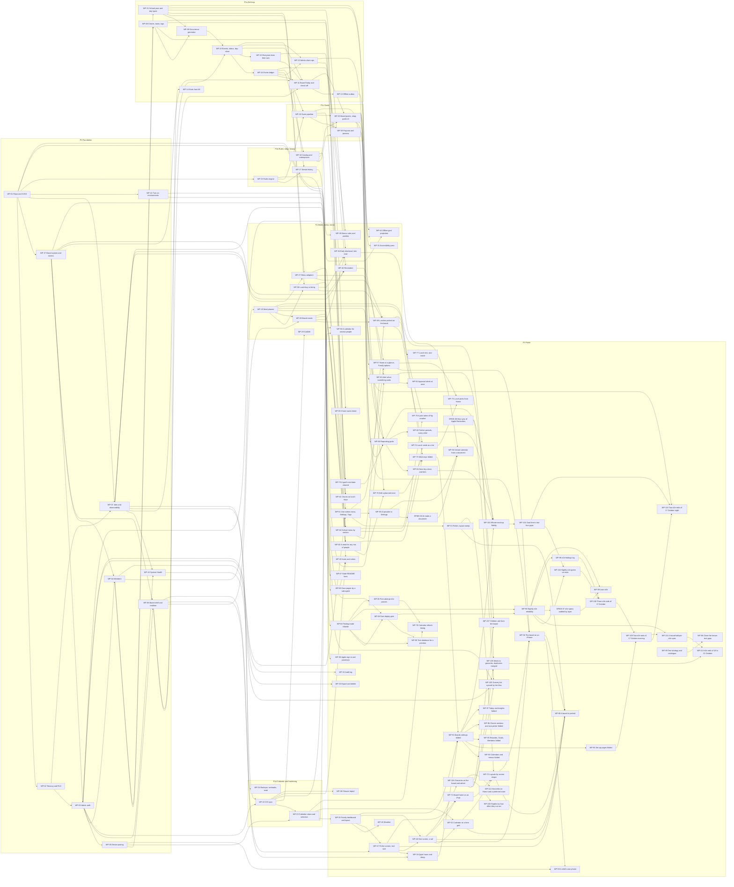

# 05 — Backlog

> Version 0.8 · Status: build baseline · Maintained by Claude Code
> v0.8.159: WP-95 (Rewards, Goals and Members folded) done (NFR-18, PTS-01, PTS-03, PTS-04, PTS-05, ACC-04, RWD-09, D-120, D-144), from the fold audit's Rewards and Members frames the owner approved on 16 October: the shop's Archived, Bonus points (Add a bonus and Archived bonuses inside), Lately, Members' Archived, a member's Points (Change points inside) and Archive folded, each to what it holds; a save comes back with its fold open; at the owner's request, the page parts around the folds follow the frames too. NFR-18's case letters were used up by WP-94 and WP-96, so its cases are PTS-01-a and -b, PTS-03-a and -b, PTS-04-b, PTS-05-a, ACC-04-a and -b and RWD-09-a, and those requirements join its Reqs line. Its Goals part was done with WP-80 (D-123); RWD-09-a adds the preview test of "needs a look" on Goals' folded History.
> v0.8.158: WP-113 (the e2e reds of 18 to 21 October) added at the owner's request and done in the same change (DEV-05, NFR-12, MEAL-19, D-143): `meal-groceries.spec.ts` was the spec's own bug, red in every run, and WP-105's merge is right; the board's snapshot timed out under the run because `lunch_week()` worked out each child's day up to eight times, now once, with the same answer (the snapshot 66 to 80 ms → 28 to 35 ms on a local copy); the five one-off reds were saves and page loads the preview never answered within their waits, none of them date-dependent, and a run now sees the preview's own way to the test database and names what a failed test was waiting for. The scheduled runs start late because GitHub queues them late; no change to D-108's schedule. Its test cases are DEV-05-a, DEV-05-b and NFR-12-a to NFR-12-e. D-143 confirmed by the owner in this item's session.
> v0.8.157: WP-112 (Groceries on Home, and a preferred store) added at the owner's request and done in the same change (MEAL-27, MEAL-28, D-142), from the mockup the owner approved on 18 October ([Groceries Quick Action](https://claude.ai/artifact/WEFjdd1cFyGCqWKFie7i62)) with its three answers: a Groceries card first in Home's Quick actions, to add to the list without leaving Home; **New items go to**, the household's preferred store, in Groceries' Categories and stores; a store suggested as last time's, then the preferred store, then Any store, on Home, in Groceries' add field and in Add this week to groceries (D-142, which changes D-138 (4)); the Stores card's new-store hint fits an iPhone. Its test cases are MEAL-27-a to MEAL-27-e and MEAL-28-a to MEAL-28-g. D-141 (WP-96) and D-142 confirmed by the owner in this item's session. Found by the side-by-side, as a plain fact: in WebKit, Groceries' add field puts Goes in and Store above their chips rather than beside them, as since WP-104; left as it is.
> v0.8.156: WP-96 (Chores in four sections, an item's page and the icon picker folded) done (CHR-21, CHR-22, CHR-23, NFR-16, NFR-18, D-132, D-141), from its approved mockup: Scheduled, Recurring, Completed and Archived; person chips and More filters; two-line rows with ⋯, held for the same menu; Duplicate and Do again (`do_chore_again()`); an item's page folded; the Meal library and Tags take the ⋯ row; checked in WebKit as an iPhone and as Safari on a Mac. A meal's Duplicate copies all of it, photos and PDFs as files of its own (the owner's answer). Its test cases are CHR-21-a to CHR-21-i, CHR-22-a and -b, CHR-23-a to -c, MEAL-25-h, NFR-16-t, NFR-18-y and NFR-18-z.
> v0.8.155: WP-104 follow-up, from the owner's use on an iPhone (MEAL-18): an item's ⋯ keeps inside the screen and closes once a choice is made, on Escape or on a tap elsewhere; an item's Edit fits the screen.
> v0.8.154: WP-104 (Groceries on the board and in the admin app, with our own categories and stores) and WP-105 (Meals → groceries: ingredients and recipes on meals, duplicates merged) done together in one branch and one PR at the owner's request (MEAL-07, MEAL-18 to MEAL-20, MEAL-23 to MEAL-26, D-138, D-139, D-140), from the approved mockup. Their test cases are MEAL-07-a and -b, MEAL-18-a to -f, MEAL-19-a to -f, MEAL-20-a to -d, MEAL-23-a to -e, MEAL-24-a to -e, MEAL-25-a to -g and MEAL-26-a.
> v0.8.153: WP-111's run by hand on `main` (run 251): `chores.spec.ts` red from WP-111's own bug (`family.own()` written inside SQL text), fixed with NFR-14-x reading each spec with the TypeScript parser; BRD-05 infrastructure twice, cause not proven. Sign-ins 55, at most 16 in any 5 minutes.
> v0.8.152: The grocery list's logic and screens, from the mockup the owner approved on 18 October, recorded only (MEAL-16, MEAL-18, MEAL-19, MEAL-22 to MEAL-26, D-138): added at the owner's request, Groceries works with or without the Apple Reminders sync, so WP-104 comes first and is Ready, and WP-103 now follows SPIKE-08 and WP-104; WP-104 gains the household's own categories and stores, moving several items at once and the category suggested on add (M to L); WP-105 gains recipes as links, photos and PDFs, read for ingredients and shown on the board; WP-107's parent OK is set per child. The mockup ([Smart grocery list](https://claude.ai/artifact/T7JhbAyMdpXBvJmW1JXXWU)) is the mockup for WP-104 to WP-107. Nothing is built in this change.
> v0.8.151: WP-111 (each e2e spec on a made-up household of its own) added at the owner's request and done in the same change (NFR-14, D-110, D-137): each spec that signs in or reaches the database makes a copy of the demo family's seed under its own ids and sign-ins as it starts, so no spec sees another's rows or depends on run order or a reseed; the demo family stays for previews and `auth.spec.ts`. Every test's assertions and limits are unchanged. It is WP-99's household per spec, done first; WP-99 keeps the rest. Its test cases are NFR-14-u to NFR-14-z.
> v0.8.150: WP-110 (the two e2e reds of 17 October night: Maya's request on the board and the goal form's save) added at the owner's request and done in the same change (PTS-04, NFR-16, D-136): both were the app's own bugs, each reproduced on `main`'s code in the UI suite. A request the server had taken stayed on "Sending…" until a Realtime notice made the board read its snapshot again, so a missed notice left it there for up to 4 minutes (#137); now it says "Waiting for a grown-up" once taken and the board reads its snapshot at once. The goal form's live summaries were a server action, and Next runs a page's server actions one at a time, so "Set the goal" waited behind every summary still out (#138); they now come from `POST /api/goals/summaries`. Its test cases are PTS-04-a, NFR-16-r and NFR-16-s.
> v0.8.149: WP-109 (the two e2e reds of 17 October evening: Family options' week and the streak bonus) added at the owner's request and done in the same change (NFR-14, D-110): both were the specs' own bugs. Home's start-day test (#134) used The week's form while WP-94 had folded it; the streak bonus (#135) read Leo's history as the seed left it, but `perfect-periods.spec.ts`, green for the first time on `d2b0aa4`, had left its check-offs in Maya's and Leo's runs. Its clean-up, and the two other specs' that tick a child's own homework, now skip each check-off they made, and the spec checks the runs are as before. No app change. Its test cases are NFR-14-s and NFR-14-t.
> v0.8.148: WP-108 (the three e2e reds of 17 October: DEV-05, lunches and perfect periods) added at the owner's request and done in the same change (NFR-14, D-110, D-129, D-135): perfect periods (#127) was the spec's own bug, a label match that also found the icon picker's "target" icon; DEV-05 (#126) and lunches were one shared delay, every request from the preview to the test project slow for minutes while the database probe answered in time, so the run had no evidence to say so. The board's read and each page load are now timed, so a late change says which; the 3 s budgets are unchanged. Its test cases are NFR-14-o to NFR-14-r.
> v0.8.147: The smart grocery list added at the owner's request, recorded only (MEAL-07, MEAL-16 to MEAL-22, D-134): Apple Reminders stays the family's grocery list, and a sync program on the owner's Mac Studio keeps one shared list in two-way sync with Supabase. SPIKE-08 (the Mac sync: two-way, through a restart, change latency in seconds, whether the Groceries list's sections reach it) is Ready; WP-103 (the sync, the Mac on Health) is Queued behind it; WP-104 (groceries on the board and in the admin app, mockup first) behind WP-103; then the smart part, each mockup first: WP-105 (meals → groceries, meals gain ingredients, duplicates merged), WP-106 (staples by how often they run out) and WP-107 (children asking from the board, with an optional parent OK). Structured ingredients (MEAL-07) move from WP-36 to WP-105, so WP-36 is the closure import alone and no longer waits on WP-25. An iPhone app was considered and is not chosen now. Nothing is built in this change.
> v0.8.146: WP-94 (the set-up pages folded) done (NFR-18, D-120, D-133), from the fold audit the owner approved on 16 October: Family options, School and a school year's page, Tags, Reminders and Health fold each section set once to what it is set to; a failing weather read, the invites waiting, a device removed, a failing job and a limit near show on the folded header; the section saved in comes back open; Home's **Add a day off** takes the fold's look. Its test cases are NFR-18-k to NFR-18-x.
> v0.8.145: WP-96 widened at the owner's request, recorded only (CHR-21, CHR-22, CHR-23, NFR-18, D-132): Chores in four sections (Scheduled, Recurring, Completed, Archived), person chips in place of WP-96's folded Filters, two-line rows with a ⋯ menu, **Duplicate** and **Do again**, and the same ⋯ row on the Meal library, which changes WP-93's meal rows. The owner approved its own mockup ([WP-96 Chores sections](https://claude.ai/artifact/QsGhSPWkeq1uqMg65d4T8d)) on 17 October with every recommendation as drawn, and confirmed D-132; added at the owner's request with the approval, it must look and work the same in Safari on an iPhone and on a Mac. WP-96 is Ready; it is not built in this change.
> v0.8.144: WP-93 (Calendars, school menus and the meal library folded) done (NFR-18, D-120, D-131), from the fold audit the owner approved on 16 October: each calendar folded to its colour, name and facts with **Can't sync** on its header, opened to what's coming up, then **Edit** and **Remove** as folds; each school menu folded to its facts with **Can't fetch** on its header, opened to its weeks, **Load a file into** and **Add a day to** as folds, and **Fetch now**, **Rename** and **Remove** set apart; **Add a calendar**, **Add a school menu** and **Add a meal** folded to their buttons; the meal library's **Archived** folded to its count; each comes back open after a save in it. Its test cases are NFR-18-a to NFR-18-j.
> v0.8.143: WP-98 (the e2e findings log) done (NFR-14, D-121, D-130): each e2e run with a failed test adds one comment to the issue "E2E findings log", infrastructure re-runs that passed included, with how many of the last 30 runs each test failed in; the run summary lists the tests that failed in more than one; `e2e.yml` can be started by hand on `main`, and only when no other e2e run is queued or going. Its test cases are NFR-14-i to NFR-14-n.
> v0.8.142: WP-102 (the nightly e2e run green on main, the e2e red triage) added at the owner's request and done in the same change (NFR-14, D-110, D-129): the 12 "E2E red on main" issues of 16 and 17 October, each with its cause. Ten were the specs' own bugs (behind WP-34's drift, WP-75's folds and WP-100's folded icon picker; a real-clock weekday; another test's leftovers; a clean-up refused by append-only check-offs; out-of-date expectations), one an app bug WP-101 had already fixed, and one the test database slow while a board's read ran, which the probe missed. Found with it: the run quoted a failed psql command, password included, into an issue; the run now hides every connection string. The owner chose not to rotate the password (Y-12, closed). Its test cases are NFR-14-a to NFR-14-h.
> v0.8.141: WP-101 (the goal form's last four differences from its mockups, WP-100's follow-up) added at the owner's request and done in the same change (NFR-16, D-128): a rule as one summary line with its weight, the live summaries where the frames place them (worked out by Preview's own code), item pictures, and dates and times written "Mon, Oct 12, 2026" and "6:00 pm" over real pickers. Found and fixed with it: a rule's field names differed between the server and the browser. Its test cases are NFR-16-i to NFR-16-q.
> v0.8.140: WP-100 (the admin app on an iPhone looks like its approved mockups, a bug) added at the owner's request and done in the same change (NFR-16, D-127): the owner's iPhone showed the goal form unlike the WP-80 to WP-82 mockups, because iPhone Safari drew its own controls and nothing tested WebKit. Every admin form control is now drawn by the app; the goal screens match their frames; the UI suite runs as an iPhone in WebKit in CI; an item built from a mockup shows a side-by-side before approval. The icon picker's fold (WP-96's last bullet) is done with it. Its test cases are NFR-16-a to NFR-16-h.
> v0.8.139: WP-82 (perfect periods, and a family goal every child meets) done (RWD-19, RWD-20, D-126), from the WP-80 to WP-82 mockup the owner approved on 16 October and its WP-82 addendum ([Perfect weeks, every child](https://claude.ai/artifact/XtkXNSiGna2TnFa42EFyRt)) approved the same day with their answers: a counted goal counts the periods that start on or after its start date; an every-child goal pays only the children who had something due; the option is fixed once the goal starts; no steps on it. Its test cases are RWD-19-a to RWD-19-j and RWD-20-a to RWD-20-k.
> v0.8.138: WP-81 (a goal done by a time, and goals that pay in steps) done (RWD-17, RWD-18, D-124), from the WP-80 to WP-82 mockup and its WP-81 addendum the owner approved on 16 October, with their answers that day: steps by number (a one-off goal in steps has an end date) and weights on a goal with two or more rules. Its test cases are RWD-17-a to RWD-17-h and RWD-18-a to RWD-18-m.
> v0.8.137: WP-80 (goals that repeat each week, month or school term) done (RWD-15, RWD-16, D-123), from the mockup for WP-80 to WP-82 the owner approved on 16 October with their answers: each period worked out, won and paid on its own, "every day it's due" with misses allowed, "Missed, starts again", a goal's weeks on Goals and the board, and **Stop after this week**. Its test cases are RWD-15-a to RWD-15-m and RWD-16-a to RWD-16-i. WP-81 and WP-82 are Ready: the mockup is theirs too. Goals' History and a goal's What happened and Cancel are folded with it, as the mockup drew them; WP-95 keeps the rest of its Goals part. "Next, in order" is the owner's to set.
> v0.8.136: WP-50's deferred contract added at the owner's request and done (CAL-09, D-122): `calendar_source.member_id`, the one-person `save_calendar_source()` and WP-50's carry-over dropped by `20261016135756_calendar_people_contract.sql`, after a guard that refuses while any calendar's person is not in `calendar_member`; the board's fallback to `member_id` goes too. `meal_plan_entry.member_id` (WP-62's deferred contract) is not part of it.
> v0.8.135: WP-50 (a calendar for one or more people) done (CAL-09, US-508, D-122), from the mockup the owner approved on 16 October with its three recommendations: a calendar is the whole family's or any number of its people's, ticked on Calendars; the board shows each of its people's faces in **Coming up** and an event's details, and puts it on each of their screens. Its test cases are CAL-09-a to CAL-09-f. Deferred: dropping `calendar_source.member_id` and the one-person `save_calendar_source()`, kept for the app deployed when the migration runs.
> v0.8.134: WP-85 (the test strategy and the Test catalogue) added at the owner's request and done in the same change (NFR-19, D-106, D-107), restarted on 16 October at the owner's request to match `main` (D-108, D-110 and everything shipped since): `08` holds the strategy, with guidance by type of change, and the catalogue generated from every test's name; CI fails a change that adds a test gap. Its test cases are the first in §5 (NFR-19-a to NFR-19-f). WP-86 (close the known test gaps) added at the owner's request with it, recorded only.
> v0.8.133: Three e2e items added at the owner's request, recorded only (D-121): SPIKE-07 audits every e2e spec by layer and lists what to keep, move or drop, for the owner to decide; WP-98 a findings log of each nightly run's red tests; WP-99 lean e2e (data set up by SQL, a household per spec, parallel runs, unchanged nights skipped). Found: the first scheduled nightly e2e run (07:17 UTC, 16 October) never started, and `e2e.yml` has no other trigger, so it can't be run by hand. The owner chose: a manual trigger in WP-98, and with unchanged nights skipped, a run once a week regardless (WP-99). SPIKE-07 and WP-98 are Ready; WP-99 is Queued behind SPIKE-07. "Next, in order" is the owner's to set.
> v0.8.132: WP-91 (the Boards settings as collapsible sections) done (D-118, D-120), from the fold audit's Boards page the owner approved on 16 October: each board folded to its name and facts with Home's not-seen warning on its header, opened to Display, Sleep and wake, Calendars, Home screen, then its name and Disconnect set apart; the household's Home screen, Add a board and Disconnected folded; Meals' fold made one shared component (`Fold`). WP-93 to WP-97 are Ready. "Next, in order" is the owner's to set.
> v0.8.131: WP-34 follow-up: the Pi's screen helper runs as a systemd user service, so it starts with the Pi on any desktop (labwc on Debian 13 doesn't read the start-up folder the first installer used); found on the owner's Pi 4, at the owner's request.
> v0.8.130: WP-92 (approval alerts at once, a bug) added at the owner's request and done in the same change (D-119). Found: the alerts job worked as designed, every 5 minutes; most of the child's check-offs were on items with approval off, so they never waited, and the homework check-off was approved 33 seconds after it, before the next run. At the owner's request, an approval alert now goes within seconds of something starting to wait, and counts all that waits. The read-only `reminders-report` workflow shows why an alert did or did not go, counts only.
> v0.8.129: The fold audit of the admin app added at the owner's request, recorded only (D-120): every admin screen judged against WP-75's fold and mocked up on the demo family; five new work packages after WP-91 (WP-93 to WP-97). The owner approved the mockup on 16 October, admin only, and confirmed D-120; WP-91 is Ready and built first and on its own, with the shared fold, and WP-93 to WP-97 are Queued behind it. "Next, in order" is the owner's to set.
> v0.8.127: WP-91 (the Boards settings as collapsible sections) added at the owner's request, recorded only (D-118): each board folded at first, showing its name and what matters about it, opening to grouped sections; the household's **Home screen** layout, **Add a board** and **Disconnected** folded too, in WP-75's fold style. Ready, mockup first. "Next, in order" is the owner's to set.
> v0.8.126: WP-34 (quiet hours and burn-in mitigation, with sleep and wake per board) built and merged (D-116, D-117), from the mockup the owner approved on 16 October with its six recommendations; its 3 days on the owner's Pi 4 are open (Y-11).
> v0.8.125: WP-34 gains sleep and wake per board, added at the owner's request, recorded only (D-116): when a board counts as missed (Always, Only while awake, Never), sleep and wake times for school days and weekends, an idle sleep woken by a touch, click or mouse movement that only wakes. WP-34 now depends on WP-06 and WP-47 and is Ready: the owner's Pi 4 on a 24" Dell is the board in use, so it no longer waits on WP-14 or SPIKE-03. Size S to M. A mockup comes first. "Next, in order" is the owner's to set.
> v0.8.124: WP-79 (a goal's end date that can be cleared) done (D-115), from the mockup the owner approved with their changes; added at the owner's request with it: a started goal's end date today or later, and a reached goal that can't change (read per period for WP-80). WP-80 no longer waits on WP-79.
> v0.8.123: WP-75 (the meal planner's days as collapsible sections, with the usual lunch week and Add to the plan folded) done (D-114), with **Copy last week** folded too and Meals reordered, added at the owner's request.
> v0.8.122: WP-75 gains two sections that fold on Meals, added at the owner's request, recorded only (D-98): **School lunch**'s usual week and **Add to the plan**, both collapsed at first on every screen size; **Add** on a day opens **Add to the plan** with that day filled. The WP-75 worker adds both collapsed states to the mockup for the owner's approval before building.
> v0.8.121: WP-73 (the lunch picks one tap from Home) done (D-113).
> v0.8.120: WP-74 (the lunch week as a list of days) done (D-112), so WP-73 is Ready.
> v0.8.119: WP-76 (Edit on a planned meal) done (D-111). The one mockup for WP-73 to WP-76 was approved by the owner on 15 October, so WP-73 to WP-75 no longer wait on it.
> v0.8.118: WP-90 (nightly e2e reliability) added at the owner's request and done in the same change (D-110), harvested from the closed e2e speed-up work (branches `claude/e2e-speed-up` and `claude/e2e-tooling`): sign in once per persona per worker; a page used only once hydrated; the test database's reset ends sessions stuck in a transaction; an infrastructure failure re-runs once and is labelled, an assertion failure never re-runs; the specs' clock in the household's zone, their own data and measured limits; the test standard in `CLAUDE.md`. WP-89 no longer carries the stuck-transaction fix.
> v0.8.117: WP-89 (the test database prepared for a pull request's preview) added at the owner's request, recorded only: a job that resets the test database, applies the pull request's migrations and loads the demo family, so a preview of a pull request with a migration works before merge. It runs no tests and never blocks anything (D-108). "Next, in order" is the owner's to set.
> v0.8.116: WP-88 (fast deploy gate; e2e nightly only) added at the owner's request and done in the same change (D-108): the deploy gate reads only the fast CI checks, e2e runs nightly and never blocks a pull request or a deploy, and a refused deploy or a red nightly run opens an issue.
> v0.8.115: WP-79 to WP-82 added at the owner's request, recorded only (D-101 to D-103): a goal's end date that can be cleared (a bug, on its own so it waits on nothing else); goals that repeat each week, month or school term, with "every day it's due" and misses allowed, each period won or missed on its own; done by a time, and tiers; perfect periods, and "every child meets it". WP-80 to WP-82 wait on one mockup. Avoidance goals (no screen time over a limit) are not covered: nothing records them.  WP-83 added at the owner's request and done in the same change: chore saves that stalled 15 s or more in two e2e runs are now checked and timed in both chores tests; their cause is open. "Next, in order" is the owner's to set.
> v0.8.114: WP-71 done (D-100): the board home on an iPad, fixed at the cause: a chore's row grows with its title and points chip, and a word in the rail goes under its icon when it doesn't fit beside it. The board's fit checks gain the iPad shapes, and, added at the owner's request, the kitchen board's 1920×1080 at Larger and Largest.
> v0.8.113: WP-78 (a lunch pick taken off by another, a bug) added at the owner's request and done in the same change: on Meals in the admin app, every "Choice of" section's radios were one group, so ticking a milk took off the entree. Two more added to it at the owner's request and done with it: "and" in a school menu joins a side like "with" (a WP-64 gap); the board picks up a new deploy by itself (D-99).
> v0.8.112: WP-71 to WP-76 added at the owner's request, recorded only (D-97, D-98), and WP-77 (WP-49's lunch test, root cause) added and done in the same change: the board home on an iPad (a bug); board layouts that adapt to the screen's shape, which WP-58 and WP-68 now build on, so WP-58 waits on it; the lunch picks one tap from Home; the lunch week as a list of days; the meal planner's days folded; Edit on a planned meal (a bug). WP-73 to WP-76 wait on one mockup. "Next, in order" is the owner's to set.
> v0.8.111: WP-70 (the board calendar's refresh timing, root cause) added at the owner's request and done in the same change (D-96): the test's own 3 s check looked last at about 2.8 s, fixed in the test; a board read after a change that failed or hung was never made again, fixed in the app; the calendar now says when it has finished drawing, and the month's test waits for it. WP-65's tally restarts with it.
> v0.8.110: WP-49 done: next week's lunches picked on the board, with the day's choices (D-95; the parent's approval screen's mockup approved by the owner). A child's change, buy or bring and the picks alike, waits for a parent on Today until the morning cut-off (8:00 am by default, set on School).
> v0.8.109: WP-64 done: the school menu by section, as options (D-94; mockup approved with WP-49's choice screens). The owner's answers for WP-49 recorded in its section; WP-49 is ready, its parent's approval screen and the morning cut-off's time to settle first.
> v0.8.108: a board in portrait or landscape added at the owner's request to WP-58's scope (D-93), recorded only: more than one L together, so WP-58 stays the iPhone and its portrait boards are WP-68 (L, its own mockup first), which follows it. WP-58's place in the order is unchanged. WP-68's orientation has **Automatic** (the default, following the screen's shape), added at the owner's request.
> v0.8.107: WP-62 done: a meal for any mix of people (D-87). Deferred: dropping `meal_plan_entry.member_id`, held empty until then.
> v0.8.106: WP-63 done: an alert when something waits for a parent (D-88).
> v0.8.105: WP-65 built (NFR-14, D-92): CAL-05's cause in the board's week (a range read again after the snapshot, so a change waited on two reads), fixed in the app; DEV-06's in the test's own time limit, fixed in the test; both now say what they saw. Merged, with the five-run tally to record.
> v0.8.104: WP-65 (first-attempt e2e passes for CAL-05 and DEV-06), WP-66 (the docs pages republished by a sub-agent, D-91) and WP-67 (stale lines in `00-README`) added at the owner's request; WP-66 and WP-67 done in the same change. WP-65 is next, ahead of everything else.
> v0.8.103: work as a planner and one worker per item (D-90): items start from the planner session; §2's prompt pattern becomes `/deliver WP-nn`; each item's PR records it as done.
> v0.8.102: WP-61 done (PR #66): chores on lunch days.
> v0.8.101: WP-62 (a meal for any mix of people), WP-63 (an alert when something waits for a parent) and WP-64 (the school menu by section) added at the owner's request, and WP-49 grows to picking a buy day's lunch choices (D-87 to D-89). The order is under the status board.
> v0.8.100: WP-61 chores on lunch days added at the owner's request, ahead of WP-58, and in review (D-86).
> v0.8.99: WP-60 merged (PR #65): previews and e2e on the test database.
> v0.8.98: WP-58 (the board on an iPhone, mockup approved) and WP-59 (a child's own phone, later) added at the owner's request; WP-60 testing made reliable, in review (D-85).
> v0.8.97: WP-57 done (PR #64): Home at a glance, and Family options in Settings.
> v0.8.96: WP-57 added at the owner's request and in review (PR #64): Home at a glance, and Family options in Settings (D-84).
> v0.8.94: WP-53 to WP-56 and SPIKE-06 added at the owner's request: polish with a layout sweep, short school days, the household's AI provider, the school calendar from a document.
> v0.8.93: WP-52 done (PR #61): the board's calendar as a time grid.
> v0.8.92: WP-52 added at the owner's request and in review: the board's calendar as a time grid (D-82).
> v0.8.91: WP-51 done (PR #60): one admin menu, with Settings.
> v0.8.90: WP-51 in review (PR #60): one admin menu, with Settings (D-81).
> v0.8.89: WP-49, WP-50 and WP-51 added at the owner's request; WP-29 waits until the owner says to start it.
> v0.8.88: WP-28 done (PR #58): meals on the board.
> v0.8.87: WP-28 in review (PR #58): meals on the board (D-80).
> v0.8.86: WP-27 done (PR #57): school menus from Nutrislice, a file or by hand.
> v0.8.85: WP-27 in review (PR #57): school menus from Nutrislice, a file or by hand (D-79).
> v0.8.84: WP-26 done (PR #56): school lunch, buy or bring.
> v0.8.83: WP-26 in review (PR #56): lunch, buy or bring (D-78).
> v0.8.82: WP-25 done (PR #55): the meal library and the weekly planner. WP-28 is ready.
> v0.8.81: WP-25 in review (PR #55): the meal library and the weekly planner (D-77).
> v0.8.80: WP-39 done (PR #53): goal payouts, payout reversal and the rule-change preview.
> v0.8.79: WP-39 in review (PR #53): goal payouts, payout reversal and the rule-change preview (D-75).
> v0.8.78: the jobs' queries stop after 60 seconds (D-76), done (PR #54). No work package changes status.
> v0.8.77: the jobs' queries stop after 60 seconds (D-76), in review (PR #54). No work package changes status.
> v0.8.76: WP-48 done (PR #52): the board's home screen on one screen, with a rail.
> v0.8.75: WP-48 in review: the home screen on one screen, with a rail, and the calendar's view chosen on the board (D-74).
> v0.8.73: WP-47 done (PR #50): the board fits its screen, and a text size per board.
> v0.8.72: WP-47 in review (PR #50): the board fits its screen, and a text size per board (D-73).
> v0.8.71: Help in the admin app (D-72) done (PR #49): the user guide at `/help` (version 0.5). No work package changes status.
> v0.8.70: Help in the admin app (D-72), in review (PR #49): the user guide at `/help`, from the menu, sign-in and setup. No work package changes status.
> v0.8.69: WP-46 done (PR #47): more icons, one icon picker and sixteen colors.
> v0.8.68: WP-46 in review (PR #47): more icons, one icon picker and sixteen colors (D-70).
> v0.8.67: fixes found while writing the user guide, done (PR #48); the user guide says what changed (version 0.3). No work package changes status.
> v0.8.66: fixes found while writing the user guide, in review (PR #48): a board's own layout kept on a second Save, Disconnect asks first, the idle return closes "Who did …?", the points form's help; the board waits 90 seconds before going home (D-71). No work package changes status.
> v0.8.65: docs (D-68), done (PR #46): the user guide and manual (`07`), and its check. No work package changes status.
> v0.8.64: docs (D-68), in review (PR #46): the user guide and manual (`07`), kept current with each user-facing change, and a check that it covers every built story. No work package changes status.
> v0.8.63: WP-45 done (PR #45): weather on the board.
> v0.8.62: WP-45 in review (PR #45): weather on the board (D-69).
> v0.8.61: WP-35 done (PR #44): the family dashboard and the home screen's layout. WP-45 is ready.
> v0.8.60: WP-35 in review (PR #44): the family dashboard and the home screen's layout (D-66, D-67). WP-45 (weather on the board, BRD-04) is split out of WP-35 and waits for it.
> v0.8.59: WP-23 done (PR #43): calendar views and per-board selection. WP-35 is ready.
> v0.8.58: WP-23 in review (PR #43): calendar views and per-board selection (D-65).
> v0.8.57: change (D-64), done (PR #42): the board's outbox sends nothing while the browser says it is offline. No work package changes status.
> v0.8.56: change (D-64), in review (PR #42): the board's outbox sends nothing while the browser says it is offline. No work package changes status.
> v0.8.55: WP-22 done (PR #41): ICS calendar sync. WP-23 and WP-29 are ready.
> v0.8.54: WP-22 in review (PR #41): ICS calendar sync (D-63).
> v0.8.53: e2e reliability done (PR #40): each spec retires its board; the bonus test checks the ledger first. No work package changes status.
> v0.8.52: fix (D-62), done (PR #39): production's jobs leave the demo family alone. No work package changes status.
> v0.8.51: fix (D-61), done (PR #38): a parent links their own sign-in from Reminders, My tasks or their page on Members. No work package changes status.
> v0.8.50: WP-20 done (PR #37): the board's shop, requests and goals. WP-31 is ready. WP-44 (offline goal projection, a fallback only, D-60) is added: ready, and nothing waits on it.
> v0.8.49: WP-20 in review (PR #37): the board's shop, requests and goals (D-59).
> v0.8.48: WP-40 done (PR #36): reminders by web push. Nothing waits on it; the owner runs the vapid-keys workflow once to switch sending on.
> v0.8.47: WP-40 in review (PR #36): reminders by web push (D-58).
> v0.8.46: WP-30 done (PR #35): bonus rules and the wishlist. Nothing waits on it.
> v0.8.45: WP-30 in review (PR #35): bonus rules and the wishlist (D-57).
> v0.8.44: WP-19 done (PR #34): goals and the progress pipeline. WP-20 and WP-39 are ready.
> v0.8.43: WP-19 in review (PR #34): goals and the progress pipeline (D-56).
> v0.8.42: WP-17 done (PR #33): streak history and insights. WP-30 is ready.
> v0.8.41: WP-17 in review (PR #33): streak history and insights (D-55).
> v0.8.40: WP-13 done (PR #32): the board works through an outage. The real 24-hour soak on the Pi stays with WP-24.
> v0.8.39: WP-13 in review (PR #32): the board works through an outage (D-54).
> v0.8.38: WP-18 done (PR #31): the rewards shop. WP-39 and WP-20 wait on WP-19 too.
> v0.8.37: WP-18 in review (PR #31): the rewards shop (D-53).
> v0.8.36: WP-12 done (PR #30): a parent's day and My tasks. WP-40 is ready.
> v0.8.35: WP-12 in review (PR #30): a parent's day and My tasks (D-52).
> v0.8.34: WP-15 done (PR #29): the rules engine. WP-17 and WP-19 are ready.
> v0.8.33: WP-15 in review (PR #29): the rules engine (D-51). WP-17 follows it.
> v0.8.32: WP-11 done (PR #28): the board's Today and check-off. The owner confirmed D-50: the board never shows why points were taken away. WP-12, WP-13 and WP-18 are ready; WP-12 and WP-18 were ready from WP-16's merge but not marked so.
> v0.8.31: WP-11 in review (PR #28): the board's Today and check-off (D-50).
> v0.8.30: WP-16 done (PR #27): the points ledger. WP-11 is ready.
> v0.8.29: WP-16 in review (PR #27): the points ledger (D-49). WP-11 waits only on it.
> v0.8.28: WP-43 done (PR #25). Y-10 lists four old failure reports: two more came from WP-43's first e2e runs, before its branch carried D-48's change.
> v0.8.27: the repository is public (D-48). Y-10: rotate the deployment-protection bypass secret, and delete two old failure reports and two setup-code runs. WP-24's backups will not be workflow artifacts.
> v0.8.26: WP-43 in review (PR #25): everyone does their own (D-47), ahead of WP-11, which now depends on it.
> v0.8.25: WP-10 done (PR #23), live in production: day close runs hourly and the status check nightly. WP-16 is ready.
> v0.8.24: WP-10 in review (PR #23): completion events, the status they drive, day close and the nightly drift check (D-46).
> v0.8.23: WP-09 done (PR #22), live in production.
> v0.8.22: WP-09 in review (PR #22): occurrences planned two weeks ahead by the database, and re-planned at once on edits without touching history (D-45).
> v0.8.21: WP-21 done (PR #21), live in production. WP-27 is ready.
> v0.8.20: WP-21 in review (PR #21): school years and day types (D-44). Regenerating occurrences when a closure changes moves to WP-09 with occurrences.
> v0.8.19: WP-08 done (PR #19), live in production. WP-21 is next.
> v0.8.18: WP-08 in review (PR #19): the family list, tags and private items (D-43).
> v0.8.17: WP-42 done (PR #17), so P0 is done: every P0 item is merged and its exit criteria pass (`04` §E). Ready now: WP-08, WP-21, WP-22, WP-24, WP-25, WP-32, WP-33.
> v0.8.16: WP-42 in review (PR #17): System Health, with errors kept per household and usage read daily (D-42).
> v0.8.15: SPIKE-02's ICS part done (`01` §5.4), so WP-22 is queued; its CalDAV part runs before WP-29. Y-6's calendar is a real one, so the spike reports counts only and its fixture is made up.
> v0.8.14: Y-6 done, so SPIKE-02 is ready (its iCloud part; the CalDAV part waits for WP-29). Y-8 is not needed before P3.
> v0.8.13: WP-06 done (PR #12), live in production. Y-9 done. The setup code shows on the setup-code run's summary page again (PR #13).
> v0.8.12: WP-05 done (PR #11). WP-06 in review (PR #12): the board keeps its own snapshot live (D-41). Your household can start in production before launch, so Y-9 is due now.
> v0.8.11: SPIKE-01 done and WP-05 in review (PR #11): boards pair in the database and heal themselves (D-40). WP-04 done (PR #10).
> v0.8.10: WP-03 done (PR #9). WP-04 in review (PR #10).
> v0.8.9: WP-07 done. WP-03 in review (PR #9): private by invitation (D-39); Y-5 is no longer a blocker; new Y-9 before launch.
> v0.8.8: WP-07 in review (PR #8): the job framework, error log and job-secret workflow; the System Health page moves to new WP-42, after WP-03 (admin sign-in), so it is built once, behind sign-in.
> v0.8.7: migrations run through `scripts/db-migrate.sh` (PR #7): PR #5's deploy stopped because PR #6's preview had applied a migration `main` did not have yet.
> v0.8.6: SPIKE-05 done: job limits, the invocation pattern and the Hobby budget are in `01` §5.6 (D-38); WP-07 takes the pattern and the job-secret workflow.
> v0.8.5: §0 lists only open owner actions; Y-1 to Y-4 move to a Done table. WP-41 done: PR #4's merge deployed on its own, and the gate's refusals are tested.
> v0.8.4: production is live and dark: the first deploy ran gate, migrate, app and smoke after the token was rescoped; keepalive wrote its first heartbeat. WP-41 closes when its own merge deploys automatically.
> v0.8.3: WP-37 done (PR #3); Y-4 done; WP-41 in progress: the first production deploy reached the app step, and the deploy token needs the project's team as its scope.
> v0.8.2: WP-37 in progress on `claude/wp-37-brand`.
> v0.8.1: Y-3 done (GitHub secrets and variables); SPIKE-01, SPIKE-05 and WP-41 wait only on Y-4.
> v0.8: one database (D-37): previews run as the demo family in the production project; Y-2 dropped (nothing to do); Y-3 and Y-4 shrink; WP-41 and SPIKE-01 wait only on Y-3 and Y-4.
> v0.7.2: branch protection is not enforced on a private repository on GitHub Free, so the deploy workflow enforces the gates (D-36). Y-1 is now the squash-only merge setting; Y-2..Y-4 give the exact steps; all GitHub secrets are repository secrets.
> v0.7.1: PR #1 merged; WP-01 and WP-02 done. WP-01's live-environment checks move to WP-41 (blocked on Y-2..Y-4); Y-1 is now branch protection.
> v0.7: WP-40 reminders (web push, switchable per person, device and item; D-35).
> v0.6: one family list (D-30..D-34): WP-08 becomes chores, tasks, tags and visibility (L); WP-09 generates one shared occurrence per due date and carries tasks over (L); WP-12 adds My tasks (L); WP-02/04 add the earns-rewards switch; WP-10, WP-11, WP-15, WP-16, WP-17, WP-19 and WP-37 take the new rules.
> v0.5.2: §0 Waiting on you lists the owner actions that unblock work; the five build artifacts are also published as interactive pages generated from these files (`pnpm docs:build`).
> v0.5: free plans (D-29): WP-01 uses a shared preview database and a keepalive; WP-24 backups are our own nightly encrypted dumps; preview-branch references replaced.
> v0.4: renamed from Work Breakdown; status board (§1); spikes are backlog items (§3); sequence changed so no finished work package needs rework (WP-37 before WP-03, WP-21 before WP-09, WP-16 before WP-11 and WP-12); WP-19 split, payouts and preview move to WP-39; WP-38 adds Sign in with Apple and passkeys; WP-01 carries the delivery pipeline (NFR-14); missing dependencies fixed.
> Companions: `01-technical-architecture.md` · `02-data-model.md` · `03-user-stories.md` · `04-requirements-traceability.md`
> Each work package (WP) is one branch and one pull request. Requirement links (`Reqs:`) and `Depends on:` lines are enforced by `check_traceability.py`; the Work packages column in `04` §B is generated from them.

---

## 0. Waiting on you

Only the owner can do these. Each row names what it unblocks; everything else on the board is Claude Code's, or waits on one of these. Secrets go straight into GitHub or Vercel settings, never into chat.

| Item | Action | Where | Unblocks |
|---|---|---|---|
| Y-7 | The Pi 5 and the 32" 4K touch panel, with the exact panel model (OQ-05b) | Hardware | SPIKE-03, then WP-14; launch checks L-05 and L-08 |
| Y-10 | The repository is public now (D-48), and three things from before are visible on it. (1) Rotate the deployment-protection bypass secret: Vercel → Settings → Deployment Protection → Protection Bypass for Automation, then put the new value in GitHub → Settings → Secrets → `VERCEL_AUTOMATION_BYPASS_SECRET`. The demo sign-ins' passwords follow it on the next e2e run. (2) Delete the four `playwright-report` artifacts (Actions → the failed e2e runs of Oct 9 whose reports were saved at 10:56, 15:03, 20:20 and 20:28 UTC), which hold the old value. (3) Delete the two `setup-code` runs of Oct 9 (10:54 and 11:03 UTC), whose pages show household codes; they expire 24 hours after issue | GitHub; Vercel | R-35 |
| Y-11 | WP-34's screen power on the Kitchen Pi 4. (1) On the Pi, in a terminal or over SSH as the user the board runs as, type `curl -fsSL https://family-wise-topaz.vercel.app/api/kiosk/install \| bash` (again, if you installed it before the follow-up), then `sudo reboot`; after the restart, `curl -s http://127.0.0.1:8737/status` answers `{"on": true}` or `{"on": false}`. (2) On Settings → Boards, open **Sleep and wake** on the Pi's board, set its times and press **Save sleep and wake**. (3) Over the next 3 days, check the monitor goes off at the sleep time and comes on at the wake time, and that moving the mouse wakes it; then tell Claude Code "WP-34 Pi check passed", or what you saw | The Pi | WP-34's last done-when line (HW) |
| Y-8 | Not before P3 (nothing earlier waits on it): choose the production domain after a trademark and domain check against "FamilyWize" (OQ-06b); join the Apple Developer Program when ready | Registrar; Apple | WP-38; custom SMTP for magic links beyond the Supabase team (`01` §9.10) |

**Done**

| Item | Outcome |
|---|---|
| Y-1 | Squash-only merges and automatic branch deletion are on. Branch protection is not available for a private repository on GitHub Free, so the deploy gate enforces the checks (D-36). |
| Y-2 | Dropped: previews use the one database as the demo family (D-37). |
| Y-3 | GitHub repository secrets and variables are in place, including `DEPLOY_ENABLED`; the deploy token is scoped to the project's team. |
| Y-4 | Vercel keys are in place: publishable key for Production and Preview, secret key and job signing secret for Production only. |
| Y-5 | Dropped as a blocker: the second admin joins by invite link and signs in with a password, so nobody needs to join the Supabase team. Adding them later is optional, for magic links before custom email (Y-8). |
| Y-6 | A real family calendar is published from iCloud, and its link is the repository secret `ICS_SPIKE_URL`. Because it is real, the `spike-02` workflow reports counts and checks only, and test fixtures are made up. |
| Y-9 | Supabase Auth points at production (Site URL `https://family-wise-topaz.vercel.app`, redirects `https://family-wise-topaz.vercel.app/**`), and "Allow new users to sign up" is off, so nobody can sign up through Supabase directly. Launch check L-12 confirms it end to end. |
| Y-12 | Closed by the owner on 17 October without rotating: "I'm not rotating. Mark Y-12 done." The test database's password, quoted by the 17 October nightly run in issue #119 and still in that issue's edit history, stays as it is. The test database holds only made-up families (D-85); production's database was never exposed. The run no longer quotes a connection string (D-129). |

---

## 1. Status board

Statuses: **Done** (merged to `main`) · **In progress** (branch open) · **Ready** (dependencies done) · **Queued** (waiting on dependencies) · **Blocked** (waiting on something outside the repo).

| Item | Title | Milestone | Size | Depends on | Status |
|---|---|---|---|---|---|
| SPIKE-01 | Device sessions + Realtime under RLS | P0 | S | WP-02 | Done (PR #11, `01` §5.1) |
| SPIKE-05 | `pg_cron`/`pg_net` → Vercel job limits | P0 | S | WP-01 | Done (PR #6) |
| SPIKE-02 | iCloud ICS fidelity; CalDAV with a secondary Apple ID | P1d | S | — | ICS part done (`01` §5.4); CalDAV part before WP-29 |
| SPIKE-04 | School menu platform and feed | P2 | S | — | Done: Nutrislice public JSON API (`01` §5.5) |
| SPIKE-03 | Pi 5 + 32" 4K panel: touch, kiosk flags, power, animation budget | P1a | S | — | Blocked: hardware being sourced (OQ-05b) |
| SPIKE-06 | Reading a document with AI on the free plan | P3 | S | WP-55 | Queued |
| SPIKE-07 | Every e2e spec audited by layer | P3 | S | WP-90 | Ready |
| SPIKE-08 | The grocery list's Mac sync: Apple Reminders both ways through the Mac Studio | P3 | S | — | Ready (needs the owner at the Mac to run it) |
| WP-01 | Repo, CI/CD pipeline, environments | P0 | M | — | Done (PR #1) |
| WP-41 | Turn on previews, production deploys, and keepalive | P0 | S | WP-01 | Done (PR #4, #5) |
| WP-37 | Brand system and design tokens | P0 | M | WP-01 | Done (PR #3) |
| WP-02 | Tenancy schema and RLS | P0 | M | WP-01 | Done (PR #1) |
| WP-03 | Admin authentication and onboarding | P0 | M | WP-02, WP-37 | Done (PR #9) |
| WP-04 | Members UI | P0 | S | WP-03, WP-37 | Done (PR #10) |
| WP-05 | Device pairing and device auth | P0 | L | WP-03 | Done (PR #11) |
| WP-06 | Board shell, snapshot, and realtime | P0 | M | WP-05, WP-37 | Done (PR #12) |
| WP-07 | Job framework and observability | P0 | M | WP-01, WP-02 | Done (PR #8) |
| WP-42 | System Health page | P0 | S | WP-03, WP-07 | Done (PR #17) |
| WP-08 | Chores, tasks, tags, and visibility | P1a | L | WP-04 | Done (PR #19) |
| WP-21 | School year and day types | P1a | M | WP-04 | Done (PR #21) |
| WP-09 | Occurrence generator | P1a | L | WP-08, WP-21 | Done (PR #22) |
| WP-10 | Completion events, status projection, day-close | P1a | L | WP-09, WP-07 | Done (PR #23) |
| WP-43 | Everyone does their own | P1a | M | WP-10 | Done (PR #25) |
| WP-16 | Points ledger | P1a | M | WP-10 | Done (PR #27) |
| WP-11 | Board Today screen and check-off | P1a | L | WP-06, WP-10, WP-16, WP-37, WP-43 | Done (PR #28) |
| WP-12 | Admin chore operations and My tasks | P1a | L | WP-10, WP-16 | Done (PR #30) |
| WP-13 | Offline outbox and stale indicator | P1a | M | WP-11 | Done (PR #32) |
| WP-14 | Kiosk host and 4K display | P1a | M | WP-06 | Blocked: SPIKE-03 (hardware) |
| WP-15 | Rules engine package | P1b | L | WP-01 | Done (PR #29) |
| WP-17 | Streak history and insights | P1b | M | WP-10, WP-15 | Done (PR #33) |
| WP-18 | Reward catalog and redemptions | P1b | M | WP-16 | Done (PR #31) |
| WP-19 | Goals admin and progress pipeline | P1c | L | WP-15, WP-16 | Done (PR #34) |
| WP-39 | Goal payouts, payout reversal, and rule-change preview | P1c | M | WP-18, WP-19 | Done (PR #53) |
| WP-20 | Board points, shop, and goals UI | P1c | L | WP-11, WP-18, WP-19 | Done (PR #37) |
| WP-22 | ICS calendar sync | P1d | L | WP-07, WP-03 | Done (PR #41) |
| WP-23 | Calendar views and per-device selection | P1d | M | WP-22, WP-05 | Done (PR #43) |
| WP-24 | Backups, runbooks, and soak | P1d | S | WP-07 | Ready |
| WP-25 | Meal library and weekly planner | P2 | M | WP-04 | Done (PR #55) |
| WP-26 | Lunch buy or bring | P2 | S | WP-21, WP-25 | Done (PR #56) |
| WP-27 | School menu adapters and import | P2 | L | WP-21, WP-07 | Done (PR #57) |
| WP-28 | Board meals panel | P2 | S | WP-25, WP-06 | Done (PR #58) |
| WP-29 | CalDAV (secondary account) | P2 | M | WP-22 | Ready, on hold until the owner says to start (SPIKE-02's CalDAV part first) |
| WP-30 | Bonus rules and wishlist | P2 | M | WP-16, WP-17 | Done (PR #35) |
| WP-31 | Accessibility pass | P2 | S | WP-20 | Ready |
| WP-40 | Reminders (web push) | P2 | M | WP-07, WP-12, WP-37 | Done (PR #36) |
| WP-44 | Offline goal projection (board fallback) | P2 | M | WP-13, WP-15, WP-20 | Ready |
| WP-32 | Audit log viewer and coverage | P3 | S | WP-03 | Ready |
| WP-33 | Export and delete | P3 | M | WP-04 | Ready |
| WP-34 | Quiet hours and burn-in mitigation, with sleep and wake per board | P3 | M | WP-06, WP-47 | Merged; 3 days on the owner's Pi 4 to check (Y-11) |
| WP-35 | Family dashboard and board layout | P3 | L | WP-23 | Done (PR #44) |
| WP-45 | Weather on the board | P3 | S | WP-35 | Done (PR #45) |
| WP-46 | More icons, one icon picker, sixteen colors | P3 | M | WP-08, WP-22, WP-37 | Done (PR #47) |
| WP-47 | The board fits its screen; text size per board | P3 | M | WP-06, WP-35 | Done (PR #50) |
| WP-48 | The home screen on one screen, with a rail | P3 | M | WP-35, WP-47 | Done (PR #52) |
| WP-49 | Next week's lunches picked on the board, with the day's choices | P2 | L | WP-26, WP-27, WP-28, WP-64 | Done |
| WP-50 | A calendar for one or more people | P2 | S | WP-22, WP-23 | Done |
| WP-51 | One admin menu, with Settings and Tags | P3 | M | WP-03, WP-08 | Done (PR #60) |
| WP-52 | The board's calendar as a time grid | P3 | M | WP-23, WP-48 | Done (PR #61) |
| WP-53 | Polish pass, with a layout sweep in CI | P3 | M | WP-51 | Ready |
| WP-54 | Short school days: early dismissal and late start | P2 | M | WP-21, WP-26, WP-28 | Ready |
| WP-55 | The household's AI provider in Settings | P3 | M | WP-51 | Ready |
| WP-56 | The school calendar from a document | P3 | L | WP-54, WP-55, SPIKE-06 | Queued |
| WP-57 | Home at a glance; Family options in Settings | P3 | M | WP-51, WP-21, WP-27 | Done (PR #64) |
| WP-58 | The board on an iPhone, from the admin app | P3 | L | WP-48, WP-20, WP-57, WP-72 | Queued: WP-72 first (iPhone mockup approved; its portrait boards, WP-68, need their own) |
| WP-59 | A child's own phone, paired as their board | P3 | M | WP-58, WP-05 | Queued (when a child has a phone) |
| WP-60 | Testing made reliable: a test database | P3 | M | WP-41 | Merged (PR #65); a week's tally to record |
| WP-61 | Chores on lunch days | P2 | S | WP-26, WP-43 | Done (PR #66) |
| WP-62 | A meal for any mix of people | P2 | S | WP-25, WP-28 | Done |
| WP-63 | An alert when something waits for a parent | P2 | S | WP-40, WP-12, WP-18 | Done |
| WP-64 | The school menu by section, as options | P2 | M | WP-27, WP-28 | Done |
| WP-65 | First-attempt e2e passes: CAL-05 and DEV-06 | P3 | S | WP-60 | Merged; its tally restarts with WP-70 (0 of 5) |
| WP-66 | The docs pages republished by a sub-agent | P3 | S | WP-01 | Done |
| WP-67 | Stale lines in `00-README` | P3 | S | WP-01 | Done |
| WP-68 | WP-58's second part: a board in portrait | P3 | L | WP-58, WP-53, WP-47, WP-48, WP-52, WP-72 | Queued (portrait mockup first) |
| WP-70 | The board calendar's refresh timing, root cause | P3 | S | WP-65, WP-23 | Done |
| WP-71 | The board home on an iPad: badges over chores, the rail clipped | P3 | S | WP-47, WP-48 | Done |
| WP-72 | Board layouts that adapt to the screen's width and shape | P3 | L | WP-71, WP-53, WP-52 | Queued (mockup first) |
| WP-73 | The lunch picks one tap from the admin app's Home | P3 | S | WP-57, WP-74 | Done |
| WP-74 | The lunch week as a list of days | P2 | M | WP-49, WP-64 | Done |
| WP-75 | The meal planner's days as collapsible sections, with the usual lunch week and Add to the plan folded | P2 | S | WP-25, WP-62, WP-76 | Done |
| WP-76 | Edit on a planned meal | P2 | S | WP-25, WP-62 | Done |
| WP-77 | WP-49's lunch test, root cause: its time limit, and the board's lunch week read again | P2 | S | WP-49 | Done |
| WP-78 | A lunch pick taken off by another; "and" in a menu; the board picks up a new deploy | P2 | S | WP-49, WP-64 | Done |
| WP-79 | A goal's end date that can be cleared | P2 | S | WP-19 | Done |
| WP-80 | Goals that repeat each week, month or school term | P2 | L | WP-79, WP-19, WP-39, WP-20, WP-21 | Done |
| WP-81 | A goal done by a time, and goals that pay in tiers | P2 | M | WP-80 | Done |
| WP-82 | Perfect periods, and a family goal every child meets | P2 | M | WP-80 | Done |
| WP-83 | Chore saves timed in the chores tests, root cause open | P3 | S | WP-08 | Done (timing); the stall's cause open |
| WP-88 | Fast deploy gate; e2e nightly only | P3 | S | WP-41, WP-60 | Done |
| WP-89 | The test database prepared for a pull request's preview | P3 | S | WP-60, WP-88 | Ready |
| WP-90 | Nightly e2e reliability | P3 | M | WP-60, WP-88 | Done |
| WP-91 | The Boards settings as collapsible sections | P3 | S | WP-34, WP-75, WP-35 | Done |
| WP-92 | Approval alerts at once (a bug) | P2 | S | WP-63 | Done |
| WP-100 | The admin app on an iPhone looks like its approved mockups (a bug) | P3 | M | WP-80, WP-81, WP-82, WP-91 | Done |
| WP-101 | The goal form's last four differences from its mockups (WP-100's follow-up) | P3 | M | WP-100 | Done |
| WP-102 | The nightly e2e run green on main (the e2e red triage) | P3 | M | WP-90, WP-101 | Done |
| WP-108 | The three e2e reds of 17 October: DEV-05, lunches and perfect periods | P3 | S | WP-98, WP-102 | Done |
| WP-109 | The two e2e reds of 17 October evening: Family options' week and the streak bonus | P3 | S | WP-94, WP-108 | Done |
| WP-110 | The two e2e reds of 17 October night: Maya's request on the board and the goal form's save | P3 | S | WP-20, WP-101, WP-109 | Done |
| WP-111 | Each e2e spec on a made-up household of its own | P3 | M | WP-90, WP-109 | Done |
| WP-113 | The e2e reds of 18 to 21 October: meal-groceries, the board's snapshot under load, five one-off reds | P3 | M | WP-105, WP-111 | Done |
| WP-93 | Calendars, school menus and the meal library folded | P3 | M | WP-91 | Done |
| WP-94 | The set-up pages folded | P3 | M | WP-91 | Done |
| WP-95 | Rewards, Goals and Members folded | P3 | M | WP-91 | Done |
| WP-96 | Chores in four sections, an item's page and the icon picker folded | P3 | M | WP-91 | Done |
| WP-97 | Today, My tasks and Insights folded | P3 | S | WP-91 | Ready (mockup approved) |
| WP-98 | The e2e findings log | P3 | S | WP-90 | Done |
| WP-99 | Lean e2e: SQL set-up, a household per spec, parallel runs, unchanged nights skipped | P3 | L | SPIKE-07, WP-90 | Queued: SPIKE-07 first |
| WP-103 | The grocery list synced with Apple Reminders by the Mac Studio | P3 | L | WP-104, WP-07, WP-42 | Queued: SPIKE-08 and WP-104 first (mockup approved) |
| WP-104 | Groceries on the board and in the admin app, with our own categories and stores | P3 | L | WP-48 | Done |
| WP-105 | Meals → groceries: ingredients and recipes on meals, duplicates merged | P3 | L | WP-104, WP-25 | Done |
| WP-106 | Staples suggested by how often they run out | P3 | M | WP-104 | Queued (mockup approved) |
| WP-107 | Children ask for groceries from the board, with an optional parent OK | P3 | M | WP-104, WP-63 | Queued (mockup approved) |
| WP-112 | Groceries on Home, and a preferred store | P3 | M | WP-104 | Done |
| WP-85 | The test strategy and the Test catalogue | P3 | M | — | Done |
| WP-86 | Close the known test gaps | P3 | L | WP-85 | Ready |
| WP-36 | Closure import | P3 | M | WP-22 | Queued |
| WP-38 | Sign in with Apple and passkeys | P3 | M | WP-03 | Blocked: production domain (OQ-06b) and Apple Developer account |

**Next, in order** (the owner's, 14 October): WP-70 (started by the owner on 14 October) and WP-65 before anything else; then (13 October) WP-62, WP-63, WP-58, WP-64 and WP-49 (mockups first for WP-64 and WP-49, together). WP-29 stays on hold. The grocery list (18 October, D-138, replacing 17 October's): WP-104 first; then SPIKE-08 and WP-103; then WP-105, WP-106 and WP-107. WP-112 (Groceries on Home and a preferred store), started by the owner on 18 October.

---

## 2. How the work is chunked

- **By vertical slice, not by layer.** Each WP delivers something testable end to end (schema + API + UI + tests), except the foundation WPs.
- **Sizes:** S ≤ 2 days · M 3–5 days · L 1–2 weeks of focused builder time. No WP above L; split it instead.
- **Every WP ends with its tests:** pgTAP for schema, Vitest for pure logic, Playwright for flows. A WP is not done until its `Done when` list passes in CI and on its preview.
- **No rework by sequence.** A WP starts only when everything it renders or writes against exists: the brand system before any screen, real day types before the generator, the ledger before any screen that shows points.
- **Spikes first where they gate work.** SPIKE-01 gates WP-05 and WP-06, SPIKE-05 gates WP-07, SPIKE-02 gates WP-22, SPIKE-04 gates WP-27, SPIKE-03 gates WP-14, SPIKE-08 gates WP-103.
- **Milestones** from `04` §E: P0, P1a … P1d, P2, P3. One launch after P3 (D-19).

### Starting an item

Ask the planner session (`/planner`): "Start WP-nn". It checks the item is ready and starts a worker session that runs `/deliver WP-nn` (D-90). The deliver skill (`.claude/skills/deliver/SKILL.md`) holds the definition of done. A worker reads the item's requirements in `04`, its entities in `02` and its components in `01`, prefixes commits and tests with requirement IDs, updates the affected docs and the status board in the same PR, doesn't widen scope, and lists anything it defers.

---

## 3. Dependency map

**Critical path to the kid loop:** WP-01 → 02 → 03 → 05 → 06 → 11, with 04 → 21/08 → 09 → 10 → 16 feeding 11, and WP-37 ahead of every screen.

**Parallel lanes** (different areas of the repo, low merge risk): WP-37 with WP-02; WP-07 with WP-04/05; WP-15 any time after WP-01; WP-21 with WP-08; WP-22 with WP-18/19; WP-24 any time after WP-07.

---

## 4. Spikes

### SPIKE-01 — Device sessions and Realtime under RLS
**Milestone:** P0 · **Size:** S · **Gates:** WP-05, WP-06 · **Reqs:** DEV-01, DEV-02, DEV-05
- Create a device auth user server-side, issue a session, refresh it unattended, revoke it; confirm Realtime `postgres_changes` honours `device_household_id()` and stops on revocation.
- **Done when:** findings and the chosen session mechanism are recorded in `01` §5.1.

### SPIKE-05 — Job calls within Vercel limits
**Milestone:** P0 · **Size:** S · **Gates:** WP-07 · **Reqs:** NFR-07, CAL-02, CHR-03
- `pg_cron` + `pg_net` call a signed Vercel endpoint; measure duration limits on the chosen Vercel plan for one-source-per-invocation sync.
- **Done when:** limits and the invocation pattern are recorded in `01` §5.6.
- **Outcome:** measured from the production database through pg_net (`scripts/spike-05.sh`): Hobby stops a call at 300 s; pg_net holds queued calls until its slowest call ends; a cold start costs about 0.4 s of CPU, a warm call a few ms; concurrent calls each get an instance; cron reports `succeeded` whatever the endpoint answers. Pattern: answer at once and work after the response, one minute per schedule, health from `job_run`, job secret from a workflow (D-38). Jobs fit in under 10 % of each Hobby allowance.

### SPIKE-02 — iCloud ICS and CalDAV fidelity
**Milestone:** P1d · **Size:** S · **Gates:** WP-22, WP-29 · **Reqs:** CAL-01, CAL-07, CAL-08
- Run a real published iCloud calendar through `ical.js` (recurrence across DST, all-day, cancelled and moved instances); test CalDAV with a secondary read-only Apple ID.
- ICS part done: the `spike-02` workflow reads the calendar from Y-6 (`ICS_SPIKE_URL`) and reports counts and checks only; findings are in `01` §5.4. `lib/calendar/ics.ts` (expand and scrub) is WP-22's starting point, tested on a synthetic calendar and on `icloud-shape.ics` (iCloud's shape, made-up events). The CalDAV part runs before WP-29, when a secondary Apple ID becomes an owner item.
- **Done when:** fixtures captured in the repo and findings recorded in `01` §5.4.

### SPIKE-04 — School menu platform
**Milestone:** P2 · **Size:** S · **Gates:** WP-27 · **Reqs:** MENU-02
- Identify the school's menu platform and whether it has a stable machine-readable feed.
- **Done when:** the adapter choice is recorded in `01` §5.5.

### SPIKE-03 — Pi 5 and 4K panel
**Milestone:** P1a · **Size:** S · **Gates:** WP-14 · **Reqs:** DEV-04, DEV-07, NFR-02, NFR-03
- Touch latency and calibration, Chromium kiosk flags, screen power control, and animation frame rate at 1920×1080 logical / DPR 2 versus a 1080p fallback.
- **Done when:** the frame budget and kiosk configuration are recorded in `01` §8.

---

## 5. Work packages

### SPIKE-06 — Reading a document with AI on the free plan
**Milestone:** P3 · **Size:** S · **Gates:** WP-56 · **Reqs:** SCH-06
- Vercel Hobby takes a request body of about 4.5 MB and stops a function at its time limit (`01` §5.6). Measure, with made-up school calendars of 1, 5 and 20 pages, a photo and a Word file: whether each fits through a server action, or must go to Supabase Storage first; how long Anthropic's and OpenAI's models take to read each at low and high effort; and whether the read must run as a background job that the page waits on.
- Which types each provider reads directly (PDF, images) and which need converting first (Word); the cost of a read at each effort.
- **Done when:** the upload path, the time and the cost per document are recorded in `01`, and WP-56's design follows them.
### Phase P0 — Foundation

### WP-01 — Repo, CI/CD pipeline, and environments
**Phase:** P0 · **Size:** M · **Depends on:** — · **Reqs:** NFR-12, NFR-08, NFR-14
- pnpm monorepo (`apps/web`, `packages/rules-engine`, `packages/ui`, `packages/adapters`, `supabase`, `e2e`, `scripts`, `docs`, `brand`), TypeScript strict, ESLint, Prettier.
- CI without Docker (`01` §9.3–9.4): checks (lint, format, typecheck, Vitest, migration lint, traceability), database (native Postgres + compatibility bootstrap + pgTAP), build.
- Preview pipeline: Vercel previews per PR on the one database as the demo family (D-37); each serialized e2e run applies the PR's additive migrations and resets the demo family (`scripts/preview-db.sh`); e2e against the preview.
- Production pipeline: gate (head of `main`, from a merged PR, every CI check and e2e green; D-36) → migrate (`supabase db push`) → app (`vercel deploy --prod`) → smoke; Vercel auto production deploy off.
- Free-plan operations (`01` §9.10): keepalive heartbeat; migrations over the session pooler.
- Secrets inventory and cost ceiling written in `01` §9.8–9.9; PR template with the docs checklist.
- **Done when:** a PR runs all CI gates green without Docker, and the e2e, deploy and keepalive workflows exist and stop at a clear configuration check until their secrets exist. Running them live is WP-41.

### WP-41 — Turn on previews, production deploys, and keepalive
**Phase:** P0 · **Size:** S · **Depends on:** WP-01 · **Reqs:** NFR-14, NFR-08
- Starts once the owner has done Y-3 (GitHub secrets and variables) and Y-4 (Vercel environment variables).
- First live runs of the WP-01 workflows: apply the migrations, seed the demo family and run e2e on a preview; set `DEPLOY_ENABLED` and run migrate, then app, then smoke against production; keepalive writing to the project. The gate needs e2e green on the merged pull request, so the first production deploy comes from a pull request opened after Y-3 and Y-4.
- **Done when:** e2e passes on a preview as the demo family; a merge runs gate, then migrate, then app, then smoke against production; the gate refuses a commit that did not come through a merged pull request with every check green; keepalive writes to the project.
- **Outcome:** e2e passed on the previews of PRs #2 to #4; PR #4's merge ran gate, migrate, app and smoke on its own; keepalive wrote its heartbeat; the gate is `scripts/deploy-gate.sh`, and `ci / checks` tests every refusal (missing configuration, a token that cannot open the project, a manual run off `main`, a failed or missing check, no merged pull request, e2e not green on the preview).

### WP-37 — Brand system and design tokens
**Phase:** P0 · **Size:** M · **Depends on:** WP-01 · **Reqs:** NFR-13
- `packages/ui`: import `brand/familywise-tokens.css` and `fonts.css`; typed `Icon` (from `icons/index.json`), `Avatar`, `ChoreTile` (all seven statuses, plus the display states Overdue, Past its time, Covered by another member, Done by, and a private badge for admin views), `PointsChip`, `GoalMeter`, `Banner`, `Button`; Day and Evening theme switching (board by household-local time with manual override; admin by `prefers-color-scheme`).
- App identity: favicon, touch icon, PWA icons, and **two manifests**: board (`/board`, fullscreen, landscape) and admin (`/admin`, standalone, any orientation); head tags; board boot splash; FamilyWise page titles; service-worker precache of fonts.
- Token fixes: Evening `--success` override (Leaf 600 on the Evening surface is 2.89:1) and an OS dark-mode hook for admin.
- Guards: lint or test that fails on raw hex outside the tokens file; Playwright snapshots of tile states in both themes (computed styles: icon, word, colors and borders, so they match on every machine); axe contrast check on shells; unit test that every `OccurrenceStatus` has a tile mapping; a contrast test over every role pair the components use in both themes.
- **Done when:** a `/dev/brand` page renders the specimen from real components, and the contrast and snapshot checks run in CI.

### WP-02 — Tenancy schema and RLS
**Phase:** P0 · **Size:** M · **Depends on:** WP-01 · **Reqs:** ACC-01, NFR-04, NFR-09, NFR-12, PTS-07
- Tables from `02` §3.1 (`household`, `household_user`, `member`, `invite`, `device`, `device_pairing`, `household_settings`, `job_run`) with `household_id` everywhere, RLS enabled, and the helpers in `02` §4.5.
- Migration lint that fails CI if a `public` table lacks RLS or `household_id` (a pgTAP test over the catalog after all migrations, `supabase/tests/001_schema_lint.test.sql`).
- `member.earns_rewards`, set from the role on insert (on for a child, off for an adult) and changeable per person (D-32).
- pgTAP: cross-tenant read and write denied for admin and device; revoked device denied immediately; earns-rewards defaults.
- **Done when:** the isolation suite is green and the lint blocks a deliberately broken migration.

### WP-03 — Admin authentication and onboarding
**Phase:** P0 · **Size:** M · **Depends on:** WP-02, WP-37 · **Reqs:** ACC-01, ACC-02, ACC-03, ACC-05, NFR-04
- Supabase Auth with email + password and magic links for existing accounts, and reset by link; `@supabase/ssr` sessions, refreshed by `proxy.ts` and verified on the server on every page and action (`01` §5.10).
- No public sign-up (D-39). Setup: a one-time code from the setup-code workflow creates the household (name, timezone, week start) and its owner. Invites: a link the inviter copies or shares, token hashed and carried after `#`, one use, 7 days, the invited email only. The server creates accounts, confirmed, for a valid code or invite (production only).
- On previews only, one-tap sign-in as four demo parents (Alex, Sam, Jordan, Riley), with passwords derived from the bypass secret, so previews still hold no key that bypasses RLS (D-37).
- Audit from day one: `audit_log` written by triggers on every household table (replacing the planned `withAudit` wrapper, which a route could forget); the viewer stays in WP-32.
- **Done when:** on a preview, two demo admins sign in by password and see the same household; Alex invites Jordan, Jordan joins, and the reused link and an expired one are refused; Riley creates a household with a setup code; invite, join and household writes produce audit rows (E2E, pgTAP). The magic link and production account creation are unit-tested and checked in production at launch (L-12).

### WP-04 — Members UI
**Phase:** P0 · **Size:** S · **Depends on:** WP-03, WP-37 · **Reqs:** ACC-04, PTS-07
- CRUD for child and adult members (name, avatar, color), archive instead of delete, multiple children supported by the schema.
- Earns-rewards switch on each member (D-32), defaulting from the role.
- An adult member links to an admin's sign-in, and only to an admin of the same household (database trigger), since later work reads "who am I" from it.
- Later fix (D-61): a parent links their own sign-in in one tap from Reminders, My tasks ("Which one is you?") or their page on Members ("This is me"), through `link_my_member()`, which moves it off an archived record; a Child record says only an adult can have a sign-in.
- **Done when:** the single child profile exists, an adult profile can be linked to an admin, and the switch defaults correctly and can be changed.

### WP-05 — Device pairing and device auth
**Phase:** P0 · **Size:** L · **Depends on:** WP-03 · **Reqs:** DEV-01, DEV-02, DEV-03, NFR-04
- SPIKE-01 first.
- Pairing code issue and redeem (8 digits on the board's keypad, single-use, 10-minute TTL, hashed, wrong codes throttled), creating the board's Supabase Auth user in the database with `app_metadata` (`role=device`, `household_id`, `device_id`), so previews pair as production does (D-40).
- The board keeps its credential and signs itself in again when its session lapses.
- Device list, rename, revoke, last seen. Revocation takes effect through `device.status` in the RLS helper.
- Device write scope limited to `/api/completions` and `/api/redemptions` (routes added later); reads through RLS. A board session that calls an admin route or action gets 403 (US-102); admin pages already treat it as signed out (WP-03).
- **Done when:** a second browser pairs with a code, reads board data, and loses access within seconds of revocation (E2E).

### WP-06 — Board shell, snapshot, and realtime
**Phase:** P0 · **Size:** M · **Depends on:** WP-05, WP-37 · **Reqs:** DEV-05
- `/board` route, PWA scaffolding, `board_snapshot` function (shape from `02` §4.6, initially members only), Realtime subscription with notify-then-refetch.
- Measure admin-change-to-board latency in an E2E budget test (p95 under 3 s).
- As built (D-41): the server draws the first snapshot; the board then reads it itself on every Realtime notice (coalesced), on every (re)connect and when the network returns, and goes back to the server when it is signed out or disconnected. The shell shows the household, date and clock in household time, the connection, and the family. The theme follows household time or an admin's hold (Boards). Kiosk viewport (no pinch zoom, bounce or selection), and an error screen that retries every 30 s.
- PWA scaffolding here is the kiosk manifest, the viewport and the font-precaching service worker (WP-37); the offline app shell and the cached snapshot are WP-13.
- **Done when:** renaming a member in the admin portal shows on the paired board within the budget.

### WP-07 — Job framework and observability
**Phase:** P0 · **Size:** M · **Depends on:** WP-01, WP-02 · **Reqs:** NFR-07
- SPIKE-05 first.
- Schedules as code (`apps/web/lib/jobs/schedule.json`), synced to pg_cron and `private.job_schedule` by the deploy; a test refuses two HTTP jobs in the same minute.
- `private.call_job`: the pg_cron command for an HTTP job; reads the job secret and the app's address from Vault; off until both exist.
- `POST /api/jobs/[job]` in the SPIKE-05 pattern (`01` §5.6): `jobAuthError`, one `job_run` row per household, answer 202 at once and work after the response, catch-up from the last success, a 60 s budget per call; idempotent jobs.
- `public.job_health(household)`: each job's state from `job_run` (`ok`, `running`, `stale`, `failing`, `never`), for System Health (WP-42).
- Later fix (D-62): jobs leave the demo family alone (`household.is_demo`), so none lands in the middle of an e2e step.
- Sample hourly job `heartbeat`; `purge_history` (SQL) keeps cron history 7 days, `job_run` 90, errors 30.
- Job secret workflow: generates the secret, writes it to Vercel production, redeploys, checks production accepts it, writes Vault, then runs a heartbeat through pg_cron's path; rotation is the same workflow. Nobody sees or pastes it (D-38). Job-run workflow: runs a job now, optionally failing on purpose.
- Structured JSON logs without PII; server errors and failed jobs kept in `private.app_error` (Next.js `onRequestError`), past Hobby's one hour of logs.
- The System Health page itself needs admin sign-in, so it is WP-42, after WP-03.
- **Done when:** the hourly `heartbeat` runs in production (dark until launch) on its own schedule; a forced failure (job-run workflow) shows as `failing` in `job_health`; replaying the job is harmless and returns it to `ok`.

### WP-42 — System Health page
**Phase:** P0 · **Size:** S · **Depends on:** WP-03, WP-07 · **Reqs:** NFR-07, NFR-08
- `/admin/health` for signed-in admins: each job's state, last success and message from `job_health()`; recent server errors from `private.app_error` (time, route, message; through an admin-checked database function, never to the browser directly).
- Usage against the Free-plan limits (`01` §9.9, US-909): database size, and Vercel invocations, Active CPU and provisioned memory where the API reports them; a warning when one nears its limit.
- **Done when:** a signed-in admin sees a forced failure (job-run workflow) on the page with its message, sees it clear after a good run, and sees a seeded server error; another household's admin sees none of it (E2E and pgTAP).
- As built (D-42):
  - Errors are kept with their household, and `household_errors()` and `system_usage()` check the caller is an admin, so previews show the page without the secret key.
  - The `usage` workflow reads the Vercel account's last 30 days daily (deploy token), and the page shows the account total and FamilyWise's share.
  - Supabase usage beyond the database size needs the management API, so it is not shown.

### Phase P1a — Kid loop

### WP-08 — Chores, tasks, tags, and visibility
**Phase:** P1a · **Size:** L · **Depends on:** WP-04 · **Reqs:** CHR-01, CHR-09, CHR-10, CHR-11, CHR-13
- `chore` (`kind` chore = routine or task = to-do, optional `due_time`, `visibility`, `created_by`), `chore_assignee` (any member, several per item), `tag` and `chore_tag` (`02` §3.2); admin UI for the combined family list with filters by person, tag, due, status and kind.
- Household tag editor (name, color token, icon; rename and archive keep goals working, D-33).
- Private visibility enforced by RLS on the item and everything derived from it, including audit rows (`private.can_see_chore`, `02` §4.5, D-34).
- Zod validation of `schedule jsonb`.
- **Done when:** a parent can create the seed list (six chores plus adult tasks) on a phone in under five minutes; pgTAP proves a private item is invisible to the board and to the other admin, and visible to an assignee who signs in.
- As built (D-43):
  - `/admin/chores` lists every item the admin can see, filtered by person, tag, kind, time of day (Morning, After school, Evening, Anytime) and active or archived. Filters by an occurrence's status and due date come with occurrences (WP-09, WP-12).
  - The form is built for a phone: the common fields first, approval and day types under "More options", and "Save and add another". e2e times six chores and two adult tasks on a 390 px screen and reports it on the run's summary page.
  - `/admin/tags` adds, renames, recolors and archives tags. Tags use the six categorical colors and always show their name.
  - `save_chore()` saves an item with its assignees and tags in one transaction; only an item's creator changes who sees it.
  - The demo family has six routines, three tasks and four tags; Sam's anniversary gift is private, so Alex and the board never see it.
  - The migration runner's additive check now ignores function bodies (they run when called), so a function that deletes rows ships to previews; a `DO` block that deletes still waits for the deploy.

### WP-21 — School year and day types
**Phase:** P1a · **Size:** M · **Depends on:** WP-04 · **Reqs:** SCH-01, SCH-02, SCH-03
- `school_year`, `school_term`, `school_closure`, `member_school_profile`, `resolve_day_type` (`02` §4.4), admin UI.
- Closure and school-year edits trigger regeneration for dates after today only (D-24).
- Members without a school profile (adults) follow the household's default school year (`02` §3.5).
- **Done when:** pgTAP covers weekend, break, no_school, school_day, summer precedence; a break week produces no school-only chores; a closure added for today leaves today alone.
- As built (D-44):
  - `/admin/school` shows today's day type for each member and the school years; each year's page has a timeline of its days, its breaks and days off, its terms, and who follows it instead of the default.
  - A member follows their own school year for a date, else the default for that date. Several years may be defaults if their dates don't overlap, so next year's calendar starts on its first day.
  - `chore_day_type_matches()` gives the generator the day-type test; pgTAP shows a school-days-only item applies on no day of a break week.
  - Regenerating future occurrences when a year, closure or profile changes, and leaving today alone (D-24), need occurrences, so they are built and tested in WP-09.
  - The demo family has this school year and next, with terms and five days off; dates follow today, so the demo never goes stale.

### WP-09 — Occurrence generator
**Phase:** P1a · **Size:** L · **Depends on:** WP-08, WP-21 · **Reqs:** CHR-02, CHR-03, CHR-09, CHR-11, CHR-12, SCH-03
- `chore_occurrence` (with `status` default `scheduled`) and `chore_occurrence_assignee`: one occurrence per item per due date with a snapshot of its assignees, `kind`, `due_time`, points and approval flag; rolling-window generation using the real `resolve_day_type` (per assignee's school profile, generated if any assignee's day type matches); regeneration of only future `scheduled` occurrences on edit.
- Tasks carry over: open past-due tasks stay `scheduled` and are listed as overdue; a repeating task keeps generating while earlier ones are open (D-31).
- `v_member_occurrence`: one row per occurrence and member with the per-member status (`covered` when someone else did it).
- Regenerates `scheduled` occurrences after today when a school year, closure or school profile changes, leaving today and the past alone (D-24; moved from WP-21, which built the day types).
- **Done when:** property tests show generation is idempotent and edits never touch past occurrences or their assignee snapshots; DST fixtures pass; a shared item yields one occurrence per day; a closure added for today leaves today alone, and one added for next week removes that week's school-only occurrences.
- As built (D-45):
  - The database plans each item for today and the next 14 days. The hourly `occurrence_gen` job (minute 23) fills tomorrow to 14 days ahead; triggers re-plan at once when an item, its assignees, a member, a school year, a closure or a school profile changes. Items saved before this shipped were planned once by the migration.
  - Only occurrences nothing has happened to change, and never a past one. An item's own edit (or a member archived or restored) reaches today's occurrence in place, keeping its id for the board's check-offs: an item archived in the morning leaves today, so it is never marked missed, and someone added at 7 am has it today. A school-year change starts tomorrow (D-24).
  - Each assignee's day type is kept in the snapshot, since a child at another school can have a different one that day. A monthly day past the end of a shorter month falls on its last day. A one-off task entered after its date is open on that date and shows as overdue.
  - `/admin/chores` shows when each item is next due ("Today", "Tomorrow" or the date) and "Overdue since …" for an open task; an item's page lists the next two weeks under "Coming up", with who it is for. Filtering the list by due date and status comes with WP-12.
  - pgTAP `110_occurrences` (41 tests) includes a property test over 40 random edits: the past never changes, today's untouched occurrences always match their items and keep their ids, and generating again adds nothing. Removing the today rule makes six of them fail.
  - Vercel's "skip unaffected projects" setting is off, so a commit that changes only docs or e2e still gets a preview and its e2e run, which the deploy gate needs (`01` §9.5).

### WP-10 — Completion events, status projection, and day-close
**Phase:** P1a · **Size:** L · **Depends on:** WP-09, WP-07 · **Reqs:** CHR-04, CHR-07, CHR-09, CHR-12, NFR-06
- `chore_completion_event` (append-only, client-generated ids, `batch_id`), `normalize_completion_event` (clamp, flag for routines only, server-derived household and credit date, `done_by` validated and `rewarded` computed from the earns-rewards switch), `fold_occurrence_status` by event time, `apply_completion_event`, `close_past_due` (routines only: `scheduled` and `rejected` → `missed`; tasks carry over), and report-only `rebuild_occurrence_status` (`02` §4.1–4.2).
- `POST /api/completions` accepting batches, idempotent on `id`, with `done_by` (defaults to the profile on screen).
- `day_close` job (hourly, idempotent, catch-up) writing `missed` and `finalized_at`; nightly drift report.
- A queued check-off can arrive for an occurrence that a parent's edit removed today (the item was archived, or nobody is left assigned): the API answers that one as gone, without failing the rest of its batch (D-45).
- **Done when:** pgTAP proves immutability, replay idempotency, event-time ordering (a late-arriving earlier event never overrides a later one), the clamp, the flag rule, and that rebuild equals the stored projection after random event sequences; a closed day has no `scheduled` or `rejected` routines while open tasks survive it; a shared item credits only `done_by`.
- As built (D-46):
  - `chore_completion_event` is append-only; who recorded each event comes from the session (the board, an admin of the household, or the database itself), never the request. A board may only check off and undo, and undo only within the household's undo window, judged by event time.
  - `POST /api/completions` records a batch (up to 100) as the caller through `record_completions()`, answering each event on its own: recorded, duplicate (a replay), gone (D-45), refused (with the reason) or invalid, with the occurrence's state for the board to rebase on.
  - The fold, day close and rebuild follow `02` §4.2. `day_close` runs hourly at minute 4 and catches up; `status_check` runs nightly and fails on any drift (System Health shows it). Daily summaries and streaks join day close in WP-17; points in WP-16.
  - An item's page shows its last seven days (who did it, missed, skipped, needs review) and today's check-off under "Coming up". The demo family has a seeded week of history.
  - pgTAP `120_completion_events` (49 tests) includes a property test over 200 random events, checking each stored status against an independent fold; breaking the event-time rule fails it.
  - The migration runner's additive check now ignores grants and revokes, which read as a `truncate` before and would have held back this migration on the preview.

### WP-43 — Everyone does their own
**Phase:** P1a · **Size:** M · **Depends on:** WP-10 · **Reqs:** CHR-18, CHR-09
- `chore.assignment` (`each` or `shared`) and `chore_occurrence.member_id`: an item for several people is either one occurrence per person per day, each with its own status, credit and miss, or one shared occurrence (D-30, D-47).
- The generator and re-planning per mode: each person's own day type decides their day; switching mode follows D-45.
- The item form asks "With several people" once two or more are chosen: "Everyone does their own" (the default for a chore) or "Any one of them" (the default for a task). The list and the item page show each person's own.
- **Done when:** pgTAP shows one occurrence per person per day with that person's day type, each person's own check-off and miss, mode switches that never touch the past or anything acted on and never count a day twice, and the defaults; the random-edit property switches modes; e2e enters a chore for two people and switches it.
- As built (D-47):
  - Items saved before WP-43 stay shared until someone changes them. In the demo family, Make bed and Brush teeth are each child's own, and the seeded week shows each child's own done and missed days.
  - An item's page groups its days: "Coming up" says when each person has their own, and "Last 7 days" has a line per person ("Maya: done", "Leo: missed", "Leo: done by Maya").
  - pgTAP `130_each_person` (19 tests). Breaking the guard against counting a day twice, or ignoring the mode when re-planning today, fails it.
  - The board's Today screen (WP-11) shows each person their own tiles.

### WP-16 — Points ledger
**Phase:** P1a · **Size:** M · **Depends on:** WP-10 · **Reqs:** PTS-01, PTS-02, PTS-07
- `points_ledger`, `post_points` trigger (one earn or reversal per rewarded member of the folded event), `private.post_ledger`, `public.adjust_points` with reason and request id, `v_points_balance`, snapshot inclusion of balance and recent activity.
- **Done when:** random complete/undo/approve sequences always leave each member's balance equal to the points of the done occurrences that rewarded them plus adjustments; a member with earns rewards off never receives an earn (pgTAP/property test); no application role can insert into `points_ledger` directly.
- As built (D-49):
  - Earn and reversal reconcile rather than diff: each status change posts the difference between what the occurrence owes each member and what the ledger holds, so day close and a parent's rebuild keep the ledger right too. Check-offs from before the ledger earned their points when it arrived.
  - A parent adds or takes away points with a reason on the member's page, which shows the balance and history; Members shows each earner's balance. Not for a member who doesn't earn rewards or is archived.
  - The board's snapshot carries each rewarded member's balance and five latest entries (a private item's without its title), and the ledger is in Realtime. The board draws them in WP-11.
  - The nightly status check also fails when a member's points for an occurrence differ from what it owes them.
  - pgTAP `140_points_ledger` (73 tests), including a property test over 300 random steps (events, switches of earns rewards, adjustments, day close). Seven deliberate breaks of the ledger each fail it.

### WP-11 — Board Today screen and check-off
**Phase:** P1a · **Size:** L · **Depends on:** WP-06, WP-10, WP-16, WP-37, WP-43 · **Reqs:** BRD-01, BRD-02, BRD-03, BRD-07, CHR-04, CHR-11, CHR-12, NFR-03, PTS-02, RWD-08
- Today screen per member (today's items plus open overdue tasks, D-21); an item where everyone does their own shows each person their own tile (D-47) grouped by part of day from due times, and a Family view with a column per person; who-did-it picker for shared items (assignees first, anyone selectable, several allowed); points chip with live balance for members who earn rewards, tap to check off with optimistic UI (feedback under 100 ms), chore-done celebration (check pop, tint, points count-up; reduced motion honoured), time-boxed undo, member selector; private items never reach the board.
- Layout reserves the slots that later WPs fill (events, meals, goal meter, streak flame), so adding them is additive.
- Debounce and confirm for destructive actions; icon-first layout on the 1920×1080 logical grid with 56 px minimum targets.
- Every action works by touch, mouse click and keyboard alike; no gesture is the only way (`06` § Touch). The Playwright flow checks off once by click and once by touch.
- **Done when:** the Playwright check-off flow passes, including a rapid double tap resulting in one effective completion and the balance updating once.
- As built (D-50):
  - The board opens on everyone's day: a column per person with their balance, grouped Overdue, Morning, After school, Evening and Anytime. Tapping a person shows their own day with "2 of 4 done", their balance and their five latest points entries; it goes back to everyone after 90 seconds untouched. Beside a person's list sit the slots for the goal meter (WP-20), the streak flame (WP-17), today's events (WP-23) and meals (WP-28).
  - The whole tile is the button while an item is open: touch, click, Enter and Space alike. A tap shows Done! (or Waiting for a parent) at once and sends the check-off through the board's outbox with an id made on the board; a second tap on the same tile within half a second is ignored, and a resend counts once. WP-13 keeps the outbox across a reload and offline.
  - On a person's own screen a tap credits them. In everyone's view it credits the column's person for their own item or an item with one person; a shared item with several opens "Who did it?" (its people first, then anyone, several allowed, the column's person picked).
  - Undo is its own button under a done tile while the household's undo window lasts, and needs a second tap within 4 seconds. If the database answers that the item changed, the window passed, or the board may not do that, the board takes its guess back and says so kindly.
  - A child's check-off that earns points pops the check and counts the balance up; with reduced motion the balance changes at once. An adult's check-off doesn't celebrate. No sound yet (US-404 makes it optional).
  - The snapshot carries today's items and open overdue tasks with what a tile needs, and the household's undo window; `chore_occurrence` and `chore` are in Realtime, so a check-off or an edit anywhere reaches the board. The board reads again at the household's midnight.
  - Points a parent took away read "A parent changed your points" on the board; the reason stays in the admin app.
  - `/dev/board` draws Today from a made-up family with a stand-in for the API, for the UI suite: click, touch, keyboard, double tap, undo, the picker, celebration, reduced motion, and 56 px targets, 28 px text, no overflow and AA contrast in both themes and both views. `board.spec.ts` runs the flow on the preview against the database.
  - pgTAP `150_board_today` (13 tests): what the board sees and in what order, private, archived, done and past items left out, `checked_at`, the undo window, another household's board, and the publication.

### WP-12 — Admin chore operations and My tasks
**Phase:** P1a · **Size:** L · **Depends on:** WP-10, WP-16 · **Reqs:** CHR-05, CHR-06, CHR-08, CHR-14
- Admin day view: complete, uncomplete, skip any occurrence; late credit for past days (`admin_complete`); approval queue (approve, reject, flagged items); household approval on/off switch and per-chore override that re-resolve `scheduled` occurrences only (D-22).
- Multi-select "Not actually done" producing one `batch_id`; undo of a batch.
- My tasks on the phone: overdue, today and upcoming items assigned to me (shared ones included), quick add (family-visible task due today, assigned to me), complete with `done_by` = me.
- **Done when:** a parent unchecks four of five items in one action, the child sees them open again on the board, and exactly four reversals post to the ledger; quick add creates a task in one step and it appears on the board.
- As built (D-52):
  - **Today** (`/admin/today`). Check-offs waiting for a parent come first, from any day, with when they were checked off and a mark on one made after its day. Then the day's items by part of day, with today's overdue tasks. "Day before" and "Day after" go to any day, for late credit or skipping ahead.
  - **Per item:** Mark done (its person or one assignee; a shared item with several asks who), Skip, Uncheck, Put back, Approve, Send back, as its state allows. A routine can't be done before its day.
  - **"Not actually done"** unchecks the ticked done items as one batch. Undo, in the notice that follows, puts back what is unchanged since (`undo_uncheck_batch()`).
  - **The approval switch** is on Home. It and an item's own setting now re-resolve every `scheduled` occurrence, including one a parent has unchecked, as D-22 says (WP-09 left those with the old setting; the preview e2e found it).
  - **My tasks** (`/admin/my`). The linked member's overdue tasks, today's items and the next seven days. Mark done credits only them. Quick add makes a family task for today with no points; the button is off while it saves, so a double tap adds one.
  - **Every action** is a completion event recorded as the parent, with ids from the form, so a form sent twice records once.
  - **`/dev/admin`** draws both pages from a made-up family for the UI suite.
  - **pgTAP** `160_admin_operations` (30 tests).

### WP-13 — Offline outbox and stale indicator
**Phase:** P1a · **Size:** M · **Depends on:** WP-11 · **Reqs:** DEV-06, DEV-08, NFR-01
- Service worker (Serwist), IndexedDB snapshot and outbox (Dexie), ordered replay with idempotent ids and `occurred_at`, projected points marked as provisional.
- Stale-data indicator driven by snapshot age and `job_run`.
- **Done when:** an E2E test goes offline, checks off three chores, reconnects, and finds exactly three events; a parent action made during the outage wins over an earlier offline tap; a 24-hour offline soak passes on cached data.
- As built (D-54):
  - **IndexedDB** (`lib/board-store.ts`, Dexie): the outbox in the order events were made, the last snapshot, and the check-offs the board shows ahead of it, for the paired board only. After a reload the board shows what it did at once and sends what waited first, oldest first, with the same ids; it sends at once when the network returns.
  - **Service worker** (`packages/ui/scripts/sw.template.js`, the project's own, not Serwist): fonts precached; the build's hashed files kept as they load (cache first, the newest 400); the board's page kept, and used only when there is no network. A board that reloads offline opens on its last day.
  - **Health lines** in the board's bar (06 §7.2): "Offline: your check-offs are saved" (wifi-off, plum) while it has no network or cannot send; "Updated 12 minutes ago" (hourglass, sun) once its snapshot is over five minutes old, or "Today's list may be out of date" when planning or day closing is late or erroring (`job_health()`, through job_run's RLS). The board reads again every four minutes, so a quiet household doesn't look stale. Neither line is a second live region.
  - **Provisional points:** while offline, a balance that counts check-offs the database hasn't answered has a dashed ring and wifi-off, and reads "Not saved yet" to a screen reader.
  - **Tests:** unit tests for the outbox with a store, the store on fake-indexeddb, and the health rules; pgTAP `180_board_job_health` (4); the UI suite on `/dev/board` (three check-offs offline, a reload with no network served by the worker, sent once each on reconnect; a day offline with every timer run by Playwright's clock; the lines in both themes); `offline.spec.ts` on the preview covers the Done-when, with a parent's later uncheck winning and the board opened after a day offline. The real 24-hour soak is on WP-24's checklist.
- Later change (D-64): nothing is sent while the browser says it is offline (`navigator.onLine`); the outbox waits and sends at once on `online`, or at the next retry if that event is missed.

### WP-14 — Kiosk host and 4K display
**Phase:** P1a · **Size:** M · **Depends on:** WP-06 · **Reqs:** DEV-04, BRD-06, NFR-02
- SPIKE-03 first (hardware).
- Pi 5 image/provisioning notes: Chromium kiosk flags, route lockdown to `/board`, watchdog restart, SSD boot, screen power control.
- Logical 1920×1080 layout for the 3840×2160 panel (the board zooms itself to it since WP-47, at device scale factor 1 or 2); idle-return to the home screen after 90 seconds (D-71; a celebration playing is not cut short).
- Hardware acceptance checklist from `04` §F.
- **Done when:** the Pi boots to the board unattended, survives a power pull, and the animation budget from SPIKE-03 is met or the 1080p fallback is adopted and documented.

### Phase P1b — Rules engine, shop, streak history

### WP-15 — Rules engine package
**Phase:** P1b · **Size:** L · **Depends on:** WP-01 · **Reqs:** RWD-02, RWD-03, RWD-05, RWD-11, CHR-10, NFR-12
- `packages/rules-engine`: `evaluateGoal` and `evaluateHistory` per `02` §5 over per-member facts (`covered` is neutral; day classes use routines only; scope by tag ids); pure, no clock or I/O.
- Property tests with `fast-check` (event orderings, DST, replay) and at least 90% coverage.
- **Done when:** the coverage gate is green and the documented edge cases in `02` §5 each have a named test.
- As built (D-51):
  - `evaluateGoal` and `evaluateHistory` per `02` §5 as built, with `ENGINE_VERSION` for the derived rows. The engine is pure: no clock, no I/O, no Node APIs (the package has no Node types).
  - Today counts as good as soon as everything due today is done, and is never bad. A day waiting for a parent stays open.
  - A streak goal's target stays met once reached, while those days stay done.
  - 62 Vitest tests: a named test per edge case, and nine fast-check properties (order, time zone and daylight saving, replay, runs against an independent reading, goal streaks against history, monotone progress, neutral facts, bounds). Coverage is 100% of lines and 96.7% of branches. Seventeen deliberate breaks are each caught.

### WP-17 — Streak history and insights
**Phase:** P1b · **Size:** M · **Depends on:** WP-10, WP-15 · **Reqs:** RWD-11, RWD-12
- `member_daily_summary` and `streak_segment` for every member, written by day-close using `evaluateHistory`; late completions re-derive the affected day; reward streaks are shown only for members who earn rewards.
- Admin Insights page: current and best good streak, longest bad streak, completion rate, heatmap, most-missed chores, completion by tag, trust panel (reversal/rejection rate, time to verify); board streak flame.
- **Done when:** after 14 seeded days the insights match a hand-computed table and a rebuild produces identical rows.
- As built (D-55):
  - **History:** `member_daily_summary` and `streak_segment` through yesterday, for every member, from `evaluateHistory` over all their facts (`lib/history.ts`). A trigger marks a member when their occurrences change; day close rebuilds the marked members, and the Insights page rebuilds a marked member before it reads. The same facts leave every row identical.
  - **Insights** (`/admin/insights`): one member at a time, the last 7, 30 or 90 closed days. Streaks (good run now, best good run, longest bad streak, over all history), routines done of those that counted, a day heatmap in words as well as colour, the five most missed, completion by tag, and Checking (check-offs, unchecked by a parent, sent back, median time to check) to inform the approval switch. "Rebuild from history" for a parent.
  - **Board:** a flame and count beside each child's name (own screen and everyone's), today added once it is done, bigger at 3, 7, 14 and 30 days, glowing once on reaching one (still with reduced motion). The snapshot carries each earner's run; `streak_segment` is in Realtime.
  - **The 14 days:** pgTAP `190_streak_history` (27) seeds them with completion events and checks the facts, the history (hand-computed), the rebuild, the marks, the insights and who may; `lib/history.test.ts` puts the same days through the engine and gets the same table. The preview's demo family keeps its seeded week: `insights.spec.ts` checks Leo's, hand-computed.

### WP-18 — Reward catalog and redemptions
**Phase:** P1b · **Size:** M · **Depends on:** WP-16 · **Reqs:** PTS-03, PTS-04
- `reward_catalog_item`, `redemption`; admin catalog editor; `POST /api/redemptions` → `public.request_redemption` with the available-balance check under a member lock; `public.decide_redemption` (approve posts `spend`, deny), `public.cancel_redemption` (refund if approved), fulfil.
- **Done when:** a redemption flows requested → approved → fulfilled and two concurrent requests cannot overspend (pgTAP/integration).
- As built (D-53):
  - **Rewards** (`/admin/rewards`):
    - what was asked for, with each child's balance (Approve, or Not this time);
    - what is approved and still to give (Given, or Cancel and refund);
    - the shop, with each reward's cost, what is left and its limit;
    - lately.
  - **Adding or editing a reward:** name, cost, description, icon, an optional photo (JPEG, PNG or WebP up to 2 MB), stock, a weekly limit, and whether it is in the shop. Rewards are archived, not deleted, and a photo can be removed.
  - **Board API:** `POST /api/redemptions` asks for a reward and `POST /api/redemptions/cancel` cancels one still waiting. The board's shop screen, and its slice of the snapshot and Realtime, come with WP-20.
  - **Storage:** the `rewards` bucket is private, one folder per household under RLS. Server actions take bodies up to 3 MB for the photo. The local test bootstrap stands in for Storage's tables.
  - **Demo family:** four rewards, and a request from Leo waiting.
  - **Tests:**
    - pgTAP `170_rewards` (49 tests);
    - `scripts/redemption-race.sh`: two requests at once, run by `db:test` in CI. It fails when the locks are removed;
    - the UI suite on `/dev/rewards`;
    - `rewards.spec.ts` on the preview.

### Phase P1c — Goals

### WP-19 — Goals admin and progress pipeline
**Phase:** P1c · **Size:** L · **Depends on:** WP-15, WP-16 · **Reqs:** RWD-01, RWD-04, RWD-06, RWD-09, CHR-10
- Goal CRUD with rules (scoped to all items, tags by id, or specific items; goals only for members who earn rewards or the whole family), lifecycle jobs (scheduled → active → expired), dirty flag trigger, reconcile within 5 minutes, reversible achievement (achieved ↔ active with `unachieved` events, `celebrated_at` cleared), redeem and redemption history.
- **Done when:** a seeded goal becomes achieved, returns to active when the deciding chore is unchecked, and is achieved again; reconcile heals a deliberately dirtied goal.
- As built (D-56):
  - **Goals** (`/admin/goals`, new in the nav). Those in play come first (achieved, going, starting later), each with its rules' meters, a streak's run now and best, and "Mark redeemed" once achieved. History lists those redeemed (when, by whom), ended or cancelled, with a flag on a redeemed goal whose check-off was later undone. Each goal's page changes it, shows what happened to it and cancels it.
  - **The form.** A child who earns rewards or the whole family; start and end dates; 1 to 5 rules (things done, days with everything done, good days in a row with 0 to 3 misses a week forgiven, points earned), each counting everything, some tags or some items; all or any; an icon or a photo. Once started, who it's for and its start date stay; once finished, its rules and dates.
  - **The pipeline.** A trigger marks goals dirty. `progress_reconcile` (every 5 minutes) and the Goals page evaluate what needs it, as does a check-off in production. The rules engine works out the progress, and `save_goal_evaluation()` applies each status change once (started, achieved n, unachieved, expired, needs review). A stale read is refused and read again.
  - **Seeded:** Leo's "Movie night" (19 things done; he has 18), Maya's "Trip to the park" (5 good days in a row; reached), the family's "Pizza night" (10 days with everything done).
  - **Tests.**
    - pgTAP `200_goals` (52): the form's checks, who may, the facts, the marks, every status change once, stale reads refused, redeem, cancel and review.
    - Unit: the form, the words, the engine on a week of facts, the stale-read retry, one goal failing among several, and the job.
    - UI suite: the list and form on a phone and a laptop in both themes.
    - e2e: the done-when on the preview.
  - **Found on the way:** a file picker's built-in width pushed a phone's form wider than the screen, the shop's photo field too (WP-18). It now shrinks with the column.

### WP-39 — Goal payouts, payout reversal, and rule-change preview
**Phase:** P1c · **Size:** M · **Depends on:** WP-18, WP-19 · **Reqs:** RWD-04, RWD-10, RWD-13
- Payout execution per achievement `n` (custom, points via `private.post_goal_payout`, catalog item as an auto-approved redemption); payout reversal on un-achieve (`private.reverse_goal_payout`, cancel an unfulfilled redemption); `needs_review` flag when the reward was already fulfilled or redeemed.
- Rule-change preview computed from full history before saving; `rules_changed` and `recomputed` events.
- **Done when:** a points payout posts one bonus on achievement even if the job runs twice; unchecking the deciding chore reverses it once; re-achieving pays again as `n+1`; a fulfilled catalog payout raises the review flag.
- As built (D-75):
  - **What a goal pays** (`save_goal()`'s `payout`, the form's **What reaching it pays**): just the celebration; points, 1 to 10,000 (a family goal pays each child who earns rewards); or a reward from the shop, for a child's goal, approved at once and costing nothing (`cost_snapshot` 0). It can change until the goal finishes, and applies from the next achievement.
  - **Paying** happens in `save_goal_evaluation()` as it records `achieved`, so once, wherever the goal is evaluated (the job, the Goals page, after check-offs). Ledger entries and the request carry `goal_id` and `goal_n`.
  - **Undoing:** `unachieved` takes the achievement's points back (`reversal`) and calls off its reward if not given; a given one stays and flags the goal (`Needs a look`); `payout_reversed` logs it. Reached again, it pays as n + 1. A redeemed goal stays redeemed: flagged once when it stops being met, its points taken back, and put back (`payout_restored`) when it is met again. `settle_goal_points()` nets each child's entries for the achievement, so any number of swings comes out right.
  - **Preview** on the goal form: `goal_preview_facts()` reads the facts for the form's dates and person; the app runs the engine on the form's goal and on the saved one, and says what saving would do, with each rule now and after. Nothing is saved.
  - **Elsewhere:** Rewards shows a goal's reward under **To give** as "Reached" and the goal (no cost; Cancel refunds nothing); the board's **Asked for** shows it without a cost; Goals says what each goal pays and flags one that needs a look, in play as well as in history.
  - **Done when:** pgTAP `320_goal_payouts` (43); the preview's `goal-payouts.spec.ts`: Alex sets Maya a goal paying 10 points (previewed first), her bed reaches it and pays one bonus however often it is worked out, unchecking takes it back once, checking again pays achievement 2, and the Preview of a higher target says it would take the goal and its 10 points back, saving nothing. Unit `goals.test.ts`; the UI suite's `goals.spec.ts` and `rewards.spec.ts`.

### WP-20 — Board points, shop, and goals UI
**Phase:** P1c · **Size:** L · **Depends on:** WP-11, WP-18, WP-19 · **Reqs:** RWD-07, RWD-08, PTS-02, PTS-04
- Shop screen, request flow with pending state, recent activity and negative balance wording, goal progress meters and nudges, one-time goal celebration (reduced motion honoured).
- **Done when:** a child can earn points, request a reward, and see it approved, end to end on a preview at 3840×2160 DPR 2.
- As built (D-59):
  - **Snapshot:** each earner's `available`, `requests` (open, and settled in the last two days) and `limited` (weekly limits reached); each reward's `left` and `photo`; the household's `goals` in play with each rule's progress. The shop, requests and goals are in Realtime.
  - **Shop:** "Shop" on a child's own screen opens their shop: a card per reward with its cost and how many are left; "Ask for this" where it can be asked for, else why not; a second tap to be sure ("Yes, ask" / "Not now"). The request shows at once and holds its cost; a refusal is taken back with the reason. Asking needs the network (not queued). "Ask for it" on the wish card opens the shop on that question.
  - **Asked for:** the child's requests: "Waiting for a grown-up" (with "Call off"), "Yes! It's coming", "Not this time", "You got it!", "Called off". The Points card says what is held: "2 to spend · 25 waiting for a grown-up".
  - **Goals:** a card on a child's own screen (their goals, then the family's): a meter per rule, a streak's run now and best, when it ends, "Reached!" once reached. A nudge under the day's progress names a goal one thing, one day or a few points away, or 90% there; everyone's view nudges only for a child's own goals and shows the family's goals below the columns.
  - **Celebration:** a reached goal, full-screen, once per achievement on whichever board shows it first (`mark_goal_celebrated()` via `POST /api/goals/celebrated`); it stays until tapped or 10 seconds pass. Reduced motion: no sparks, no pop.
  - **Not built here:** the board does not project goal progress locally (no goal facts in the snapshot); a meter moves when the server next evaluates the goal. Negative balances and the projected balance offline were already built (WP-11, WP-13).
  - **Done when:** the preview's `board-shop.spec.ts` at 3840×2160 DPR 2: Maya checks off her bed on a board, asks for "Stay up 30 minutes late" from her shop, Alex approves it in the admin app, and the board shows "Yes! It's coming" and her balance down by 25, live; a one-thing goal is nudged, reached and celebrated once and recorded. pgTAP `230_board_shop_goals` (37); unit; the UI suite's `board-shop.spec.ts`.

### Phase P1d — Calendar and hardening

### WP-22 — ICS calendar sync
**Phase:** P1d · **Size:** L · **Depends on:** WP-07, WP-03 · **Reqs:** CAL-01, CAL-02, CAL-03, CAL-06, CAL-07
- SPIKE-02 first.
- Calendar source CRUD with URL in Vault; sync job (one source per invocation, conditional fetch), parse with `ical.js`, expansion window, last-good retention, sync health surface.
- Fixtures for recurrence across DST, all-day, cancelled and moved instances.
- **Done when:** fixture-based sync matches expected instances; a broken URL leaves old data and shows an error.
- As built (D-63):
  - **Calendars** (`/admin/calendars`, in the header): add a calendar by its public link (name, color, whose, shown on the boards or not); each calendar's sync in words (Synced, Can't sync with what to do and the last good sync, Not synced yet) and its next five events; edit, replace the link (never shown again), remove. No event is added or changed anywhere (CAL-03).
  - **Synced at once:** saving a link syncs it straight away with that link, on previews too.
  - **The job:** `calendar_sync` every 15 minutes (minutes 3, 18, 33, 48), each household's calendars due one at a time (`calendar_sources_due()`, `lib/calendar/sync.ts`, `save_calendar_sync()`); a file unchanged that day is skipped. A broken link is the calendar's own state, named on System Health; the run fails only when the job can't work.
  - **Done when:** `sync.test.ts` matches the expected instances of the made-up `family-sync.ics` (DST, all-day, moved, deleted and cancelled); pgTAP `260_calendar_sync` (56) and `calendar.spec.ts` show a broken link leaving the last good events and showing its error, on Calendars and System Health.

### WP-23 — Calendar views and per-device selection
**Phase:** P1d · **Size:** M · **Depends on:** WP-22, WP-05 · **Reqs:** CAL-04, CAL-05
- Day, week, month views scrollable by touch; color and member association; `device_calendar` selection UI per board with defaults for new calendars.
- **Done when:** unticking a calendar in the admin portal removes its events from the board within 3 seconds.
- As built (D-65):
  - **The board's Calendar**, a button beside the people: Week by default, Day and Month a tap away; the arrows, a sideways swipe or Today move it. Each event in its calendar's color with the avatar of whose calendar it is; a month's day shows three and "+N more" and opens as Day. A calendar failing or 45 minutes behind says so, its last good events kept. Offline, dates beyond the snapshot's two weeks show what the board has, and say so.
  - **A person's screen** lists today's events from their own calendars and the family's (the side column).
  - **Boards** (admin): "Calendars on Kitchen" per board, a tick per calendar; saving gives that board its own choice (`set_board_calendars()`), else it follows each calendar's "show on the boards". A calendar connected later stays off a board with its own choice.
  - **Data:** `device_calendar`, the snapshot's `calendar` slice and `board_calendar()` for other ranges; `calendar_source` and `device_calendar` in Realtime.
  - **Done when:** e2e `board-calendar.spec.ts` unticks School for a paired board at 3840×2160 and its events leave within 3 seconds (pgTAP `270_board_calendars`, the UI suite's `board-calendar.spec.ts`).

### WP-24 — Backups, runbooks, and soak
**Phase:** P1d · **Size:** S · **Depends on:** WP-07 · **Reqs:** NFR-10
- Nightly `backup.yml`: `pg_dump` over the session pooler, compressed and encrypted with `BACKUP_PASSPHRASE`, kept 30 days somewhere private: not as a workflow artifact, which is public while the repository is (D-48); a rehearsed restore into a throwaway Postgres on the CI runner; runbooks (restore a paused Free project, device re-pair, stuck sync, day-close catch-up, launch checklist); 7-day soak checklist, including the board's 24-hour offline soak on the Pi (NFR-01; CI simulates it, WP-13).
- **Done when:** a restore drill is completed and recorded.

### Phase P2 — Meals, menu, extras

### WP-25 — Meal library and weekly planner
**Phase:** P2 · **Size:** M · **Depends on:** WP-04 · **Reqs:** MEAL-01, MEAL-02, MEAL-03, MEAL-08
- `meal`, `meal_plan_entry`; weekly grid for breakfast, snack, lunch, dinner; multiple ordered entries per slot; copy last week with skip or overwrite.
- **Done when:** a full week can be planned in the E2E flow, including copy-week with skip and overwrite.
- As built (D-77):
  - **Meals** (`/admin/meals`, in the menu): a household week (`?week=`), each day with **Breakfast**, **Snack**, **Lunch** and **Dinner**, what is planned in order with who it's for and its note, **Change** (**Earlier**, **Later**, **Remove**) and **Add** (which fills in the day and meal of **Add to the plan**). **Add to the plan**: a meal from the library (those good for that meal first) or something written in, for **Everyone** or one person, a note. **Copy last week**: keep or replace what this week already has.
  - **Meal library** (`/admin/meals/library`): name, description, good for, recipe link, icon; edit, archive (plans keep the name), restore.
  - **Database:** `meal`, `meal_plan_entry`; `add_meal_entry()`, `move_meal_entry()`, `copy_meal_week()`; removing through RLS; boards may read both (for WP-28). The demo family has a library and this week's meals.
  - **Done when:** the preview's `meals.spec.ts`: Alex adds a meal to the library, plans a dinner every day of a week and two snacks put in order, then copies the week on with skip (a dinner already planned is kept) and with overwrite (it is replaced), and removes a copy without touching the original. pgTAP `340_meals` (29); unit `meals.test.ts`; the UI suite's `meals.spec.ts`.

### WP-26 — Lunch buy or bring
**Phase:** P2 · **Size:** S · **Depends on:** WP-21, WP-25 · **Reqs:** MEAL-04
- `lunch_override`, weekday defaults per child, per-date overrides, only on school days.
- **Done when:** the effective mode resolves correctly across a break week (pgTAP).
- As built (D-78):
  - **School lunch** on **Meals**: each child's week, a school day's **Buy** or **Bring** a tap to change, a changed day marked, other days saying why; each child's **Usual week**, Monday to Friday.
  - **Database:** `member_lunch` (the usual week, on the child), `lunch_override` (differences only); `lunch_mode()`, `lunch_week()`, `set_lunch()`, `set_lunch_defaults()`. Only children, only their school days.
  - **Done when:** pgTAP `350_lunch` (19): the effective mode across a break week, and Leo on his own school's year choosing all that week; the preview's `meals.spec.ts` sets a usual week and changes a day and back.

### WP-27 — School menu adapters and import
**Phase:** P2 · **Size:** L · **Depends on:** WP-21, WP-07 · **Reqs:** MENU-01, MENU-02, MENU-03, MENU-04, MENU-05, MEAL-05
- `menu_source`, `school_menu_day`; adapter interface with CSV and manual, plus the Nutrislice adapter (SPIKE-04, `01` §5.5) with a district → school → menu-type picker; overrides never overwritten; 28-day daily refresh; failure surfacing; menu shown on buy days.
- **Done when:** four weeks load via CSV, and a failing adapter leaves cached menus and a visible warning.
- As built (D-79):
  - **School menus** (`/admin/meals/menus`, from **Meals**): each menu with where it comes from, whose lunch it is, how its fetches are going, and its next four weeks, a day at a time to change (the parent's own from then on) or hand back to the feed; **Add a school menu** from Nutrislice (district typed, school and menu picked; fetched at once), a file, or typed in; **Load a file** looked at before loading; **Fetch now**, rename, remove. Each child's **School menu** with their usual lunches; a buy day on Meals shows the menu.
  - **Adapters:** Nutrislice (`lib/menu/nutrislice.ts`), CSV (`lib/menu/csv.ts`), typed in. MENU-02 also names SchoolCafe and Linq Connect, which no work package builds yet.
  - **Database:** `menu_source`, `school_menu_day`, `member_lunch.menu_source_id`; `save_menu_source()`, `save_menu_days()`, `clear_menu_day()`, `menu_sources_due()`, `save_menu_fetch()`, `set_child_menu()`; `lunch_week()` gives the menu on buy days. The demo family has a made-up school's menu from a file.
  - **Job:** `menu_import` daily at 10:29 UTC.
  - **Done when:** pgTAP `360_school_menus` (31) and the preview's `menus.spec.ts`: four weeks loaded from a made-up file through the page; the job's own code against a made-up Nutrislice: fetched, then failing (its menus kept, **Can't fetch** with why), then fetched again with the parent's own day kept. Unit `lib/menu/menu.test.ts`, `menus.test.ts`; the UI suite's `menus.spec.ts`.

### WP-28 — Board meals panel
**Phase:** P2 · **Size:** S · **Depends on:** WP-25, WP-06 · **Reqs:** MEAL-06
- Today's meals and a weekly read-only view on the board.
- **Done when:** the Today screen shows the day's four slots and the lunch mode.
- As built (D-80; the owner chose the mockups' option B):
  - **Home screen:** **Today's meals** at the top of Today's list's column: breakfast, snack, lunch and dinner when planned, each with its picture and, when it is one person's, their face; on lunch each child's **Buys** (the school's menu, or **No menu yet**) or **Brings** (what is planned for their lunch). None on a day with nothing; Today's list keeps at least 40% of the column. **Boards** shows or hides it (the layout's `meals` card), apart from the cards' order.
  - **Meals screen:** **Meals** in the rail, after Calendar: the household week, a column a day and a row a meal of the day, then **School lunch** (**Weekend**, **No school** on days without); today marked; nothing to tap. A person's own screen has their part of today's.
  - **Database:** `board_snapshot()` gains `meals` (the week's entries and `lunch_week()`); `meal`, `meal_plan_entry`, `member_lunch`, `lunch_override`, `school_menu_day` in Realtime.
  - **Done when:** pgTAP `370_board_meals` (8); the preview's `board-meals.spec.ts`: a board shows today's four meals and each child's lunch as `lunch_mode()` has it, a dinner changed reaches it through Realtime, and **Meals** shows each child's lunch each day of the week. Unit `board-meals.test.ts`; the UI suite's `board-meals.spec.ts`.

### WP-29 — CalDAV (secondary account)
**Phase:** P2 · **Size:** M · **Depends on:** WP-22 · **Reqs:** CAL-08
- CalDAV with app-specific password in Vault, setup guidance for a secondary read-only Apple ID, ctag/sync-token handling.
- **Done when:** a CalDAV-backed calendar syncs alongside an ICS one.

### WP-30 — Bonus rules and wishlist
**Phase:** P2 · **Size:** M · **Depends on:** WP-16, WP-17 · **Reqs:** PTS-05, PTS-06
- `points_rule` evaluation (streak milestone, perfect day) with dedupe through `private.post_points_rule_bonus`; wishlist pinning and savings meter on the board.
- **Done when:** a 7-day streak posts exactly one bonus and replay posts none.
- As built (D-57):
  - **Bonus rules** (Rewards page, "Bonus points"): a streak (2 to 365 good days in a row) or a perfect day (everything done), 1 to 1,000 points, counting from a day (today unless chosen). Each reads as the parent set it ("20 points for 7 good days in a row"); Turn off, Turn on (counts from today) and Archive (bonuses it paid stay). A rule's terms don't change once set: archive it and add another. "Pay bonuses now" pays what tonight would.
  - **Paying:** day close rebuilds the marked histories (WP-17), then `apply_points_rules()` applies every active rule to each earner's stored history: a streak bonus once per good run that reaches the length on or after its date (a run growing longer pays nothing more), a perfect-day bonus once per good day. Each bonus goes through `private.post_points_rule_bonus()` to the ledger's one writer, keyed by the rule, the member and the run's first day (or the day), from `system`, naming the rule. A bonus paid is never taken back (D-57).
  - **Wishlist:** on a child's own screen, a "Saving for" card: the reward, a meter of their balance against its cost (06 §7.2's goal meter), "N more points to go" and, with enough, "You have enough! Ask a grown-up for it." "Choose a wish" or "Change" opens the shop's rewards (the one pinned pressed, "No wish" to take it off); the pick shows at once and is sent to `POST /api/wishes`, and put back with a notice if the shop refuses it. Choosing needs the network. The Rewards page says who is saving for what. The demo family's Maya saves for Movie night.
  - **Done when:** pgTAP `210_bonus_rules_wishlist` (32): a 7-day run posts exactly one bonus and a rerun posts none; the preview's `wishlist.spec.ts` pays Leo's seeded 3-day run once and nothing on a second run.

### WP-31 — Accessibility pass
**Phase:** P2 · **Size:** S · **Depends on:** WP-20 · **Reqs:** NFR-11
- WCAG AA contrast, no color-only cues, reduced motion verified across every screen, celebration and transition built so far (the automated checks from WP-37 already run on each PR).
- **Done when:** an automated contrast check and a manual checklist pass.

### WP-40 — Reminders (web push)
**Phase:** P2 · **Size:** M · **Depends on:** WP-07, WP-12, WP-37 · **Reqs:** CHR-15, CHR-16, CHR-17
- `reminder_preference`, `push_subscription`, `reminder_delivery` (`02` §3.7), `chore_assignee.remind`, `chore.remind_lead_minutes`; RLS so each person sees only their own preferences, devices and deliveries.
- Admin service worker push handler (tapping opens the item in My tasks). Settings: turn reminders on (the permission prompt appears only after that tap), list, test and remove devices, default bell, lead time, morning time, digest, quiet hours, private titles. A bell on each item in My tasks and in the item editor.
- `reminders` job every 5 minutes (`pg_cron` + `pg_net` to a signed endpoint, `01` §5.9): household-local schedule, skips done items and anything switched off, inserts `reminder_delivery` with a dedupe key before sending, holds during quiet hours, prunes subscriptions on 404/410; daily digest.
- Needs the VAPID keys in Vercel (`01` §9.8), an owner action when this work package starts.
- **Done when:** against a mocked push service, a task due in 15 minutes produces exactly one push, completing it first produces none, switching reminders off for the person, the item or the device stops them, quiet hours hold and release once, and a private item's payload has no title (E2E, plus pgTAP for the dedupe); on a real iPhone the test notification arrives (L-10).
- As built (D-58):
  - **Reminders page** (`/admin/reminders`, in the header): on or off for me; "Turn on reminders" or "Add this device" (the browser asks only after the tap; an iPhone is told to add FamilyWise to its Home Screen first); my devices, each to test, switch off or on, or remove; when to remind me (the bell for new items, the lead time, the morning time, the digest, quiet hours, private titles).
  - **The bell** on each item still to do in My tasks, for me; an item's lead time in its editor ("As each person chose" by default).
  - **The job:** every 5 minutes, `plan_reminders()` and `claim_reminders()` in the database, web push from `lib/reminders.ts`, `finish_reminder()` for the answers (01 §5.9). Without the keys nothing is sent, and reminders waiting fail the run (System Health shows it).
  - **Keys:** the vapid-keys workflow generates the pair on the runner, writes it to Vercel (the private key Production only) and redeploys production; it refuses to replace keys that exist. **Owner action after merge:** run Actions → vapid-keys once; then turn reminders on from the iPhone's Home Screen app and send a test (L-10).
  - **Done when:** `reminders-job.spec.ts` runs the job's code on the e2e runner against the shared database and a mocked push service (decrypting each message as the browser would); pgTAP `220_reminders` (53) covers the dedupe and every rule with the job's clock passed in. The real-iPhone test waits for the keys.

### WP-44 — Offline goal projection (board fallback)
**Phase:** P2 · **Size:** M · **Depends on:** WP-13, WP-15, WP-20 · **Reqs:** RWD-07, NFR-01
- **A fallback only (D-60).** While the board is connected, its goal meters show the server's progress from the snapshot, exactly as WP-20 built them. Only while it is offline (no network, or its outbox can't send) does it project. Nothing waits on this work package.
- **The projection:** the last server progress for each goal, plus the effect of this board's own check-offs and undos still in its outbox, worked out with the rules engine (`packages/rules-engine`, as the server does): things done and points earned in each rule's scope, and today's list for a day with everything done or a run of good days. The snapshot gains what that needs: each rule's scope (tags and items) and each occurrence's tags. A rule the board can't judge from what it has stays at the server's figure.
- **Shown as not saved,** as provisional points are (06 §7.2): the projected part of a meter marked, with `wifi-off` and "Not saved yet" for screen readers. A projection never celebrates and never marks a goal reached, and a nudge is never based on it.
- **Back online,** the next snapshot replaces the projection outright (nothing is merged), so the server's answer wins: a parent's change, another board's check-off, or a check-off the database refused.
- **Done when:** in the UI suite with the network off, checking off the item that completes a 9-of-10 goal shows 10 of 10 as not saved and no celebration, and undoing it takes it back; with the network back, the server's progress shows and any celebration comes from the server; with the network on, a check-off never moves a meter before the snapshot does. Unit tests check the projection against the engine's own evaluation over the same facts.

### Phase P3 — Polish

### WP-32 — Audit log viewer and coverage
**Phase:** P3 · **Size:** S · **Depends on:** WP-03 · **Reqs:** ACC-05
- Admin viewer with filters over the `audit_log` rows written since WP-03.
- **Done when:** every mutating API route is covered by a test asserting an audit row.

### WP-33 — Export and delete
**Phase:** P3 · **Size:** M · **Depends on:** WP-04 · **Reqs:** NFR-05
- JSON/CSV export of all household data; documented deletion procedure for a child profile and a household, anonymizing events.
- **Done when:** exported data re-imports into a throwaway database in a smoke test.

### WP-34 — Quiet hours and burn-in mitigation, with sleep and wake per board
**Phase:** P3 · **Size:** M · **Depends on:** WP-06, WP-47 · **Reqs:** DEV-07
- Scheduled dim/sleep, wake on touch, subtle pixel shifting.
- Added at the owner's request, 15 October: "Enhancement - boards. Need to be able to define a board as always on / connected or not. Certain boards may not always need to be available 24/7. So I don't constant reminders that a board hasn't been seen for those. Also, boards should have night time / sleep ability. This should be defined by a few things. Automatic sleep (off) at a time of day and automatic wake (on) at a time of day. You should also be able to set a duration for which a screen goes to sleep and is waken by a touch or mouse click / wiggle". Then: "Add to wp-34". The owner chose these details on 15 October (D-116):
  - **When a board is missed, per board:** **Always**, **Only while awake** (never during its scheduled sleep), or **Never**. Home's heads-up "(board) hasn't been seen for …" follows it; a board set to **Never** is never listed.
  - **Sleep and wake times, per board:** one pair for school days and one for weekends, from the school year already in the app (a day off from school counts as a weekend). The board sleeps (off) at its sleep time and wakes (on) at its wake time.
  - **Idle sleep, per board:** after a set time untouched, the board sleeps; a touch, a click or a mouse movement wakes it.
  - **Waking only wakes:** the touch, click or mouse movement that wakes a board never checks off a chore or presses anything.
  - **A touch in the night:** during the scheduled sleep, a touch wakes the board for the idle time, then it sleeps again.
- **How it sleeps:** in the browser, sleep is a black screen (an iPad can do no more; a web page can't turn its display off). On the Pi, the kiosk also turns the screen's power off and back on.
- **Hardware (D-116):** the board in use is the owner's Raspberry Pi 4 on a 24" Dell monitor, and it stays in use. WP-34's screen power-off is built and tested on it, so WP-34 no longer waits on WP-14 or SPIKE-03. The Pi 5 and the 32" 4K touch panel come later; SPIKE-03 and WP-14 stay as they are and are not planned now.
- **Mockup first:** the Boards settings (the new choices per board) and the sleeping board get a mockup on demo-family data, approved by the owner before WP-34 is built.
- **Done when:** unit tests on when a board is asleep (school days, weekends, a day off, the idle time, a touch in the night, across midnight and DST) and on when Home lists a board as not seen for each of the three choices; on the preview, a board set to sleep now shows the black screen, the touch that wakes it checks nothing off, and Home doesn't list a board set to **Never** or one asleep under **Only while awake**; the UI suite shows the Boards settings and the sleeping board; on the owner's Pi 4, the screen turns off and on at its times over 3 days.
- As built (D-116, D-117; the owner approved the mockup on 16 October, with its six recommendations):
  - **Data:** migration `20261016002422_board_sleep.sql`: `device.board_config.sleep` (`missed`, `schedule` with `school` and `weekend` sleep and wake times, `idle_minutes` of 5, 10, 15, 30, 60 or 120), checked by `private.valid_board_sleep()`; `public.school_days()` (a day any member has school; Monday to Friday with no school year); the snapshot's `device.sleep` and `school_days` (yesterday to a week ahead). pgTAP: `460_board_sleep.test.sql`.
  - **When a board is asleep** (`lib/board-sleep.ts`): a night takes its times from the day after it; during its set times a touch wakes it for its idle time (5 minutes without one); outside them it sleeps once untouched for its idle time since it was touched or woke; times on the household's clock across a change of clocks. Home's heads-up by each board's choice (`boardMissed()`): Always after a day; Only while awake after a day of hours awake, never while asleep; Never never.
  - **The board** (`app/(board)/board/sleep.tsx`): a black cover over everything; the press that wakes it is caught until its click, so it presses nothing; the mouse moving wakes it; the picture drifts within a 4 px square, a px every 5 minutes. On a Pi (Chromium on Linux on ARM) it tells the screen helper on and off, again each minute.
  - **Boards:** **Sleep and wake** per board (`devices/sleep-form.tsx`, `setBoardSleep`), its summary line, and "Asleep · wakes at …" or "Awake · sleeps at …" on the board's row.
  - **The Pi's screen helper** (`lib/kiosk-scripts.ts`): `/api/kiosk/install` installs it (a Python helper on 127.0.0.1:8737 that answers only the board's site and turns the monitor with `wlopm` under Wayland or `xset dpms` under X11, Chromium's Local Network Access policy for the site, and a systemd user service, `familywise-screen.service`, that starts it with the Pi and again if it stops). Follow-up, at the owner's request: the first installer used the desktop's start-up folder, which labwc on the owner's Pi (Debian 13) doesn't read, so the helper didn't start after a restart; on the Pi, started by hand, the board turned the Dell off through it. The installer now finds the desktop's display itself (Wayland or X11), so it also works over SSH, and replaces the old start-up file.
  - **Tests:** `lib/board-sleep.test.ts`, `lib/kiosk-screen.test.ts`, `lib/kiosk-scripts.test.ts` (the helper run in Python), `lib/home-alerts.test.ts`; the UI suite's `board-sleep.spec.ts` (asleep at its time, the touch that wakes it checks nothing off, idle, the mouse, Boards on a phone and a laptop in Day and Evening); `e2e/tests/board-sleep.spec.ts` (nightly: set on Boards, black on the board, the waking touch sends nothing, Home for each choice).
  - **Open:** the 3 days on the owner's Pi 4 (Y-11): the helper is built and tested here in its dry mode, not yet on the Pi's own screen.

### WP-35 — Family dashboard and board layout
**Phase:** P3 · **Size:** L · **Depends on:** WP-23 · **Reqs:** BRD-01, BRD-05, BRD-06, BRD-07
- Panel on/off and ordering. Weather moved to WP-45 (D-67).
- **Done when:** reordering panels updates the board within 3 seconds.
- As built (D-66, D-67; the owner chose "Side by side" from mockups on the board itself):
  - **The home screen is a family dashboard.** The calendar on the left two-thirds: 3, 5 or 7 days from today (5 by default), or the month with a dot per calendar on each day with events; a day's head or a month's day opens the Calendar on that day. Today's list beside it: a row per item by part of the day, overdue first, a face for each person it is for (a tap checks it off for them; "Anyone" asks who; a second tap undoes within the window). Under the calendar, cards in the layout's order: dinner and lunch (hidden until meals exist), goals, waiting for a parent, coming up (all-day events in the next three weeks).
  - **The top bar:** Home, each person with their points, Chores (the column per person, as the Family view was), Calendar. The bar and the people stay pinned while the dashboard scrolls; 90 seconds untouched, any screen goes back to the dashboard at the top. (Since WP-48 they are a rail beside a home screen that doesn't scroll, D-74.)
  - **Tiles are one height** wherever they are listed (two lines of title at most); an item with a description, or a title cut short, has "More info", which opens it in full.
  - **Layout:** the household's (`household_settings.board_layout`) and a board's own (`device.board_config.layout`), checked by `private.valid_board_layout()`, saved by `set_board_layout()`; on Boards, a "Home screen" section and, per board, "Give it its own layout" (a copy of the household's to start). Up and Down move a card and save at once; each save comes back to the layout it changed, which says so.
  - **Data:** the snapshot carries both layouts, each item's description, and three weeks ahead (was two).
  - **Tests:** pgTAP 280 (shape, who may save, a board's own, audit); the UI suite's dashboard spec at 1920×1080 in Day and Evening; e2e `board-layout.spec.ts`, the done-when timed in the board's page from the moment Up is pressed on Boards. `offline.spec` now cuts the board's network with a local proxy while offline (D-64): the route it used before let the check-offs out once on this PR's first run.

### WP-45 — Weather on the board
**Phase:** P3 · **Size:** S · **Depends on:** WP-35 · **Reqs:** BRD-04
- The temperature now and today's high in the board's bar, beside the clock, from Open-Meteo (free, no key). The household's location set once on Home by town or ZIP code, kept to about 1 km; a job reads the weather every 30 minutes into the database, so the board never calls the weather service and shows its last reading offline. °F or °C as a household setting; a layout switch to hide it.
- **Done when:** with a location set, the board shows the temperature now and today's high; with the source failing, the widget hides and nothing else on the board changes.
- As built (D-69):
  - **The place.** Set once on Home (**Weather on the boards**): a town's name through Open-Meteo's geocoding (the admin chooses from what matches, named by state and country), or a US ZIP code through Zippopotam.us (the ZIP's own centre; Open-Meteo finds a ZIP only through a town that lists it). Kept to two decimals; °F (default) or °C. Saving either reads the weather at once; **Stop showing the weather** clears it.
  - **The read.** The `weather` job (minutes 9 and 39) and Home's save call Open-Meteo's forecast (now, today's high and low, in the place's zone; 10 s at most) and store it through `save_weather()` in `weather_reading`. A failed read keeps the last good values, marked, and Home says why; a read for an old place or unit is dropped.
  - **The board.** The snapshot carries the read only while the last read worked and is under 75 minutes old; the board shows the sky (an icon and a word), the temperature and today's high beside the clock, with "Weather by Open-Meteo.com" (the licence's credit), for its own date only, unless the layout's **Show the weather beside the clock** is off. The bar is the same height with weather or without.
  - **Tests:** pgTAP 290; unit (`lib/weather`, `lib/sky`); the UI suite (`weather.spec`); e2e (`weather.spec`: the done-when with made-up weather read by the job's own code on the runner, never the real service).

### WP-46 — More icons, one icon picker, sixteen colors
**Phase:** P3 · **Size:** M · **Depends on:** WP-08, WP-22, WP-37 · **Reqs:** CHR-01, CHR-10, ACC-04, CAL-05, NFR-11, NFR-13
- The owner found the icons and colors too few for tags, chores, tasks, rewards and goals (D-70). Lucide's icons join our own; one picker with groups and a search replaces the four short lists; sixteen colors for members, tags and calendars, each legible as a line in the Evening theme.
- **Done when:** on a phone, a parent finds an icon by searching, saves a chore with it, and the board shows the chore with that icon; tags, members and calendars take any of the sixteen colors, every one at 3:1 or better as a line in both themes.
- As built (D-70):
  - **Icons:** 305, our 87 (a vacuum and an iron drawn for chores) and 218 from Lucide 1.48.0 (ISC), in twelve picker groups with everyday words (`brand/icons/lucide.json`, `groups.json`). `packages/ui/scripts/lucide.mjs` copies each into `brand/icons/lucide/` keeping only drawing elements and every attribute, and merges it into `index.json`; `--check` runs in typecheck. Near-copies of ours (music, broom, trash) are left out, and two take names of their own so no two icons sound the same (`bathtub`, `daisy`). The generated `icons.ts` holds drawings only; `icon-index.ts` holds the words and groups for the admin.
  - **One picker** (`IconPicker` in `packages/ui`) on the chore, tag, reward and goal forms: the chosen icon named, a search, group chips (each form's own group first), 44 px square tiles in a box of its own height. The app's own controls are never offered; an icon chosen before stays. Every form accepts any icon in the set (rewards and goals were limited to ten).
  - **Colors:** `--member-1..16` and `--member-N-line` (the color by day, a lighter shade in the Evening theme); event edges, calendar dots and tag and calendar swatches use the line, avatars the fill. Migration `20261011020000_sixteen_colors.sql` widens the three color checks; nothing stored changes.
  - **Tests:** unit (`icons.test.tsx`, `contrast.test.ts`), pgTAP `300_sixteen_colors` (16), the UI suite's `icons.spec.ts` on `/dev/forms` (22, including a pixel comparison of every Lucide icon with Lucide's own), and e2e `icons.spec.ts` on the preview.

### WP-47 — The board fits its screen; a text size per board
**Phase:** P3 · **Size:** M · **Depends on:** WP-06, WP-35 · **Reqs:** BRD-08
- The board zooms its 1920×1080 logical layout (D-16) to the screen it is on, so a 32" 4K panel, a 24" 1080p screen and a laptop's browser all show the same board at their own size; each board gets a **Text size** on Boards for where it hangs.
- **Done when:** on the preview, Alex sets a paired board to Larger on Boards; without a reload the board zooms to 1.15 and puts the list under the calendar, and after a reload it is still Larger.
- As built (D-73):
  - **The fit.** `boardFitScript()` runs first inside `.board` and sets `--fw-zoom` on `<html>`, which `.board` inherits: the smaller of width ÷ 1920 and height ÷ 1080, times the text size, between 0.5 and 4, and again on every resize. `.board` is zoomed by it; viewport units inside it are divided by it; `--bar-h` uses `offsetHeight` and the calendar's swipe divides pointer distance by it, so both are in the board's own px.
  - **The text size.** Smaller 0.85×, Standard, Larger 1.15×, Largest 1.3×, in `board_config.text_size` (checked), set by **Set text size** on Boards and carried by the snapshot; the board applies it through `window.__fwFit` and keeps it in `localStorage`, so its first paint, even offline, is at its size. Under 1800 board px (Larger and Largest on 16:9) the dashboard puts the list under the calendar.
  - **Tests:** pgTAP 310 and 070; unit (`board-fit`, `board`); the UI suite (`board-fit.spec`); e2e (`board-fit.spec`: the done-when).

### WP-48 — The home screen on one screen, with a rail
**Phase:** P3 · **Size:** M · **Depends on:** WP-35, WP-47 · **Reqs:** BRD-09
- The owner found the pinned bar and people row took a quarter of a laptop's screen while the dashboard scrolled under them (D-74). The people move into a rail down the left, the bar becomes one slim row, and the home screen fits the screen exactly; the calendar's view can be changed on the board itself.
- **Done when:** on the preview, a paired board at the reference panel and in a 13" laptop's window shows the rail, the bar, the calendar, today's list and every card with no page scroll; **Month** tapped on the board shows the month and saves nothing.
- As built (D-74):
  - **The shell.** `.fw-board` is a grid the height of the screen (in the board's own px, WP-47): the rail (`.fw-today__people`, Home, each person with their points, then Chores and Calendar at its foot) down the left, the bar along the top (household, date and the board's name, the weather on one line, the clock at 80 px, Live and the health lines), and the screen (`.fw-today__screen`) in the rest, scrolling inside itself. The page never scrolls; the pinned bar and `--bar-h` are gone. 90 seconds untouched, the board goes home, scrolls the screen to the top and puts the calendar back to its own view.
  - **Home.** The calendar and today's list (560 px) fill the screen; the cards (goals, waiting for a parent, coming up) sit in one row under the calendar, 300 px tall, each scrolling inside itself; today's list scrolls inside its card under its heading. Under 1800 board px (Larger and Largest, D-73) it stacks and the screen scrolls, each part as tall as it needs.
  - **The calendar's view on the board:** **Month**, **7 days**, **5 days**, **3 days** on the calendar card (`SWITCH_SPANS`), the board's own pressed; a tap changes it on that board until it goes home. Nothing is saved.
  - **Taps on the cards:** a goal opens the child's screen (a family goal, Chores); a request waiting for a parent opens the child who asked (several, Chores); an event coming up opens the Calendar on its day. Each row or goal has one button over all of it (`.fw-dash__open`), named for what it opens.
  - **Words:** a title in a narrow day is hyphenated where the browser has the language's rules, and broken only where it can't be; five and seven days use the tighter spacing seven days had. Board text stays at 28 px or more.
  - **Weather:** one line ("Partly cloudy · High 61°"); Open-Meteo's credit is in Help (A13) and on Home's Weather on the boards.
  - **Tests:** the UI suite (`dashboard.spec`: one screen, the view on the board, the idle return to the board's own view and the top, the taps on the cards; `board-fit.spec`: no page scroll on five screens; `weather.spec`: one line, no credit on the board) and e2e (`board-home.spec`: the done-when).

### WP-36 — Closure import
**Phase:** P3 · **Size:** M · **Depends on:** WP-22 · **Reqs:** SCH-04
- Preview and import no-school days from a tagged calendar.
- Structured ingredients on meals (MEAL-07) moved to WP-105 on 17 October (D-134), where the grocery list first uses them.
- **Done when:** importing a tagged calendar creates closures only after the admin confirms the preview.

### WP-38 — Sign in with Apple and passkeys
**Phase:** P3 · **Size:** M · **Depends on:** WP-03 · **Reqs:** ACC-06
- Needs the production domain (OQ-06b) and an Apple Developer account. Sign in with Apple with account linking (no duplicate users); passkey enrollment and sign-in; magic link and password stay available.
- **Done when:** both methods sign in to an existing admin account on the production domain, and cancelling either falls back cleanly.

### WP-49 — Next week's lunches picked on the board, with the day's choices
**Phase:** P2 · **Size:** L · **Depends on:** WP-26, WP-27, WP-28, WP-64 · **Reqs:** MEAL-09, MEAL-11
- The owner's family sits down on Sundays to choose buy or bring for the coming school week; they want the child to do it at the board, not a parent in the admin app. A **Lunches** screen on the board (from **Meals**, and from a child's own screen) shows a child's coming school week: each day's school menu and **Buy** or **Bring**, the usual choice already set; a tap changes a day (through `set_lunch()` as the board, with who changed it recorded). A household item, "Pick next week's lunches", can open it: tapping it on the list opens the child's coming week, and **Done** there checks the item off for them.
- Settled at WP-64's mockup (D-94, the owner's answers, 14 October): the coming week is Monday to Friday immediately after a Sunday; earlier days are locked, and today can still be changed in the morning, until a cut-off (recommended: 8:00 am by default, a household setting; its time to confirm at the start); **a parent approves a child's change** (the owner's, over the recommendation of no: the change waits on **Today** in the admin app as a check-off does, and its screen needs a mockup); an item opens Lunches through its "opens" setting, set on the item in Chores. The choice screens (the week, a day's choices, and the picks shown in place of the options) were approved with WP-64's mockup.
- **The day's choices** (D-89, the owner's): on a day the child buys, they also pick from that day's menu, read as WP-64 reads it: one option in each section whose title says "Choice of" (the entree, the milk), any number in the others (fruits and vegetables: the school offers several) (D-94). Picks are kept per child and day (`lunch_choice`: member, date, section, the options picked, who picked them) and checked against that day's menu; a menu changed after a pick keeps the pick and marks it **Menu changed**. The board then shows the picks in place of the options (Today's meals and the Meals screen), and a parent sees and can change them on **Meals**. A day changed to **Bring** drops its picks.
- **Done when:** on the preview, a weekly item opens Maya's coming week on a paired board, a day changed there shows as changed on Meals in the admin app within 3 seconds, and **Done** checks the item off for her; on a buy day she picks an entree, two fruits and a milk, and the board's home screen shows her entree that day instead of the options.
- As built (D-95; the parent's approval screen approved by the owner on 14 October, with their answers: a parent approves buy or bring **and** the picks, the cut-off 8:00 am by default, a change still waiting at the cut-off dropped, lunch changes in the approvals alert):
  - **Migration** `20261014172043_lunch_picks.sql`: `lunch_request` (a child's change, one a child and day: `waiting`, `approved` or `kept`, with its cut-off), `lunch_choice` (a buy day's picks, a row a section, the names as picked), `household_settings.lunch_cutoff` (08:00), `chore.opens` (`lunches`); `request_lunch()` (the board's; the picks checked against the menu by `private.lunch_picks()`), `decide_lunch_requests()`, `lunch_requests_waiting()`, `seen_lunch_week()`, `set_lunch_choices()`, `set_lunch_cutoff()`; `lunch_week()` gives each day's `open`, `choices`, `request` and `by_board`; `set_lunch()` and `set_lunch_defaults()` drop a bring day's picks; `private.approvals_waiting()` counts lunch changes and an alert with them opens Today. Both tables in Realtime.
  - **Board:** **Lunches** (`lunches-ui.tsx`): a child's coming week (this week on a weekday, the week after on a weekend; **Next week** a tap away), a card a school day with **Buy**/**Bring**, the picks or **Pick your lunch**, "Waiting for a parent" or "Sam kept Buy", **Locked** after the cut-off; a day's choices as buttons, a section each (**Pick one**, **Pick any**), **Save**; **Done**. Opened by an item set to (Chores: **On the board, a tap: Opens Lunches**), from **Meals** and from a child's own screen (**Pick lunches**). `POST /api/lunches`, `/api/lunches/seen`. Today's meals show the entree picked, the Meals screen all the picks, **Menu changed** where the menu no longer has one.
  - **Admin app:** Today's **Waiting for you** has **Lunch changes**, a group a child (**Approve**, **Approve both**/**Approve all**, **Keep Buy**/**Keep Bring**/**Keep as it was**), counted on Today in the menu and as a Home alert; **Meals**' lunch table shows the picks, **Changed on the board**, a change waiting (to Today) and a parent's picks form; **School** has the cut-off; **Chores** has **On the board, a tap**.
  - **Tests:** pgTAP `430_lunch_picks.test.sql` (48); Vitest `lunch-picks.test.ts`, `home-alerts.test.ts`, `board.test.ts`; UI suite `lunches.spec.ts` (the board's week, a day's choices, Done, locked days, floors and contrast; Today's lunch changes on a phone and a laptop; Meals' picks), `meals.spec.ts`; e2e `lunches.spec.ts` (**[MEAL-09][MEAL-11][US-707]** the done-when: the item opens Maya's week on a paired board, she picks a buy day, Meals shows it waiting within 3 s, a parent approves it on Today, **Done** checks the item off, and the home screen shows her entree when today is a school day).
  - A parent's "kept" line goes when the child taps **Done** on their week (the mockup said when they next open it): opening the week isn't a sign they read it.

### WP-50 — A calendar for one or more people
**Phase:** P2 · **Size:** S · **Depends on:** WP-22, WP-23 · **Reqs:** CAL-09
- A calendar belongs to **The whole family** or to any number of people, not just one (today: `calendar_source.member_id`). Its people move to `calendar_member`; each calendar's one person is carried over. On **Calendars**, choosing who it's for is **The whole family** or a tick per person. On the board, each event shows the faces of its calendar's people, and a person's screen shows the calendars that include them.
- **Done when:** pgTAP: a calendar for two people shows on each one's screen and not a third's, and an existing calendar keeps its person; on the preview, a calendar given two people on Calendars shows both faces on the board.
- Test cases:

| Case | Test case | Layer |
|---|---|---|
| CAL-09-a | An admin gives a calendar any number of people, or none for the whole family; someone archived stays on it through a save, someone removed for good leaves it; another family's people and admins are refused | DB |
| CAL-09-b | A board reads each calendar's people still in the family, in its order; Coming up and an event's details show each of their faces | DB, Unit, UI |
| CAL-09-c | An existing calendar keeps its one person: the contract drops `calendar_source.member_id` only once every calendar's person is in `calendar_member`, and refuses while one isn't | DB |
| CAL-09-d | On Calendars, who a calendar is for is The whole family or a tick a person (a person clears The whole family; no one ticks it); its line names them, with their faces | Unit, UI |
| CAL-09-e | A calendar for two people is on each one's screen and not on a third's; the whole family's is on everyone's | Unit, UI |
| CAL-09-f | On the preview, School given Leo as well as Maya on Calendars shows both their faces on the board | E2E |
| CAL-09-g | After the contract, `calendar_source` has no `member_id`, the one-person save and the carry-over are gone, the audit trigger doesn't name it, and a board reads a calendar's people only from `member_ids` | DB, Unit |

- As built (D-122; the owner approved the mockup on 16 October with its three recommendations: every person ticked stays those people, not the whole family; faces in **Coming up** and an event's details, not on the calendar grid; the faces in the family's order):
  - **Migration** `20261016130550_calendar_people.sql`: `calendar_member` (a row a calendar and person, `household_id`, RLS: read by the household's admins and boards, written only by the save; audited; in Realtime), each calendar's one person carried over by `private.carry_calendar_members()`; `save_calendar()` saves a calendar with its people as a list (none is the whole family; an archived person kept; someone from another family refused); `private.calendar_people()` a calendar's people still in the family in the board's order; `board_calendar()` gives each calendar's `member_ids`. Expand only: `calendar_source.member_id` is kept as the one person (or null) and the one-person `save_calendar_source()` now saves through `save_calendar()`, for the app deployed when the migration runs.
  - **Admin app:** **Calendars**' form has **Who it's for**: **The whole family** and a tick a person with their face, in the family's order (an archived person has no tick and stays on the calendar). Each calendar's line names who it's for ("The whole family", "Alex's", "Maya and Leo", "Maya and Kit (archived)") with their faces, worded so WP-93 can put it on the calendar's folded header. WP-93 still folds each calendar, makes **Edit** and **Remove** folds, and folds **Add a calendar** to its button.
  - **Board:** **Coming up** shows every face of an event's calendar; an event's details list each person with their face under **Whose**, and its name says "Maya and Leo"; a person's screen shows the calendars that include them and the whole family's (`calendarsFor()`). A board that read a database before WP-50 took `member_id` as the one person, until the contract below.
  - **Tests:** pgTAP `490_calendar_people.test.sql` (19), `270_board_calendars.test.sql`, `070_board_snapshot.test.sql`; Vitest `board-calendar.test.ts`, `calendars.test.ts`, `board.test.ts`; UI suite `calendars.spec.ts` (the ticks, 44 px), `board-calendar.spec.ts` (both faces in an event's details; each one's screen), `dashboard.spec.ts` (Coming up's faces); e2e `board-calendar.spec.ts` (**[CAL-09-f]** the done-when), `calendar.spec.ts` (adding a calendar for Alex by a tick).
  - The contract, added at the owner's request on 16 October once WP-50's app was live in production (it was this item's deferred part): **Migration** `20261016135756_calendar_people_contract.sql` drops `calendar_source.member_id` (with its foreign key), `public.save_calendar_source()` and `private.carry_calendar_members()`, and nothing else. It first runs `private.assert_calendar_people_carried()`, which refuses (`people_not_carried`) while any calendar's person is not in `calendar_member`, and is quiet once the column is gone. `save_calendar()` no longer writes `member_id`, `board_calendar()` no longer sends it, and the audit trigger on `calendar_source` watches name, color and `show_on_board`. The board's `readCalendar()` reads a calendar's people only from `member_ids` (its fallback for a database before WP-50 is gone). Tests: pgTAP `500_calendar_people_contract.test.sql` (10; the guard on a stand-in `member_id` in its own transaction), `490_calendar_people.test.sql` (13, without the carry-over and the one-person save), `260_calendar_sync.test.sql` and `270_board_calendars.test.sql` on `save_calendar()` and `member_ids`; Vitest `board-calendar.test.ts`. No e2e spec read `calendar_source.member_id`; none changed.
  - Deferred: nothing. `meal_plan_entry.member_id` (WP-62's deferred contract) is a separate item.

### WP-51 — One admin menu, with Settings and Tags
**Phase:** P3 · **Size:** M · **Depends on:** WP-03, WP-08 · **Reqs:** NFR-15
- The admin app's header lists fourteen pages as a row of links, and Tags is reached only from Chores. One menu groups them: the day (Home, Today, My tasks), the family (Chores, Members, Rewards, Goals, Meals, Insights) and **Settings**, a page of its own with School, Calendars, Boards, Tags, Reminders and Health. On a phone it opens from a menu button; on a laptop it stays beside the page. Help stays at hand.
- **Done when:** the UI suite: on a phone and a laptop every page is two taps or fewer from any other, the page you are on is marked, Tags is under Settings, and nothing scrolls sideways.
- As built (D-81; the owner chose the mockups' option A, one Settings page, Reminders in Settings, and a count on Today):
  - **The menu:** **Your day** (Home, Today, My tasks), **The family** (Chores, Members, Rewards, Goals, Meals, Insights), **Set-up** (Settings); Help, the person signed in and **Sign out** at its foot. From 1024 px it stays down the left of every page; on a phone **Menu** opens it over the page (the family's six pages two to a row), **Close** or Escape shuts it. **Today** carries how many check-offs wait for a parent, in words for a screen reader.
  - **Settings** (`/admin/settings`): a tile for School, Calendars, Boards, Tags, Reminders and Health, each with what it is for and how it stands, a line needing a look in amber with a warning icon. A page Settings holds marks Settings in the menu, with **Settings** above it to go back.
  - **Reach:** on a laptop every page is two clicks or fewer from any other; on a phone, three taps (Menu, Settings, the page) for the six Settings holds, two for the rest.
  - **Tests:** unit `settings-status.test.ts`; the UI suite's `admin-menu.spec.ts` (the groups and the page marked, Today's count, Settings' tiles and lines, the way back, Menu, Close and Escape on a phone, 44 px, AA contrast and no sideways scroll in both themes); the preview's `admin-menu.spec.ts` (Today's count as the database has it, Settings' six tiles, Tags through Settings and back).

### WP-52 — The board's calendar as a time grid
**Phase:** P3 · **Size:** M · **Depends on:** WP-23, WP-48 · **Reqs:** CAL-10
- The owner found the board's calendar crowded: all-day events stacked into each day with the timed ones, a card per event with its time on a line of its own, text large for the columns, and no hours. Lay it out as Apple Calendar does: all-day events apart, across the top; the hours down the side; an event's details at a tap, with where it is (the sync keeps an event's place for this, and nothing else more).
- **Done when:** the UI suite: a day with more all-day events than lanes shows "+N" and opens as a day with them all; the home screen's hours line up across the days; Week and Day show the hours to scale with overlaps side by side and a line at now; a tap on an event shows when, where, its calendar and whose it is; pgTAP: a sync stores an event's place and a board reads it; on the preview, an event's place from a calendar file shows in its details on a paired board.
- As built (D-82; the owner chose the mockup's rows of hours for the home screen over every hour to scale, the calendar's own text sizes, and the details with the place):
  - **All day:** lanes across the top of the days, two on the home screen and three on the Calendar (in Day, all of them two to a row); an event over several days, or a timed one of a day or more, is one bar across them; the rest count as "+N" on the day's head, which opens the day.
  - **Home (3, 5, 7 days):** a row for each hour something starts in, its hour beside it, lined up across the days; a day's events starting in that hour one under the other, reaching down to the row they end in; a skipped stretch a thin band. The heads and lanes stay; the hours scroll under them, opened where now is. Each event's start leads its title ("9:30 Dentist"), except in seven days.
  - **Calendar (Week, Day):** the hours to scale, 8 am to 8 pm at least and as far as the events go, and to now when today shows; a block's title, then its time when there's room; events at once side by side; a late event's part after midnight says "Until 1:00".
  - **Now:** a line across today, its time beside the hours in place of the nearest hour.
  - **Details:** **When**, **Where** (when it has a place), **Calendar**, **Whose** (the person, or **Everyone**), and a note when it was moved or changed on its own; **Close**, Escape or the board going home closes it.
  - **Sizes:** titles 24 px (22 px in seven days), times, hours and "+N" 20 px; blocks at least 30 px tall; the board's 28 px and 56 px everywhere else, the details included (BRD-03, D-82).
  - **Tests:** unit `board-calendar.test.ts`, `ics.test.ts`, `sync.test.ts`; pgTAP `380_calendar_location`; the UI suite's `board-calendar.spec.ts` and `dashboard.spec.ts`, with the board's floors in `e2e/support/floors.ts`; the preview's `board-calendar.spec.ts` and `calendar.spec.ts`.

### WP-53 — Polish pass, with a layout sweep in CI
**Phase:** P3 · **Size:** M · **Depends on:** WP-51 · **Reqs:** NFR-16
- The owner sees drop-downs, buttons and fields across the app, mostly in the admin app, spaced badly or overlapping. First an automated sweep: every admin page and board screen, filled with the demo family's data (and with long names and empty states), at 390, 768 and 1280 px wide (the board at its 1920×1080 canvas) in both themes, checking that no two controls overlap, nothing is clipped or scrolls sideways, and controls in a row share a baseline and a height. Then every finding is fixed at its cause (shared form and toolbar styles before single pages), with screenshots before and after.
- The sweep stays in the UI suite, so CI fails a change that brings an overlap back.
- **iPad shapes** (added at the owner's request with WP-71): the sweep also checks the board at 1180×820 and 820×1180, at Standard, Larger and Largest (the stacked layout), and at 1920×1080 at Larger and Largest, not only at its 1920×1080 canvas at Standard.
- **Done when:** the sweep finds nothing on any page at any of the three widths in either theme, and it runs in CI.

### WP-54 — Short school days: early dismissal and late start
**Phase:** P2 · **Size:** M · **Depends on:** WP-21, WP-26, WP-28 · **Reqs:** SCH-05
- A school year gets its usual start and dismissal times, set once for the year. A school day can be marked **Early dismissal** ("Out at") or **Late start** ("Starts at") with its time, on **School** (`school_day_change`, one per year and date); the day stays a school day, so chores and their times do not change.
- The board shows a banner on the day and the evening before ("Out at 12:30 tomorrow"). On an early-dismissal day there is no school lunch: `lunch_mode()` gives none, and the board and **Meals** hide buy or bring and the menu.
- **Delay today** on the admin Home: one tap and a start time marks today a late start (a two-hour delay by default).
- **Done when:** pgTAP: an early-dismissal day is a school day with no lunch, a late start keeps lunch; on the preview, **Delay today** reaches a paired board's banner within 3 seconds, and an early dismissal tomorrow shows its banner the evening before.

### WP-55 — The household's AI provider in Settings
**Phase:** P3 · **Size:** M · **Depends on:** WP-51 · **Reqs:** ACC-07
- **AI** in Settings: Anthropic or OpenAI, the household's own API key (to Vault, shown once, used only by the server, never in a snapshot, a board or a preview), a model from the provider's own list of models (read with the key, so new models appear without a release), and an effort level mapped to each provider's own setting (Anthropic's extended thinking budget or effort, OpenAI's reasoning effort), shown only for models that have one. **Test connection** makes the smallest call and shows the provider's answer in plain words. Remove clears the key from Vault.
- A server-only client (`lib/ai`) for later features, with a timeout, no logging of document text or the key, and errors kept to `private.app_error` without content.
- **Done when:** unit tests for the effort mapping and the model list; pgTAP: only an owner or admin can set or clear the key and no role can read it back; on the preview, a made-up key's **Test connection** shows the provider's refusal in plain words, and no board response holds a key.

### WP-56 — The school calendar from a document
**Phase:** P3 · **Size:** L · **Depends on:** WP-54, WP-55, SPIKE-06 · **Reqs:** SCH-06
- On **School**, **Read the school's calendar**: upload a PDF, a photo or a Word file (by the path SPIKE-06 settles); the household's AI reads it with a fixed instruction and a strict output shape: the year's first and last days, breaks, days off, early dismissals and late starts with their times, each with the page and the words it came from.
- A review list before anything is saved: each proposal new, a change to what is there, or the same as what is there; a tick for each; **Save** writes only the ticked ones, through the same functions **School** uses. The file is not kept after the read.
- Tests use made-up school calendars only; the provider is mocked in CI, and one live read runs on the preview only when the owner sets a key there.
- **Done when:** on the preview, a made-up calendar's proposals are listed with their sources, only the ticked ones are saved, and saving twice adds nothing twice.

### WP-57 — Home at a glance; Family options in Settings
**Phase:** P3 · **Size:** M · **Depends on:** WP-51, WP-21, WP-27 · **Reqs:** NFR-17, ACC-08
- The owner asked for Home to be quick actions and alerts at a glance, and for check-offs, the weather and the week's start day to move to Settings.
- **Done when:** on the preview, Home's alerts match the database, **No school today** makes today a snow day and re-plans it (Undo puts it back), and a new start day for the week is held for the next week (and **Keep** cancels it); the UI suite shows Home and Family options on a phone and a laptop in both themes with nothing overlapping.
- As built (D-84):
  - **Home:** **Needs you** (check-offs and reward requests waiting, a board not seen for 15 minutes, a calendar or school menu that fails, a job that needs a look) and **Heads-up** (no menu for next week, no school year or one ending within two weeks, weather not updating, an invite running out), each with a button to where it is dealt with (`lib/home-alerts.ts`); **Quick actions**: **Add a chore**, **Add a task**, **Add a reward**, **Add a goal**; **Add a meal** with **Plan a meal** or **New in the library**; **School today** with **No school today** (and **Undo**) or **Add a day off…**; **Refresh school menu**.
  - **No school today** (`no_school_today()`, `undo_no_school_today()`): a snow day in the school year today is in, today re-planned at once; only untouched items no longer due go.
  - **Settings → Family options:** the week (a new start day held in `household_settings` for the next week, `set_week_start()`; applied by `apply_week_start()` in the day-close job and on the admin pages), **Check-offs** (its choices now one to a line), **Weather on the boards**, **Admins**, **Invite an admin**. Its Settings tile says the start day and how check-offs count.
  - **Tests:** pgTAP `390_week_start_change`, `395_no_school_today`; unit `home-alerts.test.ts`, `schedule.test.ts`; the UI suite's `home.spec.ts` (with an overlap check) and `admin-menu.spec.ts`; e2e `home.spec.ts`, with `auth`, `admin-day` and `weather` now using Family options.

### WP-58 — The board on an iPhone, from the admin app
**Phase:** P3 · **Size:** L · **Depends on:** WP-48, WP-20, WP-57, WP-72 · **Reqs:** BRD-08
- The owner asked for an iPhone-friendly board view they can switch to from the admin app and back. Mockup approved (the "Board on iPhone" canvas): **Board view** at the top of the admin menu; on the phone, the chosen board's Home cards stacked in its own order, the calendar as a list, a tab bar (Home, Chores, Calendar, Meals), the family across the top, and **Admin** to go back.
- Signed in as the admin, not as a board, so there is no pairing and no second sign-in; the server shows **Admin** only to an admin. Everything a board does works: a parent's check-off counts at once and is recorded as done by that parent for the child, with Undo; a reward is **Given** (the stars taken at once) rather than asked for; requests waiting can be answered there. A board picker mirrors one board's layout and calendars; the phone remembers the choice.
- Phone sizes follow the admin app (16–17 px text, controls of 44 px or more), not the wall board's BRD-03 sizes, which are for reading across a room.
- **Orientation** (added at the owner's request, 14 October, D-93): WP-58's scope grows to setting each board to portrait or landscape, for example a 24" Dell monitor turned to portrait, since the phone already needs each board screen stacked for a tall screen. Together that is more than one L, so it is split: this item is the iPhone, as approved, and **WP-68** is the portrait boards (the setting, the fit and every board screen at the wall board's sizes), which follows it. The approved mockup covers the iPhone only; portrait boards need their own mockup, approved before WP-68 is built.
- **Builds on WP-72** (added at the owner's request with WP-72, D-97): the phone's layouts use WP-72's layout system rather than solving layout alone, so WP-58 now waits on WP-72. The approved iPhone mockup stands.
- **Done when:** on the preview, an admin opens Board view on a 390 px phone, checks off a child's chore that the wall board shows done within 3 s, gives a reward, switches boards, and returns to the admin app; the UI suite shows each screen on a phone in Day and Evening with nothing overlapping.

### WP-59 — A child's own phone, paired as their board
**Phase:** P3 · **Size:** M · **Depends on:** WP-58, WP-05 · **Reqs:** DEV-02
- For later, when a child has a phone: the phone is paired like a board (a code from an admin) and linked to that child, and shows WP-58's phone layout with just their list, calendar and shop ("Ask", not "Give"). A board's sign-in cannot open the admin app, so there is no way into it from the child's phone (approved in the WP-58 mockup, screen 7).
- **Done when:** a phone paired to a child shows only that child's things, asks rather than gives, and is refused every admin page.

### WP-60 — Testing made reliable: a test database
**Phase:** P3 · **Size:** M · **Depends on:** WP-41 · **Reqs:** NFR-14
- Previews and e2e move to the plan's second free Supabase project (`puoctwssryisuzakhzxj`, D-85). Each run empties it and rebuilds it from the pull request's migrations, then loads the demo family; production's database changes only on deploy. A retried test starts from a freshly loaded demo family. A pull request's results are recorded at the start of the next one, so each needs one e2e run.
- Why: of the last 40 e2e attempts on the shared database, 23 passed cleanly, 10 needed a retry and 7 failed, across 17 specs; production's jobs slowed from about 0.5 s to as much as 30 s during runs.
- **Done when:** `scripts/preview-db.test.sh` shows the reset refusing production's database and any unnamed remote one before connecting, and a second run leaving nothing of the first; a pull request's preview runs on the test database and its e2e passes; a week of e2e runs on the test database is recorded here (clean, retried, failed) against the 23/10/7 above.
- As built (PR #65): the first two runs failed in set-up (the job list, which only the deploy wrote, and `pg_cron`'s grants outliving the reset), both fixed in the PR; the third passed, 134 of 134 with no retries, in 14.7 min. The next (PR #66's first) stopped in the reset before any test, a board paired in the run before still pointing to its sign-in; fixed in PR #66.
- The week's tally (from 13 October): clean 2 (PR #65, PR #66), retried 0, failed 0; set-up failures fixed along the way 3.

### WP-61 — Chores on lunch days
**Phase:** P2 · **Size:** S · **Depends on:** WP-26, WP-43 · **Reqs:** CHR-19
- The owner's daughter empties her lunch box after school only on the days she brings lunch, and lunches are packed in the morning on those days. An item everyone does on their own can follow each child's school lunch (D-86): **More options → School lunch**: **Any day**, **Days they bring lunch**, **Days they buy lunch**. Two items, **Pack lunch** and **Empty lunch box**, both on bring days; no night-before option, and no hint on the Meals page (the owner's choices).
- It comes up for a person only when their lunch that day (`lunch_mode()`: the day's change, else their usual) is the one chosen, so never for an adult or on a day without school. A change to a child's lunch re-plans at once, today's included; one already checked off stays.
- Only an item everyone does on their own can follow lunch days; choosing them makes it so.
- **Done when:** pgTAP shows the plan following each child's lunch, an adult and weekends with none, a day's change and a new usual week re-planning at once (today too, one checked off kept) and a shared item refused; on the preview, an item made on the form with **Days they bring lunch** is planned exactly on each child's bring days for two weeks, and still after a child's day is changed.
- As built: `chore.lunch_days` (migration `20261014100000_lunch_days`), `private.occurrence_due()`, `private.replan_lunch_days()` with triggers on `lunch_override` and `member_lunch`; the form's **School lunch** choice and the list's "on days they bring lunch". Tests: pgTAP `400_lunch_days`; unit `lib/chores.test.ts`; the UI suite's `lunch-days.spec.ts`; e2e `chores.spec.ts`.

### WP-62 — A meal for any mix of people
**Phase:** P2 · **Size:** S · **Depends on:** WP-25, WP-28 · **Reqs:** MEAL-10
- The owner found a planned meal could be for **Everyone** or one person only (D-87); fixed as a bug. An entry's people move to `meal_plan_entry_member` (no rows: everyone); each entry's one person is carried over. `add_meal_entry()` takes a list; `copy_meal_week()` copies each entry's people.
- **Add to the plan:** **Everyone**, or a tick per person (ticking everyone is **Everyone**). Each entry on **Meals** names its people.
- **Board:** each person's face on the entry; a person's own screen shows the entries that include them; a lunch entry shows as packed in the school lunch of each child on it who brings that day.
- **Done when:** pgTAP: an entry for two of four people, everyone's carried over, copy keeps people, another household's member refused; on the preview, a dinner for Maya and Leo shows both faces on the board's Meals screen and is on Maya's own screen but not Sam's.
- As built: `meal_plan_entry_member` (migration `20261014110543_meal_people`), each entry's one person carried over by `private.carry_meal_people()` and `meal_plan_entry.member_id` held empty (`meal_plan_entry_member_id_moved`); `add_meal_entry()` takes `member_ids`; `copy_meal_week()` copies them; `board_snapshot()`'s entries give `member_ids`. **Add to the plan**'s **For** is **Everyone** or a tick per person (every person ticked, or none, is Everyone); **Meals** names each person; the board shows a face for each, a person's screen the entries that include them, and a lunch for children who bring goes with each of them, staying under Lunch for anyone else on it (mockup approved). Tests: pgTAP `410_meal_people` (and `340_meals`, `370_board_meals` on the new table); unit `lib/meals.test.ts`, `lib/board-meals.test.ts`; the UI suite's `meals.spec.ts` and `board-meals.spec.ts`; e2e `meals.spec.ts` (a lunch for Maya and Leo on the form, copied with its people) and `board-meals.spec.ts` (the done-when).
- Deferred: dropping `meal_plan_entry.member_id`. The app deployed before WP-62 still reads it, so it stays, empty, and a later migration drops it once WP-62's app is live.

### WP-63 — An alert when something waits for a parent
**Phase:** P2 · **Size:** S · **Depends on:** WP-40, WP-12, WP-18 · **Reqs:** CHR-20
- The owner asked for a notification when something is queued for approval (D-88). Both a check-off waiting for a parent's OK (`pending_approval`) and a reward request (`redemption` `requested`) count.
- The reminders job (every 5 minutes) plans, for each parent with notifications on and **Approvals** on (`reminder_preference.approval_alerts`, default on), one alert for what became waiting since their last alert, grouped by child ("Maya: 3 check-offs and 1 reward request waiting"; several children in one line). `reminder_delivery` gains kind `approval`, deduplicated per parent per run; quiet hours hold it, and a held alert is dropped if nothing is waiting by then. The same notification tag, so a newer alert replaces an older one. It opens **Today** (or **Rewards** when only requests wait).
- **Reminders** page: an **Approvals** switch under the person's other choices.
- **Done when:** pgTAP for the plan (one alert for several check-offs, none when switched off, held in quiet hours and dropped once cleared, never twice for the same thing); against a mocked push service, a check-off needing approval on the preview produces exactly one push to a parent with it on, and its link opens Today.
- As built (D-88; mockup approved by the owner): migration `20261014110526_approval_alerts.sql`: `reminder_preference.approval_alerts` (default true) and `approvals_on_at`; `reminder_delivery` kind `approval` with its window (`waiting_from`, `waiting_to`] (kept by a trigger); `plan_reminders()` plans one per parent per run when something they may see became waiting since their last alert or since they turned Approvals on (at most two hours back), never while one is held; `claim_reminders()` closes the window at the claim, words what still waits (`private.approvals_waiting()`, `private.approvals_line()`), opens `/admin/today` or `/admin/rewards`, and skips it with nothing still waiting. Every approval alert has the tag `approval` and `renotify` (the service worker alerts again as it replaces the older). **Approvals** in Reminders' **When to remind me**, and "approvals" in the summary line (`lib/reminder-settings.ts`). Tests: pgTAP `410_approval_alerts.test.sql` (26) and `220_reminders.test.sql` (the plan's new count); Vitest `reminder-settings.test.ts`, `reminders.test.ts`; e2e `reminders-job.spec.ts` (**[CHR-20][US-322]** exactly one push, then one for only what is new, and the link opens Today with both waiting) and `reminders.spec.ts` (Approvals saved off and read back); UI suite `ui/reminders.spec.ts`. A parent who turns it on hears only of what becomes waiting from then (as the mockup says).

### WP-64 — The school menu by section, as options
**Phase:** P2 · **Size:** M · **Depends on:** WP-27, WP-28 · **Reqs:** MENU-06
- The board shows a buy day's menu as one long line (D-89). The feed already sends each food under its section, with "or" and "with" as items of their own; the import keeps them as foods, and the board joins every name with commas, dropping the sections.
- The import reads each section's items into options: "or" ends an option, "with" joins the next item to the option before it; each stored item keeps its section and option (`school_menu_day.items`: `{name, section, option}`), and menus already fetched are read again on the next fetch. Typed-in and file menus follow the same rules ("or" and "with" in a line, "Section: item").
- **Board:** the home screen shows a buy day's entree options only ("Pizza or Chicken wrap"), within one line where it fits; **Meals** shows each section with its options. **Meals** in the admin app shows the same.
- Mockups first, with WP-49's choices, so both read the same.
- **Done when:** unit tests on made-up menus (or, with, sections, none); on the preview, a made-up feed's day shows its entree options on the board's home screen and three sections on Meals, and the long line is gone.
- As built (D-94; the mockup approved by the owner, with their answers: sides shown, one line cut short and tapped for the whole menu, a row a section on Meals, the entree the section saying entree or main, titles shortened to show):
  - **Reading:** `lib/menu/sections.ts` (`withOptions()`, `menuSections()`, `sectionLabel()`, `entreeSection()`, `entreeWords()`, `pickOne()` for WP-49), used by `readWeek()` (a feed's "or" and "with" items), `parseMenuCsv()` and `itemsFrom()` ("or" and "with" in an item or a line). A day typed in is a section a line; the form writes a day back the same way.
  - **Migration** `20261014152244_menu_options.sql`: `private.menu_items()` keeps `option` (1 to 60); `lunch_week()` gives `menu_name` and the menu on every school day, buy or bring; each feed's content hash cleared so its next fetch writes options. Days stored before are read by the same rules meanwhile. The demo family's seed menu is by section.
  - **Board:** the home screen's buy day is the entree's options with their sides on one line, cut short with "…", a 56 px tap target opening the day's whole menu (`LunchDetails`); a person's own screen the same. **Meals:** under School lunch (Buys or Brings only), **School menu** · the menu's name, then a row a section, each day's options a line each, sides in the softer colour after "with" (`weekMenus()`).
  - **Admin app:** **Meals**' School lunch and **School menus** show a day a line a section (`MenuText`), and the file preview the same.
  - **Tests:** Vitest `menu/sections.test.ts` (or, with, sections, none, stored before WP-64, a file), `board-meals.test.ts` (the home line, `weekMenus()`), `menus.test.ts`, `menu/menu.test.ts`; pgTAP `420_menu_options.test.sql` (12) and `360_school_menus.test.sql`; UI suite `board-meals.spec.ts` (**[MENU-06][US-804]** one line, the tap, the rows), `meals.spec.ts`, `menus.spec.ts`; e2e `board-meals.spec.ts` (**[MENU-06][US-804]** the done-when, through the menu_import job's own code and a made-up feed) and `menus.spec.ts`.
  - A menu with no sections can't say which is the entree: the home screen lists it with commas, as before.

### WP-65 — First-attempt e2e passes: CAL-05 and DEV-06
**Phase:** P3 · **Size:** S · **Depends on:** WP-60 · **Reqs:** NFR-14
- Added at the owner's request. Two e2e tests have needed their retry (`retries: 1` in CI, `e2e/playwright.config.ts`): the calendar's timing test in `board-calendar.spec.ts` (**[CAL-05][US-507]** unticking School takes its events off the board within 3 seconds) and the offline test in `offline.spec.ts` (**[DEV-06][NFR-01][US-205]** three check-offs offline, a reload with no network, exactly three events). e2e runs one pull request at a time (D-90), so each retry delays every item behind it.
- What the last runs show (13–14 October, test database): of five e2e runs that reached the tests, two passed cleanly in about 14.7 min and three needed retries and took 20.5–21.1 min. CAL-05 and DEV-06 retried together in one of them; the other two retried other tests (BRD-05's and DEV-05's latency budgets, a CHR-01 list entry, RWD-04's goal test) and one failed CHR-10. No test retried in more than one run. On its first attempt CAL-05's event was still on the grid at 3 s (its retry: 1.8 s), and DEV-06 hit the 30-second test timeout. In the slow runs the board heard changes in 3.5–6 s against 1–1.5 s in the clean ones. So the first question is why those runs were slow (the preview, the test database or Realtime), then whether each test waits on the right thing.
- Neither is called a flake: for each, find the cause from what the first attempt saw (the test says what it saw when it fails), and fix that cause, in the app or in the test. A 3-second budget is CAL-05's requirement and stays; it is not loosened to pass. `retries` stays as it is; the fix is that these two no longer need it.
- **Done when:** each test's cause is named in its As-built line here, with the fix; Vitest or the UI suite covers the cause where it is in app code; the pull request's e2e run passes both on their first attempt; and the next five e2e runs on `main`'s pull requests record no retry of either (tallied in this section).
- As built, CAL-05: **the cause is in the app.** The failing first attempt (13 October, 22:31 in the demo family's New York, a Tuesday) had the board's Week on Sunday 11 to Saturday 17. The snapshot's calendar covers yesterday to three weeks ahead, so a week that starts before yesterday (Tuesday to Saturday, for a Sunday week) is read on its own with `board_calendar()`, and was read again only after each snapshot read. Until that second read came back, the board kept showing the earlier range read, School included: a change heard through Realtime waited on a snapshot read, then a range read, and a burst of changes (the first Save writes a row per calendar) cancelled and restarted the range read after the second snapshot read. Every run measured that longer path (1.3–2.3 s); the slow one passed 3 s. Fix: `withSnapshot()` in `apps/web/lib/board-calendar.ts`, used by `useCalendar()` (`calendar-ui.tsx`), brings an earlier range read up to the newest snapshot at once: only the snapshot's calendars, and the snapshot's own events on every date it covers. The range is still read again for dates beyond the snapshot. The 3-second budget is unchanged. Vitest: `lib/board-calendar.test.ts` (a calendar unticked leaves the whole week, Sunday too; an event moved or gone on the snapshot's dates; an event across the snapshot's first date). The e2e test now says, when it fails, the changes the board heard, its last read and when the database had the choice.
- As built, DEV-06: **the cause is in the test.** Its first attempt failed with "Test timeout of 30000ms exceeded" and nothing more: the run kept no trace (the repository is public, D-48), so the step it was in is not known. The test itself allowed more than 30 s in its own steps: a 30 s wait for the three events, then a reload online that waits up to 30 s for **Live**, whose first join after a quiet spell can take about 20 s (as `devices.spec.ts` notes), all under Playwright's default 30 s. Its retry passed. Fix in `e2e/tests/offline.spec.ts`: the test has its own 120 s (D-92), and its five parts run as named steps timed into the run's measurements (`[DEV-06] offline, three check-offs … ms, …`), so a timeout names the step it was in and how long each before it took. No app change: nothing on the board's side was shown to be slow.
- The tally (the next five e2e runs on pull requests after this one; a retry of either counts against it): broken by run 213, so it restarts with WP-70's pull request (D-96): 0 of 5 so far. Runs 211 to 219 on 14 October: in run 213 CAL-05 needed its retry (and US-507's "ticked again" failed on its first attempt): WP-70 names the causes. In run 217 DEV-06 failed with eleven other tests, after `lunches.spec.ts`'s `afterAll` failed and the run's worker restarted (fixed in WP-49). In run 218 the board-calendar spec's `beforeAll` timed out on its retry, when the test database's pooler refused connections (`ECHECKOUTTIMEOUT`).

### WP-66 — The docs pages republished by a sub-agent
**Phase:** P3 · **Size:** S · **Depends on:** WP-01 · **Reqs:** NFR-14
- Added at the owner's request (D-91). Step 11 of the deliver skill (`.claude/skills/deliver/SKILL.md`) republishes the six docs pages, and each page has to be read before it can be republished, so every read loads a large part of the page into the worker's session for the rest of its work.
- Step 11 hands the republish to one sub-agent, started by the worker from a clean `origin/main`. The sub-agent runs `pnpm docs:build`, and for each page in `scripts/docs-site/artifacts.json` reads it and publishes the built HTML to that same URL; never a new page, never a deletion; a publish refused because the page changed is rebuilt from the latest `main` and published again. It returns one line per page (URL, published or why not) and nothing of the pages themselves. The worker reports from that list; definition-of-done line 11 is unchanged.
- **Done when:** the deliver skill's step 11 says the above; `CLAUDE.md` and D-90's description agree with it; and this item's own step 11 runs that way, its six pages republished with only the sub-agent's six lines in the worker's session.
- As built: the deliver skill's step 11 (`.claude/skills/deliver/SKILL.md`): a clean `origin/main`, one `general-purpose` sub-agent in the foreground that builds, reads and republishes each page and returns one line per page, and the worker's own steps when a session can't start a sub-agent; definition-of-done line 11 names the sub-agent, with its six `published` lines as proof. `CLAUDE.md` and D-90 needed no change: the worker still republishes, through the sub-agent. D-91 in `00`.

### WP-67 — Stale lines in `00-README`
**Phase:** P3 · **Size:** S · **Depends on:** WP-01 · **Reqs:** NFR-14
- Added at the owner's request. In `00-README.md`'s Document map, the line on the published pages links five pages and names the user guide (`user-guide.html`) as a sixth page with no link. Under Build order, the spikes line points to "`05` §3" for spikes; §3 is the dependency map and spikes are §4.
- Found while recording this item: the Document map's table counts are stale too: 87 stories (now 103), 98 requirements (now 115), 48 work packages and 5 spikes (now 67 and 6). They are fixed here as well, to the counts `pnpm trace` prints.
- **Done when:** the Document map links all six pages from `scripts/docs-site/artifacts.json`, the user guide with the others; the Build order line points to `05` §4; the table's counts match `pnpm trace`; `pnpm docs:build --check` passes.
- As built: `00-README.md`'s Document map links the User guide page with the other five, and its table says 103 stories, 115 requirements, 67 work packages and 6 spikes; Build order points to `05` §4 for spikes.

### WP-68 — WP-58's second part: a board in portrait
**Phase:** P3 · **Size:** L · **Depends on:** WP-58, WP-53, WP-47, WP-48, WP-52, WP-72 · **Reqs:** BRD-10
- Added at the owner's request (D-93), as part of WP-58's scope: "I'd like to be able to set the orientation for a given dashboard in portrait or landscape", for example the 24" Dell monitor turned on its side, taller than it is wide. WP-58 and this together are more than one L, so the portrait boards are split out here and follow WP-58 (see WP-58's section). Today every board is laid out at 1920×1080 (D-16) and zoomed to its screen (WP-47), and the board's app manifest is fixed to landscape (WP-37); on a tall screen the board is a strip across the middle.
- **The setting:** **Set orientation** on Boards, beside the text size: **Automatic** (the default: the board follows its screen's shape, portrait when taller than wide, and decides again on every resize, so a turned monitor needs no setting; added at the owner's request), **Landscape** or **Portrait** (fixed, whatever the shape); `board_config.orientation` (checked; none is Automatic), carried by the snapshot and kept in `localStorage`, so the first paint, even offline, is in the board's orientation. A change reaches the board without a reload.
- **The fit:** a portrait board zooms a 1080×1920 logical canvas to its screen (the smaller of width ÷ 1080 and height ÷ 1920, times the text size), with WP-47's limits and text sizes. The board's manifest stops forcing landscape. The picture is turned by the screen's own computer (its display setting), not by the board; on the Pi that is the kiosk's display configuration (WP-14, WP-34, blocked on hardware).
- **Every board screen in portrait,** starting from WP-58's stacked phone layouts but at the wall board's sizes (BRD-03), not the phone's: the rail and the bar; Home fitting the screen with no page scroll at Standard (BRD-09) and stacking at Larger and Largest, with the household's and a board's own layout (WP-35); the calendar about 1000 px wide (WP-52's time grid: 7 days, the month and the view switch on the board); Chores; the Calendar's Month, Week and Day and an event's details; a person's screen with points, goals and the shop (WP-20); Meals (WP-28); the dialogs ("Who did it?", More info, celebrations); and the pairing, offline and stale screens (WP-05, WP-13). Each covers what is on `main` when this starts; a board screen built after it ships in both orientations itself (D-93).
- **The layout sweep (WP-53)** gains the portrait canvas, in both themes and at each text size.
- WP-58's mockup was approved for the iPhone only. Portrait boards need their own mockup, on the demo family, approved before this is built.
- Why these dependencies: WP-58 builds the stacked layouts this reuses; WP-53's sweep is what proves portrait has no overlaps; WP-47, WP-48 and WP-52 built what this lays out again.
- **Builds on WP-72** (added at the owner's request with WP-72, D-97): the portrait layouts use WP-72's layout system, so WP-68 now waits on WP-72 too.
- **Done when:** pgTAP: `board_config.orientation` accepts only its three values and the snapshot carries it; unit tests on the orientation chosen from the setting and the screen's shape; the UI suite and the layout sweep: every board screen in portrait at 1080×1920 in Day and Evening, at Standard and Largest, with nothing overlapping, no sideways scroll, no page scroll on Home at Standard, and the board's floors (`e2e/support/floors.ts`); a landscape board unchanged; in the UI suite, an Automatic board turns portrait when its window is made taller than wide and back again, and a board set to Landscape does not; on the preview, Alex sets a paired board to Portrait on Boards and, without a reload, a 1080×1920 window shows the portrait Home, still portrait after a reload; on that board a check-off on Chores shows on the admin app within 3 s, the Calendar's Week shows the hours to scale, and a child asks for a reward in the shop.

### WP-70 — The board calendar's refresh timing, root cause
**Phase:** P3 · **Size:** S · **Depends on:** WP-65, WP-23 · **Reqs:** NFR-14, DEV-05, CAL-05
- Added at the owner's request (14 October: "start the calendar timing fix"). Three things were left unexplained after WP-65 (D-92). In e2e run 213 (14 October), CAL-05 passed on its first attempt in 2,877 ms, US-507's "ticked again" failed on its first attempt (School not back within 3 s), and on the retry CAL-05 failed: the board heard both changes but had not read its snapshot again 5 s after Save, while the database had the choice 344 ms after it. That is `main`'s WP-65 code. On `main` after WP-49 (5c66576), the UI suite's US-503 test failed and the deploy gate refused WP-49; WP-49's follow-up (9832092) made the test wait for the 10th's "+N more", which may have fixed the test without fixing the app. And WP-65's five-run tally was broken by run 213.
- Wanted: the cause or causes of the board calendar's load and refresh timing (the snapshot read, the range read, the changes Realtime brings, the screen being ready), each fixed in the app or in the test, whichever is wrong. Not "flake", no more retries, no looser budgets: CAL-05's 3 s stays. Vitest or the UI suite covers each cause in app code.
- **Done when:** each cause is named in the As-built lines here, with its fix; Vitest or the UI suite covers each one in app code; this pull request's e2e run passes CAL-05, US-507's "ticked again" and the UI suite's US-503 on their first attempt; and WP-65's tally closes, or restarts as its section says.
- As built, cause 1, **in the test** (CAL-05 and US-507's "ticked again"): the 3 s check didn't look at 3 s. `expect(…).not.toContainText(…, { timeout: 3_000 })` looks again after 20, 50, 100, 100, then every 500 ms, so its last look came at about 2.8 s (run 213's report: ten looks in 3 s), and a change at 2.8–3.0 s failed a 3 s requirement. The time it reported was the look's, up to half a second after the change: run 213's first attempt said 2,877 ms. Fix in `e2e/tests/board-calendar.spec.ts`: both tests are timed in the board's own page every 50 ms, from Save (`untilOnBoard()`, as DEV-05 is timed), for up to 10 s so a late change says how late, and the time must be 3,000 ms or less. "Ticked again" now says what the board did, as CAL-05 does.
- As built, cause 2, **in the app** (CAL-05, DEV-05): the board's read after a change had no second chance. `board_snapshot()`'s errors were dropped (the board waited for the next change), and a read that never came back held up every read after it (`coalesce()` waits for the one in flight). A change the board had heard could stay off its screen until the four-minute read (DEV-08). That matches run 213's retry, where both changes were heard and no read came back in 5 s. Run 213 didn't record whether its read failed, hung, or ran late after a late change, so the board now records each stage. Fix in `apps/web/lib/live.ts` and the board (`board.tsx`): `readSoon()` makes a failed read again at once, and starts another beside a read still out after 4 s (`READ_DEADLINE_MS`); the first back wins and the rest are aborted (`abortSignal()`); up to three reads (D-96; e2e's `retries` and the 3 s budget unchanged). Its first version aborted a read still out at 4 s and started again; on this pull request's first e2e run (a slow test database) that kept the board shop's request on "Sending…", so a slow read is now never given up. The status shows `data-heard-at`, `data-read-from`, `data-read-to` and `data-read-failed`, and both calendar tests print them with every result: when the last change was heard, and when the last read began and came back, in ms from Save. Vitest `lib/board.test.ts`: a failed read made again; one still out at 4 s joined by another, the first back winning; a slow read still first back; reads that never come back given up after 16 s; a hung read no longer holding back the change heard after it; offline, three reads and then the board waits.
- As built, cause 3, **in the app and the test** (US-503): the calendar didn't say when it had finished drawing. A month beyond the snapshot draws twice: first the snapshot's days, then the whole month when `board_calendar()` comes back (CAL-04). The page gave no sign of which, so the test read "+N more" from the first drawing and clicked after the second, by then a different day once the 10th fell outside the snapshot (from the 12th of a month). The follow-up's wait for the 10th worked only because the fixture puts eight events there. Fix: `shownCalendar()` in `apps/web/lib/board-calendar.ts` (used by `useCalendar()`) also gives `loading` while a range's first read is out, and the Calendar screen is `aria-busy` until it lands (or fails, offline). The UI suite's US-503 waits for that, then reads the first day with "+N more", whatever the date; its 2 s budget is unchanged. The Day view it opens waits the same way, and the offline test checks that a failed read leaves the screen not busy. Vitest `lib/board-calendar.test.ts`: busy while the first read is out, including after another range's read; not busy once read, or once failed; never busy for dates in the snapshot. No app race was found under it: a tap during the first drawing opens the day tapped, which reads its own range.
- WP-65's tally restarts with this pull request (D-96; recorded in WP-65's section).

### WP-71 — The board home on an iPad: badges over chores, the rail clipped
**Phase:** P3 · **Size:** S · **Depends on:** WP-47, WP-48 · **Reqs:** BRD-08, BRD-09, NFR-16
- Added at the owner's request, as a bug. On the owner's iPad ("Matt's iPad"), the board home in its stacked layout (under 1800 board px, so at Larger or Largest text on a tablet): the chore list's points badges (+2, +1, +5) sit over the next chore's title; the rail's words are cut off ("Calenda") and its icons are cut at the left edge.
- Found while recording this (to confirm in the build): a chore row has a fixed height (`.fw-dash__row`, 104 px) that its title (40 px), gap (4 px) and points chip (56 px, the board's touch floor) fill to within 4 px, and nothing clips it, so on the iPad the row's content spills onto the next one; the rail is a fixed 216 px column whose rows put a 48 px icon beside the word, centered, wider than the 192 px inside it, and its `overflow-y: auto` clips both sides. The fix is at the cause: rows that grow with what is in them, and a rail whose entries fit it (the word wraps or shrinks before anything is cut), not a fix for one screen size.
- **The board's layout checks gain the iPad shapes** (added at the owner's request): the UI suite's board fit (`e2e/ui/board-fit.spec.ts`) checks the home screen at 1180×820 and 820×1180 at Standard, Larger and Largest (the stacked layout), in Day and Evening: no two parts overlapping, no word or icon clipped in the rail, no sideways scroll. Today they check only laptop, 1080p, 4K, ultrawide and 16:10 screens. WP-53's planned sweep, which checks the board only at its 1920×1080 canvas, gains the same shapes.
- **The kitchen board at Larger and Largest** (added at the owner's request, 15 October): a photo of the owner's wall board (24" Dell, 1920×1080, Evening, at its own text size) shows a chore's points badge cut off ("+5"). Its home is stacked, so its text size is Larger or Largest (Standard at 1920×1080 is side by side). The fix covers it, and the board-fit checks add 1920×1080 at Larger and Largest, in Day and Evening. "The board at 1920×1080 unchanged" below means the Standard layout, which was already right.
- **Done when:** the UI suite fails on `main` at 1180×820 at Larger (badges over the next title, the rail clipped) and passes with the fix, at both iPad shapes and every text size, in both themes; the board at 1920×1080 is unchanged; on the preview, the board home at 1180×820 at Larger shows each chore's badge under its own title and the whole word "Calendar" in the rail.
- As built, the cause, **in the app** (`packages/ui/src/ui.css`), measured in the board's own px on `main` in Chromium and in WebKit (the iPad's engine), the same at every iPad shape, text size and theme, and on the 1080p board at Larger and Largest:
  - **Chores' rows:** a row was a fixed 104 px and its title (40 px), gap (4 px) and points chip (56 px) left 2 px under the chip and 5.5 px to the next row's title. WebKit already drew the chip a pixel taller; any browser or font that drew it a few px taller put it over the next title, and the next row's title over it ("+5" cut off). Fix: `.fw-dash__row` has a 96 px minimum and 4 px above and below its content, and the title and chip sit together, so a row is still 104 px and grows with what is in it instead of spilling (D-100).
  - **The rail:** "Calendar" with its 48 px icon and 12 px gap was 179 px, 7 px wider than its button's 172 px inside, so it reached 3.3 to 3.8 px into the padding on each side, centered; the rail clips both sides, so a browser that drew the word a little wider cut its icon at the left and its word at the right ("Calenda"). Fix: Home, Chores, Calendar and Meals have 4 px of padding at the sides and an 8 px gap, so "Calendar" fits with room to spare, and a word that doesn't fit beside its icon goes under it, never past the button's edge (D-100).
  - At 1920×1080 Standard, nothing moves but those two spaces: the rail's icon 4 px nearer its word and each chip 2 px nearer its title.
- As built, the tests: the UI suite's `e2e/ui/board-fit.spec.ts` checks the home screen at 1180×820 and 820×1180 at every text size, and at 1920×1080 at Larger and Largest, in Day and Evening (20 tests): each chore's chip at least 3.5 px above its row's edge and 8 px above the next title, each rail entry's icon and word inside its button's padding and inside the rail, the rail beside the screen, no sideways scroll. All 20 fail on `main` (chip 2 px from its row's edge, 5.4 px from the next title; "Calendar" 3.3 px past its padding on each side) and pass with the fix, in Chromium and in WebKit.
- As built, a test fix outside WP-71's own change: on this pull request's CI, WP-78's UI test "never with a dialog open" (`e2e/ui/board-update.spec.ts`) failed once; the board reloaded before Leo opened a dialog. The cause is in the test: Playwright's clock gives the page one turn after each timer, so at 5:00 `/api/health` can answer between the board's version check and that minute's own reload check, and a board idle since it started rightly reloads at once. The test assumed it couldn't until 5:10. Answering `/api/health` inside the page at once made it fail every time (5 of 5). Fix: Leo touches the board at 4 minutes, so it isn't idle when the new version is seen; it passes with the instant answer (30 of 30) and without it. The app is unchanged.

### WP-72 — Board layouts that adapt to the screen's width and shape
**Phase:** P3 · **Size:** L · **Depends on:** WP-71, WP-53, WP-52 · **Reqs:** BRD-11
- Added at the owner's request: the owner expected the board to be responsive. Today it lays out one 1920×1080 canvas (D-16) and zooms it to the screen (D-73), stacking the home screen under 1800 board px; on an iPad that is the wall panel's layout shrunk to about 0.6 (0.5 in portrait, the zoom's floor), not a layout for a tablet.
- The board picks a layout from its screen's width and shape, in the board's own px after the text size (D-97): a wall panel or a laptop keeps today's layout; a tablet in landscape and a tablet in portrait each get their own, at the board's sizes (BRD-03), with every board screen laid out for them: the rail and the bar, Home, Chores, the Calendar's views, a person's screen with the shop, Meals, the dialogs, and the pairing, offline and stale screens. The layout follows a change of shape (an iPad turned) without a reload.
- **WP-58 (iPhone) and WP-68 (portrait boards) build on it**, rather than each solving layout alone: both now depend on WP-72. The phone stays in WP-58 at the admin app's sizes, as its mockup was approved, and the portrait wall board in WP-68; both use WP-72's layout system.
- **Size:** every shape at once (tablet, phone, portrait wall panel) is more than one L, so it is split three ways: WP-72 (L) is the layout system and the tablet shapes; WP-58 (L) the phone; WP-68 (L) the portrait boards.
- **Effect on the order (a fact, not a change to "Next, in order"):** WP-58, the next item in the owner's order, now waits on WP-72, which waits on WP-71 and WP-53. Before WP-58 can start: WP-71, WP-53, WP-72's mockup and WP-72.
- Mockup first: the tablet layouts on the demo family, landscape and portrait, approved by the owner before this is built; the mockup sets where one shape ends and the next begins.
- **Done when:** unit tests on the layout chosen from width, height and text size; the UI suite and WP-53's sweep: every board screen at 1180×820, 820×1180, 1366×1024 and 1024×1366, at Standard and Largest, in Day and Evening, with nothing overlapping or clipped, no sideways scroll, and the board's floors (`e2e/support/floors.ts`); a 1920×1080 and a 3840×2160 board unchanged; a window turned from 1180×820 to 820×1180 changes layout without a reload; on the preview, the demo family's board on an iPad-sized window shows the tablet home, and a check-off there shows in the admin app within 3 s.

### WP-73 — The lunch picks one tap from the admin app's Home
**Phase:** P3 · **Size:** S · **Depends on:** WP-57, WP-74 · **Reqs:** MEAL-12
- Added at the owner's request: "We need a quick actions on the Home Screen in the admin portal that goes straight to the school lunch menu selections where we can select lunches. It's too buried in the admin portal and cumbersome to get to."
- A quick action on Home (beside Add a meal) opens the lunch week (WP-74): the current week if today is Monday to Friday, the coming week on Saturday and Sunday. It opens on the child chosen last (kept on the device); WP-74's row of children switches, with a dot on a child who still has days without a choice. With one child, there is no switcher (D-98).
- Admin app only, not the board. One mockup covers WP-73 to WP-76 (and WP-76's Edit and Remove), on the demo family; the owner approved it on 15 October.
- **Done when:** unit tests on the week opened for each day of the week; on the preview, Alex taps the quick action on a weekday and lands on this week's lunches, and on a Saturday (the clock set in the test) on next week's, on the child they chose last; the UI suite shows Home with the quick action at 390 and 1280 px in both themes.
- **As built:** no migration. `lunchWeekToOpen()`, `daysToPick()` and `lunchQuickWords()` in `apps/web/lib/lunch-list.ts`; the **School lunches** card beside **Add a meal** in `apps/web/app/(admin)/admin/home-view.tsx`, with **Pick lunches** to `/admin/meals?week=<Monday>#lunch` and a line saying whose days still need a choice (as in the mockup), read in `page.tsx` through `lunch_week()`; it shows when a child has school lunch. The child chosen last is WP-74's (`fw-lunch-child` on the device). **Pick lunches** is a link, so a tap before hydration still opens the week. D-113: the Saturday case is proved by the unit tests, since the server's clock can't be set from a test. Tests: Vitest `lib/lunch-list.test.ts` (each day of the week, month, year and DST changes, the card's words); UI suite `e2e/ui/home.spec.ts` (390 and 1280 px in both themes, the card beside Add a meal, its link, none without a child); e2e `e2e/tests/lunch-quick.spec.ts` (the done-when on the preview on the day it runs, nightly, D-108).

### WP-74 — The lunch week as a list of days
**Phase:** P2 · **Size:** M · **Depends on:** WP-49, WP-64 · **Reqs:** MEAL-13
- Added at the owner's request: "We need a better way for the lunch menu week to be displayed. Currently when viewing it on an iPhone it's a section that you have to scroll horizontally. I'm thinking we should have a stacked list with the days of the week (not including Saturday or Sunday because there is never school on those days). Each day will be expandable. Each expandable day section will show what day of the week it is, the date (the date will dynamically change based on the week), buy vs bring, and a checkmark if a lunch selection has been chosen or not. When expanded, there will be the lunch menu sections and the available selections within each section. If selections have been made, they will be shown as checked and highlighted."
- Today **School lunch** on Meals is a table, a row a child and a column a day (`lunch-section.tsx`), which scrolls sideways on a phone. It becomes a stacked list, on every screen size, of one child's Monday to Friday, with the children's faces and names in a row at the top (none for a single child), opening on the child chosen last, a dot on a child with days still without a choice (D-98).
- **All days start collapsed.** Collapsed, a day shows its weekday, its date (following the week shown), **Buy** or **Bring**, and a checkmark when its selection is complete: on a Buy day when every "Choice of" section (the entree, the milk) has a pick; on a Bring day as soon as Bring is set. Expanded: **Buy** or **Bring** can be changed at the top, and the day's menu sections are listed with their options (MENU-06); chosen options are checked and highlighted. A school closure stays in the list, greyed, says **No school**, and doesn't expand. Today stays highlighted or outlined, collapsed or expanded. Picks and changes save as they do now (WP-49), and a child's change waiting for a parent still shows as waiting.
- Admin app only, not the board. One mockup covers WP-73 to WP-76, on the demo family; the owner approved it on 15 October.
- **Done when:** unit tests on a day's completeness (Buy with and without each "Choice of" pick, Bring, no school); on the preview, Alex opens the lunch week on a 390 px phone with nothing scrolling sideways, every day collapsed, expands a Buy day, picks an entree and a milk and sees its checkmark, sets a day to Bring and sees its checkmark, and finds a closure greyed as "No school"; the UI suite at 390, 768 and 1280 px in both themes, collapsed and expanded, today outlined.
- **As built:** no migration. `apps/web/lib/lunch-list.ts` (`lunchDayStatus()`, `schoolWeek()`, `hasDaysToPick()`, `openOn()`); the list in `apps/web/app/(admin)/admin/meals/lunch-week.tsx` (the children's row, the child chosen last kept on the device under `fw-lunch-child`, each day a `
` closed at first, Buy or Bring and **Save** (name)**'s picks** enabled only once hydrated), used by `lunch-section.tsx` in place of the table; styles `.fw-lunchkids`, `.fw-lunchdays`, `.fw-lunchday` in `packages/ui/src/ui.css`. D-112: a Buy day with no "Choice of" section (or no menu) is complete; the dot counts today and the days after it; picks still save with **Save**, since the database refuses an entree without its milk. Tests: Vitest `lib/lunch-list.test.ts`; UI suite `e2e/ui/lunch-week.spec.ts` (390, 768 and 1280 px in both themes, closed and opened, today outlined; the days and checks; the picks and a change waiting; nothing saves before hydration); e2e `e2e/tests/lunch-week.spec.ts` (the done-when on the preview, nightly, D-108), and `meals.spec.ts`, `lunches.spec.ts` and `menus.spec.ts` moved from the table to the list.
### WP-75 — The meal planner's days as collapsible sections
**Phase:** P2 · **Size:** S · **Depends on:** WP-25, WP-62, WP-76 · **Reqs:** MEAL-14
- Added at the owner's request: "The meal planner also needs to be updates to save real estate. each day section should be expandable section. The expandable section will show what day of the week it is, the date (the date will dynamically changed based on the week), and a dynamic count of meals set (example, if there are 4 meals for a day and only 2 are set, it will show 2 of 4 set. If all meals are set, a checkmark is shown. When expanded, it will show the meal types like it does currently and what the set meals are like it does currently. There will also be an add ability like there is now. You should still be able to change a meal as well. The current day should still be highlighted/outlined like it currently is, expanded or collapsed."
- **All days start collapsed.** Collapsed, a day shows its weekday, its date (following the week), and "X of Y set", where Y is the meal types shown for that day and X how many have a meal; when all are set, a checkmark instead (D-98). Expanded: the meal types and their meals as today, **Add** as today, and every meal can still be changed (**Change**, with WP-76's **Edit** and **Remove**). Today stays highlighted or outlined as it is now, collapsed or expanded.
- Admin app only, not the board. One mockup covers WP-73 to WP-76, on the demo family; the owner approved it on 15 October.
- Added at the owner's request, 15 October: "Enhancement - Meals. Expandable and collapsible sections for: School lunch 'usual week' - it shouldn't always be expanded. It rarely changes. Add to plan - this should be collapsed by default especially on the phone view." Then: "add to WP-75".
  - **School lunch's usual week:** collapsed at first on every screen size. Collapsed, it shows one line per child ("Sam: Mon Buy · Tue Bring · …"); it opens on tap.
  - **Add to the plan:** collapsed at first on every screen size, showing only its header and button. It opens on tap, or when **Add** is tapped on a day, which opens it with that day filled in.
  - The approved mockup for WP-73 to WP-76 doesn't show these two collapsed states. Before building, the WP-75 worker adds them to the mockup, on the demo family, for the owner's approval.
- Added at the owner's request, 15 October, while approving the mockup: "Copy last weeks should also move up under weekly meals directly under add to plan. And it should default to collapsed." Meals reads the days, **Add to the plan**, **Copy last week** (collapsed at first), then **School lunch** (D-114). The owner approved the mockup with these on 15 October.
- **Done when:** unit tests on "X of Y set" and the checkmark, and on the usual week's one-line summary; on the preview, Alex opens Meals with every day collapsed, sees "2 of 4 set" on a day with two meals, adds the other two from the expanded day and sees the checkmark, and edits a meal there; the UI suite at 390 and 1280 px in both themes, collapsed and expanded, today outlined, and the usual lunch week and **Add to the plan** collapsed at first, expanded on tap, and **Add** on a day opening **Add to the plan** with the day filled.
- **As built:** no migration. `daySet()` and `daySetWords()` in `apps/web/lib/meals.ts` ("X of Y set" of the four meals the planner shows, the check when all are set); `usualLine()` in `apps/web/lib/lunch.ts` (a weekday without a choice reads Bring). In `apps/web/app/(admin)/admin/meals/view.tsx` each day is a `
` closed at first, with the lunch days' look (`.fw-lunchday`), opened by itself for the entry being edited or by `?open=<day>`, which `addMealEntry`, `updateMealEntry`, `changeMealEntry` and Edit's **Cancel** now send; **Add to the plan** and **Copy last week** follow the days, each a folded card (`.fw-fold`), **Add to the plan** opened by a day's **Add** (`?day=&slot=`); the usual week folded in `lunch-section.tsx`. Folding is the browser's own, so it works before hydration. D-114: the new order and **Copy last week** folded, added at the owner's request; the day opened after a change, proposed by Claude Code. Tests: Vitest `lib/meals.test.ts`, `lib/lunch.test.ts`; UI suite `e2e/ui/meals.spec.ts` (390 and 1280 px in both themes: the days closed and opened, today outlined; the three sections closed, then opened on a tap; a day's **Add**; taps after hydration); e2e `e2e/tests/meal-days.spec.ts` (the done-when on the preview, nightly, D-108), and `meals.spec.ts`, `meal-edit.spec.ts` and `menus.spec.ts` opening the folds they use (`e2e/support/fold.ts`). Not in scope, as before: **Add to the plan** and the other admin forms still lose a submit made before the page hydrates (recorded in WP-76).

### WP-76 — Edit on a planned meal
**Phase:** P2 · **Size:** S · **Depends on:** WP-25, WP-62 · **Reqs:** MEAL-15
- Added at the owner's request, as a bug: "Also fix the "change" feature on an existing meal that is entered. Right now all that does is allow me to "remove". There should be an edit capability that opens the set meal allowing me to make changes. Right now I have to delete and re-add… it's a pain in the ass."
- Today **Change** on a planned meal offers **Earlier** and **Later** (only when its meal has more than one entry) and **Remove**, and nothing edits an entry: the database has `add_meal_entry()`, `move_meal_entry()` and `copy_meal_week()`, and removing is a delete. **Change** offers two options, **Edit** and **Remove** (Earlier and Later stay where a meal has more than one entry). **Edit** opens the meal's form filled in with what was saved (the day, the meal, the library meal or what was written, the people, the note); saving updates the entry in place, keeping its place in order, and opening it again shows the last saved values.
- Recorded as its own small item, so it can ship ahead of WP-75. Its Edit and Remove choice is in the one mockup for WP-73 to WP-76, which the owner approved on 15 October.
- **Done when:** pgTAP: an entry's update keeps its id and order and replaces its people, and another household can't update it; on the preview, Alex taps **Change** on a planned dinner, chooses **Edit**, finds the form filled in, changes the meal, the people and the note, saves, sees the change on the plan, and opens **Edit** again to find the saved values; the UI suite shows Change's two options and the filled form.
- **As built:** migration `20261015193825_meal_entry_edit.sql` (`update_meal_entry()`, D-111); `updateMealEntry` in `apps/web/app/(admin)/admin/meals/actions.ts`; **Edit** in Change and the form in place (`view.tsx`, `entry-form.tsx`, `?edit=<entry>`), **Save changes** enabled only once hydrated; tests `supabase/tests/440_meal_edit.test.sql`, `e2e/ui/meals.spec.ts` (Change's options, the filled form), `e2e/tests/meal-edit.spec.ts` (the done-when on the preview, nightly, D-108). Not in scope, recorded: **Add to the plan** and the other admin forms still lose a submit made before the page hydrates.
### WP-77 — WP-49's lunch test, root cause: its time limit, and the board's lunch week read again
**Phase:** P2 · **Size:** S · **Depends on:** WP-49 · **Reqs:** MEAL-09, MEAL-11
- Added at the owner's request (15 October: "fix in #80"), and done in the same change as WP-71 to WP-76, whose e2e run it held up. In e2e run 224 (15 October, about 00:42 UTC), WP-49's done-when test in `lunches.spec.ts` failed twice. On the first attempt, Meals in the admin app didn't show Maya's waiting change within 3 s. On the retry, the board stayed on "Pick your lunch" for 15 s after Save. The run before it (223, the same code) also failed this test's first attempt, on Playwright's 30 s test limit, and passed its retry. Every attempt since 00:00 UTC had been slow; earlier first-try passes took 1.1 to 1.5 s. Nothing in the dates was wrong: the admin page, `lunch_week()` and `request_lunch()` all use the household's time zone.
- **Done when:** this pull request's e2e run passes the test, and a slow or refused change in it says which step was slow.
- As built, cause 1, **in the test:** the test chained up to five 15 s waits under Playwright's default 30 s limit, so a slow preview ran out the test's time before an assertion could say what was slow (D-92's rule). Fix in `e2e/tests/lunches.spec.ts`: the test has its own 90 s limit; it waits for each POST to `/api/lunches` (Buy, then Save with the picks), checks it answered 200 and reports its time (`lunchPost()`); and the 3 s check on Meals keeps each reload's time and prints them when it misses. MEAL-09's 3 s budget and e2e's `retries` are unchanged.
- As built, cause 2, **in the app:** the board's Lunches screen read the week once after a change, and a read that failed was dropped, so the screen kept the week from before the change with nothing to say so (the retry's "Pick your lunch"). Fix: `readWeek()` in `apps/web/lib/lunch-picks.ts`, used by `useWeek()` in the board's `lunches-ui.tsx`, reads again after a failed read, 1 s apart, up to three reads, before giving up as before (with no week read yet, the screen says the lunches need the internet); it stops once the screen has moved on. Vitest `lib/lunch-picks.test.ts`: a failed read made again; one read when the first works; null after three, a thrown read counting as failed; no more reads once the screen has moved on.
- Not known from the run: why the preview was slow after 00:00 UTC (no trace is kept, D-48). The test now reports each step's time, so the next slow run says where.

### WP-78 — A lunch pick taken off by another; "and" in a menu; the board picks up a new deploy
**Phase:** P2 · **Size:** S · **Depends on:** WP-49, WP-64 · **Reqs:** MEAL-11, MENU-06, DEV-05
- Added at the owner's request, as a bug in production (15 October): "When a child is making their lunch selections for a day, if they choose an entree and then choose a milk, deselects the entree."
- Added at the owner's request to the same item (15 October), a WP-64 gap: a menu's "and" joins like "with". A Nutrislice entree list reads A, or, B, or, C, or, D, with, E, and, F, and "and" became an option of its own on the board's choices and the home screen's lunch line. "and" joins the next item to the option before it as a side, in a feed and in a typed-in or file line ("D with E and F").
- Added at the owner's request to the same item (15 October): the board picks up a new deploy by itself (D-99). The board reloaded only after an error, so a kiosk left open ran the version it first loaded: the owner's kitchen board still showed the menu as it was before WP-64, and no picks. It reloads itself, only with no dialog open and nobody touching it for a while, never mid-tap.
- **Done when:** the cause is named in the As-built line; the Vitest test covers picking an entree, then a milk, then fruits, keeping all of them; an e2e or UI test does the same on the board and in admin; Vitest [MENU-06] cases read a feed's "D, with, E, and, F" and a line's "D with E and F" as one option with two sides; a unit test for the deploy check, and a UI test showing the board reloads when idle and doesn't while a dialog is open; and the PR's e2e is green.
- As built, **the cause, on Meals in the admin app:** the parent's picks form (`lunch-section.tsx`) gave every option the one name `pick`, and radios that share a name are one group in the browser, so the radios of "Choice of Entree" and "Choice of Milk" were one group: ticking a milk took off the entree, and only one of the two could be saved. Fix: each section's inputs have a name of their own (`pickName()`, `pick-0`, `pick-1` …), and `parsePicksForm()` in `apps/web/lib/lunch-picks.ts` reads them all (and `pick`, so a Meals page loaded before the change still saves its picks). Reproduced on a made-up menu shaped like a school day (entree with a side, fruits and vegetables, milk) before the fix: the UI test failed with the entree unticked.
- **The board was not affected:** its picker (`togglePick()`, keyed by section title) keeps a pick in each section, and its tests passed in the owner's order before the fix. Vitest `lib/lunch-picks.test.ts`: an entree, then a milk, then two fruits all kept; the form's names one a section, read back as three sections. UI suite `e2e/ui/lunches.spec.ts`: on the board and on Meals, an entree, then a milk, then fruits, all still picked. e2e `e2e/tests/lunches.spec.ts`: Maya picks in that order on the board, and a parent does the same on Meals and saves all three sections.
- As built, **"and" in a menu:** `withOptions()` in `apps/web/lib/menu/sections.ts` reads an "and" item like "with": dropped, and the next item joins the option before it as a side. In a typed-in or file line, "and" joins only after a "with" ("Fish sticks with Fries and Coleslaw"), so a food named with "and" ("Macaroni and cheese") stays whole. Sides read "with Fries and Coleslaw" (`sidesWords()`, used by `optionWords()`, the board's choices and Meals). Vitest `lib/menu/sections.test.ts`: a feed's A, or, B, or, C, or, D, with, E, and, F as four options, the last with two sides, and the home screen's line; a stray "and" never an item; a line's "D with E and F", and "Macaroni and cheese" kept whole. A feed's days already stored read right from the next daily fetch (10:29 UTC), which stores them again.
- As built, **the board picks up a new deploy (D-99):** `DeployWatch` (`app/(board)/board/deploy-watch.tsx`, on the board) asks `/api/health` every 5 minutes which commit is deployed and, when it isn't the one the board runs (`isNewDeploy()` in `apps/web/lib/board-update.ts`), reloads once no dialog is open and nobody has touched the board for 2 minutes (`mayReload()`); a local or dev build never reloads. Vitest `lib/board-update.test.ts`; UI suite `e2e/ui/board-update.spec.ts` (on `/dev/board?deploy=…`, with Playwright's clock): an idle board reloads; it doesn't while Leo is picking, nor however long a dialog stays open; nor while someone is tapping, nor when the version is the same.

### WP-79 — A goal's end date that can be cleared
**Phase:** P2 · **Size:** S · **Depends on:** WP-19 · **Reqs:** RWD-14
- Added at the owner's request, as a bug: once an end date is chosen on a goal, it can't be taken off. The goal form's **Ends (optional)** is a plain date field (`apps/web/app/(admin)/admin/goals/goal-form.tsx`), and an iPhone's date field has no way to clear it, so a goal meant to run with no end date keeps the one picked by mistake.
- The fix: beside the end date, a **No end date** choice, and a **Clear** control on the date. Choosing No end date (or Clear) saves the goal with no end date; choosing a date again brings the field back. Where the form already locks the dates (a finished goal), this changes nothing.
- Recorded as its own small item, so it ships ahead of WP-80 and waits on nothing else. Its mockup (the end date with No end date and Clear, on the demo family) is its own, approved by the owner before it is built.
- **Done when:** unit test on the form's reading of No end date and of a cleared date (both save no end date); on the preview, Alex opens a goal of Maya's with an end date on a 390 px phone, chooses **No end date**, saves, and the goal shows no end date and stays active past the old date; opening it again shows No end date chosen; the UI suite shows the dates with and without an end date, at 390 and 1280 px in both themes.
- As built, from the mockup the owner approved on 15 October with their changes (D-115): **Ends on a date** is a check box. Ticked, the date shows, with **Clear** once a date is chosen, and a tap on the date opens the picker to choose another; unticked, the date is hidden and cleared. Saved unticked, or ticked with the date cleared, the goal has no end date and opens unticked. The iPhone's cause: its picker puts a date field back to the date it was first given, so a field given the saved date could never be emptied; the saved date is now the field's value, never that first date (`EndDateField`, `app/(admin)/admin/goals/end-date-field.tsx`; `readEndDate()` in `lib/goals.ts`, which also reads a form loaded before the change).
- As built, **added at the owner's request with the mockup** (D-115): a started goal's end date can be added, moved or taken off until it finishes, and added or moved it is today or later; a **reached** goal keeps its rules, dates, person and payout as a finished one does, its name, description and picture still editable. Migration `20261015232202_goal_end_date.sql` (`save_goal()`: `goal_achieved`, `end_in_past`); the goal's page says why a reached goal's rules are locked. This replaces WP-39's preview of a change to a reached goal: the form no longer offers it.
- As built, tests: Vitest `lib/goals.test.ts` (the box unticked with or without a date, a cleared date, a ticked date, a form without the box: the done-when's two cases save no end date) and rules-engine `goal.test.ts` (a goal whose end date was taken off stays active past the old date); pgTAP `450_goal_end_date.test.sql` (taken off, added, today or later, a goal not yet started, a reached goal locked and renamed) and `200_goals.test.sql` (a reached goal keeps its rules); UI suite `e2e/ui/goals.spec.ts` (the dates with and without an end date at 390 and 1280 px in both themes; Clear, untick, tick again; the field has no default once hydrated; a reached goal's form); e2e `e2e/tests/goal-end-date.spec.ts` (the done-when on a 390 px phone, nightly, D-108) and `goal-payouts.spec.ts` (a reached goal's form offers no target, end date or preview).

### WP-80 — Goals that repeat each week, month or school term
**Phase:** P2 · **Size:** L · **Depends on:** WP-79, WP-19, WP-39, WP-20, WP-21 · **Reqs:** RWD-15, RWD-16
- Added at the owner's request. The owner's case: a child must bring their homework home every school day of a week. If they miss Tuesday, that week is lost and the goal starts again next Monday; it is not a streak that restarts the day after the miss. A short school week (a closure, a holiday) needs only the days the chore is due. The goal can also follow chosen weekdays, whatever the school calendar.
- **What exists today:** chores follow school days through day types (closures and breaks drop them, SCH-03), and a schedule can pick weekdays. A goal has one start and end date, a fixed target (COUNT, STREAK with misses forgiven, DAILY_ALL_DONE, POINTS) and is reached once (RWD-02, RWD-06). It doesn't repeat, size itself to a short week, or say "missed, starts again Monday".
- **Repeats** (D-101): a goal can repeat **each week** (the household's week, from its week start), **each month**, or **each school term** (the child's school year's terms; a family goal uses the household's school year). It repeats from its start date to its end date, or, with no end date (WP-79), until a parent stops it. A first or last part-period counts only the days due inside it. Every rule is worked out inside each period, so "20 things done each week" works too.
- **A new rule, "every day it's due, each period"** (D-101): its target is the number of days in the period when a chore in its scope is due for the child, as school days and chosen weekdays decide, so a 4-day week needs 4. A day counts when everything in scope due that day is done.
- **Misses allowed per period:** 0 to N, default 0 ("4 of 5 school days" is 1 allowed). Today is never a miss (RWD-05); a day is missed once it closes with a chore in scope missed.
- **A won period can't change** (D-115, added at the owner's request with WP-79): a reached goal keeps its rules and dates, read per period for a repeating goal, so a period that was won keeps what it paid, and the goal stays editable for the periods ahead.
- **A miss beyond the allowance ends that period:** the goal shows "Missed, starts again <the next period's first day>", with no part count and no restart mid-period.
- **Each period is reached and pays on its own** (an achievement each, D-75's payout and its reversal), and the goal keeps a history of its periods ("3 of the last 4 weeks"), on Goals in the admin app and on the child's screen on the board.
- **Neutral days and periods:** a period with no days due (a break) is neither won nor missed; a day a parent skipped is neutral, as today. A parent's late tick still counts, as late credit does today (D-21), even after the period has closed: the period is worked out again and can turn from missed to won, or back after a reversal (RWD-04).
- **Not covered, as a plain fact:** goals for avoiding something (no screen time over a limit) aren't part of this; nothing in FamilyWise records them.
- **Mockup first:** one mockup covers WP-80 to WP-82 (the goal form's repeat, rule, misses, by-a-time and tiers; the goal's period history; the board's goal card with "Missed, starts again Monday"; a family goal each child meets), on made-up demo-family data, approved by the owner before any of them is built.
- **Mockup approved** by the owner on 16 October ([Repeating goals](https://claude.ai/artifact/QX8BdvfM6YFDg8cmX63h4R)), for WP-80 to WP-82, with their answers (D-123): "every day it's due" only on a repeating goal; each won period pays the goal's own reward (a shop reward goes to **To give** once a period), and a reward for the goal as a whole is a separate goal counting the weeks won (WP-82); **Stop after this week** beside Cancel; how a goal repeats is fixed once it starts.
- Test cases:

| Case | Test case | Layer |
|---|---|---|
| RWD-16-a | A 5-day week with everything in scope done every day is won | Unit |
| RWD-16-b | A 4-day week (Friday a closure, nothing due) is won with 4 | Unit |
| RWD-16-c | Tuesday missed with 0 allowed loses the week once Tuesday closes, "starts again" the next Monday; the next week starts afresh | Unit |
| RWD-16-d | With 1 miss allowed, one miss is forgiven and two lose the week | Unit |
| RWD-16-e | A break week (nothing due) is neither won nor missed | Unit |
| RWD-16-f | A day a parent skipped is neutral: neither due nor missed | Unit |
| RWD-16-g | Today is never a miss, whatever is still to do | Unit |
| RWD-16-h | A parent's late tick after the week closed turns it from missed to won, and an uncheck turns it back | Unit |
| RWD-16-i | "Every day it's due" is refused on a goal that doesn't repeat, and its misses allowed are 0 to 3 | Unit, DB |
| RWD-15-a | A part first week counts only the days due inside it | Unit |
| RWD-15-b | Each calendar month is its own period | Unit |
| RWD-15-c | Each school term is a period, and days between terms belong to none | Unit |
| RWD-15-d | Every rule is worked out inside each period ("20 things done each week") | Unit |
| RWD-15-e | The repeat and the rule are saved and checked; the repeat stays once the goal has started | DB |
| RWD-15-f | Each period's outcome and achievement are recorded once; its payout is paid once and reversed once | DB |
| RWD-15-g | A won week keeps its outcome and what it paid when the rules change; the change counts from the next week | DB |
| RWD-15-h | Stop after this week ends the goal on the last day of the period going now | DB |
| RWD-15-i | Each won period is celebrated once on the board | DB |
| RWD-15-j | The form reads the repeat, "every day it's due" and its misses | Unit |
| RWD-15-k | The board's and the Goals card's words: the days, "Missed, starts again", the won line and the weeks | Unit |
| RWD-15-l | The form, the Goals card and the goal's Weeks at 390 and 1280 px, and the board's card going, missed and won, in both themes | UI |
| RWD-15-m | On the preview: Maya's weekly homework goal, Monday to Thursday done and Friday a closure, is won and pays 10 once; a missed Tuesday next week shows "Missed, starts again Monday"; Goals shows the weeks | E2E |

- **Done when:** the rules engine's tests (Vitest, with named cases): a 5-day week won; a 4-day week (a closure) won with 4; Tuesday missed with 0 allowed loses the week at day close and the next Monday starts afresh; 1 allowed forgives one miss and not two; a break week neither; a skipped day neutral; today never a miss; a parent's late tick after the week turns it from missed to won, and a reversal back; a part first week; months and terms. pgTAP: the repeat and rule saved and checked, each period's outcome and achievement recorded once, its payout once and reversed once. On the preview, Alex sets Maya "Homework home every school day, each week" paying 10 points; with Monday to Thursday done and Friday a closure, the week is won and pays 10 once; next week, a missed Tuesday shows "Missed, starts again Monday <date>" on the board; Goals shows the weeks' history. The UI suite: the form, the history and the board card at the admin app's 390 and 1280 px and the board's sizes, in both themes.
- As built (D-123), **the engine:** `packages/rules-engine/src/periods.ts` cuts a goal's dates into weeks (from the family's week start), months or terms (`spansBetween()`, `nextSpanStart()`); `evaluateGoal()` works each period out on its own (`evaluatePeriods()`), with the new `DAYS_DUE` rule (`daysDueParams()`, 0 to 3 misses allowed): its days due, done and missed, a week's marks, and won, missed (at once on a miss beyond the allowance), neutral or open; the goal's progress is the period going now. `ENGINE_VERSION` 2, so every goal is worked out again.
- As built, **the database:** migration `20261016143718_repeating_goals.sql`: `reward_goal.repeats` (fixed once started, `repeat_fixed`) and `periods_from`; `DAYS_DUE` only on a repeating goal (`rule_repeat`, `rule_misses`); `reward_goal_period` (RLS, Realtime), saved by `private.save_goal_periods()` from `save_goal_evaluation()`: a period newly won is achievement n + 1 and pays once (`pay_goal()`), a won period undone takes back once (`take_back_goal()`), a period before `periods_from` keeps what it was; `goal_facts()` and `goal_preview_facts()` read a repeating goal's facts 14 days ahead and a term goal's terms (`private.goal_terms()`); a week's day with nothing due is named by its day type (`private.goal_day_type()`); `stop_goal_after_period()`; `mark_goal_celebrated()` per won period; the board snapshot's `repeat`, `pays`, `period` and `history`.
- As built, **the screens** (the approved mockup): the goal form's **Repeats**, **Every day it's due** with **Misses allowed each week**, **What each week pays**, and the preview's "This week Homework home is due 4 days, so this week needs 4."; on Goals a repeating goal's card (`PeriodProgress`), "Going", "Missed this week" or "Won this week", and **History** folded; a goal's page with **Weeks** (`WeeksFold`), **What happened** and **Stop or cancel** folded; the board's card (`RepeatingGoal` in `goals-ui.tsx`) going, missed and won, and "Maya won this week of Homework home!" celebrated once. Shared: `DayMarks` and `PeriodMarks` (`packages/ui`), the words in `apps/web/lib/goal-periods.ts`.
- As built, **tests:** Vitest `rules-engine/src/repeat.test.ts` (RWD-16-a to RWD-16-i, RWD-15-a to RWD-15-d), `lib/goal-periods.test.ts` and `lib/board.test.ts` (RWD-15-k), `lib/goals.test.ts` (RWD-15-j, RWD-16-i), `lib/board-goals.test.ts` (RWD-15-i); pgTAP `500_repeating_goals.test.sql` (RWD-15-e to RWD-15-i, RWD-16-i); UI suite `goals.spec.ts` and `board-repeating.spec.ts` at 390 and 1280 px and 1920 and 3840 px in both themes (RWD-15-l); e2e `repeating-goals.spec.ts` (RWD-15-m, nightly, D-108). `goals.spec.ts` and `goal-payouts.spec.ts` open the folds before they read History, What happened or Cancel.
- Not built here, as a plain fact: a term goal's terms are the school year's as they stand, so a term added later shows from the next evaluation; a month or term counts the days due planned so far (chores are planned 14 days ahead).

### WP-81 — A goal done by a time, and goals that pay in tiers
**Phase:** P2 · **Size:** M · **Depends on:** WP-80 · **Reqs:** RWD-17, RWD-18
- Added at the owner's request.
- **Done by a time** (D-102): a rule can count only check-offs made by a set time (homework before 6 pm, bed made before school): **by each chore's due time** (chores already have `due_time`) or **by a time** set on the rule. A tick after the time still completes the chore and earns its points, but doesn't count toward the rule. The time is the check-off's own time, kept by the board when offline (DEV-06).
- **Tiers** (D-102): a goal, or each period of a repeating one, can pay at steps (3 days = 5 points, 4 = 10, 5 = 20), so partial effort earns something without lowering the full payout's bar. The highest step reached pays, not the sum of the steps. The top step pays as soon as it is reached; a lower step pays when its period or the goal's window closes, or as soon as no higher step can still be reached.
- Mockup first, with WP-80 and WP-82 (one mockup, approved by the owner before any is built). Approved on 16 October with WP-80's ([Repeating goals](https://claude.ai/artifact/QX8BdvfM6YFDg8cmX63h4R)): **Counts only when done** (any time that day, by each chore's due time, or by a time) under the rule, and **Pay in steps** under what each week pays; on the board, the steps as chips with the one reached in Sun.
- **Added at the owner's request** (16 October, in WP-81's session), as the mockup didn't cover them: **steps by number** on a goal counted by number ("Read 20 books": 20 pays 20, 15 pays 10, 10 pays 5; a one-off goal with steps needs an end date), and **weights** on a goal with two or more rules, together 100%: the goal's % is each rule's % (up to 100) times its weight, steps are % of the goal, and 100% (every rule met) pays at once. Its mockup addendum, [Goal steps](https://claude.ai/artifact/Ti4opxKF9TQ6L5R1fhb4So), approved by the owner on 16 October (D-124).
- Test cases:

| Case | Test case | Layer |
|---|---|---|
| RWD-17-a | By a time on the rule: a tick a minute after it doesn't count; one at the time and one a minute before do | Unit |
| RWD-17-b | By each chore's due time: a tick after its due time doesn't count, one before does | Unit |
| RWD-17-c | A chore without a due time, under "its due time", counts at any time that day | Unit |
| RWD-17-d | An offline tick counts by its own time, not when it reached the server | Unit, DB |
| RWD-17-e | A late tick completes the chore and earns its points but doesn't count; on "every day it's due" its day is a miss once the day closes, and today is never a miss | Unit |
| RWD-17-f | A parent's tick after the time doesn't count; a chore waiting for approval counts by the child's tick | Unit, DB |
| RWD-17-g | The time is saved and checked: each chore's due time or a time of day, nothing else | Unit, DB |
| RWD-17-h | The goal's facts carry each tick's time in the household's time and each chore's due time | DB |
| RWD-18-a | A lower step pays when its period closes | Unit |
| RWD-18-b | The top step pays at once, and only its own points, not the sum | Unit |
| RWD-18-c | Only the highest step reached pays | Unit |
| RWD-18-d | A lower step pays as soon as no higher step can still be reached | Unit |
| RWD-18-e | A 4-day week reaches its top step with 4 | Unit |
| RWD-18-f | Steps by number on a one-off goal: the top step at once, a lower step when the goal ends | Unit |
| RWD-18-g | Two weighted rules: the goal's % is the weighted sum; 100% pays the top step at once, a lower step at the close | Unit |
| RWD-18-h | Steps and weights are saved and checked: points only, up to 3 lower steps each paying less, misses 1 to 3 rising, a one-off goal with an end date, weights totalling 100; the lowest step sets the misses allowed | Unit, DB |
| RWD-18-i | A step's payout is paid once and taken back once; a parent's fix that moves a won week to another step pays or takes back the difference | DB |
| RWD-18-j | The form reads the time, the steps and the weights | Unit |
| RWD-18-k | The board's and the Goals page's words: the steps, a tick after the time, a week won at a step | Unit |
| RWD-18-l | The form's time, steps and weights, a goal's weeks at 390 and 1280 px, and the board's card going, won at a step and weighted, in both themes | UI |
| RWD-18-m | On the preview: Maya's "Homework before 6 pm" with steps 20, 10 and 5: a tick at 6:05 pm completes the chore and doesn't count; a week with 4 of 5 on time pays 10 at the week's close | E2E |

- **Done when:** engine tests: a check-off a minute after the time doesn't count and one a minute before does, by a chore's due time and by the rule's time, offline included; a chore without a due time under "its due time"; a tier paid at the period's close, the top tier at once, only the highest step, and a reversal taking it back once; a 4-day week reaching its top step. pgTAP: the time and the steps saved and checked; each step's payout once. On the preview, Alex sets Maya's homework goal to "by 6 pm" with steps 3 = 5, 4 = 10, 5 = 20: a tick at 6:05 pm completes the chore and doesn't count; a week with 4 on time pays 10 at the week's close. The UI suite: the form's time and steps, in both themes.
- As built (D-124), **the engine:** `packages/rules-engine/src/goal.ts`: a rule's `params.on_time` (`onTimeParam()`, `'due_time'` or `'HH:MM'`) and `isLate()`, to the minute on the household's clock; a tick after the time counts as a miss for that rule (`ruleUnits()`), and its day is marked `late`; a goal's `steps` (`checkSteps()`, highest first) read by days missed, the number reached or the weighted % (`weight`), and each period's (or a one-off goal's) `step`: reached, best in reach, final. `ENGINE_VERSION` 3, so every goal is worked out again.
- As built, **the database:** migration `20261016181909_goal_times_and_steps.sql`: `reward_rule.weight`; `params.on_time` checked (`rule_on_time`); the payout's `steps` checked with the rules (`private.clean_goal_steps()`: points only, 1 to 3 lower steps, a one-off goal with an end date, weights totalling 100; the lowest days-missed step sets the misses allowed); `private.goal_facts_between()` gives each fact's `due_time` and `done_at` (the latest tick up to its status, on the household's clock); `goal_facts()` gives the payout and the weights; a period or one-off goal pays its step's points (`private.pay_goal_step()`), keeps the step (`reward_goal_period.step`, `step_best`; `reward_goal.paid_step`; `reward_goal_progress.step`, `step_best`), and a step changed by a parent's fix settles the difference (`private.settle_goal_to()`, event `step_changed`); the board snapshot's `steps`, `step`, `step_best` and each rule's `weight` and `on_time`.
- As built, **the screens** (the approved mockup and addendum): the goal form's **Counts only when done** under each rule (**Any time that day**, **By each chore's due time**, **By a time**), **Pay in steps** under what it pays (days missed, or **At** and **Pays**), and **Weight (%)** on each rule of a goal with two or more rules in steps; on Goals the steps line ("Steps: All 5: 20 · 4: 10 · 3: 5 · On course for 10 points.") and "Wednesday was after 6:00 pm."; a goal's **Weeks** say the step each week was won at and what it paid; the board's card with the steps as chips, the one in reach or won at marked, a meter per weighted rule and the week's %. Shared: `apps/web/lib/goal-steps.ts`, the `late` day mark (`DayMarks`).
- As built, **tests:** Vitest `rules-engine/src/tiers.test.ts` (RWD-17-a to RWD-17-g, RWD-18-a to RWD-18-h), `lib/goal-steps.test.ts` (RWD-17-g, RWD-18-h, RWD-18-j, RWD-18-k); pgTAP `510_goal_times_and_steps.test.sql` (RWD-17-d, RWD-17-f to RWD-17-h, RWD-18-h, RWD-18-i); UI suite `goal-steps.spec.ts` at 390 and 1280 px and 1920 and 3840 px in both themes (RWD-18-l); e2e `goal-steps.spec.ts` (RWD-18-m, nightly, D-108).
- Not built here, as a plain fact: a step pays points only (D-102); a goal paying a reward from the shop or the celebration has no steps.

### WP-82 — Perfect periods, and a family goal every child meets
**Phase:** P2 · **Size:** M · **Depends on:** WP-80 · **Reqs:** RWD-19, RWD-20
- Added at the owner's request.
- **Perfect periods** (D-103): a goal can count the periods a repeating goal (WP-80) was reached, either **in total** ("4 perfect weeks this term") or **in a row** ("3 perfect weeks in a row"); the parent chooses. A period with no days due neither counts nor breaks a run; a lost period breaks a run.
- **Every child meets it** (D-103): a family goal option, reached (each period, for a repeating goal) only when each child who earns rewards meets the rule on their own. Today a family goal counts each check-off once, whoever did it, so one child can carry the others. A child with nothing due in the period doesn't hold it back; progress shows each child's.
- Mockup first, with WP-80 and WP-81 (one mockup, approved by the owner before any is built). Approved on 16 October with WP-80's ([Repeating goals](https://claude.ai/artifact/QX8BdvfM6YFDg8cmX63h4R)): **Weeks won of a repeating goal** in **Counts**, with the goal and **In total** or **In a row**; **For the whole family: every child meets it**; on the board, each child's days on a family goal, and "1 of 3 weeks in a row". With the owner's answer (D-123): a reward for the goal as a whole (3 perfect weeks in a row: an ice cream trip) is this counted goal's own payout, apart from what each week pays.
- **Mockup addendum** ([Perfect weeks, every child](https://claude.ai/artifact/XtkXNSiGna2TnFa42EFyRt)), approved by the owner on 16 October "exactly like you mocked up", for what the mockup didn't draw: the two goals' cards on Goals and a family goal's **Weeks** with each child. With the owner's answers (D-126): a counted goal counts the periods that **start on or after its start date** (set up on a Thursday, it counts from the next week); an every-child goal pays **only the children who contribute**, those with something due in the period; **every child meets it** stays as set once the goal starts; and it **doesn't pay in steps**.
- Test cases:

| Case | Test case | Layer |
|---|---|---|
| RWD-19-a | In total: won weeks count, a missed or break week doesn't; reached at the target | Unit |
| RWD-19-b | In a row: a break week neither counts nor breaks the run, a missed week starts it again, a week still going doesn't break it | Unit |
| RWD-19-c | In a row stays reached once a run reaches the target, while those weeks stay won | Unit |
| RWD-19-d | Only weeks that start on or after the counted goal's start date count (D-126); a counted goal that repeats counts each of its periods' weeks | Unit |
| RWD-19-e | A won week undone by a parent's fix takes the counted goal below its target, and its payout is taken back once | Unit, DB |
| RWD-19-f | The counted goal is saved and checked: a repeating goal of the same person (or the family's), not itself, not one that counts weeks itself, in total or in a row; a goal another counts keeps repeating | Unit, DB |
| RWD-19-g | A week of the counted goal won or lost marks the goal counting it, which is worked out after it; its facts carry the counted goal's weeks; reached, it pays its own payout once; the board has the counted goal's weeks since it started | DB |
| RWD-19-h | The form reads the counted goal: which goal, in total or in a row, the target | Unit |
| RWD-19-i | The words: "1 of 3 weeks in a row", "best so far 1", "This week makes 2 in a row.", and the rule naming the goal it counts | Unit |
| RWD-19-j | On the preview: Maya's "3 perfect weeks in a row" counts her won homework weeks, 2 of 3 | E2E |
| RWD-20-a | One child short loses the week at once, though the other made every day | Unit |
| RWD-20-b | Every child meeting it wins the week; its progress is the child furthest behind | Unit |
| RWD-20-c | A child with nothing due doesn't hold it back; with nobody due the week is neither won nor missed | Unit |
| RWD-20-d | A family goal that doesn't repeat, every child meets it: reached when each child with something due meets it | Unit |
| RWD-20-e | The option is saved and checked: a family goal only, no steps, no counted rule, fixed once the goal starts | Unit, DB |
| RWD-20-f | A won week pays each child with something due once, and only them (D-126); a parent's fix that changes who had something due pays or takes back the difference; undone, it is taken back once | DB |
| RWD-20-g | Each child's week is kept with the period, a day with nothing due named by their day type, and is on the board; the facts carry the children | Unit, DB |
| RWD-20-h | The form reads the option, and a form without it leaves the goal's own | Unit |
| RWD-20-i | The words: each child's line, "Leo missed Tuesday. Starts again Monday, Oct 19.", "Everyone made it! 20 points each.", a week's row on Weeks | Unit |
| RWD-20-j | The forms, Goals' two cards and a family goal's Weeks at 390 and 1280 px, and the board's family card going, missed and won and the perfect-weeks card, in both themes | UI |
| RWD-20-k | On the preview: the family's "Everyone's homework home": a week both children made pays each 20 once; Leo's missed Tuesday leaves the next week unreached though Maya made every day | E2E |
- **Done when:** engine tests: in total and in a row, with a break week and a lost week; every child meets it with one child short, with all met, and with a child who has nothing due. pgTAP: the counted goal and the option saved and checked; a family goal that every child meets pays each child once. On the preview, Alex sets the family "Everyone's homework home, each week" with every child meets it: Leo's missed Tuesday leaves the week unreached though Maya made every day; and Maya's "3 perfect weeks in a row" counts her won weeks. The UI suite: the counted goal and each child's progress, in both themes.
- As built (D-126), **the engine:** `packages/rules-engine/src/goal.ts`: a `PERIODS_WON` rule (`periodsWonParams()`: `goal_id`, `in_a_row`) counts the counted goal's periods (`GoalInput.sources`) that start inside its window, in total or as the best run in a row (a neutral or open period passes over, a lost one breaks it); `evaluateEachChild()` works an every-child family goal (`goal.each_child`, `GoalInput.members`) out for each child on their own and decides each period (or a one-off goal) from the children with something due (`children`, `contributes`). `ENGINE_VERSION` 4, so every goal is worked out again.
- As built, **the database:** migration `20261016222454_perfect_periods.sql`: `reward_goal.each_child` (a family goal only; `each_child_family`, `each_child_steps`, `each_child_counted`, `each_child_fixed`); `PERIODS_WON` in `reward_rule` (`rule_source`); `reward_goal_period.children` and `reward_goal_progress.children`; `goal_facts()` and `goal_preview_facts()` give `members` (`private.goal_children()`) and `sources` (`private.goal_sources()`); a period of a counted goal changing marks the goals counting it (`private.mark_counting_goals_dirty()`), and `goals_to_evaluate()` works them out after it; an every-child period or goal pays the children with something due (`private.pay_goal_children()`, `private.goal_payees()`), and a change in who had something due settles the difference (event `payees_changed`); the board snapshot's `each_child`, `children`, each period's `children`, and each rule's `in_a_row` and `source`.
- As built, **the screens** (the approved mockup and addendum): the goal form's **For the whole family: Every child meets it** (no **Pay in steps** with it), and **Weeks won of a repeating goal** in **Counts** with **Which goal** and **How** (**In total**, **In a row**); on Goals an every-child goal's card with each child's days and "Leo missed Tuesday. Starts again Monday, Oct 19.", and a counted goal's card with "1 of 3 weeks in a row · best so far 1" and the counted goal's weeks; a family goal's **Weeks** with each child and what each was paid; the board's family card going, missed and won ("Everyone made it! 20 points each.") and the perfect-weeks card ("This week makes 2 in a row."). Shared: `apps/web/lib/goal-perfect.ts`, `ChildRows` (`repeating.tsx`, `goals-ui.tsx`).
- As built, **tests:** Vitest `rules-engine/src/perfect.test.ts` (RWD-19-a to RWD-19-f, RWD-20-a to RWD-20-e), `lib/goal-perfect.test.ts` (RWD-19-f, RWD-19-h, RWD-19-i, RWD-20-e to RWD-20-i); pgTAP `520_perfect_periods.test.sql` (RWD-19-e to RWD-19-g, RWD-20-e to RWD-20-g); UI suite `goal-perfect.spec.ts` at 390 and 1280 px and 1920 and 3840 px in both themes (RWD-20-j); e2e `perfect-periods.spec.ts` (RWD-19-j, RWD-20-k, nightly, D-108).
- Not built here, as a plain fact, by the owner's answer (D-126): an every-child goal doesn't pay in steps, and doesn't count another goal's weeks. A counted goal's weeks are those the counted goal last worked out: a week it hasn't worked out yet counts from its next evaluation (the counting goal is marked then).

### WP-83 — Chore saves timed in the chores tests, root cause open
**Phase:** P3 · **Size:** S · **Depends on:** WP-08 · **Reqs:** CHR-01, CHR-10, NFR-14
- Added at the owner's request (15 October: "fix in #83"), and done in the same change as WP-79 to WP-82, whose e2e runs it held up. The pull request changes only docs and tests.
- **What failed:** in e2e runs 232 and 233 (15 October, about 11:15 and 11:35 UTC), a chore save's "Saved" banner didn't show within 15 s four times: three in WP-08's test "a parent enters the family's list on a phone in under five minutes" and once in CHR-10's tag test, both in `e2e/tests/chores.spec.ts`. Otherwise, WP-08's test enters the whole list in about 16 s.
- **Not the cause:** the test's 30 s limit. The first reading blamed it, because WP-08's test saves eight items under Playwright's 30 s default against its own 300 s target (D-92). But run 233 passed the test in 16 s and then stalled on one save, so the limit only decided where it stopped.
- **Not known:** whether those saves were slow or never answered, and why. The tests didn't time a save, and the preview's server logs record nothing for them.
- **Done:** both tests time each save:
  - `save()` waits for the save's server action, checks it answered under 400 and reports its time before waiting for the banner;
  - the run's report lists every save (`WP-08 saves: …`, `CHR-10 saves: …`);
  - each test has its own limit (330 s and 120 s, D-92).
  WP-08's 300 s target and e2e's `retries` are unchanged; the app is unchanged.
- **Done when:** this pull request's e2e run passes both tests, and a slow or refused save says which item and how long it took.
- **Open:** the cause. The next run whose save stalls will report which save, its status and its time. That is where the root cause starts.

### WP-88 — Fast deploy gate; e2e nightly only
**Phase:** P3 · **Size:** S · **Depends on:** WP-41, WP-60 · **Reqs:** NFR-14
- Added at the owner's request (15 October: "reset fast gate only. E2E better not fuck with anything, ever."; then "nightly only", not after deploys), and done in the same change (D-108).
- **Deploy gate:** ships the head of `main` from a merged pull request when `checks`, `database`, `docs` and `build` passed on it and on the pull request's head. It reads no e2e result. A refused or failed deploy opens or updates one issue, "Deploy refused: <commit>", with the reason.
- **e2e:** runs nightly only, on a preview of `main` that the run builds, against the test database. Never on a pull request or after a deploy, never a required check or a deploy input; it never cancels, delays or rolls back anything. A red run opens or updates one issue per failing spec, "E2E red on main: <spec>", and does nothing else. The specs are unchanged, and none is skipped.
- **Rules:** a pull request is ready when the four checks are green and the owner approves; workers no longer wait on, queue for or re-run e2e (`CLAUDE.md`, the deliver, steward and planner skills).
- **Done when:** `scripts/deploy-gate.test.mjs` shows the gate ships with the fast checks green, refuses a red or missing check on the merge commit or the pull request's head, writes its reason, and reads no e2e result; `scripts/open-issue.test.mjs` shows one issue per title.
- **As built:** `scripts/deploy-gate.sh`, `.github/workflows/deploy.yml` (`report` job), `scripts/open-issue.sh`, `.github/workflows/e2e.yml` (`schedule` only), `e2e/playwright.config.ts` (a JSON report when `E2E_JSON` is set); tests `scripts/deploy-gate.test.mjs`, `scripts/open-issue.test.mjs`.
- **Deferred:** a pull request's preview gets no fresh test database: nothing applies its new migrations there, so a preview of a pull request with a migration can fail until the next nightly run after merge; recorded as WP-89. Open issues are not closed by a green run.

### WP-89 — The test database prepared for a pull request's preview
**Phase:** P3 · **Size:** S · **Depends on:** WP-60, WP-88 · **Reqs:** NFR-14
- Added at the owner's request (15 October: "Add to the backlog: prepare the test database for a PR's preview"). Recorded only; not built.
- **Why:** since D-108, nothing applies a pull request's new migrations to the test database. A preview of a pull request that adds a migration can show errors until the nightly run after merge (WP-88's Deferred line).
- **The item:** a job that only prepares the test database for a pull request's preview: it empties it, applies the pull request's migrations and loads the demo family, all through `scripts/preview-db.sh`, which refuses production.
- **Never:** it runs no tests, is never a required check or a deploy input, and never blocks, cancels or delays a pull request, a deploy or the nightly run. A failed job says why on its own run and nothing else.
- **Related work:** the stuck-transaction fix (`scripts/preview-db.sh` ends sessions idle in a transaction before a reset) shipped with WP-90; this job gets it by running that script.
- **Open question for the owner, when it is built:** the test database is shared with the nightly e2e run and every other pull request's preview, so the last one to prepare it wins: a preview can lose its schema when another pull request's job or the nightly run resets it.
- **Done when:**
  - on a pull request that adds a migration, the job's run shows the reset, the pull request's migrations and the demo family loaded, and its preview signs in as the demo family and shows the new schema's screen without errors;
  - `scripts/preview-db.test.sh` shows the job's path still refuses production's database;
  - the job is in no branch protection rule and no deploy gate input: `scripts/deploy-gate.test.mjs` shows the gate ships with the job red or missing;
  - a failed job leaves the pull request's four checks and its deploy unchanged.

### WP-90 — Nightly e2e reliability
**Phase:** P3 · **Size:** M · **Depends on:** WP-60, WP-88 · **Reqs:** NFR-14
- Added at the owner's request (15 October), and done in the same change (D-110). The closed e2e speed-up work (branches `claude/e2e-speed-up` and `claude/e2e-tooling`) was built for e2e on every pull request; this takes from it only what still applies to the nightly run under D-108.
- **Sign in once:** each Playwright worker signs in once per demo persona and reuses the session (`e2e/support/session.ts`, `pairBoard()` in `e2e/support/board.ts`): about 500 Auth sign-ins a run become a handful. `auth.spec.ts` still signs in itself.
- **Hydrated first:** after every page load, e2e waits until React has hydrated the page (`<html data-hydrated>`), so no admin form is submitted as a plain browser form (the cause of WP-83's stalled saves).
- **Stuck transactions:** `scripts/preview-db.sh` logs who waits on whom, ends sessions idle in a transaction for 30 s, and sets a 60 s idle-in-transaction limit on the test database, after its guard, so production is never touched.
- **Infrastructure faults labelled:** a statement timeout, a connection reset, a Supabase or Auth 5xx, or the preview not being ready re-runs that test once and labels the cause in the run summary and in the "E2E red on main: <spec>" issue. An assertion failure never re-runs. Playwright's own retry is off.
- **Specs:** browsers in the household's zone and locale, dates from the household's today (`e2e/support/day.ts`), school days a spec owns (`e2e/support/school.ts`), each test's own data, and time limits from measured runs.
- **Test standard:** in `CLAUDE.md` ("Tests") and the deliver skill's definition of done; no e2e and no burn-in on a pull request (D-108).
- **Done when:** `scripts/e2e-infra.test.mjs` tells infrastructure from assertion failures; `scripts/e2e-run.selftest.mjs` (CI `build`) shows an injected statement timeout, Supabase 5xx and Auth failure each re-run once, labelled, and pass, a second infrastructure failure red with its cause in the issue's list, and an assertion failure red and never re-run; `scripts/preview-db.test.sh` shows a session idle in a transaction ended, the waiter logged and the 60 s limit set; `e2e/ui/hydrated.spec.ts` shows pages marked hydrated; the sign-in's unit test shows Auth asked once more on 5xx and never after a refusal; the next nightly run is the proof on the real preview.
- **As built:** `scripts/e2e-run.mjs`, `scripts/e2e-infra.mjs`, `scripts/e2e-ready.sh`, `.github/workflows/e2e.yml` (the run through `e2e-run.mjs`, the preview waited for, one issue per red spec with each test's kind and cause), `e2e/playwright.config.ts` (no retries, a 90 s limit, the household's zone), `e2e/support/session.ts`, `day.ts`, `school.ts`, `board.ts`, `test.ts`, the specs in `e2e/tests/`, `apps/web/app/hydrated.tsx`, the demo sign-in's second ask (`apps/web/app/(admin)/sign-in/actions.ts`), `scripts/preview-db.sh`; tests `scripts/e2e-infra.test.mjs`, `scripts/e2e-run.selftest.mjs`, `scripts/preview-db.test.sh`, `e2e/ui/hydrated.spec.ts`, `apps/web/app/(admin)/sign-in/actions.test.ts`. The UI suite's reminders layout check now waits for hydration and for the "Turn on reminders" button's fade-in before axe reads its contrast (it read 2.13:1 mid-fade, about 1 run in 40).
- **Deferred:** the nightly run burns in no spec by itself: `scripts/e2e-run.mjs --burn-in` runs one five times, but nothing picks the changed specs for it. The idle-in-transaction limit is set on the test database, not on a role. Left out as moot since D-108: the scope classifier, the PR e2e queue and lock, any deploy-gate change and per-PR burn-in.
### WP-91 — The Boards settings as collapsible sections
**Phase:** P3 · **Size:** S · **Depends on:** WP-34, WP-75, WP-35 · **Reqs:** DEV-09
- Added at the owner's request, 16 October: "Enhancement - boards settings. Similar to what we did with the meals and school lunch day selection sections, we need to make some of these sections expandable and collapsible. Each configured board should default collapsed. With the name and important meta data in the collapsed view. Once expanded there are neater sections with the settings and configurations for each board. Home Screen sections needs the same treatment and styling." Then, on 16 October: "add to the backlog as a new WP, yes the Home Screen setting sections within the boards settings". "Home Screen" is the household's home screen layout on **Boards** (`07` A11, B1.12), not the admin app's Home.
- The scope the mockup shows (D-118), proposed by Claude Code; the owner confirms its details when they approve the mockup:
  - **The fold:** WP-75's on Meals (`.fw-fold`, the browser's own `
`), so the two screens match.
  - **Each board folded at first**, showing its name; **Awake** or **Asleep** with its next sleep or wake time; last seen; its theme and text size; its own layout or the household's; and, when Home would list it as not seen, that warning, visible while folded.
  - **Opened, a board's grouped sections:** **Display** (theme, text size), **Sleep and wake**, **Calendars**, **Home screen**, and **Rename** and **Disconnect** set apart at the bottom (Disconnect is permanent, and still asks first).
  - **The household's Home screen layout** folded to a one-line summary (for example "5 days · meals on · Goals, Waiting, Coming up · weather on"), opening to its form as now.
  - **Add a board** folded to one button that opens the name and pairing code form; **Disconnected** folded to a count that opens the list.
- Admin app only, not the board. Nothing is removed: every setting on Boards today stays, inside a fold.
- **Mockup first:** Boards, folded and opened, on the demo family at 390 and 1280 px, approved by the owner before WP-91 is built. The fold audit's **Boards** page is that mockup, approved by the owner on 16 October ([Boards in the fold audit](https://claude.ai/artifact/XmqoDeW6RNFbov3dntr5F4#boards)).
- **With the fold audit (D-120), approved by the owner with the mockup on 16 October:** WP-91 is built first and on its own, and lifts the fold out of Meals into one shared component (the fold, its summary lines and the warning on its header) that WP-75's screens and WP-93 to WP-97 use. Meals looks and works as it does now.
- **Done when:** unit tests on a board's folded summary (awake or asleep with the next time, last seen, theme, text size, own or household layout, the not-seen warning by its **Tell me when** choice) and on the layout's one-line summary; on the preview, Alex opens Boards with every board folded, reads the Kitchen board's summary, opens it, changes its text size under **Display**, and finds the board open after the save; the UI suite at 390 and 1280 px in both themes, every fold closed and opened, the not-seen warning shown while folded, and taps after hydration.
- **As built:** no migration. **The shared fold:** `Fold` in `packages/ui/src/Fold.tsx` (exported from `@familywise/ui`): a card, an inner fold or a row, its header the chevron, the title, then its button or summary lines while closed, a row's facts, and a warning in amber with the sign that stays open or closed (`.fw-fold--row`, `.fw-fold__flag`, `.fw-fold__group`, `.fw-fold__apart` in `ui.css`); Meals' **Add to the plan**, **Copy last week** and the usual lunch week now use it, looking and working as before. **Boards:** `BoardsView` in `apps/web/app/(admin)/admin/devices/view.tsx`, used by the page and by `/dev/boards` (the mockup's made-up Kitchen, Hallway tablet and Playroom, two boards disconnected). `boardFacts()` and `seenWords()` in `apps/web/lib/board-facts.ts` (Awake or Asleep with the next time, or "Awake · no set times"; "seen 5 min ago", "seen 7 h ago", then the day and time; theme; text size; own or household layout; "Not seen for 2 days" by `boardMissed()`), `layoutSummary()` in `apps/web/lib/board-layout.ts`. Sleep and wake is a group in the board's fold (`sleep-form.tsx`). Every save on a board (theme, text size, sleep, calendars, layout, rename) sends Boards back with that board open (`backToBoard()` in `actions.ts`); a layout saved for every board opens **Home screen**; a disconnect opens **Disconnected**; the calendars notice shows in the board's fold. **Add a board** is open at first while there is no board. Tests: `apps/web/lib/board-facts.test.ts` (with midnight UTC and the end of daylight saving), `layoutSummary` in `board-layout.test.ts`, `Fold` in `packages/ui/src/components.test.tsx`; UI suite `e2e/ui/boards.spec.ts` (390 and 1280 px, Day and Evening: every fold closed then each opened by a tap after hydration, the warning while folded, no sideways scroll, 44 px targets, AA contrast; a board open after a save) and `e2e/ui/board-sleep.spec.ts`; e2e (nightly): `e2e/tests/board-fit.spec.ts` opens Boards with every board folded, reads the board's header, opens it, changes its text size under **Display** and finds it open after the save; `addBoardForm()` and `boardFold()` in `e2e/support/board.ts` open the folds for the specs that pair or set a board.

### WP-92 — Approval alerts at once (a bug)
**Phase:** P2 · **Size:** S · **Depends on:** WP-63 · **Reqs:** CHR-20, CHR-05
- Added at the owner's request, 16 October: "Bug - Notifications. I'm not getting notifications from the app on my phone. My child completed a few chores today that required approval and the notifications were not delivered. I am set up to receive notifications." The owner's checks: **Approvals** is on in Reminders; **Send a test** arrives on their phone; their device is listed and on. Then, on the findings: "Homework was the 4:32 one. I prefer to have more instant notifications, that's the point of being notified", and the owner chose "Build instant alerts in WP-92, count all waiting".
- **Found, from production, counts only:** both parents have reminders and **Approvals** on and a device each. Since the day before, the child made 20 check-offs on the board. 17 were on items left on the family setting, with the family's approval **off**: they counted at once and never waited, so no alert was due. 3 were on items that always need a parent's OK: on Thursday at 3:57 pm, one was in the alert at 4:00 pm, sent to both parents, accepted by the push service for both phones and approved by the household's owner 22 seconds after it went; at 4:32 pm the homework one was approved by the owner 33 seconds after the check-off, before the next 5-minute run, so nothing was still waiting and no alert was due; one, on Wednesday morning, was undone on the board 3 seconds after it was checked off. The job worked as D-88 designed it: the fault the owner saw was the 5-minute wait.
- **The fix (D-119):** an approval alert goes **at once**: the database calls the reminders job for the household as a check-off starts waiting, a reward request is made or a lunch change waits, once per transaction, and a failed call never stops the change; the 5-minute run stays as the safety net, and a lock per household keeps the two from planning the same alert. Each alert **counts everything still waiting** for that parent, so the newest, which replaces the older on the lock screen, is never short. Who is told, quiet hours and the **Approvals** switch are as D-88.
- **The owner's setting, unchanged:** with the family's approval off, only items set to **Always needs a parent's OK** wait, and so bring an alert. To be told about every check-off: **Settings** → **Family options** → **Check-offs**, choose **It waits for a parent to approve it**, then **Save**.
- **Tooling, kept:** the read-only `reminders-report` workflow (Actions → reminders-report → Run workflow) says why each approval alert did or did not go, with households and parents numbered and nothing named.
- **Done when:** pgTAP shows a check-off that starts waiting, a reward request and a lunch change each call the reminders job for their household at once, once per transaction, a check-off that counts at once calls nothing, a failed call leaves the check-off waiting, the plan holds the household's lock, and each alert counts all still waiting (opening Rewards when only requests wait); a check-off on a family-setting item with approval off brings no alert; Vitest shows the job endpoint runs only the household a call names; the report's test shows it runs read only, has every section and names no member, item or household; the nightly e2e counts one more check-off in the second alert.
- **As built:** migration `20261016095117_approval_alerts_at_once.sql` (`private.alert_now()`, `private.alert_now_checkoff()`, `private.alert_now_request()` and their three triggers; `plan_reminders()` with `pg_advisory_xact_lock`; `claim_reminders()` wording all that waits); `apps/web/lib/jobs/run.ts` (`household` in the body); `.github/workflows/reminders-report.yml`, `scripts/reminders-report.sh`, `scripts/reminders-report.sql`; the user guide (A3). Tests: `supabase/tests/480_approval_alerts_at_once.test.sql` (14), `470_approval_alert_findings.test.sql` (8), `410_approval_alerts.test.sql` (its alerts now count all still waiting), `apps/web/lib/jobs/run.test.ts`, `scripts/reminders-report.test.sh` (CI `database`), `e2e/tests/reminders-job.spec.ts` (nightly).
- **Open, the owner's to check:** after the deploy, the next check-off that waits brings an alert within seconds.

### The fold audit — every admin screen folded, one standard

- Added at the owner's request, 16 October (in the planner session): "So, we may need to go through all the the pages / screens and give them the styling treatment and expandable and collapsible sections similar to the meals and school lunches. There are a lot that could benefit from that. Could you have a work go through the app and mock up what that would look like."
- **The mockup:** [the fold audit](https://claude.ai/artifact/XmqoDeW6RNFbov3dntr5F4). Every admin screen (`07` B1.1 to B1.16, and the item, member, goal and school year pages) on the made-up demo family, at 390 and 1280 px, Day and Evening, before and after, with a table per screen of each section: folded at first or open, what its folded header shows, and why. Admin app only.
- **The standard (D-120):** WP-75's fold, made one shared component in WP-91. Folded: forms that add something (to their button), archived lists, history and logs, settings set once (to what they are set to), each calendar, school menu and board (to its facts), and Archive, Remove, Cancel and Disconnect set apart at the bottom. Open: what waits for a parent, a page's main list, an edit page's form, and short pages. A warning or a count waiting for a parent shows on the folded header. A fold comes back open after a save, an add or an error inside it. The older plain disclosures become the same fold.
- **No change:** Home (it is the glance: **Needs you**, **Heads-up** and **Quick actions** stay open), **Settings** (its tiles already summarise), and the sign-in, setup and invite pages.
- **The board (a separate note):** no board screen is folded. Its Home never scrolls (D-74) and is read from 2 m away. If one ever is, **Lunches** (B2.10) and a person's screen (B2.3) at Larger and Largest text come first, each with 56 px headers and its own mockup.
- **The build, in this order:** WP-91 (Boards, with the shared fold), WP-93, WP-94, WP-95, WP-96, WP-97. The owner approved the mockup on 16 October, admin only, and confirmed D-120. It is each one's mockup, so none needs another unless the owner asks for a change; each is Queued until WP-91 is done, then Ready. "Next, in order" is the owner's to set.
- **Nothing is removed:** every control on every page today stays, inside a fold or in the open.

### WP-93 — Calendars, school menus and the meal library folded
**Phase:** P3 · **Size:** M · **Depends on:** WP-91 · **Reqs:** NFR-18
- Added at the owner's request with the fold audit (D-120). The two longest pages in the admin app first.
- **Calendars:** each calendar folded to its colour, name, whose it is, "Not on the boards" if hidden, its sync and how many events are coming up; **Can't sync** on the header while folded. Opened: what's coming up, then **Edit** (name) and **Remove** (name) as folds. **Add a calendar** folded to its button.
- **School menus:** each menu folded to its name, where it comes from, whose lunch it is, **Fetched** (or **Can't fetch** on the header) and the days it has in the next four weeks. Opened: its weeks, then **Load a file into** (name) and **Add a day to** (name) as folds, and **Fetch now**, **Rename** and **Remove** set apart. **Add a school menu** folded to its button.
- **The meal library:** **Add a meal** folded to its button; **Our meals** open; **Archived** folded to its count.
- **Done when:** unit tests on each folded header (a calendar's sync and count, a menu's source, fetch and days, the warnings); on the preview, Alex opens Calendars with every calendar folded, reads the Family calendar's header, opens it and saves an edit, and finds it open after the save; the UI suite at 390 and 1280 px in both themes, every fold closed and opened, the warnings shown while folded, taps after hydration.
- Test cases:

| Case | Test case | Layer |
|---|---|---|
| NFR-18-a | A calendar's folded header: who it's for, "Not on the boards" when hidden, "Synced" and how long ago, and how many events are coming up (one, many, none); one not synced yet says so | Unit |
| NFR-18-b | A calendar that can't sync has **Can't sync** as its warning and says when it last synced, or that it never did | Unit |
| NFR-18-c | A school menu's folded header: where it comes from, whose lunch it is or "nobody yet", a feed's **Fetched** with its time today or its day and time before, and the days with lunch in the next four weeks; a file or typed-in menu has nothing to fetch | Unit |
| NFR-18-d | A feed that can't fetch has **Can't fetch** as its warning and says when it last fetched, or that it never did; one not fetched yet says so | Unit |
| NFR-18-e | The headers' times hold across midnight UTC and the end of daylight saving: "today" is the household's day, and how long ago counts real hours | Unit |
| NFR-18-f | Calendars at 390 and 1280 px, Day and Evening: every calendar folded with its facts, **Can't sync** on its header while folded, **Add a calendar** folded to its button; each opened by a tap after hydration, a calendar to what's coming up, then **Edit** and **Remove** as folds; no sideways scroll, 44 px targets, AA contrast | UI |
| NFR-18-g | School menus at 390 and 1280 px, Day and Evening: every menu folded with its facts, **Can't fetch** on its header while folded, **Add a school menu** folded to its button; each opened by a tap after hydration, a menu to its weeks, **Add a day to** (and a file's **Load a file into**) as folds, then **Fetch now**, **Rename** and **Remove** set apart, Remove still asking first; no sideways scroll, 44 px targets, AA contrast | UI |
| NFR-18-h | The meal library at 390 and 1280 px, Day and Evening: **Add a meal** folded to its button, **Our meals** open, **Archived** folded to its count; each opened by a tap after hydration; no sideways scroll, 44 px targets, AA contrast | UI |
| NFR-18-i | A calendar or a menu just saved in comes back open and the others stay folded; **Archived** comes back open after an archive; with none yet, **Add a calendar**, **Add a school menu** and **Add a meal** are open | UI |
| NFR-18-j | On the preview, Alex opens Calendars with every calendar folded, reads the Family calendar's header, opens it, saves an edit under **Edit**, and finds it open after the save | E2E |

- **As built:** no migration. **Calendars:** `CalendarsView` in `apps/web/app/(admin)/admin/calendars/view.tsx`, each calendar a row of the shared `Fold` (WP-91): its colour and name, then `calendarFacts()` in `apps/web/lib/calendars.ts` (who it's for with their faces; "Not on the boards"; "Synced 12 min ago", "last synced" its last good sync while it can't, "never synced" or "Not synced yet"; "23 events coming up" or "nothing coming up") and **Can't sync** as its warning. Opened: how its sync went, what's coming up, then **Edit** and **Remove** as inner folds. **Add a calendar** folds to its button, open while there is no calendar. **School menus:** `MenusView` in `apps/web/app/(admin)/admin/meals/menus/view.tsx`, each menu a row: `menuFacts()` in `apps/web/lib/menus.ts` (from Nutrislice, a file or typed in; whose lunch or "nobody yet"; a feed's "Fetched 6:29 am" today or its day and time before, "last fetched" while it can't, "never fetched" or "Not fetched yet"; "9 days in the next four weeks", counting days with lunch) and **Can't fetch** as its warning. Opened: the menu's source and whose lunch in full, how its fetches are going, its weeks, **Load a file into** (a file's) and **Add a day to** as inner folds, then **Menu** set apart: **Fetch now**, **Rename** (its name field and button, as on Boards) and **Remove**, which still asks first. **Add a school menu** folds to its **Add a menu** button, open while there is no menu or while it lists a district's schools. **The meal library:** `MealLibraryView`: **Add a meal** folds to its button (open while the library is empty), **Our meals** stays open, **Archived** folds to its count. Every save in a calendar or menu sends the page back with it open (`open=` and its anchor: `saveCalendar()`, and `back()` in the menus' actions for add, rename, fetch, a day saved or cleared and a file loaded); an archive opens **Archived**. `agoWords()` in `apps/web/lib/format.ts` ("just now", "5 min ago", "7 h ago", then the day and time) is shared with Boards' `seenWords()`. A day's **Change** is a 44 px target again inside a fold (`.fw-menu-days__change > summary`). From the side-by-side (D-131): the shared fold's header is 64 px tall with its padding (it was 80 px), 56 px inside another fold, so every fold in the admin app is shorter, as the fold audit draws it; on a phone a long title keeps its line and its button goes under it; an event reads its title, then when, and a menu's day its date, then its menu, with **Change** beside them, a line between rows. Tests: `calendarFacts` in `apps/web/lib/calendars.test.ts` and `menuFacts` in `apps/web/lib/menus.test.ts` (NFR-18-a to NFR-18-e, with midnight UTC and the end of daylight saving); UI suite `e2e/ui/calendars.spec.ts`, `e2e/ui/menus.spec.ts` and `e2e/ui/meals.spec.ts` (NFR-18-f to NFR-18-i; their earlier tests open the folds they read); e2e (nightly): `e2e/tests/calendar-fold.spec.ts` (NFR-18-j), and `calendar.spec.ts`, `board-calendar.spec.ts`, `menus.spec.ts` and `meals.spec.ts` open the folds they use. `/dev/calendars`, `/dev/menus` and `/dev/meals?page=library` take `?open=` and `?state=empty`; `scripts/screen-shots.mjs` keeps a calendar, a menu and Archived opened too.
- **Deferred, as plain facts:** nothing.

### WP-94 — The set-up pages folded
**Phase:** P3 · **Size:** M · **Depends on:** WP-91 · **Reqs:** NFR-18
- Added at the owner's request with the fold audit (D-120). Pages set once and left alone: each section folds to what it is set to.
- **Family options:** **The week** (the start day, and a change waiting to start), **Check-offs** (the choice in words), **Weather on the boards** (the place, unit and last reading; a failed read on the header), **Admins** (names and roles), **Invite an admin** (to its button, with the invites waiting on the header).
- **School:** today's day types and **School years** open; **Lunch changes** (the cut-off), **Add a school year** (to its button) and **Archived** (its count) folded. **A school year's page:** its timeline open; **Breaks and days off** (how many and the next), **Terms**, **Who follows it**, **Dates and name** folded; **Archive** set apart.
- **Tags:** **Add a tag** folded to its button; **Our tags** open; **Archived** folded.
- **Reminders:** the state line and its buttons open; **My devices** (how many, on or off, last reached; a removed device on the header) and **When to remind me** (each setting in one line) folded.
- **Health:** the verdict open; **Background jobs** (how many fine, any failing or late by name on the header), **Server errors** (how many in 30 days, the latest) and **Usage** (the highest share of a free plan; near a limit on the header) folded.
- Home's **Add a day off…** takes the fold's look.
- **Done when:** unit tests on each folded header; on the preview, Alex changes the check-offs choice on Family options and finds **Check-offs** open after the save, and opens Health with a failing job named on the folded header; the UI suite at 390 and 1280 px in both themes, every fold closed and opened, the warnings shown while folded, taps after hydration.
- Test cases:

| Case | Test case | Layer |
|---|---|---|
| NFR-18-k | Family options' folded headers: the week's start day, and a change waiting with the day it starts; check-offs in words, either way; the admins by name (their email when they have no member) and role; the invites waiting and when the soonest runs out ("runs out today", "tomorrow", "in 6 days"), or none | Unit |
| NFR-18-l | Weather's folded header: the place, the unit and the last reading; a failed read is the warning "Not updated since" the last good read's time today, "yesterday", or its day and time before; with no place, "Not shown on the boards"; a place not read yet says so | Unit |
| NFR-18-m | School's folded headers: the lunch cut-off; Archived's count and names. A school year's: how many days off and the next from the household's today (or none still to come), its terms by name, who follows it (a default year with nobody ticked: "Everyone not given another year"), its dates and school, and what archiving does | Unit |
| NFR-18-n | Reminders' folded headers: how many devices, on or off ("both on", "1 on, 1 off"), when one was last reached, or none yet; a device removed shows as the warning; When to remind me as set, in one line, a digest, quiet hours and approvals said either way | Unit |
| NFR-18-o | Health's folded headers: how many jobs run fine and how many fail or are late, each failing or late job by name as the warning; server errors in 30 days and the latest, or none; usage's highest share of a free plan, a limit near as the warning | Unit |
| NFR-18-p | The headers' days hold across midnight UTC and the end of daylight saving: an invite's days left, a device reached today or before, a server error's day and the next day off count the household's days | Unit |
| NFR-18-q | Family options at 390 and 1280 px, Day and Evening: every section folded to its header, the weather's warning and the invites waiting on their headers while folded; each opened by a tap after hydration; no sideways scroll, 44 px targets, AA contrast | UI |
| NFR-18-r | School and a school year's page at 390 and 1280 px, Day and Evening: today and School years open, **Lunch changes**, **Add a school year** (to its button) and **Archived** (its count) folded; a year's timeline open, **Breaks and days off** (with **Add a day off** and **Add a term** inner folds), **Terms**, **Who follows it**, **Dates and name** folded and **Archive** set apart at the bottom; each opened by a tap after hydration; no sideways scroll, 44 px targets, AA contrast | UI |
| NFR-18-s | Tags at 390 and 1280 px, Day and Evening: **Add a tag** folded to its button, **Our tags** open with each tag's **Edit** in the fold's look, **Archived** folded to its count; each opened by a tap after hydration; no sideways scroll, 44 px targets, AA contrast | UI |
| NFR-18-t | Reminders at 390 and 1280 px, Day and Evening: the state line and its buttons open, **My devices** and **When to remind me** folded to their headers, a removed device on the header while folded; each opened by a tap after hydration; no sideways scroll, 44 px targets, AA contrast | UI |
| NFR-18-u | Health at 390 and 1280 px, Day and Evening: the verdict open, **Background jobs**, **Server errors** and **Usage** folded, a failing job and a limit near on their headers while folded; each opened by a tap after hydration; no sideways scroll, 44 px targets, AA contrast | UI |
| NFR-18-v | A section saved in comes back open and the others stay folded (Check-offs, The week, Weather, a school year's sections, Lunch changes, a tag's Edit, When to remind me, My devices); **Archived** comes back open after an archive; with none yet, **Add a tag** and **Add a school year** are open; Home's **Add a day off** is an inner fold | UI |
| NFR-18-w | On the preview, Alex changes the check-offs choice on Family options and finds **Check-offs** open after the save, the other sections folded | E2E |
| NFR-18-x | On the preview, Alex opens Health with a failing job named on **Background jobs**' folded header | E2E |

- **As built:** no migration. The shared `Fold` (WP-91) takes `waiting`, a count waiting for a parent on its header in amber without the sign (`.fw-fold__wait`). `apps/web/lib/setup-facts.ts` says each folded header: `weekLine()`, `checkOffsLine()`, `adminsLine()`, `invitesWaiting()` and `weatherFacts()` for Family options; `cutoffLine()`, `archivedLine()`, `closuresLine()`, `termsLine()`, `followersLine()`, `yearLine()` and `archiveLine()` for School; `devicesFacts()` and `remindLine()` for Reminders; `jobsFacts()`, `errorsLine()` and `usageFacts()` for Health; `Line` (`fold-line.tsx`) draws a line's bold facts. **Family options** (`FamilyView`, `WeatherSection`): every section a fold, the admins by their member's name; `familyOpen()` opens the section a save came back from (`open=` on a failed save). **School** and **a school year's page** as `SchoolView` and `SchoolYearView` (`school/view.tsx`): **Add a day off** and **Add a term** inner folds, open while the year has none; **Archive** last, its button the danger button; the actions send each save back with `open=` (`done()`), an archive to **School** with **Archived** open. **Tags** as `TagsView`: each tag's **Edit** an inner fold, open again after its save. **Reminders**: **My devices** and **When to remind me** folds (`remindersOpen()`), **1 removed** after `error=gone`; the settings line moved from the state card to **When to remind me**'s header. **Health** as `HealthView`. Home's **Add a day off** an inner fold. Dev pages `/dev/school` (`?page=year`), `/dev/tags` and `/dev/health`, and `?open=`, `?weather=failing` and `?error=gone` on `/dev/family` and `/dev/reminders`, for the UI suite and the side-by-side; `scripts/screen-shots.mjs` shoots them. Tests: `apps/web/lib/setup-facts.test.ts` (NFR-18-k to NFR-18-p, with midnight UTC and the end of daylight saving), `Fold` in `packages/ui/src/components.test.tsx`; UI suite `e2e/ui/setup-folds.spec.ts` (NFR-18-q to NFR-18-v), and `home.spec.ts` and `reminders.spec.ts` open the folds they read; e2e (nightly): `admin-day.spec.ts` (NFR-18-w, the spec that owns the household's approval mode) and `health.spec.ts` (NFR-18-x), and `school.spec.ts`, `reminders.spec.ts`, `weather.spec.ts`, `auth.spec.ts`, `chores.spec.ts` and `icons.spec.ts` open the folds they use.
- **Deferred, as plain facts:** nothing.

### WP-95 — Rewards, Goals and Members folded
**Phase:** P3 · **Size:** M · **Depends on:** WP-91 · **Reqs:** NFR-18, PTS-01, PTS-03, PTS-04, PTS-05, ACC-04, RWD-09
- Added at the owner's request with the fold audit (D-120).
- **Rewards:** **Asked for**, **To give** and **The shop** open; the shop's **Archived** folded to its count; **Bonus points** folded (how many on and off, their names and points), with **Add a bonus** and **Archived bonuses** as folds inside; **Lately** folded (the latest settled request, how many).
- **Goals:** goals in play open; **History** folded (redeemed, ended, cancelled), "Needs a look" on the header. **A goal's page:** the form open; **What happened** folded to its latest line; **Cancel** set apart. Done with WP-80 (D-123), as its approved mockup drew them; Rewards and Members remain.
- **Members:** the list open; **Archived** folded. **A member's page:** the form open; **Points** folded to the balance and the last change, opening to **Change points** and the history; **Archive** set apart.
- **The parts around the folds, as the frames draw them** (added at the owner's request on 22 October, after the side-by-side: "fix them first", D-144 (8)): Rewards' title above the cards, and **Asked for** marked in amber while something waits; each request led by the child's avatar, with its buttons beside it; the shop's archived rewards each with the month it left and **Put back**, coming back with **Archived** open; Members' title and **Add a member** above the list; a member's page with **‹ Members** and the name above the form's card. A member's form keeps everything it has: Child or Adult, the avatar picker, all 18 colours, the help lines and **Cancel**; nothing is folded or hidden.
- **Done when:** unit tests on each folded header; on the preview, Alex changes Maya's points and finds **Points** open after the save, and sees "Needs a look" on Goals' folded **History**; the UI suite at 390 and 1280 px in both themes, every fold closed and opened, taps after hydration.
- Test cases (NFR-18's letters were used up by WP-94 and WP-96, so each case is under the requirement whose screen it folds):

| Case | Test case | Layer |
|---|---|---|
| PTS-03-a | Rewards' folds: the shop's **Archived** folded to its count ("3 archived", or none), each reward in it with the month it left in the household's zone; which fold comes back open: a reward archived or put back opens **Archived**; a bonus added, turned on or off, paid or refused opens **Bonus points**, an archived one **Archived bonuses** too; anything else opens none | Unit |
| PTS-04-b | **Lately**'s folded header: the latest settled request in words ("Movie night given to Maya", "Ice cream trip not this time for Leo", "… cancelled for …"), its day (today, yesterday, else the date) in the household's zone across midnight UTC and the end of daylight saving, and how many settled; none yet | Unit |
| PTS-05-a | **Bonus points**' folded header: how many on and off and the ones on by short name and points ("1 on, 1 off · 7 days in a row +20", "Perfect day +5"), "None on", "No bonuses yet" (archived ones not counted); **Archived bonuses**' count | Unit |
| PTS-01-a | A member's **Points** folded to the balance (a debt with its minus sign) and the last change, signed, what for and when ("142 points · last: +5 Make bed, today 7:10 am"), or no points yet; open again after a change of points, not otherwise | Unit |
| ACC-04-a | Members' **Archived** folded to how many and who ("1 archived: Grandpa Joe", up to three names then "and 2 more") | Unit |
| PTS-03-b | Rewards on the demo family at 390 and 1280 px, Day and Evening, in Chrome, as an iPhone in WebKit and as Safari on a Mac in WebKit: the title above the cards, **Asked for** marked in amber, each request led by the child's avatar with its buttons beside it; **Asked for**, **To give** and **The shop** open; the shop's **Archived** (each with **Put back**), **Bonus points** (with **Add a bonus** folded to its button and **Archived bonuses** inside) and **Lately** folded to their headers; each opened by a tap after hydration; the fold a save comes back to open; no sideways scroll, 44 px targets, AA contrast | UI |
| ACC-04-b | Members and a member's page at 390 and 1280 px, Day and Evening, in Chrome, as an iPhone and as Safari on a Mac: the title and **Add a member** above the list, **‹ Members** and the name above a member's form; the list open, each row its avatar, name and facts, **Archived** folded to who; the form open, **Points** folded to the balance and the last change, opening to **Change points** (folded to its button) and the history, open again after a change; **Archive** set apart at the bottom; **Archived** open after an archive; each opened by a tap after hydration; no sideways scroll, 44 px targets, AA contrast | UI |
| PTS-03-c | On the preview, Alex puts an archived reward back from the shop's **Archived**: it is in the shop again, and the page came back after the archive with **Archived** open | E2E |
| PTS-01-b | On the preview, Alex changes Maya's points and finds **Points** open after the save, with **Change points**, the new balance and the change on top; Maya's balance is put back | E2E |
| RWD-09-a | On the preview, Alex sees "needs a look" on Goals' folded **History** while a redeemed goal needs a look, and the goal flagged inside | E2E |

- **As built (D-144):** no migration. `apps/web/lib/reward-facts.ts` says each folded header: `shopArchivedLine()`, `bonusName()`, `bonusLine()`, `archivedBonusesLine()` and `latelyLine()` (with `settledAt()`, Lately now newest settled first) for Rewards; `pointsLine()` and `membersArchivedLine()` for Members; `rewardsOpen()` and `memberOpen()` open the fold a save comes back to (a bonus refused as invalid now says `open=bonus`; an archived member goes back to Members with `archived=1`). **Rewards** (`RewardsView`): the shop's **Archived**, **Add a bonus** and **Archived bonuses** inner folds, **Bonus points** and **Lately** folds, **Add a reward** under the shop's list as the frame draws it. At the owner's request after the side-by-side, the page parts around the folds follow the frames too (D-144 (8)): the title above the cards and **Asked for** in amber (`.fw-card--attn`) while something waits; each request led by the child's avatar, its buttons beside it (`.fw-reward__ask`); the shop's archived rewards with the month they left and **Put back** (`setRewardArchived()` back to `?restored=1`, **Archived** open, `archivedWhen()`); Members' title and **Add a member** above the list (`.fw-page-head`); a member's page with **‹ Members** and the name above the form's card. **Members** and **a member's page** as `MembersView` and `MemberView` (`members/view.tsx`): each member a row of avatar, name and facts; **Archived** a fold; **Points** a fold with **Change points** inside (its legend now **Add or take away**), **Archive** last, its button the danger button. Dev page `/dev/members` (`?page=member`, `?adjusted=`, `?archived=`), and `?archived=`, `?bonus=` and `?error=` on `/dev/rewards`; `scripts/screen-shots.mjs` shoots them. Tests: Vitest `lib/reward-facts.test.ts` (PTS-01-a, PTS-03-a, PTS-04-b, PTS-05-a, ACC-04-a, with midnight UTC and the end of daylight saving); UI suite `e2e/ui/reward-folds.spec.ts` (PTS-03-b, ACC-04-b; in Chrome, as an iPhone and as Safari on a Mac), and `rewards.spec.ts` opens the folds it reads; e2e (nightly): `points.spec.ts` (PTS-01-b), `rewards.spec.ts` (PTS-03-c) and `goals.spec.ts` (RWD-09-a), and `members.spec.ts` and `wishlist.spec.ts` open the folds they use.
- **Deferred, as plain facts:** nothing.

### WP-96 — Chores in four sections, an item's page and the icon picker folded
**Phase:** P3 · **Size:** M · **Depends on:** WP-91 · **Reqs:** NFR-16, NFR-18, CHR-21, CHR-22, CHR-23, MEAL-25
- Added at the owner's request with the fold audit (D-120). Widened at the owner's request on 17 October (in the planner session): "Enhancement – Chores and Tasks admin. We need a better way to present this. It's kind of cluttered. One-time tasks that are completed remain in the list; they shouldn't. They should be moved to a Completed section that is collapsed. Organised by: Scheduled, Recurring, Completed, Archived. I should be able to duplicate a task/chore. I should be able to reschedule a single-instance completed task/chore." Then: "add to WP-96: Chores sections, person chips, ⋯ menu, Duplicate and Do again, as the planner recommends; and use the same ⋯ row on the meal library" (D-132).
- **The mockup:** [WP-96 Chores sections](https://claude.ai/artifact/QsGhSPWkeq1uqMg65d4T8d), on the made-up demo family at 390 and 1280 px, Day and Evening, in the app's current tokens and controls (D-127, D-128): each section busy and empty, Maya's chip chosen, More filters, an open ⋯ menu, Duplicate's form, Do again's date step, Completed with **Show older**, and the Meal library's rows, with eleven questions for the owner. **Approved by the owner on 17 October** ("approve mockup"), every question answered as recommended, and D-132 confirmed. It is WP-96's mockup from now on, in place of the fold audit's Chores frame; the item's page and the item form keep the fold audit's frames.
- **Chores in four sections** (CHR-21): **Scheduled**, the one-time items (How often: Once) not done yet, open, under the headings Overdue, Today, This week and Later, Overdue first in the missed colour. **Recurring**, everything that repeats, open. **Completed**, the one-time items that are done, folded to its count ("12 done"), opening to the newest 20 and then **Show older**. **Archived**, anything archived, folded. A recurring item is never completed. Chores and tasks mix in every section, each row tagged Chore or Task.
- **Person chips** at the top of the page: tapping faces filters every section at once, with no Filter button. They replace WP-96's folded **Filters**. Of today's other filters, the mockup recommends Tag, Kind and Time of day in a folded **More filters** that reads what is set and how many show while folded, and Show (Active or Archived) dropped because the Archived section does it; the owner decides (the mockup's Q1).
- **Two-line rows with a ⋯ menu:** line 1 the icon and name; line 2 how often, the time, who and the points ("Every school day · 4:00 pm · Maya, Leo · +10"). **Edit**, **Duplicate** and **Archive** (or **Restore**) are in ⋯, not buttons on the row.
- **Duplicate** (CHR-22) opens the item form filled in from the original, its name marked "(copy)". Nothing is saved until **Save**.
- **Do again** (CHR-23), on a completed one-time item, makes a **new** one-time item on a date the parent picks. The original keeps its completion, points and goal credit; it is not reopened.
- **The Meal library, the same ⋯ row** (NFR-18): each meal on one row with ⋯ (Edit, Duplicate, Archive), as the fold audit's frame drew it. This changes WP-93's meal rows, which give each meal its own "Edit <meal>" line under it and so double the list on a phone.
- **Other admin lists built the same way:** the owner chose **Tags** for the ⋯ row (Q11), since it has the same "Edit <tag>" line and "Archive <tag>" button under each tag as the meal library. The others stay as they are: **Calendars** has its Edit and Remove inside each calendar's fold (WP-93); the **Rewards** shop, **Members** and **Goals** have one row each with a link to its page, so they don't double.
- **The owner's answers (17 October, as the mockup recommended):** (1) Tag, Kind and Time of day in a folded **More filters** under the chips, applied as tapped, reading what is set and how many show while folded; Show dropped. (2) Several people at once: Maya and Leo shows what is either's; a chosen face tapped again comes off, **Clear** takes all off. (3) A missed one-time chore goes to Completed, marked **Missed** in the missed colour, with **Do again**; Completed's count is the done ones ("12 done · 1 missed"); a one-time task stays under Overdue until done. (4) A one-time item for several people, each their own, moves to Completed when everyone has done theirs, and shows "1 of 2 done" until then. (5) A tap on a row's name opens its page; pressing and holding a row (by touch or mouse) opens the same menu as its ⋯, and so does ⋯ itself. In Safari on an iPhone, holding the row opens that menu, not Safari's link preview. (6) Tag pills come off the row; tags stay on the item's page and in More filters. (7) Do again's date: Tomorrow, the next Saturday, In a week, or any date; **Add it** adds it with the same people, points and time, **Change more first** opens the form filled in with that date. (8) All four sections always show, an empty one saying so ("None done yet", "None archived"). (9) Scheduled by date then time; Recurring by time of day then name; Completed newest done first; Archived newest archived first. (10) A meal's ⋯ holds Edit, Duplicate and Archive; Duplicate opens **Add a meal** filled in, "(copy)"; Edit opens the form in place under its row; the recipe link stays on line 2. (11) **Tags** takes the same ⋯ row (Edit, Archive) in WP-96; Rewards, Goals, Members and Calendars stay as they are.
- **Safari on an iPhone and on a Mac** (added at the owner's request with the approval): every screen WP-96 changes (Chores, an item's page and form, Duplicate, Do again, the Meal library, Tags) looks and works as its mockup frame in WebKit, Safari's engine, both as an iPhone at 390 px and as Safari on a Mac at 1280 px. The UI suite runs these specs on the iPhone project and on a new desktop WebKit project at 1280 px (today the laptop runs in Chrome only), and the side-by-side's laptop pictures are WebKit's (D-127).
- **An item's page and the item form:** the main fields open; **More options** folded to how it is set (approval, days, lunch); **Coming up** (the next one and how many in two weeks), **Last 7 days** (done, missed, skipped) folded; **Archive** set apart.
- **The icon picker,** in every form that has one (chores and tasks, rewards, goals, meals, tags): folded to **Chosen:** and the icon, opening to **Find an icon** and the groups. Done with WP-100, which needed it for the goal form's height on a phone; the rest of WP-96 is as written.
- **Done when:** unit tests on which section an item is in (a one-time item not done, done, missed and each-their-own part done; a recurring item; archived), the date headings across midnight, a week's end and DST, the person chips across every section, More filters' summary, Duplicate's filled form and Do again's new item; pgTAP that Do again adds a new item and leaves the original's completion, points and goal credit unchanged; on the preview, Alex taps Maya's chip and every section shows only Maya's, opens Completed and taps **Show older**, duplicates an item and saves the copy, uses **Do again** on a completed one-time item and finds the new one under its date in Scheduled, then changes an item's icon and saves; on the Meal library, Alex edits, duplicates and archives a meal from ⋯; on Tags, Alex edits and archives a tag from ⋯; the UI suite at 390 and 1280 px in both themes, in WebKit as an iPhone and as Safari on a Mac as well as in Chrome, every fold closed and opened, a ⋯ menu opened, taps after hydration; the side-by-side with the mockup in WebKit at both sizes (D-127).

- **As built (D-141):** migration `20261018132852_do_chore_again.sql` (`do_chore_again()`: a new one-time item from a done one, under the admin's RLS); `apps/web/lib/chore-sections.ts` (`place()`, `headingFor()`, `sections()`, `byHeading()`, `parseChoreFilters()`, `togglePerson()`, `applyFilters()`, `moreFiltersLine()`, `completedCount()`, `rowParts()`, `duplicateOf()`, `doAgainDates()`, `moreOptionsLine()`, `comingUpLine()`, `lastWeekLine()`); the shared row `app/(admin)/admin/hold-row.tsx` (`HoldRow`: ⋯ as a `
`, held 500 ms by touch or mouse for the same menu, no callout or text selection, the row's own context menu; it stays inside the screen and closes on a choice, on Escape and on a tap elsewhere, as WP-104's follow-up fixed Groceries' ⋯); Chores' `view.tsx`, `do-again.tsx`, `tag-picker.tsx`, `item-view.tsx`, `new-view.tsx`, the actions `doChoreAgain()` and `setChoreArchived()` (back to the page with its filters), `loadOnceOccurrences()`; the shared `Fold`'s `count`; the item form's date and time, and Do again's date, written in words (`DatePick`, D-128); the Meal library's and Tags' rows; `/dev/chores`; a `mac` project in `e2e/ui.config.ts` (desktop WebKit at 1280 px); the Chores screens in `scripts/screen-shots.mjs`. a meal's Duplicate copies all of it, its photos and PDFs as files of the copy's own (`lib/meal-copy.ts`: `mealCopy()`, `copyRecipeFiles()`; `saveMeal()`'s `copyFrom`). Tests: Vitest `lib/chore-sections.test.ts` (CHR-21-a to CHR-21-f, CHR-22-a, CHR-23-a, NFR-18-y) and `lib/meal-copy.test.ts` (MEAL-25-h); pgTAP `560_do_chore_again.test.sql` (CHR-23-b); UI suite `e2e/ui/chores.spec.ts` (CHR-21-g, CHR-21-h, CHR-23-a, NFR-16-t; in Chrome, as an iPhone in WebKit and as Safari on a Mac in WebKit); e2e `e2e/tests/chore-sections.spec.ts` (CHR-21-i, CHR-22-b, CHR-23-c, NFR-18-z), on its own household. `chores.spec.ts`, `devices.spec.ts` and the UI suite's `meals.spec.ts`, `meal-groceries.spec.ts` and `setup-folds.spec.ts` follow the new rows and folds.
- **Deferred, as plain facts:** nothing.
- Test cases:

| Case | Test case | Layer |
|---|---|---|
| CHR-21-a | Which section an item is in: a one-time item not done is Scheduled, done is Completed; a one-time chore missed is Completed and marked missed; a one-time task past its date stays in Scheduled under Overdue; each their own with one done stays in Scheduled with "1 of 2 done", and is Completed once everyone has done theirs; a recurring item is never completed; anything archived is Archived; only the occurrences on the item's own date count | Unit |
| CHR-21-b | Scheduled's headings: before today Overdue, then Today, This week to the last day of the household's week (from Sunday or Monday), then Later; across midnight UTC the household's own date decides the day an item was done; across the end of DST the dates stay calendar dates; a heading with nothing under it is left out | Unit |
| CHR-21-c | The order inside each section: Scheduled by date then time; Recurring by time of day (morning first, anytime last) then name; Completed newest done first; Archived newest archived first | Unit |
| CHR-21-d | The person chips filter every section at once; several faces show what is any of theirs; a chosen face tapped again comes off; Clear is the page without them; anything unknown in the address is ignored | Unit |
| CHR-21-e | More filters: Tag, Kind and Time of day filter the items; folded, it reads the defaults, or what is set and how many show of all ("Tag: Kitchen · 4 of 23 show") | Unit |
| CHR-21-f | Completed's count says the done ones and how many were missed ("12 done · 1 missed"); each row's second line by its section: a date ("Due today", late when overdue), its time, who, "1 of 2 done" and points; a recurring task's "Overdue since" first; "Done" or "Missed" and the day; when it was archived | Unit |
| CHR-21-g | The Chores page on the demo family at 390 and 1280 px in Day and Evening, in Chrome, as an iPhone in WebKit and as Safari on a Mac in WebKit: the four sections, Scheduled under its headings and Recurring open, Completed and Archived folded to their counts and each opened; Maya chosen; More filters opened and set; a ⋯ menu opened by a tap (Edit, Duplicate, Archive; Do again first on a completed one; Restore on an archived one), closed by Escape and by a tap elsewhere; Show older; a family just started; no sideways scroll, 44 px targets, AA contrast; taps after hydration | UI |
| CHR-21-h | Pressing and holding a row, by touch on the phone and by mouse on a laptop, opens its ⋯ menu and does not follow the name's link; the row and its link have no touch callout where the engine has one, and no text selection; the browser's own context menu on a row is the row's menu | UI |
| CHR-21-i | On the preview, Alex taps Maya's chip and every section shows only Maya's, opens Completed and taps Show older | E2E |
| CHR-22-a | Duplicate's form is filled in from the original, every field as it is, its name marked "(copy)" and cut to fit 80 characters; the copy's lists are its own | Unit |
| CHR-22-b | On the preview, Alex duplicates an item from its ⋯ and saves the copy: the same kind, points, icon, time, schedule and people; the original is unchanged | E2E |
| CHR-23-a | Do again's quick dates: Tomorrow, the next Saturday after tomorrow and In a week, a date already offered offered once (across a week's end, a month's end and DST); Change more first fills the form as a one-time item on that date under the item's own name; the sheet picks a date and says what the first one keeps | Unit, UI |
| CHR-23-b | Do again adds a new one-time item on the date picked, with the same name, icon, points, time, assignment, people and active tags, planned on its date and not done; the original keeps its completion, the points it paid and its goal credit; a repeating item, another household's item and no date are refused | DB |
| CHR-23-c | On the preview, Alex uses Do again on a completed one-time item and finds the new one under its date in Scheduled while the first stays done, then changes its icon and saves | E2E |
| NFR-16-t | The screens WP-96 changes besides Chores, in Chrome, as an iPhone in WebKit and as Safari on a Mac: an item's page with More options, Coming up, Last 7 days and Archive folded to their lines and each opened; Duplicate's form filled in; Do again's Change more first on its date; the Meal library's and Tags' rows with ⋯, a meal's Edit under its row and Duplicate's Add a meal | UI |
| MEAL-25-h | Duplicate on the Meal library copies all of a meal (the owner's answer, 18 October): every field, its ingredients, recipe link and steps, named "(copy)"; its photos and PDFs become files of the copy's own, in order, under its folder, once the copy is saved; one that can't be copied is named and its stored copy taken away; the copy's form never offers the original's files for removal | Unit, UI |
| NFR-18-y | An item's page folded: More options reads approval, days and lunch as set; Coming up reads the next one, when and who, and how many in two weeks; Last 7 days reads how many done, missed and skipped | Unit |
| NFR-18-z | On the preview, Alex edits, duplicates and archives a meal from its ⋯ on the Meal library, and edits and archives a tag from its ⋯ on Tags | E2E |

### WP-97 — Today, My tasks and Insights folded
**Phase:** P3 · **Size:** S · **Depends on:** WP-91 · **Reqs:** NFR-18
- Added at the owner's request with the fold audit (D-120). Last, because it changes the pages used most.
- **Today:** **Waiting for you** open. A part of the day (**Morning**, **After school**, **Evening**, **Anytime**) folds by itself to "6 of 6 done" and the first names once every item in it is done or skipped, and stays open while anything in it is still to do; **Overdue** stays open while it has anything in it. A done part opens for **Uncheck**.
- **My tasks:** **Coming up** folded (how many in the next seven days, and the next one).
- **Insights:** **Streaks** and **Done** open; **Day by day**, **Missed most**, **By tag** and **Checking** folded to their one-line finding; **History** folded.
- **Done when:** unit tests on a part's done count and when it folds (done, skipped, sent back, waiting for a parent); on the preview, Alex marks the last open item of a part done and finds that part folded with its count, then opens it and unchecks one; the UI suite at 390 and 1280 px in both themes, every fold closed and opened, taps after hydration.
### WP-100 — The admin app on an iPhone looks like its approved mockups (a bug)
**Phase:** P3 · **Size:** M · **Depends on:** WP-80, WP-81, WP-82, WP-91 · **Reqs:** NFR-16
- Added at the owner's request on 17 October, in the planner session: the admin app on their iPhone looks **nothing like** the approved WP-80 to WP-82 mockups ([Repeating goals](https://claude.ai/artifact/QX8BdvfM6YFDg8cmX63h4R), [Goal steps](https://claude.ai/artifact/Ti4opxKF9TQ6L5R1fhb4So), [Perfect weeks, every child](https://claude.ai/artifact/XtkXNSiGna2TnFa42EFyRt)), with the fold standard of the [fold audit](https://claude.ai/artifact/XmqoDeW6RNFbov3dntr5F4) (D-120). Recorded as a bug and fixed in the same change.
- **The owner's evidence** (Goals → Set a goal, Evening, production `bf909ae`; the family's names left out): fields, **Starts** and **Target** with thin light outlines, the date short with its words centred; **Counts** a small native list under 44 px; **Photo** Safari's own "Choose File / no file selected"; radio dots in two colours (iOS blue and teal); the chosen chip with a teal ring; **Repeats** as separate pills with dots, where the mockup draws tinted chips; only **Rule** boxed, where the mockup also boxes **Repeats**, **What reaching it pays** and **For the whole family**; radio rows wrapping unevenly; the icon picker most of the form's height.
- **Causes, found on `main`:** no CSS in the app set `appearance` (and `accent-color` only on some radios), so iPhone Safari drew its own controls; `e2e/ui.config.ts` ran Desktop Chrome only, so nothing tested WebKit, and the UI suite passed while the phone showed this.
- **The fix (D-127):** every admin form control is drawn by the app on every engine, to the mockups' tokens: fields, lists, dates, times, numbers and searches 44 px tall, 10 px round, filled with the page's background, a 3:1 edge (`--field-edge`) and the focus ring, text 16 px; radios and check boxes 20 px in the primary colour; segmented chips (`.fw-seg`); a file picker with the app's button and the file's name (`FileField`); the admin buttons 12 px round in the body font, secondary on the card with a teal edge, ghost as teal words, and a plum **danger** button. The goal screens follow their frames: the form's **Repeats** as chips, **Who it's for** as choices, **Repeats**, **Rule**, **Counts only when done**, **What it pays**, **Pay in steps** and **For the whole family** in boxes, the points beside **Points**, **Points**, **A reward from the shop**, **Something else** in the mockup's order and words, **Set the goal** and **Cancel**; a goal page's head (**‹ Goals**, its name and state, its line) above the card, a started goal's who, repeats and start shown as fields; **Goals** above its card of goals, each goal's state on its title's row and its icon in a teal tile; the board's goal card with its icon in a tile and "3 of 4 days · 10 points" under the bar. The icon picker folds to the icon chosen in every form, as the fold audit draws it (WP-96's icon picker part).
- **iPhone in CI (D-127):** the UI suite gains an `iphone` project, an iPhone 13 in WebKit, running the controls, goal, form and admin layout specs; CI's build job installs WebKit (free on GitHub Actions) and keeps iPhone and laptop screenshots of the made-up family's screens as the `screen-shots` artifact (`scripts/screen-shots.mjs`).
- **The side-by-side (D-127):** an item built from a mockup shows each screen as built (iPhone WebKit at 390 px, and the laptop) next to its mockup frame, Day and Evening, on the demo family, with every remaining difference listed, linked in its PR before approval (`CLAUDE.md`, the deliver skill).
- Test cases:

| Case | Test case | Layer |
|---|---|---|
| NFR-16-a | Every admin page's fields, lists, dates and times are the app's on Chrome and iPhone WebKit, in Day and Evening: no browser look, 44 px or taller, 10 px round, 16 px text; a field is filled with the page's background and shows the focus ring | UI |
| NFR-16-b | Every radio and check box is the app's: 20 px, a soft edge, the primary colour when chosen, on both engines | UI |
| NFR-16-c | A photo is chosen with **Choose a photo**; the file's name shows; the browser's own file picker never shows | UI |
| NFR-16-d | The goal form: **Repeats** as tinted chips with no dot, **Who it's for** as choices with no ring, its parts in boxes, and the mockup's words (**Points**, **A reward from the shop**, **Something else**, **Set the goal**, **Cancel**) | UI |
| NFR-16-e | A goal's page: **‹ Goals**, its name and state above its card; a started goal's who, repeats and start shown, not offered; Goals' heading and **Set a goal** above its card | UI |
| NFR-16-f | The board's goal card: its icon in a tile, "3 of 4 days" and its points under the bar | UI |
| NFR-16-g | The icon picker folded to the icon chosen; opened, the search and the icons; the choice shows on the folded header | UI |
| NFR-16-h | CI runs the UI suite as an iPhone in WebKit (the controls, goal, form and admin layout specs) and keeps the screenshots for the side-by-side | Unit |
- **Done when:** the UI suite passes on Chrome and as an iPhone in WebKit in CI, with the cases above; the side-by-side artifact shows each goal screen as built next to its frame, in Day and Evening, with every remaining difference listed; the deliver skill and `CLAUDE.md` carry the side-by-side rule.
- **As built:** `brand/familywise-tokens.css` (`--field-edge`); `packages/ui/src/ui.css` (the controls, `.fw-seg`, `.fw-box`, `.fw-fgrid`, `.fw-choices`, the admin buttons, the goal head and card, the board goal tile, `.fw-meter__foot`); `packages/ui/src/FileField.tsx`; `IconPicker` folded; `Button`'s `danger`; `GoalMeter`'s `foot`; the goal form, Goals, a goal's page (`GoalHead`, `ReadField`) and the board's card; `RewardForm` and the school menu's file use `FileField`; `e2e/ui.config.ts` (`chrome` and `iphone` projects); `.github/workflows/ci.yml` (WebKit, `scripts/screen-shots.mjs`, the `screen-shots` artifact). Tests: UI `controls.spec.ts` (NFR-16-a to NFR-16-e, NFR-16-g), `board-repeating.spec.ts` (NFR-16-f), `goals.spec.ts`, `icons.spec.ts`, `menus.spec.ts` updated; `scripts/screen-shots.test.mjs` (NFR-16-h); `contrast.test.ts` (`--field-edge` at 3:1); e2e `icons.spec.ts` and the goal specs (nightly) for the folded picker and **Set the goal**.
- **Side-by-side:** [WP-100 Side-by-side](https://claude.ai/artifact/TQz94H7pMEu2Y2kB1xj5Bs), each goal screen as built (iPhone WebKit, 390 px; the board at 1920 px) beside its frame, Day and Evening.
- **Remaining differences from the frames, as plain facts (D-127):** a field's edge is 3:1, darker than the frames' Line; field text is 16 px, not 15 px; a choice row is 44 px tall, so wrapped choices sit further apart; the form keeps **Description**, the folded icon, **Photo** and **Preview**, which the frames leave out; dates show in the phone's own format; item choices show no picture; the frames' live callouts on the form (the week's days due, "So far this week… 77%") show only in **Preview**; some help lines are worded differently; **By**'s time shows once **By** is chosen; a goal's page draws **What counts** as choices, not one list, and says "a change counts from this week" above the form, not under the pay; goals show the app's line icons, not emoji; with two weighted rules each rule shows all its fields, where the frame draws one summary line per rule with **Weight** beside it, and the label reads "Weight (%)"; **Which goal** cuts a long name with "…" on a phone; the board's meter keeps its teal-to-sun fill.
- **Other screens, as plain facts:** their controls are fixed here; the folds the fold audit draws for Calendars, school menus, the meal library, the set-up pages, Rewards, Members, Chores' filters and an item's page, Today, My tasks and Insights are WP-93 to WP-97's, not built yet.

### WP-101 — The goal form's last four differences from its mockups (WP-100's follow-up)
**Phase:** P3 · **Size:** M · **Depends on:** WP-100 · **Reqs:** NFR-16
- Added at the owner's request on 17 October, in the planner session, as a follow-up to WP-100: WP-100 merged with four differences from the approved frames ([Repeating goals](https://claude.ai/artifact/QX8BdvfM6YFDg8cmX63h4R), [Goal steps](https://claude.ai/artifact/Ti4opxKF9TQ6L5R1fhb4So), [Perfect weeks, every child](https://claude.ai/artifact/XtkXNSiGna2TnFa42EFyRt)), as its [side-by-side](https://claude.ai/artifact/TQz94H7pMEu2Y2kB1xj5Bs) shows. All four are closed here; none is cut or softened.
- **1. A rule as one summary line with its weight.** Each rule shows as its summary ("Every day it's due: *Homework home*, by 6:00 pm", the item's picture beside its name) under **Rule 1 · weight**, with **Weight** beside it on a weighted goal, and opens to its fields on a tap. A new rule and a rule with something to fix open by themselves, and **Done** folds a rule again; any number of rules may be open at once (the owner's choice, 17 October). A goal's single rule keeps its fields, and its **What counts** is one summary line ("Some items: *Homework home*") that opens to the choices, as the frames draw it. A folded rule still sends every field, so saving is unchanged.
- **2. The live summaries on the form, where the frames place them,** worked out by the same code as **Preview** (one engine, D-128): under the rule, "This week Homework home is due 4 days for Maya (Friday, Oct 16 is a teacher planning day), so this week needs 4. A normal week needs 5."; for every child, "…due 4 days for Maya and 4 days for Leo (…): each needs 4."; with steps by days missed, "…: all 4 on time pays 20, 3 pays 10, 2 pays 5."; with weights, "So far this week: … = 77%: 10 points if the week closes now."; on a rule counting weeks won, which weeks count, worded to D-126 (weeks that start on or after the goal's start). They change as the form changes. **Preview** stays. "A normal week needs 5" counts only the closed days one of the rule's items would have been due on were the school open (its schedule and day types); when that can't be known, it isn't said (the owner's choice, 17 October). The preview's facts gain the school calendar's closures around today, so the summary names the day off.
- **3. Item pictures** in a rule's item choices and in its summary.
- **Found while building it, and fixed:** a rule's fields were named from a counter shared by every form the server drew, so once the server had drawn one form, the fields it sent kept other names than the browser's list of rules, and the rules could not be read when saved. A rule's name is now its place in the form (r1, r2…), the same on both.
- **4. Dates and times written as the frames write them:** "Mon, Oct 12, 2026" on **Starts**, **Ends**, a started goal's start, Goals and a goal's page; "6:00 pm" on **By**. Each stays a real date or time picker: the written date is shown and a tap opens the phone's picker.
- **Two tests that read the real clock, fixed at the owner's request on 17 October (D-110):** `160_admin_operations.test.sql` stamped its check-offs 3 hours before now, so between 05:00 and 08:00 UTC (00:00 to 03:00 in its household's Chicago) they fell on the day before and waited for a parent; each event is now after the household's midnight. `board-meals.spec.ts` failed on any Saturday, because the made-up week (`fixtureMeals()`) put Saturday's lunch on today; it no longer does. Both were red on `main` too.
- Test cases:

| Case | Test case | Layer |
|---|---|---|
| NFR-16-i | A rule's summary line: what it counts, its target, what counts (items by name) and its time, e.g. "Every day it's due: Homework home, by 6:00 pm" and "Things done: 5 · Reading"; **What counts** alone as "Some items: Homework home" | Unit |
| NFR-16-j | Two rules on a weighted goal show as **Rule 1 · weight** and **Rule 2 · weight**, each one summary line with **Weight** beside it; a tap opens one and **Done** folds it; more than one may be open at once; **Add a rule** opens the new rule and leaves the others as they are; a rule with nothing chosen to count stays open and says so; a folded rule still sends all its fields | UI |
| NFR-16-k | The live summaries' words: the rule's days due with the closure named and a normal week's need; every child's days; steps by days missed; the weights' sum and what the period would pay; the weeks a weeks-won rule counts (D-126) | Unit |
| NFR-16-l | The live summaries show on the form where the frames place them (the rule, the steps, the weights, every child, perfect weeks) and change as the form changes; **Preview** still shows | UI |
| NFR-16-m | The preview's facts give the school calendar's closures around today, by name and kind, for the goal's person or each child | DB |
| NFR-16-n | A rule's item choices and its summary show each item's picture beside its name | UI |
| NFR-16-o | A date reads "Mon, Oct 12, 2026" and a time "6:00 pm", for any date and time | Unit |
| NFR-16-p | **Starts**, **Ends** and **By** show the written date or time; the real picker covers it, so a tap opens it, and choosing a date changes the words; on Chrome and as an iPhone in WebKit | UI |
| NFR-16-q | Every rule field keeps the name the form's rule list gives it once the page loads, however many forms the server has drawn (a bug found while building this: the names came from a counter shared by every render, so the server's names and the browser's differed) | UI |

- **Done when:** the cases above pass in CI (the UI cases on Chrome and as an iPhone in WebKit); the side-by-side, a new version of WP-100's, shows each affected screen as built (iPhone WebKit, 390 px) next to its frame, in Day and Evening, says gaps 1 to 4 are closed and lists anything else that still differs.
- **As built:** `packages/ui/src/DatePick.tsx` (a date or time written over the real field), `date-words.ts` (`dateWords`, `timeWords`), `ui.css` (`.fw-pick`, `.fw-goal-rule__sum`, `.fw-goal-rule__line`, `.fw-pct`, `.fw-item-pic`, `.fw-callout`); `apps/web/lib/goal-summaries.ts` (`ruleSummaryParts`, `scopeParts`, `ruleProblem`, `goalSummaries`, `closureWords`, `firstCounted`) and `goal-preview.ts` (`previewView`, Preview and the summaries from one result); `liveGoal` in the goals' actions; the goal form (`RuleRow` folded and open, `RuleFields`, `WeightField`, `SummaryLine`, `ItemName`, the live summaries, `data-live`), `EndDateField`, Goals and a goal's page with whole dates (`fullDay`); the items' pictures (`loadGoalContext`); migration `20261017042418_goal_form_closures.sql` (`private.goal_closures()`, `goal_preview_facts()` with `closures`); `/dev/goals` with `?form=homework` and its made-up facts (`app/dev/goals/facts.ts`, `live.ts`); `scripts/screen-shots.mjs` (`goal-homework`, waits for the summaries). Tests: Vitest `goal-summaries.test.ts` (NFR-16-i, -j, -k, -o); pgTAP `530_goal_form_closures.test.sql` (NFR-16-m); UI `goal-form-summary.spec.ts` (NFR-16-j, -l, -n, -p, -q), on Chrome and as an iPhone in WebKit; `controls.spec.ts`, `goals.spec.ts`, `goal-steps.spec.ts`, `goal-perfect.spec.ts` updated for the folded rules, the whole dates and **Weight**.
- **Side-by-side:** [WP-100 Side-by-side](https://claude.ai/artifact/TQz94H7pMEu2Y2kB1xj5Bs), version 2: each goal screen as built (iPhone WebKit at 390 px, the laptop folded under it; the board at 1920 px) beside its frame, Day and Evening. Gaps 1 to 4 are closed.
- **Remaining differences from the frames, as plain facts (D-127, D-128):** a field's edge is 3:1, darker than the frames' Line; field text is 16 px, not 15 px; a choice row is 44 px tall; the form keeps **Description**, the folded icon, **Photo** and **Preview**; pictures are the app's line icons, where the frames draw emoji; an open **What counts** has **Done** to fold it; some help lines are worded differently; **By**'s time shows once **By** is chosen; a goal's page writes its start "Mon, Sep 14, 2026" where that frame writes "Sep 14, 2026", and shows the rule's live summary, which that frame doesn't draw; the steps' grid puts **At %** and **Pays** side by side; the weights' summary names each rule by its item; **Which goal** cuts a long name with "…" on a phone; whole dates make Goals' lines wrap more on a phone; the board's meter keeps its teal-to-sun fill.

### WP-102 — The nightly e2e run green on main (the e2e red triage)
**Phase:** P3 · **Size:** M · **Depends on:** WP-90, WP-101 · **Reqs:** NFR-14
- Added at the owner's request on 17 October, in the planner session: "Start the e2e red triage." The nightly run (`e2e.yml`, D-108) had opened 12 issues "E2E red on main": #103 to #107 from 16 October (on `b11c24a`) and #116 to #122 from 17 October (on `3db76e2`, WP-100; WP-101 merged after it). The goal: the nightly run green on `main`, each red spec with its cause, fixed where the cause is, and no test skipped, disabled, quarantined or loosened (D-110).
- **The causes, one per issue** (from the two runs' logs; the repository is public, so the runs kept no traces, D-48):

| Spec | Issue | Cause | Fix | Layer |
|---|---|---|---|---|
| board-home | #103 | WP-34's burn-in drift (D-117) moves the board up to 2 px each way by the real clock, and clips what passes the edge by design; the spec judged each part against the window, so the rail or the bar was 1 to 2 px "outside" at some times of day (+2 px down on 16 October, 1 px up on 17 October). Not a layout bug: the page never scrolled | Each part judged against the board's own box, and the box within 2 px of the window's corner (NFR-14-c) | Spec |
| chores | #104 | 17 October: WP-100 folded the icon picker, and the spec's helper clicked "More icons", text that never existed, so five tests waited out their limits. 16 October (before WP-100): CHR-13's first save showed no banner within 15 s; not proved from the log (a save that never answered, a refused one, or a slow one); the saves around it took under 1.2 s | The helper opens the picker by its header (NFR-14-f); CHR-13's saves are timed and checked as the others are (WP-83), so a repeat says which | Spec |
| lunch-quick | #105 | WP-75 made each planner day a `.fw-lunchday` too, above the lunch week, so the spec's first one was the planner's Sunday (the demo family's week starts on Sunday). The lunch week itself was right, Monday to Friday | Reads the shown child's lunch week only (NFR-14-f) | Spec |
| meal-edit | #106 | A meal's **Change** stays open after Edit and the save (both are client-side navigations, which keep a `
` open), and the spec's tap on it closed it, so **Edit** never showed. The most likely cause, from the code; no trace confirms it | **Change** opened only if it is closed (`unfold`) (NFR-14-f) | Spec |
| reminders | #107 | Green on 17 October; closed with that run. The 16 October failure has no cause found: nothing in the bell or its spec changed between the runs, and no trace was kept | None | — |
| board-calendar | #116 | CAL-09-f: the spec expected "Maya and Leo"; a calendar's people are in the family's order, children first and then by name, on Calendars and the board (D-122), so "Leo and Maya". CAL-05: School left the board 3,364 ms after the save, over 3 s, while the test database was slow (11:41 to 11:44 UTC; the next test's saves took 1 to 3 s where they take 0.3 to 0.6 s); the board's own read of the change took at least 2.3 s, against 0.3 s the day before, but the probe's cheap query answered within 2 s, so the run called it an assertion. No delay in the app: a change heard is read at once | CAL-09-f expects the family's order (NFR-14-h). CAL-05: the board marks its read's start when the read returns, and a late change whose read took over 2 s is labelled infrastructure and re-runs once; the 3 s budget is unchanged (NFR-14-b, D-129) | Spec; app (the read's start marked when it returns) |
| board-layout | #117 | D-67's test expected the card order the BRD-05 test before it leaves (an odd number of moves). On 17 October BRD-05 failed on the slow database, a new worker loaded the demo family again, and D-67 found the seed's order | D-67 starts from the household's default layout and expects its order (NFR-14-d) | Spec |
| board-meals | #118 | A menu import stores the days from its own today on. On a Saturday none of the board's week's school days is stored, so the Meals screen rightly drew no block for the feed. The same weekday dependence as WP-101's UI fix, in the e2e spec | The import runs from the board's week's first day, and every weekday of that week is a school day of Leo's own (NFR-14-g) | Spec |
| goal-steps | #119 | The test passed; its clean-up deleted the item it ticked, and check-offs are append-only (`private.prevent_event_change`, since 9 October), so the delete was refused. The error quoted the psql command with the test database's URL and password, into the issue | Clean-up removes the item's days with no check-off and archives it, as `insights.spec.ts` does (NFR-14-e). The run hides every connection string (NFR-14-a, D-129); the issue is redacted; the owner chose not to rotate the password (Y-12) | Spec; run script |
| insights | #120 | The spec expected `engine_version` 1 on rebuilt history; WP-80, WP-81 and WP-82 took the rules engine to 4, and history is rightly written at 4. The two tests after it didn't run because it failed | Expects the engine's current version, `ENGINE_VERSION` (NFR-14-h) | Spec |
| perfect-periods | #121 | "Choose what rule counts." on **Set the goal**: an app bug, a rule's field names taken from a counter shared by every form the server drew, so the server's names and the browser's differed after another goal form (here, a goal's **Change**). WP-101 found and fixed it, with its UI test (NFR-16-q); the run was on `3db76e2`, before it. Plus the clean-up of #119 | Nothing more for the form (fixed on `main` by WP-101); the clean-up as #119 (NFR-14-e) | App (fixed by WP-101); spec |
| repeating-goals | #122 | As #121: the same form bug, and the same clean-up | As #121 | App (fixed by WP-101); spec |

- **The app changes, named plainly:** one, `board.tsx` marks its read's start (`data-read-from`) when the read returns, so a follow-up read that starts at once doesn't hide how long the read that drew the change took. No screen changes. The app bug behind #121 and #122 was WP-101's, already fixed on `main`.
- **Also found:** a meal's **Change** stays open after a save; no requirement covers it and it is left as it is.
- **Proving it:** e2e doesn't run on a pull request (D-108), and `e2e.yml` has no manual trigger until WP-98, so the fixed specs are proved by the first nightly run after the merge. Each issue is closed by this change or by a green run.
- Test cases:

| Case | Test case | Layer |
|---|---|---|
| NFR-14-a | A failed psql call's connection string, password included, never reaches the run summary or an "E2E red on main" issue; the rest of its error does | Unit |
| NFR-14-b | A board change that misses its 3 s budget while the board's own read of it took over 2 s carries infrastructure evidence and re-runs once; the budget stays 3 s | E2E |
| NFR-14-c | One screen is judged against the board's own box, which drifts up to 2 px against burn-in, so the result is the same at any time of day | E2E |
| NFR-14-d | A test starts from the data it needs, not what an earlier test left: a board's own layout starts from the household's default | E2E |
| NFR-14-e | A spec's clean-up never deletes an item with check-offs: its days with none are removed and it is archived | E2E |
| NFR-14-f | Specs use the controls as WP-75 and WP-100 drew them: the icon picker opened by its header, the lunch week read from its own list, a meal's **Change** opened only if closed | E2E |
| NFR-14-g | The board's Meals screen shows a feed's school menu on any day of the week, a Saturday and a Sunday included | E2E |
| NFR-14-h | A spec expects what the app is meant to do: history at the rules engine's current version, a calendar's people in the family's order | E2E |

- **Done when:** each red spec has its cause above, with its fix in the spec or the app; every case above has a test; the fast checks are green; the Test strategy page says how a run hides connection strings and when a board's slow read counts as infrastructure (`08` §8); each issue is closed by this change or by a green run.
- **As built:** `scripts/e2e-infra.mjs` (`redact()`; `errorText()` hides connection strings) and `scripts/e2e-run.mjs` (a run error's text too); `apps/web/app/(board)/board/board.tsx` (`data-read-from` marked with the read's return). Specs: `board-home.spec.ts` (`parts()` against the board's box, `DRIFT_PX`), `board-layout.spec.ts`, `board-calendar.spec.ts` (`slowRead()`; the family's order), `board-meals.spec.ts` (the import from the week's first day, the week's school days), `chores.spec.ts` (`pick()` opens the folded picker; CHR-13 timed by `save()`), `lunch-quick.spec.ts`, `meal-edit.spec.ts`, `goal-steps.spec.ts`, `repeating-goals.spec.ts`, `perfect-periods.spec.ts` (clean-up archives), `insights.spec.ts` (`ENGINE_VERSION`). Tests: node:test `scripts/e2e-infra.test.mjs` (NFR-14-a); e2e, nightly: the tests above, each named with its case (NFR-14-b to NFR-14-h). Issue #107 closed on the 17 October run; #119 redacted.
- **Deferred, as plain facts:** proving the fixed specs on a preview before the merge (no e2e on a pull request, D-108, and no manual trigger until WP-98): the first nightly run after the merge proves them, and a spec still red opens a new issue; the cause of CHR-13's 16 October failure and reminders' 16 October failure, not found in their logs (no traces are kept on a public repository).

### WP-108 — The three e2e reds of 17 October: DEV-05, lunches and perfect periods
**Phase:** P3 · **Size:** S · **Depends on:** WP-98, WP-102 · **Reqs:** NFR-14
- Added at the owner's request on 17 October, in the planner session: "start the e2e fix for #126, #127 and the lunches red". The two runs by hand on `main` that day (WP-98's trigger) were red in three tests, each in the findings log (#128): `perfect-periods.spec.ts` in both (#127), `devices.spec.ts` DEV-05 on `10de2f5` (#126), and `lunches.spec.ts` MEAL-09 on `8ed3d23`, whose message ended "its reloads took  ms". The goal: each with its cause, fixed where the cause is, and no budget loosened, no test skipped, disabled or quarantined (D-110).
- **The causes** (from the two runs' logs; no traces are kept on a public repository, D-48, and Vercel keeps a Hobby project's runtime logs for an hour, so the preview's own logs were gone when this was looked into):

| Test | Issue | Cause | Fix | Layer |
|---|---|---|---|---|
| perfect-periods, the perfect-weeks goal | #127 | The spec's bug, there since WP-82 wrote it: `getByLabel('Target')` matches any label containing "target", whatever its case, and the goal form's icon picker has a radio labelled "target" (the rewards group), in the form while the picker is folded (WP-100). The runs before `10de2f5` stopped earlier (#121's form bug, fixed by WP-101), so `10de2f5` was the first to reach the line. Every other label lookup in the specs was checked against the 305 icons' names: three more match ("Person", "Show" and "Tag", in `chores.spec.ts`), but each looks only inside Chores' filters, where there is no icon picker | Finds Target by its role, a number field (NFR-14-o) | Spec |
| devices, DEV-05's rename p95 | #126 | The test database's path slow, not the app. Samples 1 to 14 (15:15 to 15:18 UTC) were slow end to end: the admin page took 1.6 to 14.2 s to open, against under 1.2 s on `8ed3d23`; its saves 1.4 to 3.2 s, against 0.3 s; the board 3.3 to 11.5 s after the save, and once never. From sample 15 all were back to normal; on `8ed3d23` the same code had a p95 of 861 ms. Realtime delivered every change (each sample's count rose by one). The admin page has no board in it and was as slow as the board, so the delay was before the board's refresh, in the preview's reads and writes of the test project. The database probe (a cheap query every 5 s on a direct connection) answered every time within 2 s, and `/api/health` was not timed, so the run had no evidence and called it an assertion. Which part was slow, the preview's functions or Supabase's API, can't be told from what was kept | Each sample records the board's read that drew the change, or the read still out when the wait ended (`data-reading-since`); a p95 miss is infrastructure only when every late sample's read took over 2 s, as D-129 says, and re-runs once; the 3 s budget is unchanged (NFR-14-p). `/api/health` is timed: over 2 s is a slow reading, the preview's own (NFR-14-r) | Spec; app (the read still out marked); run script |
| lunches, Meals within 3 s of the board's pick | — | The same shared delay. The first reload of Meals after the pick (16:49:07 UTC) had not come back when the 3 s ran out, so no reload time was kept and the message said "took  ms". The board's two saves just before answered in 257 and 351 ms; the probe read the test database slow at 16:42:08 (3,665 ms) and 16:51:01 (2,088 ms), each outside the 10 s it covers, so no evidence was recorded. On `10de2f5` the same step passed in 1,377 ms. The page is five reads of the test database and nothing else | The message names each load, the one still loading when the wait ended included, timed so far, so it is never blank; a miss is infrastructure only when every load took over 2 s, and re-runs once; the 3 s budget is unchanged (NFR-14-q, D-135) | Spec |

- **The planner's read**, that DEV-05 and lunches were one shared delay, holds: both missed while the preview's own path to the test project was slow, which the probe doesn't take. Not proven: whether the preview or Supabase was slow; the timed `/api/health` tells the two apart next time.
- **The app change, named plainly:** one, `board.tsx` marks when a read of the board's snapshot went out (`data-reading-since`, 0 once it is back), so a read that never returned within a wait is timed too. No screen changes.
- Test cases:

| Case | Test case | Layer |
|---|---|---|
| NFR-14-o | The perfect-weeks goal's Target is found by its role, so the icon picker's "target" icon, in the form while folded, never matches it | E2E |
| NFR-14-p | A DEV-05 miss is the test database slow only when the board's read of every late change took over 2 s, returned or still out; one read under 2 s keeps it an assertion; the budget stays p95 under 3 s | Unit |
| NFR-14-q | A missed wait for Meals in the admin app names each page load, the one still loading included, never blank; every load over 2 s is the database slow, one under keeps it an assertion | Unit |
| NFR-14-r | The preview answering `/api/health` in over 2 s, or with a 5xx, is a bad probe reading, and a test that failed while it was read is infrastructure | Unit |

- **Done when:** each red test has its cause above, with its fix in the spec, the app or the run; every case above has a test; the fast checks are green; the Test strategy page says when a page load or a slow `/api/health` counts as infrastructure (`08` §8); each test's findings-log entry names this change's PR in **Done**; a run by hand on `main` after the merge.
- **As built:** `scripts/e2e-infra.mjs` (`SLOW_READ_MS`, `slowReads()`, `loadWords()`, `healthReading()`; types for the specs in `scripts/e2e-infra.d.mts`); `scripts/e2e-run.mjs` (the preview's `/api/health` timed); `apps/web/app/(board)/board/board.tsx` (`data-reading-since`). Specs: `devices.spec.ts` (DEV-05: each sample's heard time and the board's read, `stillOut()`, the evidence), `lunches.spec.ts` (each load timed, the one still out included, the evidence), `perfect-periods.spec.ts` (Target by its role). Tests: node:test `scripts/e2e-infra.test.mjs` (NFR-14-p, NFR-14-q, NFR-14-r); e2e, nightly: the three tests above, each named with its case.
- **Proving it:** e2e doesn't run on a pull request (D-108): a run by hand on `main` after the merge. A test still red opens or updates its issue, and the findings log counts it.
- **Deferred, as plain facts:** which part was slow on 17 October, the preview's functions or Supabase's API: the runtime logs that would say were gone, and the run kept no timings of either. A probe through Supabase's API from the run itself needs the test project's publishable key in the e2e workflow, which it doesn't have; the timed `/api/health` and the specs' own read times are the evidence until then.

### WP-109 — The two e2e reds of 17 October evening: Family options' week and the streak bonus
**Phase:** P3 · **Size:** S · **Depends on:** WP-94, WP-108 · **Reqs:** NFR-14
- Added at the owner's request on 17 October, in WP-108's worker session: "start the e2e fix for #134 and #135". The run by hand on `main` at `d2b0aa4` (21:48 to 22:13 UTC, a Saturday evening in the demo family's zone) was red in two tests, both labelled assertion failures (the probe saw nothing slow), each in the findings log (#128). The goal: each with its cause, fixed where the cause is, and no test skipped, disabled, quarantined or loosened (D-110).
- **The causes** (from the run's log, and #135 reproduced on a local copy of the demo family with the rules engine):

| Test | Issue | Cause | Fix | Layer |
|---|---|---|---|---|
| home, a new start day waits for the next week | #134 | The spec's bug, from WP-94: Family options' **The week** folds to its start day, and its select stays in the page, hidden, while the fold is closed. The spec used it without opening the fold, so Playwright waited 90 s for it to be visible ("element is not visible", 182 tries). WP-94 updated the specs of the sections it folded but missed this one; e2e doesn't run on a PR (D-108), so `d2b0aa4`'s run was the first to try it. Every other spec on a page WP-94 folded was checked: each opens its fold | Checks the fold's header says the start day, then opens it (`unfold`) before the form; a save or **Keep** sends the page back with it open, as before (NFR-14-s) | Spec |
| wishlist, a streak bonus pays once | #135 | Another spec's leftovers. `perfect-periods.spec.ts` gives Maya's and Leo's own homework items check-offs two weeks and one week back; its clean-up can't delete them (check-offs are append-only) and only removed the days without one, so they stayed in both children's history. With the clean-up's own undo (Leo's first day missed), Leo's runs became bad 1, good 8 (28 September to 11 October, the days with nothing due passed over), bad 1, good 3, bad 1, and Insights said "Best good run 8 days", not the seed's 3 (Maya's best went from 4 to 12). The spec had failed on every run before WP-108 fixed it, and after a failure the next file starts from a freshly loaded demo family, so `d2b0aa4` was the first run where its leftovers reached `wishlist.spec.ts`. Not the weekday: on any day the ticks join the seed's week through the days with nothing due. `goal-steps.spec.ts` and `repeating-goals.spec.ts` leave Maya's own ticks the same way; no spec reads her runs as seeded, so neither was red | The clean-up skips each day an item checked off, after the spec's goals are cancelled: a skipped routine makes a day neither good nor bad and posts nothing (0 points), so the runs are as before; the spec reads both children's runs before it starts and checks them after the put-back (NFR-14-t). `goal-steps.spec.ts` and `repeating-goals.spec.ts` use the same clean-up (`retireItems`). `wishlist.spec.ts` is unchanged: its check was right | Spec |

- **No app change, and no new decision.** The rule for writing specs is updated in `08` §7 (rules 10 and 11).
- Test cases:

| Case | Test case | Layer |
|---|---|---|
| NFR-14-s | Family options' The week, folded to its start day, is opened before its form is used; a new start day waits for the next week and Keep cancels it | E2E |
| NFR-14-t | A spec whose items check off a child's days puts their history back: after its clean-up, Maya's and Leo's stored good and bad runs are as they were before it started | E2E |

- **Done when:** each red test has its cause above, with its fix; every case above has a test; the fast checks are green; `08` §7 says to open a fold in every spec that uses it and to skip a spec's check-offs in its clean-up; each test's findings-log entry names this change's PR in **Done**; a run by hand on `main` after the merge.
- **As built:** `e2e/support/history.ts` (`retireItems()`: each check-off skipped, the days without one removed, the items archived; `storedRuns()`). Specs: `home.spec.ts` (The week opened, its folded header checked), `perfect-periods.spec.ts` (each child's runs read before, the put-back as the test's last step and checked, the clean-up only when a step before failed), `goal-steps.spec.ts` and `repeating-goals.spec.ts` (`retireItems`). Tests: e2e, nightly: `home.spec.ts` (NFR-14-s), `perfect-periods.spec.ts` (NFR-14-t).
- **Proving it:** e2e doesn't run on a pull request (D-108): a run by hand on `main` after the merge. A test still red opens or updates its issue, and the findings log counts it.
- **Deferred, as plain facts:** `goal-steps.spec.ts` and `repeating-goals.spec.ts` get the put-back but no check of their own that Maya's runs are as before; `perfect-periods.spec.ts`' check covers the clean-up they share. `insights.spec.ts` adds a child of its own whose check-offs stay too; no spec reads that child.

### WP-113 — The e2e reds of 18 to 21 October: meal-groceries, the board's snapshot under load, five one-off reds
**Phase:** P3 · **Size:** M · **Depends on:** WP-105, WP-111 · **Reqs:** DEV-05, NFR-12, MEAL-19
- Added at the owner's request on 21 October, in the planner session: "start the e2e fix for #152 to #158 and #146; close the fixed ones". The nightly runs 254, 255 and 256 were all on `0879013`, and each was red in a different set of tests. The goal: a cause for every red (D-110), the app or the test fixed where the cause is, no test skipped, disabled, quarantined or loosened, and the latency budgets that are requirements unchanged (D-135).
- **The causes.** Each was found from the runs' logs and reproduced where it could be, on `main`'s code:

| Test | Issue | Cause | Fix | Layer |
|---|---|---|---|---|
| meal-groceries, a week's ingredients added once each | #152 | The spec's own bug, red in all 4 runs since WP-105. Its `onList()` query answers "1 " (the count, a space, no reasons), and `sql()` trims what psql prints, so the check `/^1 $/` saw "1" and could never pass; the later `'0 '` the same. WP-105's merge is right: on a local copy with the migrations, the spec's household, its two dinners planned and the items `weekGroceryItems()` makes, `add_groceries()` left one Onions item with both meals as its reasons, one Ground beef, Tortillas with Tacos alone, and no taco seasoning | The count and the reasons are joined by a colon ("1:", "1: Spaghetti, Tacos"), which the trim leaves alone; every check is the same check | Test |
| devices DEV-05 rename p95; board-calendar CAL-05 | #146, #156 | The board's own read. `board_snapshot()` answered with statement timeouts (8 s) in 7 of the runs 244 to 256, run 254 among them, whose probe saw every trivial query in time, and runs by hand at night too; on a good sample the board's read took 0.6 to 0.9 s on the free test project, ten times a local copy. Two thirds of the snapshot was `lunch_week()`: Postgres pulled its `lateral (select lunch_mode(…) as mode)` up into the query and copied the call into each of its seven uses, so a week of two children worked out a day type 112 times, not 14 (these helpers set `search_path`, so none can be inlined and each call is a whole query). It doesn't grow with the run's households: 1 or 46 households, the same time | `lunch_week()` works out each child's day once, with the same answer (compared field for field on 1,150 households × weeks); on a local copy as a board, three times 50 reads, the snapshot took 66 to 80 ms (median) and takes 28 to 35 ms, its lunches 66 ms of it before and 9 ms now. The 3 s budgets are unchanged | App |
| devices DEV-05, the theme held on Evening or Day | #146 | Red in runs 252 and 253 (18 October): the save itself took 3.6 s and the board stayed on Day for the 5 s after it, while the probe read 2.1 s a minute later. Unlike the rename, the test timed nothing of the board's read, so it could only say "assertion" | On a miss the test says the board's read that would have shown it, and when that read took over 2 s it is the database slow (D-129) and re-runs once; the 5 s is unchanged | Test |
| wishlist, the streak bonus | #153 | Not the streak bonus: its beforeAll pairs a board, and the board's first page (`/board`, which reads `board_snapshot()` on the server) never finished loading in 30 s; in the same run board-shop saw a `board_snapshot` statement timeout. Not date-dependent: it stopped before any date was used | The snapshot above | App |
| goal-steps, 6 pm and a week of 4 | #154 | "Set the goal" never answered in 15 s, the first step, before any date-dependent check | — (see below) | — |
| meal-edit | #155 | "Save changes" never answered in 15 s | — | — |
| meal-days | #157 | "Add to the plan" never came back in 15 s; the form's Day had been checked as the right day first | — | — |
| school, a snow day on a coming school day | #158 | The snow day was added and checked as a day off; "Remove" never came back in 15 s; the preview logged no error for it | — | — |

- **The five one-off reds (#153 to #155, #157, #158) are not date-dependent.** Each stopped before its date-dependent checks, or after checking its dates were right; each passed on two of the three weekdays it ran on (Monday, Tuesday, Wednesday), between 08:44 and 11:16 in the household's zone, far from midnight there and in UTC; the specs' date maths (`addDays`, `weekStartOf`) is now unit-tested on every weekday and week start, across DST, month and year ends and a leap day, in a runner at UTC, UTC−11 and UTC+14 (NFR-12-e). What they share: a page load or a save that the preview never answered within its wait. The admin pages run no server action of their own in the background, so none was queued behind another (WP-110's #138); each stopped on its own request, which goes from the browser to the preview's function and on to the test database. The run timed only its own way to the database, and its probe was slow at none of these moments, so they read as assertion failures without evidence either way. **Fixed in the run, not in a check:** the run now reads the preview's own way to the test database every 15 s (`GET /api/health/db`, previews only), and a failed test while that was slow is infrastructure with the reading named; a slow probe says how much was the database's own time; and a failed test's cause names the page load or save it was still waiting for (D-143). Whether these were the database is for the next nightly run to say; a save stuck while the preview reached the database in time is the app's, and will be found as one.
- **The schedule.** The cron is 07:17 UTC; the scheduled runs 244 to 256 were created by GitHub at 11:38 to 14:41 UTC, and each run's first job started seconds after it was created: GitHub queues scheduled runs late, and nothing in the workflow waits. Whether it makes the test database busier isn't shown: the runs by hand at night had clean probes (248 to 250) and slow ones (251, 03:33 UTC, with the snapshot's timeouts), and day run 254 had none. No change to D-108's schedule is proposed (D-143 (4)).
- **The probe's readings, a fact for the next look:** within a run, each slow reading falls on the same second of the minute (run 256 at :09, 255 at :35, 252 at :00) though the probe asks every 5 s: something on a 60-second beat slows the test project. It is not this app's (no job is scheduled in the test project) and is not found here; the probe's new split says next time whether it is the database or the way to it.
- **One new decision:** D-143, confirmed by the owner on 21 October.
- Test cases:

| Case | Test case | Layer |
|---|---|---|
| DEV-05-a | `lunch_week()` works out each child's day type once: a week of two children is 14, not the 112 of `main` | DB |
| DEV-05-b | `lunch_week()` says for each child and day the type, mode and change that `resolve_day_type()`, `lunch_mode()` and `lunch_override` say, over a break, a child on their own school's year, a weekend, a day's change and a usual buy day | DB |
| NFR-12-a | A slow probe says how much of it the database spent on the query; one within 2 s is no reading | Unit |
| NFR-12-b | `GET /api/health/db` on a preview times one call to the database and answers 200, or 503 with the error and its time; nowhere but a preview | Unit |
| NFR-12-c | The preview taking over 2 s to reach the test database, or not reaching it, is a bad reading (a preview without the route, none), and a test that failed while it was read is infrastructure | Unit |
| NFR-12-d | A failed test still waiting for a page load or a save says which and for how long in its cause, and stays an assertion failure | Unit |
| NFR-12-e | The specs' calendar-date maths on every weekday and week start, across DST, month and year ends and a leap day, the same in any zone | Unit |

- **Done when:** every case above has a test; `meal-groceries.spec.ts` checks the same things and can pass; the theme test says the board's read when it misses; no test's assertions or limits loosened; the fast checks are green; the next nightly run on `main` after the merge is green in #152, and in #146's and #156's tests, or names each red's cause.
- **As built:** migrations `20261021144559_lunch_week_once_a_day.sql` (`lunch_week()`) and `20261021144600_db_probe.sql` (`public.db_probe()`); `GET /api/health/db` (`app/api/health/db/route.ts`, `lib/health-db.ts`); the run: `scripts/e2e-run.mjs` (the probe's own time, `/api/health/db` every 15 s, the cause with what was waited for), `scripts/e2e-infra.mjs` (`probeReading`, `dbHealthReading`, `waitingWords`), `e2e/support/test.ts` (the page loads and saves still outstanding when a test fails, as `waiting` notes), `scripts/e2e-dates.mjs` (the date maths `e2e/support/day.ts` re-exports); the specs: `meal-groceries.spec.ts` (`onList()`), `devices.spec.ts` (the theme's evidence, `boardRead()`). Tests: pgTAP `580_lunch_week_once.test.sql` (DEV-05-a, DEV-05-b; DEV-05-a fails on `main` with 112); Vitest `lib/health-db.test.ts` (NFR-12-b); node:test `scripts/e2e-infra.test.mjs` (NFR-12-a, NFR-12-c, NFR-12-d), `scripts/e2e-dates.test.mjs` (NFR-12-e). No screen changes.
- **Proving it:** e2e doesn't run on a pull request (D-108). The pgTAP, Vitest and unit tests prove the snapshot's fix and the run's new readings. Only the next nightly run (or a run by hand on `main` after the merge) can show #152 green, whether #146's and #156's tests stay under their budgets on the free test project, and what the five one-off reds were when they come back.
- **Found while its CI ran:** the `build` job's UI suite was red twice on this item's first commit, each time in one WebKit test that passed the other time and that nothing in this item reaches: `goals.spec.ts:347` as an iPhone (the Weeks fold's list empty after a click), then `home-groceries.spec.ts:131` on the Mac (the field gone after Enter). Chrome passed both. CI kept no trace of either, so the UI suite now keeps a failed test's trace (`e2e/ui.config.ts`), which the `brand-checks` artifact carries. The next run's red was `home-groceries.spec.ts:131` again, as the iPhone, and its trace gave the cause: the page's service worker had taken control before Enter, WebKit then doesn't route a controlled page's fetches to the test, so the add the test holds went to the dev page's server and was answered (`POST /dev/home` 200). The test now runs with the service worker blocked, as Groceries' ⋯ and the recipe tests already do; what it checks is unchanged. The run after was red in a third WebKit test, `controls.spec.ts:93` as the iPhone, `page.goto: WebKit encountered an internal error`, and its trace showed the same worker: WebKit refused `sw.js` and a fetch under it ("due to access control checks") and then aborted the navigation, as the screenshot step's WebKit had done once. So the service worker is blocked for the whole iPhone and Mac projects and for the screenshot pictures; none of their specs tests the worker, and the board's and offline specs that do run in Chrome, which keeps it. `goals.spec.ts:347` was red once, before traces were kept, on the same kind of page; the worker is its likely cause, not a proven one.
- **Deferred, as plain facts:** `school_days()` (about 13 ms of the snapshot's 30, as the board under RLS) is left as it is. `wishlist.spec.ts` pairs its board with its own steps, not `pairBoard()`. The 60-second beat in the test project's slow readings is not explained. #153 to #155, #157 and #158 stay open until a nightly run on `main` shows them green, or names their cause.

### WP-111 — Each e2e spec on a made-up household of its own
**Phase:** P3 · **Size:** M · **Depends on:** WP-90, WP-109 · **Reqs:** NFR-14
- Added at the owner's request on 18 October, in the planner session: "each e2e spec uses its own made-up household". Why: one spec's leftover data broke another twice in a week (WP-102; WP-109, where `perfect-periods.spec.ts`' check-offs gave Leo a run of 8 that `wishlist.spec.ts` read). The goal: no spec can see another's rows, and no spec depends on run order or on the demo family being freshly loaded. This changes isolation, not what is tested: every test's assertions and time limits stay as they are (D-110). It is the "household per spec" part of WP-99, done ahead of SPIKE-07 at the owner's request; WP-99 keeps the SQL set-up, the parallel runs and the skipped nights.
- **How (D-137):** each spec file that signs in or reaches the database calls `ownHousehold('<its name>')` at its top. Its beforeAll, before the spec's own, makes a copy of the demo family's seed (the same made-up members, items, history, rewards, goals, meals and menus, dated from today) under ids of its own (`0de00000-…` becomes 8 hex digits from the spec's name, so a spec knows its ids before it runs) and its own copies of the demo sign-ins (`alex+<spec>@demo.familywise.invalid`), with passwords derived from the bypass secret. `signIn()` signs in to that household by the preview's one-tap with the household's key (`/sign-in?household=<spec>`, previews only, the page unchanged), so the Auth retry and the `error=auth` evidence stay. The demo family stays for previews and `auth.spec.ts`. Nothing reloads it after a failure or before an infrastructure re-run any more.
- **Free plans:** the copy is sent as one query, about 1.5 s on a local copy; each copy is about 800 rows, and the next spec takes the last one away. Sign-ins go from a handful a run to about 50 (two or so per spec, one per board paired), against Supabase Auth's 30 per 5 minutes per address: the run summary now counts them and the most in any 5 minutes, and says when that is within a third of the limit. Workers stay at one.
- Test cases:

| Case | Test case | Layer |
|---|---|---|
| NFR-14-u | A spec's household is the demo family's seed under its own ids and sign-ins: no demo family id or sign-in is left in it, it starts by taking away the household a try before left, no two specs share an id prefix, a bad key, seed id or persona is refused, and each sign-in gets the password the preview derives for it | Unit |
| NFR-14-v | On Postgres with the migrations and the demo family: two spec households each hold what the demo family holds and only their own rows; making one again starts it afresh and leaves the other as it is; taking one away takes the household its Riley set up, and nothing of the demo family or the other spec | Unit |
| NFR-14-w | The preview's one-tap signs in to an e2e household's copy of a persona when the form names a valid key, with that email's derived password; a bad key is refused, and none of it works outside a preview | Unit |
| NFR-14-x | Every spec that signs in or reaches the database owns a household named after it, and no spec names a demo family id (outside `own()`) or sign-in; `auth.spec.ts` uses the demo family itself | Unit |
| NFR-14-y | A spec signed in as Alex or Sam is in its own household: Family options' admins are its own copies of Alex and Sam, and no one else | E2E |
| NFR-14-z | The run counts its sign-ins once each, with the most in any 5 minutes against Auth's limit, and says when that is within a third of it | Unit |

- **Done when:** every case above has a test; every spec but `auth.spec.ts`, `jobs.spec.ts` and `smoke.spec.ts` runs on its own household; no test's assertions or limits changed; the fast checks are green; `01` §9.5 and `08` §7 say how a spec gets its household; a run by hand on `main` after the merge.
- **As built:** `scripts/e2e-household.mjs` (`createSql`, `removeSql`, `passwordSql`, `ownId`, `oneTrip`), `e2e/support/household.ts` (`ownHousehold`, `currentHousehold`); `e2e/support/session.ts` signs in to the spec's household and notes each sign-in (`noteSignIn`, also from `pairBoard`); `board.ts`, `school.ts` and `day.ts` default to the spec's household; `test.ts` no longer reloads the demo family when a worker starts, and `scripts/e2e-run.mjs` no longer before a re-run, and counts the sign-ins (`signInWords`, `scripts/e2e-infra.mjs`). App: `lib/auth/demo.ts` (`demoEmail(persona, household)`, `isE2eHousehold`), the sign-in page's hidden `household` field and `demoSignIn`. 41 specs moved to their own household. Tests: node:test `scripts/e2e-household.test.mjs` (NFR-14-u, NFR-14-x), `scripts/db-tests/e2e-household.test.mjs` in CI's database job (NFR-14-v), `scripts/e2e-infra.test.mjs` (NFR-14-z); Vitest `sign-in/actions.test.ts` (NFR-14-w); e2e, nightly: `admin-menu.spec.ts` (NFR-14-y). No migration; no screen changes.
- **Proving it:** e2e doesn't run on a pull request (D-108): a run by hand on `main` after the merge, whose summary gives the sign-ins and the run's time against the last runs (25 to 32 minutes on 17 October).
- **The run by hand on `main` after the merge (run 251, `6b302be`, 18 October):** red in 3 tests, 10 more not run, 28:45 against 23 minutes for #250. Sign-ins: 55, at most 16 in any 5 minutes, against Auth's 30. (1) `chores.spec.ts` (#143), an assertion failure, and WP-111's own bug: the change that moved the specs to `family.own()` wrote it as text inside two SQL strings (the beforeAll's tag names, and the item-history test's chore), so the database was sent `family.own('…')` ("schema family does not exist"), and the file's other 10 tests did not run. NFR-14-x's check matched the text, not the code, and let it through. Fixed in a follow-up the same day: the two queries use `${family.own(…)}`, and NFR-14-x now reads every spec with the TypeScript parser, so a seed id or `family.` inside any string or template fails it (the check fails on `6b302be`'s `chores.spec.ts`). (2) `board-layout.spec.ts` BRD-05 (#142), infrastructure twice: the board's `board_snapshot` answered with statement timeouts, the first time in move 2 (the board never read the new order), and again on the re-run while the probe saw the test database answer in 2 to 4.7 s. `board_snapshot` only reads, and filters by the household throughout, so a household per spec gives it no more to read. Measured on a local copy with the migrations and RLS, as a paired board: 1 household (the demo family) about 70 ms a snapshot, 42 (the demo family and every spec's, each with a board and its next three weeks planned) about 85 ms, before and after `analyze`; and the first time failed while about 7 households existed. Not WP-111's, then; the cause is not proven, and the next nightly run says whether it repeats. (3) `lunches.spec.ts`, infrastructure once (the same timeouts), passed on its re-run. Also found while the follow-up's CI ran, on a Sunday: the UI suite's `board-meals.spec.ts` (MENU-06, from WP-64) checked the Meals week's first day for "–", but the fixture's menus are today and two days either side, so on a Sunday, when today begins the week, it found today's milk and failed, on `main` too. It now checks the day before today, or after it when today begins the week (D-110: any weekday).
- **Deferred, as plain facts:** the specs' own put-backs of the demo family (the `afterAll` clean-ups) stay as they were, now on the spec's own household; removing them is a change to the specs, not to their isolation. A spec's comments still say "as Alex of the demo family" where the household is its copy of it. Running specs in parallel, data set up by SQL and skipped nights stay WP-99's.

### WP-110 — The two e2e reds of 17 October night: Maya's request on the board and the goal form's save
**Phase:** P3 · **Size:** S · **Depends on:** WP-20, WP-101, WP-109 · **Reqs:** PTS-04, NFR-16
- Added at the owner's request on 18 October, in the planner session: "start the e2e fix for #137 and #138". The run by hand on `main` at `fb1ae45` (23:14 to 23:46 UTC on 17 October, a Saturday evening in the demo family's zone) was red in two tests, both labelled assertion failures (the probe saw nothing slow), each in the findings log (#128). The goal: prove for each whether the app or the spec is wrong, since a child's request stuck on "Sending…" or a save with no confirmation would be a real problem for the family; fix it where the cause is; no test skipped, disabled, quarantined or loosened (D-110).
- **The causes.** The preview's logs for the run hold no error, refusal or timeout from either request (two warnings in all, neither from these flows), so both were in the browser. Each was then reproduced on `main`'s code in the UI suite:

| Test | Issue | Cause | Fix | Layer |
|---|---|---|---|---|
| board-shop, Maya asks and Alex approves | #137 | The app's bug. The board lays its own ask over the snapshot and shows it as "Sending…" until a snapshot holds it, even after the server has taken it (`POST /api/redemptions` answered 200). Only a Realtime notice of the new `redemption` row made the board read its snapshot again; with that notice missed, the row stayed on "Sending…" until the 4-minute read. On `main`'s code, a stand-in that takes the ask and never says so shows exactly what the run saw: "Ice cream trip40 pointsSending…" | Once the server takes an ask it says "Waiting for a grown-up", and the board reads its snapshot at once after its own ask or call-off, with or without Realtime. Call off shows once the snapshot holds the request | App |
| goal-steps, Alex sets the goal | #138 | The app's bug. The goal form asked for its live summaries (WP-101) through a server action, 300 ms after each change, and Next runs a page's server actions one at a time: "Set the goal" waited, unsent, behind every summary still out. The spec fills 15 fields quickly, so several were queued; with them, the save and the Goals page past 15 s, no status was shown. On `main`'s code, with one summary held unanswered, the save didn't leave the browser in 8 s | The live summaries come from `POST /api/goals/summaries`, a route, not a server action, so the save goes at once; a summary a newer one replaces is dropped | App |

- **One new decision for the owner to confirm:** D-136.
- Test cases:

| Case | Test case | Layer |
|---|---|---|
| PTS-04-a | A request the server took says "Waiting for a grown-up", never still "Sending…", and the board reads it back itself (Call off shows) when Realtime never says it changed | UI |
| NFR-16-r | "Set the goal" sends the save at once while a live summary is still being worked out | UI |
| NFR-16-s | The live summaries route: the form goes as JSON and comes back field for field, with its photo left out; anything else is refused; a refusal rejects | Unit |

- **Done when:** each red test has its cause above, with its fix in the app; every case above has a test, and PTS-04-a and NFR-16-r fail on `main`'s code; the fast checks are green; each test's findings-log entry names this change's PR in **Done**; a run by hand on `main` after the merge.
- **As built:** `apps/web/app/(board)/board/shop-ui.tsx` (`useShop` keeps the asks the server took, `taken`, and calls `refresh` after an ask or call-off; `RequestsCard` shows Call off once the snapshot has the request), `today.tsx` and `board.tsx` (`refresh` passed down). `apps/web/lib/goal-live.ts` (`liveFrom`, `formEntries`, `formOf`, `liveRequestSchema`), `apps/web/app/api/goals/summaries/route.ts`, `apps/web/lib/goal-form-preview.ts` (`previewGoal`, `readGoalForm`, `liveSummaries`, moved from the goals' actions; `liveGoal` removed), `goal-form.tsx` (`livePath`, the summary still out aborted). Stand-ins: `/dev/board?missed=1` (an ask stored, never heard), `/dev/goals/summaries`. Tests: `e2e/ui/board-shop.spec.ts` (PTS-04-a), `e2e/ui/goal-form-summary.spec.ts` (NFR-16-r), `apps/web/lib/goal-live.test.ts` (NFR-16-s). No spec in `e2e/tests` and nothing in `e2e/support` changed: both specs were right.
- **Proving it:** e2e doesn't run on a pull request (D-108): a run by hand on `main` after the merge. A test still red opens or updates its issue, and the findings log counts it.
- **Deferred, as plain facts:** the board's other own changes (a wish pinned, a lunch asked for, a celebration marked) still rely on Realtime or their own reads as before; they weren't red and this change doesn't touch them. The Goals page still works out every goal before it shows (`bringGoalsUpToDate`), which is part of the time after a save.

### WP-85 — The test strategy and the Test catalogue
**Phase:** P3 · **Size:** M · **Depends on:** — · **Reqs:** NFR-19, NFR-12, NFR-14
- Added at the owner's request (15 October): "I think we need to develop an entire test strategy complete with documented rules and test cases. The strategy needs to think through what requires full e2e, what test cases are applicable for what changes, and the rules for that." And on the draft: "It also needs to contain all the tests and test cases and their relationship to items in the other documents. I want traceability back to requirements, user stories, backlog items, etc. This creates accountability and responsibility on your behalf to ensure we are testing the right things at the right time."
- `08-test-strategy.md`, styled like `00`–`07`, from the draft the owner reviewed, brought up to date at the owner's request on 16 October ("Make sure this is up to date with the most recent strategy, plan, and information"): the layers, the test types, what runs when under D-108 (the fast checks gate every PR and deploy; e2e nightly only), the rules by type of change (docs only, test only, bug fix, small feature, large feature across capabilities, shared code), what earns an e2e test, test cases, how tests are written (D-110), and what happens when one fails. A docs page of its own, **Test strategy**, republished with the others. SPIKE-07, WP-98 and WP-99 (D-121) and WP-89 are referenced as planned, not duplicated.
- The Test catalogue (`08` §9), generated, not hand-written: every test in the Vitest, node:test, UI suite, e2e and pgTAP layers, traced to the requirements, stories, backlog items and test cases it names; per requirement, item and story; a coverage summary; counts by layer and area. `04` §B gains a generated Tests column and §C a Tests line.
- CI fails a change that adds a test gap, or a test naming an unknown ID (`08` §6.2). The gaps that exist today are known gaps; closing them is WP-86.
- The deliver skill's definition of done gains the item's test cases and the regenerated catalogue; a PR lists the cases it adds and the catalogue's diff. The planner's status reports include the coverage.
- Test cases:

| Case | Test case | Layer |
|---|---|---|
| NFR-19-a | A test's IDs are read from its name and its `describe` blocks, in the Unit, DB, UI and E2E layers | Unit |
| NFR-19-b | A test naming an unknown requirement, story, backlog item or test case fails the check | Unit |
| NFR-19-c | A new gap (a built story with no test, a Done item with no test cases) fails the check; a known gap doesn't | Unit |
| NFR-19-d | A Done item's test case with no test fails the check; a case of an item not yet built may wait for its test | Unit |
| NFR-19-e | `--fix` writes the catalogue to `08` and the Tests column and line to `04`, and the check fails while they are out of date | Unit |
| NFR-19-f | `--fix` takes a closed gap off the known gaps and never adds one | Unit |

- **Done when:** `08` is in the docs index and on the docs site; each of NFR-19-a to NFR-19-f has a test (node:test `scripts/trace-catalogue.test.mjs`); `pnpm trace` fails on a new gap and on an unknown ID; the catalogue, `04` §B's Tests column and §C's Tests line are generated; the skills say who answers for it; and the four fast checks are green on the PR.
- As built: `docs/test_catalogue.py` reads every test by name: Vitest and node:test (`it`, `test`, an `.each` table once, with the titles of the `describe` blocks around it), the UI suite and e2e (`test`), and pgTAP (each assertion's description); counted as written, so a test in a loop counts once. `check_traceability.py` builds a `Catalogue` from it: unknown IDs and new gaps are errors, `--fix` writes `08` §9 between `<!-- catalogue -->` markers, `04` §B's Tests column (counts by layer) and §C's Tests line, and takes closed gaps off `docs/known-test-gaps.txt`; `--baseline-gaps` wrote the 104 known gaps once, on 16 October. The docs site gains the **Test strategy** page (`scripts/docs-site/pages/test-strategy.mjs`; `08` § references link across pages). node:test `scripts/trace-catalogue.test.mjs` runs the check on a copy of the docs and tests for each of NFR-19-a to NFR-19-f. Deliver skill: definition of done line 12, test cases first (step 3), `08` in the docs table, the PR's test cases and catalogue diff, and the catalogue in the conflict table; planner skill: the coverage line; the PR template's Test cases and catalogue section.

### WP-86 — Close the known test gaps
**Phase:** P3 · **Size:** L · **Depends on:** WP-85 · **Reqs:** NFR-19
- Added at the owner's request with WP-85: close every known test gap in `docs/known-test-gaps.txt` (`08` §9.6). When WP-85 was made (16 October) there were 104 known gaps: 42 built stories no test names, and 62 Done items whose Done when has no test cases. Every built requirement had at least one test.
- Also a plain fact when WP-85 was made: 448 of 2,330 tests named no ID, so they trace to nothing; each gets the ID of what it proves.
- A story's gap closes with a test that names it, at the lowest layer that shows it (`08` §1). A Done item's closes with its test cases in its §5 section, each proved by a test.
- **Done when:** `docs/known-test-gaps.txt` lists no gap, `08` §9.1 shows none, and every test names at least one ID.

### SPIKE-07 — Every e2e spec audited by layer
**Milestone:** P3 · **Size:** S · **Depends on:** WP-90 · **Gates:** WP-99 · **Reqs:** NFR-14
- Added at the owner's request on 16 October ("SPIKE to audit e2e specs by layer"). Recorded only; not started.
- **The question:** for each of the 40 specs in `e2e/tests/` and each test in it, does what it checks need the real database and a preview, or would a lower layer cover it faster and more reliably: pgTAP (`supabase/tests/`), Vitest unit tests, or the UI suite (`e2e/ui/`)?
- **For each test:** what it checks (requirement and story IDs); the layer it belongs in, and why; whether that layer already covers it (the test that does); its time on the last nightly runs; and **keep**, **move** (to which layer, and the test to write) or **drop** (only where a lower-layer test already covers the same check).
- **Output:** a list for the owner to decide, line by line. The spike removes, skips, disables or quarantines no test, and moves nothing; what the owner chooses to move or drop becomes its own item, added at the owner's request. Tests stay within D-108 and D-110 (`CLAUDE.md` "Tests").
- **Done when:** the list is recorded in `01` §9.5, with counts of keep, move and drop and the nightly run's time each would save; WP-99's design follows the owner's choices.

### WP-98 — The e2e findings log
**Phase:** P3 · **Size:** S · **Depends on:** WP-90 · **Reqs:** NFR-14
- Added at the owner's request on 16 October ("WP for the e2e findings log"). Built on 17 October, after WP-102, with the D-129 re-runs logged too (D-130).
- **Why:** each red nightly run opens or updates one issue per spec (WP-88), with each red test's kind and cause (WP-90). Nothing keeps the run-by-run record, so a test red on Monday and again on Thursday reads as two separate failures, and what was done about each is only in the PR that fixed it.
- **The item:** a durable log with one entry per red test per nightly run: the date, the run and `main`'s commit, the spec and test, its kind (assertion or infrastructure), its cause as `scripts/e2e-run.mjs` labelled it, whether its one infrastructure re-run passed, and what was done (the PR or commit that fixed it, or "open"). The nightly run writes the entry; the worker who fixes it fills in what was done. Repeat failures show: each entry says how many of the last 30 runs the same test was red, and the run summary lists any test red more than once in them.
- **A run by hand (the owner's choice, D-121):** `e2e.yml` gains a manual trigger (`workflow_dispatch`), so the nightly run can be started from Actions → e2e → Run workflow, on `main` only. It runs exactly as the scheduled run does: never on a pull request, never a required check or a deploy input, and it never blocks, cancels or delays anything (D-108). It shares the `demo-family` concurrency group, so a run by hand and the night's run never overlap.
- **Where it lives (proposed, D-121):** in GitHub, one issue, "E2E findings log", with one comment per red run, written by the nightly run's existing `issues: write` permission. The nightly run never pushes to `main`. Free plans only. Real family data never appears in it: e2e runs only on the made-up demo family.
- **Done when:** a unit test shows a run's JSON report with an assertion failure, an infrastructure failure that passed on its re-run and one that failed twice turned into three entries with their kinds and causes; a test red in 2 of the last 30 runs counted and listed in the run summary; a green run writes no entry; `e2e.yml` has a `workflow_dispatch` trigger, and a run started by hand on `main` goes through to its summary; the next nightly runs are the proof on the real preview.
- Test cases:

| Case | Test case | Layer |
|---|---|---|
| NFR-14-i | A run's report with an assertion failure, an infrastructure failure that passed on its one re-run and one that failed twice becomes three findings-log entries, each with its spec and test, kind, cause and re-run, two "open" and one needing nothing | Unit |
| NFR-14-j | A test that failed in 2 of the last 30 runs is counted on its entry and listed in the run summary; a run older than the last 30 isn't counted, and a test that failed once isn't listed | Unit |
| NFR-14-k | A run with no failed test writes no entry and opens no issue; its summary still lists the tests that failed in more than one of the last 30 runs | Unit |
| NFR-14-l | A database connection string, password included, in a test's error, cause, title or re-run never reaches the findings log's comment or the run summary | Unit |
| NFR-14-m | The first run with a failure opens the one "E2E findings log" issue and comments its entries; later runs comment on the same issue and count what earlier runs wrote; GitHub not answering is said in the summary and fails nothing | Unit |
| NFR-14-n | `e2e.yml` can be started by hand (`workflow_dispatch`), on `main` only and only when no other e2e run is queued or going, so it never displaces one; it shares the one `demo-family` group with no other trigger, and the findings log runs after every run | Unit |

- **As built:** `scripts/e2e-findings.mjs` (`entriesOf()`, `entriesOfReds()`, `logged()`, `counts()`, `commentOf()`, `summaryOf()`; reads and writes the issue through `gh`); `scripts/e2e-run.mjs` (`--findings`; `failuresIn()`, `settle()`, `causeOf()` taken out of the run so the log and the run decide alike); `scripts/e2e-guard.mjs` (`refusal()`); `.github/workflows/e2e.yml` (`workflow_dispatch`; a `guard` job; the concurrency group on the `nightly` job; `actions: read`; the **Findings log** step after every run). Tests: node:test `scripts/e2e-findings.test.mjs` (NFR-14-i to NFR-14-m), `scripts/e2e-guard.test.mjs` (NFR-14-n); the run script's self-test (`scripts/e2e-run.selftest.mjs`, CI `build`) checks the entries on a real Playwright run. No screen changes; nothing a parent or child sees.
- **Proving it:** the first run by hand on `main` after the merge, which is also the first proof of WP-102's fixed specs.
- **Deferred, as plain facts:** nothing.

### WP-99 — Lean e2e: SQL set-up, a household per spec, parallel runs, unchanged nights skipped
**Phase:** P3 · **Size:** L · **Depends on:** SPIKE-07, WP-90 · **Reqs:** NFR-14
- Added at the owner's request on 16 October ("WP for lean e2e (SQL setup, a household per spec, parallel runs, skip unchanged nights)"). Recorded only; not built. After SPIKE-07, so no spec the owner moves or drops is rewritten first.
- **SQL set-up:** a test's data is made by SQL on the test database instead of through the admin app's screens, except where the screen is what the test checks. The SQL runs from the runner, as `scripts/preview-db.sh` does, behind its guard that refuses production; the preview still holds no secret key and no `JOB_SIGNING_SECRET`.
- **A household per spec:** done ahead of the rest by WP-111 (D-137), at the owner's request on 18 October. As written here: each spec gets a made-up household of its own, created at its start and removed at its end, so no spec shares state with another and none puts back the demo family. The demo family stays as `supabase/seed.sql` defines it, for previews. A spec's sign-ins stay within Supabase Auth's limits on the free plan: the run counts them.
- **Parallel runs:** with no shared state, specs run in more than one Playwright worker, as many as the free test database and Auth hold, set from measured runs. Paired boards stay one per spec (`pairBoard()`, `retireBoard()`).
- **Unchanged nights skipped:** a night when nothing on `main` changed since the last green nightly run is skipped, and its run summary says so with that run and commit.
- **Once a week regardless (the owner's choice, D-121):** with no change on `main`, the run still goes once a week, to catch drift in Supabase, Auth or the browser that no commit caused. A run started by hand (WP-98) is never skipped.
- **Within:** D-108 (nightly only, never on a pull request, never blocking anything), D-110 and `CLAUDE.md` "Tests" (no fixed waits, no real clock, own data, measured limits, no blind retries); no test is skipped, disabled or quarantined to make the run faster. Free plans only.
- **Done when:** the run's time before and after is recorded in `01` §9.5 from measured nightly runs; every spec runs on its own household with its data set up by SQL, and `scripts/preview-db.test.sh` shows the set-up still refuses production; two specs run at once on the real preview without either seeing the other's data; a unit test shows an unchanged `main` skipped, a changed one run, the weekly run going with no change, and a run by hand never skipped; the run summary lists Auth sign-ins and the slowest tests against their limits.

### The smart grocery list — FamilyWise's own list, with Apple Reminders synced by the Mac Studio
Added at the owner's request on 17 October in the planner session ("smart grocery list, Apple Reminders kept as the list, synced by the Mac Studio; spike first, then groceries on the board, then meals → groceries, staples and kids' asks"), with the planner's recommendation the owner accepted (D-134). Changed at the owner's request on 18 October with the mockup's approval (D-138): Groceries works with or without the Apple Reminders sync; items have a store; the household makes its own categories; several items move at once; the category is suggested on add; meals hold recipes as links, photos and PDFs. Recorded only; nothing is built in this change.
- **Why this shape:** the family keeps its grocery list in Apple Reminders today and keeps shopping from it (Siri, the Watch, sharing). FamilyWise's list stands on its own, and the sync keeps it in step with Apple Reminders. Apple has no web API for Reminders, and upgraded Reminders lists no longer sync over CalDAV, so neither the server, Vercel nor the Pi can reach them; the owner's Mac Studio, on all the time, runs a small sync program that keeps one shared Apple Reminders grocery list in two-way sync with Supabase.
- **The mockup:** [Smart grocery list](https://claude.ai/artifact/T7JhbAyMdpXBvJmW1JXXWU), on the made-up demo family, the kitchen board at 1920 × 1080 and the admin app at 390 and 1280 px, Day and Evening, in the app's current tokens and controls (D-120, D-127, D-128): the logic written out, the board's Groceries (busy, the Mac off, empty), asking, typing an ask, a recipe on the board; the admin app's Groceries (busy, the Mac off with every fallback, empty, without the sync), an item's ⋯, adding with the category and store suggested, moving several, categories and stores, a meal's recipe and ingredients, the week's review, Staples, connecting the Mac, and Health. Every element SPIKE-08 settles is marked S8·1 to S8·8 with its fallback drawn. **Approved by the owner on 18 October** ("Approve mockup, rules, requirements, logic"), with their answers to its 23 questions (D-138). It is the mockup for WP-103 to WP-107.
- **Considered and not chosen now:** an iPhone app (the owner has an Apple developer account); a paid service for suggestions or reading recipes; a Groceries card on the board's Home (Q16).
- **The family's data:** real grocery lists and recipes are never committed; fixtures are made up; spike reports give counts only.
- **Order (the owner's, 18 October):** WP-104, then SPIKE-08 and WP-103, then WP-105, WP-106 and WP-107.

### SPIKE-08 — The grocery list's Mac sync: Apple Reminders both ways through the Mac Studio
**Milestone:** P3 · **Size:** S · **Depends on:** — · **Gates:** WP-103 · **Reqs:** MEAL-16, MEAL-17
- Added at the owner's request on 17 October (D-134). Recorded only; not started.
- **The questions:** on the owner's Mac Studio, with one shared Apple Reminders grocery list,
  1. **Two-way:** does an item added, renamed, ticked, unticked or removed on an iPhone, by Siri, on the Watch or by another family member sharing the list reach the sync program; and does a change the program writes show on the iPhone? Which identifier stays stable for an item on both sides?
  2. **Through a restart:** with the program started at login (a LaunchAgent) and the account set to log in automatically, does it come back by itself after a restart and catch up on changes made while it was down? Does automatic login work with FileVault on (macOS turns it off while FileVault is on), and what does the owner choose?
  3. **Latency:** how many seconds, measured, from a change on the iPhone to Supabase, and from Supabase to the iPhone (the program hearing of a FamilyWise change through Supabase Realtime, or by asking)?
  4. **Sections:** do the Groceries list's sections (Produce, Dairy, …) reach the program, can it read and set an item's section, and what happens to an item it adds?
  5. **Who and when:** does Apple Reminders say when an item was ticked, and by whom on a shared list?
  6. **Tooling:** EventKit in a small Swift program, or what the spike finds best; its one-time Reminders permission at the Mac; free plans only (GitHub's macOS runners are free for a public repository).
- **How:** a probe program run by the owner at the Mac on a made-up test list first, then on the real list with the owner's OK, reporting counts and timings only. Its steps for the owner become a Y-item when the probe is merged. It writes nothing to production.
- **Done when:** the answers, measured latencies (counts only), the restart result and the recommendation are recorded in `01` §5.11; the decisions it needs are in `00`; WP-103's design follows them and WP-103 is Ready.

### WP-103 — The grocery list synced with Apple Reminders by the Mac Studio
**Phase:** P3 · **Size:** L · **Depends on:** SPIKE-08, WP-104, WP-07, WP-42 · **Reqs:** MEAL-16, MEAL-17
- Added at the owner's request on 17 October (D-134). Recorded only; not built. After SPIKE-08 and WP-104, which makes the list's tables (D-138).
- **Data:** the sync program's own identity (`grocery_sync_client`), with `household_id`, RLS and pgTAP; the list, its items, categories, stores and history come from WP-104.
- **The sync program (`MACSYNC`):** on the Mac Studio, started at login, keeps the one shared Apple Reminders grocery list and Supabase in two-way sync within the latency SPIKE-08 measured; catches up after a restart; the newest change to an item wins a conflict; never touches another list. In Apple Reminders an item's title carries its name and amount, its notes the why and "Store: Costco" (or a #Costco tag where reachable); the household's categories mirror the list's sections by name, both ways, where SPIKE-08 finds that possible (D-138).
- **Its key:** **Connect the Mac**, in the **Apple Reminders sync** fold set apart at the foot of Groceries, shows a short single-use code that expires in 10 minutes; typed at the Mac once, it is traded for the program's own key, kept in the Mac's Keychain, never pasted anywhere. The key reaches only the household's grocery list and the sync's status. **Disconnect** revokes it.
- **Late:** the fold sets how long the Mac may be quiet before it counts as late: 2 min, 10 min, 30 min or 1 hour, 10 min to start (D-138). Late, the board shows a Sun pill, Groceries a notice, and changes made in FamilyWise are marked **Not in Apple Reminders yet** until the Mac is back.
- **Health:** the Mac is listed with the background jobs: when it was last heard from, its last sync, any error, and a warning when it is late.
- **Owner steps (a Y-item when built):** the Mac account's automatic login, as SPIKE-08 settles it; installing the program; its one-time Reminders permission; typing the code.
- **Done when:** the side-by-side is in the PR (D-127); unit tests show the merge (both sides changed, the newest wins; a change made while the Mac was off caught up; an item removed on one side and changed on the other; a duplicate typed in Apple Reminders folded in and removed there); pgTAP shows the key reaches only its household's list and is refused once revoked; Health shows the Mac's row and its warning in the UI suite; on the owner's Mac (HW), an item added by Siri reaches Supabase and one added in FamilyWise reaches the iPhone within the budget, and the sync comes back by itself after a restart.

### WP-104 — Groceries on the board and in the admin app, with our own categories and stores
**Phase:** P3 · **Size:** L · **Depends on:** WP-48 · **Reqs:** MEAL-18, MEAL-23, MEAL-24
- Added at the owner's request on 17 October (D-134); widened at the owner's request on 18 October and no longer waits for the sync (D-138). Recorded only; not built. Its mockup is approved.
- **Data:** the household's grocery list and its items (`grocery_list`, `grocery_item`: name, amount, category, store, why), its categories and stores (`grocery_category`, `grocery_store`, in the household's order), and each item's history (`grocery_item_event`: added, merged, changed, ticked, unticked, removed, when, and by whom where known), kept for good. Every new table has `household_id`, RLS and pgTAP. The one way in, which every source uses, lives here; WP-105 adds the merge's amounts and meals to it.
- **Admin app:** **Groceries** in the menu after Meals: the add field open at the top (an exception to D-120 for this page), the category and store suggested before **Add**; the list by category, A to Z, each item with its store, why and ⋯ (why it's on the list, Edit, Move to…, Store…, Select several, Remove); store chips; **Select** to move, set the store of or remove several at once; **Got recently** (7 days, Untick); **Categories and stores** (add, rename, order, remove; a removed category's items go to Other, after asking). It works the same with no sync.
- **The suggestion:** the item's last category and store, then the household's own learned words (every move teaches them), then a starter list from open data (Open Food Facts' categories), then a small open-source model where it helps; no paid service. The worker measures the open options (how often each is right on a made-up list, and the cost on an iPhone) and brings the choice to the owner as a decision before building it.
- **Board:** **Groceries** in the rail shows the list by category, A to Z, with each item's picture where one fits, its amount, and why when a meal needs it or a child asked; store chips change only what it shows. Text 28 px or more. It doesn't change the list; asking comes with WP-107 (D-134).
- **Done when:** the side-by-side is in the PR (D-127); unit tests show the suggestion (last time's, a learned word, the starter list, Other) and the categories' order; pgTAP shows the tables within the household and a removed category's items moved to Other; the UI suite covers both screens on the demo family, Select and Move to, and the store chips; e2e adds, ticks, moves several and unticks on the real preview.
- **Delivered with WP-105 in one branch and one pull request, at the owner's request on 18 October (D-139).**
- Test cases:

| Case | Test case | Layer |
|---|---|---|
| MEAL-18-a | The grocery list, its items, their reasons and their history are the household's own: another household's admin and board read none of them and write none; the household's board reads its list and writes nothing | DB |
| MEAL-18-b | Ticking an item records a tick with when and who, unticking puts it back on the list, and removing it is not a tick; every event stays in the history after the item is removed | DB |
| MEAL-18-c | Got recently holds the items ticked in the last 7 days, newest first, and not one ticked 8 days ago; a ticked item is off the list at once | Unit |
| MEAL-18-d | The admin app's Groceries on the demo family, as an iPhone in WebKit and on a laptop, Day and Evening: the add field open at the top, the list by category A to Z with each item's amount, store and why, an item's ⋯ (why it's on the list, Edit, Move to…, Store…, Select several, Remove), Got recently with Untick; nothing overflows, contrast is AA, targets are 44 px | UI |
| MEAL-18-e | The board's Groceries on the demo family, Day and Evening: the list by category A to Z with each item's picture, amount, and why for a meal; text 28 px or more; nothing on it changes the list; an empty list says "Nothing on the list right now."; Groceries is in the rail once the household has had its first item | UI |
| MEAL-18-f | On the real preview, an admin adds an item, ticks it, finds it under Got recently and unticks it back onto the list | E2E |
| MEAL-23-a | The list groups by the household's categories in their order, Other last, with items A to Z inside, whatever their capitals; a store chip shows only that store's items, still by category; Any store shows the items with no store; the counts on the chips match | Unit |
| MEAL-23-b | Categories and stores are the household's own: added, renamed, ordered and removed only by its admins; removing a category moves its items to Other; Other can't be removed or renamed; a removed store leaves its items with no store | DB |
| MEAL-23-c | A new household starts with the made-up starter categories, Other, the six starter stores and its list | DB |
| MEAL-23-d | Select, tick three items, Move to… a new category: all three move at once; Store… sets the store of several; Remove takes several off after asking; the store chips filter the list; Categories and stores adds, renames, reorders and removes, asking before a category with items goes | UI |
| MEAL-23-e | On the real preview, an admin selects several items and moves them to another category at once | E2E |
| MEAL-24-a | The suggestion for an item had before is the category and store it had last time | Unit |
| MEAL-24-b | An item never had before takes the category the household's own words point to, learned from earlier moves, before the starter list; a move teaches every word of its name | Unit |
| MEAL-24-c | An item neither had before nor learned takes the starter list's category, built from Open Food Facts' categories; a renamed starter category is still found; a removed one gives Other | Unit |
| MEAL-24-d | An item nothing knows goes to Other with any store; one tap changes the suggestion before Add | Unit |
| MEAL-24-e | Moving items teaches their words to their own household only | DB |

- **As built:** migrations `20261018101513_groceries.sql` (`grocery_list`, `grocery_category`, `grocery_store`, `grocery_item`, `grocery_item_reason`, `grocery_item_event`, `grocery_learned_word`; `add_groceries()`, the one way in; `set_groceries_ticked()`, `remove_groceries()`, `update_grocery_item()`, `move_groceries()`, `set_groceries_store()`; `add_grocery_place()`, `rename_grocery_place()`, `move_grocery_place()`, `remove_grocery_place()`; the starter set for every household) and `20261018103755_board_groceries.sql` (`board_groceries()`, Realtime); `apps/web/lib/groceries.ts` (`sections()`, `storeChips()`, `gotRecently()`, `whyLines()`, `suggest()`), `lib/board-groceries.ts`; `app/(admin)/admin/groceries/` (page, view, add form with the suggestion, Select, Categories and stores, server actions); the starter list `lib/grocery-starter.ts` and `.json` (D-140 A: Open Food Facts' categories, 84.5% right on 200 made-up items, `lib/__fixtures__/grocery-items.json`); the board's `groceries-ui.tsx` and Groceries in the rail; `/dev/groceries`, `/dev/board?groceries=1`. Tests: pgTAP `540_groceries.test.sql` (MEAL-18-a, MEAL-18-b, MEAL-20-d, MEAL-23-b, MEAL-23-c, MEAL-24-e); Vitest `lib/groceries.test.ts` (MEAL-18-c, MEAL-23-a, MEAL-24-a to MEAL-24-d); UI suite `e2e/ui/groceries.spec.ts` (MEAL-18-d, MEAL-23-d, MEAL-24-d; also as an iPhone in WebKit) and `e2e/ui/board-groceries.spec.ts` (MEAL-18-e); e2e `e2e/tests/groceries.spec.ts` (MEAL-18-f, MEAL-23-e), on its own household.
- **Follow-up (owner's report, 18 October):** on an iPhone an item's ⋯ spilled past its right edge and stayed open after a choice, and an item's Edit ran its Name field off the screen; fixed in `groceries/more-menu.tsx` and the menu's and Edit's styles, proved by the UI test `[MEAL-18-d] an item’s ⋯ fits inside the screen and closes once a choice is made`.
- **Deferred, as plain facts:** the Apple Reminders sync and its fold at the foot of Groceries are WP-103 (after SPIKE-08); Asked for, the board's Ask for something and the rail's count are WP-107; Running low? and Staples are WP-106.

### WP-105 — Meals → groceries: ingredients and recipes on meals, duplicates merged
**Phase:** P3 · **Size:** L · **Depends on:** WP-104, WP-25 · **Reqs:** MEAL-07, MEAL-19, MEAL-20, MEAL-25, MEAL-26
- Added at the owner's request on 17 October (D-134); recipes added at the owner's request on 18 October, in this item (D-138). Recorded only; not built. Its mockup is approved.
- **Meals gain ingredients:** a meal in the library holds its ingredients, each a name, an optional amount to buy ("1 can", "8", "1 lb", not the recipe's spoonfuls) and **We usually have it** (MEAL-07, moved here from WP-36).
- **Recipes:** a library meal holds a link, photos and PDFs, up to 10 MB each, in Supabase Storage (`meal_recipe_file`, with `household_id`, RLS and pgTAP). **Read ingredients** fills the rows from a link's published recipe data, a PDF's text, or a photo read in the browser by free open-source text reading (Tesseract.js); always for the admin to check, never saved unchecked. On the board's Meals, a tap on a meal opens its recipe full screen, read-only, with **Close**.
- **Meals → groceries:** from a planned week, **Add to groceries** shows what the week's meals need, by meal in day order; what we usually have and meals already added that week start unticked; nothing is added until confirmed. No scaling by who eats. A meal taken off the plan takes its share off the list: an item only it needed and not yet ticked is removed, a merged item loses that meal's amount and reason.
- **Duplicates merged:** an item added that is already on the list, open, is merged into it (the same thing whatever its capitals or plural; counts and same units added, different units side by side), whichever way it came: Apple Reminders, the admin app, a meal, a staple (WP-106) or a child's ask (WP-107). "Milk" and "milk 2%" are never merged by themselves; the admin app and the review offer **Make it one**.
- **Done when:** the side-by-side is in the PR; unit tests show the merge (capitals, plurals, amounts that add and amounts that don't, "milk 2%" not merged) and a meal taken off the plan; unit tests read made-up recipe pages, a made-up PDF and a made-up photo; pgTAP shows ingredients, recipe files and the week's add within the household; the UI suite covers the recipe on the board; e2e adds a week's ingredients and finds them once each.
- **Delivered with WP-104 in one branch and one pull request, at the owner's request on 18 October (D-139).**
- Test cases:

| Case | Test case | Layer |
|---|---|---|
| MEAL-07-a | A meal's ingredients are kept as rows of a name, an optional amount to buy and We usually have it; a row with no name, a name over 80 characters or more than 60 rows is refused | DB |
| MEAL-07-b | A meal's form shows its Ingredients, a row each with the amount, the name and We usually have it, the last row adding one and × removing one; saved and opened again, they are as typed | UI |
| MEAL-19-a | The week's review lists the planned library meals by meal in day order with their ingredients ticked; We usually have it starts unticked; a meal already added that week starts unticked, marked "Added Sun"; an item on the list says what it makes once merged; nothing is scaled | Unit |
| MEAL-19-b | Adding the week's ingredients puts them on the household's list with each meal as a reason, merged into what is there; a meal of another household is refused | DB |
| MEAL-19-c | A meal taken off the plan, removed or changed to another meal, takes its share off the list: an item only it needed and not yet ticked is removed, a merged item loses its amount and reason, a ticked item is left as it is | DB |
| MEAL-19-d | Taking a meal's share off an item recomputes its amount from the reasons left: "Onions ×3" from Tacos (1) and Chili (2) becomes "Onions ×2" without Tacos | Unit |
| MEAL-19-e | The week's review on Meals on the demo family, as an iPhone in WebKit and on a laptop, Day and Evening: by meal in day order, the notes, Add n to groceries and Cancel | UI |
| MEAL-19-f | On the real preview, an admin adds a planned week's ingredients and finds each once on Groceries, two meals' onions merged into one item | E2E |
| MEAL-20-a | "Onions", "onion", "2 onions" and "ONIONS ×2" are one thing; hummus, couscous and asparagus keep their s; extra spaces don't matter | Unit |
| MEAL-20-b | Counts add ("2 onions" and "1 onion" make ×3), the same unit adds ("1 lb" and "1 lb" make 2 lb), different units sit side by side ("1 lb + 500 g"), no amount takes the other's | Unit |
| MEAL-20-c | "Milk", "milk 2%" and "oat milk" are never merged by themselves; a new name that contains an open one's, or is contained by it, offers Make it one | Unit |
| MEAL-20-d | The one way in merges an add into the open item of the same name, one item with both reasons and a merged event; a ticked item is never merged into; two adds of the same thing at once make one item | DB |
| MEAL-25-a | Read ingredients finds a made-up recipe page's published recipe data (a Recipe on its own, in a list or in a graph) with its ingredients and steps, and says so when a page has none | Unit |
| MEAL-25-b | A recipe's lines become rows to check: an amount to buy is kept ("1 lb", "8", "2 cans"), a recipe's measure is left off ("2 tbsp", "1 cup"), and the name is cleaned | Unit |
| MEAL-25-c | A made-up PDF's text is read into lines | Unit |
| MEAL-25-d | A made-up photo of an ingredient list is read into lines by Tesseract.js | Unit |
| MEAL-25-e | Fetching a recipe link takes only http and https to a public address, gives up after its time and size limits, and never follows a redirect to a private one | Unit |
| MEAL-25-f | A meal's recipe files are the household's own: up to 10 MB each, a photo or a PDF; another household's admin and board can't read or add them; the household's board reads them | DB |
| MEAL-25-g | A meal's form shows its Recipe: the link with Read ingredients, its photos and PDFs each with Read ingredients and ×, Add a photo or PDF, and what was found filled in for the admin to check | UI |
| MEAL-26-a | On the board's Meals, a tap on a meal with a recipe opens it full screen, read-only: its photos and PDFs with chips between them, its ingredients and the link's steps, text 28 px or more, and Close goes back | UI |

- **As built:** migrations `20261018104414_meal_ingredients.sql` (`meal.ingredients` checked), `20261018105509_meal_off_plan.sql` (`trg_meal_off_plan_delete`, `trg_meal_off_plan_change`, `private.take_meal_share()`) and `20261018110649_meal_recipes.sql` (`meal_recipe_file`, the Storage bucket `recipes`, `meal.recipe_steps`, `board_recipes()`); `apps/web/lib/grocery-merge.ts` (the one merge: `parseItem()`, `itemKey()`, `combineAmounts()`, `makeItOne()`), `lib/meal-groceries.ts` (`weekReview()`, `startTicked()`, `rowNotes()`), `lib/recipe-read.ts` (`recipeFromHtml()`, `ingredientRow()`, `ingredientLines()`), `lib/recipe-fetch.ts` (`fetchRecipePage()`), `lib/recipe-files.ts` (pdf.js and Tesseract.js, on the device), `lib/board-recipes.ts`; `app/api/recipes/read/route.ts`; the meal form's `ingredients-field.tsx` and `recipe-field.tsx`; Meals' `week-groceries.tsx`; the board's `recipe-ui.tsx`. Tests: Vitest `lib/grocery-merge.test.ts` (MEAL-20-a to MEAL-20-c, MEAL-19-d), `lib/meal-groceries.test.ts` (MEAL-19-a), `lib/recipe-read.test.ts` (MEAL-25-a to MEAL-25-e, on made-up pages, a made-up PDF and a made-up photo); pgTAP `550_meal_groceries.test.sql` (MEAL-07-a, MEAL-19-b, MEAL-19-c, MEAL-25-f); UI suite `e2e/ui/meal-groceries.spec.ts` (MEAL-07-b, MEAL-19-e, MEAL-25-g; also as an iPhone in WebKit) and `e2e/ui/board-recipe.spec.ts` (MEAL-26-a); e2e `e2e/tests/meal-groceries.spec.ts` (MEAL-19-f), on its own household.
- **Deferred, as plain facts:** nothing.

### WP-106 — Staples suggested by how often they run out
**Phase:** P3 · **Size:** M · **Depends on:** WP-104 · **Reqs:** MEAL-21
- Added at the owner's request on 17 October (D-134). Recorded only; not built. Its mockup is approved.
- From the ticks in each item's history (WP-104), FamilyWise learns how often it is bought: at least 4 buys at a steady gap. It suggests it when it is not on the list and due again, a day early (two for gaps over a week), under **Running low?** on the admin app's Groceries only; it stops after 3 gaps with no buy. **Add** puts it on the list in one tap; **Not now** hides it for one gap; **Don't suggest**, in **Staples**, stops it until **Suggest again**. Nothing is added by itself (D-138).
- **Done when:** the side-by-side is in the PR; unit tests show the intervals on made-up histories (too few buys to suggest, a regular staple, one bought irregularly, a dismissed suggestion, one no longer bought); the UI suite covers the suggestions and Staples on the demo family.

### WP-107 — Children ask for groceries from the board, with an optional parent OK
**Phase:** P3 · **Size:** M · **Depends on:** WP-104, WP-63 · **Reqs:** MEAL-22
- Added at the owner's request on 17 October (D-134). Recorded only; not built. Its mockup is approved.
- On the board's Groceries, **Ask for something**: the asker's face, then 11 picture tiles (the household's most-bought things) or **Something else** typed on the board's own keyboard; the ask is recorded as theirs. An adult's ask never waits. Something already on the list says "Already on the list!" and adds the child to its reasons. A child has at most 5 asks waiting, and **Call off** takes one back.
- **The parent OK**, set for each child in the **Apple Reminders sync** fold, on by default (D-138): on, the ask waits under **Asked for** on Groceries and as a count on Home's **Needs you**, and a parent with alerts on is told (WP-63); it reaches the list and Apple Reminders only once approved. Off, it goes straight on the list, marked as the child's ask. Either way it goes through WP-105's merge. The board's **Asked for** card says "Waiting for a grown-up", "On the list", and until the day ends "Got it!" or "Not this time".
- **Done when:** the side-by-side is in the PR; pgTAP shows a board can ask only for its household and only approval puts a waiting ask on the list; the UI suite covers the ask on the board; e2e covers ask, approve and the item on the list.

### WP-112 — Groceries on Home, and a preferred store
**Phase:** P3 · **Size:** M · **Depends on:** WP-104 · **Reqs:** MEAL-27, MEAL-28
- Added at the owner's request on 18 October, with its mockup ([Groceries Quick Action](https://claude.ai/artifact/WEFjdd1cFyGCqWKFie7i62)) approved the same day in the WP-104 and WP-105 worker session, and the owner's three answers: keep **This week's meals** on the card; show the card when the list is empty; an item keeps the last store it was given (D-142).
- **Home:** a **Groceries** card first among Quick actions' cards, above **Add a meal**: how many are on the list ("8 on the list", "Nothing on the list"); Groceries' own add field (two lines on a phone, one on a laptop; Enter adds, no line breaks); one line under it saying where the item goes (its category, its store and why), or, for something already on the list, "Onions ×3 are on the list already. Adding makes ×4."; **Add** through the one way in (`add_groceries()`), with the suggested category and store; then "Added Ground beef 2 lb to Meat & Seafood. Change", **Change** opening the item on Groceries, and the count updated. Links: **Open the list** and **This week's meals** (`/admin/meals?groceries=1`). On a laptop the card spans two columns of the cards. It shows when the list is empty too.
- **Preferred store:** Groceries → Categories and stores → **New items go to**, a select of the household's stores or **Any store** (the start), with "A new item gets this store. One you've had before keeps the store it had last time."; the store chosen shows **Preferred** in the list of stores. Data: `grocery_list.preferred_store_id`, set only through a function, cleared when its store is removed; RLS unchanged; pgTAP.
- **The store suggested (D-142):** last time's store, then the preferred store, then Any store; on Home, in Groceries' add field (the store chip picked, and "Costco is your preferred store."), and in **Add this week to groceries**.
- **Also:** on an iPhone at 390 px the Stores card's new-store hint ("New store, like Trader Joe's") was cut off; it fits.
- **Done when:** the side-by-side is in the PR (D-127) for Home (busy, typing, preferred, merge, added, empty), the Stores setting and Groceries' add field, each on an iPhone in WebKit at 390 px and on a laptop, Day and Evening, the screens in `scripts/screen-shots.mjs`; unit tests show the store order and Home's lines; pgTAP shows the preferred store within the household, set only through its function and cleared with its store; the UI suite covers the Home card in Chrome, as an iPhone in WebKit and as Safari on a Mac, and the Stores setting; e2e adds from Home and sets the preferred store on the real preview.
- Test cases:

| Case | Test case | Layer |
|---|---|---|
| MEAL-27-a | Home's card says "8 on the list", "1 on the list" or "Nothing on the list"; as an item is typed its line says its category and its store with why ("Meat & Seafood · Kroger, where it went last time", "Pantry · Costco, your preferred store", "Other · Any store"); something already on the list says "Onions ×3 are on the list already. Adding makes ×4." | Unit |
| MEAL-27-b | After Add the card says "Added Ground beef 2 lb to Meat & Seafood." with the item's name and amount as the list now has them, merged or new | Unit |
| MEAL-27-c | Home on the demo family, on a phone and a laptop, Day and Evening: the Groceries card first among the cards, above Add a meal; its field two lines on a phone and one on a laptop; the line under it as typed; the merge line; the Added line with Change opening the item on Groceries; Open the list and This week's meals; two columns wide on a laptop; the card with an empty list; nothing overflows, 44 px targets, AA contrast; in Chrome, as an iPhone in WebKit and as Safari on a Mac | UI |
| MEAL-27-d | Enter in Home's field adds and never makes a new line; Change opens the item's ⋯ on Groceries | UI |
| MEAL-27-e | On the real preview, an admin adds an item from Home: the count goes up by one, the Added line names its category, and it is on Groceries there; adding the same thing again merges it | E2E |
| MEAL-28-a | The preferred store is the household's own: set only through `set_grocery_preferred_store()` by its admins, to one of its own stores or none; another household's admin, a board, or a store of another household is refused; nobody writes the column directly | DB |
| MEAL-28-b | Removing the preferred store sets New items go to back to Any store | DB |
| MEAL-28-c | The store suggested is last time's store, then the preferred store, then Any store: an item had before at Kroger keeps Kroger; one had before with no store, or at a store since removed, takes the preferred store; a new item takes the preferred store; with none, Any store | Unit |
| MEAL-28-d | Add this week to groceries gives each new item its suggested category and that store | Unit |
| MEAL-28-e | Groceries' Categories and stores on the demo family: New items go to with Any store and each store, its help line, Preferred on the chosen store; the add field with the preferred store's chip picked and "Costco is your preferred store."; on an iPhone at 390 px the new-store hint shows in full | UI |
| MEAL-28-f | On the real preview, an admin sets New items go to, adds something new and finds it at that store, then removes that store and New items go to says Any store | E2E |
| MEAL-28-g | A new household's New items go to is Any store | DB |

- **As built (D-142):** migration `20261018165556_grocery_preferred_store.sql` (`grocery_list.preferred_store_id`, cleared with its store by its foreign key; `set_grocery_preferred_store()`; `grocery_list` audited); `apps/web/lib/groceries.ts` (`suggest()` takes the preferred store and says where the store came from; `onTheList()`, `whereLine()`, `alreadyLine()`, `addedLine()`), `lib/meal-groceries.ts` (`weekGroceryItems()`, used by Add this week to groceries); Home's `groceries-quick.tsx` and the action `quickAddGrocery()`; Groceries' **New items go to** (`PreferredStoreForm`, `setPreferredStore()`), the **Preferred** pill, the add field's preferred chip and line, `?item=` opening an item's ⋯; the new-store and new-category fields two lines on a phone, as the add field; `/dev/home?groceries=&typed=`, `/dev/groceries?preferred=`; the screens in `scripts/screen-shots.mjs` and the guide's. Tests: Vitest `lib/groceries.test.ts` (MEAL-27-a, MEAL-27-b, MEAL-28-c) and `lib/meal-groceries.test.ts` (MEAL-28-d); pgTAP `570_grocery_preferred_store.test.sql` (MEAL-28-a, MEAL-28-b, MEAL-28-g); UI suite `e2e/ui/home-groceries.spec.ts` (MEAL-27-c, MEAL-27-d; in Chrome, as an iPhone in WebKit and as Safari on a Mac) and `e2e/ui/groceries.spec.ts` (MEAL-28-e); e2e `e2e/tests/home-groceries.spec.ts` (MEAL-27-e, MEAL-28-f), on its own household; it runs on a preview once the nightly run on `main` has migrated the test database. `home.spec.ts` in the UI suite follows Groceries first among the cards.
- **Deferred, as plain facts:** nothing.

---

## 6. Size summary

| Milestone | Items | Notes |
|---|---|---|
| P0 | SPIKE-01, SPIKE-05, WP-01 – WP-07, WP-37, WP-41, WP-42 | One L (device auth). Done 9 October 2026. |
| P1a | SPIKE-03, WP-08 – WP-14, WP-16, WP-21, WP-43 | Five L (chores/tasks, generator, events/status, board Today, admin ops) |
| P1b | WP-15, WP-17, WP-18 | Rules engine is the long pole |
| P1c | WP-19, WP-20, WP-39 | Two L |
| P1d | SPIKE-02, WP-22 – WP-24 | ICS sync is the L |
| P2 | SPIKE-04, WP-25 – WP-31, WP-40, WP-44, WP-49, WP-50, WP-54, WP-61 – WP-64, WP-74 – WP-82, WP-92 | Menu adapters, WP-49 and WP-80 are the Ls |
| P3 | SPIKE-06, SPIKE-07, SPIKE-08, WP-32 – WP-36, WP-38, WP-45 – WP-48, WP-51 – WP-53, WP-55 – WP-60, WP-65 – WP-68, WP-70 – WP-73, WP-83, WP-85, WP-86, WP-88 – WP-91, WP-93 – WP-99, WP-103 – WP-107, WP-112 | WP-56, WP-58, WP-68, WP-72, WP-86, WP-99, WP-103, WP-104 and WP-105 are the Ls |

Sizes are relative effort for a single builder with Claude Code, not commitments; re-estimate at each milestone.
