# 07 — User Guide and Manual

> Version 0.6 · Status: living document · Maintained by Claude Code
> v0.41: the grocery list and meals → groceries (WP-104, WP-105, D-138): A17 The grocery list (adding with the category and store suggested, the list, Select, Got recently, your own categories and stores, Groceries on the board); in A15, a meal's recipe and ingredients and this week's meals onto the grocery list, and a recipe at the board; B1.17 Groceries and B2.11 Groceries; B1.15 and B2.9 updated.
> v0.40: the set-up pages folded (WP-94, D-120, D-133): Family options, School and a school year's page, Tags, Reminders and Health fold each section set once to what it is set to; a failing weather read, the invites waiting, a device removed, a failing job and a limit near show on the folded header; the section saved in comes back open; Home's **Add a day off** a fold too (A1, A2, A3, A10, A13, B1.1, B1.4, B1.5, B1.10, B1.13, B1.16).
> v0.39: Calendars, School menus and the meal library folded (WP-93, D-120, D-131): each calendar folded to its colour, name and facts with **Can't sync** on its header, each school menu to its facts with **Can't fetch** on its header; **Add a calendar**, **Add a school menu** and **Add a meal** folded to their buttons; the library's **Archived** to its count; a calendar or menu comes back open after a save in it (A9, A15, B1.11, B1.15).
> v0.38: the goal form as its mockups draw it (WP-101, D-128): a rule folds to one line with its weight; summaries on the form say what this week asks ("This week Homework home is due 4 days for Maya (Friday, Oct 16 is a teacher planning day)…") and change as you fill it in; items with their picture; dates written "Mon, Oct 12, 2026" (A7, A7b, A7c).
> v0.37: the admin app's form controls drawn the same on an iPhone and a computer (WP-100, D-127): fields, lists, dates, radios and check boxes in the app's own look; **Repeats** as chips; the goal form's parts in boxes; **Something else** and **Set the goal**; the icon picker folded to the icon chosen in every form; **Choose a photo** for a photo (A7, B1).
> v0.36: perfect weeks, and a family goal every child meets (WP-82, D-126): **Weeks won of a repeating goal**, in total or in a row, and **Every child meets it** on a family goal, with each child's days on Goals and the board (A7c, B1.8).
> v0.35: a goal done by a time, and goals that pay in steps (WP-81, D-124): **Counts only when done**, **Pay in steps** by days missed, by number or by weighted rules, and the board's steps (A7b, B1.8).
> v0.34: goals that repeat each week, month or school term (WP-80, D-123): **Repeats**, **Every day it's due** and its misses, a goal's weeks, **Stop after this week**, and the board's week won or missed (A7a, B1.8); Goals' **History** and a goal's **What happened** and **Cancel** folded.
> v0.33: the test strategy's story (US-913) left out of the guide, with its reason: it is for the people building FamilyWise (WP-85).
> v0.33: a calendar for one or more people (WP-50, D-122): **Who it's for** on Calendars, and each of its people's faces on the board (A9, B1.11).
> v0.32: the Boards settings folded (WP-91, D-118, D-120): each board folded to its name and facts, with the not-seen warning on its header, opened to **Display**, **Sleep and wake**, **Calendars**, **Home screen**, then **Name and connection** set apart; the household's **Home screen**, **Add a board** and **Disconnected** folded (A16, B1.12).
> v0.31: the Pi's screen helper starts with the Pi on any desktop, and installs over SSH too (WP-34 follow-up): A16 and troubleshooting.
> v0.30: approvals alerts within seconds, counting all that waits for you, and which check-offs bring one: only those that wait for you, so with approval off, only items set to **Always needs a parent's OK** (WP-92, D-119; A3).
> v0.29: sleep and wake per board (WP-34, D-116, D-117): A16, Boards (B1.12), the board asleep (B2), the rules, troubleshooting and questions.
> v0.28: a goal's end date that can be cleared (WP-79, D-115): **Ends on a date** with the date and **Clear**, on an iPhone too; a started goal's end date added, moved or taken off; a reached goal keeps its rules and dates (A7, B1, B3).
> v0.27: the meal week folded (WP-75, D-114): each day of **Meals** closed at first with "2 of 4 set" or a check, then **Add to the plan**, **Copy last week** and the usual lunch week, each closed until tapped (A15, B1.15).
> v0.26: the lunch picks one tap from Home (WP-73, D-113): **School lunches** on Home says whose days still need a choice, and **Pick lunches** opens the lunch week on the child chosen last (A2, B1.1).
> v0.25: the lunch week as a list of days (WP-74, D-112): **School lunch** on **Meals** shows one child's Monday to Friday, each day closed at first with a check once it's set, opened to Buy or Bring and the day's menu (A15, B1).
> v0.24: Edit on a planned meal (WP-76, D-111): **Change** offers **Edit**, which opens the meal filled in, and **Remove**.
> v0.23: the board on a tablet such as an iPad, and at **Larger** or **Largest**: each chore's points under its own title, and the whole of every word in the rail (A14).
> v0.22: a menu's "and" joins a side like "with" ("Fish sticks with Fries and Coleslaw"); a parent's lunch picks on **Meals** keep the entree when a milk is ticked; the board picks up a new version by itself when nobody is using it (WP-78, D-99).
> v0.21: next week's lunches picked at the board (WP-49, D-95): **Lunches** on the board, a child's changes waiting on **Today**, picks on **Meals**, the cut-off on **School**, an item that opens Lunches (A2, A15, B1.2, B1.5, B1.10, B1.15, B2.9, B2.10).
> v0.20: the school menu by section (WP-64, D-94): a buy day's entree options on the board's home screen, the whole menu at a tap, the menu a row a section on the **Meals** screen, and a line a section on **Meals** and **School menus**; a day typed in with "or" and "with" (A5, A15, B1.15, B2, B7).
> v0.19: a meal for any mix of people (WP-62, D-87): **For** on **Add to the plan** is **Everyone** or a tick per person, and the boards show each person's face (A15, B1.15, B2.9).
> v0.18: an alert when something waits for you (WP-63, D-88): **Approvals** in Reminders (A3).
> v0.17: chores on lunch days (WP-61, D-86): **School lunch** in an item's **More options**, so "Pack lunch" or "Empty lunch box" comes up only on the days a child brings lunch (A4, A15, B1, B4).
> v0.16: Home at a glance and Family options (WP-57, D-84): **Needs you**, **Heads-up** and **Quick actions** on Home, **No school today**, and the household's options (the week's start day, check-offs, weather, admins and invites) in Settings, Family options (A1, A2, A10, A13, B1).
> v0.14: the board's calendar as a time grid (WP-52, D-82): all-day events across the top, the hours down the side, now, and an event's details at a tap (A5, A9).
> v0.13: one admin menu (WP-51, D-81): the menu in three groups, **Settings** with each part's state, Tags in Settings, and Today's count (A4, B1).
> v0.12: meals on the board (WP-28, D-80): **Today's meals** above Today's list, the **Meals** screen, and a person's own meals (A5, A11, A15, B1.12, B2, B7).
> v0.11: school menus (WP-27, D-79): **School menus** from Nutrislice, a file or typed in, and the menu on a buy day (A15, B1.15, B3, B7).
> v0.10: school lunch, buy or bring (WP-26, D-78): A15, B1.15, B3.
> v0.9: meal planning (WP-25, D-77): the week's meals and the meal library on **Meals** (A15, B1.15, B3, B7).
> v0.8: goals pay out (WP-39, D-75): points or a reward from the shop when a goal is reached, taken back if a check-off it needed is undone; **Preview** before changing a goal (A7, B1.8, B3, B5, B7).
> v0.7: the home screen on one screen, with a rail (WP-48, D-74): A5, B2.1 and B2.2; the calendar's view on the board; tapping goals, requests and events on the cards; the weather on one line, its credit here in A13.
> v0.6: the board fits any screen, and each board has a text size (WP-47, D-73): A14, Boards, the rules, troubleshooting and questions.
> v0.5: Help in the admin app (D-72): this guide is **Help** in the menu, open before you sign in too.
> v0.4: more icons and colors (WP-46, D-70): one icon picker everywhere, with **Find an icon** and groups; sixteen named colors; the weather's own sky icons; how the board stays easy to read for everyone (A12).
> v0.3: fixes found while writing this guide (PR #48): a board's own layout is kept when you save again; Disconnect asks first; the return home also closes an unanswered "Who did …?"; the board waits 90 seconds before going home (D-71).
> v0.2: weather on the board (WP-45): A13, and the weather on Home (in Family options since v0.16), Boards, the board's top bar, the rules, troubleshooting and questions; no longer "coming soon".
> v0.1: first version (D-68): Part A, the User Guide by task, and Part B, the User Manual, for everything built up to WP-35; screenshots from the made-up demo family; a check that every built story is covered.
> Companions: `03-user-stories.md` (the stories each section covers) · `05-backlog.md` (what is built) · `06-brand-and-style-guide.md` (the words the app uses)

FamilyWise is your family's board: a touchscreen on the wall that shows everyone's day, and an admin app for parents on a phone or laptop. Children check things off on the board and earn points. Parents set everything up, and keep the record honest, from the admin app.

This guide has two parts:

- **Part A, the User Guide**, follows the tasks people do: setting up, a parent's day, the family at the board, points and rewards, goals, calendars and the school year. Read it in order the first time.
- **Part B, the User Manual**, is the reference: every page and screen, what each control does, the rules and limits, troubleshooting, questions, and a glossary.

You can read this guide in the admin app too: **Help** in the menu, and on the sign-in page before you sign in.

Button and label names are in **bold**, exactly as the app shows them. The pictures show the demo family: Maya and Leo (children), Alex and Sam (adults). They are made up, and so is everything they do.

## How this guide is kept current

- **One guide, kept in step with the app.** Any pull request that changes something a parent or child can see updates this guide in the same pull request, and bumps its version line (D-68).
- **Every built story is covered.** Each section names the user stories it covers. On GitHub that line is hidden; on the published page it shows as a small **Covers** line. `pnpm trace` fails when a story linked to a work package that is Done in `05` is covered by no section, unless it is listed, with a reason, in [Stories this guide covers](#b8-stories-this-guide-covers).
- **Pictures from made-up data only.** Every screenshot comes from a dev page that draws the demo family without a database. `pnpm guide:shots` takes them again (see `scripts/guide/shots.mjs`).
- **Published with the other docs.** `pnpm docs:build` turns this file into the **User guide** page. Edit this file, never the page.
- **In the app as Help.** The admin app's **Help** (`/help`) is this file, made into a page when the app is built, without this section and the stories table (D-72). It changes when the app is next deployed.

## Contents

- [Part A — User Guide](#part-a--user-guide)
  - [A1 Getting started](#a1-getting-started)
  - [A2 A parent's day](#a2-a-parents-day)
  - [A3 Reminders on your phone](#a3-reminders-on-your-phone)
  - [A4 Setting up chores and tasks](#a4-setting-up-chores-and-tasks)
  - [A5 The family at the board](#a5-the-family-at-the-board)
  - [A6 Points, rewards, the shop and wishes](#a6-points-rewards-the-shop-and-wishes)
  - [A7 Goals and celebrations](#a7-goals-and-celebrations)
  - [A8 Streaks and insights](#a8-streaks-and-insights)
  - [A9 Calendars](#a9-calendars)
  - [A10 School year and day types](#a10-school-year-and-day-types)
  - [A11 The board's home screen layout](#a11-the-boards-home-screen-layout)
  - [A12 Day and Evening themes](#a12-day-and-evening-themes)
  - [A13 Weather on the board](#a13-weather-on-the-board)
  - [A14 Screens and text size](#a14-screens-and-text-size)
  - [A15 Planning meals](#a15-planning-meals)
  - [A16 Sleep and wake](#a16-sleep-and-wake)
- [Part B — User Manual](#part-b--user-manual)
  - [B1 The admin app, page by page](#b1-the-admin-app-page-by-page)
  - [B2 The board, screen by screen](#b2-the-board-screen-by-screen)
  - [B3 Rules and limits](#b3-rules-and-limits)
  - [B4 Troubleshooting](#b4-troubleshooting)
  - [B5 Questions and answers](#b5-questions-and-answers)
  - [B6 Glossary](#b6-glossary)
  - [B7 Coming soon](#b7-coming-soon)
  - [B8 Stories this guide covers](#b8-stories-this-guide-covers)

## Part A — User Guide

### A1 Getting started
<!-- covers: US-101 US-102 US-103 US-104 US-201 US-1109 -->

**What this is.** The steps to go from nothing to a working board. **When.** Once, when your family starts. **How.** Do the steps below in order; each takes a few minutes.

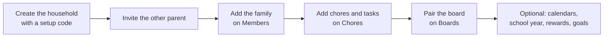

#### Create your household

You need a **setup code** from whoever installed FamilyWise for you. It works once, for 24 hours. FamilyWise has no public sign-up: every household starts from a setup code, and every other parent joins by invitation.

1. Open FamilyWise's setup page (the address ending in `/setup`).
2. Enter the **Setup code**.
3. If you are not signed in yet, enter **Your email** and **Choose a password** (at least 8 characters). If you already have an account, choose **Sign in first** instead.
4. Enter a **Household name**, for example "The Rivera family".
5. Check the **Timezone**. It starts as your device's. The board's day starts and ends in this timezone.
6. Choose when the **Week starts on**: Sunday, Monday or Saturday. Weekly limits in the shop and the Insights calendar follow it. You can change it later in **Settings**, **Family options**; a change starts with the next week.
7. Choose **Create household**.

You land on the admin app's **Home** page as the household's owner, with "Your household is ready. Invite another admin from Settings, Family options, when you like."

#### Sign in

On the **Sign in** page, either:

- enter your **Email** and **Password** under **With your password**, then choose **Sign in**; or
- enter your **Email** under **With a link by email** and choose **Email me a link**. The link works once, for 1 hour, in the same browser.

**Forgot your password?** sends a reset link; then you **Choose a new password** and **Save password**.

> **Note:** FamilyWise doesn't have its own email service yet, so a sign-in or reset link by email may not reach you. Sign in with your password. Your password works from your very first sign-in.

> **Tip:** On an iPhone, add the admin app to your Home Screen: in Safari, tap **Share**, then **Add to Home Screen**. It opens full screen, and it is what makes reminders possible on an iPhone.

#### Invite another admin

Both parents can run FamilyWise. Each has their own sign-in.

1. In **Settings**, open **Family options**. Open **Invite an admin** (folded to its **Invite** button) and enter **Their email**.
2. Choose **Create invite link**.
3. Choose **Copy link** (or **Share** on a phone) and send it to them yourself. No email is sent for you.

The link works once, for 7 days, and only for the email it names. Anyone with the link can use it, so share it only with them. While it waits it is listed under **Waiting to join**, where **Cancel invite** cancels it, and the folded header says how many wait and when the first runs out ("1 waiting · runs out in 2 days"). A new invite to the same email replaces the open one.

**For the person invited:** open the link. It says **Join** and the household's name.

- Already have an account? **Sign in** with the email the invite names, come back to the link, and choose **Join household**.
- New to FamilyWise? **Choose a password** and choose **Create account and join**.
- Signed in with a different email? Choose **Sign out**, then sign in with the invited email.

#### Add the family

Everyone in the family is a **member**: children and adults. Chores, tasks, points and goals belong to members.

1. Go to **Members** and choose **Add a member**.
2. Enter a **Name** (a first name or nickname is enough, up to 40 characters).
3. Choose **Who they are**: **Child** or **Adult**. Children never sign in; they use the board.
4. Pick an **Avatar** (an animal, or **Initials**) and a **Color**, one of sixteen, each with its name. The board shows both, so each person is easy to spot.
5. Optionally, a **Birth year**.
6. Check **Earns rewards**. It starts on for a child and off for an adult. Members who earn rewards collect points, go through approval, and can have goals and streaks. You can change it for anyone, any time.
7. Choose **Add member**.

#### Link your own sign-in

FamilyWise needs to know which member you are, so **My tasks** and **Reminders** can find your own items. Do this once per parent.

- The quickest way: open **My tasks** or **Reminders**. If your sign-in isn't linked, it asks **Which one is you?** and lists the adults with no sign-in. Choose **I'm** and your name.
- Or open your own record on **Members**: an adult's page offers **This is me**.
- Or, as any admin, choose the parent's sign-in under **Their sign-in** on their member page.

Only an adult can have a sign-in. If your record says Child, open it on **Members** and choose **Adult** first.

#### Pair a board

A board is any screen showing FamilyWise's board page: normally the wall touchscreen. It doesn't sign in like a parent. Instead, you pair it once with a code.

1. On the board's screen, open FamilyWise's board page (the address ending in `/board`). It starts on **Pair this board**, with a keypad.
2. On your phone, go to **Boards**. Tap **Add a board** to open it, enter a **Board name** (for example "Kitchen") and choose **Get a pairing code**.
3. The code has 8 digits, shown as two groups of four. It works once, for 10 minutes.
4. Type the code on the board's keypad and choose **Pair this board**.

The board shows the family's day at once. From then on it keeps itself signed in, even after a power cut or a wifi drop. Nobody needs to touch it again.

> **Note:** If the board is a browser where a parent is signed in to the admin app, pairing signs that browser out of the admin app.

### A2 A parent's day
<!-- covers: US-109 US-306 US-307 US-309 US-310 US-316 US-709 -->

**What this is.** The admin app's **Today** and **My tasks** pages. **When.** Whenever you want to see how the day is going, settle what's waiting for you, or put something right. **How.** Open **Today** from the menu.

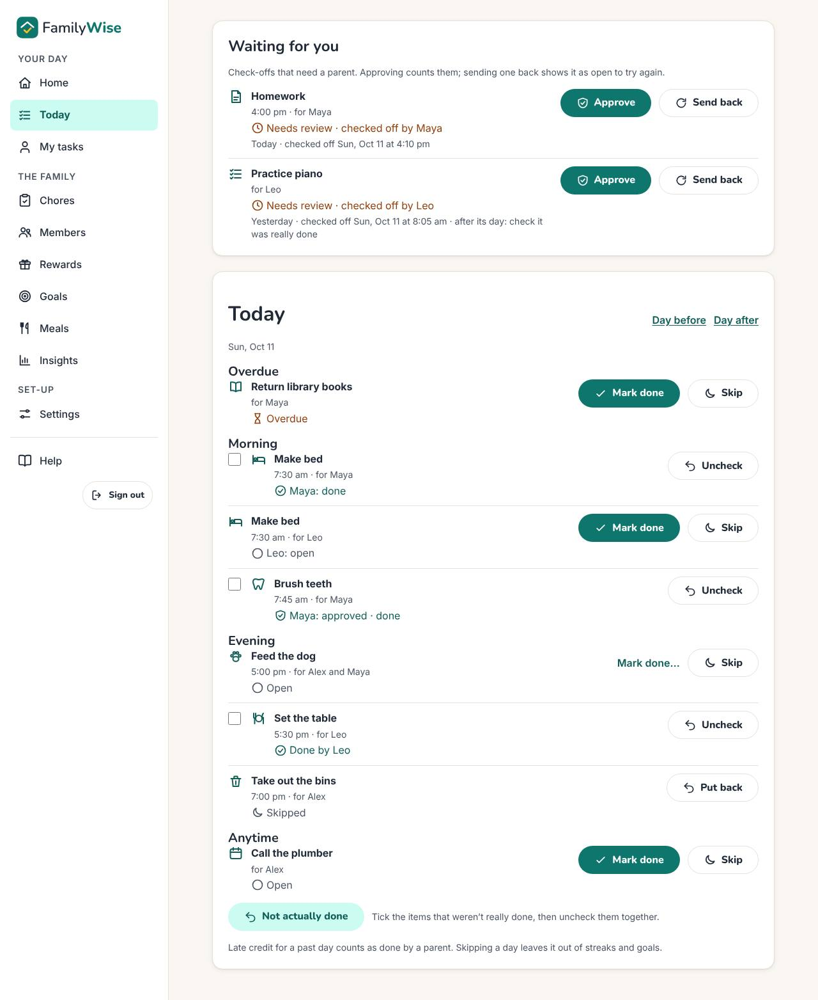

#### Home: what needs you, and quick actions

**Home** is the first page you see. It shows what needs you, then the things you do most, a tap away.

![Home on a laptop: Needs you lists 2 check-offs wait for you (Review), 1 reward request waits for you (Decide), and School can't sync (Calendars); Heads-up says Den hasn't been seen for 3 days (Boards) and No school menu for next week yet (School menus). Below, Quick actions: Add a chore, Add a task, Add a reward and Add a goal, then Add a meal (Plan a meal, New in the library), School lunches (This week: Maya has 1 day to pick; Leo is all set. Pick lunches), School today (No school today, Add a day off) and School menu (Refresh school menu).](guide/img/admin-home-laptop.jpg "Home, on a laptop")

- **Needs you** lists what needs you now, each with a button to where you deal with it: check-offs and reward requests waiting for you, a calendar that can't sync, a school menu that can't be read, and a background job that needs a look.
- **Heads-up** lists what to know soon: no school menu for next week yet, no school year set up (or this one ending within two weeks), weather that hasn't updated, an invite about to run out, and a board that hasn't been seen for a day (switched off, or off the Wi-Fi; a board asleep overnight doesn't count).
- An alert stays while its cause lasts and goes once you've dealt with it. There's nothing to dismiss. With nothing to look at, Home says "Nothing needs you right now."

**Quick actions:**

- **Add a chore**, **Add a task**, **Add a reward** and **Add a goal** open the page that adds one.
- **Add a meal**: **Plan a meal** puts a meal on a day of the week; **New in the library** adds a meal you make again.
- **School lunches** says whose days still need a lunch choice ("This week: Maya has 1 day to pick; Leo is all set."). **Pick lunches** opens **School lunch** on **Meals** in one tap: this week from Monday to Friday, next week on Saturday and Sunday, on the child you chose last on this phone or computer. Tap another child's face there to switch. It shows when a child has school lunch.
- **School today**: **No school today** makes today a snow day in one tap. Today's school-day items (like homework) go at once; anything already checked off stays; the board shows a day off school. **Undo** makes it a school day again. **Add a day off** (a fold) adds a day off or a break on another date, without leaving Home.
- **Refresh school menu** reads your school menu feeds now, rather than waiting for the morning.

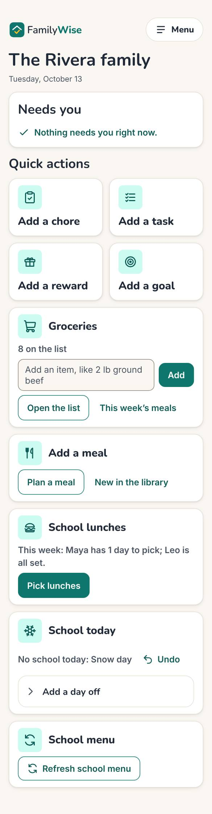

#### Check the day on Today

**Today** shows the whole family's day, grouped like the board: **Overdue**, **Morning**, **After school**, **Evening** and **Anytime**. Each item says who it is for and how it stands, with an icon and a word: **Open**, **Done**, **Approved**, **Needs review**, **Sent back**, **Skipped**, **Missed**, **Overdue** or **Covered**. For an item everyone does their own, each person's line starts with their name ("Maya: done").

Move between days with **Day before** and **Day after**; **Today** brings you back.

#### Approve or send back a check-off

If check-offs wait for a parent (see [Approval: on or off](#approval-on-or-off)), they appear at the top under **Waiting for you**, from any day.

- **Approve** counts it. The points are earned and it counts toward goals and streaks.
- **Send back** shows it as open again on the board ("Try again"), so your child can do it and check it off again.

A check-off marked "after its day: check it was really done" was made after the item's day had ended (for example, a board that was offline at midnight). It always waits for you, whatever the approval setting.

#### Lunch changes from the board
<!-- covers: US-707 -->

When a child changes a day's lunch on the board, Buy or Bring or what they picked from the menu, it waits for you under **Lunch changes** at the top of **Today**, a group for each child: each day with what it usually is, the change, and what they picked. **Approve** sets the day as they asked; **Keep Bring** (or **Keep Buy**, or **Keep as it was** for new picks) leaves it as it was and drops the change. A child with two or more changes has **Approve both** (or **Approve all**). Changes count in the number beside **Today** in the menu, show on **Home**, and are in your approvals alert if you have **Approvals** on in Reminders. A change still waiting at the morning cut-off is dropped: see [Lunches picked at the board](#lunches-picked-at-the-board).

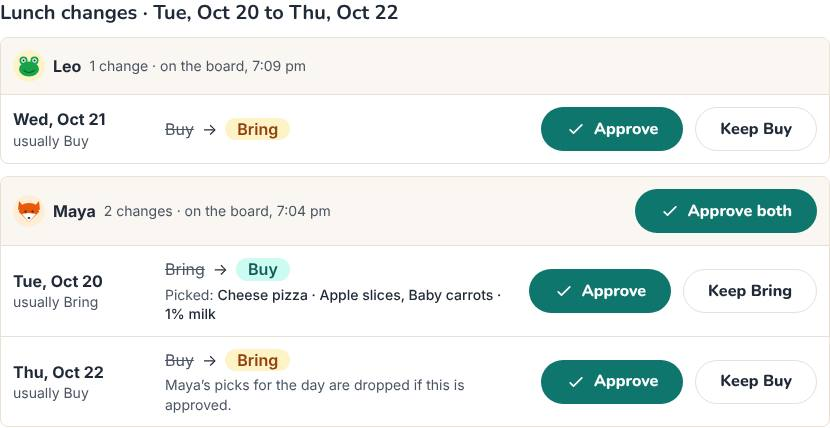

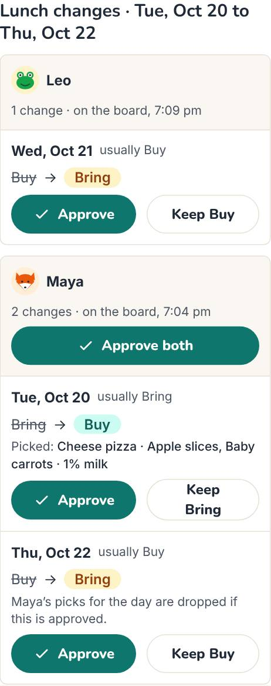

#### Approval: on or off

In **Settings**, open **Family options**, then **Check-offs** (folded to the choice in words). Choose what happens **When a child checks something off**:

- **It counts straight away; a parent can uncheck it later** (the default). Points arrive at once. You check in real life and use **Uncheck** or **Not actually done** if needed.
- **It waits for a parent to approve it.** The board shows **Waiting for a parent** and no points arrive until you approve.

Choose **Save**: **Check-offs** comes back open. Switching changes only what is still to do: check-offs already waiting stay in **Waiting for you**, and ones already done stay done.

Approval applies only to members who earn rewards. A check-off by someone who doesn't earn rewards, like most adults, always counts straight away. Each item can also be set to **Always needs a parent's OK** or **Never needs a parent's OK**, under **Approval** in **More options** on its page.

> **Tip:** **Insights** shows how often you uncheck or send back each child's check-offs. Few means check-offs can count straight away; many means they should wait for you.

#### Mark done, skip, uncheck

Each item on **Today** has the buttons that make sense for it:

| Button | What it does | Shown for |
|---|---|---|
| **Mark done** | Checks it off as a parent. It counts at once, as approved, and earns its points. | Open, sent back or missed items. A chore only once its day has come; a task any time. |
| **Mark done…** | Asks **Who did** it, then **Mark done**. Tick one or several people. | A shared item with several people. |
| **Skip** | Leaves it out for that day. "It won't count for or against anyone." | Open, sent back or missed items, on any day. |
| **Put back** | Undoes a skip. | Skipped items. |
| **Uncheck** | Makes it not done. Its points are taken back. | Done or approved items. |
| **Approve** / **Send back** | Decides a check-off that waits for a parent. | Items waiting for review. |

**Late credit.** Go back with **Day before** to a past day and use **Mark done** on a routine that was missed. It counts as done by a parent and earns its points; streaks and goals are worked out again. Only a parent can catch up a past day: the board shows today only.

**Skipping ahead.** Go forward with **Day after** to skip a day in advance, for example for a sick day or a trip.

#### "Not actually done"

When your child checked off things they didn't really do, uncheck them together:

1. On **Today**, tick the box beside each item that wasn't really done.
2. Choose **Not actually done**.

They go back to open (or to missed, if their day is over), and their points are taken back once each. The banner says "Unchecked 2 items. Their points are taken back." with an **Undo** button: if you unticked the wrong ones, **Undo** puts back each item that hasn't changed since, done by whoever had done it, with its points.

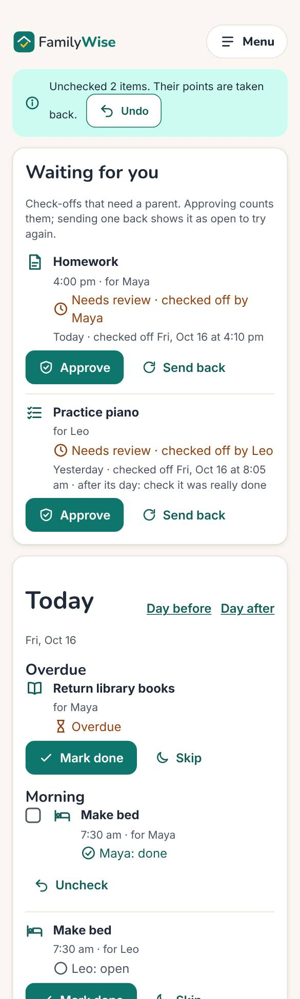

#### My tasks and quick add

**My tasks** is your own list, on your phone: everything you are on, including shared items.

- **Overdue**: your tasks from earlier days that are still open.
- **Today**: everything due today.
- **Coming up**: the next seven days.

**Mark done** credits only you. **Uncheck** takes it back. The **Bell on** / **Bell off** button beside each open item says whether it reminds you (see [A3](#a3-reminders-on-your-phone)).

**Quick add:** type under **Add a task for today** and choose **Add**. It becomes a task for you, due today, with no points, visible to the family. It shows on the board straight away.

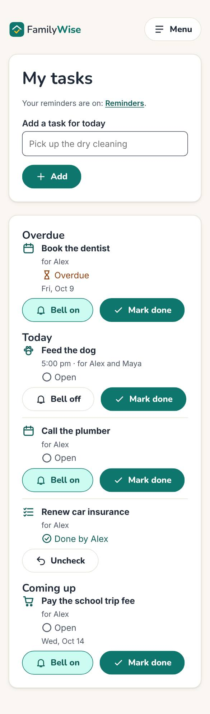

### A3 Reminders on your phone
<!-- covers: US-317 US-318 US-319 US-322 -->

**What this is.** Notifications on your phone or computer when one of your items comes due. **When.** If you want a nudge for your own tasks. Reminders are off until you turn them on, and they are yours alone: nobody else sees your settings. **How.** Open **Reminders**.

1. On an iPhone or iPad, first add FamilyWise to your Home Screen (**Share**, then **Add to Home Screen**) and open it from there.
2. On **Reminders**, choose **Turn on reminders**. Your browser asks to allow notifications: allow them.
3. Open **My devices** and choose **Send a test**. A notification should arrive in a moment.
4. Do the same on each phone or computer you want reminders on (the button then reads **Add this device**).

Then open **When to remind me**, set it and choose **Save**:

| Setting | What it does |
|---|---|
| **Remind me about new items (each has its own bell)** | Whether a new item reminds you until you change its bell. On by default. |
| **Remind me** | **At the due time**, **15 minutes before** (default), **1 hour before** or **1 day before**. An item can say otherwise. |
| **Items with no due time remind me at** | The time of day for items without a due time (8:00 am by default). |
| **Daily digest** | **Send me a summary of my day** at a time you choose: what's overdue and due today. Nothing is sent on a day with nothing to do. |
| **Quiet hours** | **Hold reminders during quiet hours**, **From** and **To** (they may run past midnight). A reminder that falls inside them comes when they end. |
| **Approvals** | **Tell me when a check-off or a reward request waits for me**. On by default. See below. |
| **Hide the names of private items on my lock screen** | On by default: a private item reads "Private task" or "Private chore" instead of its name. |

A reminder shows the item's name and when it is due ("Due at 3:00 pm", "Due today", "Due tomorrow at 9:00 am"). Tapping it opens the item in **My tasks**. A digest reads "Your day: 3 to do, 1 overdue" and names up to three items.

**Choosing which items remind you.** In **My tasks**, each open item has a bell: **Bell on** or **Bell off**. Tap it to switch that item for you only. On an item's page, **Reminders** sets how early that item reminds everyone ("As each person chose", or a fixed time).

**Told when something waits for you.** With **Approvals** on, you get an alert when a child checks off something that needs your OK, or asks for a reward. It comes within seconds, each time something new waits, and counts everything still waiting for you, by child: "Maya: 3 check-offs and 1 reward request waiting". A newer alert replaces the older one on your lock screen. Tapping it opens **Today**, where they wait under **Waiting for you**, or **Rewards** when only reward requests wait. Quiet hours hold it, and if the other parent has dealt with everything by then, nothing comes. You aren't told about a reward you asked for yourself, or a private item you can't see, and the alert never shows an item's name. When you turn it on, the first alert comes when something new waits from then.

The alert is only for a check-off that waits for you. With approval off in **Family options** (the default), a child's check-off counts straight away and brings no alert, unless its item is set to **Always needs a parent's OK**. To hear about every check-off, turn approval on: see [Approval: on or off](#approval-on-or-off).

Folded, **My devices** says how many devices you have, which are on and when one was last reached; **When to remind me** says your settings in one line ("15 minutes before · no due time at 8:00 am · digest at 7:00 am · quiet 9:00 pm to 7:00 am · approvals on"). The one you just saved in comes back open.

Reminders come only for items you are on, at most once each, and never after the item is done. **Turn off reminders** stops them all; your devices stay listed for when you **Turn reminders back on**.

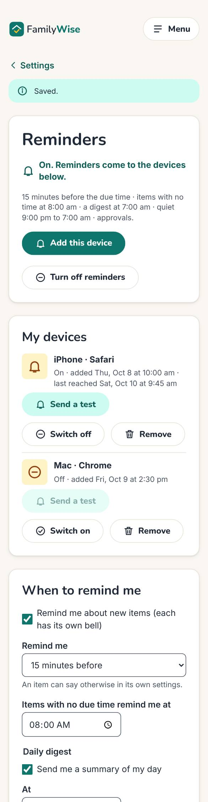

### A4 Setting up chores and tasks
<!-- covers: US-301 US-302 US-308 US-311 US-312 US-313 US-314 US-315 US-320 US-321 -->

**What this is.** The family list: everything anyone in the family does, adults included, on **Chores**. **When.** At the start, then whenever something changes. **How.** Go to **Chores** and choose **Add a chore** or **Add a task**.

**Chore or task?**

- A **chore** is a routine, like making your bed. If it isn't done on its day, it counts as **missed**.
- A **task** is a to-do, like returning library books. It stays open, and shows as **Overdue**, until it's done. It is never missed.

#### Add an item

1. Choose **What it is**: **Chore** or **Task**.
2. Enter its **Name** (up to 80 characters).
3. Tick **Who it's for**: anyone in the family, one or several people.
4. With two or more people, choose **With several people**:
   - **Everyone does their own**: each person has their own to check off, like making their own bed. Each person's check-off, points and miss are their own. New chores start like this.
   - **Any one of them**: done once, by whoever gets to it, like feeding the dog. New tasks start like this.
5. Choose **How often**: **Every day**, **Some days** (tick the days), **Monthly** (a **Day of the month**; the 31st falls on the last day of a shorter month) or **Once** (a date).
6. Optionally, a **Due time**. It orders the day into Morning (before noon), After school (noon to 5 pm) and Evening (from 5 pm); items without one are **Anytime**. It never changes points.
7. Pick an **Icon**: open **Icon** (closed, it names the one chosen), then type a word in **Find an icon** (like *fish*, *laundry* or *piano*), or choose a group such as **Home** or **Pets and garden**. **Chosen:** under the picker names the one you picked.
8. Set **Points**: 5 for a new chore and 0 for a new task, until you change it. Only members who earn rewards collect points.
9. Optionally, tick **Tags** (see below).
10. Optionally, switch on **Private** (see below).
11. Under **More options**, optionally set **Approval**, **On these days** (for example, homework on **School days** only) and **School lunch** (see [Chores on lunch days](#chores-on-lunch-days)).
12. Choose **Save**, or **Save and add another** to enter the next one straight away.

> **Tip:** **Save and add another** keeps the same kind (chore or task), so you can enter the whole family list in a few minutes.

> **Tip:** Searching or choosing a group only changes which icons you see. The icon you chose stays chosen, even when it is out of sight, until you pick another.

#### Change or archive an item

Choose **Edit** beside it. Its page shows the form, then **Coming up** (the next two weeks) and **Last 7 days** (what happened each day). The next two weeks are always planned ahead.

- A change applies from today. Today's item follows the change unless something has already happened to it, like a check-off or a skip; days already past keep what they were.
- **Archive** takes it off the list and the board; its history stays. **Restore** puts it back.

#### Shared items and who did it

An item for several people with **Any one of them** is one item a day, shared. Whoever checks it off is recorded as doing it, and it is done for everyone. For the others it counts as **Covered**: neither done nor missed. If several people did it together, pick them all: each one who earns rewards gets the points. If nobody does a shared chore, it is missed for everyone on it.

#### Chores on lunch days

Some chores only make sense on the days a child brings lunch: packing it in the morning, emptying the lunch box after school. Under **More options**, **School lunch** chooses:

- **Any day**: as usual. New items start like this.
- **Days they bring lunch**: each child has it only on the days they bring lunch.
- **Days they buy lunch**: each child has it only on the days they buy (say, "Take lunch money").

It follows each child's lunch as **Meals** has it (see [School lunch: buy or bring](#school-lunch-buy-or-bring)): the usual week, and any day you changed. An adult never has it, and nobody has it at a weekend, in a break or on a day off. Change a child's lunch and their list follows at once, today included: if Maya buys today after all, today's "Pack lunch" leaves her list straight away. One she already checked off stays.

Each child has their own lunch, so a lunch-day item is always **Everyone does their own**: choosing lunch days sets it, and **Any one of them** waits until you choose **Any day** again. The list shows it after how often it happens, like "Every day · on days they bring lunch".

#### Tags

Tags group the list, like Morning or Kitchen. Use them to filter **Chores** and to set goals that count by category.

1. Open **Settings** and choose **Tags** (or **Tags** under the list on **Chores**, or **Add or change tags** in an item's form).
2. Enter a **Name** (up to 30 characters), pick a **Color** and, optionally, an **Icon** (**People and labels** comes first among the groups; **No icon** leaves it without one), then **Add tag**.

Renaming a tag keeps every goal working. **Archive** a tag to stop offering it; goals and history that use it keep working, and **Restore** brings it back.

#### Private items

Switch on **Private** for a surprise or a personal item. A private item never shows on the board. Only you, and the people it's for who sign in, can see it. Only the person who created an item can make it private or family-visible again.

#### Find things on the list

At the top of **Chores**, filter by **Person**, **Tag**, **Kind**, **Time of day**, and **Show** (**Active** or **Archived**), then choose **Filter**. **Clear** shows everything again. Each line shows how often it happens, its due time, its points, when it is next due ("Next: Today"), and "Overdue since" for an open task.

### A5 The family at the board
<!-- covers: US-303 US-304 US-305 US-1001 US-1002 US-1005 US-1006 US-1008 US-905 US-705 US-708 US-804 -->

**What this is.** The wall board: the family's day, for everyone. **When.** All day. **How.** Just tap. Every button on the board is big enough for a child's finger and answers at once.

#### The home screen

The home screen fits the screen: nothing hides under the bar, and the page never scrolls. It has three parts:

- **The calendar** on the left: the next few days (5 by default). All-day events run across the top; when a day has more than fit, its heading says how many more ("+2"). Under them, each hour with something on has a row, lined up across the days, with the time it starts and a red line at now. Tap an event to see it in full. Tap a day's heading to open it in **Calendar**. To look further ahead, tap **Month**, **7 days**, **5 days** or **3 days** at the top of the calendar. That changes only this board, and only for now: when the board goes home after 90 seconds untouched, it is back to the view set on **Boards**.
- **Today's meals** at the top on the right, on a day with meals planned: **Breakfast**, **Snack**, **Lunch** and **Dinner**, each with its picture, and a face for each person it's for (none when it's for everyone). On **Lunch**, each child says **Buys** with the day's entree choices ("Cheese Pizza or Turkey sandwich with Pretzels", cut short with "…" when it doesn't fit), or **Brings** with what is planned for their lunch. Tap a buy day's choices to see the day's whole menu, a section at a time (Entree, Fruits & Vegetables, Milk); **Close** shuts it. A parent can hide it (see [A11](#a11-the-boards-home-screen-layout)).
- **Today's list** on the right, under today's meals: one list for the whole family, grouped into **Overdue**, **Morning**, **After school**, **Evening** and **Anytime**, with "2 of 9 done" at the top. Each row shows the item, its points, and a face for each person it is for.
- **Cards** in a row under the calendar: **Goals**, **Waiting for a parent** and **Coming up** (all-day events in the next three weeks). A parent chooses which cards show, and in what order (see [A11](#a11-the-boards-home-screen-layout)). Tap a goal to open that child's screen (a family goal opens **Chores**), a request to open the child who asked, or an event to open **Calendar** on its day. When a list is longer than its card, it scrolls inside the card.

Down the left is the rail: **Home**, a button for each person (with their points, if they earn rewards), and **Chores**, **Calendar** and **Meals** at the bottom. It never moves. Every other screen scrolls inside itself, under the bar and beside the rail.

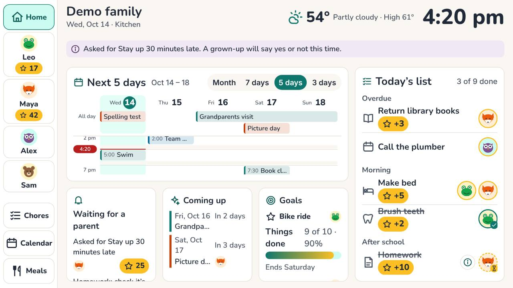

#### Check something off with a face

On **Today's list**, tap the face of the person who did it. The face gets a check mark straight away, and the points go to that person if they earn rewards. If the item waits for a parent, the face shows an hourglass instead, and the points come when a parent approves.

- An item **everyone does their own** is one row with a face each: tap your own face.
- A **shared** item shows the faces of its people: tap the one who did it.
- **Anyone** (a face with a family icon) appears on a shared item with nobody on it. Tapping it asks who did it.

How a face looks tells you how it stands:

| Face | Means |
|---|---|
| Plain | To do |
| Ring in the sun color | Past its time (today, after its due time) or overdue |
| Ring with a check | Done |
| Dashed ring with an hourglass | Waiting for a parent |
| Dashed grey ring | Done by someone else (covered), or skipped today |

When nobody on a row has anything left to do, its name is crossed through.

#### Undo a mistaken tap

Tapped the wrong thing? You have **2 minutes** from the check-off to undo it on the board.

- **On the home screen:** tap the done face again. It is outlined; tap it once more within 4 seconds to undo.
- **On a person's screen or Chores:** tap **Undo** under the tile. It changes to **Tap again to undo**; tap within 4 seconds.

After 2 minutes the **Undo** button goes away. A parent can still change it in the admin app.

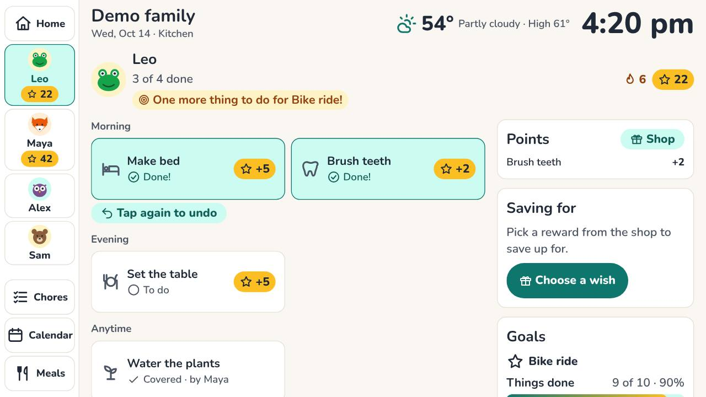

#### A person's screen

Tap a person in the rail to see their own day: their name, "3 of 4 done", and their items as big tiles. A tap on a tile checks it off for them, even a shared one. When everything is done it says "All done today. Nice work!"

For someone who earns rewards (usually a child), the screen also shows:

- their **points**, and a **flame** with their run of good days (see [A8](#a8-streaks-and-insights));
- a **nudge** when a goal is nearly reached, like "One more thing to do for Bike ride!";
- a **Points** card with their five latest points and a **Shop** button;
- **Asked for** (their requests), **Saving for** (their wish) and **Goals**.

Anyone's screen also lists **Today**: today's events from their own calendars and the family's, and **Today's meals**: what's planned for everyone and for them, and a child's own lunch.

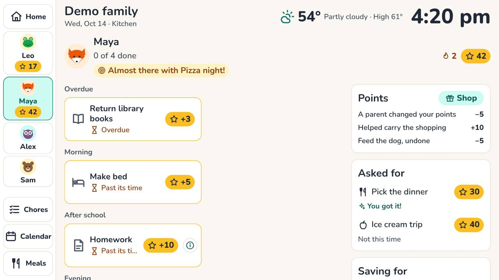

#### The Chores screen

**Chores** shows everyone's day side by side: a column per person, each with their items by part of the day, their flame and points. The family's goals sit underneath.

A tap on a tile credits that column's person when it is their own item or an item for one person. For a shared item with several people, the board asks **Who did** it: the item's people come first, then everyone else, and the column's person is already ticked. Tick one or several, then **Done** (or **Cancel**).

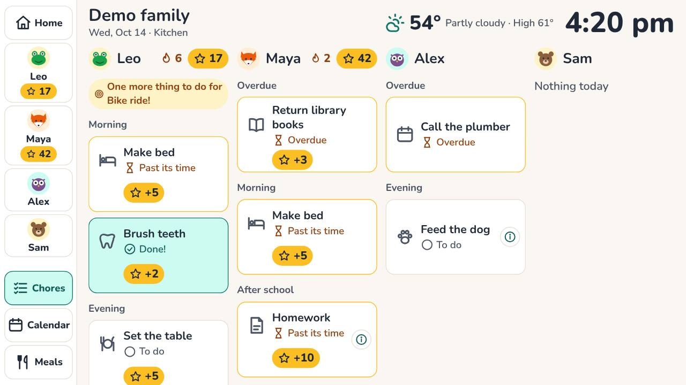

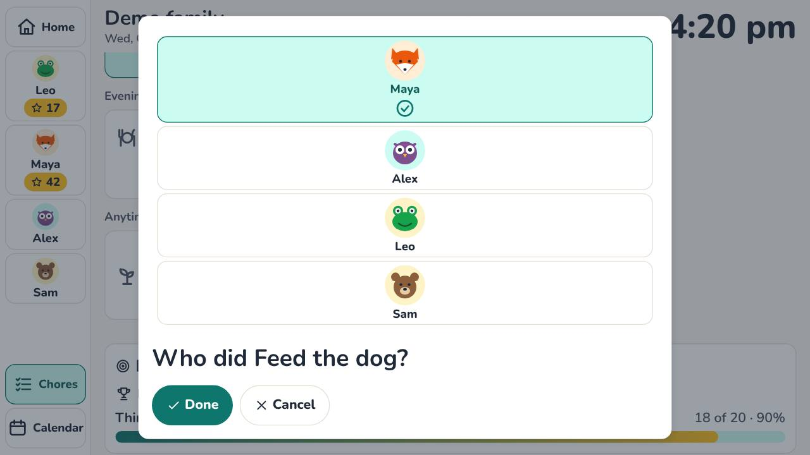

#### More info

Every tile is the same height and a name may be cut short. A row or tile whose name doesn't fit, or that has a description, has a small **i** button: **More info**. It opens the item in full: its description, **When** it's due, its **Points**, and **Who** it is for with how each person stands. **Close** shuts it.

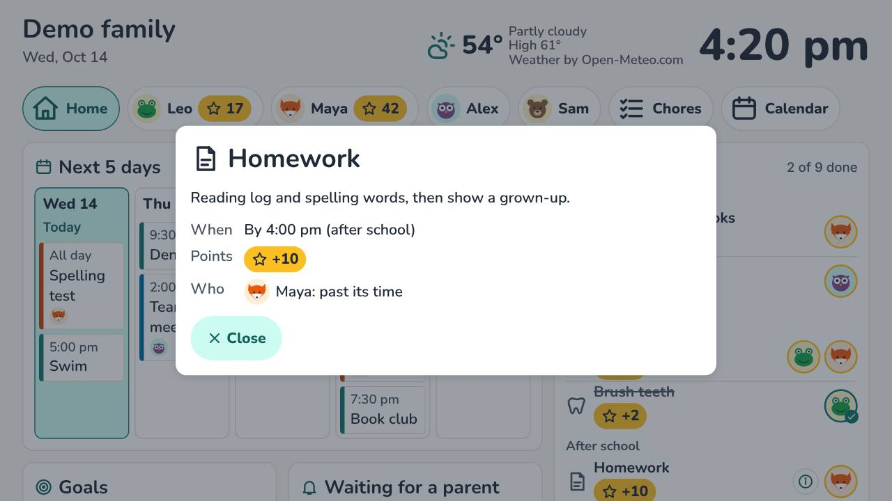

#### Back home on its own

After **90 seconds** with nobody touching it, the board goes back to the home screen, scrolled to the top, and closes the shop, the wish picker, More info and an unanswered **Who did** question (which records nothing, as **Cancel** does). The next person always finds the whole family.

#### When the internet drops
<!-- covers: US-205 US-206 US-204 -->

The board keeps working without the internet. Check-offs and undos still work and show at once; the board saves them and sends them as soon as it can, each exactly once, even after a reload.

While it waits, the bar says **Offline: your check-offs are saved**, and a balance that counts unsaved check-offs has a dashed ring and a no-wifi mark ("Not saved yet"). When the connection returns, everything is sent and the board shows what the server recorded.

Asking for a reward, calling a request off and choosing a wish need the internet. Offline, the board says so ("Asking needs the internet", "Choosing a wish needs the internet.") or greys the button out.

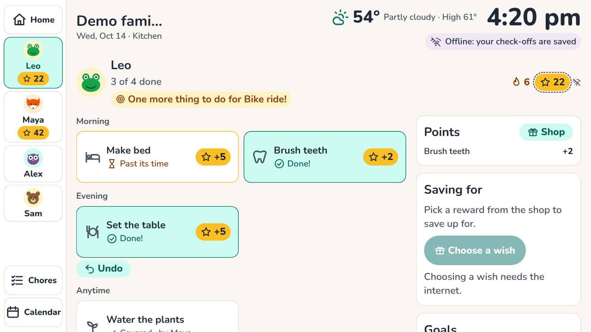

The board also tells you when what it shows may be old:

- **Updated 12 minutes ago** (or hours, or days): it hasn't been able to read the latest for over 5 minutes.
- **Today's list may be out of date**: the jobs that plan the days ahead or close the day are late or failing.

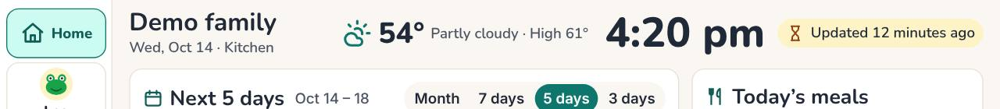

Changes a parent makes in the admin app reach the board within seconds while it is connected.

### A6 Points, rewards, the shop and wishes
<!-- covers: US-1101 US-1102 US-1103 US-1104 US-1105 US-1106 US-1107 US-1108 -->

**What this is.** A points economy for children: points for things done, spent in a shop of rewards a parent keeps. **When.** Once your children have chores. **How.** Set up the shop on **Rewards**; children ask on the board; you decide in the admin app.

#### How points work

- An item's points are earned when it is done (or approved) by someone who earns rewards. Items done together pay each person their points.
- Undoing or unchecking it takes those points back. A balance can go below zero; the board shows that calmly as points "to earn back".
- Nothing in the points history is ever edited or deleted. A mistake is put right with a new entry.

A child's check-off, from tap to points:

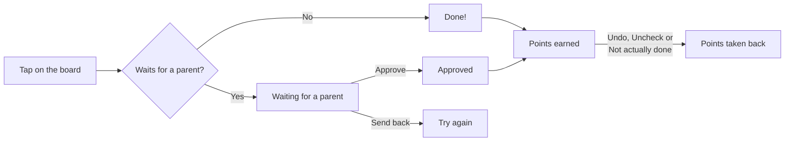

#### Give or take away points by hand

On **Members**, open a child and find **Points**:

1. Choose **Add** or **Take away**.
2. Enter the **Points** (1 to 10,000).
3. Say **Why** (up to 200 characters).
4. Choose **Add points** or **Take away points**.

The board's points list shows the reason for points added. Points taken away read only "A parent changed your points": the reason stays in the admin app, so the board never tells a child off.

#### Build the shop

1. On **Rewards**, choose **Add a reward**.
2. Enter a **Name** and a **Cost in points**.
3. Optionally: a **Description**, an **Icon**, a **Photo** (JPEG, PNG or WebP, up to 2 MB), **How many there are**, and **Times each child may ask in a week**.
4. Keep **In the shop now** ticked, and choose **Add reward**.

A reward with none left shows "All gone for now" on the board. **Archive** takes a reward out of the shop; requests already made keep the cost they had.

#### A child asks for a reward

On their own screen, a child taps **Shop**. The shop shows what they have **to spend** (their points, less what they have already asked for) and every reward:

- **Ask for this**, then **Yes, ask** to be sure (or **Not now**). A stray tap never spends anything.
- Or a line saying why not yet: "58 more points to go", "All gone for now", "Asked for this week. Try next week!" or "Asking needs the internet".

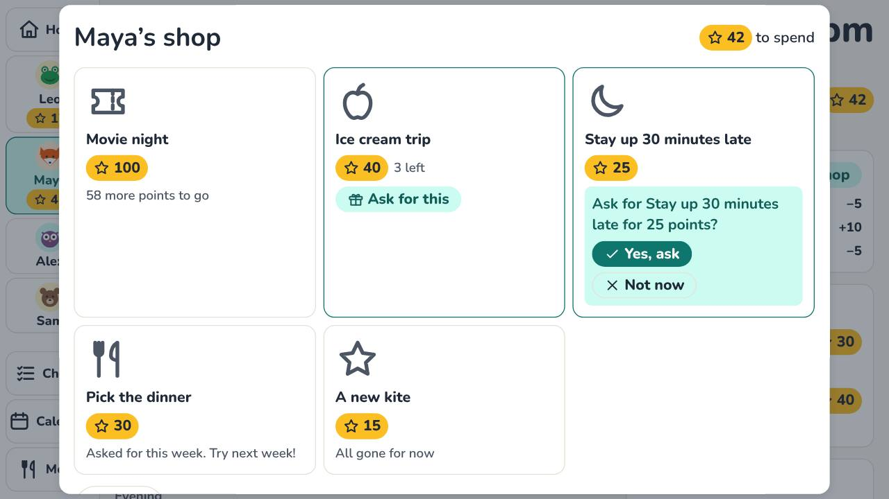

The request shows at once under **Asked for** as "Waiting for a grown-up". While it waits, the child can call it off with **Call off**. The points it holds show as "waiting for a grown-up" on the **Points** card.

#### Decide a request

On **Rewards**, under **Asked for**, each request shows the child, the reward, its cost and the child's points:

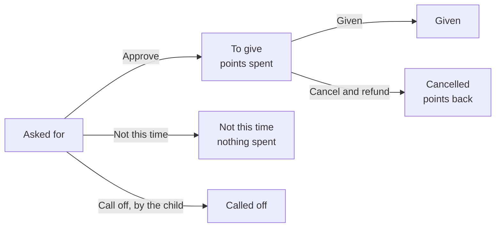

- **Approve** spends the points and moves it to **To give**. The board says "Yes! It's coming".
- **Not this time** spends nothing. The board says "Not this time".
- Under **To give**: **Given** once it has happened ("You got it!"), or **Cancel and refund** to give the points back. A reward already given can't be cancelled.

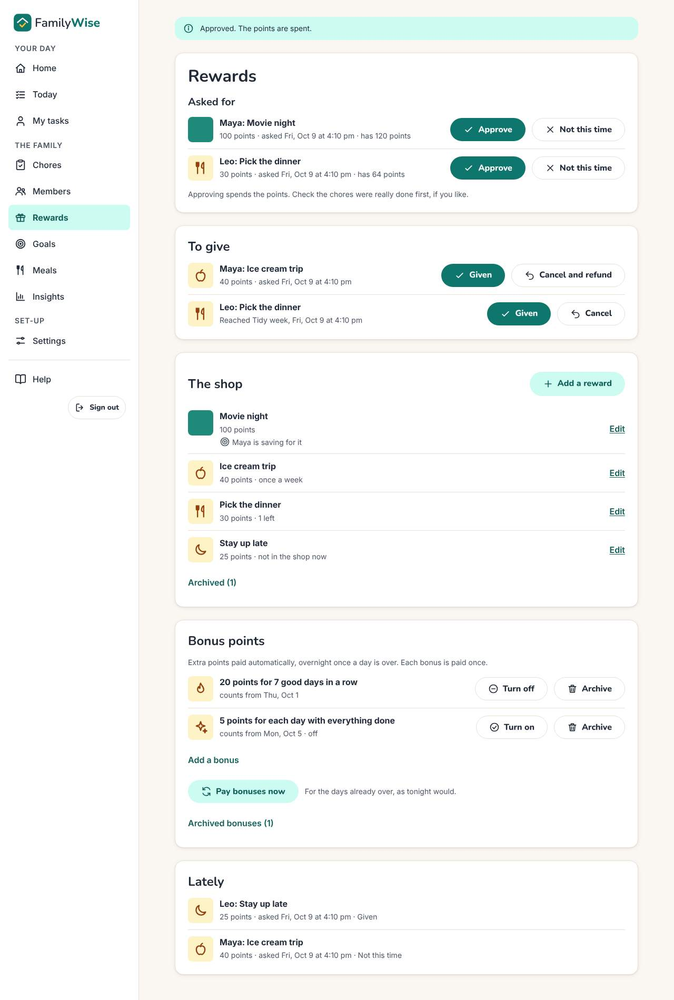

#### Bonus points

Bonuses pay extra points automatically, overnight once a day is over. On **Rewards**, under **Bonus points**, open **Add a bonus**:

- **A streak**: points once for each run of **Good days in a row** (2 to 365) that reaches the length. A run that goes on pays nothing more; a new run pays again.
- **A perfect day**: points for each day with everything on the list done.

Set the **Bonus points** (1 to 1,000) and **Counts from** (days before it never pay), then **Add bonus**. **Turn off** pauses a bonus; **Turn on** counts again from that day, so a pause never pays a backlog. **Archive** retires it; bonuses it paid stay. **Pay bonuses now** pays, for the days already over, what tonight would. A bonus once paid is never taken back.

#### Wishes: saving up

A child can pin one reward as their wish. On their screen, **Saving for** shows it with a meter, "42 more points to go." or "You have enough!", and **Ask for it** once they can.

- **Choose a wish** (or **Change**) opens **What is** (name) **saving for?**: tap a reward, or **No wish** to clear it.
- If the reward leaves the shop, the wish isn't shown until it comes back or the child chooses again.

On **Rewards**, a reward someone is saving for says so ("Maya is saving for it").

### A7 Goals and celebrations
<!-- covers: US-401 US-402 US-403 US-404 US-405 US-406 US-407 US-409 -->

**What this is.** Something to work toward, for one child or the whole family, with rules that check-offs fill in. **When.** Whenever you want a target: a movie night after 20 things done, a trip after a week of good days. **How.** On **Goals**, choose **Set a goal**.

#### Set a goal

1. Enter a **Name** and, optionally, a **Description**.
2. Choose **Who it's for**: someone who earns rewards, or **The whole family** (which counts what everyone does).
3. Set when it **Starts**: tap the date ("Mon, Oct 12, 2026") to pick another. To give it an end date, tick **Ends on a date** and choose the day. Left unticked, it has no end date and keeps going until it's reached or you end it.
4. Set the **Rule**: what it **Counts** and its **Target**:
   - **Things done**: items done within the goal's dates.
   - **Days with everything done**: days when every routine was done.
   - **Good days in a row**: a streak, with **Misses forgiven a week** (0 to 3, 1 by default).
   - **Points earned**: points from items done.
5. Choose **What counts**: **Everything**, **Some tags** or **Some items** (each item with its picture). On a goal you've already set, **What counts** shows as one line ("Some items: Homework home"); tap it to change it.
6. Optionally, **Add a rule** (up to 5), and choose whether **It's reached when** **Every rule is met** or **Any one rule is met**. With two or more rules, each one can fold to a line such as "Every day it's due: Homework home, by 6:00 pm": tap a line to open that rule, and **Done** to fold it again. Open as many as you like. A rule that still needs something (an item to count, say) stays open and says what.

As you fill it in, the form says what it means for this week, under the rule: "This week Homework home is due 4 days for Maya (Friday, Oct 16 is a teacher planning day), so this week needs 4. A normal week needs 5." The normal week counts only the days off on which one of the rule's items would have been due. It changes as you change the form, worked out the same way as **Preview**.

7. Choose **What reaching it pays**:
   - **Points**: type the points (1 to 10,000) in the box beside it. They go to the child when it's reached. A family goal pays them to each child who earns rewards.
   - **A reward from the shop** (a child's goal only): choose the **Reward**. It is approved for them at once and costs them nothing; you mark it given on **Rewards** as usual. A reward taken out of the shop can still be a goal's prize.
   - **Something else**: you give the reward yourself and mark it redeemed.
8. Open **Icon, shown when there's no photo** to pick another icon (it shows the one chosen while it's closed), or choose **Choose a photo**. To see where it would start from what's already done, choose **Preview**. Then choose **Set the goal**, or **Cancel** to go back to Goals.

#### Follow a goal

**Goals** lists the goals in play, each with a meter per rule and its state: **Starts later**, **Going**, **Achieved** (or **Achieved again**). Progress follows the check-offs: if one is undone, the goal follows it, and an achieved goal can go back to going. Progress is worked out again within about five minutes of any change, and every time you open **Goals**.

On the board, goals show as meters on the home screen's **Goals** card and on a child's own screen; the family's goals also sit under **Chores**. A nudge names a goal that is nearly there: one thing or one day to go, a few points to go, or "Almost there with" the goal at 90%.

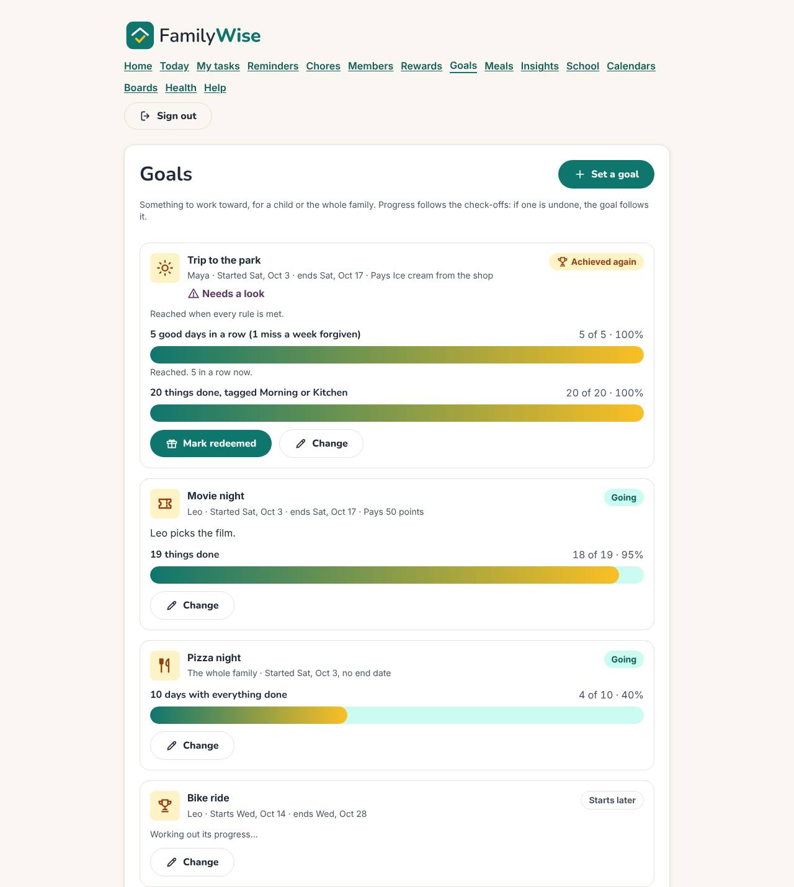

#### When a goal is reached

The board celebrates it full-screen, once, on whichever board shows it first: "Leo reached Bike ride! Well done! A grown-up will sort out the reward." Tap **Yay!** to close it (it closes by itself after 10 seconds). With reduced motion turned on, nothing moves; the words are the same.

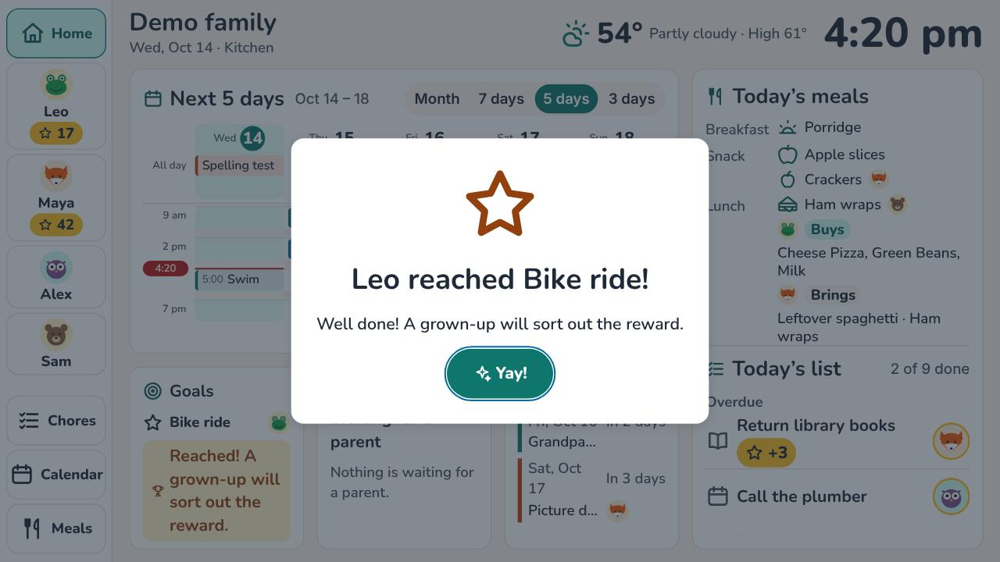

What it pays is paid at the same moment, once, however often its progress is worked out: the points show in the child's points, or the reward from the shop is on **Rewards** under **To give**, marked "Reached" and the goal's name. Then, on **Goals**, give the reward in real life and choose **Mark redeemed**. The goal moves to **History**.

If a check-off the goal needed is undone, the goal goes back to going and what it paid is undone too, once: its points are taken back (the balance can go below zero), and a reward from the shop not yet given is called off. Reached again, it pays again. A reward already marked given stays given, and the goal is marked **Needs a look**.

A child's own check-offs celebrate too, in a small way: when a check-off earns points, the check pops and the points count up. A check-off by someone who doesn't earn rewards doesn't celebrate.

#### Change or cancel a goal

Choose **Change** to open a goal. Before it starts, everything can change. Once it has started, who it's for and its start date stay as they are; changing its rules or end date works its progress out again from every check-off. What it pays can change, and applies the next time it is reached.

To take an end date off, untick **Ends on a date**, or choose **Clear** beside the date, and save: the goal has no end date and keeps going. To change the date, tap it and choose another day; a goal that has started ends today or later. A goal with no end date can be given one the same way: tick **Ends on a date** and choose the day. This works on an iPhone too.

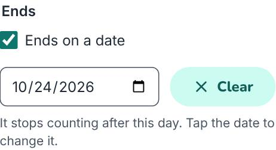

Once a goal is reached, its rules, dates and payout stay as they are, so a change can't take back what reaching it unlocked; its name, description and picture can still change. If a check-off it needed is undone, it is going again and can change. Once it is redeemed, ended or cancelled, its rules, dates and payout stay as they are.

Before you save a change, choose **Preview**. It works the goal out from every check-off as the form has it, and nothing is saved:

- a line saying what saving would do: reach it now (and what it pays), end it, or how its progress moves;
- a table with each rule's progress **Now** and **After saving** (a rule you changed shows **New or changed**), and the goal's.

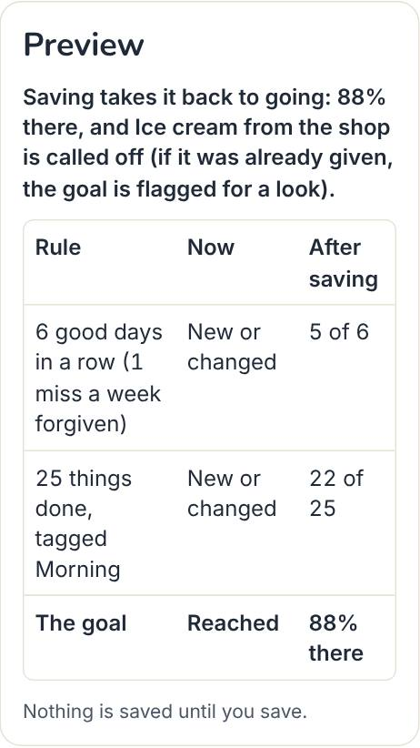

The goal's page folds **What happened** to it to its latest line; open it for each event, with when and who. **Cancel**, set apart at the bottom (open it, then choose **Cancel** and the goal's name), stops it counting and moves it to **History**. Goals are never deleted. **History** on Goals is folded to how many are redeemed, ended and cancelled, with "needs a look" on it when one does.

A goal marked **Needs a look** had its reward given (redeemed, or its reward from the shop marked given) and then a check-off it needed was undone. A redeemed goal stays redeemed; points it paid are taken back, and put back if it is met again. Have a look, then choose **Clear**: it isn't marked again unless it stops being met again.

### A7a Goals that repeat
<!-- covers: US-410 US-411 -->

**What this is.** A goal that starts again each week, month or school term, and is won or missed one period at a time: "Homework home every school day, each week". **When.** For a habit, rather than a one-off target. **How.** On **Goals**, choose **Set a goal**, and under **Repeats** choose **Each week**, **Each month** or **Each school term**.

- **Each week** follows your family's week. **Each month** is the calendar month. **Each school term** follows the child's school year (the family's, for a family goal); days between terms don't count. A goal that starts mid-week counts only the days left in that week.
- Once it repeats, **Counts** offers **Every day it's due**: a day counts when everything it counts that is due that day is done. Choose what counts (for homework, **Some items** and the homework item). A short week needs only its days: with Friday a day off school, a week needs Monday to Thursday.
- **Misses allowed each week** is 0 to 3 (0 by default). With 1, a week of 5 needs 4. Today is never a miss; a day you skip isn't due.
- **What each week pays** is paid once for each week won: points, or a reward from the shop, which goes to **To give** once a week. For a bigger reward after several weeks, set a second goal later that counts the weeks won (coming with WP-82).
- The other rules work too, inside each period: "20 things done each week".

How a goal repeats is fixed once it starts. Its rules, misses and what it pays can still change: a change counts from this week, or from next week if this week is already won. A week already won keeps its rules and what it paid.

**A week won or missed.** As soon as the days it needs are done, the week is won and pays. When a day is missed beyond the misses allowed, the week is lost at once: the goal says "Missed, starts again Monday, Oct 19", with no part credit and no restart mid-week. If you tick a missed day late for your child, even after the week has ended, the week is worked out again and can still be won; if a check-off it needed is undone, what that week paid is taken back. A week of school break, with nothing due, is neither won nor missed.

**On Goals,** a repeating goal shows how it repeats and what it pays, **Going**, **Missed this week** or **Won this week**, this week's days ("This week: 3 of 4 days · Friday no school") with a mark for each, and its last weeks: "Won 3 of the last 4 weeks".

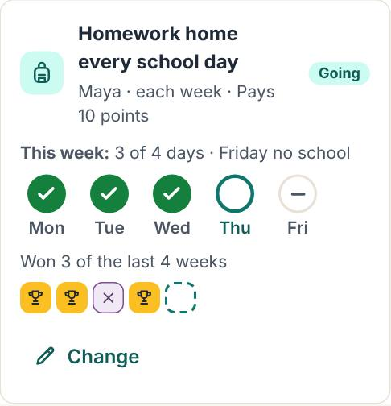

On the goal's page, **Weeks** is folded to "Won 3 of the last 4 weeks" and the points paid; open it for each week, newest first, with its days and what it paid.

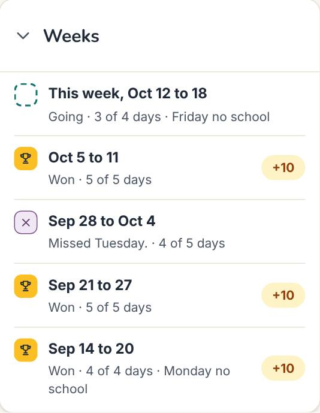

**To stop it,** open **Stop or cancel** at the bottom of the goal's page. **Stop after this week** ends it on the last day of this week, so this week still counts and pays. **Cancel** stops it now; nothing more is paid. You can also give it an end date in the form.

**On the board,** your child's screen shows the goal with a mark for each day of this week (done, missed, today, a day off school), "Days · 10 points" with how many of how many, "Today makes it!", and their last weeks. A lost week says "Missed, starts again Monday, Oct 19"; a won week says "Won this week! 10 points." and is celebrated once.

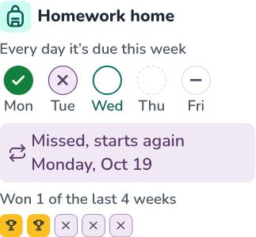

### A7b Goals done by a time, and in steps
<!-- covers: US-412 US-413 -->

**What this is.** A goal that counts only what is done by a set time ("homework before 6 pm"), and a goal that pays less for less instead of nothing. **When.** When on time matters, or when nearly there should still earn something. **How.** In the goal form, under each rule, and under what it pays.

- **Counts only when done**: **Any time that day** (as before), **By each chore's due time**, or **By** a time you set. A tick after the time still completes the chore and earns its points; it just doesn't count for this goal. A chore without a due time, under **By each chore's due time**, counts any time that day. The tick's own time decides, even when the board was offline. Your own tick after the time doesn't count either.
- **Pay in steps** (when it pays points): the points you set are the top step. On **Every day it's due**, the steps are days missed: "All days 20, 1 missed 10, 2 missed 5", so a short week's top step is still all its days, and the lowest step sets the misses allowed. On a goal counted by number, a step is a number reached: "20 pays 20, 15 pays 10, 10 pays 5"; a goal like that that doesn't repeat needs an end date.
- **Two or more rules in steps**: each rule gets a **Weight**, together 100%, beside its line ("Rule 1 · weight"). At the foot of the form a line adds them up as the week stands: "So far this week: Homework home 3 of 4 days (75%) × 60% = 45, Reading 4 of 5 (80%) × 40% = 32. 77%: 10 points if the week closes now."; with steps by days missed it says what each step pays this week: "all 4 on time pays 20, 3 pays 10, 2 pays 5".

 The goal's % is each rule's % times its weight ("homework 75% × 60% + reading 80% × 40% = 77%"), the steps are % of the goal, and it is reached at 100%, every rule met.
- **The highest step reached pays, not the sum.** The top step pays the moment it's reached. A lower step pays when the week (or the goal) ends, or as soon as nothing higher can be reached. If you fix a tick later and the week moves to another step, the difference is paid or taken back.

**On Goals,** the goal shows its steps and where it stands ("Steps: All 5: 20 · 4: 10 · 3: 5 · On course for 10 points."), and a day ticked late ("Wednesday was after 6:00 pm."). The goal's **Weeks** say the step each week was won at: "Won at 1 missed: 10 points".

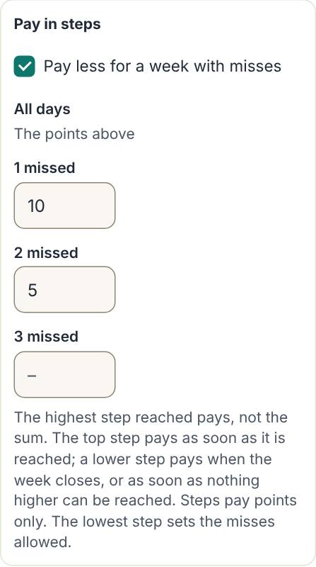

**On the board,** your child sees the steps as chips, the one in reach marked, with a line such as "Wednesday was after 6:00 pm. On course for 10 points."; a week won at a step says "Won this week! 10 points."

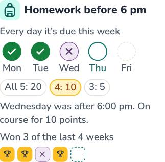

### A7c Perfect weeks, and a family goal every child meets
<!-- covers: US-414 US-415 -->

**What this is.** A goal that counts the weeks another goal was won ("3 perfect homework weeks in a row"), and a family goal each child has to meet on their own. **When.** To reward a run of good weeks with something bigger, or when one child shouldn't carry the others. **How.** In the goal form.

- **Weeks won of a repeating goal**: under **Counts**, choose it, then **Which goal** (that person's goals that repeat, or the family's for a family goal), **How** (**In total** or **In a row**) and the **Target**. A week with nothing due neither counts nor breaks a run; a missed week breaks it. Only weeks that start on or after this goal's start date count, so a goal set up on a Thursday counts from the next week; the form says which week is the first. What it pays is its own, apart from what each week pays: an ice cream trip for 3 in a row.
- **Every child meets it**: on a goal for **The whole family**, under **For the whole family**. Each child who earns rewards has to meet it on their own: one child's missed Tuesday loses the week for everyone, however well the others did. A child with nothing due that week doesn't hold it back. The points go to each child who had something due, and only to them. The form says what this week asks of each: "due 4 days for Maya and 4 days for Leo (…): each needs 4." It can't be changed once the goal starts, and it doesn't pay in steps.

**On Goals,** a family goal every child meets shows each child's days this week and who missed ("Leo missed Tuesday. Starts again Monday, Oct 19."); its **Weeks** say how each child did and what each was paid. A goal counting weeks shows its run ("1 of 3 weeks in a row · best so far 1") and the counted goal's weeks.

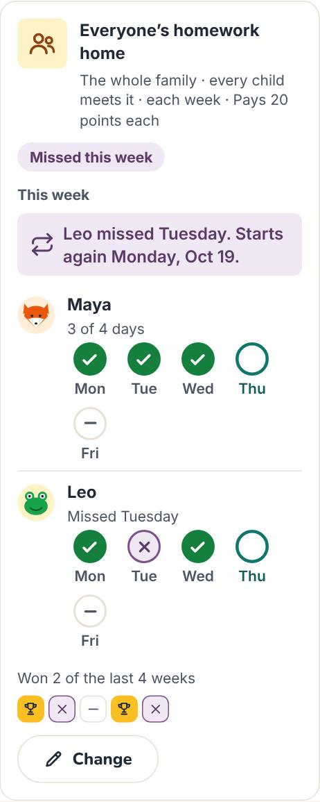

**On the board,** your children see each child's days on the family goal, and the line when it is lost or won: "Everyone made it! 20 points each." A goal counting weeks says "1 of 3 weeks in a row" with "This week makes 2 in a row."

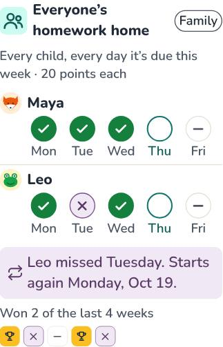

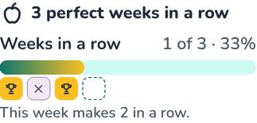

### A8 Streaks and insights
<!-- covers: US-408 -->

**What this is.** How a child's days go over time: runs of good days on the board, and the full picture for parents on **Insights**. **When.** The flame is always on the board; open **Insights** when you want to see patterns.

**A good day** is a day when every routine that counts was done. Skipped routines, and shared ones someone else did, don't count either way. Tasks never make a day good or bad. A day with nothing that counted, or one still waiting for a parent, neither adds to a run nor breaks it. Today counts as soon as it's good, and is never a bad day while it's still going.

**The flame.** A child's run of good days shows as a flame and a number beside their name. It grows bigger at 3, 7, 14 and 30 days, and glows once when it reaches one of them while the board is open.

**Insights.** Choose a member and **Last 7 days**, **Last 30 days** or **Last 90 days**. It covers the days up to yesterday ("Today is added once it closes"):

| Section | Shows |
|---|---|
| **Streaks** | **Good run now**, **Best good run** and **Longest bad streak**, over all their history. |
| **Done** | The share of routines that counted that were done. |
| **Day by day** | A calendar of the days: **Good day**, **Bad day**, **Waiting for a parent**, **Nothing that counted**. |
| **Missed most** | The routines missed most often. |
| **By tag** | How much was done, tag by tag. |
| **Checking** | Their **Check-offs**, how many were **Unchecked by a parent** or **Sent back**, and the **Time to check**. |
| **History** | **Rebuild from history** reads every check-off again. It is kept up to date each hour, so you rarely need it. |

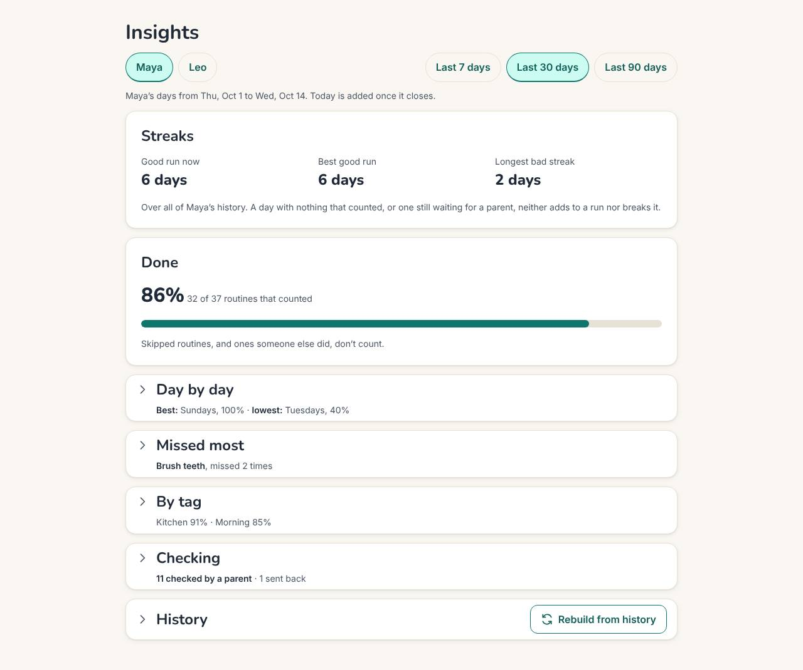

### A9 Calendars
<!-- covers: US-501 US-502 US-503 US-504 US-505 US-507 US-508 US-509 -->

**What this is.** The family's Apple calendars on the board, read only. Events still live in Apple Calendar: add and change them there. **When.** Once per calendar. **How.** On **Calendars**, add each one by its public link.

#### Connect a calendar

1. In Apple Calendar, open the calendar's settings, turn on **Public Calendar** and copy the link (it starts with `webcal://`).
2. In FamilyWise, go to **Calendars** and tap **Add a calendar** to open it (it is open already while you have none). Enter a **Name** and paste the **Public link**.
3. Pick a **Color**, and choose **Who it's for**: leave **The whole family** ticked, or tick each person it belongs to, as many as you like (a calendar the two kids share, say). The board shows their faces with its events, and puts it on each of their screens.
4. Keep **Show on the boards** ticked, and choose **Add calendar**.

FamilyWise syncs it straight away and says "Added Family and synced it.", then lists what's coming up. If the link doesn't work, it says what went wrong and what to do. The link is kept privately and never shown again; to change it, open **Edit** and fill in **Replace the link (optional)**.

")

#### Keep calendars healthy

Each calendar is folded to one line: its colour and name, who it's for, "Not on the boards" if hidden, when it last synced ("Synced 12 min ago") and how many events are coming up. One that can't sync says **Can't sync** on that line, so you see it without opening anything. Tap a calendar to open it: how its sync went, **Synced** (with when), **Not synced yet**, or **Can't sync** with the reason and the last good sync, then what's coming up, then **Edit** and **Remove**. After you save, the calendar comes back open. Calendars sync every 15 minutes, so a new event in Apple Calendar shows within 15 minutes. A calendar that can't sync keeps its last good events on the board, and **Health** names it too.

**Remove** (the calendar's name) takes its events off FamilyWise and the boards. The calendar itself stays in Apple Calendar.

#### Who a calendar is for

Open the calendar, then **Edit** (the calendar's name), and tick under **Who it's for**. Ticking a person clears **The whole family**; clearing every person ticks it again. Each calendar's line says who it's for: "The whole family", "Alex's" or "Ava and Ben", with their faces. Ticking everyone keeps it as those people: someone you add to the family later isn't on it until you tick them, so use **The whole family** for a calendar everyone should see. Someone archived stays on a calendar and is back on it when restored.

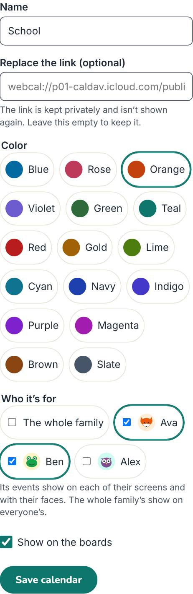

#### The calendar on the board

On the board, **Calendar** opens the **Week**; **Day** and **Month** are a tap away. Move with the arrows, by swiping sideways, or back to **Today**. Tapping a day on the home screen's calendar opens that day here.

It reads like the calendar on your phone:

- **All-day events** run across the top, each in its calendar's color. One that lasts several days is one bar across them. When a day has more than fit, its heading says how many more ("+1"); tap the heading to see the day, with all of them.
- **The hours** run down the side, from 8 am to 8 pm, or earlier and later when something is on then (or when it's that early or late now). Each event sits at its time, as tall as it lasts. Two at once sit side by side.
- **Now** is a red line across today, with the time beside it.
- **Tap an event** to see it in full: **When**, **Where** (when it has a place in Apple Calendar), its **Calendar**, and **Whose** it is: each of the calendar's people with their face, or **Everyone**. Tap **Close** to go back. Its notes stay in Apple Calendar.

A month's day shows three events and "+N more"; tap it to see the day.

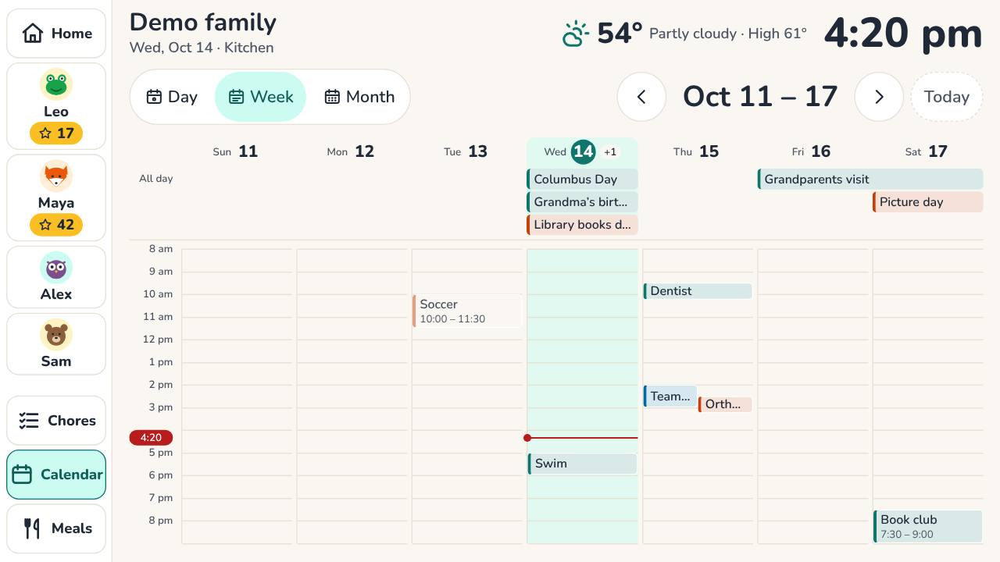

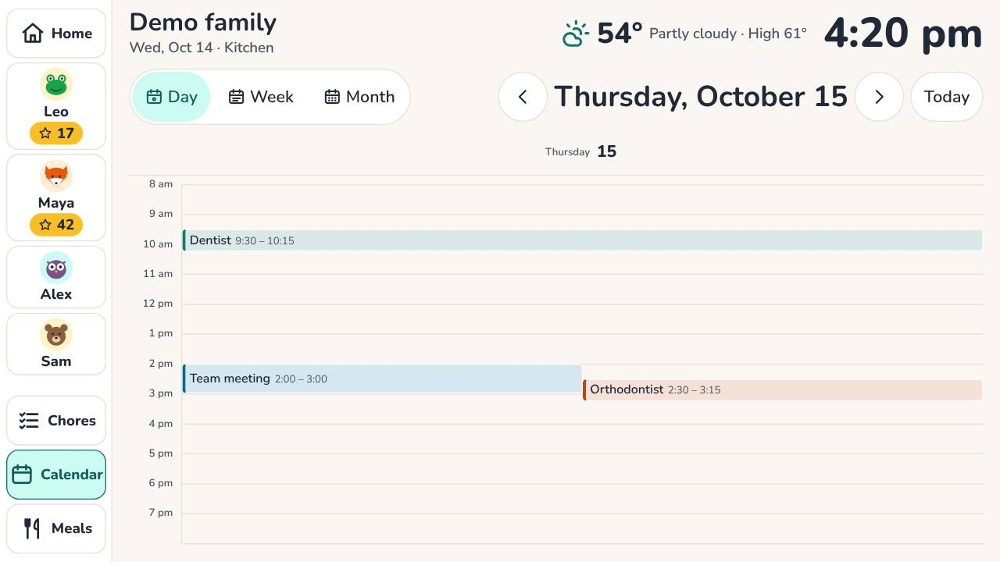

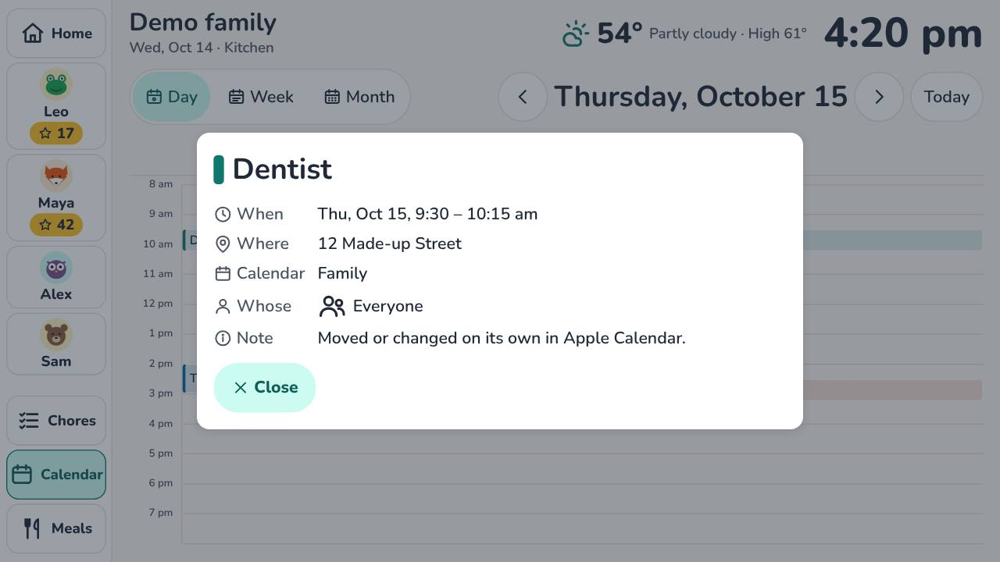

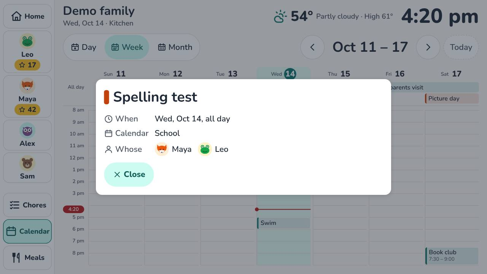

On a person's own screen, **Today** lists the events of the calendars that include them and the whole family's. **Coming up** on the home screen shows the faces of each event's people.

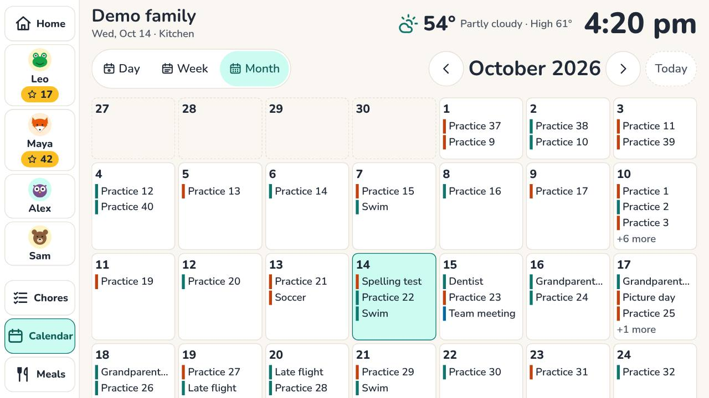

#### Choose the calendars for each board

By default, every board shows the calendars with **Show on the boards** ticked. To choose for one board, go to **Boards**, tap the board to open it, tick under **Calendars** the ones it should show, and choose **Save calendars**. From then on that board shows exactly those: a calendar you connect later stays off it until you tick it there. Other boards are not affected. The board changes within seconds.

### A10 School year and day types
<!-- covers: US-601 US-602 -->

**What this is.** Your school calendar, so chores can follow school days, breaks, weekends and summer. **When.** At the start of each school year. **How.** On **School**, add the year, then its breaks and days off.

Every date is one **day type** for each person:

| Day type | When |
|---|---|
| **Weekend** | Every Saturday and Sunday. |
| **Break** | A weekday inside a break you added. |
| **Day off school** | A weekday inside any other day off (holiday, teacher day, snow day, other). |
| **School day** | Any other weekday inside the school year. |
| **Summer** | A weekday outside every school year. |

An item's **On these days** (under **More options**) says which day types it happens on; all are ticked to start. Untick to make, for example, homework happen on **School days** only.

1. On **School**, open **Add a school year** (folded to its **Add a year** button; open at first while there is none) and enter a **Name** (like "2026–27"), optionally the **School**, the **First day** and **Last day**. Keep **Default** ticked, and choose **Add school year**.
2. Choose **Open** on the year. Open **Breaks and days off**, then **Add a day off**, and add each one: a **Name**, its **Kind**, **From** and optionally **To**, then **Add day off**. A break makes its weekdays "Break"; any other kind makes them "Day off school".
3. Optionally, add **Terms** for reference (**Terms**, then **Add a term**).

On a year's page the timeline stays open; **Breaks and days off**, **Terms**, **Who follows it** and **Dates and name** fold to what they hold ("4 days off · next: Teacher day, Fri, Oct 23", "2 terms: Fall, Spring"), and **Archive** is last. The one you just saved in comes back open.

The top of **School** shows what kind of day today is for each person. A year's page shows a timeline of its days.

> **Note:** Until you add a school year, every weekday counts as summer, so items set to school days only don't appear.

**Next year's calendar.** Add it whenever it is published, as a **Default** too. Default years can't overlap, so next year simply starts on its first day; nobody switches anything.

**A child at another school.** Add that school's year without **Default**, open it, tick the child under **Who follows it** and choose **Save who follows it**. Everyone else follows the default.

Changes to the school year start tomorrow: today stays as it was planned. Days already past never change. The exception is **No school today** on **Home**, for a snow day called in the morning: it changes today at once (see [A2](#a2-a-parents-day)).

### A11 The board's home screen layout
<!-- covers: US-1004 -->

**What this is.** What the home screen's calendar shows, and which cards appear under it, in which order. **When.** Whenever the board's home screen should fit your routine better. **How.** On **Boards**.

**Home screen for every board.** Under **Home screen** on **Boards**:

1. Choose what **The calendar shows**: **3 days**, **5 days** (the default), **7 days** or **Month**. In the month, a colored dot marks each calendar with something on a day.
2. Tick or untick **Show today's meals** (above **Today's list**, on days with meals planned; see [A15](#meals-on-the-board)).
3. Under **Under the calendar, in this order**, tick the cards to show: **Goals**, **Waiting for a parent** and **Coming up**.
4. Move a card with **Up** or **Down**. Each move saves at once.
5. Tick or untick **Show the weather beside the clock** (see [A13](#a13-weather-on-the-board)).
6. Choose **Save layout**.

The boards change within seconds.

**A board's own layout.** A board can have its own layout instead, for example a month on the kitchen board and three days in the hall. On **Boards**, tap the board to open it, then under **Home screen** tick **Give** (the board) **its own layout** and choose **Save**. It starts as a copy of the household's; then change it in the form that appears. Untick and **Save** to follow the household's layout again.

> **Tip:** To change a board's own layout, use the form under it and **Save layout**. Choosing **Save** again with **Give … its own layout** still ticked keeps the layout it has.

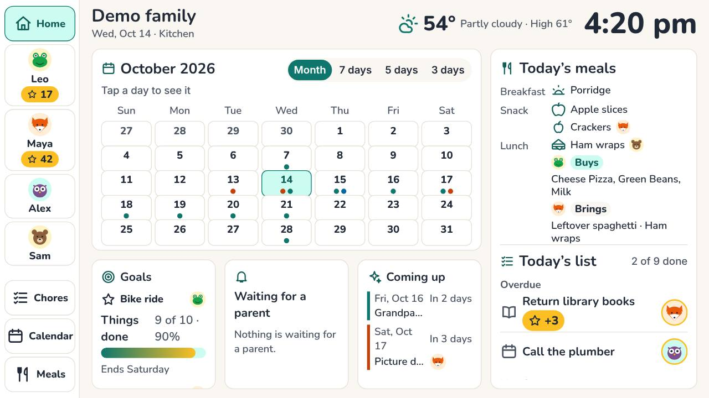

### A12 Day and Evening themes
<!-- covers: US-910 US-906 -->

**What this is.** Two looks: **Day** (light) and **Evening** (dark, easier on the eyes at night). **When.** Automatic. **How.**

- **The board** follows the household's clock: Day from 6:30 am, Evening from 7:00 pm. To hold a board on one, go to **Boards**, tap the board to open it, choose **Always Day** or **Always Evening** under **Display**, and choose **Set theme**. **Automatic, by time of day** goes back to the clock. The board switches at once.
- **The admin app** follows your phone's or computer's dark mode: Evening when dark mode is on.

Both looks use the same colors for the same things, never color alone: every state also has an icon and a word.

**Easy to read for everyone.** In both looks, words meet the WCAG AA contrast level, and each of the sixteen colors, used as a line or a dot, stands out at least 3 to 1 from what is behind it; in the Evening, lines and dots use a lighter shade of each color so they still do. With **reduce motion** turned on in the screen's or the browser's settings, celebrations and points don't move or count up; the words are the same.

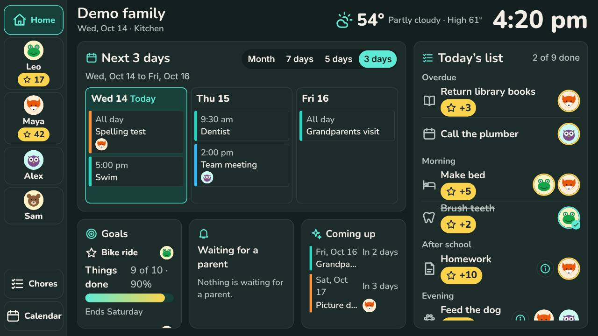

### A13 Weather on the board
<!-- covers: US-1003 -->

**What this is.** The sky, the temperature now and today's high, beside the clock on the board. **When.** Once, to set your place; after that it looks after itself. **How.** In **Settings**, open **Family options**, then **Weather on the boards** (folded to the place, °F or °C and the last reading).

1. Under **Town or ZIP code**, type your town's name or a US ZIP code, and choose **Find**.
2. Under the places it found, choose **Use this** beside yours. Each is named with its state and country, so two towns with the same name are easy to tell apart.
3. Under **Show temperatures in**, choose **Fahrenheit (°F)** (the default) or **Celsius (°C)**, and choose **Save**.

Family options says "Saved. The boards show the weather in a moment." and, once the weather is read, the last reading, like "Last read at 4:09 pm: 64°F, partly cloudy, high 68°F."

**On the board** the weather sits beside the clock: an icon and a word for the sky (**Sunny**, **Partly cloudy**, **Rain**, **Snow** and so on), the temperature now in large numbers, and **High** with today's high. Temperatures are whole degrees. The sky and today's high share one line, like "Partly cloudy · High 61°".

Weather data by [Open-Meteo.com](https://open-meteo.com/) (CC BY 4.0). The credit is here and in Family options, beside where you set your place, rather than on the board.

- **How fresh it is.** FamilyWise reads the weather every 30 minutes. The board never asks the weather service itself, so it costs the board nothing.
- **When it can't be read.** If the weather can't be read, or the last reading is more than 75 minutes old, the board simply shows no weather; nothing else on it moves. Family options says what went wrong ("Couldn't read the weather at …"), its folded header says "Not updated since" the last good reading, Home lists it under **Heads-up**, and tries again on its own.
- **Offline.** A board without the internet keeps showing its last reading for the rest of that day.
- **One board without it.** Untick **Show the weather beside the clock** in that board's layout on **Boards** (see [A11](#a11-the-boards-home-screen-layout)).
- **Stop it everywhere.** **Stop showing the weather** in Family options forgets your place.

> **Note:** FamilyWise keeps your place to about a kilometre (two decimal places), and only that goes to the weather service. Town names are found through Open-Meteo, and US ZIP codes through Zippopotam.us.

### A14 Screens and text size
<!-- covers: US-1007 US-912 -->

**What this is.** The board fills whatever screen it is on, and you choose how big its words are. **When.** When you set up a board, or when someone finds it hard to read from where they stand. **How.** The fit is automatic; the size is on **Boards**.

- **Any screen.** The board is designed for a 1920 by 1080 screen and grows or shrinks to fit yours. A 4K panel shows exactly the same board twice as large, drawn with all its pixels, so it is sharper, not more crowded. A laptop shows it smaller, and it fits again when you change the window's size. A screen wider or taller than usual gives the board more room.
- **Text size.** On **Boards**, tap the board to open it and, under **Display**, choose **Smaller text**, **Standard text**, **Larger text** or **Largest text** for a board, and choose **Set text size**. The board changes at once and keeps its size, even after a restart without the internet.
- **What larger text changes.** Larger words take more room. With **Larger** or **Largest**, today's list moves under the calendar instead of beside it, and the people at the top may take two rows. Scroll down for the rest.
- **On a tablet.** A board on an iPad or another tablet works the same way, in landscape or portrait: the board fits the screen, and each chore's points stay under its own title at every text size. If a word in the rail is too long to sit beside its icon, it goes under it.

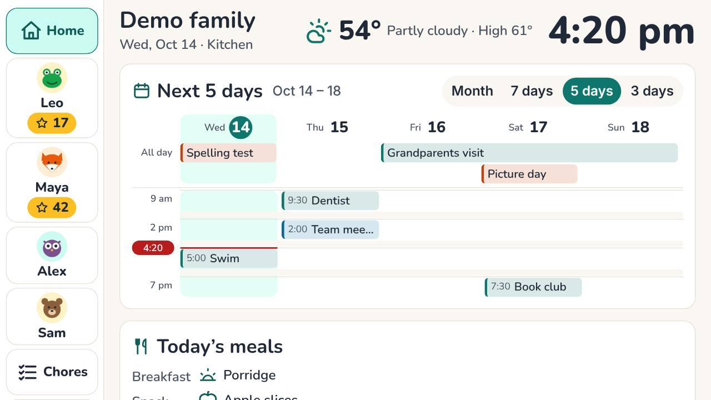

> **Tip:** Stand where the family usually reads the board. If the words for each item are hard to make out, try **Larger text**. On a 32-inch 4K panel read from about two metres, **Larger** suits most families; a smaller screen, or one read from further away, may want **Largest**.

### A15 Planning meals
<!-- covers: US-701 US-702 US-703 US-704 US-801 US-802 US-803 US-705 US-708 US-804 -->

**What this is.** The week's breakfasts, snacks, lunches and dinners, planned ahead, and a library of the meals your family makes again. **When.** Once a week, say on Sunday, so nobody decides at 5 pm. **How.** On **Meals** in the menu.

#### Build the library

1. On **Meals**, choose **Meal library**, then tap **Add a meal** to open it (it is open already while the library is empty).
2. Enter a **Name** and, if you like, a **Description**.
3. Tick what it's **Good for**: **Breakfast**, **Snack**, **Lunch**, **Dinner**. These meals are offered first when you plan that meal of the day; none ticked means any.
4. Optionally add its **Recipe** (a link) and **Ingredients**, and pick an **Icon**, then choose **Add meal**. Photos and PDFs of the recipe are added once it is saved (see [Recipes and ingredients](#recipes-and-ingredients)).

Choose **Edit** (the meal's name) to change one. **Archive** takes a meal out of the library: it isn't offered any more, and plans that used it keep its name. Archived meals are folded under **Archived**, which says how many; open it and **Restore** puts one back.

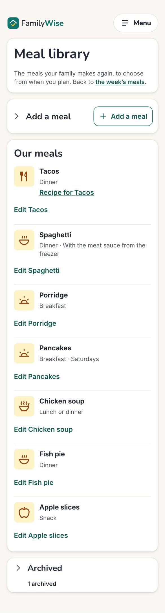

#### Plan the week
<!-- covers: US-711 -->

**Meals** shows the week, a day under the other. **Last week** and **Next week** move between weeks; **This week** comes back.

- **Each day, closed:** the weekday, the date and how many of its four meals (**Breakfast**, **Snack**, **Lunch**, **Dinner**) have something planned, like "2 of 4 set", or a check once all four have. Today is outlined, open or closed.
- **Open a day:** tap it to see its meals, each with what's planned, **Add** and **Change**. Tap it again to close it. After you add, edit, move or remove one of its meals, the day stays open.
- Under the days come **Add to the plan**, **Copy last week** and **School lunch**. **Add to the plan**, **Copy last week** and the lunch **Usual week** are closed until you tap them.

1. Open a day and choose **Add** beside one of its meals: **Add to the plan** opens with the **Day** and **Meal** filled in. (Or tap **Add to the plan** and choose them.)
2. Under **What**, choose **From the library** and pick a meal (those good for that meal of the day come first), or **Something else** and write it in ("Leftovers", "Out for Grandma's birthday").
3. Under **For**, leave **Everyone** ticked, or tick each person it's for: one (a snack after school) or any mix (fish fingers for the children, sandwiches for Maya and Sam). Ticking a person unticks **Everyone**; ticking everyone, or nobody, is **Everyone**.
4. Add a **Note** if you like ("Make extra for lunch"), then choose **Add to the plan**.

Each thing planned names who it's for, unless it's for everyone. A meal of the day can hold several things, like two snacks. They show in the order you added them.

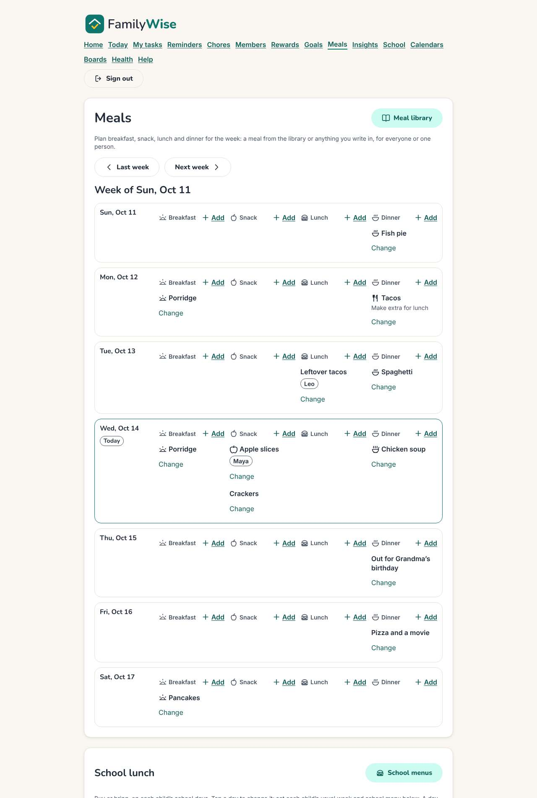

#### Change a planned meal

Choose **Change** on a planned meal:

- **Edit** opens it in place, filled in with what you saved: the **Day**, the **Meal**, the library meal or what you wrote, who it's for and the note. Change what you like, then choose **Save changes**; **Cancel** leaves it as it was. It keeps its place among that meal's other things; moved to another day or meal, it goes last there.
- **Earlier** and **Later** reorder it, when that meal of the day has more than one thing.
- **Remove** takes it off the plan.

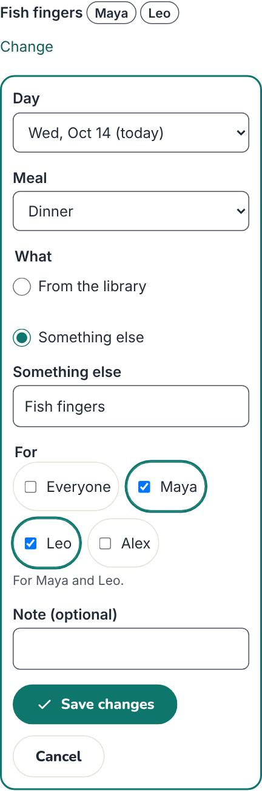

#### Copy last week

Tap **Copy last week** to open it, then choose what happens where this week already has something planned for a meal of a day: **Keep it**, or **Replace it with last week's**. Then choose **Copy last week here**. Everything planned last week is copied to the same days this week; meals last week left empty stay as they are this week. Each copy is for the same people, and is its own, so changing one doesn't change last week.

> **Tip:** Plan a good week once, then copy it forward and change only what's different.

#### School lunch: buy or bring
<!-- covers: US-710 -->

**School lunch** on **Meals** shows one child's school week, Monday to Friday, a day under the other. With more than one child, their faces are in a row at the top: tap one to see their week. It opens on the child you chose last on that phone or computer, and a dot on a face means that child still has a day to pick, today or later. Each child follows their own school year (see [A10](#a10-school-year-and-day-types)), so a child at another school can have lunch on a day the others are off.

- **Each day, closed:** the weekday, the date, **Buy** (school lunch) or **Bring** (a packed lunch), and a check once the day is set. A Bring day is set as it is; a Buy day once there is a pick in every "Choice of" section of the day's menu (the entree, the milk). Today is outlined. A day without school is greyed and says **No school**; it doesn't open.
- **Change one day:** tap it to open it, then tap **Buy** or **Bring** at its top. A day not as the usual says **Changed from the usual**; tap the other one to put it back.
- **Pick a Buy day's lunch:** open the day. Its menu is listed a section at a time: one in a section that says **pick one**, any number in one that says **any**. What is picked is ticked and highlighted. Tap **Save** (their name)**'s picks**.
- **The usual week:** closed, **Usual week** shows a line per child ("Maya: Mon Bring · Tue Bring · Wed Bring · Thu Bring · Fri Buy"). Tap it, choose **Buy** or **Bring** for each weekday for a child, then **Save** (their name)**'s usual lunches**. A day you had changed to what is now the usual stops being a change.

A chore can follow these days, like "Pack lunch" only when a child brings: see [Chores on lunch days](#chores-on-lunch-days).

#### School menus: what the school serves

A day a child buys can show what the school serves that day. Open **School menus** (the button beside **School lunch** on **Meals**), tap **Add a school menu** (open already while you have none) and add the school's menu once:

- **From the school's Nutrislice menus**, if your school's lunch menu is on Nutrislice (its address ends in nutrislice.com). Type the name at the start of that address (for menus at example.nutrislice.com, type example) or paste the whole address, then **Find the schools**. Choose the school and its lunch menu, then **Add the menu**: FamilyWise fetches the next four weeks straight away, and again every morning.
- **From a file**, for a school whose menu comes another way: a spreadsheet saved as CSV with a row for each item, and the columns **date** (like 2027-02-01, or 2/1/2027), **item** and, if you like, **section** (Choice of Entree, Choice of Milk). An item can hold choices: "Beef tacos or Chicken wrap with tortilla chips" is two options, the wrap with its chips. A date with no item means no lunch that day, and its section says why (Presidents' Day). **Look at the file** shows how many days it holds and the first few; **Load** stores them.
- **Typed in**, a day at a time with **Add a day**.

Then, under **Usual week** on **Meals** (tap it to open it), choose each child's **School menu**. A day they buy shows what's served, a line a section (**Entree**: Beef tacos or Chicken wrap with tortilla chips; **Fruits & Vegetables**: Corn, Orange; **Milk**: 1% milk or Chocolate milk), or **No menu yet**.

FamilyWise reads a menu as the school writes it: each section's options, "or" between them, and "with" (or "and" after it) for what comes with one: "Fish sticks with Fries and Coleslaw" is one option with two sides. A section's name is shortened to show it ("Choice of Entree" shows as **Entree**, "Fruits & Vegetables offered" as **Fruits & Vegetables**), and the **Entree** is the section whose name says entree or main (else the first). A menu with no sections lists what's served with commas, as before.

- **Change a day:** each day's **Change** lets you write it yourself: a section a line, its name and a colon first, "or" between options and "with" before a side, "and" before another (Choice of Milk: 1% milk or Chocolate milk; Choice of Entree: Pizza or Fish sticks with Fries and Coleslaw), or **No lunch that day** with a note. A day you change is **Yours**: the morning's fetch never replaces it. **Use Nutrislice's menu again** hands it back.
- **Each menu is folded** to one line: where it comes from, whose lunch it is, when it was fetched and how many days it has in the next four weeks. Tap it to open its days, then **Load a file into** (a file's), **Add a day to**, and set apart under **Menu**: **Fetch now**, **Rename** and **Remove** (which asks first). After you save, the menu comes back open.
- **When Nutrislice can't be reached:** the menu's line says **Can't fetch**, even while it is folded; opened, it says why and when it last worked. The menus you have stay, and it tries again the next morning; **Fetch now** tries at once.

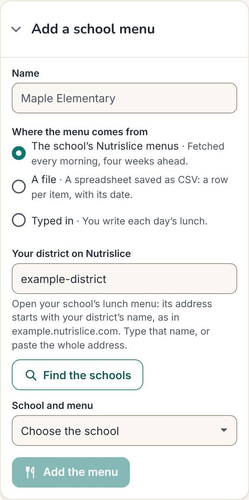

#### Recipes and ingredients
<!-- covers: US-706 US-720 -->

A library meal can hold its recipe and what it needs to buy, so the week's meals go onto the grocery list in one go and the recipe is at the kitchen board when you cook.

1. In the **Meal library**, open a meal with **Edit**.
2. Under **Recipe**, paste the recipe's web link and choose **Read ingredients**. Most recipe sites publish their recipe in a form FamilyWise can read: what it finds is filled in under **Ingredients** for you to check, and its steps are kept for the board. A page that doesn't publish its recipe says so, and nothing changes.
3. **Add a photo or PDF** adds a photo of a recipe card or a PDF, up to 10 MB each, kept in your family's own storage. **Read ingredients** beside one reads its text on your own phone or laptop, with free open-source text reading, and fills in what it finds. × takes one away.
4. Under **Ingredients**, each row is the **amount to buy** ("1 lb", "8", "2 cans", not the recipe's spoonfuls; leave it empty for "some") and the name. Tick **We usually have it** for things like salt and oil. The last row adds another as you type; × takes one away.
5. Check what was read, then **Save changes**. Nothing read is ever saved until you save.

#### This week's meals onto the grocery list
<!-- covers: US-715 -->

1. On **Meals**, choose **Add to groceries** beside the week.
2. **Add this week to groceries** lists each planned meal that has ingredients, in day order, with its ingredients ticked. What you usually have starts unticked, and so does a meal you already added that week ("Added Sun"). Things written in, or meals with no ingredients yet, are named at the top.
3. A row that joins something says what it makes: "With Tacos: 2 lb" when two meals need the same thing, "On the list: Kidney beans 1 can, makes 3 cans" or "On the list already" when it is on the list. Untick what you have.
4. Choose **Add** N **to groceries**. Nothing is added before that, and amounts are never scaled by who eats.

The same thing is only ever on the list once: "Onions" from two meals is one item, its amounts added and both meals its reasons. If you take a meal off the plan, or change it to another, it takes its share off the list: an item only it needed and not yet got goes, and an item it shared loses its amount and the meal.

#### Meals on the board

What you plan shows on the boards within seconds; nothing about meals can be changed on a board.

- **Home:** **Today's meals** above **Today's list**: today's breakfast, snacks, lunch and dinner, each with the face of each person it's for (none when it's for everyone), with each child's school lunch (**Buys** and the day's entree choices, or **Brings** and what you planned for their lunch, like "Leftover spaghetti" for that child). A tap on a buy day's choices shows the day's whole menu by section. A lunch planned for a child who brings theirs goes with them; if it's for others too, it stays under **Lunch** with their faces. A day with nothing planned and no school lunch shows nothing.
- **Meals** in the rail: the whole week, a column a day (today marked) and a row for each meal of the day, then **School lunch**: who buys and who brings, each day; **Weekend** or **No school** when there is none. Under it, **School menu** and the menu's name, then a row a section (**Entree**, **Fruits & Vegetables**, **Milk**): each day's options a line each, what comes with one in grey after "with". The menu shows on every school day, whoever buys.
- **A person's screen:** their part of today's meals: what's for everyone, and each thing they are one of the people for.
- **A recipe:** on **Meals**, a meal with a recipe has a book on it. A tap opens its recipe full screen, to cook from: its photos and PDFs (tap a chip under it to switch), its ingredients, and the steps its link publishes. **Close** goes back. Nothing on it can be changed.

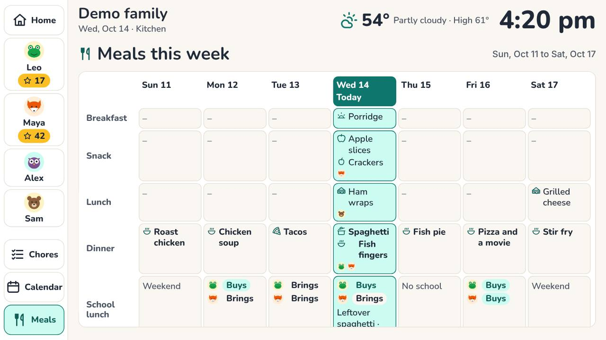

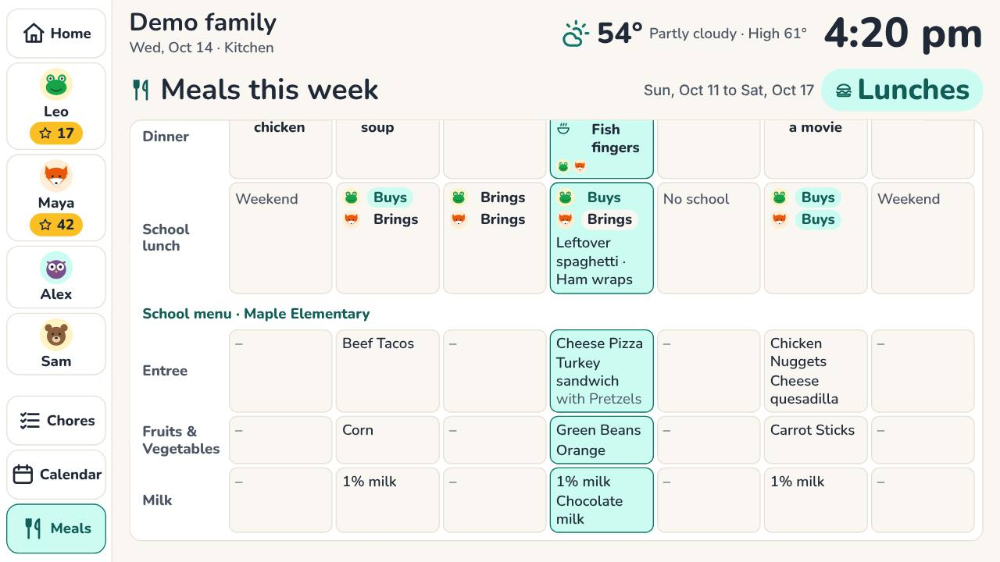

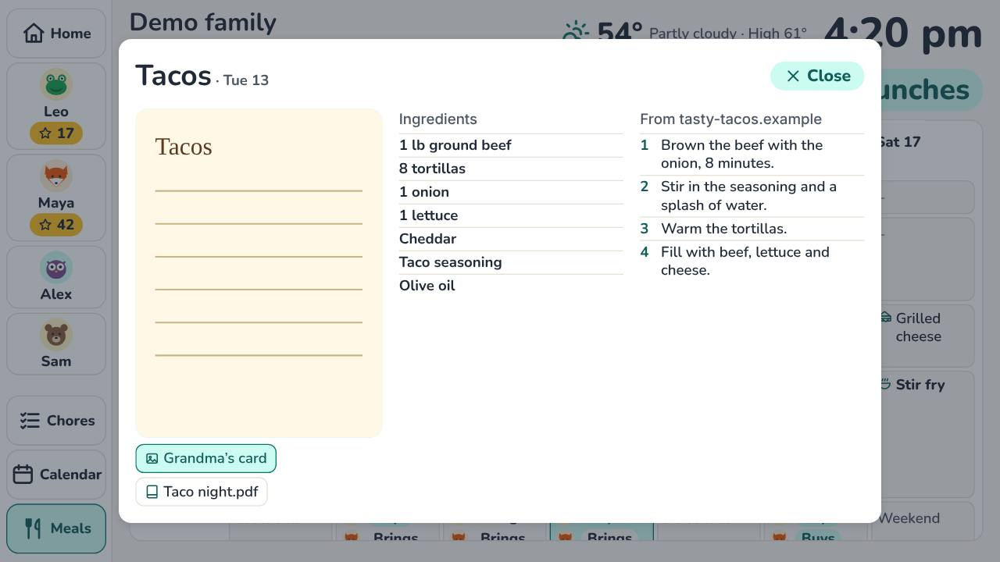

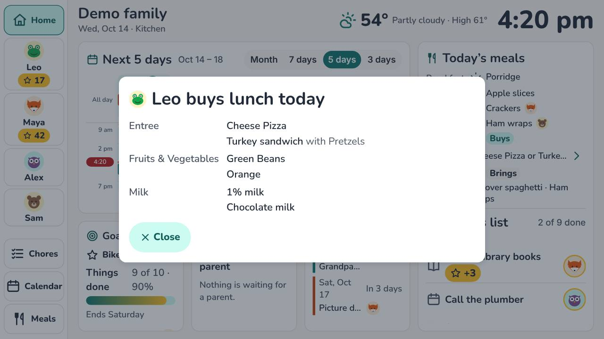

#### Lunches picked at the board
<!-- covers: US-707 -->

The family can pick the coming week's school lunches at the board, on a Sunday say, instead of on a parent's phone.

- **Open Lunches:** **Lunches** on the board's **Meals** screen, **Pick lunches** on a child's own screen, or an item you set to open it: add a weekly task like "Pick next week's lunches" for each child, and under **On the board, a tap** choose **Opens Lunches**. A tap on it then opens that child's week, and **Done** there checks it off for them.
- **The week:** Monday to Friday. On a Saturday or Sunday it's the coming week; on a weekday it's this week, with **Next week** a tap away. Each school day has **Buy** and **Bring**, the child's usual already set; days without school say why.
- **Picking a buy day's lunch:** **Buy** opens the day's menu, a section at a time: one where it says **Pick one** (the entree, the milk), any number where it says **Pick any** (fruits and vegetables). **Save**. The day then shows what they picked, and **Pick your lunch** on a buy day with nothing picked yet.
- **A parent says yes:** every change, Buy or Bring and the picks, says **Waiting for a parent** until you approve it on **Today** (see [Lunch changes from the board](#lunch-changes-from-the-board)). If you keep the day as it was, the board says so ("Sam kept Buy") until the child taps **Done**. The board can't tell who is tapping, so a change made there waits even when it's yours; on **Meals** in the admin app your change is made at once.
- **The cut-off:** a day can change until 8:00 am that morning (set another time on **School**, under **Lunch changes**). After it, the day is **Locked**, and a change still waiting is dropped: the day stays as it was.
- **On the boards:** once approved, a buy day shows what the child picked instead of every option: their entree on the home screen, all of it on the **Meals** screen. If the school changes the menu afterwards, the pick stays and says **Menu changed**. A day changed to **Bring** drops its picks.
- **On Meals in the admin app:** each Buy day opened shows the picks ticked (**Changed on the board** when a child's change was approved there), and you can change them yourself; a change waiting says **Waiting** on the day, and opened, links to **Today**.

### A16 Sleep and wake
<!-- covers: US-207 -->

**What this is.** Each board can sleep at night and when nobody uses it, and you choose whether Home tells you when it hasn't been seen. **When.** When you set up a board, or when it lights up a room at night. **How.** On **Boards**, tap the board to open it, choose under **Sleep and wake**, and press **Save sleep and wake**. The board follows within a minute.

- **Tell me when (the board) isn't seen.** **Always**: Home's heads-up says so after a day without it, at any hour (as before). **Only while awake**: its hours asleep don't count, and Home never says so while it is asleep; for a board switched off at the wall overnight. **Never**: for a board that is often off; Home never lists it.
- **Sleep at night.** Tick **(the board) sleeps and wakes at set times**, then give **School nights** and **Weekends and days off** a time each to sleep and to wake. A night takes its times from the day after it: Sunday to Thursday night are school nights when school is the next day; Friday and Saturday night, and any night before a day off from school, are weekend nights. School days come from **School** in Settings; without a school year, every weekday is a school day.
- **Sleep when nobody touches it.** **Never**, or after 5, 10, 15 or 30 minutes, 1 hour or 2 hours untouched. After its wake time in the morning it stays on for at least this long.
- **Asleep, the board is black.** A touch, a click or moving the mouse wakes it. **That first touch only wakes it**: it never checks off a chore or presses a button, so tap again for that. A touch in the night wakes it for its idle time (5 minutes if **Never**), then it sleeps again.
- **On the board's folded header** Boards says "Asleep · wakes at 6:30 am" or "Awake · sleeps at 9:30 pm" while it has set times, or "Awake · no set times".
- **Burn-in.** Every board moves its picture by a pixel every 5 minutes, within a 4-pixel square, too little to see, so nothing stays on the same pixels all day. There is nothing to set.

**Turning the screen off on the Raspberry Pi.** A web page can't turn its screen off, so on an iPad or a laptop a sleeping board is just black (an iPad's own Auto-Lock still works as usual). On the Pi, a small helper turns the monitor off when the board sleeps and back on when it wakes. The Dell isn't switched off at its button: the Pi stops sending a picture, and the monitor goes into its own standby until the picture comes back. Install the helper once: on the Pi, in a terminal (or over SSH as the user the board runs as), type `curl -fsSL https://family-wise-topaz.vercel.app/api/kiosk/install | bash`, then `sudo reboot`. It needs no password or key, listens only on the Pi itself, and answers only FamilyWise; it starts with the Pi and again if it stops. Running the same command again updates it.

> **Tip:** Moving the mouse wakes the Pi's monitor too. A monitor coming out of standby takes a second or two to show the picture.

### A17 The grocery list
<!-- covers: US-714 US-718 US-719 -->

**What this is.** Your family's own grocery list, in your own categories and stores, on the kitchen board and in the admin app. It works on its own: no Mac and no Apple Reminders needed. **When.** Whenever you think of something, and when you plan the week's meals. **How.** On **Groceries** in the menu, after **Meals**.

#### Add something

1. At the top of **Groceries**, type what to get, with its amount if you like: "2 lb ground beef", "Onions ×3", "milk".
2. As you type, FamilyWise suggests where it **Goes in** and its **Store**: where it went and where it was bought last time, else what your own moves have taught it, else **Other**. One tap on another chip changes it; **Other…** and **More…** show the rest.
3. Choose **Add**. Something already on the list isn't added twice: "onion" joins "Onions", its amount added. If what you type might be something already on the list ("milk 2%" while "Milk" is on), it says **Also on the list** and offers **Make it one**.

The **+** on a category's heading adds straight into it.

#### The list

- **By category**, in your order, then A to Z. Each thing has its amount, its store, and why it's on the list: a meal ("Tacos, Tue"), a child's ask, or who added it.
- **The store chips** over it show one store's things (still by category), or **Any store** for things with no store.
- **The box** gets it: it leaves the list at once and goes under **Got recently** for a week, where **Untick** puts it back.
- **⋯** says why it's on the list (each meal and amount), and holds **Edit** (its name and amount), **Move to…** (another category, or a new one), **Store…**, **Select several** and **Remove** (off the list, not counted as bought).
- **Select** turns the boxes into selection: tick several, then **Move to…**, **Store…** or **Remove** acts on them all at once. **Done** goes back.

Each move teaches FamilyWise your words, so the next time it suggests the right category.

#### Your categories and stores

Open **Categories and stores** at the foot of **Groceries**. Categories show in the order the list and the board use; the arrows move one up or down, and its **⋯** holds **Rename** and **Remove**. Removing a category with things in it asks first, then moves them to **Other**, which always stays, last. Stores have **Rename**, **Move up**, **Move down** and **Remove** (their things can then be got anywhere). Type a name and **Add** for a new one. You start with a made-up set of categories and six stores.

#### Groceries on the board

**Groceries** is in the board's rail once your list has had its first thing. It shows the list by category, A to Z, each thing with its picture, its amount, and why when a meal needs it or a child asked. The store chips change only what the board shows. Nothing on the board changes the list.

## Part B — User Manual

### B1 The admin app, page by page
<!-- covers: US-107 -->

The admin app is for parents, on a phone or a laptop. On a laptop its menu is down the left of every page; on a phone, tap **Menu** at the top (and **Close** to put it away). The menu has three groups, then **Help** (this guide), who is signed in, and **Sign out**, which signs this browser out. **Today** shows how many check-offs are waiting for you.

| Menu | Page | For |
|---|---|---|
| **Your day** · **Home** | At a glance | What needs you, heads-ups, quick actions |
| **Your day** · **Today** | A parent's day | Approve, mark done, skip, uncheck, Not actually done |
| **Your day** · **My tasks** | Your own list | Your items, quick add, reminder bells |
| **The family** · **Chores** | The family list | Chores and tasks |
| **The family** · **Members** | The family | People, sign-ins, points |
| **The family** · **Rewards** | The shop | Rewards, requests, bonuses |
| **The family** · **Goals** | Goals | Goals in play and history |
| **The family** · **Meals** | Meals | The week's meals, school lunch, school menus |
| **The family** · **Insights** | Patterns | Streaks and checking, per member |
| **Set-up** · **Settings** | Settings | The pages below, each with how it stands |
| **Help** | This guide | How everything works, open even before you sign in |

**Settings** holds the pages you set once and leave alone. Each tile says how that part stands right now, like "6 tags" or "On for 2 devices"; one that needs a look is in amber with a warning sign, like "School can't sync". Each of these pages has **Settings** at the top, to go back.

| Settings | Page | For |
|---|---|---|
| **Family options** | The household | The week's start day, check-offs, weather, admins and invites |
| **School** | School years | Day types, breaks, who follows which year |
| **Calendars** | Calendars | Connecting Apple calendars |
| **Boards** | Boards | Pairing, themes, calendars, layout, and sleep and wake per board |
| **Tags** | Tags | Labels that group chores and let goals count by kind |
| **Reminders** | Your reminders | Devices and when to remind you |
| **Health** | System health | Background jobs, errors, usage |

#### B1.1 Home
<!-- covers: US-109 US-709 -->

| Part | What it shows or does |
|---|---|
| The household | Its name and today's date. |
| **Needs you** | Check-offs and reward requests waiting for you, calendars that can't sync, school menus that can't be read and background jobs that need a look, each with a button to where you deal with it (**Review**, **Decide**, **Calendars**, **School menus**, **Health**). "Nothing needs you right now." when there's none. |
| **Heads-up** | No school menu for next week, no school year (or one ending within two weeks), weather that hasn't updated, an invite about to run out. Shown only when there is one. |
| **Quick actions** | **Add a chore**, **Add a task**, **Add a reward**, **Add a goal**. **Add a meal**: **Plan a meal**, **New in the library**. **School lunches**: whose days still need a choice this week (next week at the weekend), and **Pick lunches**, which opens the lunch week on the child chosen last. **School today**: **No school today** (then "No school today: Snow day" and **Undo**), or "No school today: the weekend" or the day off's name; **Add a day off**, a fold, opens **Name**, **Kind**, **From**, **To (optional)** and **Add day off**. **School menu**: **Refresh school menu**, or **Set up school menus** when there's no feed. |

Messages: "No school today. Today's chores follow a day off school.", "Today is a school day again.", "Day off saved.", "School menus fetched.", "A school menu couldn't be fetched. School menus says why."

#### B1.2 Today
<!-- covers: US-306 US-307 US-309 -->

| Part | What it shows or does |
|---|---|
| **Waiting for you** | **Lunch changes** from the board, a group a child (each day: what it usually is, the change, the picks; **Approve**, **Keep Bring** / **Keep Buy** / **Keep as it was**; **Approve both** or **Approve all**), until the morning cut-off. Then **Check-offs** that need a parent, from any day: **Approve** or **Send back**. Shown only when something waits. |
| The day | The day's name and date, **Day before**, **Today**, **Day after**. Items by **Overdue**, **Morning**, **After school**, **Evening**, **Anytime**, each with who it is for, its status, and its buttons. |
| Buttons per item | **Mark done** (or **Mark done…** with **Who did** it), **Skip**, **Put back**, **Uncheck**, **Approve**, **Send back**. See [Mark done, skip, uncheck](#mark-done-skip-uncheck). |
| **Not actually done** | Unchecks every ticked done item together, then offers **Undo** in the banner. |

Messages: "Approved 2 lunch changes.", "Kept the day as it was.", "… was past the morning cut-off, so that day stays as it was.", "Marked Make bed done.", "Unchecked … Its points are taken back.", "Skipped … It won't count for or against anyone.", "… is back on the list.", "Approved …", "Sent … back. It shows as open to try again." If something changed meanwhile: "That item changed: it was taken off the list."

#### B1.3 My tasks
<!-- covers: US-316 US-318 -->

| Part | What it shows or does |
|---|---|
| Reminders line | "Your reminders are on" or "off", with a link to **Reminders**. |
| **Add a task for today** | Type a name, **Add**: a task for you today, no points, visible to the family. |
| **Overdue**, **Today**, **Coming up** | Your items: open tasks from before today, today's items, the next seven days. |
| Per item | **Mark done** (credits only you), **Uncheck**, and **Bell on** / **Bell off** on items still to do. |
| **Which one is you?** | Shown instead when your sign-in isn't linked to a member: choose **I'm** (name). |

#### B1.4 Reminders
<!-- covers: US-317 US-319 -->

| Part | What it shows or does |
|---|---|
| State | "On. Reminders come to the devices below.", "On, but no device is switched on: nothing comes yet." or "Off. Nothing is sent to you." |
| Buttons | **Turn on reminders** (first time, on this device), **Add this device**, **Turn reminders back on**, **Turn off reminders**. |
| **My devices** | Folded to how many devices, on or off, and when one was last reached ("2 devices, 1 on, 1 off · last reached 9:14 am"). Opened: each phone or computer: on or off, when added, when last reached. **Send a test**, **Switch off** / **Switch on**, **Remove**. |
| **When to remind me** | Folded to the settings in one line. Opened: the settings in [A3](#a3-reminders-on-your-phone), then **Save**. |

If a device can no longer get notifications, it is removed and the page says so, with **1 removed** on **My devices**' folded header: turn reminders on there again. The section you saved in, or acted on a device in, comes back open.

#### B1.5 Chores
<!-- covers: US-301 US-312 US-315 -->

| Part | What it shows or does |
|---|---|
| **Add a chore** / **Add a task** | Opens the form for a new item. |
| Filters | **Person**, **Tag**, **Kind**, **Time of day**, **Show** (**Active** / **Archived**), **Filter**, **Clear**. |
| The list | Chores first, then tasks, by due time. Each line: icon, name, a **Private** badge if private, kind, schedule, due time, points, **Next:** when, "Overdue since" for an open task, the people (", each their own" when everyone does their own) and tags. **Edit** opens it. |
| **Tags** | The tags page: add, edit, archive, restore. |

**The item form** (also on an item's page):

| Field | Choices and limits |
|---|---|
| **What it is** | **Chore** (a routine; missed if not done on its day) or **Task** (a to-do; stays open and overdue until done). |
| **Name** | Up to 80 characters. |
| **Who it's for** | Anyone in the family; at least one. |
| **With several people** | **Everyone does their own** or **Any one of them**. Asked only with two or more people. |
| **How often** | **Every day**, **Some days** (weekdays ticked to start), **Monthly** (**Day of the month** 1 to 31), **Once** (**Date**, or **Due date** for a task; today to start). |
| **Due time (optional)** | Sets the part of the day. Never changes points. |
| **Reminders** | **As each person chose**, or **At the due time**, **15 minutes before**, **1 hour before**, **1 day before**. |
| **On the board, a tap** | **Checks it off** (to start), or **Opens Lunches**: a tap on the board opens the child's coming week of lunches, and **Done** there checks it off. |
| **Icon** | The icon picker, as in every form with an icon: **Chosen:** names the one picked; **Find an icon** searches by everyday words ("No icon matches" when nothing does); **Icon groups**: **All**, **Home**, **Kitchen and food**, **School and learning**, **Pets and garden**, **Health and care**, **Play and sport**, **Music and making**, **Errands and money**, **Out and about**, **Treats and rewards**, **Weather and time**, **People and labels**. The groups most likely to fit come first: **Home** for a chore. |
| **Points** | 0 to 1,000. 5 for a new chore, 0 for a new task. |
| **Tags** | Any active tags. |
| **Private** | Only for the item's creator. Off the board; seen only by its creator and the people it's for who sign in. |
| **More options**: **Approval** | **Family setting** (shows whether approval is on or off), **Always needs a parent's OK**, **Never needs a parent's OK**. |
| **More options**: **On these days** | **School days**, **Days off school**, **School breaks**, **Weekends**, **Summer**. At least one; all to start. |
| **More options**: **School lunch** | **Any day** (to start), **Days they bring lunch**, **Days they buy lunch**. Lunch days make the item **Everyone does their own**. |
| Buttons | **Save**, **Save and add another**, **Cancel**; **Save changes** when editing. |

**An item's page** also shows **Coming up** (the next two weeks, with who), **Last 7 days** (each day's result and who did it), and **Archive** / **Restore**.

**Tags page:** **Add a tag**, folded to its button (open while there is no tag): **Name** (up to 30), **Color**, **Icon (optional)**, **Add tag**; **Our tags**, open, with how many items use each (a link to them), each with **Edit** (name), a fold: **Save tag**, then **Archive** apart; **Archived**, folded to its count and names ("1 archived: Garden"), with **Restore**. A tag you saved comes back with its **Edit** open, and **Archived** comes back open after an archive.

#### B1.6 Members
<!-- covers: US-104 US-1106 US-1109 -->

| Part | What it shows or does |
|---|---|
| **Members** | Everyone still here: avatar, name, **Child** or **Adult**, "Earns rewards" with their points or "No rewards", and "Signs in as" for a linked adult. **Edit** opens them. **Add a member** adds one. |
| **Archived** | Members archived, with **Restore**. |

**A member's page:**

| Part | What it shows or does |
|---|---|
| The form | **Name** (up to 40), **Who they are**, **Avatar**, **Color**, **Birth year (optional)**, **Earns rewards**, and for an adult **Their sign-in** (**Not linked**, or an admin's email). **Save changes**. |
| **Is this you?** | **This is me**: links your own sign-in to this adult. Shown when your sign-in isn't on anyone still here. |
| **Points** | The balance, **Change points** (**Add** / **Take away**, **Points**, **Why**), and the history: day, what it was for (and who, for a change by hand), amount. |
| **Archive** | **Archive** (name): off the board, chores and goals stop showing, history kept. |

A member who doesn't earn rewards can't be given points; what they earned before stays.

#### B1.7 Rewards
<!-- covers: US-1103 US-1105 US-1107 US-1108 -->

| Part | What it shows or does |
|---|---|
| **Asked for** | Waiting requests: child, reward, cost, when, the child's points. **Approve** (spends the points) or **Not this time**. |
| **To give** | Approved rewards: **Given** or **Cancel and refund**. |
| **The shop** | Rewards with cost, how many are left, the weekly limit, "not in the shop now", and who is saving for it. **Add a reward**, **Edit**, **Archived**. |
| **Bonus points** | Each bonus with when it counts from; **Turn off** / **Turn on**, **Archive**; **Add a bonus**; **Pay bonuses now**; **Archived bonuses**. |
| **Lately** | The last ten settled requests: given, not this time, or cancelled. |

**The reward form:** **Name** (up to 80), **Cost in points** (1 to 100,000), **Description (optional)** (up to 300), **Icon, shown when there's no photo**, **Photo (optional)** (JPEG, PNG or WebP, up to 2 MB), **How many there are (optional)** (blank for as many as are asked for), **Times each child may ask in a week (optional)** (1 to 100), **In the shop now**. **Add reward** or **Save changes**. A reward's page also has **Remove photo** and **Archive** / **Put back**.

#### B1.8 Goals
<!-- covers: US-401 US-405 US-406 US-409 -->

| Part | What it shows or does |
|---|---|
| **Set a goal** | Opens the goal form. |
| Goals in play | Each goal: picture, name, who and dates, what it pays ("Pays 10 points", "Pays Ice cream from the shop"), **Needs a look** if flagged, state (**Starts later**, **Going**, **Achieved**, **Achieved again**), a meter per rule, **Mark redeemed** when achieved, **Change**. "Working out its progress…" before its first evaluation. |
| A repeating goal | How it repeats, misses allowed and what each week pays; **Going**, **Missed this week** or **Won this week**; this week's days and a mark for each; the lost week's line; its last weeks as marks with "Won 3 of the last 4 weeks"; **Change**. See [A7a](#a7a-goals-that-repeat). |
| **History** (folded) | Folded to how many are redeemed, ended and cancelled, and "needs a look". Open: goals **Redeemed** (when and by whom), **Ended**, or **Cancelled**; **Needs a look** if flagged; **Details**. |

**The goal form:** **Name** (up to 80), **Description (optional)** (up to 300), **Who it's for**, **For the whole family** (**Every child meets it**, a family goal; fixed once it starts), **Repeats** (**Doesn't repeat**, **Each week**, **Each month**, **Each school term**; fixed once it starts), **Starts**, **Ends** (**Ends on a date**, then the date and **Clear**), one to five rules (**Counts**, **Target** 1 to 100,000, **Misses forgiven a week** for a streak, **Every day it's due** with **Misses allowed each week** 0 to 3 for a goal that repeats, **Weeks won of a repeating goal** with **Which goal** and **How** (**In total**, **In a row**), **What counts**, **Counts only when done**: **Any time that day**, **By each chore's due time** or **By** with its time; **Weight (%)** on a goal with two or more rules in steps), **Add a rule**, **It's reached when**, **What reaching it pays** (**What each week pays** for a goal that repeats) (**Points** with its points 1 to 10,000 and **Pay in steps**, **A reward from the shop** with **Reward**, or **Something else**), the icon (folded to the one chosen), **Photo (optional)** with **Choose a photo**. **Set the goal** (with **Cancel**) or **Save changes**; **Preview** shows what saving would do, and saves nothing.

**A goal's page:** who, state and "% there"; **Clear** for a **Needs a look** flag; **Remove photo**; the form (locked as the goal progresses, see [A7](#change-or-cancel-a-goal)); **Weeks** for a goal that repeats (folded; each week, its days and what it paid); **What happened** (folded to its latest line: set up, started, rules or dates changed, what it pays changed, progress worked out again with the old and new %, achieved and what it paid, a week won or no longer won, back to going, payout undone, points put back, needs a look, set to stop, redeemed, ended, cancelled); **Stop or cancel** (folded: **Stop after this week** for a goal that repeats, and **Cancel**).

#### B1.9 Insights
<!-- covers: US-408 -->

One member at a time, children first; **Last 7 days**, **Last 30 days** (default) or **Last 90 days**, up to yesterday. Sections: **Streaks**, **Done**, **Day by day**, **Missed most**, **By tag**, **Checking**, **History** with **Rebuild from history**. See [A8](#a8-streaks-and-insights).

#### B1.10 School
<!-- covers: US-601 US-602 -->

| Part | What it shows or does |
|---|---|
| Today | Each person's day type today, and which school year they follow. |
| **School years** | Each year: name, **Default** badge, dates, school; **Open**. |
| **Lunch changes** | Folded to the cut-off ("Today's lunch can change until 8:00 am"). **Today's lunch can change until** (8:00 am to start, household time), **Save the cut-off**. After it a day is locked on the board, and a child's change still waiting is dropped. |
| **Add a school year** | Folded to its **Add a year** button (open while there is none). **Name**, **School (optional)**, **First day**, **Last day**, **Default**, **Add school year**. |
| **Archived** | Folded to its count and names. Archived years, with **Open**. |

**A school year's page:** a timeline of its days, open; then, each folded to what it holds: **Breaks and days off** (how many days off and the next; each with **Remove**; **Add a day off**, a fold: **Name**, **Kind**: **Break**, **Holiday**, **Teacher day**, **Snow day**, **Other day off**; **From**, **To (optional)**, **Add day off**); **Terms** (their names; **Remove**; **Add a term**, a fold: **Add term**); **Who follows it** (their names; **Save who follows it**); **Dates and name** (the dates and school; **Save changes**); **Archive** / **Restore**, last. Archiving stops it applying (anyone following it goes back to the default); its days off stay as a record. The section you saved in comes back open; archiving goes back to **School** with **Archived** open.

#### B1.11 Calendars
<!-- covers: US-501 US-504 US-505 US-111 -->

| Part | What it shows or does |
|---|---|
| Each calendar | Folded at first to its color and name, who it's for ("The whole family", "Alex's", "Ava and Ben", with their faces), "Not on the boards" if hidden, when it synced ("Synced 12 min ago", "last synced …" while it can't, "Not synced yet") and how many events are coming up; **Can't sync** on its line, folded or open. Opened: its sync (**Synced**, **Can't sync**, **Not synced yet**) with details, and what's coming up ("· moved" for a moved event; "and N more in the next four months"), then **Edit** and **Remove**, each folded. It comes back open after a save in it. |
| **Edit** (name) | **Name**, **Replace the link (optional)**, **Color**, **Who it's for** (**The whole family**, or a tick a person), **Show on the boards**, **Save calendar**. A new link syncs at once. |
| **Remove** (name) | Takes its events off FamilyWise and the boards. It stays in Apple Calendar; you can add it again. |
| **Add a calendar** | Folded to its button; open while there is no calendar. **Name** (up to 40), **Public link**, **Color**, **Who it's for**, **Show on the boards**, **Add calendar** ("Adding and syncing…"). |

#### B1.12 Boards
<!-- covers: US-201 US-202 US-507 US-1004 US-1007 US-207 US-208 -->

Every section starts folded: tap its header to open it, tap again to fold it. After you save something, the board (or the section) you were in comes back open.

| Part | What it shows or does |
|---|---|
| Each board, folded | Its name, then "Awake · sleeps at 9:30 pm" or "Asleep · wakes at 6:30 am" (or "Awake · no set times"), when it was last seen ("seen 1 min ago", "seen 7 h ago", then the day and time, or "not seen yet"), its theme, its text size, and "household layout" or "its own layout". When Home lists it as not seen (by its **Tell me when** choice), "Not seen for 2 days" in amber, open or folded. |
| **Display** | Theme and **Set theme**: **Automatic, by time of day**, **Always Day** or **Always Evening**. Text size and **Set text size**: **Smaller text**, **Standard text**, **Larger text** or **Largest text** (see [A14](#a14-screens-and-text-size)). The board changes at once. |
| **Sleep and wake** | How it is set ("School nights 9:30 pm to 6:30 am, weekends 10:30 pm to 7:30 am; sleeps after 15 minutes untouched"); **Tell me when** (name) **isn't seen** (**Always**, **Only while awake**, **Never**), **Sleep at night** with **School nights** and **Weekends and days off**, **Sleep when nobody touches it**, **Save sleep and wake** (see [A16](#a16-sleep-and-wake)). |
| **Calendars** | Which calendars it shows; **Save calendars** makes it choose its own. |
| **Home screen** (a board's) | **Give** (name) **its own layout**, **Save**; then its own layout form. Without its own, it shows the household's. |
| **Name and connection** | Set apart at the bottom. **Rename**: a new name (up to 60 characters). **Disconnect** (name): asks first, says what will happen, and **Yes, disconnect** (name) disconnects the board for good. It reads nothing more and can't sign in again; pair it again for a new start. |
| **Home screen** | The household's layout, folded to one line ("5 days · meals on · Goals, Waiting, Coming up · weather on"). Opened: **The calendar shows**, **Show the weather beside the clock**, **Show today's meals**, **Under the calendar, in this order** with **Up** / **Down**, **Save layout**. |
| **Add a board** | Folded to its **Add a board** button (open at first while there is no board). Opened: **Board name**, **Get a pairing code**: 8 digits, once, for 10 minutes. |
| **Disconnected** | Folded to "2 disconnected". Opened: the boards disconnected, with when. |

#### B1.13 Health
<!-- covers: US-904 US-909 -->

**System health** says whether everything behind the scenes is working: "Everything is running normally.", or which background jobs need attention, which calendars can't sync, and whether usage is near a free-plan limit.

The verdict stays open; the three parts below fold to their counts, and a problem shows on the folded header: a failing or late job by name ("Calendar sync: Failing"), and "Near a limit" with the limit's name.

| Part | What it shows |
|---|---|
| **Background jobs** | Folded to how many run fine and how many fail, are late or haven't run. Opened: each job (**Day close**, **Occurrence gen**, **Calendar sync**, **Reminders**, **Progress reconcile**, **Status check**, **Heartbeat**, **Purge history**) with when it last worked and its state: **Running fine**, **Running now**, **Late**, **Failing** or **Not run yet**. |
| **Server errors** | Folded to how many in the last 30 days and the day of the latest. Opened: your household's server errors in the last 30 days, newest first. |
| **Usage** | Folded to the highest share of a free plan ("Highest: Database, 31% of the free plan"). Opened: use against the free plans' monthly limits, with FamilyWise's own share. Vercel's figures are read once a day. |

The jobs that matter most to the family: **Occurrence gen** plans the next two weeks, **Day close** closes each day, **Calendar sync** reads calendars, **Reminders** sends reminders, **Progress reconcile** works out goals.

#### B1.14 Sign-in, setup and invite pages
<!-- covers: US-102 US-101 -->

| Page | Controls |
|---|---|
| **Sign in** | **With your password** (**Email**, **Password**, **Sign in**, **Forgot your password?**); **With a link by email** (**Email**, **Email me a link**). A wrong password says only that the email and password don't match an account. **Help: how FamilyWise works** opens this guide. |
| Reset password | **Email**, **Email me a reset link**, **Back to sign in**; then **New password**, **Save password**. |
| **Set up your household** | **Setup code**, (**Your email**, **Choose a password**), **Household name**, **Timezone**, **Week starts on**, **Create household**. **Help: getting started, step by step** opens [A1 Getting started](#a1-getting-started). |
| Invite | **Join** (household): **Join household**, or **Create account and join**, or **Sign out** to switch account. |

#### B1.15 Meals
<!-- covers: US-701 US-702 US-703 US-704 US-801 US-802 US-803 US-708 US-804 US-711 -->

| Part | What it shows or does |
|---|---|
| **Meal library** | Opens the library. |
| **Last week** · **This week** · **Next week** | Move between weeks. |
| The week | Each day closed at first: weekday, date, **Today** (outlined), and "X of 4 set" or a check. Opened: **Breakfast**, **Snack**, **Lunch** and **Dinner**, what is planned in order, with each person it's for and its note; **Change** (**Earlier**, **Later**, **Edit**, **Remove**); **Add**, which opens **Add to the plan** filled in. |
| **Add to the plan** | Closed at first: its header and **Add a meal**. Opened: **Day**, **Meal**, **What** (**From the library** or **Something else**), **For** (**Everyone**, or a tick per person; "For Maya and Leo." under it), **Note (optional)**, **Add to the plan**. |
| **Add to groceries** | Beside the week, when something is planned: **Add this week to groceries**, each planned meal with ingredients by day, its rows ticked or not with what they make once merged, **Add** N **to groceries** and **Cancel**. |
| **Copy last week** | Closed at first. Opened: **Keep it** or **Replace it with last week's**, **Copy last week here**. |
| **School lunch** | **School menus**. The children's faces (a dot: a day still to pick), then one child's Monday to Friday, each day closed: weekday, date, **Buy** or **Bring**, a check once set, **Today**, **Waiting** for a child's change; **No school**, greyed, on a day without. Opened: **Buy** · **Bring**, **Changed from the usual** or **Changed on the board**, **Buy? waiting** (or **New picks waiting**) linking to **Today**. **Usual week**, closed at first with a line per child ("Maya: Mon Bring · …"); opened, Monday to Friday and **School menu**, **Save** (name)**'s usual lunches**. |
| Picks | A Buy day opened: its menu a section each (**pick one** or **any**), the picks ticked and highlighted (**Menu changed: look again** if the menu no longer has one), **Save** (name)**'s picks**; **No menu yet**, or the menu as text when it has nothing to pick. |

**The meal library:** **Add a meal**, folded to its button (open while the library is empty) (**Name** up to 80, **Description (optional)** up to 300, **Good for**, **Recipe** (its link and **Read ingredients**; photos and PDFs once saved), **Ingredients** (an amount, a name and **We usually have it** a row), **Icon**, **Add meal**); **Our meals**, each with what it's good for, how many ingredients and its recipe, **Edit** (the same form, with **Add a photo or PDF** and each file's **Read ingredients** and ×) and **Archive**; **Archived**, folded to how many, with **Restore** (open after an archive).

**School menus:** each menu folded at first to where it comes from, whose lunch it is ("nobody yet"), for Nutrislice **Fetched** (the time today, else the day), and how many days it has in the next four weeks, with **Can't fetch** on its line, folded or open; opened, each menu with where it comes from (**From Nutrislice**, **From a file**, **Typed in**), whose lunch it is, and for Nutrislice **Fetched**, **Not fetched yet** or **Can't fetch** (why, and when it last worked); its next four weeks, each day's menu a line a section, each day with **Change** (**What's for lunch**: a section a line, "or" between options, "with" before a side; **No lunch that day**, **Note (optional)**, **Save the day**; a day you wrote is **Yours**, with **Use Nutrislice's menu again**, or **Remove** for a file's); **Load a file into** (name) (**Menu file (CSV)**, **Look at the file**, **Load** N **days**); **Add a day to** (name), both folded; then **Menu**, set apart: **Fetch** (name) **now**, **Rename** (its name and **Rename**) and **Remove** (name), which asks first. A menu comes back open after a save in it. **Add a school menu**, folded to **Add a menu** (open while there is no menu): **Name**, **Where the menu comes from**, and for Nutrislice **Your district on Nutrislice**, **Find the schools**, **School and menu**; **Add the menu**.

#### B1.16 Family options
<!-- covers: US-110 US-310 US-103 US-1003 -->

In **Settings**, the first tile. It says the day the week starts on and how check-offs count. Each section is folded to what it is set to; the one you saved in comes back open.

| Part | What it shows or does |
|---|---|
| The household | Its name, timezone, and who you are signed in as. |
| **The week** | Folded to the start day, and a change waiting with the day it starts. The day the week starts on. **Start the week on** and **Save**: a change starts with the next week (the page says from which day), so this week's weekly limits, goals and streaks aren't cut short. **Keep** (the day it is now) cancels a change. |
| **Check-offs** | Folded to the choice in words. **When a child checks something off**: **It counts straight away; a parent can uncheck it later** or **It waits for a parent to approve it**. **Save** applies it to what's still to do. |
| **Weather on the boards** | Folded to the place, °F or °C and the last reading; "Not updated since" on the header when a read failed. The place the boards show the weather for, and the last reading (or why it failed). **Town or ZIP code** (or **Change the place**) and **Find**; **Use this** on a place found; **Show temperatures in**: **Fahrenheit (°F)** or **Celsius (°C)**, **Save**; **Stop showing the weather**. |
| **Admins** | Folded to their names and roles. Everyone who can manage the household, as **Owner** or **Admin**, with their email. |
| **Invite an admin** | Folded to its **Invite** button, with how many invites wait and when the first runs out. **Their email**, **Create invite link**, then **Copy link** or **Share**. **Waiting to join** lists open invites with when they expire, and **Cancel invite**. |

#### B1.17 Groceries
<!-- covers: US-714 US-718 US-719 -->

| Part | What it shows or does |
|---|---|
| **Groceries** | How many to get; "FamilyWise's own list. Apple Reminders sync is off."; the add field and **Add**, open at the top. Typing shows **Goes in** and **Store** chips (**Other…**, **More…**) and, for something that may be on the list already, **Also on the list** with **Make it one**. |
| **On the list** | Its count; **Select** (or **Done**); the store chips (**All**, each store with things, **Any store**); then each category with its count and **+**, its things A to Z: the box (**Got** it), the name and amount, the store and why; **⋯** (**Why it's on the list**, **Edit**, **Move to…**, **Store…**, **Select several**, **Remove**). **Nothing on the list right now.** when empty. |
| Select | **N selected**; **Move to…** (each category and **New category…**), **Store…** (**Any store** and each store), **Remove** (asks first: **Remove** N **items** or **Keep them**). |
| **Got recently** | Folded to the last thing got and how many more this week; opened, each with when and by whom, and **Untick**. |
| **Categories and stores** | Folded to how many; opened, **Categories** in order with how many on the list, the arrows and **⋯** (**Rename**, **Remove**; with things in it, it asks first), **Other** always last; a new one's name and **Add**; **Stores** with how many on the list and **⋯** (**Rename**, **Move up**, **Move down**, **Remove**); a new one's name and **Add**. |

### B2 The board, screen by screen

Any screen can fall asleep: black, at the board's set times or when nobody touches it, then back where it was at a touch ([A16](#a16-sleep-and-wake)).

#### B2.1 The rail and the bar
<!-- covers: US-1002 US-204 US-1008 -->

| Part | What it shows or does |
|---|---|
| Household name, date and the board's name | Always shown, in the bar along the top. |
| Clock | In the household's timezone. |
| Weather | Beside the clock, when the household has a place: the sky's icon, the temperature now, and the sky's word with **High** and today's high on one line. Not shown when the layout turns it off or the last reading is over 75 minutes old. |
| Connection | **Live** (changes arrive within seconds), **Connecting…**, or **Reconnecting…** (the board reads everything again when it reconnects). |
| Health lines | **Offline: your check-offs are saved**; **Updated N minutes ago**; **Today's list may be out of date**. |
| **Home** | The family dashboard. The rail's buttons are down the left of every screen. |
| A button per person | Children first, then adults, each by name. Someone who earns rewards has their points on their button. Opens their screen. |
| **Chores** | Everyone's day, a column each. |
| **Calendar** | The family's calendar. |
| **Meals** | The week's meals (see [B2.9](#b29-meals)). |
| **Groceries** | The grocery list (see [B2.11](#b211-groceries)), once the list has had its first thing. With it in the rail, the rail's pages are a little shorter so everything still fits. |

The board's name is beside the date.

#### B2.2 Home
<!-- covers: US-1001 US-1006 US-705 US-804 -->

| Part | What it shows or does |
|---|---|
| Calendar | **Month**, **7 days**, **5 days** and **3 days** at the top choose the view on this board until it goes home (90 seconds untouched); the one set on **Boards** shows otherwise. "Next 5 days" (or 3 or 7) from today with the dates, a column per day with its events (time or "All day", the event, whose avatar). Or the month ("Tap a day to see it") with a dot per calendar on each day with events, up to four. Tapping a day opens it in **Calendar**. |
| **Today's list** | "N of M done", then **Overdue**, **Morning**, **After school**, **Evening**, **Anytime**. A row per item: icon, name, points, **More info** when needed, and faces. |
| Faces | Tap an open face: done for that person. Tap a done face twice (within 4 seconds, inside the undo window): undone. **Anyone**: asks who. |
| **Goals** card | Every goal in play, whose (an avatar or **Family**), a meter per rule, when it ends; "Reached! A grown-up will sort out the reward." Tap one: that child's screen (a family goal: **Chores**). |
| **Waiting for a parent** card | "Asked for" rewards with their cost, and check-offs to approve ("Homework: check it's done"). Parents decide them in the admin app. Tap one: the child who asked. |
| **Coming up** card | Up to five all-day events in the next three weeks, with "Tomorrow" or "In N days". Tap one: **Calendar** on that day. |
| **Today's meals** | Above **Today's list**, on a day with meals planned, unless the layout hides it: **Breakfast**, **Snack**, **Lunch**, **Dinner**, each thing planned with its picture and, when it's one person's, their face. On **Lunch**, each child: **Buys** and the day's entree choices on one line (or **No menu yet**), or **Brings** and what is planned for their lunch. Tap a buy day's choices: the day's whole menu, a section at a time, with **Close**. |

#### B2.3 A person's screen
<!-- covers: US-1002 US-1102 US-1108 US-403 -->

| Part | What it shows or does |
|---|---|
| Header | Avatar, name, "N of M done" (or "Nothing on the list today"), a goal nudge, the flame, and points counting up after a check-off. |
| Tiles | Their items by part of the day. Tap: done for this person. **Undo**, then **Tap again to undo**, for 2 minutes. **More info** when needed. "All done today. Nice work!" when finished. |
| **Points** | **Shop** (when the shop has rewards); "N to spend · M waiting for a grown-up" when something is asked for; the five latest points ("Make bed", "Feed the dog, undone", a parent's reason for points added, "A parent changed your points"); or "Points arrive as chores get done." |
| **Asked for** | Each request: "Waiting for a grown-up" (with **Call off**), "Yes! It's coming", "Not this time", "You got it!" or "Called off". Settled ones stay two days. |
| **Saving for** | The wish with a **Saved** meter, "N more points to go." or "You have enough!", **Ask for it**, **Choose a wish** or **Change**. |
| **Goals** | Their goals, then the family's: a meter per rule, "All of these:" or "Any one of these:", "Ends Saturday". |
| **Today** | Today's events from their calendars and the family's. |
| **Today's meals** | What's planned today for everyone and for them; a child's own lunch, buying or bringing. |

Points, the shop, wishes, goals and the flame appear only for someone who earns rewards. On anyone's screen, a tap credits that person.

#### B2.4 Chores
<!-- covers: US-1006 US-311 -->

A column per person: avatar, name, flame and points (for those who earn rewards), a nudge for their own goals, and their tiles by part of the day ("Nothing today" if none). **Family goals** sit below. A tap credits the column's person for their own item or a one-person item; a shared item with several people asks **Who did** it.

#### B2.5 Calendar
<!-- covers: US-503 US-504 US-507 US-505 -->

| Part | What it shows or does |
|---|---|
| **Day** / **Week** / **Month** | The view. It opens on **Week** (or on a day tapped on Home). |
| Arrows | Previous and next day, week or month. A sideways swipe does the same. |
| **Today** | Back to today. Greyed out when today is showing. |
| Events | In their calendar's color, with the time ("All day", or "Until" a time for an event that started the day before) and whose avatar. |
| Month | Three events a day and "+N more"; tap a day to open it. Weeks start on the household's week start. |
| Notes | "(Calendar) hasn't updated since …. Showing its last good events." when a calendar can't sync or hasn't for 45 minutes; "Showing what this board has for these dates." offline, beyond the weeks the board keeps; "No calendars on this board yet. A parent adds them on Calendars in the admin portal." |

#### B2.6 The shop and the board's windows
<!-- covers: US-1104 US-1108 US-404 -->

| Window | What it shows or does |
|---|---|
| The shop ((name)'s shop) | What they have **to spend**; each reward with its picture, cost and how many are left; **Ask for this** then **Yes, ask** or **Not now**; or why not ("N more points to go", "All gone for now", "Asked for this week. Try next week!", "Asking needs the internet"). **Close**. |
| **Who did** (item)? | The item's people first, then everyone; tap to tick one or several; **Done** or **Cancel**. |
| More info | The item's description, **When**, **Points**, **Who** with each person's state; **Close**. |
| **What is** (name) **saving for?** | The shop's rewards; tap one; **No wish**; **Cancel**. |
| Celebration | "(Name) reached (goal)!" or "The family reached (goal)!", "Well done! A grown-up will sort out the reward.", **Yay!**. Closes after 10 seconds. |

Short messages appear under the bar for 6 seconds: "Asked for Movie night. A grown-up will say yes or not this time.", "Called off … Those points are free again.", "Too late to undo here. Ask a parent.", "That one changed. A parent took it off today.", "Ask a parent for that one.", "That didn't save. Try again."

#### B2.7 Pairing and other screens
<!-- covers: US-201 US-202 -->

| Screen | What it shows or does |
|---|---|
| **Pair this board** | **Pairing code from the admin app**, a keypad (**Clear**, **0**, **Back**), **Pair this board** (once all 8 digits are in). |
| Disconnected | "This board was disconnected. Ask an admin for a new code to pair it again." |
| **Can't reach FamilyWise** | "Trying again in 30 seconds." It reloads by itself. |
| A new version | The board picks it up by itself within about 5 minutes of its release, once nobody has touched it for 2 minutes and nothing is open on it: it reloads and comes back on the home screen. Nothing to do at the board. |

Pairing messages: "Enter all 8 digits from the admin app.", "That code didn't match. Codes work once, for 10 minutes. …", "Too many codes were tried. Wait 10 minutes, then try again."

#### B2.8 How items look
<!-- covers: US-910 US-313 US-314 -->

Every state is an icon, a word and a color together, in both themes. The board uses short, positive words; the admin app uses plain ones.

| Board says | Admin says | Means |
|---|---|---|
| **To do** | Open | Not done yet. |
| **Done!** | Done | Checked off. |
| **Waiting for a parent** | Needs review | Checked off; a parent approves it. |
| **Approved** | Approved | A parent approved it, or marked it done. |
| **Try again** | Sent back | A parent sent it back. |
| **Skipped today** | Skipped | A parent skipped it; it counts neither way. |
| **Missed** | Missed | A routine not done by the end of its day (history only). |
| **Overdue** | Overdue | A task still open after its date. |
| **Past its time** | Past its time | Still open today, after its due time. |
| **Covered** · by (name) | Covered | A shared item someone else did. |
| **Done!** · by (name) | Done by (name) | Done by someone else for a shared item, or by several people. |

#### B2.9 Meals
<!-- covers: US-705 US-708 US-804 US-720 -->

| Part | What it shows or does |
|---|---|
| **Meals this week** | The household week, first day to last ("Sun, Oct 11 to Sat, Oct 17"). |
| Days | A column each; today's heading says **Today** and its column stands out. |
| **Breakfast**, **Snack**, **Lunch**, **Dinner** | A row each: what's planned, with its picture and the face of each person it's for (none when it's for everyone); "–" for nothing. **Dinner** always shows; the others when planned on some day that week. |
| **School lunch** | Each child who has school that day: **Buys** (or **No menu yet**), or **Brings** and what is planned for their lunch. **Weekend**, **Break** or **No school** on a day none of them has school. On a buy day with picks, what the child picked instead (**Menu changed** if the menu no longer has one). |
| **School menu** · (name) | The children's school menu, a row a section (**Entree**, **Fruits & Vegetables**, **Milk**): each day's options a line each, a side after "with"; "–" on a day it has nothing. A menu for each when the children's lunches come from different ones. |
| **Lunches** | Opens [Lunches](#b210-lunches), where a child picks their week's school lunches. |
| A recipe | A meal with a recipe has a book on it and opens it full screen at a tap: its photos and PDFs with a chip each, its **Ingredients**, and the steps **From** its link's site; **Close** (or Escape) goes back. |
| Read-only | Otherwise nothing here is a button: meals are planned on **Meals** in the admin app. |

#### B2.10 Lunches
<!-- covers: US-707 -->

| Part | What it shows or does |
|---|---|
| (name)**'s lunches** | The child's school week, Monday to Friday, and its dates. **Leo**, **Maya**: whose lunches, when more than one child has school lunch. |
| **This week** · **Next week** | Move between weeks (on a weekend, **This week** is the coming one). |
| A day | **Buy** and **Bring** (the day's lunch pressed); on a buy day what they picked, **Pick your lunch**, **Nothing picked** or **No menu yet**; **Waiting for a parent**, or (name) **kept Buy**; **Menu changed**; **Locked** after the cut-off. A day without school says why. |
| The day's choices | Each section with **Pick one** or **Pick any** and its options as buttons; "Still to pick: Entree and Milk"; **Save**, **Cancel**. |
| **Done** | Checks off the item that opened it, for that child, and goes back. "Changes wait for a parent to say yes." beside it. |

Messages: "Sent. A parent will look at it.", "Back as it was.", "That day can't change now.", "The menu changed. Pick again.", "Lunches need the internet." (a change needs the internet; nothing is queued).

#### B2.11 Groceries
<!-- covers: US-714 US-718 -->

| Part | What it shows or does |
|---|---|
| **Groceries** | How many to get, or **Nothing to get**. |
| Store chips | **All**, each store with things on the list, **Any store**: each shows only those, still by category. They change only what the board shows. |
| Categories | A card each, in the household's order, its things A to Z: a picture where one fits, the name and amount, and **For** the meals that need it or the face of each child who asked. |
| **Nothing on the list right now** | When the list is empty. |
| Read-only | Nothing here changes the list: it is kept in the admin app. |

### B3 Rules and limits
<!-- covers: US-907 US-1101 US-320 US-311 US-315 US-1109 -->

#### Timing on the board

| Rule | Value |
|---|---|
| Undo on the board | Within **2 minutes** of the check-off (the household's undo window), judged by when the tap happened. Then only a parent can change it. |
| Second tap to undo | Within **4 seconds**. |
| Double taps | A second tap on the same tile within half a second is ignored; a check-off sent twice counts once. |
| Back to Home | After **90 seconds** untouched, on any screen. |
| A tap's answer | At once; the board shows it before the server answers. |
| Changes from the admin app | Within about **3 seconds** while connected. |
| "Updated … ago" | When the board's information is over **5 minutes** old. A board reads everything again every 4 minutes. |
| "seen …" on a board's header on **Boards** | The board reports in every 5 minutes while open, asleep or not. |
| Sending saved check-offs | Retried after 1, 2, 5 and 10 seconds, then every 30 seconds, and at once when the network returns. |
| Goal celebration | Once per achievement, on one board; up to 10 seconds. |
| Goal payout | Once per achievement, when it is reached. Undone once if the goal goes back to going (points taken back, a reward not yet given called off); paid again when it is reached again. |
| A new day | At the household's midnight, the board reads the new day by itself. |
| Sleep and wake | A board sleeps at its set times and after its idle time untouched (5 minutes to 2 hours), and looks every 15 seconds. A touch in the night keeps it awake for its idle time, or 5 minutes. A board missed **Only while awake** is listed after 24 of its hours awake unseen. |
| Burn-in drift | A pixel every 5 minutes, within a 4-pixel square. |
| Weather | Read every 30 minutes; hidden once the last good reading is over 75 minutes old. Offline, the last reading stays for that day. |

#### Approval

| Setting | A child's check-off | Points |
|---|---|---|
| Approval off (default) | **Done!** at once | Earned at once; a parent can uncheck later. |
| Approval on | **Waiting for a parent** | Earned when approved; none if sent back. |
| Item: **Always needs a parent's OK** | Waits, whatever the family setting. | When approved. |
| Item: **Never needs a parent's OK** | Done at once, whatever the family setting. | At once. |
| Anyone who doesn't earn rewards | Done at once, always. | None. |

Switching approval changes only what is still to do. Check-offs already waiting stay waiting; done ones stay done.

#### Everyone does their own, or any one of them

| | **Everyone does their own** | **Any one of them** |
|---|---|---|
| Items a day | One per person. | One, shared. |
| Who checks it off | Each person their own. | Whoever does it, or several together. |
| Points | Each person's own. | Each person who did it and earns rewards. |
| For the others | Their own is still to do. | **Covered**: neither done nor missed. |
| If nobody does it | Missed for each person who didn't. | Missed for everyone on it. |
| Day types | Each person's own day type decides whether it's due for them. | It's due if the day type allows it for any one of its people. |
| Default | New chores. | New tasks. |

Changing between the two takes effect today unless someone already checked off today's item; past days keep what they were.

#### Visibility

| | Family-visible (default) | **Private** |
|---|---|---|
| On the board | Yes | Never |
| Both parents see it | Yes | Only its creator, and the people it's for who sign in |
| Who can change who sees it | Only its creator | Only its creator |
| Points on the board | Shown with the item's name | Counted, shown as "A chore" |
| Reminders | Item's name | "Private task" or "Private chore" if you hide private names |

#### Points

| Entry | When | On the board |
|---|---|---|
| Earned | An item is done or approved, for each person credited who earns rewards. | The item's name |
| Taken back | It is undone, unchecked or not actually done. | "(item), undone" |
| Bonus | A bonus rule pays, overnight or with **Pay bonuses now**. | The bonus |
| Spent | A parent approves a request. | The reward |
| Back | A parent cancels an approved request. | The reward |
| Changed by a parent | **Add points** or **Take away points**. | The reason if added; "A parent changed your points" if taken away |

Nothing in the points history is edited or deleted; every check-off, undo and parent decision is kept, so a day's result can always be worked out again. A balance below zero shows as "to earn back".

#### Day close and missed

At the household's midnight, each day closes (within the hour):

| Item | Still to do or sent back at midnight |
|---|---|
| Chore (routine) | Becomes **Missed**. |
| Task (to-do) | Stays open, shown as **Overdue** on the following days, until done. |

A parent can still mark a missed chore done later (late credit). Waiting check-offs stay waiting.

#### Planning ahead

- Each item is planned for today and the next 14 days. A change applies from today; past days never change.
- A change to an item reaches today's item unless someone already acted on it. An item archived in the morning leaves today, so it is never missed.
- School-year changes start tomorrow.
- A one-off task entered after its date is open on that date and shows as overdue.

#### Limits

| Thing | Limit |
|---|---|
| Names | Member 40 · item 80 · reward 80 · goal 80 · tag 30 · board 60 · calendar 40 characters |
| Item points | 0 to 1,000 |
| Points by hand | 1 to 10,000, with a reason of up to 200 characters |
| Reward cost | 1 to 100,000 points; weekly limit 1 to 100 |
| Bonus | 1 to 1,000 points; a streak of 2 to 365 days |
| Lunch | Buy or bring, on a child's school days only; a usual for each weekday, Monday to Friday |
| School menu | A name up to 40 characters; up to 60 items a day, each up to 120 characters; a file up to 512 KB and 120 days; Nutrislice fetched each morning for the next four weeks |
| Meals | Something written in up to 80 characters, a note up to 200; any number in a meal of a day; one library meal of a name at a time |
| Goal | 1 to 5 rules; target 1 to 100,000; 0 to 3 misses forgiven a week; pays 1 to 10,000 points, or one reward from the shop (a child's goal); an end date or none, and once started it ends today or later; once reached, only its name, description and picture change |
| Photos | JPEG, PNG or WebP, up to 2 MB |
| Password | At least 8 characters |
| Setup code · invite link · pairing code | Once, for 24 hours · once, for 7 days · once, for 10 minutes |
| Wrong pairing codes | 20 in 10 minutes pauses pairing for 10 minutes |
| Calendar | Synced every 15 minutes, from a week back to four months ahead; up to 5 MB and 5,000 events |
| Board, offline | Keeps today, its saved check-offs, and the calendar from yesterday to three weeks ahead |
| Reminders | Checked every 5 minutes; at most once each; never more than two hours late |
| Layout | Calendar of 3, 5 or 7 days, or the month; four cards, each shown or not, in any order; the weather on or off |
| Colors | Sixteen, for people, tags and calendars: Blue, Rose, Orange, Violet, Green, Teal, Red, Gold, Lime, Cyan, Navy, Indigo, Purple, Magenta, Brown, Slate. In Evening, lines and dots use a lighter shade of each, so they show on the dark board |
| Icons | 305 to choose from, in twelve groups; any icon can be used for a chore, task, tag, reward or goal |
| Board size | Fits any screen, from half to four times its 1920 by 1080 design; **Text size** ×0.85, ×1, ×1.15 or ×1.3 on top |

### B4 Troubleshooting
<!-- covers: US-206 US-505 US-904 US-1003 US-1007 -->

| What you see | What it means | What to do |
|---|---|---|
| Board: **Offline: your check-offs are saved** | The board has no network, or can't reach FamilyWise. Check-offs are kept. | Check the wifi. Nothing is lost: it sends them when it's back. |
| Board: points with a dashed ring | Points counting check-offs not yet saved. | Wait for the connection; the server's figure replaces it. |
| Board: **Updated 12 minutes ago** | It couldn't read the latest for a while. | Check the wifi. If it stays, reload the board's page. |
| Board: **Reconnecting…** | The live connection dropped. | Usually fixes itself; it reads everything again when back. |
| Board: black | It is asleep: its set times, or nobody touched it for a while ([A16](#a16-sleep-and-wake)). | Touch it, click or move the mouse. The first touch only wakes it; tap again to check something off. |
| The Pi's monitor stays on while the board is black | The screen helper isn't installed or isn't running, or the Pi hasn't restarted since it was installed. | On the Pi, type `curl -s http://127.0.0.1:8737/status`: no answer means it isn't running, and `systemctl --user status familywise-screen` says why. Install it again (A16), then `sudo reboot`. |
| Board: words too small, or too big, to read from where you stand | Its text size suits a different spot. | On **Boards**, tap the board to open it, choose a text size under **Display** and **Set text size**. |
| Board: today's list is under the calendar | It has **Larger** or **Largest** text, which leaves no room beside the calendar. | Scroll down; or choose **Standard text** on **Boards**. |
| Board in a laptop's browser: the browser's zoom does nothing | The board fits the window, whatever its zoom. | Use the board's **Text size** on **Boards** instead. |
| Board: **Today's list may be out of date** | Planning or day closing is late or failing. | Open **Health** in the admin app. |
| Board: **Can't reach FamilyWise** | The page couldn't load. | It tries again every 30 seconds. Check the wifi. |
| Board: **Pair this board** with "This board was disconnected" | Someone disconnected it on **Boards**. | Get a new code on **Boards**, **Add a board**, and pair it again. |
| Board: a chore isn't there | It isn't due today for that person, it's private, its person is archived, it doesn't happen on today's day type, or it follows lunch days and that child's lunch today is the other one. | Check the item on **Chores** (**Coming up**, **How often**, **On these days**, **School lunch**), **School**, and the child's lunch on **Meals**. |
| Board: a child's tap shows **Waiting for a parent** | Approval is on, or the item always needs a parent. | Approve it on **Today**. |
| Board: "Too late to undo here. Ask a parent." | The 2-minute undo window has passed. | Uncheck it on **Today**. |
| Board: a calendar note "hasn't updated since" | That calendar can't sync. | Open **Calendars**: its line says why and what to do. |
| Calendars: **Can't sync**, "may no longer be public" | The link stopped working. | In Apple Calendar, share it publicly again; **Edit** and **Replace the link**. |
| Calendars: "didn't return a calendar" | The link isn't a public calendar link. | Copy the public link (it starts with `webcal://`). |
| Calendars: "took more than 15 seconds" | The calendar's server was slow. | Nothing: it tries again in 15 minutes. |
| An event isn't on the board yet | Calendars sync every 15 minutes. | Wait up to 15 minutes. Check **Show on the boards** and the board's **Calendars** on **Boards**. |
| Reminders: none arrive | Reminders are off, no device is switched on, the bell is off, quiet hours hold them, or the item is done or not yours. | On **Reminders**: check the state, **Send a test**. In **My tasks**: check the item's bell. |
| Reminders: "On an iPhone or iPad, add FamilyWise to your Home Screen first" | iPhone notifications need the Home Screen app. | **Share**, **Add to Home Screen**, open it from there, then **Turn on reminders**. |
| Reminders: "Notifications are blocked" | The browser was told not to allow them. | Allow notifications for FamilyWise in the browser's or phone's settings. |
| Reminders: "Reminders aren't set up on this site yet." | Sending isn't switched on for this installation. | Ask whoever runs FamilyWise for you. |
| **My tasks** or **Reminders**: **Which one is you?** | Your sign-in isn't linked to a member. | Choose **I'm** (your name). See [Link your own sign-in](#link-your-own-sign-in). |
| Sign in: a link by email never arrives | FamilyWise has no email service of its own yet. | Use your password. |
| Points didn't arrive | The person doesn't earn rewards, the check-off waits for a parent, or it was undone. | Check **Members** (**Earns rewards**) and **Today**. |
| Health: a job **Late** or **Failing** | A background job is behind. | It usually recovers by itself; if it stays, tell whoever runs FamilyWise. |
| Board: no weather beside the clock | No place is set, the board's layout turns it off, or the weather couldn't be read for over 75 minutes. | In **Settings**, **Family options**, check **Weather on the boards** (it says why a read failed); on **Boards**, check **Show the weather beside the clock**. |
| Home: "No places found" | The name or code didn't match a place. | Try the town's name, or another code. |

### B5 Questions and answers

**Can my child undo something after two minutes?** Not on the board. A parent can uncheck it on **Today**.

**Can I give credit for yesterday?** Yes. On **Today**, choose **Day before** and **Mark done**. It counts as done by a parent, with its points, and streaks and goals catch up.

**Does a sleeping board still count as seen?** Yes. Asleep it is still on and reports in, so it never goes missing by sleeping. **Only while awake** is for a board that is switched off at the wall overnight.

**Why didn't my tap check it off?** The board was asleep. The tap that wakes it only wakes it, so a child's tap in the dark never checks something off by mistake.

**What happens to a chore nobody did?** At midnight a chore becomes missed. A task stays open as overdue until it's done.

**Why do weekdays count as summer?** No school year covers them. Add one on **School**.

**Can both parents manage everything?** Yes. Invite the other parent in **Settings**, **Family options**. Only an item's creator can make it private, or family-visible again.

**Does the board show private items?** Never.

**Why does the board say "A parent changed your points"?** That's how points taken away by hand show, so the board never tells a child off. The reason is on the child's page in the admin app.

**Can a child spend points they don't have?** No. A request is accepted only if their points, less what they've already asked for, cover the cost.

**Can I add or edit events on the board?** No. Calendars are read only: change events in Apple Calendar.

**We have two boards. Do they differ?** Each board can have its own calendars, its own home screen layout and its own theme. A reached goal is celebrated on one board only.

**A goal was reached. Where's the reward?** If it pays points, they are already in the child's points. If it pays a reward from the shop, it is on **Rewards** under **To give**. Either way, or if it pays something else, you give the reward in real life, then choose **Mark redeemed** on **Goals**.

**Points from a goal disappeared.** A check-off the goal needed was undone, so the goal went back to going and its points were taken back. Check the item off again and the goal is reached again, and pays again. The goal's **What happened** says when.

**Does an adult earn points?** Only with **Earns rewards** switched on, for example for a family challenge.

**Why is there no description in More info?** The admin app can't add descriptions to items yet, so **More info** mostly appears for names too long for a tile.

**How do I replace or move a board?** Pair the new screen on **Boards**, then **Disconnect** the old one and choose **Yes, disconnect**.

**Where does the weather come from?** From Open-Meteo, read every 30 minutes for the place you set in Family options. Only your place, to about a kilometre, is sent.

**What if the internet is down all day?** The board keeps working with what it has and sends the day's check-offs when it's back.

### B6 Glossary

| Word | Meaning |
|---|---|
| **Admin** | A parent who manages FamilyWise in the admin app. The first is the **Owner**. |
| **Admin app** | FamilyWise on a parent's phone or laptop. |
| **Board** | A screen paired to the household, usually the wall touchscreen. |
| **Member** | Anyone in the family, child or adult. |
| **Earns rewards** | A member who collects points, goes through approval, and has goals and streaks. |
| **Chore** | A routine. Missed if not done on its day. |
| **Task** | A to-do. Stays open, and overdue, until done. |
| **Item** | A chore or a task. |
| **Due time** | An optional time that places an item in the day and marks it past its time. |
| **Part of the day** | Morning (before noon), After school (noon to 5 pm), Evening (from 5 pm), Anytime (no due time). |
| **Everyone does their own** | Each person on an item has their own to do. |
| **Any one of them** | One shared item, done by whoever gets to it. |
| **Covered** | A shared item someone else did: neither done nor missed. |
| **Private** | An item only its creator and its people who sign in can see. Never on the board. |
| **Tag** | A household label for items, like Kitchen. |
| **Approval** | Check-offs that wait for a parent before they count. |
| **Late credit** | A parent marking a past day's item done. |
| **Skip** | A day left out for an item: it counts neither way. |
| **Undo window** | The 2 minutes in which the board can undo its own check-off. |
| **Day close** | Midnight, when unfinished chores become missed. |
| **Day type** | School day, day off school, break, weekend or summer. |
| **School year** | Dates, breaks and days off; the **default** one is followed by everyone not assigned another. |
| **Points** | Earned for items done; spent in the shop. |
| **To spend** | Points less what's already asked for. |
| **To earn back** | A balance below zero. |
| **Reward** | Something in the shop, with a cost. |
| **Request** | A child asking for a reward; a parent decides. |
| **Wish** | The reward a child is saving for. |
| **Bonus** | Extra points for a streak or a perfect day. |
| **Goal** | Something to work toward, with rules. |
| **Rule** | What a goal counts and its target. |
| **Good day** | A day with every routine that counted done. |
| **Streak**, **run** | Good days in a row. Shown as a flame. |
| **Nudge** | A line on the board when a goal is nearly reached. |
| **Layout** | The board's home screen: the calendar's span and the cards. |
| **Card** | A panel under the home screen's calendar. |
| **Theme** | Day or Evening. |
| **Pairing code** | 8 digits that connect a new board. |
| **Demo family** | Made-up people used in previews and in this guide's pictures. |

### B7 Coming soon

These are planned but not built yet. This guide will cover each as it arrives.

- **Audit log:** a page showing who changed what, and when.
- **Export and delete** your household's data.
- **Sign in with Apple** and passkeys.
- **Private calendars** through a separate read-only Apple account (CalDAV), and importing days off from a school calendar.
- **The kiosk:** the board locked full-screen on its own device (sleep and wake, with the Pi's screen turned off, are here now: [A16](#a16-sleep-and-wake)).
- **Goal meters offline** that move with check-offs not yet saved.
- **A meal for some of us:** **Add to the plan** for any mix of people, not just everyone or one.
- **An alert when something waits for you:** a phone notification when a check-off needs your OK or a child asks for a reward, if you have notifications on.
- **Picking lunch on the board:** children choosing next week's buy or bring on the board and, on a day they buy, their entree, fruits and vegetables and milk from the menu.
- **A board in portrait:** a board on a screen hung taller than it is wide lays every screen out for it by itself (**Automatic**), or you can fix it to **Portrait** or **Landscape** on Boards.

### B8 Stories this guide covers

Every user story linked to a work package that is Done (`05`) is covered by at least one section above, through the hidden `covers` line under its heading, or is listed here with a reason. `pnpm trace` checks this.

**Stories with no user-facing surface yet**

<!-- guide-exclusions -->
| Story | Why the guide leaves it out |
|---|---|
| US-105 | Changes are recorded in an audit trail, but there is no page to read it yet; the viewer comes with WP-32 (see [Coming soon](#b7-coming-soon)). |
| US-901 | Data isolation and secret storage happen in the database and the server; there is nothing for the family to see or do. |
| US-908 | Automated tests are for the people building FamilyWise. |
| US-911 | The delivery pipeline (checks, previews and the owner's approval before anything ships) is how FamilyWise is built and released, not part of using it. |
| US-913 | The test strategy and the Test catalogue (`08`) are how FamilyWise is tested and held to account, not part of using it. |
<!-- /guide-exclusions -->
