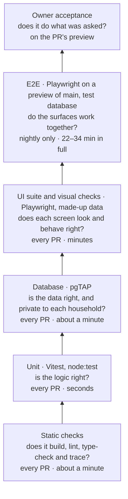
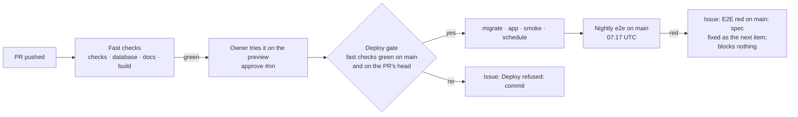

# 08 — Test Strategy

> Version 0.8 · Status: build baseline · Maintained by Claude Code
> v0.8.11: the e2e reds of 18 to 21 October (WP-113, D-143): a slow probe says how much was the database's own time; the run reads the preview's own way to the test database (`/api/health/db`); a failed test names the page load or save it was still waiting for; the specs' date maths (`scripts/e2e-dates.mjs`) unit-tested on every weekday, across DST and in any zone. Test cases DEV-05-a, DEV-05-b and NFR-12-a to NFR-12-e.
> v0.8.10: WP-111's follow-up: NFR-14-x reads each spec with the TypeScript parser, so a seed id or `family.` inside SQL text fails it (run 251's `chores.spec.ts`); the UI suite's MENU-06 Meals check passes on a Sunday too.
> v0.8.9: each e2e spec its own made-up household (WP-111, NFR-14, D-137): rule 4 says how a spec gets it, and rule 11 that leftovers stay in it. Test cases NFR-14-u to NFR-14-z; the Test catalogue regenerated (§9).
> v0.8.8: the two e2e reds of 17 October night (WP-110, PTS-04, NFR-16, D-136): both the app's bugs, each proved by a UI test that fails on `main`'s code (PTS-04-a, NFR-16-r) and a unit test (NFR-16-s); the Test catalogue regenerated (§9).
> v0.8.7: the two e2e reds of 17 October evening (WP-109, NFR-14): a change that folds a section opens it in every spec that uses what it holds; a clean-up skips each check-off its items made, so the children's good and bad runs are as before, and says why a leftover shows only once its spec passes (§7 rules 10 and 11).
> v0.8.6: the three e2e reds of 17 October (WP-108, NFR-14, D-135): a late change's evidence is the read or page load that would show it, and every one over 2 s; the preview's `/api/health` over 2 s is a slow reading (§8). Test cases NFR-14-o to NFR-14-r; the Test catalogue regenerated (§9).
> v0.8.5: WP-93's test cases (NFR-18-a to NFR-18-j, D-131): the Test catalogue regenerated (§9).
> v0.8.4: the e2e findings log and a run by hand (WP-98, NFR-14, D-130): each run with a failed test adds a comment to "E2E findings log", re-runs included, and the run summary lists tests that failed in more than one of the last 30 runs; the nightly run can be started by hand on `main` when no other e2e run is queued or going (§3, §8).
> v0.8.3: the e2e red triage (WP-102, NFR-14, D-129): the run hides every connection string from its summary and issues; a board's own read over 2 s is evidence the test database was slow; three more rules for writing specs (§7).
> v0.8.2: the UI suite runs as an iPhone in WebKit too, and an item built from a mockup shows a side-by-side before approval (WP-100, NFR-16, D-127).
> v0.8.1: added at the owner's request (WP-85, NFR-19, D-106, D-107), within D-108 (e2e nightly only, the deploy gate on the fast checks) and D-110 (the test standard): the test strategy, guidance by change type, and the Test catalogue (§9), generated from every test's name, which traces each test to the requirements, stories, backlog items and test cases it proves. CI fails a change that adds a test gap.

Every change is one type, and each type has its own rules for the tests it must write and how the owner accepts it. Every pull request runs the same fast checks, and only those gate a merge and a deploy (D-108). The full e2e suite runs nightly on `main` and never blocks anything, so what only e2e can catch is reported the next morning, and fixed as the next item.

This page is the source of truth for how FamilyWise is tested: the layers (§1), what each kind of test proves (§2), what runs when (§3), the rules for each type of change (§4), what earns an e2e test (§5), test cases and traceability (§6), how tests are written (§7), and what happens when one fails (§8). §9 is the **Test catalogue**: every test, traced to what it proves, generated by `check_traceability.py --fix` and checked in CI (NFR-19).

What is built and what is still to come is said plainly in each section. Built: the fast checks and the deploy gate on them (WP-88, D-108); nightly e2e, its one re-run on infrastructure evidence, and the test standard in `CLAUDE.md` (WP-90, D-110); the rules for each type of change (D-106) and the catalogue with its CI check (WP-85, D-107). Planned: the test database prepared for a pull request's preview (WP-89); SPIKE-07, an audit of every e2e spec by layer; WP-98, a findings log of each nightly run's red tests and a way to start the nightly run by hand; WP-99, lean e2e that runs at least once a week (D-121); and WP-86, closing the known test gaps.

---

## 1. Test layers

A bug is tested at the lowest layer that can show it. The layers are cheapest at the base: a unit test runs in milliseconds, a full e2e run takes more than 20 minutes.

| Layer | Asks | Where it fails first | Gates a merge and a deploy |
|---|---|---|---|
| Static checks | Does it build, lint, type-check and trace? | The PR's `checks` and `docs` jobs | Yes |
| Unit | Is the logic right? | `pnpm test`, in `checks` | Yes |
| Database (pgTAP) | Is the data right, and private to each household? | `pnpm db:test`, the `database` job | Yes |
| UI suite and visual checks | Does each screen look and behave right, at every size, theme and text size? | `pnpm test:ui`, the `build` job | Yes |
| E2E | Do the board, the admin app, the database and the jobs work together? | The nightly run on `main` (`e2e.yml`) | No, never (D-108) |
| Owner acceptance | Does it do what was asked? | The owner, on the PR's preview | The owner's `approve #nn` |

---

## 2. Test types

Each type, with what it proves, where it runs, when, and how fast.

| Type | What it proves | Where it runs | When | How fast |
|---|---|---|---|---|
| Static checks | Format, lint, types, traceability (`check_traceability.py`), the docs build and its layout on 13 devices | CI `checks` and `docs` jobs | Every PR, and the merge commit on `main` | About a minute each |
| Unit (Vitest, node:test) | Pure logic: the rules engine, dates, menu reading, lunch picks, the board's layout choice, sleep and wake, the scripts CI runs | CI `checks` (`pnpm test`) | Every PR | Seconds |
| Database (pgTAP) | Tables, functions and access rules; household isolation (RLS) | CI `database`, on native Postgres (`scripts/db-test.sh`) | Every PR | About a minute |
| UI suite (Playwright) | Screens on made-up data with no shared database: every size, theme and text size; the 28 px and 56 px floors; a page's own interactions. Desktop Chrome, and an iPhone in WebKit (Safari's engine) for the controls, goal, form and admin layout specs (the `iphone` project, D-127) | CI `build` (`pnpm test:ui`) | Every PR | Minutes |
| Visual and accessibility | Tile style snapshots, axe contrast, manifests, fonts, keyboard | CI `build`, in the UI suite | Every PR | In the UI suite's time |
| E2E (Playwright) | Real flows across the board, the admin app, the database and the jobs, as the demo family | A preview of `main` that the run builds, on the test database (`e2e.yml`) | Nightly at 07:17 UTC; never on a PR, never after a deploy (D-108) | 22–34 min for the last four green full runs before D-108 (225, 228, 229, 234), one worker; 40 spec files |
| Burn-in | A new or changed e2e spec passes 5 runs in a row | The nightly run (`node scripts/e2e-run.mjs --burn-in <spec>`) | Optional, after the spec is on `main` (D-110) | 5 × the spec's time |
| Smoke | Production answers after a deploy | `deploy / smoke`: `/api/health` reports `ok` | After every deploy | Seconds |
| Owner acceptance (UAT) | The item's Done when, tried by the owner | The PR's preview, as the demo family | Every item with something a parent or child can see | The owner's time |

Regression is not a type of its own: it is every existing test run again, plus one test kept forever for each bug fixed (§4.2). The smoke check stays a health check: the owner chose no e2e after a deploy (D-108).

**The nightly run, as a fact (16 October):** the first scheduled run had not started by 11:14 UTC, four hours after its 07:17 slot. GitHub's schedule runs late, and e2e has no way to start it by hand until WP-98 adds one (`workflow_dispatch`, on `main` only, D-121).

---

## 3. What runs, and when

Every pull request runs the same fast checks, whatever it changes: `checks` (lint, format, types, unit, traceability), `database` (pgTAP), `docs` (the docs build and its layout) and `build` (the app and the UI suite). A pull request is ready when those four are green and the owner approves; the deploy gate ships `main`'s head when they passed on it and on its pull request's head (D-108). e2e runs nightly on `main` only. The same run can be started by hand (Actions → e2e → Run workflow, on `main`): it starts only when no other e2e run is queued or going, so it never displaces the night's run, and like it, it blocks nothing (D-130).

| | Before merge | After deploy | Nightly | Blocks a merge or a deploy |
|---|---|---|---|---|
| Fast checks | Every PR | The merge commit on `main` | — | Yes |
| Smoke | — | Every deploy | — | A failed smoke fails the deploy run |
| E2E | Never | Never | The full suite on `main` | Never |
| Owner acceptance | On the PR's preview | — | — | Yes: `approve #nn` |

The preview of a pull request runs as the demo family on the test database. A pull request that adds a migration may show errors on its preview until the nightly run applies it; WP-89 adds a job that prepares the test database for a pull request's preview.

### 3.1 Areas and their e2e specs

Each area and its e2e specs (`e2e/tests/<name>.spec.ts`). A fix or feature in an area names the area's specs in its PR, and the morning after its merge the worker reads their result in the nightly run.

| Area | e2e specs |
|---|---|
| Chores and points | chores, points, admin-day, insights |
| Goals and rewards | goals, goal-payouts, goal-end-date, rewards, wishlist, board-shop |
| Calendar | calendar, board-calendar |
| Meals and lunch | meals, meal-days, meal-edit, lunches, lunch-week, lunch-quick, menus, board-meals |
| Board | board, board-home, board-layout, board-fit, offline, devices, board-sleep |
| Admin and members | auth, home, admin-menu, members, icons, link-me |
| School year | school |
| Jobs and reminders | jobs, reminders, reminders-job, weather |
| Always | smoke, health |

The specs on `main` are the list's source; SPIKE-07 audits each test in them by layer, for the owner to choose what to keep, move or drop.

---

## 4. Rules by type of change

A change is one of these types (D-106). A worker may treat a change as a larger type, never a smaller one, and a change of two types follows both. Every type runs the same fast checks (§3); what differs is the tests it must add and how the owner accepts it.

| Type | What it is | Tests it must add | The owner |
|---|---|---|---|
| Docs only | Only `docs/`, `*.md`, guide images | None: the docs build, cross-links, layout and trace are its tests | Reads it |
| Test only | Only tests and their support | The changed tests themselves; a changed e2e spec may be burnt in on the nightly run | — |
| Bug fix | A fix in one area | A test that fails on `main` for the reason the owner saw, at the lowest layer that shows it (§4.2) | May check on the preview that the bug is gone |
| Small feature | One area | Unit tests for every rule and edge; the screen's states in the UI suite; one e2e test only if it crosses surfaces (§4.3) | Tries its Done when on the preview; built from a mockup, a side-by-side of each screen (iPhone WebKit and laptop) next to its frame first (D-127) |
| Large feature | Two or more areas (capabilities), or a new table | A test plan before it is built; coverage at each layer for each capability; one e2e journey per capability it crosses (§4.4) | A scripted acceptance of 3 to 8 steps on the preview |
| Shared code | Migrations, auth, the board or admin shell, shared `lib/`, the test harness, dependencies, CI | Contract tests for what callers rely on (§4.5) | — |

### 4.1 Docs only

- The docs build, its cross-links, its layout on 13 devices and the trace are the tests.
- A changed screenshot re-takes only those guide shots (`pnpm guide:shots --only=<shots>`).

### 4.2 Bug fix

1. A test that fails on `main` for the reason the owner saw.
2. At the lowest layer that can show the bug: logic in a unit test, data or access in pgTAP, layout in the UI suite, wiring between surfaces in e2e.
3. The fix makes it pass; the PR states "fails on main, passes here" with the runs. A bug only e2e can show is proved by the nightly run after merge, and the PR says so.
4. The test is named with the bug's item ID (`[MEAL-11] WP-78: …`) and is never removed.
5. Ask why no test caught it, and add the missing case.

### 4.3 Small feature

- Unit tests for every rule and edge: dates, empty, one, many, limits.
- UI states (empty, filled, error, waiting) at board and admin sizes, in both themes.
- One e2e test for its Done when, only if it crosses surfaces or needs the real database; it runs nightly from the merge on.
- The owner tries the Done when on the preview.

### 4.4 Large feature, across several capabilities

- A test plan in the item's §5 section of `05` before building: its test cases by layer, with IDs (§6).
- Unit and UI coverage for each capability.
- One e2e journey for each capability it crosses, and its area's specs named in the PR; the worker reads their result in the first nightly run after merge.
- An owner script of 3 to 8 steps on the preview, each with what they should see.

### 4.5 Shared code

- Contract tests for what the shared code promises its callers, at the lowest layer that holds them.
- The PR names the areas it touches; the next nightly run is the full suite.

---

## 5. What earns an e2e test

Since D-108, e2e protects nothing before merge: what an e2e test catches reaches production and is reported the next morning. So a check belongs in e2e only when no lower layer can make it. Target: the full suite under 10 minutes (WP-99); the last full runs took 22–34.

| E2E for | Never in e2e (and where instead) |
|---|---|
| Flows that cross surfaces: the board, the admin app, the database | Layout, sizes, themes and the 28 px and 56 px floors (UI suite) |
| Sign-in, pairing and what the real database shows each household | A rule's edge cases (unit) |
| Points and goal payouts | Access cases, one household against another (pgTAP) |
| Background jobs: day close, reminders, the menu fetch | Anything that waits on the clock, a third party, or another test's data |
| One happy path and one key failure for each capability | |

---

## 6. Test cases and traceability

Every requirement, user story and backlog item traces to the tests that prove it (NFR-19, US-913). The trace is read from the tests' own names, so it can't drift from the code.

- **Every Done when line becomes numbered test cases before the build.** A case's ID is its requirement plus a letter: `MEAL-11-a`. The cases go in the item's §5 section of `05`, as a table with the columns Case, Test case and Layer.
- **A case is proved by a test whose name carries its ID**, in brackets like any other ID: `[MEAL-11-a] picking a milk keeps the entree`.
- **Every test names what it proves**: a requirement (`[CHR-04]`), and where it applies a story (`[US-707]`), an item (`WP-78`) or a case (`[MEAL-11-a]`). A `describe` block's IDs apply to every test in it.

Examples:

| Case | Test case | Layer |
|---|---|---|
| MEAL-11-a | Picking a milk keeps the entree | Unit, UI |
| MEAL-11-b | A parent's picks save all three sections | E2E |
| MENU-06-c | "and" joins the next item to the option before it | Unit |
| BRD-08-a | At 1180×820 and Larger, each points chip sits under its own chore | UI |

(These are examples of the form, not cases in `05`.)

### 6.1 What the check reads

`check_traceability.py` reads every test in four layers (`docs/test_catalogue.py`):

| Layer | Files | A test is |
|---|---|---|
| Unit | `*.test.ts`, `*.test.tsx`, `*.test.mjs` outside `e2e/` (Vitest, node:test) | Each `it(…)` or `test(…)`, and each `.each(…)` table once |
| DB | `supabase/tests/*.test.sql` (pgTAP) | Each assertion, named by its description |
| UI | `e2e/ui/*.spec.ts` | Each `test(…)` |
| E2E | `e2e/tests/*.spec.ts` | Each `test(…)` |

Tests are counted as written: a test in a loop, an `.each` table or a pgTAP branch counts once, so the runners' own counts (which count each run) are higher.

### 6.2 What fails CI

| Fails a PR | Why |
|---|---|
| A test naming an unknown requirement, story, backlog item or test case | A typo, or a test proving something the docs don't have |
| A test case in `05` for a requirement not on its item's Reqs line | The case traces to the wrong place |
| A **new** gap: a built requirement or built story with no test naming it; a Done item whose Done when has no test cases; a Done item's test case with no test | Something shipped untested |
| The Test catalogue (`08` §9), `04` §B's Tests column or `04` §C's Tests line out of date | The catalogue is generated; run `python3 docs/check_traceability.py --docs docs --fix` |

The check runs in `checks`, one of the four fast checks, so a gap holds a merge and a deploy like any other red check.

**Built** means a Done item builds it: a requirement on a Done item's Reqs line, or a story that shares a requirement with a Done item (the user guide's rule, D-68). A requirement, story or item recorded but not yet built is not a gap, so a backlog change never fails for tests it can't have yet; its cases may wait for their tests until the item is built.

Gaps that existed when the catalogue was made are **known gaps**, listed in `docs/known-test-gaps.txt` and §9.6. `--fix` takes a gap off once it is closed; it never adds one. Closing them all is WP-86.

### 6.3 Who answers for it

- The worker writes the item's test cases in `05` §5 before building, gives every case a test, and regenerates the catalogue. The PR lists the cases it adds and the catalogue's diff (deliver skill).
- The planner's status reports include the coverage: the count of known gaps and any new gap.

---

## 7. How we write tests

The test standard is in `CLAUDE.md` ("Tests", D-110). In short:

1. **Wait for a signal, never a time.** A role or text, `aria-busy`, a status, a response, or `expect.poll` on the database; after a page load, wait until React has hydrated it (`<html data-hydrated>`).
2. **Sign in once, not per test.** `signIn(page, 'Alex')` (`e2e/support/session.ts`) signs each worker in once per persona of the spec's own household.
3. **Own the clock.** Read the household's today from the database once (`e2e/support/day.ts`); cover midnight UTC, a week boundary and DST in unit tests.
4. **Own the data.** Each spec that signs in or reaches the database has a made-up household of its own: `const family = ownHousehold('<spec>')` at its top (`e2e/support/household.ts`, WP-111, D-137), a copy of the demo family's seed made as the spec starts. Its ids are `family.id` and `family.own('0de00000-…')`, its sign-ins `family.email('alex')`; never the demo family's own, which is left to previews and `auth.spec.ts`. Within the spec, unique names, no dependence on order, and anything one test changes put back for the next.
5. **Measure the limit.** A time limit comes from measured runs on the free test database, with at least 3× headroom; a latency budget that is a requirement stays exact, timed from the server's answer.
6. **Lowest layer first.** §1, §5.
7. **One reason to fail, named:** `[MEAL-11] a milk keeps the entree`. A test that fails says what it saw.
8. **Made-up data only.** Never the real family's calendar, school identifiers or menu responses.
9. **No live third parties.** Fixtures in tests; live checks only at night.
10. **Follow the screen as it is drawn now.** A fold is opened only if it is closed (`unfold`, `e2e/support/fold.ts`): a tap on an open one closes it. A locator names the list it reads from, not a class another part of the page shares. The board drifts up to 2 px against burn-in, so where a part sits is judged against the board's own box (WP-102). A change that folds a section opens it in every spec that uses what it holds: search the specs for the section's labels and buttons, since e2e doesn't run on its PR (WP-109).
11. **History is never deleted, and put back.** Check-offs are append-only: a clean-up removes an item's days with no check-off and archives the item (WP-102). An item's check-offs stay in the child's history, so the clean-up also skips each day it checked off, once the spec's goals are cancelled: a skipped routine makes a day neither good nor bad, so the child's runs are as before (`retireItems`, `e2e/support/history.ts`, WP-109). Since WP-111 a spec's leftovers stay in its own household, so no other spec reads them.
12. **Any day of the week.** A spec that reads a week's data sets it up for the whole week, so it passes on a Saturday and a Sunday too (WP-102).

---

## 8. When a test fails

| What failed | What happens |
|---|---|
| A fast check | Red on the PR: the PR waits until it is fixed, and the deploy gate won't ship it |
| A wrong result in the nightly run | Red, never re-run; the issue "E2E red on main: <spec>" opens or gains the run, with the test's kind and cause; it blocks nothing and is fixed as the next item (D-108) |
| Infrastructure in the nightly run: a statement timeout, a refused or reset connection, a Supabase or Auth 5xx, the preview not answering, the test database or preview slow or down (the probe, the preview's `/api/health` answering in over 2 s, the preview taking over 2 s to reach the test database (`/api/health/db`, D-143), or the reads that would show a late change all taking over 2 s: a board's read of it, D-129, or a reloaded page's loads, D-135), the demo family's day turned since its load | That test re-runs once by itself, on that evidence only, and its cause is labelled in the run summary; a second fault is red, with its cause (D-110) |
| A refused or failed deploy | The issue "Deploy refused: <commit>" opens or gains the run (D-108) |

- Never skip, disable or quarantine a test, and never call a failure a flake without a cause.
- The run summary and an issue never quote a database connection string: the run hides each one (`postgresql://***`) first, since GitHub masks secrets in a log but not in an issue the run opens (D-129).
- A test with two infrastructure faults in two weeks gets a robustness fix. The findings log keeps the record that shows it (WP-98, D-130): the issue "E2E findings log" gains one comment per run with a failed test, an entry per test with its kind, cause and re-run, re-runs that passed included; each entry says how many of the last 30 runs the test failed in, and the run summary lists every test that failed in more than one of them.
- A failed test's cause names the page load or save its browser was still waiting for from the preview when it ended, if any (D-143): where it stopped, so a save that never answered is seen as one. On its own it is no evidence of infrastructure, and never re-runs the test.
- The worker who fixes a red test edits its entry's **Done** from "open" to the PR that fixed it.

**Measured before and after:** push to green for a small change, and red nightly runs per week by kind (assertion or infrastructure).

---

## 9. Test catalogue

Generated from the tests by `python3 docs/check_traceability.py --docs docs --fix`; do not edit by hand. CI fails when it is out of date.

<!-- catalogue -->

### 9.1 Coverage summary

**2932** tests: Unit 920 · DB 1562 · UI 313 · E2E 137. 2410 name at least one ID; 522 name none.

| Measure | Count |
|---|---|
| Requirements built (a Done item builds them) | 130 of 147 |
| Built requirements with no test | 0 |
| Stories built | 114 of 130 |
| Built stories with no test naming them | 42 |
| Done items whose Done when has no test cases | 62 |
| Test cases | 220 (with a test: 220) |
| Done items' test cases with no test | 0 |
| Must requirements covered only by e2e | 0 |
| Tests naming an unknown ID | 0 |
| Known gaps (`known-test-gaps.txt`) | 104 |

Must requirements covered only by e2e: none.

### 9.2 Tests by layer and area

Area is the domain of the first requirement a test names. Layers: Unit (Vitest, node:test), DB (pgTAP), UI (the UI suite), E2E (on the preview).

| Area | Unit | DB | UI | E2E | Total |
|---|---|---|---|---|---|
| Chores | 116 | 202 | 38 | 33 | 389 |
| Points | 38 | 92 | 18 | 12 | 160 |
| Goals and rewards | 182 | 140 | 42 | 8 | 372 |
| Calendar | 67 | 92 | 19 | 5 | 183 |
| School year | 10 | 43 | 1 | 4 | 58 |
| Meals and lunch | 100 | 74 | 60 | 16 | 250 |
| School menu | 30 | 14 | 8 | 3 | 55 |
| Board | 29 | 68 | 34 | 11 | 142 |
| Boards and devices | 67 | 84 | 14 | 13 | 178 |
| Admin and members | 26 | 87 | 8 | 15 | 136 |
| Platform | 197 | 167 | 61 | 16 | 441 |
| Not named | 58 | 499 | 10 | 1 | 568 |
| **Total** | **920** | **1562** | **313** | **137** | **2932** |

### 9.3 By requirement

Status: **Covered** (built, and at least one test names it), **Gap** (built, no test), **Not built** (no Done item builds it yet). Tests are counted by layer; the tests themselves are in §9.7.

| Req | Pri | Status | Stories | Backlog items | Test cases | Tests |
|---|---|---|---|---|---|---|
| ACC-01 | M | Covered | US-101 | WP-02, WP-03 | — | DB 14 · E2E 1 |
| ACC-02 | M | Covered | US-102 | WP-03 | — | U 18 · DB 5 · UI 1 · E2E 4 |
| ACC-03 | M | Covered | US-103 | WP-03 | — | U 1 · DB 19 · E2E 2 |
| ACC-04 | M | Covered | US-104 | WP-04, WP-46 | — | U 5 · DB 16 · UI 3 · E2E 7 |
| ACC-05 | S | Covered | US-105 | WP-03, WP-32 | — | DB 20 |
| ACC-06 | S | Not built | US-106 | WP-38 | — | — |
| ACC-07 | S | Not built | US-108 | WP-55 | — | — |
| ACC-08 | S | Covered | US-110 | WP-57 | — | U 2 · DB 13 · UI 4 · E2E 1 |
| DEV-01 | M | Covered | US-201 | WP-05 | — | U 1 · DB 13 · UI 1 · E2E 2 |
| DEV-02 | M | Covered | US-201, US-202 | WP-05, WP-59 | — | U 4 · DB 26 · E2E 3 |
| DEV-03 | M | Covered | US-202 | WP-05 | — | U 2 · DB 7 · UI 1 · E2E 1 |
| DEV-04 | M | Not built | US-203 | WP-14 | — | U 1 |
| DEV-05 | M | Covered | US-204 | WP-06, WP-70, WP-78, WP-113 | DEV-05-a, DEV-05-b | U 12 · DB 26 · UI 3 · E2E 6 |
| DEV-06 | M | Covered | US-205 | WP-13 | — | U 5 · UI 1 · E2E 1 |
| DEV-07 | S | Not built | US-207 | WP-34 | — | U 41 · DB 17 · UI 4 · E2E 1 |
| DEV-08 | S | Covered | US-206 | WP-13 | — | U 3 · UI 3 · E2E 1 |
| DEV-09 | S | Covered | US-208 | WP-91 | — | U 3 · UI 2 |
| CHR-01 | M | Covered | US-301 | WP-08, WP-46, WP-83 | — | U 16 · DB 9 · UI 4 · E2E 4 |
| CHR-02 | M | Covered | US-302 | WP-09 | — | DB 4 |
| CHR-03 | M | Covered | US-303, US-308, US-311 | WP-09 | — | U 4 · DB 18 · E2E 1 |
| CHR-04 | M | Covered | US-304, US-305, US-1006 | WP-10, WP-11 | — | U 11 · DB 9 · UI 4 · E2E 3 |
| CHR-05 | M | Covered | US-306, US-310 | WP-12, WP-92 | — | U 4 · DB 8 · UI 3 · E2E 1 |
| CHR-06 | M | Covered | US-307, US-309 | WP-12 | — | U 5 · DB 3 · UI 3 · E2E 2 |
| CHR-07 | M | Covered | US-307, US-314 | WP-10 | — | U 5 · DB 15 · E2E 1 |
| CHR-08 | M | Covered | US-309 | WP-12 | — | U 2 · DB 1 · UI 2 · E2E 1 |
| CHR-09 | M | Covered | US-304, US-311, US-316, US-320 | WP-08, WP-09, WP-10, WP-43 | — | U 8 · DB 15 · UI 1 · E2E 3 |
| CHR-10 | M | Covered | US-312 | WP-08, WP-15, WP-19, WP-46, WP-83 | — | U 9 · DB 8 · UI 3 · E2E 2 |
| CHR-11 | M | Covered | US-313 | WP-08, WP-09, WP-11 | — | U 9 · DB 5 · UI 1 · E2E 2 |
| CHR-12 | M | Covered | US-303, US-314 | WP-09, WP-10, WP-11 | — | U 5 · DB 9 · UI 2 · E2E 1 |
| CHR-13 | M | Covered | US-315 | WP-08 | — | U 4 · DB 28 · E2E 3 |
| CHR-14 | M | Covered | US-316 | WP-12 | — | U 4 · DB 7 · UI 6 · E2E 2 |
| CHR-15 | M | Covered | US-317 | WP-40 | — | U 8 · DB 3 · UI 5 · E2E 4 |
| CHR-16 | M | Covered | US-318 | WP-40 | — | U 5 · DB 6 · UI 2 · E2E 6 |
| CHR-17 | M | Covered | US-319 | WP-40 | — | U 2 · DB 2 · UI 1 · E2E 2 |
| CHR-18 | M | Covered | US-320 | WP-43 | — | U 5 · DB 21 · E2E 2 |
| CHR-19 | M | Covered | US-321 | WP-61 | — | U 2 · DB 14 · UI 1 · E2E 1 |
| CHR-20 | S | Covered | US-322 | WP-63, WP-92 | — | U 3 · DB 22 · UI 1 · E2E 1 |
| CHR-21 | S | Covered | US-323 | WP-96 | CHR-21-a, CHR-21-b, CHR-21-c, CHR-21-d, CHR-21-e, CHR-21-f, CHR-21-g, CHR-21-h, CHR-21-i | U 21 · UI 6 · E2E 3 |
| CHR-22 | S | Covered | US-324 | WP-96 | CHR-22-a, CHR-22-b | U 2 · E2E 1 |
| CHR-23 | S | Covered | US-325 | WP-96 | CHR-23-a, CHR-23-b, CHR-23-c | U 3 · DB 10 · UI 1 · E2E 1 |
| RWD-01 | M | Covered | US-401 | WP-19 | — | U 5 · DB 1 · UI 2 · E2E 1 |
| RWD-02 | M | Covered | US-312, US-401 | WP-15 | — | U 16 · UI 1 |
| RWD-03 | M | Covered | US-401 | WP-15 | — | U 5 · UI 1 |
| RWD-04 | M | Covered | US-406, US-407 | WP-19, WP-39 | — | U 13 · DB 7 · UI 1 · E2E 2 |
| RWD-05 | M | Covered | US-402 | WP-15 | — | U 31 · DB 2 · UI 3 · E2E 1 |
| RWD-06 | M | Covered | US-405 | WP-19 | — | DB 2 · UI 1 · E2E 1 |
| RWD-07 | M | Covered | US-403 | WP-20, WP-44 | — | U 9 · DB 3 · UI 3 · E2E 1 |
| RWD-08 | M | Covered | US-404 | WP-11, WP-20 | — | U 3 · DB 9 · UI 5 · E2E 1 |
| RWD-09 | M | Covered | US-405 | WP-19 | — | U 1 · DB 2 · UI 1 · E2E 1 |
| RWD-10 | S | Covered | US-406 | WP-39 | — | U 3 · DB 2 · UI 1 · E2E 1 |
| RWD-11 | M | Covered | US-408 | WP-15, WP-17 | — | U 21 · DB 3 · E2E 2 |
| RWD-12 | S | Covered | US-408 | WP-17 | — | U 1 · DB 6 · UI 1 · E2E 1 |
| RWD-13 | S | Covered | US-409 | WP-39 | — | U 3 · DB 4 · UI 3 · E2E 1 |
| RWD-14 | S | Covered | US-401 | WP-79 | — | U 5 · DB 5 · UI 3 · E2E 1 |
| RWD-15 | S | Covered | US-410, US-411 | WP-80 | RWD-15-a, RWD-15-b, RWD-15-c, RWD-15-d, RWD-15-e, RWD-15-f, RWD-15-g, RWD-15-h, RWD-15-i, RWD-15-j, RWD-15-k, RWD-15-l, RWD-15-m | U 17 · DB 22 · UI 7 · E2E 1 |
| RWD-16 | S | Covered | US-410, US-411 | WP-80 | RWD-16-a, RWD-16-b, RWD-16-c, RWD-16-d, RWD-16-e, RWD-16-f, RWD-16-g, RWD-16-h, RWD-16-i | U 14 · DB 5 · UI 4 |
| RWD-17 | S | Covered | US-412 | WP-81 | RWD-17-a, RWD-17-b, RWD-17-c, RWD-17-d, RWD-17-e, RWD-17-f, RWD-17-g, RWD-17-h | U 9 · DB 10 · UI 1 · E2E 1 |
| RWD-18 | S | Covered | US-413 | WP-81 | RWD-18-a, RWD-18-b, RWD-18-c, RWD-18-d, RWD-18-e, RWD-18-f, RWD-18-g, RWD-18-h, RWD-18-i, RWD-18-j, RWD-18-k, RWD-18-l, RWD-18-m | U 16 · DB 19 · UI 9 · E2E 1 |
| RWD-19 | S | Covered | US-414 | WP-82 | RWD-19-a, RWD-19-b, RWD-19-c, RWD-19-d, RWD-19-e, RWD-19-f, RWD-19-g, RWD-19-h, RWD-19-i, RWD-19-j | U 10 · DB 19 · UI 3 · E2E 1 |
| RWD-20 | S | Covered | US-415 | WP-82 | RWD-20-a, RWD-20-b, RWD-20-c, RWD-20-d, RWD-20-e, RWD-20-f, RWD-20-g, RWD-20-h, RWD-20-i, RWD-20-j, RWD-20-k | U 12 · DB 19 · UI 8 · E2E 1 |
| CAL-01 | M | Covered | US-501 | WP-22 | — | U 6 · DB 19 · UI 2 · E2E 1 |
| CAL-02 | M | Covered | US-502 | WP-22 | — | U 5 · DB 11 · E2E 1 |
| CAL-03 | M | Covered | US-501 | WP-22 | — | DB 3 · UI 1 |
| CAL-04 | M | Covered | US-503, US-1008 | WP-23 | — | U 8 · DB 4 · UI 11 · E2E 1 |
| CAL-05 | M | Covered | US-504, US-507 | WP-23, WP-46, WP-70 | — | U 11 · DB 11 · UI 3 · E2E 2 |
| CAL-06 | M | Covered | US-505 | WP-22 | — | U 9 · DB 7 · UI 4 · E2E 2 |
| CAL-07 | M | Covered | US-502 | WP-22 | — | U 17 · DB 6 · E2E 1 |
| CAL-09 | S | Covered | US-508 | WP-50 | CAL-09-a, CAL-09-b, CAL-09-c, CAL-09-d, CAL-09-e, CAL-09-f, CAL-09-g | U 8 · DB 24 · UI 4 · E2E 1 |
| CAL-10 | S | Covered | US-509 | WP-52 | — | U 4 · DB 8 · UI 1 · E2E 1 |
| CAL-08 | C | Not built | US-506 | WP-29 | — | — |
| SCH-01 | M | Covered | US-601 | WP-21 | — | U 10 · DB 13 · UI 4 · E2E 5 |
| SCH-02 | M | Covered | US-602 | WP-21 | — | DB 14 · UI 1 · E2E 3 |
| SCH-03 | M | Covered | US-302, US-602 | WP-09, WP-21 | — | DB 17 · E2E 1 |
| SCH-04 | C | Not built | US-603 | WP-36 | — | — |
| SCH-05 | S | Not built | US-604 | WP-54 | — | — |
| SCH-06 | C | Not built | US-605 | WP-56 | — | — |
| MEAL-01 | M | Covered | US-701 | WP-25 | — | U 4 · DB 1 · UI 3 · E2E 1 |
| MEAL-02 | M | Covered | US-701 | WP-25 | — | U 3 · DB 2 · UI 3 · E2E 1 |
| MEAL-03 | S | Covered | US-702 | WP-25 | — | U 1 · DB 3 · UI 1 · E2E 1 |
| MEAL-04 | M | Covered | US-703 | WP-26 | — | U 5 · DB 4 · UI 1 · E2E 1 |
| MEAL-05 | M | Covered | US-704 | WP-27 | — | U 3 · DB 2 · E2E 1 |
| MEAL-06 | M | Covered | US-705 | WP-28 | — | U 6 · DB 3 · UI 4 · E2E 3 |
| MEAL-07 | S | Covered | US-706, US-715 | WP-105 | MEAL-07-a, MEAL-07-b | U 1 · DB 1 · UI 2 |
| MEAL-09 | S | Covered | US-707 | WP-49, WP-77 | — | U 9 · DB 13 · UI 6 · E2E 1 |
| MEAL-08 | S | Covered | US-701 | WP-25 | — | U 2 · DB 1 · UI 2 · E2E 1 |
| MEAL-10 | M | Covered | US-708 | WP-62 | — | U 3 · DB 5 · UI 2 · E2E 1 |
| MEAL-11 | S | Covered | US-707 | WP-49, WP-77, WP-78 | — | U 7 · DB 6 · UI 1 · E2E 1 |
| MEAL-12 | S | Covered | US-709 | WP-73 | — | U 4 · UI 1 · E2E 1 |
| MEAL-13 | M | Covered | US-710 | WP-74 | — | U 9 · UI 4 · E2E 1 |
| MEAL-14 | S | Covered | US-711 | WP-75 | — | U 4 · UI 4 · E2E 1 |
| MEAL-15 | S | Covered | US-701 | WP-76 | — | DB 4 · UI 3 · E2E 1 |
| MEAL-16 | S | Not built | US-712 | WP-103 | — | — |
| MEAL-17 | S | Not built | US-713 | WP-103 | — | — |
| MEAL-18 | S | Covered | US-714 | WP-104 | MEAL-18-a, MEAL-18-b, MEAL-18-c, MEAL-18-d, MEAL-18-e, MEAL-18-f | U 4 · DB 6 · UI 8 · E2E 1 |
| MEAL-19 | S | Covered | US-715 | WP-105, WP-113 | MEAL-19-a, MEAL-19-b, MEAL-19-c, MEAL-19-d, MEAL-19-e, MEAL-19-f | U 4 · DB 2 · UI 2 · E2E 1 |
| MEAL-20 | S | Covered | US-715 | WP-105 | MEAL-20-a, MEAL-20-b, MEAL-20-c, MEAL-20-d | U 8 · DB 2 · E2E 1 |
| MEAL-21 | S | Not built | US-716 | WP-106 | — | — |
| MEAL-22 | S | Not built | US-717 | WP-107 | — | — |
| MEAL-23 | S | Covered | US-718 | WP-104 | MEAL-23-a, MEAL-23-b, MEAL-23-c, MEAL-23-d, MEAL-23-e | U 3 · DB 3 · UI 3 · E2E 1 |
| MEAL-24 | S | Covered | US-719 | WP-104 | MEAL-24-a, MEAL-24-b, MEAL-24-c, MEAL-24-d, MEAL-24-e | U 5 · DB 1 · UI 1 |
| MEAL-25 | S | Covered | US-720 | WP-96, WP-105 | MEAL-25-h, MEAL-25-a, MEAL-25-b, MEAL-25-c, MEAL-25-d, MEAL-25-e, MEAL-25-f, MEAL-25-g | U 13 · DB 2 · UI 2 · E2E 1 |
| MEAL-26 | S | Covered | US-720 | WP-105 | MEAL-26-a | U 1 · DB 1 · UI 1 |
| MEAL-27 | S | Covered | US-721 | WP-112 | MEAL-27-a, MEAL-27-b, MEAL-27-c, MEAL-27-d, MEAL-27-e | U 2 · UI 7 · E2E 1 |
| MEAL-28 | S | Covered | US-721 | WP-112 | MEAL-28-a, MEAL-28-b, MEAL-28-c, MEAL-28-d, MEAL-28-e, MEAL-28-f, MEAL-28-g | U 2 · DB 13 · UI 4 · E2E 1 |
| MENU-01 | M | Covered | US-801 | WP-27 | — | U 3 · DB 1 · UI 2 · E2E 1 |
| MENU-02 | M | Covered | US-801 | WP-27 | — | U 4 · DB 2 · UI 2 · E2E 1 |
| MENU-03 | M | Covered | US-802 | WP-27 | — | U 6 · DB 3 · UI 2 · E2E 1 |
| MENU-04 | M | Covered | US-803 | WP-27 | — | U 4 · DB 1 · UI 2 · E2E 1 |
| MENU-05 | S | Covered | US-803 | WP-27 | — | U 5 · DB 3 · E2E 1 |
| MENU-06 | S | Covered | US-804 | WP-64, WP-78 | — | U 10 · DB 4 · UI 1 · E2E 1 |
| BRD-01 | M | Covered | US-303, US-1001 | WP-11, WP-35 | — | U 1 · DB 2 · UI 2 · E2E 3 |
| BRD-02 | M | Covered | US-1002 | WP-11 | — | U 1 |
| BRD-03 | M | Covered | US-905 | WP-11 | — | UI 10 |
| BRD-04 | C | Covered | US-1003 | WP-45 | — | U 13 · DB 33 · UI 7 · E2E 3 |
| BRD-05 | S | Covered | US-1004 | WP-35 | — | U 8 · DB 22 · UI 2 · E2E 3 |
| BRD-06 | M | Covered | US-1005 | WP-14, WP-35 | — | UI 2 |
| BRD-07 | M | Covered | US-1006 | WP-11, WP-35 | — | U 3 · DB 1 · UI 4 · E2E 2 |
| BRD-08 | S | Covered | US-1007 | WP-47, WP-58, WP-71 | — | U 5 · DB 11 · UI 8 · E2E 1 |
| BRD-09 | S | Covered | US-1008 | WP-48, WP-71 | — | UI 5 · E2E 1 |
| BRD-10 | S | Not built | US-1009 | WP-68 | — | — |
| BRD-11 | M | Not built | US-1010 | WP-72 | — | — |
| NFR-01 | M | Covered | US-205 | WP-13, WP-44 | — | U 11 · UI 2 · E2E 2 |
| NFR-02 | M | Not built | US-905 | WP-14 | — | UI 1 |
| NFR-03 | M | Covered | US-905 | WP-11 | — | UI 6 · E2E 1 |
| NFR-04 | M | Covered | US-102, US-901 | WP-02, WP-03, WP-05 | — | U 1 · DB 82 |
| NFR-05 | S | Not built | US-902 | WP-33 | — | U 1 |
| NFR-06 | M | Covered | US-907 | WP-10 | — | U 7 · DB 20 |
| NFR-07 | S | Covered | US-904 | WP-07, WP-42 | — | U 43 · DB 28 · UI 2 · E2E 4 |
| NFR-08 | S | Covered | US-909 | WP-01, WP-41, WP-42 | — | U 5 · DB 11 · UI 1 · E2E 1 |
| NFR-09 | M | Covered | US-101, US-901 | WP-02 | — | DB 4 |
| NFR-10 | M | Not built | US-903 | WP-24 | — | — |
| NFR-11 | S | Covered | US-906 | WP-31, WP-46 | — | U 4 · UI 29 |
| PTS-01 | M | Covered | US-309, US-1101, US-1106 | WP-16 | — | U 10 · DB 42 · E2E 5 |
| PTS-02 | M | Covered | US-1102 | WP-11, WP-16, WP-20 | — | U 4 · DB 11 · UI 1 · E2E 2 |
| PTS-03 | M | Covered | US-1103 | WP-18 | — | U 5 · DB 6 · UI 4 · E2E 1 |
| PTS-04 | M | Covered | US-1104, US-1105 | WP-18, WP-20, WP-110 | PTS-04-a | U 10 · DB 17 · UI 11 · E2E 3 |
| PTS-05 | S | Covered | US-1107 | WP-30 | — | U 7 · DB 4 · UI 2 · E2E 1 |
| PTS-06 | S | Covered | US-1108 | WP-30 | — | U 5 · DB 2 · UI 7 · E2E 2 |
| PTS-07 | M | Covered | US-1109 | WP-02, WP-04, WP-16 | — | U 2 · DB 15 · E2E 3 |
| NFR-12 | M | Covered | US-908, US-911 | WP-01, WP-02, WP-15, WP-85, WP-113 | NFR-12-a, NFR-12-b, NFR-12-c, NFR-12-d, NFR-12-e | U 10 |
| NFR-13 | M | Covered | US-910 | WP-37, WP-46 | — | U 21 · UI 7 |
| NFR-15 | S | Covered | US-107 | WP-51 | — | U 2 · UI 6 · E2E 1 |
| NFR-16 | S | Covered | US-912 | WP-53, WP-71, WP-96, WP-100, WP-101, WP-110 | NFR-16-t, NFR-16-a, NFR-16-b, NFR-16-c, NFR-16-d, NFR-16-e, NFR-16-f, NFR-16-g, NFR-16-h, NFR-16-i, NFR-16-j, NFR-16-k, NFR-16-l, NFR-16-m, NFR-16-n, NFR-16-o, NFR-16-p, NFR-16-q, NFR-16-r, NFR-16-s | U 20 · DB 10 · UI 23 |
| NFR-17 | S | Covered | US-109 | WP-57 | — | U 11 · DB 2 · UI 4 · E2E 2 |
| NFR-18 | S | Covered | US-111 | WP-93, WP-94, WP-95, WP-96, WP-97 | NFR-18-a, NFR-18-b, NFR-18-c, NFR-18-d, NFR-18-e, NFR-18-f, NFR-18-g, NFR-18-h, NFR-18-i, NFR-18-j, NFR-18-k, NFR-18-l, NFR-18-m, NFR-18-n, NFR-18-o, NFR-18-p, NFR-18-q, NFR-18-r, NFR-18-s, NFR-18-t, NFR-18-u, NFR-18-v, NFR-18-w, NFR-18-x, NFR-18-y, NFR-18-z | U 34 · UI 15 · E2E 5 |
| NFR-14 | M | Covered | US-911 | WP-01, WP-41, WP-60, WP-65, WP-66, WP-67, WP-70, WP-83, WP-85, WP-88, WP-89, WP-90, WP-98, WP-99, WP-102, WP-108, WP-109, WP-111 | NFR-14-a, NFR-14-b, NFR-14-c, NFR-14-d, NFR-14-e, NFR-14-f, NFR-14-g, NFR-14-h, NFR-14-o, NFR-14-p, NFR-14-q, NFR-14-r, NFR-14-s, NFR-14-t, NFR-14-u, NFR-14-v, NFR-14-w, NFR-14-x, NFR-14-y, NFR-14-z, NFR-14-i, NFR-14-j, NFR-14-k, NFR-14-l, NFR-14-m, NFR-14-n | U 46 · DB 14 · UI 1 · E2E 19 |
| NFR-19 | M | Covered | US-913 | WP-85, WP-86 | NFR-19-a, NFR-19-b, NFR-19-c, NFR-19-d, NFR-19-e, NFR-19-f | U 6 |

### 9.4 By backlog item

Each item's Done when, as test cases (§5 of `05`), and the tests that name the item. **No cases** on a Done item is a known gap until its cases are written.

| Item | Status | Test cases | With a test | Tests naming the item |
|---|---|---|---|---|
| WP-01 | Done | **No cases** | — | — |
| WP-02 | Done | **No cases** | — | — |
| WP-03 | Done | **No cases** | — | — |
| WP-04 | Done | **No cases** | — | — |
| WP-05 | Done | **No cases** | — | DB 1 |
| WP-06 | Done | **No cases** | — | — |
| WP-07 | Done | **No cases** | — | — |
| WP-08 | Done | **No cases** | — | — |
| WP-09 | Done | **No cases** | — | — |
| WP-10 | Done | **No cases** | — | — |
| WP-11 | Done | **No cases** | — | — |
| WP-12 | Done | **No cases** | — | — |
| WP-13 | Done | **No cases** | — | — |
| WP-14 | Blocked: | — | — | — |
| WP-15 | Done | **No cases** | — | — |
| WP-16 | Done | **No cases** | — | — |
| WP-17 | Done | **No cases** | — | U 1 |
| WP-18 | Done | **No cases** | — | — |
| WP-19 | Done | **No cases** | — | — |
| WP-20 | Done | **No cases** | — | U 4 |
| WP-21 | Done | **No cases** | — | — |
| WP-22 | Done | **No cases** | — | — |
| WP-23 | Done | **No cases** | — | — |
| WP-24 | Ready | — | — | — |
| WP-25 | Done | **No cases** | — | — |
| WP-26 | Done | **No cases** | — | — |
| WP-27 | Done | **No cases** | — | — |
| WP-28 | Done | **No cases** | — | DB 1 |
| WP-29 | Ready, | — | — | — |
| WP-30 | Done | **No cases** | — | U 1 |
| WP-31 | Ready | — | — | — |
| WP-32 | Ready | — | — | — |
| WP-33 | Ready | — | — | — |
| WP-34 | Merged; | — | — | U 37 · UI 4 · E2E 1 |
| WP-35 | Done | **No cases** | — | — |
| WP-36 | Queued | — | — | — |
| WP-37 | Done | **No cases** | — | — |
| WP-38 | Blocked: | — | — | — |
| WP-39 | Done | **No cases** | — | — |
| WP-40 | Done | **No cases** | — | U 1 |
| WP-41 | Done | **No cases** | — | — |
| WP-42 | Done | **No cases** | — | — |
| WP-43 | Done | **No cases** | — | — |
| WP-44 | Ready | — | — | — |
| WP-45 | Done | **No cases** | — | — |
| WP-46 | Done | **No cases** | — | — |
| WP-47 | Done | **No cases** | — | U 1 |
| WP-48 | Done | **No cases** | — | — |
| WP-49 | Done | **No cases** | — | U 1 |
| WP-50 | Done | CAL-09-a, CAL-09-b, CAL-09-c, CAL-09-d, CAL-09-e, CAL-09-f, CAL-09-g | 7 of 7 | DB 1 |
| WP-51 | Done | **No cases** | — | — |
| WP-52 | Done | **No cases** | — | — |
| WP-53 | Ready | — | — | — |
| WP-54 | Ready | — | — | — |
| WP-55 | Ready | — | — | — |
| WP-56 | Queued | — | — | — |
| WP-57 | Done | **No cases** | — | — |
| WP-58 | Queued: | — | — | — |
| WP-59 | Queued | — | — | — |
| WP-60 | Merged | — | — | — |
| WP-61 | Done | **No cases** | — | — |
| WP-62 | Done | **No cases** | — | U 1 · DB 1 |
| WP-63 | Done | **No cases** | — | — |
| WP-64 | Done | **No cases** | — | U 1 |
| WP-65 | Merged; | — | — | U 4 |
| WP-66 | Done | **No cases** | — | — |
| WP-67 | Done | **No cases** | — | — |
| WP-68 | Queued | — | — | — |
| WP-70 | Done | **No cases** | — | U 9 |
| WP-71 | Done | **No cases** | — | — |
| WP-72 | Queued | — | — | — |
| WP-73 | Done | **No cases** | — | — |
| WP-74 | Done | **No cases** | — | — |
| WP-75 | Done | **No cases** | — | — |
| WP-76 | Done | **No cases** | — | — |
| WP-77 | Done | **No cases** | — | U 4 |
| WP-78 | Done | **No cases** | — | U 7 · UI 3 |
| WP-79 | Done | **No cases** | — | — |
| WP-80 | Done | RWD-16-a, RWD-16-b, RWD-16-c, RWD-16-d, RWD-16-e, RWD-16-f, RWD-16-g, RWD-16-h, RWD-16-i, RWD-15-a, RWD-15-b, RWD-15-c, RWD-15-d, RWD-15-e, RWD-15-f, RWD-15-g, RWD-15-h, RWD-15-i, RWD-15-j, RWD-15-k, RWD-15-l, RWD-15-m | 22 of 22 | U 4 |
| WP-81 | Done | RWD-17-a, RWD-17-b, RWD-17-c, RWD-17-d, RWD-17-e, RWD-17-f, RWD-17-g, RWD-17-h, RWD-18-a, RWD-18-b, RWD-18-c, RWD-18-d, RWD-18-e, RWD-18-f, RWD-18-g, RWD-18-h, RWD-18-i, RWD-18-j, RWD-18-k, RWD-18-l, RWD-18-m | 21 of 21 | — |
| WP-82 | Done | RWD-19-a, RWD-19-b, RWD-19-c, RWD-19-d, RWD-19-e, RWD-19-f, RWD-19-g, RWD-19-h, RWD-19-i, RWD-19-j, RWD-20-a, RWD-20-b, RWD-20-c, RWD-20-d, RWD-20-e, RWD-20-f, RWD-20-g, RWD-20-h, RWD-20-i, RWD-20-j, RWD-20-k | 21 of 21 | — |
| WP-83 | Done | **No cases** | — | — |
| WP-85 | Done | NFR-19-a, NFR-19-b, NFR-19-c, NFR-19-d, NFR-19-e, NFR-19-f | 6 of 6 | — |
| WP-86 | Ready | — | — | — |
| WP-88 | Done | **No cases** | — | — |
| WP-89 | Ready | — | — | — |
| WP-90 | Done | **No cases** | — | — |
| WP-91 | Done | **No cases** | — | U 1 |
| WP-92 | Done | **No cases** | — | — |
| WP-93 | Done | NFR-18-a, NFR-18-b, NFR-18-c, NFR-18-d, NFR-18-e, NFR-18-f, NFR-18-g, NFR-18-h, NFR-18-i, NFR-18-j | 10 of 10 | — |
| WP-94 | Done | NFR-18-k, NFR-18-l, NFR-18-m, NFR-18-n, NFR-18-o, NFR-18-p, NFR-18-q, NFR-18-r, NFR-18-s, NFR-18-t, NFR-18-u, NFR-18-v, NFR-18-w, NFR-18-x | 14 of 14 | — |
| WP-95 | Ready | — | — | — |
| WP-96 | Done | CHR-21-a, CHR-21-b, CHR-21-c, CHR-21-d, CHR-21-e, CHR-21-f, CHR-21-g, CHR-21-h, CHR-21-i, CHR-22-a, CHR-22-b, CHR-23-a, CHR-23-b, CHR-23-c, NFR-16-t, MEAL-25-h, NFR-18-y, NFR-18-z | 18 of 18 | — |
| WP-97 | Ready | — | — | — |
| WP-98 | Done | NFR-14-i, NFR-14-j, NFR-14-k, NFR-14-l, NFR-14-m, NFR-14-n | 6 of 6 | — |
| WP-99 | Queued: | — | — | — |
| WP-100 | Done | NFR-16-a, NFR-16-b, NFR-16-c, NFR-16-d, NFR-16-e, NFR-16-f, NFR-16-g, NFR-16-h | 8 of 8 | — |
| WP-101 | Done | NFR-16-i, NFR-16-j, NFR-16-k, NFR-16-l, NFR-16-m, NFR-16-n, NFR-16-o, NFR-16-p, NFR-16-q | 9 of 9 | — |
| WP-102 | Done | NFR-14-a, NFR-14-b, NFR-14-c, NFR-14-d, NFR-14-e, NFR-14-f, NFR-14-g, NFR-14-h | 8 of 8 | — |
| WP-103 | Queued: | — | — | — |
| WP-104 | Done | MEAL-18-a, MEAL-18-b, MEAL-18-c, MEAL-18-d, MEAL-18-e, MEAL-18-f, MEAL-23-a, MEAL-23-b, MEAL-23-c, MEAL-23-d, MEAL-23-e, MEAL-24-a, MEAL-24-b, MEAL-24-c, MEAL-24-d, MEAL-24-e | 16 of 16 | — |
| WP-105 | Done | MEAL-07-a, MEAL-07-b, MEAL-19-a, MEAL-19-b, MEAL-19-c, MEAL-19-d, MEAL-19-e, MEAL-19-f, MEAL-20-a, MEAL-20-b, MEAL-20-c, MEAL-20-d, MEAL-25-a, MEAL-25-b, MEAL-25-c, MEAL-25-d, MEAL-25-e, MEAL-25-f, MEAL-25-g, MEAL-26-a | 20 of 20 | — |
| WP-106 | Queued | — | — | — |
| WP-107 | Queued | — | — | — |
| WP-108 | Done | NFR-14-o, NFR-14-p, NFR-14-q, NFR-14-r | 4 of 4 | — |
| WP-109 | Done | NFR-14-s, NFR-14-t | 2 of 2 | — |
| WP-110 | Done | PTS-04-a, NFR-16-r, NFR-16-s | 3 of 3 | — |
| WP-111 | Done | NFR-14-u, NFR-14-v, NFR-14-w, NFR-14-x, NFR-14-y, NFR-14-z | 6 of 6 | — |
| WP-112 | Done | MEAL-27-a, MEAL-27-b, MEAL-27-c, MEAL-27-d, MEAL-27-e, MEAL-28-a, MEAL-28-b, MEAL-28-c, MEAL-28-d, MEAL-28-e, MEAL-28-f, MEAL-28-g | 12 of 12 | U 4 |
| WP-113 | Done | DEV-05-a, DEV-05-b, NFR-12-a, NFR-12-b, NFR-12-c, NFR-12-d, NFR-12-e | 7 of 7 | — |

Test cases and the tests that prove them:

| Case | Item | Case | Layer | Tests |
|---|---|---|---|---|
| CAL-09-a | WP-50 | An admin gives a calendar any number of people, or none for the whole family; someone archived stays on it through a save, someone removed for good leaves it; another family's people and admins are refused | DB | DB `supabase/tests/490_calendar_people.test.sql`: `[CAL-09-a] an admin gives a calendar two people` DB `supabase/tests/490_calendar_people.test.sql`: `[CAL-09-a] both are on it` DB `supabase/tests/490_calendar_people.test.sql`: `[CAL-09-a] a calendar added for two people` DB `supabase/tests/490_calendar_people.test.sql`: `[CAL-09-a] and both are on the new one` DB `supabase/tests/490_calendar_people.test.sql`: `[CAL-09-a] someone from another family can't be given a calendar` DB `supabase/tests/490_calendar_people.test.sql`: `[CAL-09-a] an archived person stays on a calendar saved without them` DB `supabase/tests/490_calendar_people.test.sql`: `[CAL-09-a] the whole family is no one on it` DB `supabase/tests/490_calendar_people.test.sql`: `[CAL-09-a] a person removed for good leaves the calendar` DB `supabase/tests/490_calendar_people.test.sql`: `[CAL-09-a] another family's admin can't change it` DB `supabase/tests/490_calendar_people.test.sql`: `[CAL-09-a] another family reads none of its people` |
| CAL-09-b | WP-50 | A board reads each calendar's people still in the family, in its order; Coming up and an event's details show each of their faces | DB, Unit, UI | Unit `apps/web/lib/board-calendar.test.ts`: `reading the board’s calendar › [CAL-09-b] a calendar’s people as the database lists them, strings only` UI `e2e/ui/board-calendar.spec.ts`: `[CAL-09-b][US-508] an event of a calendar for two people shows both their faces` UI `e2e/ui/dashboard.spec.ts`: `[CAL-09-b][US-508] Coming up shows each of an event’s calendar’s people` DB `supabase/tests/490_calendar_people.test.sql`: `[CAL-09-b][US-508] a board reads a calendar's two people, Ivy then Zoe` DB `supabase/tests/490_calendar_people.test.sql`: `[CAL-09-b] and a calendar's one person` DB `supabase/tests/490_calendar_people.test.sql`: `[CAL-09-b] a board leaves an archived person out` |
| CAL-09-c | WP-50 | An existing calendar keeps its one person: the contract drops `calendar_source.member_id` only once every calendar's person is in `calendar_member`, and refuses while one isn't | DB | DB `supabase/tests/500_calendar_people_contract.test.sql`: `[CAL-09-c] with member_id gone, the guard is quiet` DB `supabase/tests/500_calendar_people_contract.test.sql`: `[CAL-09-c] the guard refuses while a calendar's person (archived, here) is not in calendar_member` DB `supabase/tests/500_calendar_people_contract.test.sql`: `[CAL-09-c] and lets the drop go on once every calendar's person is in calendar_member` DB `supabase/tests/500_calendar_people_contract.test.sql`: `[CAL-09-c] the whole family's calendar needs no one` DB `supabase/tests/500_calendar_people_contract.test.sql`: `[CAL-09-c] someone else on the calendar is not its person carried over` |
| CAL-09-d | WP-50 | On Calendars, who a calendar is for is The whole family or a tick a person (a person clears The whole family; no one ticks it); its line names them, with their faces | Unit, UI | Unit `apps/web/lib/calendars.test.ts`: `the calendar form › [CAL-09-d] any number of people, a tick each; The whole family ticked is no one` Unit `apps/web/lib/calendars.test.ts`: `who a calendar is for › [CAL-09-d] the whole family, one person’s, or a list in the family’s order` Unit `apps/web/lib/calendars.test.ts`: `who a calendar is for › [CAL-09-d] someone archived is named so; someone gone is left out` UI `e2e/ui/calendars.spec.ts`: `[CAL-09-d][US-508] who a calendar is for: The whole family or a tick a person` |
| CAL-09-e | WP-50 | A calendar for two people is on each one's screen and not on a third's; the whole family's is on everyone's | Unit, UI | Unit `apps/web/lib/board-calendar.test.ts`: `a person’s calendars › [CAL-09-e] a calendar for two people is on each one’s screen, and not on a third’s` Unit `apps/web/lib/board-calendar.test.ts`: `a person’s calendars › [CAL-09-e] the whole family’s calendar is on everyone’s screen` UI `e2e/ui/board-calendar.spec.ts`: `[CAL-09-e][US-508] a calendar for two people is on each one’s screen, not on a third’s` |
| CAL-09-f | WP-50 | On the preview, School given Leo as well as Maya on Calendars shows both their faces on the board | E2E | E2E `e2e/tests/board-calendar.spec.ts`: `[CAL-09-f][US-508][NFR-14-h] a calendar given two people on Calendars shows both faces on the board` |
| CAL-09-g | WP-50 | After the contract, `calendar_source` has no `member_id`, the one-person save and the carry-over are gone, the audit trigger doesn't name it, and a board reads a calendar's people only from `member_ids` | DB, Unit | Unit `apps/web/lib/board-calendar.test.ts`: `reading the board’s calendar › [CAL-09-g] a calendar’s people come only from member_ids, not the one-person member_id` DB `supabase/tests/270_board_calendars.test.sql`: `[CAL-05][CAL-09][CAL-09-g] each calendar with its color and whose it is, as member_ids only` DB `supabase/tests/500_calendar_people_contract.test.sql`: `[CAL-09-g] calendar_source has no member_id` DB `supabase/tests/500_calendar_people_contract.test.sql`: `[CAL-09-g] the one-person save is gone` DB `supabase/tests/500_calendar_people_contract.test.sql`: `[CAL-09-g] and so is WP-50's carry-over` DB `supabase/tests/500_calendar_people_contract.test.sql`: `[CAL-09-g] the save of a calendar with its people stays` DB `supabase/tests/500_calendar_people_contract.test.sql`: `[CAL-09-g] the audit trigger watches name, color and show_on_board` |
| RWD-16-a | WP-80 | A 5-day week with everything in scope done every day is won | Unit | Unit `packages/rules-engine/src/repeat.test.ts`: `[US-410] every day it’s due, each week › [RWD-16-a] a 5-day week with everything done every day is won` |
| RWD-16-b | WP-80 | A 4-day week (Friday a closure, nothing due) is won with 4 | Unit | Unit `packages/rules-engine/src/repeat.test.ts`: `[US-410] every day it’s due, each week › [RWD-16-b] a 4-day week (Friday a closure, nothing due) is won with 4` Unit `packages/rules-engine/src/repeat.test.ts`: `[US-410] every day it’s due, each week › [RWD-16-b] the week is not won while a day due is still to come` |
| RWD-16-c | WP-80 | Tuesday missed with 0 allowed loses the week once Tuesday closes, "starts again" the next Monday; the next week starts afresh | Unit | UI `e2e/ui/board-repeating.spec.ts`: `the card › [RWD-15-l][RWD-16-c][US-411] missed: "Missed, starts again" the next week’s first day, no part count` Unit `packages/rules-engine/src/repeat.test.ts`: `[US-410] every day it’s due, each week › [RWD-16-c] Tuesday missed with 0 allowed loses the week when Tuesday closes; the next week starts afresh` |
| RWD-16-d | WP-80 | With 1 miss allowed, one miss is forgiven and two lose the week | Unit | Unit `packages/rules-engine/src/repeat.test.ts`: `[US-410] every day it’s due, each week › [RWD-16-d] with 1 miss allowed one miss is forgiven, and two lose the week` |
| RWD-16-e | WP-80 | A break week (nothing due) is neither won nor missed | Unit | Unit `packages/rules-engine/src/repeat.test.ts`: `[US-410] every day it’s due, each week › [RWD-16-e] a break week, with nothing due, is neither won nor missed` |
| RWD-16-f | WP-80 | A day a parent skipped is neutral: neither due nor missed | Unit | Unit `packages/rules-engine/src/repeat.test.ts`: `[US-410] every day it’s due, each week › [RWD-16-f] a day a parent skipped is neutral: not due, not missed` |
| RWD-16-g | WP-80 | Today is never a miss, whatever is still to do | Unit | Unit `packages/rules-engine/src/repeat.test.ts`: `[US-410] every day it’s due, each week › [RWD-16-g] today is never a miss, whatever is still to do` |
| RWD-16-h | WP-80 | A parent's late tick after the week closed turns it from missed to won, and an uncheck turns it back | Unit | Unit `packages/rules-engine/src/repeat.test.ts`: `[US-410] every day it’s due, each week › [RWD-16-h] a parent’s late tick after the week closed turns it from missed to won, and an uncheck back` |
| RWD-16-i | WP-80 | "Every day it's due" is refused on a goal that doesn't repeat, and its misses allowed are 0 to 3 | Unit, DB | Unit `apps/web/lib/goals.test.ts`: `repeating goals (WP-80) › [RWD-16-i] every day it’s due on a goal that doesn’t repeat says what to fix` UI `e2e/ui/goals.spec.ts`: `[RWD-15-l][RWD-16-i] a new goal: choosing how it repeats offers "every day it’s due" and its misses` Unit `packages/rules-engine/src/repeat.test.ts`: `[US-410] every day it’s due, each week › [RWD-16-i] every day it’s due needs a repeating goal, and 0 to 3 misses allowed` DB `supabase/tests/500_repeating_goals.test.sql`: `[RWD-16-i] every day it's due is stored with its misses allowed, 0 by default` DB `supabase/tests/500_repeating_goals.test.sql`: `[RWD-16-i] up to 3 misses allowed` DB `supabase/tests/500_repeating_goals.test.sql`: `[RWD-16-i] not 4` DB `supabase/tests/500_repeating_goals.test.sql`: `[RWD-16-i] every day it's due is refused on a goal that doesn't repeat` |
| RWD-15-a | WP-80 | A part first week counts only the days due inside it | Unit | Unit `packages/rules-engine/src/repeat.test.ts`: `periods › [RWD-15-a] a part first week counts only the days due inside it` Unit `packages/rules-engine/src/repeat.test.ts`: `periods › [RWD-15-a] a part last week ends with the goal, and nothing follows it` |
| RWD-15-b | WP-80 | Each calendar month is its own period | Unit | Unit `packages/rules-engine/src/repeat.test.ts`: `periods › [RWD-15-b] each calendar month is its own period` |
| RWD-15-c | WP-80 | Each school term is a period, and days between terms belong to none | Unit | Unit `packages/rules-engine/src/repeat.test.ts`: `periods › [RWD-15-c] each school term is a period, and days between terms belong to none` |
| RWD-15-d | WP-80 | Every rule is worked out inside each period ("20 things done each week") | Unit | Unit `packages/rules-engine/src/repeat.test.ts`: `periods › [RWD-15-d] every rule is worked out inside each period: 3 things done each week` Unit `packages/rules-engine/src/repeat.test.ts`: `periods › [RWD-15-d] a week closed unmet is missed, and one with nothing in scope due is neutral` |
| RWD-15-e | WP-80 | The repeat and the rule are saved and checked; the repeat stays once the goal has started | DB | UI `e2e/ui/goals.spec.ts`: `[RWD-15-l][RWD-15-e] a repeating goal’s page: how it repeats stays, its rule and its weeks` DB `supabase/tests/500_repeating_goals.test.sql`: `[RWD-15-e] a goal that repeats each week, every day it's due, is saved` DB `supabase/tests/500_repeating_goals.test.sql`: `[RWD-15-e] a repeat is a week, month or term` DB `supabase/tests/500_repeating_goals.test.sql`: `[RWD-15-e] a goal left without a repeat doesn't repeat` DB `supabase/tests/500_repeating_goals.test.sql`: `[RWD-15-e] a goal not yet started may change how it repeats` DB `supabase/tests/500_repeating_goals.test.sql`: `[RWD-15-e] a started goal keeps how it repeats (D-123)` |
| RWD-15-f | WP-80 | Each period's outcome and achievement are recorded once; its payout is paid once and reversed once | DB | DB `supabase/tests/500_repeating_goals.test.sql`: `[RWD-15-f] an evaluation with its periods is saved` DB `supabase/tests/500_repeating_goals.test.sql`: `[RWD-15-f] each period's outcome is recorded, the won week as achievement 1` DB `supabase/tests/500_repeating_goals.test.sql`: `[RWD-15-f] the won week pays its 10 points` DB `supabase/tests/500_repeating_goals.test.sql`: `[RWD-15-f] worked out again, it is recorded and paid once` DB `supabase/tests/500_repeating_goals.test.sql`: `[RWD-15-f] a won week undone takes back its payout once` DB `supabase/tests/500_repeating_goals.test.sql`: `[RWD-15-f] won again, each week is its own next achievement` DB `supabase/tests/500_repeating_goals.test.sql`: `[RWD-15-f] a shop reward goes to To give once for each won week` |
| RWD-15-g | WP-80 | A won week keeps its outcome and what it paid when the rules change; the change counts from the next week | DB | DB `supabase/tests/500_repeating_goals.test.sql`: `[RWD-15-g] a started repeating goal's rules change` DB `supabase/tests/500_repeating_goals.test.sql`: `[RWD-15-g] the change counts from the next week, this one being won` DB `supabase/tests/500_repeating_goals.test.sql`: `[RWD-15-g] the weeks before keep their outcome under the new rules` DB `supabase/tests/500_repeating_goals.test.sql`: `[RWD-15-g] ... and what they paid` |
| RWD-15-h | WP-80 | Stop after this week ends the goal on the last day of the period going now | DB | DB `supabase/tests/500_repeating_goals.test.sql`: `[RWD-15-h] stop after this week ends it on the last day of the week going now` DB `supabase/tests/500_repeating_goals.test.sql`: `[RWD-15-h] safe to send twice` DB `supabase/tests/500_repeating_goals.test.sql`: `[RWD-15-h] only a repeating goal stops after a period` |
| RWD-15-i | WP-80 | Each won period is celebrated once on the board | DB | Unit `apps/web/lib/board-goals.test.ts`: `celebrating once › [RWD-15-i] a repeating goal is celebrated for each won week while it goes on` DB `supabase/tests/500_repeating_goals.test.sql`: `[RWD-15-i] a won week is celebrated` DB `supabase/tests/500_repeating_goals.test.sql`: `[RWD-15-i] ... once` |
| RWD-15-j | WP-80 | The form reads the repeat, "every day it's due" and its misses | Unit | Unit `apps/web/lib/goals.test.ts`: `repeating goals (WP-80) › [RWD-15-j] reads how it repeats, "every day it’s due" and its misses allowed` Unit `apps/web/lib/goals.test.ts`: `repeating goals (WP-80) › [RWD-15-j] a goal without a repeat doesn’t repeat; an unknown one is read as none` |
| RWD-15-k | WP-80 | The board's and the Goals card's words: the days, "Missed, starts again", the won line and the weeks | Unit | Unit `apps/web/lib/board.test.ts`: `the shop, requests and goals (WP-20) › [RWD-15-k] reads a repeating goal’s week going now and its last weeks` Unit `apps/web/lib/goal-periods.test.ts`: `a week’s days › [RWD-15-k] shows each school day and a day off with nothing due, never the weekend` Unit `apps/web/lib/goal-periods.test.ts`: `a week’s days › [RWD-15-k] says "3 of 4 days · Friday no school", and what is left` Unit `apps/web/lib/goal-periods.test.ts`: `a lost or won week › [RWD-15-k] lost: "Missed, starts again Monday, Oct 19", and which days` Unit `apps/web/lib/goal-periods.test.ts`: `a lost or won week › [RWD-15-k] the weeks: "Won 3 of the last 4 weeks", a break week left out` |
| RWD-15-l | WP-80 | The form, the Goals card and the goal's Weeks at 390 and 1280 px, and the board's card going, missed and won, in both themes | UI | UI `e2e/ui/board-repeating.spec.ts`: `at ${viewport.width}×${viewport.height} › [RWD-15-l][NFR-03] Maya’s goal going, missed and won, in ${theme}: 28 px text, AA contrast` UI `e2e/ui/board-repeating.spec.ts`: `the card › [RWD-15-l][RWD-16][US-411] going: a mark for each day, a day off a dash, "3 of 4 days" and what it pays` UI `e2e/ui/board-repeating.spec.ts`: `the card › [RWD-15-l][RWD-16-c][US-411] missed: "Missed, starts again" the next week’s first day, no part count` UI `e2e/ui/board-repeating.spec.ts`: `the card › [RWD-15-l] won: "Won this week! 10 points." and when the next week starts` UI `e2e/ui/goals.spec.ts`: `[RWD-15-l][RWD-16][US-410] a repeating goal on Goals: this week’s days, a lost week, and the weeks` UI `e2e/ui/goals.spec.ts`: `[RWD-15-l][RWD-15-e] a repeating goal’s page: how it repeats stays, its rule and its weeks` UI `e2e/ui/goals.spec.ts`: `[RWD-15-l][RWD-16-i] a new goal: choosing how it repeats offers "every day it’s due" and its misses` |
| RWD-15-m | WP-80 | On the preview: Maya's weekly homework goal, Monday to Thursday done and Friday a closure, is won and pays 10 once; a missed Tuesday next week shows "Missed, starts again Monday"; Goals shows the weeks | E2E | E2E `e2e/tests/repeating-goals.spec.ts`: `[RWD-15-m][US-410][US-411][NFR-14-e] done-when: Maya’s weekly homework goal, a 4-day week won and paid once, a missed Tuesday, the weeks on Goals and the board` |
| RWD-17-a | WP-81 | By a time on the rule: a tick a minute after it doesn't count; one at the time and one a minute before do | Unit | Unit `packages/rules-engine/src/tiers.test.ts`: `[US-412] done by a time › [RWD-17-a] by a time on the rule: a minute after doesn’t count; at the time and a minute before do` |
| RWD-17-b | WP-81 | By each chore's due time: a tick after its due time doesn't count, one before does | Unit | Unit `packages/rules-engine/src/tiers.test.ts`: `[US-412] done by a time › [RWD-17-b] by each chore’s due time: after it doesn’t count, before it does` |
| RWD-17-c | WP-81 | A chore without a due time, under "its due time", counts at any time that day | Unit | Unit `packages/rules-engine/src/tiers.test.ts`: `[US-412] done by a time › [RWD-17-c] a chore without a due time, under “its due time”, counts at any time that day` |
| RWD-17-d | WP-81 | An offline tick counts by its own time, not when it reached the server | Unit, DB | Unit `packages/rules-engine/src/tiers.test.ts`: `[US-412] done by a time › [RWD-17-d] an offline tick counts by its own time, not when it reached the server` DB `supabase/tests/510_goal_times_and_steps.test.sql`: `[RWD-17-h][RWD-17-d] and its tick's own time on the household's clock, though it reached the server later` |
| RWD-17-e | WP-81 | A late tick completes the chore and earns its points but doesn't count; on "every day it's due" its day is a miss once the day closes, and today is never a miss | Unit | E2E `e2e/tests/goal-steps.spec.ts`: `[RWD-18-m][RWD-17-e][NFR-14-e][US-412][US-413] done-when: Maya’s homework by 6 pm in steps, a 6:05 pm tick that doesn’t count, a week of 4 on time paying 10` Unit `packages/rules-engine/src/tiers.test.ts`: `[US-412] done by a time › [RWD-17-e] a late tick doesn’t count; its day is a miss once the day closes, and today is never a miss` |
| RWD-17-f | WP-81 | A parent's tick after the time doesn't count; a chore waiting for approval counts by the child's tick | Unit, DB | Unit `packages/rules-engine/src/tiers.test.ts`: `[US-412] done by a time › [RWD-17-f] a parent’s tick after the time doesn’t count; a chore waiting for approval counts by the child’s tick` DB `supabase/tests/510_goal_times_and_steps.test.sql`: `[RWD-17-f] an approved chore keeps the child's tick, not the approval's time` DB `supabase/tests/510_goal_times_and_steps.test.sql`: `[RWD-17-f] a parent's tick carries its own time` |
| RWD-17-g | WP-81 | The time is saved and checked: each chore's due time or a time of day, nothing else | Unit, DB | Unit `apps/web/lib/goal-steps.test.ts`: `[US-412] the form: done by a time › [RWD-17-g] reads by a time, by each chore’s due time, or any time; nothing else` Unit `apps/web/lib/goal-steps.test.ts`: `[US-412] the form: done by a time › [RWD-17-g] says a rule’s time in its line` UI `e2e/ui/goal-steps.spec.ts`: `the admin app › [RWD-18-l][RWD-17-g] the form: by a time, and steps by days missed that set the misses allowed` Unit `packages/rules-engine/src/tiers.test.ts`: `[US-412] done by a time › [RWD-17-g] the time is each chore’s due time or a time of day, nothing else` DB `supabase/tests/510_goal_times_and_steps.test.sql`: `[RWD-17-g] a time of day is stored on the rule` DB `supabase/tests/510_goal_times_and_steps.test.sql`: `[RWD-17-g] so is each chore's due time` DB `supabase/tests/510_goal_times_and_steps.test.sql`: `[RWD-17-g] anything else is refused` DB `supabase/tests/510_goal_times_and_steps.test.sql`: `[RWD-17-g] ... a time that isn't one too` |
| RWD-17-h | WP-81 | The goal's facts carry each tick's time in the household's time and each chore's due time | DB | DB `supabase/tests/510_goal_times_and_steps.test.sql`: `[RWD-17-h] a fact carries its chore's due time` DB `supabase/tests/510_goal_times_and_steps.test.sql`: `[RWD-17-h][RWD-17-d] and its tick's own time on the household's clock, though it reached the server later` DB `supabase/tests/510_goal_times_and_steps.test.sql`: `[RWD-17-h] a chore without a due time has none` DB `supabase/tests/510_goal_times_and_steps.test.sql`: `[RWD-17-h] a chore not ticked has no time` |
| RWD-18-a | WP-81 | A lower step pays when its period closes | Unit | Unit `packages/rules-engine/src/tiers.test.ts`: `[US-413] goals that pay in steps › [RWD-18-a] a lower step pays when its period closes` |
| RWD-18-b | WP-81 | The top step pays at once, and only its own points, not the sum | Unit | Unit `packages/rules-engine/src/tiers.test.ts`: `[US-413] goals that pay in steps › [RWD-18-b] the top step pays at once, and only its own points` |
| RWD-18-c | WP-81 | Only the highest step reached pays | Unit | Unit `packages/rules-engine/src/tiers.test.ts`: `[US-413] goals that pay in steps › [RWD-18-c] only the highest step reached pays` |
| RWD-18-d | WP-81 | A lower step pays as soon as no higher step can still be reached | Unit | Unit `packages/rules-engine/src/tiers.test.ts`: `[US-413] goals that pay in steps › [RWD-18-d] a lower step pays as soon as no higher step can still be reached` |
| RWD-18-e | WP-81 | A 4-day week reaches its top step with 4 | Unit | Unit `packages/rules-engine/src/tiers.test.ts`: `[US-413] goals that pay in steps › [RWD-18-e] a 4-day week reaches its top step with 4` |
| RWD-18-f | WP-81 | Steps by number on a one-off goal: the top step at once, a lower step when the goal ends | Unit | Unit `packages/rules-engine/src/tiers.test.ts`: `[US-413] goals that pay in steps › [RWD-18-f] steps by number on a one-off goal: the top at once, a lower step when it ends` |
| RWD-18-g | WP-81 | Two weighted rules: the goal's % is the weighted sum; 100% pays the top step at once, a lower step at the close | Unit | Unit `packages/rules-engine/src/tiers.test.ts`: `[US-413] goals that pay in steps › [RWD-18-g] two weighted rules: the weighted sum; 100% at once, a lower step at the close` |
| RWD-18-h | WP-81 | Steps and weights are saved and checked: points only, up to 3 lower steps each paying less, misses 1 to 3 rising, a one-off goal with an end date, weights totalling 100; the lowest step sets the misses allowed | Unit, DB | Unit `apps/web/lib/goal-steps.test.ts`: `[US-413] the form: steps and weights › [RWD-18-h] says what to fix in the steps and weights` Unit `packages/rules-engine/src/tiers.test.ts`: `[US-413] goals that pay in steps › [RWD-18-h] steps and weights are checked` DB `supabase/tests/510_goal_times_and_steps.test.sql`: `[RWD-18-h] a weekly goal pays in steps by days missed` DB `supabase/tests/510_goal_times_and_steps.test.sql`: `[RWD-18-h] the lowest step sets the misses allowed` DB `supabase/tests/510_goal_times_and_steps.test.sql`: `[RWD-18-h] steps pay points only` DB `supabase/tests/510_goal_times_and_steps.test.sql`: `[RWD-18-h] each step pays fewer points than the one above` DB `supabase/tests/510_goal_times_and_steps.test.sql`: `[RWD-18-h] days missed rise step by step` DB `supabase/tests/510_goal_times_and_steps.test.sql`: `[RWD-18-h] up to 3 days missed` DB `supabase/tests/510_goal_times_and_steps.test.sql`: `[RWD-18-h] up to 3 lower steps` DB `supabase/tests/510_goal_times_and_steps.test.sql`: `[RWD-18-h] a one-off goal in steps needs an end date` DB `supabase/tests/510_goal_times_and_steps.test.sql`: `[RWD-18-h] a step by number is under the target` DB `supabase/tests/510_goal_times_and_steps.test.sql`: `[RWD-18-h] a one-off goal with an end date pays in steps by number` DB `supabase/tests/510_goal_times_and_steps.test.sql`: `[RWD-18-h] weights total 100` DB `supabase/tests/510_goal_times_and_steps.test.sql`: `[RWD-18-h] a weight is 1 to 100` DB `supabase/tests/510_goal_times_and_steps.test.sql`: `[RWD-18-h] two weighted rules pay in steps by the goal's %` |
| RWD-18-i | WP-81 | A step's payout is paid once and taken back once; a parent's fix that moves a won week to another step pays or takes back the difference | DB | DB `supabase/tests/510_goal_times_and_steps.test.sql`: `[RWD-18-i] a week won at a lower step pays that step, once` DB `supabase/tests/510_goal_times_and_steps.test.sql`: `[RWD-18-i] a fix that lifts a won week to the top step pays the difference, once` DB `supabase/tests/510_goal_times_and_steps.test.sql`: `[RWD-18-i] a won week undone takes back what its step paid, once` DB `supabase/tests/510_goal_times_and_steps.test.sql`: `[RWD-18-i] a one-off goal reached at a lower step pays that step` DB `supabase/tests/510_goal_times_and_steps.test.sql`: `[RWD-18-i] lifted to the top step, it pays the difference once` |
| RWD-18-j | WP-81 | The form reads the time, the steps and the weights | Unit | Unit `apps/web/lib/goal-steps.test.ts`: `[US-413] the form: steps and weights › [RWD-18-j] reads steps by days missed, and the lowest sets the misses allowed` Unit `apps/web/lib/goal-steps.test.ts`: `[US-413] the form: steps and weights › [RWD-18-j] reads steps by number on a one-off goal with an end date` Unit `apps/web/lib/goal-steps.test.ts`: `[US-413] the form: steps and weights › [RWD-18-j] reads each rule’s weight on a goal with two rules in steps; reached at 100%` Unit `apps/web/lib/goal-steps.test.ts`: `[US-413] the form: steps and weights › [RWD-18-j] gives the engine the goal’s steps from its payout` |
| RWD-18-k | WP-81 | The board's and the Goals page's words: the steps, a tick after the time, a week won at a step | Unit | Unit `apps/web/lib/goal-steps.test.ts`: `[US-413] the steps in words › [RWD-18-k] the steps as chips: days missed, a number, the goal’s %` Unit `apps/web/lib/goal-steps.test.ts`: `[US-413] the steps in words › [RWD-18-k] what a week makes, what it was won at, and a tick after the time` Unit `apps/web/lib/goal-steps.test.ts`: `[US-413] the steps in words › [RWD-18-k] the payout, a step changed, and a board goal’s steps` UI `e2e/ui/goal-steps.spec.ts`: `the admin app › [RWD-18-l][RWD-18-k] Goals: a week’s steps and a late day; a one-off goal’s steps; each week’s step paid` UI `e2e/ui/goal-steps.spec.ts`: `the board’s card › [RWD-18-l][RWD-18-k][US-412] going: the steps, the one in reach, and a day ticked after 6 pm` UI `e2e/ui/goal-steps.spec.ts`: `the board’s card › [RWD-18-l][RWD-18-k][US-413] won at a step: "Won this week! 10 points." and its chip` |
| RWD-18-l | WP-81 | The form's time, steps and weights, a goal's weeks at 390 and 1280 px, and the board's card going, won at a step and weighted, in both themes | UI | UI `e2e/ui/goal-steps.spec.ts`: `on a ${device} › [RWD-18-l][NFR-11] the time, the steps and the weights fit a ${device} in ${theme}` UI `e2e/ui/goal-steps.spec.ts`: `the admin app › [RWD-18-l][RWD-17-g] the form: by a time, and steps by days missed that set the misses allowed` UI `e2e/ui/goal-steps.spec.ts`: `the admin app › [RWD-18-l] the form: two rules weighted 60% and 40%, steps by %, reached at 100%` UI `e2e/ui/goal-steps.spec.ts`: `the admin app › [RWD-18-l] the form: steps by number on a one-off goal, which needs an end date` UI `e2e/ui/goal-steps.spec.ts`: `the admin app › [RWD-18-l][RWD-18-k] Goals: a week’s steps and a late day; a one-off goal’s steps; each week’s step paid` UI `e2e/ui/goal-steps.spec.ts`: `the admin app the board at ${viewport.width}×${viewport.height} › [RWD-18-l][NFR-03] Maya’s goal in steps going, won at a step and weighted, in ${theme}: 28 px…` UI `e2e/ui/goal-steps.spec.ts`: `the board’s card › [RWD-18-l][RWD-18-k][US-412] going: the steps, the one in reach, and a day ticked after 6 pm` UI `e2e/ui/goal-steps.spec.ts`: `the board’s card › [RWD-18-l][RWD-18-k][US-413] won at a step: "Won this week! 10 points." and its chip` UI `e2e/ui/goal-steps.spec.ts`: `the board’s card › [RWD-18-l] weighted: a meter for each rule with its weight, the week’s %, and the step reached` |
| RWD-18-m | WP-81 | On the preview: Maya's "Homework before 6 pm" with steps 20, 10 and 5: a tick at 6:05 pm completes the chore and doesn't count; a week with 4 of 5 on time pays 10 at the week's close | E2E | E2E `e2e/tests/goal-steps.spec.ts`: `[RWD-18-m][RWD-17-e][NFR-14-e][US-412][US-413] done-when: Maya’s homework by 6 pm in steps, a 6:05 pm tick that doesn’t count, a week of 4 on time paying 10` |
| RWD-19-a | WP-82 | In total: won weeks count, a missed or break week doesn't; reached at the target | Unit | Unit `packages/rules-engine/src/perfect.test.ts`: `[US-414] perfect weeks, in total or in a row › [RWD-19-a] in total: won weeks count, a missed or break week doesn’t; reached at the target` |
| RWD-19-b | WP-82 | In a row: a break week neither counts nor breaks the run, a missed week starts it again, a week still going doesn't break it | Unit | Unit `packages/rules-engine/src/perfect.test.ts`: `[US-414] perfect weeks, in total or in a row › [RWD-19-b] in a row: a break week neither counts nor breaks the run, a missed week starts it again, a week going…` |
| RWD-19-c | WP-82 | In a row stays reached once a run reaches the target, while those weeks stay won | Unit | Unit `packages/rules-engine/src/perfect.test.ts`: `[US-414] perfect weeks, in total or in a row › [RWD-19-c] in a row stays reached once a run reaches the target, while those weeks stay won` |
| RWD-19-d | WP-82 | Only weeks that start on or after the counted goal's start date count (D-126); a counted goal that repeats counts each of its periods' weeks | Unit | Unit `packages/rules-engine/src/perfect.test.ts`: `[US-414] perfect weeks, in total or in a row › [RWD-19-d] only weeks that start on or after the goal’s start date count; a repeating counted goal counts each p…` |
| RWD-19-e | WP-82 | A won week undone by a parent's fix takes the counted goal below its target, and its payout is taken back once | Unit, DB | Unit `packages/rules-engine/src/perfect.test.ts`: `[US-414] perfect weeks, in total or in a row › [RWD-19-e] a won week undone by a parent’s fix takes the counted goal back below its target` DB `supabase/tests/520_perfect_periods.test.sql`: `[RWD-19-e] a week undone takes it below its target: its payout is taken back once` |
| RWD-19-f | WP-82 | The counted goal is saved and checked: a repeating goal of the same person (or the family's), not itself, not one that counts weeks itself, in total or in a row; a goal another counts keeps repeating | Unit, DB | Unit `apps/web/lib/goal-perfect.test.ts`: `[US-414] the form: perfect weeks › [RWD-19-f] names a refusal of the goal it counts` Unit `packages/rules-engine/src/perfect.test.ts`: `[US-414] perfect weeks, in total or in a row › [RWD-19-f] a counted rule names its goal, in total or in a row` DB `supabase/tests/520_perfect_periods.test.sql`: `[RWD-19-f] Maya's goal can count 3 weeks in a row of her weekly goal, paying a shop reward` DB `supabase/tests/520_perfect_periods.test.sql`: `[RWD-19-f] the rule keeps the goal it counts and in a row; it counts no items of its own` DB `supabase/tests/520_perfect_periods.test.sql`: `[RWD-19-f] a goal that doesn't repeat can't be counted` DB `supabase/tests/520_perfect_periods.test.sql`: `[RWD-19-f] Leo's goal can't count Maya's weeks` DB `supabase/tests/520_perfect_periods.test.sql`: `[RWD-19-f] a family goal can't count Maya's weeks` DB `supabase/tests/520_perfect_periods.test.sql`: `[RWD-19-f] a goal can't count its own weeks` DB `supabase/tests/520_perfect_periods.test.sql`: `[RWD-19-f] a goal can't count a goal that counts weeks itself` DB `supabase/tests/520_perfect_periods.test.sql`: `[RWD-19-f] the rule names a goal by its id` DB `supabase/tests/520_perfect_periods.test.sql`: `[RWD-19-f] in a row is true or false` DB `supabase/tests/520_perfect_periods.test.sql`: `[RWD-19-f] another goal can count the same weeks in total` DB `supabase/tests/520_perfect_periods.test.sql`: `[RWD-19-f] in total is in_a_row false` DB `supabase/tests/520_perfect_periods.test.sql`: `[RWD-19-f] a goal another goal counts keeps repeating` |
| RWD-19-g | WP-82 | A week of the counted goal won or lost marks the goal counting it, which is worked out after it; its facts carry the counted goal's weeks; reached, it pays its own payout once; the board has the counted goal's weeks since it started | DB | DB `supabase/tests/520_perfect_periods.test.sql`: `[RWD-19-g] the counting goal's facts carry the counted goal's weeks` DB `supabase/tests/520_perfect_periods.test.sql`: `[RWD-19-g] a week of the counted goal won marks the goals counting it` DB `supabase/tests/520_perfect_periods.test.sql`: `[RWD-19-g] a goal counting weeks is worked out after the goal it counts` DB `supabase/tests/520_perfect_periods.test.sql`: `[RWD-19-g] reached, it pays its own 15 points once` DB `supabase/tests/520_perfect_periods.test.sql`: `[RWD-19-g] the board has the goal a rule counts` DB `supabase/tests/520_perfect_periods.test.sql`: `[RWD-19-g] with its weeks that started on or after this goal's start date (D-126)` |
| RWD-19-h | WP-82 | The form reads the counted goal: which goal, in total or in a row, the target | Unit | Unit `apps/web/lib/goal-perfect.test.ts`: `[US-414] the form: perfect weeks › [RWD-19-h] reads the goal it counts, in a row or in total, and the target` UI `e2e/ui/goal-perfect.spec.ts`: `the admin app › [RWD-20-j][RWD-19-h] the form: weeks won of Maya’s goal, in a row, from this goal’s start` |
| RWD-19-i | WP-82 | The words: "1 of 3 weeks in a row", "best so far 1", "This week makes 2 in a row.", and the rule naming the goal it counts | Unit | Unit `apps/web/lib/goal-perfect.test.ts`: `[US-414] perfect weeks in words › [RWD-19-i] "1 of 3 weeks in a row", best so far, what this week makes` Unit `apps/web/lib/goal-perfect.test.ts`: `[US-414] perfect weeks in words › [RWD-19-i] the rule on Goals names the goal it counts` UI `e2e/ui/goal-perfect.spec.ts`: `the admin app › [RWD-20-j][RWD-20-i][RWD-19-i] Goals: each child’s week and who missed it; perfect weeks in a row` UI `e2e/ui/goal-perfect.spec.ts`: `the board’s cards › [RWD-20-j][RWD-19-i][US-414] perfect weeks: 1 of 3 in a row, the weeks, what this week makes` |
| RWD-19-j | WP-82 | On the preview: Maya's "3 perfect weeks in a row" counts her won homework weeks, 2 of 3 | E2E | E2E `e2e/tests/perfect-periods.spec.ts`: `[RWD-20-k][RWD-19-j][NFR-14-e][NFR-14-o][NFR-14-t][US-414][US-415] done-when: every child meets the family’s homework goal; Maya’s perfect weeks in a row; thei…` |
| RWD-20-a | WP-82 | One child short loses the week at once, though the other made every day | Unit | Unit `packages/rules-engine/src/perfect.test.ts`: `[US-415] a family goal every child meets › [RWD-20-a] one child short loses the week at once, though the other made every day` |
| RWD-20-b | WP-82 | Every child meeting it wins the week; its progress is the child furthest behind | Unit | Unit `packages/rules-engine/src/perfect.test.ts`: `[US-415] a family goal every child meets › [RWD-20-b] every child meeting it wins the week; its progress is the child furthest behind` |
| RWD-20-c | WP-82 | A child with nothing due doesn't hold it back; with nobody due the week is neither won nor missed | Unit | Unit `packages/rules-engine/src/perfect.test.ts`: `[US-415] a family goal every child meets › [RWD-20-c] a child with nothing due doesn’t hold it back; with nobody due the week is neither` |
| RWD-20-d | WP-82 | A family goal that doesn't repeat, every child meets it: reached when each child with something due meets it | Unit | Unit `packages/rules-engine/src/perfect.test.ts`: `[US-415] a family goal every child meets › [RWD-20-d] a family goal that doesn’t repeat is reached when each child with something due meets it` |
| RWD-20-e | WP-82 | The option is saved and checked: a family goal only, no steps, no counted rule, fixed once the goal starts | Unit, DB | Unit `apps/web/lib/goal-perfect.test.ts`: `[US-415] the form: every child meets it › [RWD-20-e] refuses steps and a counted rule with it, and names the database’s refusals` Unit `packages/rules-engine/src/perfect.test.ts`: `[US-415] a family goal every child meets › [RWD-20-e] every child meets it is for a family goal, without steps or a counted rule` DB `supabase/tests/520_perfect_periods.test.sql`: `[RWD-20-e] a family goal can need every child to meet it` DB `supabase/tests/520_perfect_periods.test.sql`: `[RWD-20-e] it is kept` DB `supabase/tests/520_perfect_periods.test.sql`: `[RWD-20-e] a family goal counts each check-off once unless asked` DB `supabase/tests/520_perfect_periods.test.sql`: `[RWD-20-e] every child meets it is for a family goal` DB `supabase/tests/520_perfect_periods.test.sql`: `[RWD-20-e] every child meets it doesn't pay in steps (D-126)` DB `supabase/tests/520_perfect_periods.test.sql`: `[RWD-20-e] every child meets it doesn't count another goal's weeks` DB `supabase/tests/520_perfect_periods.test.sql`: `[RWD-20-e] a started goal keeps every child meets it (D-126)` DB `supabase/tests/520_perfect_periods.test.sql`: `[RWD-20-e] a started family goal can't take it on` DB `supabase/tests/520_perfect_periods.test.sql`: `[RWD-20-e] the table refuses it on a goal for one person` |
| RWD-20-f | WP-82 | A won week pays each child with something due once, and only them (D-126); a parent's fix that changes who had something due pays or takes back the difference; undone, it is taken back once | DB | Unit `apps/web/lib/goal-perfect.test.ts`: `[US-415] every child meets it in words › [RWD-20-f] What happened says when who is paid changed` DB `supabase/tests/520_perfect_periods.test.sql`: `[RWD-20-f] a won week pays the child with something due, once; Leo had nothing due (D-126)` DB `supabase/tests/520_perfect_periods.test.sql`: `[RWD-20-f] a parent's fix that gives Leo something due, done, pays him too` DB `supabase/tests/520_perfect_periods.test.sql`: `[RWD-20-f] once, in What happened` DB `supabase/tests/520_perfect_periods.test.sql`: `[RWD-20-f] undone, each child's points are taken back, once` DB `supabase/tests/520_perfect_periods.test.sql`: `[RWD-20-f] one reversal each` |
| RWD-20-g | WP-82 | Each child's week is kept with the period, a day with nothing due named by their day type, and is on the board; the facts carry the children | Unit, DB | Unit `apps/web/lib/goal-perfect.test.ts`: `[US-415] every child meets it in words › [RWD-20-g] reads each child from the database, leaving out what it can’t read` DB `supabase/tests/520_perfect_periods.test.sql`: `[RWD-20-g] an every-child goal's facts carry the children who earn rewards` DB `supabase/tests/520_perfect_periods.test.sql`: `[RWD-20-g] and the option` DB `supabase/tests/520_perfect_periods.test.sql`: `[RWD-20-g] each child's week is kept with the period` DB `supabase/tests/520_perfect_periods.test.sql`: `[RWD-20-g] a day with nothing due is named by the child's day type` DB `supabase/tests/520_perfect_periods.test.sql`: `[RWD-20-g] the board has the option and each child's week` |
| RWD-20-h | WP-82 | The form reads the option, and a form without it leaves the goal's own | Unit | Unit `apps/web/lib/goal-perfect.test.ts`: `[US-415] the form: every child meets it › [RWD-20-h] reads the option on a family goal, and sends it` UI `e2e/ui/goal-perfect.spec.ts`: `the admin app › [RWD-20-j][RWD-20-h] the form: every child meets it on a family goal, without steps` |
| RWD-20-i | WP-82 | The words: each child's line, "Leo missed Tuesday. Starts again Monday, Oct 19.", "Everyone made it! 20 points each.", a week's row on Weeks | Unit | Unit `apps/web/lib/goal-perfect.test.ts`: `[US-415] every child meets it in words › [RWD-20-i] each child’s line, who missed it and when it starts again` Unit `apps/web/lib/goal-perfect.test.ts`: `[US-415] every child meets it in words › [RWD-20-i] won: everyone, or only the children with something due, as they are paid (D-126)` Unit `apps/web/lib/goal-perfect.test.ts`: `[US-415] every child meets it in words › [RWD-20-i] a week’s row on the goal’s Weeks` UI `e2e/ui/goal-perfect.spec.ts`: `the admin app › [RWD-20-j][RWD-20-i][RWD-19-i] Goals: each child’s week and who missed it; perfect weeks in a row` UI `e2e/ui/goal-perfect.spec.ts`: `the admin app › [RWD-20-j][RWD-20-i] a family goal’s weeks: each child, who had nothing due, and what each was paid` UI `e2e/ui/goal-perfect.spec.ts`: `the board’s cards › [RWD-20-j][RWD-20-i][US-415] the family goal: each child’s days; missed by Leo; won by both` |
| RWD-20-j | WP-82 | The forms, Goals' two cards and a family goal's Weeks at 390 and 1280 px, and the board's family card going, missed and won and the perfect-weeks card, in both themes | UI | UI `e2e/ui/goal-perfect.spec.ts`: `on a ${device} › [RWD-20-j][NFR-11] the forms, Goals and a family goal’s weeks fit a ${device} in ${theme}` UI `e2e/ui/goal-perfect.spec.ts`: `the admin app › [RWD-20-j][RWD-20-h] the form: every child meets it on a family goal, without steps` UI `e2e/ui/goal-perfect.spec.ts`: `the admin app › [RWD-20-j][RWD-19-h] the form: weeks won of Maya’s goal, in a row, from this goal’s start` UI `e2e/ui/goal-perfect.spec.ts`: `the admin app › [RWD-20-j][RWD-20-i][RWD-19-i] Goals: each child’s week and who missed it; perfect weeks in a row` UI `e2e/ui/goal-perfect.spec.ts`: `the admin app › [RWD-20-j][RWD-20-i] a family goal’s weeks: each child, who had nothing due, and what each was paid` UI `e2e/ui/goal-perfect.spec.ts`: `the admin app the board at ${viewport.width}×${viewport.height} › [RWD-20-j][NFR-03] the family goal going, missed and won, and perfect weeks, in ${theme}: 28…` UI `e2e/ui/goal-perfect.spec.ts`: `the board’s cards › [RWD-20-j][RWD-20-i][US-415] the family goal: each child’s days; missed by Leo; won by both` UI `e2e/ui/goal-perfect.spec.ts`: `the board’s cards › [RWD-20-j][RWD-19-i][US-414] perfect weeks: 1 of 3 in a row, the weeks, what this week makes` |
| RWD-20-k | WP-82 | On the preview: the family's "Everyone's homework home": a week both children made pays each 20 once; Leo's missed Tuesday leaves the next week unreached though Maya made every day | E2E | E2E `e2e/tests/perfect-periods.spec.ts`: `[RWD-20-k][RWD-19-j][NFR-14-e][NFR-14-o][NFR-14-t][US-414][US-415] done-when: every child meets the family’s homework goal; Maya’s perfect weeks in a row; thei…` |
| NFR-18-a | WP-93 | A calendar's folded header: who it's for, "Not on the boards" when hidden, "Synced" and how long ago, and how many events are coming up (one, many, none); one not synced yet says so | Unit | Unit `apps/web/lib/calendars.test.ts`: `a calendar’s folded header › [NFR-18-a][CAL-06][CAL-09] who it’s for, its sync and how many events are coming up` Unit `apps/web/lib/calendars.test.ts`: `a calendar’s folded header › [NFR-18-a][CAL-05] one hidden from the boards says so; one not synced yet says that` |
| NFR-18-b | WP-93 | A calendar that can't sync has **Can't sync** as its warning and says when it last synced, or that it never did | Unit | Unit `apps/web/lib/calendars.test.ts`: `a calendar’s folded header › [NFR-18-b][CAL-06][US-505] one that can’t sync has the warning and says when it last synced` |
| NFR-18-c | WP-93 | A school menu's folded header: where it comes from, whose lunch it is or "nobody yet", a feed's **Fetched** with its time today or its day and time before, and the days with lunch in the next four weeks; a file or typed-in menu has nothing to fetch | Unit | Unit `apps/web/lib/menus.test.ts`: `a school menu’s folded header › [NFR-18-c][MENU-01][MENU-04] where it comes from, whose lunch, its fetch and its days` Unit `apps/web/lib/menus.test.ts`: `a school menu’s folded header › [NFR-18-c][MENU-03] a file or typed-in menu has nothing to fetch; nobody yet, one day, none` |
| NFR-18-d | WP-93 | A feed that can't fetch has **Can't fetch** as its warning and says when it last fetched, or that it never did; one not fetched yet says so | Unit | Unit `apps/web/lib/menus.test.ts`: `a school menu’s folded header › [NFR-18-d][MENU-04][US-803] a feed that can’t fetch has the warning and says when it last fetched` |
| NFR-18-e | WP-93 | The headers' times hold across midnight UTC and the end of daylight saving: "today" is the household's day, and how long ago counts real hours | Unit | Unit `apps/web/lib/calendars.test.ts`: `a calendar’s folded header › [NFR-18-e] its times across midnight UTC and the end of daylight saving` Unit `apps/web/lib/menus.test.ts`: `a school menu’s folded header › [NFR-18-e] "today" is the household’s day, across midnight UTC and the end of daylight saving` |
| NFR-18-f | WP-93 | Calendars at 390 and 1280 px, Day and Evening: every calendar folded with its facts, **Can't sync** on its header while folded, **Add a calendar** folded to its button; each opened by a tap after hydration, a calendar to what's coming up, then **Edit** and **Remove** as folds; no sideways scroll, 44 px targets, AA contrast | UI | UI `e2e/ui/calendars.spec.ts`: `Calendars folded on ${device} › [NFR-18-f][US-111][CAL-06][D-120] every fold closed, then each opened by a tap, in ${theme}` |
| NFR-18-g | WP-93 | School menus at 390 and 1280 px, Day and Evening: every menu folded with its facts, **Can't fetch** on its header while folded, **Add a school menu** folded to its button; each opened by a tap after hydration, a menu to its weeks, **Add a day to** (and a file's **Load a file into**) as folds, then **Fetch now**, **Rename** and **Remove** set apart, Remove still asking first; no sideways scroll, 44 px targets, AA contrast | UI | UI `e2e/ui/menus.spec.ts`: `School menus folded on a ${device} › [NFR-18-g][US-111][MENU-04][D-120] every fold closed, then each opened by a tap, in ${theme}` |
| NFR-18-h | WP-93 | The meal library at 390 and 1280 px, Day and Evening: **Add a meal** folded to its button, **Our meals** open, **Archived** folded to its count; each opened by a tap after hydration; no sideways scroll, 44 px targets, AA contrast | UI | UI `e2e/ui/meals.spec.ts`: `The meal library folded on a ${device} › [NFR-18-h][US-111][MEAL-02][D-120] Add a meal and Archived folded, Our meals open, each opened by a tap, in ${theme}` |
| NFR-18-i | WP-93 | A calendar or a menu just saved in comes back open and the others stay folded; **Archived** comes back open after an archive; with none yet, **Add a calendar**, **Add a school menu** and **Add a meal** are open | UI | UI `e2e/ui/calendars.spec.ts`: `[NFR-18-i][D-120] a calendar just saved in comes back open, the others folded; with none, Add a calendar is open` UI `e2e/ui/meals.spec.ts`: `[NFR-18-i][D-120] Archived comes back open after an archive; with no meal yet, Add a meal is open` UI `e2e/ui/menus.spec.ts`: `[NFR-18-i][D-120] a menu just saved in comes back open, the others folded; with none, Add a school menu is open` |
| NFR-18-j | WP-93 | On the preview, Alex opens Calendars with every calendar folded, reads the Family calendar's header, opens it, saves an edit under **Edit**, and finds it open after the save | E2E | E2E `e2e/tests/calendar-fold.spec.ts`: `[NFR-18-j][CAL-06][D-120] Alex opens Calendars folded, reads the Family calendar’s header, saves an edit and finds it open` |
| NFR-18-k | WP-94 | Family options' folded headers: the week's start day, and a change waiting with the day it starts; check-offs in words, either way; the admins by name (their email when they have no member) and role; the invites waiting and when the soonest runs out ("runs out today", "tomorrow", "in 6 days"), or none | Unit | Unit `apps/web/lib/setup-facts.test.ts`: `Family options › [NFR-18-k] the week: its start day, and a change waiting with the day it starts` Unit `apps/web/lib/setup-facts.test.ts`: `Family options › [NFR-18-k] check-offs in words, either way` Unit `apps/web/lib/setup-facts.test.ts`: `Family options › [NFR-18-k] the admins by name and role; one with no member by their email` Unit `apps/web/lib/setup-facts.test.ts`: `Family options › [NFR-18-k] the invites waiting and when the soonest runs out, or none` Unit `packages/ui/src/components.test.tsx`: `Fold › [NFR-18-k][D-120] a count waiting for a parent sits on the header in amber, without the sign` |
| NFR-18-l | WP-94 | Weather's folded header: the place, the unit and the last reading; a failed read is the warning "Not updated since" the last good read's time today, "yesterday", or its day and time before; with no place, "Not shown on the boards"; a place not read yet says so | Unit | Unit `apps/web/lib/setup-facts.test.ts`: `Family options › [NFR-18-l] the weather: the place, the unit and the last reading` Unit `apps/web/lib/setup-facts.test.ts`: `Family options › [NFR-18-l] a failed read is the warning, with when it last read well` Unit `apps/web/lib/setup-facts.test.ts`: `Family options › [NFR-18-l] with no place, not shown on the boards; a place not read yet says so` |
| NFR-18-m | WP-94 | School's folded headers: the lunch cut-off; Archived's count and names. A school year's: how many days off and the next from the household's today (or none still to come), its terms by name, who follows it (a default year with nobody ticked: "Everyone not given another year"), its dates and school, and what archiving does | Unit | Unit `apps/web/lib/setup-facts.test.ts`: `School › [NFR-18-m] the lunch cut-off, and Archived by count and name` Unit `apps/web/lib/setup-facts.test.ts`: `School › [NFR-18-m] a year’s days off: how many, and the next from today, or none still to come` Unit `apps/web/lib/setup-facts.test.ts`: `School › [NFR-18-m] terms, who follows it, its dates and school, and what archiving does` |
| NFR-18-n | WP-94 | Reminders' folded headers: how many devices, on or off ("both on", "1 on, 1 off"), when one was last reached, or none yet; a device removed shows as the warning; When to remind me as set, in one line, a digest, quiet hours and approvals said either way | Unit | Unit `apps/web/lib/setup-facts.test.ts`: `Reminders › [NFR-18-n] devices: how many, on or off, and when one was last reached` Unit `apps/web/lib/setup-facts.test.ts`: `Reminders › [NFR-18-n] a device just removed is the warning` Unit `apps/web/lib/setup-facts.test.ts`: `Reminders › [NFR-18-n] when to remind me, each setting in one line, either way` |
| NFR-18-o | WP-94 | Health's folded headers: how many jobs run fine and how many fail or are late, each failing or late job by name as the warning; server errors in 30 days and the latest, or none; usage's highest share of a free plan, a limit near as the warning | Unit | Unit `apps/web/lib/setup-facts.test.ts`: `Health › [NFR-18-o] jobs: how many run fine and fail, each failing or late job by name` Unit `apps/web/lib/setup-facts.test.ts`: `Health › [NFR-18-o] server errors in 30 days and the latest, or none` Unit `apps/web/lib/setup-facts.test.ts`: `Health › [NFR-18-o] usage: the highest share of a free plan; a limit near is the warning` |
| NFR-18-p | WP-94 | The headers' days hold across midnight UTC and the end of daylight saving: an invite's days left, a device reached today or before, a server error's day and the next day off count the household's days | Unit | Unit `apps/web/lib/setup-facts.test.ts`: `the household’s days › [NFR-18-p] an invite’s days left count the household’s days, across midnight UTC` Unit `apps/web/lib/setup-facts.test.ts`: `the household’s days › [NFR-18-p] across the end of daylight saving, a day is still a day` Unit `apps/web/lib/setup-facts.test.ts`: `the household’s days › [NFR-18-p] a server error’s day is the household’s, not UTC’s` |
| NFR-18-q | WP-94 | Family options at 390 and 1280 px, Day and Evening: every section folded to its header, the weather's warning and the invites waiting on their headers while folded; each opened by a tap after hydration; no sideways scroll, 44 px targets, AA contrast | UI | UI `e2e/ui/setup-folds.spec.ts`: `on ${name} › [NFR-18-q][NFR-18-r][NFR-18-s][NFR-18-t][NFR-18-u][NFR-11] the set-up pages fit ${name} in ${theme}, folded and opened` UI `e2e/ui/setup-folds.spec.ts`: `folded › [NFR-18-q][ACC-08] Family options: every section folded to what it is set to, the weather’s warning and the invites waiting on their headers` |
| NFR-18-r | WP-94 | School and a school year's page at 390 and 1280 px, Day and Evening: today and School years open, **Lunch changes**, **Add a school year** (to its button) and **Archived** (its count) folded; a year's timeline open, **Breaks and days off** (with **Add a day off** and **Add a term** inner folds), **Terms**, **Who follows it**, **Dates and name** folded and **Archive** set apart at the bottom; each opened by a tap after hydration; no sideways scroll, 44 px targets, AA contrast | UI | UI `e2e/ui/setup-folds.spec.ts`: `on ${name} › [NFR-18-q][NFR-18-r][NFR-18-s][NFR-18-t][NFR-18-u][NFR-11] the set-up pages fit ${name} in ${theme}, folded and opened` UI `e2e/ui/setup-folds.spec.ts`: `folded › [NFR-18-r][SCH-01] School: today and the years open, the cut-off, Add a school year and Archived folded` UI `e2e/ui/setup-folds.spec.ts`: `folded › [NFR-18-r][SCH-01][SCH-02] a school year: the timeline open, its set-up folded to its facts, Archive set apart at the bottom` |
| NFR-18-s | WP-94 | Tags at 390 and 1280 px, Day and Evening: **Add a tag** folded to its button, **Our tags** open with each tag's **Edit** in the fold's look, **Archived** folded to its count; each opened by a tap after hydration; no sideways scroll, 44 px targets, AA contrast | UI | UI `e2e/ui/setup-folds.spec.ts`: `on ${name} › [NFR-18-q][NFR-18-r][NFR-18-s][NFR-18-t][NFR-18-u][NFR-11] the set-up pages fit ${name} in ${theme}, folded and opened` UI `e2e/ui/setup-folds.spec.ts`: `folded › [NFR-18-s][CHR-10] Tags: Add a tag folded to its button, Our tags open, each tag a row with ⋯, Archived folded to its count` |
| NFR-18-t | WP-94 | Reminders at 390 and 1280 px, Day and Evening: the state line and its buttons open, **My devices** and **When to remind me** folded to their headers, a removed device on the header while folded; each opened by a tap after hydration; no sideways scroll, 44 px targets, AA contrast | UI | UI `e2e/ui/setup-folds.spec.ts`: `on ${name} › [NFR-18-q][NFR-18-r][NFR-18-s][NFR-18-t][NFR-18-u][NFR-11] the set-up pages fit ${name} in ${theme}, folded and opened` UI `e2e/ui/setup-folds.spec.ts`: `folded › [NFR-18-t][CHR-15] Reminders: the state open, My devices and When to remind me folded, a removed device on the header` |
| NFR-18-u | WP-94 | Health at 390 and 1280 px, Day and Evening: the verdict open, **Background jobs**, **Server errors** and **Usage** folded, a failing job and a limit near on their headers while folded; each opened by a tap after hydration; no sideways scroll, 44 px targets, AA contrast | UI | UI `e2e/ui/setup-folds.spec.ts`: `on ${name} › [NFR-18-q][NFR-18-r][NFR-18-s][NFR-18-t][NFR-18-u][NFR-11] the set-up pages fit ${name} in ${theme}, folded and opened` UI `e2e/ui/setup-folds.spec.ts`: `folded › [NFR-18-u][NFR-07][NFR-08] Health: the verdict open, jobs, errors and usage folded, a failing job and a limit near on their headers` |
| NFR-18-v | WP-94 | A section saved in comes back open and the others stay folded (Check-offs, The week, Weather, a school year's sections, Lunch changes, a tag's Edit, When to remind me, My devices); **Archived** comes back open after an archive; with none yet, **Add a tag** and **Add a school year** are open; Home's **Add a day off** is an inner fold | UI | UI `e2e/ui/setup-folds.spec.ts`: `open again › [NFR-18-v][D-120] the section saved in comes back open and the others stay folded` UI `e2e/ui/setup-folds.spec.ts`: `open again › [NFR-18-v] with none yet, Add a tag and Add a school year are open; Home’s Add a day off is an inner fold` |
| NFR-18-w | WP-94 | On the preview, Alex changes the check-offs choice on Family options and finds **Check-offs** open after the save, the other sections folded | E2E | E2E `e2e/tests/admin-day.spec.ts`: `[CHR-05][D-22][NFR-18-w] with approval on, a child’s check-off waits for a parent: approved, or sent back to try again` |
| NFR-18-x | WP-94 | On the preview, Alex opens Health with a failing job named on **Background jobs**' folded header | E2E | E2E `e2e/tests/health.spec.ts`: `[NFR-18-x][NFR-07] a failing job is named on the folded header, shows with its message, and the household’s server errors are listed` |
| CHR-21-a | WP-96 | Which section an item is in: a one-time item not done is Scheduled, done is Completed; a one-time chore missed is Completed and marked missed; a one-time task past its date stays in Scheduled under Overdue; each their own with one done stays in Scheduled with "1 of 2 done", and is Completed once everyone has done theirs; a recurring item is never completed; anything archived is Archived; only the occurrences on the item's own date count | Unit | Unit `apps/web/lib/chore-sections.test.ts`: `[CHR-21-a] which section an item is in › [CHR-21-a] a one-time item not done is Scheduled; done, it is Completed` Unit `apps/web/lib/chore-sections.test.ts`: `[CHR-21-a] which section an item is in › [CHR-21-a] a one-time chore missed is Completed and marked missed; a task stays Scheduled, overdue` Unit `apps/web/lib/chore-sections.test.ts`: `[CHR-21-a] which section an item is in › [CHR-21-a] each their own: Scheduled with "1 of 2 done" until everyone has done theirs` Unit `apps/web/lib/chore-sections.test.ts`: `[CHR-21-a] which section an item is in › [CHR-21-a] a recurring item is never completed; anything archived is Archived; one not planned yet is Scheduled` Unit `apps/web/lib/chore-sections.test.ts`: `[CHR-21-a] which section an item is in › [CHR-21-a] only the occurrences on its own date count, so a date moved later is Scheduled again` |
| CHR-21-b | WP-96 | Scheduled's headings: before today Overdue, then Today, This week to the last day of the household's week (from Sunday or Monday), then Later; across midnight UTC the household's own date decides the day an item was done; across the end of DST the dates stay calendar dates; a heading with nothing under it is left out | Unit | Unit `apps/web/lib/chore-sections.test.ts`: `[CHR-21-b] Scheduled’s date headings › [CHR-21-b] Overdue, Today, This week to the week’s last day, then Later` Unit `apps/web/lib/chore-sections.test.ts`: `[CHR-21-b] Scheduled’s date headings › [CHR-21-b] the week ends where the household’s week does` Unit `apps/web/lib/chore-sections.test.ts`: `[CHR-21-b] Scheduled’s date headings › [CHR-21-b] across midnight UTC the household’s own date decides the day it was done` Unit `apps/web/lib/chore-sections.test.ts`: `[CHR-21-b] Scheduled’s date headings › [CHR-21-b] across the end of DST the dates stay calendar dates` Unit `apps/web/lib/chore-sections.test.ts`: `[CHR-21-b] Scheduled’s date headings › [CHR-21-b] headings in order, leaving out one with nothing under it` |
| CHR-21-c | WP-96 | The order inside each section: Scheduled by date then time; Recurring by time of day (morning first, anytime last) then name; Completed newest done first; Archived newest archived first | Unit | Unit `apps/web/lib/chore-sections.test.ts`: `[CHR-21-c] the order inside each section › [CHR-21-c] Scheduled by date then time; Recurring by time of day then name` Unit `apps/web/lib/chore-sections.test.ts`: `[CHR-21-c] the order inside each section › [CHR-21-c] Completed newest done first; Archived newest archived first` |
| CHR-21-d | WP-96 | The person chips filter every section at once; several faces show what is any of theirs; a chosen face tapped again comes off; Clear is the page without them; anything unknown in the address is ignored | Unit | Unit `apps/web/lib/chore-sections.test.ts`: `[CHR-21-d] the person chips › [CHR-21-d] a face filters every section at once; several show what is any of theirs` Unit `apps/web/lib/chore-sections.test.ts`: `[CHR-21-d] the person chips › [CHR-21-d] a chosen face tapped again comes off; Clear is the page without them` Unit `apps/web/lib/chore-sections.test.ts`: `[CHR-21-d] the person chips › [CHR-21-d] anything unknown in the address is ignored, and the old person link still works` |
| CHR-21-e | WP-96 | More filters: Tag, Kind and Time of day filter the items; folded, it reads the defaults, or what is set and how many show of all ("Tag: Kitchen · 4 of 23 show") | Unit | Unit `apps/web/lib/chore-sections.test.ts`: `[CHR-21-e] More filters folded › [CHR-21-e] reads the defaults when nothing is set` Unit `apps/web/lib/chore-sections.test.ts`: `[CHR-21-e] More filters folded › [CHR-21-e] reads what is set and how many show, so a filtered page reads as filtered` Unit `apps/web/lib/chore-sections.test.ts`: `[CHR-21-e] More filters folded › [CHR-21-e] the tag, kind and time of day filter the items` |
| CHR-21-f | WP-96 | Completed's count says the done ones and how many were missed ("12 done · 1 missed"); each row's second line by its section: a date ("Due today", late when overdue), its time, who, "1 of 2 done" and points; a recurring task's "Overdue since" first; "Done" or "Missed" and the day; when it was archived | Unit | Unit `apps/web/lib/chore-sections.test.ts`: `[CHR-21-f] Completed’s count and each row’s second line › [CHR-21-f] Completed counts the done ones and says how many were missed` Unit `apps/web/lib/chore-sections.test.ts`: `[CHR-21-f] Completed’s count and each row’s second line › [CHR-21-f] Scheduled: its date, time, who, "1 of 2 done" and points; overdue in the missed colour` Unit `apps/web/lib/chore-sections.test.ts`: `[CHR-21-f] Completed’s count and each row’s second line › [CHR-21-f] Recurring leads with a task’s "Overdue since"; Completed with done or missed; Archived end…` |
| CHR-21-g | WP-96 | The Chores page on the demo family at 390 and 1280 px in Day and Evening, in Chrome, as an iPhone in WebKit and as Safari on a Mac in WebKit: the four sections, Scheduled under its headings and Recurring open, Completed and Archived folded to their counts and each opened; Maya chosen; More filters opened and set; a ⋯ menu opened by a tap (Edit, Duplicate, Archive; Do again first on a completed one; Restore on an archived one), closed by Escape and by a tap elsewhere; Show older; a family just started; no sideways scroll, 44 px targets, AA contrast; taps after hydration | UI | UI `e2e/ui/chores.spec.ts`: `Chores in four sections › [CHR-21-g] the four sections, Scheduled and Recurring open, Completed and Archived folded; fits in ${theme}` UI `e2e/ui/chores.spec.ts`: `Chores in four sections › [CHR-21-g] a face chosen filters every section; More filters reads what is set` UI `e2e/ui/chores.spec.ts`: `Chores in four sections › [CHR-21-g] a ⋯ menu opened by a tap: Edit, Duplicate and Archive; Do again first on a completed one; Restore on an archived one` UI `e2e/ui/chores.spec.ts`: `Chores in four sections › [CHR-21-g] Completed opened: the newest 20, then Show older` UI `e2e/ui/chores.spec.ts`: `Chores in four sections › [CHR-21-g] a family just started: all four sections show and say so` |
| CHR-21-h | WP-96 | Pressing and holding a row, by touch on the phone and by mouse on a laptop, opens its ⋯ menu and does not follow the name's link; the row and its link have no touch callout where the engine has one, and no text selection; the browser's own context menu on a row is the row's menu | UI | UI `e2e/ui/chores.spec.ts`: `Chores in four sections › [CHR-21-h] pressing and holding a row opens its menu, not the link nor Safari’s preview` |
| CHR-21-i | WP-96 | On the preview, Alex taps Maya's chip and every section shows only Maya's, opens Completed and taps Show older | E2E | E2E `e2e/tests/chore-sections.spec.ts`: `[CHR-21-i][US-323] Maya’s chip filters every section; Completed opens and Show older brings the rest` |
| CHR-22-a | WP-96 | Duplicate's form is filled in from the original, every field as it is, its name marked "(copy)" and cut to fit 80 characters; the copy's lists are its own | Unit | Unit `apps/web/lib/chore-sections.test.ts`: `[CHR-22-a] Duplicate’s filled form › [CHR-22-a] every field from the original, its name marked "(copy)"` Unit `apps/web/lib/chore-sections.test.ts`: `[CHR-22-a] Duplicate’s filled form › [CHR-22-a] a long name is cut so the copy still fits 80 characters` |
| CHR-22-b | WP-96 | On the preview, Alex duplicates an item from its ⋯ and saves the copy: the same kind, points, icon, time, schedule and people; the original is unchanged | E2E | E2E `e2e/tests/chore-sections.spec.ts`: `[CHR-22-b][US-324] an item duplicated from its ⋯ and the copy saved; the original unchanged` |
| CHR-23-a | WP-96 | Do again's quick dates: Tomorrow, the next Saturday after tomorrow and In a week, a date already offered offered once (across a week's end, a month's end and DST); Change more first fills the form as a one-time item on that date under the item's own name; the sheet picks a date and says what the first one keeps | Unit, UI | Unit `apps/web/lib/chore-sections.test.ts`: `[CHR-23-a] Do again › [CHR-23-a] its quick dates: Tomorrow, the next Saturday, In a week` Unit `apps/web/lib/chore-sections.test.ts`: `[CHR-23-a] Do again › [CHR-23-a] across a week’s end a date already offered is offered once` Unit `apps/web/lib/chore-sections.test.ts`: `[CHR-23-a] Do again › [CHR-23-a] Change more first fills the form as a one-time item on that date, under its own name` UI `e2e/ui/chores.spec.ts`: `Chores in four sections › [CHR-23-a] Do again’s sheet: a date picked, what the first one keeps` |
| CHR-23-b | WP-96 | Do again adds a new one-time item on the date picked, with the same name, icon, points, time, assignment, people and active tags, planned on its date and not done; the original keeps its completion, the points it paid and its goal credit; a repeating item, another household's item and no date are refused | DB | DB `supabase/tests/560_do_chore_again.test.sql`: `[CHR-23-b] Do again adds a new one-time item on the date picked, with the same name, icon, points, time and assignment` DB `supabase/tests/560_do_chore_again.test.sql`: `[CHR-23-b] the new item is for the same people` DB `supabase/tests/560_do_chore_again.test.sql`: `[CHR-23-b] the new item keeps the active tags, not one archived since` DB `supabase/tests/560_do_chore_again.test.sql`: `[CHR-23-b] the new item is planned on its date, one for each person, not done` DB `supabase/tests/560_do_chore_again.test.sql`: `[CHR-23-b] the original keeps its completion, the points it paid and its goal credit, and is not reopened` DB `supabase/tests/560_do_chore_again.test.sql`: `[CHR-23-b] a repeating item is not done again` DB `supabase/tests/560_do_chore_again.test.sql`: `[CHR-23-b] another household's item is not found` DB `supabase/tests/560_do_chore_again.test.sql`: `[CHR-23-b] Do again needs a date` |
| CHR-23-c | WP-96 | On the preview, Alex uses Do again on a completed one-time item and finds the new one under its date in Scheduled while the first stays done, then changes its icon and saves | E2E | E2E `e2e/tests/chore-sections.spec.ts`: `[CHR-23-c][US-325] Do again on a completed one-time item: a new one under its date in Scheduled, the first stays done; then its icon changed` |
| NFR-16-t | WP-96 | The screens WP-96 changes besides Chores, in Chrome, as an iPhone in WebKit and as Safari on a Mac: an item's page with More options, Coming up, Last 7 days and Archive folded to their lines and each opened; Duplicate's form filled in; Do again's Change more first on its date; the Meal library's and Tags' rows with ⋯, a meal's Edit under its row and Duplicate's Add a meal | UI | UI `e2e/ui/chores.spec.ts`: `the ⋯ menus with no service worker › [NFR-16-t] ${title}’s ⋯ fits inside the screen and closes once a choice is made (${url})` UI `e2e/ui/chores.spec.ts`: `An item’s page, Duplicate, the Meal library and Tags › [NFR-16-t] an item’s page folded: the form open, More options, Coming up, Last 7 days and Archive folded…` UI `e2e/ui/chores.spec.ts`: `An item’s page, Duplicate, the Meal library and Tags › [NFR-16-t] Duplicate’s form filled in, "(copy)"; Do again’s Change more first on its date` UI `e2e/ui/chores.spec.ts`: `An item’s page, Duplicate, the Meal library and Tags › [NFR-16-t][MEAL-25-h] the Meal library: a meal a row with ⋯ (Edit, Duplicate, Archive); Duplicate opens…` UI `e2e/ui/chores.spec.ts`: `An item’s page, Duplicate, the Meal library and Tags › [NFR-16-t] Tags: a tag a row with ⋯ (Edit, Archive); Edit opens its form under the row` |
| MEAL-25-h | WP-96 | Duplicate on the Meal library copies all of a meal (the owner's answer, 18 October): every field, its ingredients, recipe link and steps, named "(copy)"; its photos and PDFs become files of the copy's own, in order, under its folder, once the copy is saved; one that can't be copied is named and its stored copy taken away; the copy's form never offers the original's files for removal | Unit, UI | Unit `apps/web/lib/meal-copy.test.ts`: `[MEAL-25-h] Duplicate on the Meal library copies all of a meal › [MEAL-25-h] the copy takes every field, its ingredients, link, steps and files, named "(copy)"` Unit `apps/web/lib/meal-copy.test.ts`: `[MEAL-25-h] Duplicate on the Meal library copies all of a meal › [MEAL-25-h] the photos and PDFs become files of the copy’s own, in order, under its folder` Unit `apps/web/lib/meal-copy.test.ts`: `[MEAL-25-h] Duplicate on the Meal library copies all of a meal › [MEAL-25-h] one that can’t be copied or recorded is named, and its stored copy taken away` E2E `e2e/tests/chore-sections.spec.ts`: `[NFR-18-z][MEAL-25-h] the Meal library from ⋯: a meal edited, duplicated and archived` UI `e2e/ui/chores.spec.ts`: `An item’s page, Duplicate, the Meal library and Tags › [NFR-16-t][MEAL-25-h] the Meal library: a meal a row with ⋯ (Edit, Duplicate, Archive); Duplicate opens…` |
| NFR-18-y | WP-96 | An item's page folded: More options reads approval, days and lunch as set; Coming up reads the next one, when and who, and how many in two weeks; Last 7 days reads how many done, missed and skipped | Unit | Unit `apps/web/lib/chore-sections.test.ts`: `[NFR-18-y] an item’s page folded › [NFR-18-y] More options reads how it is set: approval, days and lunch` Unit `apps/web/lib/chore-sections.test.ts`: `[NFR-18-y] an item’s page folded › [NFR-18-y] Coming up reads the next one, when and who, and how many in two weeks` Unit `apps/web/lib/chore-sections.test.ts`: `[NFR-18-y] an item’s page folded › [NFR-18-y] Last 7 days reads how many done, missed and skipped` |
| NFR-18-z | WP-96 | On the preview, Alex edits, duplicates and archives a meal from its ⋯ on the Meal library, and edits and archives a tag from its ⋯ on Tags | E2E | E2E `e2e/tests/chore-sections.spec.ts`: `[NFR-18-z][MEAL-25-h] the Meal library from ⋯: a meal edited, duplicated and archived` E2E `e2e/tests/chore-sections.spec.ts`: `[NFR-18-z] Tags from ⋯: a tag edited and archived` |
| NFR-16-a | WP-100 | Every admin page's fields, lists, dates and times are the app's on Chrome and iPhone WebKit, in Day and Evening: no browser look, 44 px or taller, 10 px round, 16 px text; a field is filled with the page's background and shows the focus ring | UI | UI `e2e/ui/controls.spec.ts`: `[NFR-16-a][NFR-16-b] every admin page’s fields, lists, dates, radios and check boxes are the app’s, in ${theme}` UI `e2e/ui/controls.spec.ts`: `[NFR-16-a] a field is filled, 10 px round, with a 3:1 edge and the focus ring` |
| NFR-16-b | WP-100 | Every radio and check box is the app's: 20 px, a soft edge, the primary colour when chosen, on both engines | UI | UI `e2e/ui/controls.spec.ts`: `[NFR-16-a][NFR-16-b] every admin page’s fields, lists, dates, radios and check boxes are the app’s, in ${theme}` |
| NFR-16-c | WP-100 | A photo is chosen with **Choose a photo**; the file's name shows; the browser's own file picker never shows | UI | UI `e2e/ui/controls.spec.ts`: `[NFR-16-c] a photo is chosen with the app’s button, and its name shows` |
| NFR-16-d | WP-100 | The goal form: **Repeats** as tinted chips with no dot, **Who it's for** as choices with no ring, its parts in boxes, and the mockup's words (**Points**, **A reward from the shop**, **Something else**, **Set the goal**, **Cancel**) | UI | UI `e2e/ui/controls.spec.ts`: `[NFR-16-d] the goal form: Repeats as chips, Who it’s for as choices, its parts in boxes` |
| NFR-16-e | WP-100 | A goal's page: **‹ Goals**, its name and state above its card; a started goal's who, repeats and start shown, not offered; Goals' heading and **Set a goal** above its card | UI | UI `e2e/ui/controls.spec.ts`: `[NFR-16-e] a goal’s page: Goals to go back to, its name and state, then its form` |
| NFR-16-f | WP-100 | The board's goal card: its icon in a tile, "3 of 4 days" and its points under the bar | UI | UI `e2e/ui/board-repeating.spec.ts`: `the card › [NFR-16-f] the board’s goal card: its icon in a tile, its days under the bar` |
| NFR-16-g | WP-100 | The icon picker folded to the icon chosen; opened, the search and the icons; the choice shows on the folded header | UI | UI `e2e/ui/controls.spec.ts`: `[NFR-16-g] the icon picker folds to the icon chosen; opened, the search and the icons` |
| NFR-16-h | WP-100 | CI runs the UI suite as an iPhone in WebKit (the controls, goal, form and admin layout specs) and keeps the screenshots for the side-by-side | Unit | Unit `scripts/screen-shots.test.mjs`: `[NFR-16-h] the UI suite runs the goal, form and admin layout specs as an iPhone in WebKit` Unit `scripts/screen-shots.test.mjs`: `[NFR-16-h] CI keeps iPhone and laptop screenshots of the goal screens as an artifact` |
| NFR-16-i | WP-101 | A rule's summary line: what it counts, its target, what counts (items by name) and its time, e.g. "Every day it's due: Homework home, by 6:00 pm" and "Things done: 5 · Reading"; **What counts** alone as "Some items: Homework home" | Unit | Unit `apps/web/lib/goal-summaries.test.ts`: `a rule as one summary line › [NFR-16-i] every day it’s due, its item with its picture, and its time` Unit `apps/web/lib/goal-summaries.test.ts`: `a rule as one summary line › [NFR-16-i] things done with a target; tags; everything; misses, streaks and due times` Unit `apps/web/lib/goal-summaries.test.ts`: `a rule as one summary line › [NFR-16-i] What counts alone: "Some items: Homework home", tags, everything` |
| NFR-16-j | WP-101 | Two rules on a weighted goal show as **Rule 1 · weight** and **Rule 2 · weight**, each one summary line with **Weight** beside it; a tap opens one and **Done** folds it; more than one may be open at once; **Add a rule** opens the new rule and leaves the others as they are; a rule with nothing chosen to count stays open and says so; a folded rule still sends all its fields | UI | Unit `apps/web/lib/goal-summaries.test.ts`: `a rule as one summary line › [NFR-16-j] what keeps a rule open: nothing chosen to count, no target, a weight out of range` UI `e2e/ui/goal-form-summary.spec.ts`: `[NFR-16-j] two weighted rules fold to "Rule 1 · weight" lines with Weight beside each; a tap opens one` UI `e2e/ui/goal-form-summary.spec.ts`: `[NFR-16-j] a single rule keeps its fields; What counts is one line that opens to the choices` |
| NFR-16-k | WP-101 | The live summaries' words: the rule's days due with the closure named and a normal week's need; every child's days; steps by days missed; the weights' sum and what the period would pay; the weeks a weeks-won rule counts (D-126) | Unit | Unit `apps/web/lib/goal-summaries.test.ts`: `the live summaries › [NFR-16-k] under the rule: the week’s days due, the day off named, and a normal week` Unit `apps/web/lib/goal-summaries.test.ts`: `the live summaries › [NFR-16-k][D-128] a normal week counts only the closed days the rule’s items would have been due` Unit `apps/web/lib/goal-summaries.test.ts`: `the live summaries › [NFR-16-k] a week with no day off says nothing of one` Unit `apps/web/lib/goal-summaries.test.ts`: `the live summaries › [NFR-16-k] every child: each child’s days, the day off, what each needs` Unit `apps/web/lib/goal-summaries.test.ts`: `the live summaries › [NFR-16-k] steps by days missed: what each step of this week pays` Unit `apps/web/lib/goal-summaries.test.ts`: `the live summaries › [NFR-16-k] weights: each rule’s % times its weight, the sum, what the week would pay` Unit `apps/web/lib/goal-summaries.test.ts`: `the live summaries › [NFR-16-k][D-126] weeks won: the weeks that start on or after the goal’s start` Unit `apps/web/lib/goal-summaries.test.ts`: `the live summaries › [NFR-16-k][D-126] the first week counted: on a week’s first day, across a month and a year` Unit `apps/web/lib/goal-summaries.test.ts`: `the live summaries › [NFR-16-k] a closure in words: a day off, a break, a holiday` |
| NFR-16-l | WP-101 | The live summaries show on the form where the frames place them (the rule, the steps, the weights, every child, perfect weeks) and change as the form changes; **Preview** still shows | UI | UI `e2e/ui/goal-form-summary.spec.ts`: `[NFR-16-l] the live summaries show where the frames place them and change with the form` |
| NFR-16-m | WP-101 | The preview's facts give the school calendar's closures around today, by name and kind, for the goal's person or each child | DB | DB `supabase/tests/530_goal_form_closures.test.sql`: `[NFR-16-m] a child's goal: the closures of the school year they follow, by name and kind` DB `supabase/tests/530_goal_form_closures.test.sql`: `[NFR-16-m] a child at another school: their own school's closures` DB `supabase/tests/530_goal_form_closures.test.sql`: `[NFR-16-m] each closure names the person it is for` DB `supabase/tests/530_goal_form_closures.test.sql`: `[NFR-16-m] a family goal: Maya's closures` DB `supabase/tests/530_goal_form_closures.test.sql`: `[NFR-16-m] a family goal: Leo's school's closures` DB `supabase/tests/530_goal_form_closures.test.sql`: `[NFR-16-m] a family goal: the household's default year, for the family` DB `supabase/tests/530_goal_form_closures.test.sql`: `[NFR-16-m] no weekend day, and never another household's calendar` DB `supabase/tests/530_goal_form_closures.test.sql`: `[NFR-16-m] a closed day lists the person's routines that would have been due were the school open, not a weekend-only one nor another child's` DB `supabase/tests/530_goal_form_closures.test.sql`: `[NFR-16-m] a routine only on some weekdays is listed only on those days` DB `supabase/tests/530_goal_form_closures.test.sql`: `[NFR-16-m] a family goal's default-year closure lists any routine that would have been due` |
| NFR-16-n | WP-101 | A rule's item choices and its summary show each item's picture beside its name | UI | UI `e2e/ui/goal-form-summary.spec.ts`: `[NFR-16-n] item pictures beside their names in the choices and the summary line` |
| NFR-16-o | WP-101 | A date reads "Mon, Oct 12, 2026" and a time "6:00 pm", for any date and time | Unit | Unit `apps/web/lib/goal-summaries.test.ts`: `dates and times as the frames write them › [NFR-16-o] "Mon, Oct 12, 2026" for any date, across months, years and DST` Unit `apps/web/lib/goal-summaries.test.ts`: `dates and times as the frames write them › [NFR-16-o] "6:00 pm" for any time, midnight and noon included` |
| NFR-16-p | WP-101 | **Starts**, **Ends** and **By** show the written date or time; the real picker covers it, so a tap opens it, and choosing a date changes the words; on Chrome and as an iPhone in WebKit | UI | UI `e2e/ui/goal-form-summary.spec.ts`: `[NFR-16-p] Starts, Ends and By show the written date or time over a real picker` |
| NFR-16-q | WP-101 | Every rule field keeps the name the form's rule list gives it once the page loads, however many forms the server has drawn (a bug found while building this: the names came from a counter shared by every render, so the server's names and the browser's differed) | UI | UI `e2e/ui/goal-form-summary.spec.ts`: `[NFR-16-q] every rule field keeps a name the form lists, however many forms the server drew` |
| NFR-14-a | WP-102 | A failed psql call's connection string, password included, never reaches the run summary or an "E2E red on main" issue; the rest of its error does | Unit | Unit `scripts/e2e-infra.test.mjs`: `[NFR-14-a][D-110] a failed psql call never puts the database URL or its password in the summary or an issue` |
| NFR-14-b | WP-102 | A board change that misses its 3 s budget while the board's own read of it took over 2 s carries infrastructure evidence and re-runs once; the budget stays 3 s | E2E | E2E `e2e/tests/board-calendar.spec.ts`: `[CAL-05][US-507][NFR-14-b] this board’s own calendars: School unticked leaves it within 3 seconds; ticked again it is back in its color; a calendar connected l…` |
| NFR-14-c | WP-102 | One screen is judged against the board's own box, which drifts up to 2 px against burn-in, so the result is the same at any time of day | E2E | E2E `e2e/tests/board-home.spec.ts`: `[BRD-09][US-1008][NFR-14-c] done-when: one screen on the 4K panel and a laptop; Month chosen on the board saves nothing` |
| NFR-14-d | WP-102 | A test starts from the data it needs, not what an earlier test left: a board's own layout starts from the household's default | E2E | E2E `e2e/tests/board-layout.spec.ts`: `[BRD-05][D-67][NFR-14-d] a board with its own layout: the month and no Goals here; every other board keeps the household’s` |
| NFR-14-e | WP-102 | A spec's clean-up never deletes an item with check-offs: its days with none are removed and it is archived | E2E | E2E `e2e/tests/goal-steps.spec.ts`: `[RWD-18-m][RWD-17-e][NFR-14-e][US-412][US-413] done-when: Maya’s homework by 6 pm in steps, a 6:05 pm tick that doesn’t count, a week of 4 on time paying 10` E2E `e2e/tests/perfect-periods.spec.ts`: `[RWD-20-k][RWD-19-j][NFR-14-e][NFR-14-o][NFR-14-t][US-414][US-415] done-when: every child meets the family’s homework goal; Maya’s perfect weeks in a row; thei…` E2E `e2e/tests/repeating-goals.spec.ts`: `[RWD-15-m][US-410][US-411][NFR-14-e] done-when: Maya’s weekly homework goal, a 4-day week won and paid once, a missed Tuesday, the weeks on Goals and the board` |
| NFR-14-f | WP-102 | Specs use the controls as WP-75 and WP-100 drew them: the icon picker opened by its header, the lunch week read from its own list, a meal's **Change** opened only if closed | E2E | E2E `e2e/tests/chores.spec.ts`: `[CHR-01][CHR-03][CHR-09][CHR-11][NFR-14-f] a parent enters the family’s list on a phone in under five minutes; each new item has its next two weeks planned` E2E `e2e/tests/chores.spec.ts`: `[CHR-13][NFR-14-f] a private task stays with its creator, and reaches the other parent only if it’s theirs` E2E `e2e/tests/lunch-quick.spec.ts`: `[MEAL-12][US-709][NFR-14-f] done-when: Pick lunches on Home opens the lunch week to pick, on the child chosen last` E2E `e2e/tests/meal-edit.spec.ts`: `[MEAL-15][US-701][NFR-14-f] done-when: Alex edits a planned dinner in place, and Edit again shows what was saved` |
| NFR-14-g | WP-102 | The board's Meals screen shows a feed's school menu on any day of the week, a Saturday and a Sunday included | E2E | E2E `e2e/tests/board-meals.spec.ts`: `[MENU-06][US-804][NFR-14-g] done-when: a feed’s day shows its entree options at home and three sections on Meals` |
| NFR-14-h | WP-102 | A spec expects what the app is meant to do: history at the rules engine's current version, a calendar's people in the family's order | E2E | E2E `e2e/tests/board-calendar.spec.ts`: `[CAL-09-f][US-508][NFR-14-h] a calendar given two people on Calendars shows both faces on the board` E2E `e2e/tests/insights.spec.ts`: `[RWD-11][RWD-12][US-408][NFR-14-h] a child’s last week, as hand-computed` |
| NFR-14-o | WP-108 | The perfect-weeks goal's Target is found by its role, so the icon picker's "target" icon, in the form while folded, never matches it | E2E | E2E `e2e/tests/perfect-periods.spec.ts`: `[RWD-20-k][RWD-19-j][NFR-14-e][NFR-14-o][NFR-14-t][US-414][US-415] done-when: every child meets the family’s homework goal; Maya’s perfect weeks in a row; thei…` |
| NFR-14-p | WP-108 | A DEV-05 miss is the test database slow only when the board's read of every late change took over 2 s, returned or still out; one read under 2 s keeps it an assertion; the budget stays p95 under 3 s | Unit | E2E `e2e/tests/devices.spec.ts`: `[DEV-05][NFR-14-p] a rename in the admin app reaches the board within 3 seconds (p95 of 20)` Unit `scripts/e2e-infra.test.mjs`: `[NFR-14-p][D-129] a late change is the database slow only when every read of it took over 2 s` |
| NFR-14-q | WP-108 | A missed wait for Meals in the admin app names each page load, the one still loading included, never blank; every load over 2 s is the database slow, one under keeps it an assertion | Unit | E2E `e2e/tests/lunches.spec.ts`: `[MEAL-09][MEAL-11][US-707][NFR-14-q] done-when: the item opens Maya’s week; she picks a buy day; Meals shows it within 3 s; a parent approves it; Done checks i…` Unit `scripts/e2e-infra.test.mjs`: `[NFR-14-q][D-135] a missed page wait says each load, the one still loading included, and is evidence only if all were slow` |
| NFR-14-r | WP-108 | The preview answering `/api/health` in over 2 s, or with a 5xx, is a bad probe reading, and a test that failed while it was read is infrastructure | Unit | Unit `scripts/e2e-infra.test.mjs`: `[NFR-14-r][D-135] the preview answering /api/health in over 2 s, or with a 5xx, is a bad reading` |
| NFR-14-s | WP-109 | Family options' The week, folded to its start day, is opened before its form is used; a new start day waits for the next week and Keep cancels it | E2E | E2E `e2e/tests/home.spec.ts`: `[NFR-14-s][ACC-08][US-110] the done-when: a new start day waits for the next week, and Keep cancels it` |
| NFR-14-t | WP-109 | A spec whose items check off a child's days puts their history back: after its clean-up, Maya's and Leo's stored good and bad runs are as they were before it started | E2E | E2E `e2e/tests/perfect-periods.spec.ts`: `[RWD-20-k][RWD-19-j][NFR-14-e][NFR-14-o][NFR-14-t][US-414][US-415] done-when: every child meets the family’s homework goal; Maya’s perfect weeks in a row; thei…` |
| DEV-05-a | WP-113 | `lunch_week()` works out each child's day type once: a week of two children is 14, not the 112 of `main` | DB | DB `supabase/tests/580_lunch_week_once.test.sql`: `[DEV-05-a] lunch_week() works out each child's day once: 2 children × 7 days` |
| DEV-05-b | WP-113 | `lunch_week()` says for each child and day the type, mode and change that `resolve_day_type()`, `lunch_mode()` and `lunch_override` say, over a break, a child on their own school's year, a weekend, a day's change and a usual buy day | DB | DB `supabase/tests/580_lunch_week_once.test.sql`: `[DEV-05-b] each child, each day of the week` DB `supabase/tests/580_lunch_week_once.test.sql`: `[DEV-05-b] each day's type, mode and change as resolve_day_type(), lunch_mode() and lunch_override say` DB `supabase/tests/580_lunch_week_once.test.sql`: `[DEV-05-b] Maya: her Monday change to bring, a usual bring, the break with no lunch, the weekend` DB `supabase/tests/580_lunch_week_once.test.sql`: `[DEV-05-b] Leo, on his own school's year: school all week, his Wednesday change to buy` |
| NFR-12-a | WP-113 | A slow probe says how much of it the database spent on the query; one within 2 s is no reading | Unit | Unit `scripts/e2e-infra.test.mjs`: `[NFR-12-a] a slow probe says how much of it the database spent on the query` |
| NFR-12-b | WP-113 | `GET /api/health/db` on a preview times one call to the database and answers 200, or 503 with the error and its time; nowhere but a preview | Unit | Unit `apps/web/lib/health-db.test.ts`: `[NFR-12-b] GET /api/health/db: the preview’s own path to the database, timed › [NFR-12-b] on a preview: one call, its time, 200 when it answered` Unit `apps/web/lib/health-db.test.ts`: `[NFR-12-b] GET /api/health/db: the preview’s own path to the database, timed › [NFR-12-b] a call that fails, or throws, is 503 with its error and its time` Unit `apps/web/lib/health-db.test.ts`: `[NFR-12-b] GET /api/health/db: the preview’s own path to the database, timed › [NFR-12-b] nowhere but a preview, and off without the database settings` |
| NFR-12-c | WP-113 | The preview taking over 2 s to reach the test database, or not reaching it, is a bad reading (a preview without the route, none), and a test that failed while it was read is infrastructure | Unit | Unit `scripts/e2e-infra.test.mjs`: `[NFR-12-c] the preview slow to reach the test database, or not reaching it, is a bad reading; a failure while it was is infrastructure` |
| NFR-12-d | WP-113 | A failed test still waiting for a page load or a save says which and for how long in its cause, and stays an assertion failure | Unit | Unit `scripts/e2e-infra.test.mjs`: `[NFR-12-d] a failed test still waiting for a page load or a save says which in its cause, and stays an assertion failure` |
| NFR-12-e | WP-113 | The specs' calendar-date maths on every weekday and week start, across DST, month and year ends and a leap day, the same in any zone | Unit | Unit `scripts/e2e-dates.test.mjs`: `[NFR-12-e] each weekday of a week, and the week holding it for every week start` Unit `scripts/e2e-dates.test.mjs`: `[NFR-12-e] across DST, month and year ends and a leap day, a day is one calendar day` |
| NFR-14-u | WP-111 | A spec's household is the demo family's seed under its own ids and sign-ins: no demo family id or sign-in is left in it, it starts by taking away the household a try before left, no two specs share an id prefix, a bad key, seed id or persona is refused, and each sign-in gets the password the preview derives for it | Unit | Unit `scripts/e2e-household.test.mjs`: `[NFR-14-u] a spec household is the seed under its own ids and sign-ins, and nothing of the demo family` Unit `scripts/e2e-household.test.mjs`: `[NFR-14-u] keys, ids and personas outside the rules are refused` Unit `scripts/e2e-household.test.mjs`: `[NFR-14-u] each sign-in gets the password the preview derives for it, and only the spec’s` |
| NFR-14-v | WP-111 | On Postgres with the migrations and the demo family: two spec households each hold what the demo family holds and only their own rows; making one again starts it afresh and leaves the other as it is; taking one away takes the household its Riley set up, and nothing of the demo family or the other spec | Unit | Unit `scripts/db-tests/e2e-household.test.mjs`: `[NFR-14-v] two spec households, next to the demo family, each hold what it holds and only their own rows` Unit `scripts/db-tests/e2e-household.test.mjs`: `[NFR-14-v] making a spec household again starts it afresh, and leaves the others as they are` Unit `scripts/db-tests/e2e-household.test.mjs`: `[NFR-14-v] taking a spec household away takes what it set up, and nothing of the demo family or another spec` |
| NFR-14-w | WP-111 | The preview's one-tap signs in to an e2e household's copy of a persona when the form names a valid key, with that email's derived password; a bad key is refused, and none of it works outside a preview | Unit | Unit `apps/web/app/(admin)/sign-in/actions.test.ts`: `sign-in actions › [NFR-14-w] demo sign-in into an e2e household uses its copy of the persona, and refuses a bad key` |
| NFR-14-x | WP-111 | Every spec that signs in or reaches the database owns a household named after it, and no spec names a demo family id (outside `own()`) or sign-in; `auth.spec.ts` uses the demo family itself | Unit | Unit `scripts/e2e-household.test.mjs`: `[NFR-14-x] every spec that signs in or reaches the database owns a household, and none names the demo family’s ids or sign-ins` |
| NFR-14-y | WP-111 | A spec signed in as Alex or Sam is in its own household: Family options' admins are its own copies of Alex and Sam, and no one else | E2E | E2E `e2e/tests/admin-menu.spec.ts`: `[NFR-14-y] a spec signs in to its own household: its admins are its own copies of Alex and Sam` |
| NFR-14-z | WP-111 | The run counts its sign-ins once each, with the most in any 5 minutes against Auth's limit, and says when that is within a third of it | Unit | Unit `scripts/e2e-infra.test.mjs`: `[NFR-14-z] the run counts its sign-ins once each, and the most in any 5 minutes against Auth’s limit` |
| PTS-04-a | WP-110 | A request the server took says "Waiting for a grown-up", never still "Sending…", and the board reads it back itself (Call off shows) when Realtime never says it changed | UI | UI `e2e/ui/board-shop.spec.ts`: `[PTS-04-a][US-1104] a request the server took waits for a grown-up, read back by the board itself when Realtime never says` |
| NFR-16-r | WP-110 | "Set the goal" sends the save at once while a live summary is still being worked out | UI | UI `e2e/ui/goal-form-summary.spec.ts`: `with no service worker › [NFR-16-r] Set the goal goes at once while a live summary is still being worked out` |
| NFR-16-s | WP-110 | The live summaries route: the form goes as JSON and comes back field for field, with its photo left out; anything else is refused; a refusal rejects | Unit | Unit `apps/web/lib/goal-live.test.ts`: `[NFR-16-s] the live summaries route › [NFR-16-s] the form goes as JSON and comes back field for field; a photo is left out` Unit `apps/web/lib/goal-live.test.ts`: `[NFR-16-s] the live summaries route › [NFR-16-s] a body that is not the form is refused` Unit `apps/web/lib/goal-live.test.ts`: `[NFR-16-s] the live summaries route › [NFR-16-s] posts JSON with the signal it is given; a refusal rejects` |
| NFR-19-a | WP-85 | A test's IDs are read from its name and its `describe` blocks, in the Unit, DB, UI and E2E layers | Unit | Unit `scripts/trace-catalogue.test.mjs`: `[NFR-19-a][US-913] a test traces to the IDs in its name and its describe blocks, in every layer` |
| NFR-19-b | WP-85 | A test naming an unknown requirement, story, backlog item or test case fails the check | Unit | Unit `scripts/trace-catalogue.test.mjs`: `[NFR-19-b][US-913] a test naming an unknown requirement, story, item or test case fails the check` |
| NFR-19-c | WP-85 | A new gap (a built story with no test, a Done item with no test cases) fails the check; a known gap doesn't | Unit | Unit `scripts/trace-catalogue.test.mjs`: `[NFR-19-c][US-913] a new gap fails the check, and a known gap does not` |
| NFR-19-d | WP-85 | A Done item's test case with no test fails the check; a case of an item not yet built may wait for its test | Unit | Unit `scripts/trace-catalogue.test.mjs`: `[NFR-19-d][US-913] a Done item's test case with no test fails; a case of an item not built yet may wait` |
| NFR-19-e | WP-85 | `--fix` writes the catalogue to `08` and the Tests column and line to `04`, and the check fails while they are out of date | Unit | Unit `scripts/trace-catalogue.test.mjs`: `[NFR-19-e][US-913] --fix writes the catalogue and 04's Tests column and line; the check fails while they are out of date` |
| NFR-19-f | WP-85 | `--fix` takes a closed gap off the known gaps and never adds one | Unit | Unit `scripts/trace-catalogue.test.mjs`: `[NFR-19-f][US-913] --fix takes a closed gap off the known gaps, and never adds one` |
| NFR-14-i | WP-98 | A run's report with an assertion failure, an infrastructure failure that passed on its one re-run and one that failed twice becomes three findings-log entries, each with its spec and test, kind, cause and re-run, two "open" and one needing nothing | Unit | Unit `scripts/e2e-findings.test.mjs`: `[NFR-14-i] an assertion failure, a re-run that passed and one that failed twice make three entries` |
| NFR-14-j | WP-98 | A test that failed in 2 of the last 30 runs is counted on its entry and listed in the run summary; a run older than the last 30 isn't counted, and a test that failed once isn't listed | Unit | Unit `scripts/e2e-findings.test.mjs`: `[NFR-14-j] a test that failed in 2 of the last 30 runs is counted and listed; older runs are not` |
| NFR-14-k | WP-98 | A run with no failed test writes no entry and opens no issue; its summary still lists the tests that failed in more than one of the last 30 runs | Unit | Unit `scripts/e2e-findings.test.mjs`: `[NFR-14-k] a run with no failed test writes no entry and opens no issue, and still lists repeats` |
| NFR-14-l | WP-98 | A database connection string, password included, in a test's error, cause, title or re-run never reaches the findings log's comment or the run summary | Unit | Unit `scripts/e2e-findings.test.mjs`: `[NFR-14-l] a connection string, password included, never reaches the findings log or the run summary` |
| NFR-14-m | WP-98 | The first run with a failure opens the one "E2E findings log" issue and comments its entries; later runs comment on the same issue and count what earlier runs wrote; GitHub not answering is said in the summary and fails nothing | Unit | Unit `scripts/e2e-findings.test.mjs`: `[NFR-14-m] the first red run opens "E2E findings log"; later runs comment on it and read it back` Unit `scripts/e2e-findings.test.mjs`: `[NFR-14-m] when GitHub cannot be reached, the summary says so and the run is not failed by it` |
| NFR-14-n | WP-98 | `e2e.yml` can be started by hand (`workflow_dispatch`), on `main` only and only when no other e2e run is queued or going, so it never displaces one; it shares the one `demo-family` group with no other trigger, and the findings log runs after every run | Unit | Unit `scripts/e2e-guard.test.mjs`: `[NFR-14-n] a run by hand starts on main when no other e2e run is queued or going` Unit `scripts/e2e-guard.test.mjs`: `[NFR-14-n] a run by hand never displaces or joins behind another run, and starts on main only` Unit `scripts/e2e-guard.test.mjs`: `[NFR-14-n] e2e.yml can be run by hand, guarded, in the one demo-family group, and logs every run` |
| MEAL-18-a | WP-104 | The grocery list, its items, their reasons and their history are the household's own: another household's admin and board read none of them and write none; the household's board reads its list and writes nothing | DB | DB `supabase/tests/540_groceries.test.sql`: `[MEAL-18-a] not onto another family's list` DB `supabase/tests/540_groceries.test.sql`: `[MEAL-18-a] nobody writes the list directly` DB `supabase/tests/540_groceries.test.sql`: `[MEAL-18-a] the household's board reads its list, reasons and categories` DB `supabase/tests/540_groceries.test.sql`: `[MEAL-18-a] board_groceries gives a board its household's open items, categories and stores` |
| MEAL-18-b | WP-104 | Ticking an item records a tick with when and who, unticking puts it back on the list, and removing it is not a tick; every event stays in the history after the item is removed | DB | DB `supabase/tests/540_groceries.test.sql`: `[MEAL-18-b] ticking is a buy` DB `supabase/tests/540_groceries.test.sql`: `[MEAL-18-b] unticking puts it back` |
| MEAL-18-c | WP-104 | Got recently holds the items ticked in the last 7 days, newest first, and not one ticked 8 days ago; a ticked item is off the list at once | Unit | Unit `apps/web/lib/groceries.test.ts`: `the list › [MEAL-18-c] Got recently: ticked in the last 7 days, newest first; not 8 days ago` |
| MEAL-18-d | WP-104 | The admin app's Groceries on the demo family, as an iPhone in WebKit and on a laptop, Day and Evening: the add field open at the top, the list by category A to Z with each item's amount, store and why, an item's ⋯ (why it's on the list, Edit, Move to…, Store…, Select several, Remove), Got recently with Untick; nothing overflows, contrast is AA, targets are 44 px | UI | UI `e2e/ui/groceries.spec.ts`: `the admin app’s Groceries › [MEAL-18-d][US-714] the list by category, A to Z, with amount, store and why; fits in ${theme}` UI `e2e/ui/groceries.spec.ts`: `the admin app’s Groceries with no service worker › [MEAL-18-d] an item’s ⋯ fits inside the screen and closes once a choice is made` UI `e2e/ui/groceries.spec.ts`: `the admin app’s Groceries › [MEAL-18-d] an item’s ⋯ says why it is on the list and holds the rest` UI `e2e/ui/groceries.spec.ts`: `the admin app’s Groceries › [MEAL-18-d] Got recently: what was got this week, with Untick` UI `e2e/ui/groceries.spec.ts`: `the admin app’s Groceries › [MEAL-18-d] an empty list says so` |
| MEAL-18-e | WP-104 | The board's Groceries on the demo family, Day and Evening: the list by category A to Z with each item's picture, amount, and why for a meal; text 28 px or more; nothing on it changes the list; an empty list says "Nothing on the list right now."; Groceries is in the rail once the household has had its first item | UI | UI `e2e/ui/board-groceries.spec.ts`: `[MEAL-18-e] the list by category, A to Z, with pictures, amounts and why, read-only, in ${theme}` UI `e2e/ui/board-groceries.spec.ts`: `[MEAL-18-e] store chips change only what the board shows` UI `e2e/ui/board-groceries.spec.ts`: `[MEAL-18-e] an emptied list says so; a household with none has no Groceries in the rail` |
| MEAL-18-f | WP-104 | On the real preview, an admin adds an item, ticks it, finds it under Got recently and unticks it back onto the list | E2E | E2E `e2e/tests/groceries.spec.ts`: `[MEAL-18-f][MEAL-23-e] done-when: add, tick, untick; then move several at once` |
| MEAL-23-a | WP-104 | The list groups by the household's categories in their order, Other last, with items A to Z inside, whatever their capitals; a store chip shows only that store's items, still by category; Any store shows the items with no store; the counts on the chips match | Unit | Unit `apps/web/lib/groceries.test.ts`: `the list › [MEAL-23-a] groups by the household’s categories in their order, Other last, A to Z inside` Unit `apps/web/lib/groceries.test.ts`: `the list › [MEAL-23-a] a store chip shows only its items, still by category; Any store those with none` Unit `apps/web/lib/groceries.test.ts`: `the list › [MEAL-23-a] each item says what to buy and why, the meals once each` |
| MEAL-23-b | WP-104 | Categories and stores are the household's own: added, renamed, ordered and removed only by its admins; removing a category moves its items to Other; Other can't be removed or renamed; a removed store leaves its items with no store | DB | DB `supabase/tests/540_groceries.test.sql`: `[MEAL-23-b] several items move to a category at once` DB `supabase/tests/540_groceries.test.sql`: `[MEAL-23-b] a parent adds a category` |
| MEAL-23-c | WP-104 | A new household starts with the made-up starter categories, Other, the six starter stores and its list | DB | DB `supabase/tests/540_groceries.test.sql`: `[MEAL-23-c] a new household starts with the starter categories, Other last` |
| MEAL-23-d | WP-104 | Select, tick three items, Move to… a new category: all three move at once; Store… sets the store of several; Remove takes several off after asking; the store chips filter the list; Categories and stores adds, renames, reorders and removes, asking before a category with items goes | UI | UI `e2e/ui/groceries.spec.ts`: `the admin app’s Groceries › [MEAL-23-d][US-718] Select: tick several, then Move to…, Store… or Remove for all at once` UI `e2e/ui/groceries.spec.ts`: `the admin app’s Groceries › [MEAL-23-d] the store chips filter the list, still by category` UI `e2e/ui/groceries.spec.ts`: `the admin app’s Groceries › [MEAL-23-d] Categories and stores: in order, each to rename, move or remove; removing one with items asks` |
| MEAL-23-e | WP-104 | On the real preview, an admin selects several items and moves them to another category at once | E2E | E2E `e2e/tests/groceries.spec.ts`: `[MEAL-18-f][MEAL-23-e] done-when: add, tick, untick; then move several at once` |
| MEAL-24-a | WP-104 | The suggestion for an item had before is the category and store it had last time | Unit | Unit `apps/web/lib/groceries.test.ts`: `the suggestion › [MEAL-24-a] an item had before gets the category and store it had last time` |
| MEAL-24-b | WP-104 | An item never had before takes the category the household's own words point to, learned from earlier moves, before the starter list; a move teaches every word of its name | Unit | Unit `apps/web/lib/groceries.test.ts`: `the suggestion › [MEAL-24-b] a new item takes the household’s learned words before the starter list` |
| MEAL-24-c | WP-104 | An item neither had before nor learned takes the starter list's category, built from Open Food Facts' categories; a renamed starter category is still found; a removed one gives Other | Unit | Unit `apps/web/lib/groceries.test.ts`: `the suggestion › [MEAL-24-c] an item nothing has taught takes the starter list’s category, renamed or not` Unit `apps/web/lib/groceries.test.ts`: `the suggestion › [MEAL-24-c] the shipped starter list places made-up items in the starter categories` |
| MEAL-24-d | WP-104 | An item nothing knows goes to Other with any store; one tap changes the suggestion before Add | Unit | Unit `apps/web/lib/groceries.test.ts`: `the suggestion › [MEAL-24-d] an item nothing knows goes to Other, with any store` UI `e2e/ui/groceries.spec.ts`: `the admin app’s Groceries › [MEAL-24-d][US-719] adding suggests the category and store before Add; one tap changes it` |
| MEAL-24-e | WP-104 | Moving items teaches their words to their own household only | DB | DB `supabase/tests/540_groceries.test.sql`: `[MEAL-24-e] the move teaches each word of their names` |
| MEAL-07-a | WP-105 | A meal's ingredients are kept as rows of a name, an optional amount to buy and We usually have it; a row with no name, a name over 80 characters or more than 60 rows is refused | DB | DB `supabase/tests/550_meal_groceries.test.sql`: `[MEAL-07-a] a meal keeps its ingredients: a name, an amount to buy, and we usually have it` |
| MEAL-07-b | WP-105 | A meal's form shows its Ingredients, a row each with the amount, the name and We usually have it, the last row adding one and × removing one; saved and opened again, they are as typed | UI | UI `e2e/ui/meal-groceries.spec.ts`: `[MEAL-07-b][US-706] a meal’s Ingredients: amount, name and We usually have it; the last row adds one, × takes one away` UI `e2e/ui/meal-groceries.spec.ts`: `[MEAL-07-b] a meal’s form with its ingredients fits a ${device} in ${theme}` |
| MEAL-19-a | WP-105 | The week's review lists the planned library meals by meal in day order with their ingredients ticked; We usually have it starts unticked; a meal already added that week starts unticked, marked "Added Sun"; an item on the list says what it makes once merged; nothing is scaled | Unit | Unit `apps/web/lib/meal-groceries.test.ts`: `a week’s meals into groceries › [MEAL-19-a] lists the planned library meals by meal in day order, with their ingredients` Unit `apps/web/lib/meal-groceries.test.ts`: `a week’s meals into groceries › [MEAL-19-a] what we usually have, and a meal already added that week, start unticked` Unit `apps/web/lib/meal-groceries.test.ts`: `a week’s meals into groceries › [MEAL-19-a] a ticked row says what it makes once merged; nothing is scaled` |
| MEAL-19-b | WP-105 | Adding the week's ingredients puts them on the household's list with each meal as a reason, merged into what is there; a meal of another household is refused | DB | DB `supabase/tests/550_meal_groceries.test.sql`: `[MEAL-19-b] the week's ingredients go on the list, each meal a reason` |
| MEAL-19-c | WP-105 | A meal taken off the plan, removed or changed to another meal, takes its share off the list: an item only it needed and not yet ticked is removed, a merged item loses its amount and reason, a ticked item is left as it is | DB | DB `supabase/tests/550_meal_groceries.test.sql`: `[MEAL-19-c] Tuesday's tacos come off the plan` |
| MEAL-19-d | WP-105 | Taking a meal's share off an item recomputes its amount from the reasons left: "Onions ×3" from Tacos (1) and Chili (2) becomes "Onions ×2" without Tacos | Unit | Unit `apps/web/lib/grocery-merge.test.ts`: `the one merge › [MEAL-19-d] taking a meal’s share off recomputes the amount from the reasons left` |
| MEAL-19-e | WP-105 | The week's review on Meals on the demo family, as an iPhone in WebKit and on a laptop, Day and Evening: by meal in day order, the notes, Add n to groceries and Cancel | UI | UI `e2e/ui/meal-groceries.spec.ts`: `[MEAL-19-e][US-715] the week’s Add to groceries: by meal in day order, the notes, Add n to groceries and Cancel` UI `e2e/ui/meal-groceries.spec.ts`: `[MEAL-19-e] the week’s review fits a ${device} in ${theme}` |
| MEAL-19-f | WP-105 | On the real preview, an admin adds a planned week's ingredients and finds each once on Groceries, two meals' onions merged into one item | E2E | E2E `e2e/tests/meal-groceries.spec.ts`: `[MEAL-19-f][MEAL-20] done-when: a week’s ingredients added once each, two meals merged` |
| MEAL-20-a | WP-105 | "Onions", "onion", "2 onions" and "ONIONS ×2" are one thing; hummus, couscous and asparagus keep their s; extra spaces don't matter | Unit | Unit `apps/web/lib/grocery-merge.test.ts`: `the one merge › [MEAL-20-a] "Onions", "onion", "2 onions" and "ONIONS ×2" are one thing` Unit `apps/web/lib/grocery-merge.test.ts`: `the one merge › [MEAL-20-a] hummus, couscous and asparagus keep their s` |
| MEAL-20-b | WP-105 | Counts add ("2 onions" and "1 onion" make ×3), the same unit adds ("1 lb" and "1 lb" make 2 lb), different units sit side by side ("1 lb + 500 g"), no amount takes the other's | Unit | Unit `apps/web/lib/grocery-merge.test.ts`: `the one merge › [MEAL-20-b] counts add, the same unit adds, different units sit side by side` Unit `apps/web/lib/grocery-merge.test.ts`: `the one merge › [MEAL-20-b] no amount takes the other’s, and a lone one says nothing` Unit `apps/web/lib/grocery-merge.test.ts`: `reading an item as typed › [MEAL-20-b] takes the amount off before or after the name` Unit `apps/web/lib/grocery-merge.test.ts`: `reading an item as typed › [MEAL-20-b] reads amounts as counts, units or words` |
| MEAL-20-c | WP-105 | "Milk", "milk 2%" and "oat milk" are never merged by themselves; a new name that contains an open one's, or is contained by it, offers Make it one | Unit | Unit `apps/web/lib/grocery-merge.test.ts`: `the one merge › [MEAL-20-c] "Milk", "milk 2%" and "oat milk" are never merged by themselves` Unit `apps/web/lib/grocery-merge.test.ts`: `the one merge › [MEAL-20-c] a name that contains an open one, or is contained by it, offers Make it one` |
| MEAL-20-d | WP-105 | The one way in merges an add into the open item of the same name, one item with both reasons and a merged event; a ticked item is never merged into; two adds of the same thing at once make one item | DB | DB `supabase/tests/540_groceries.test.sql`: `[MEAL-20-d] the first add is a new item` DB `supabase/tests/540_groceries.test.sql`: `[MEAL-20-d] a ticked item is never merged into: a new one` |
| MEAL-25-a | WP-105 | Read ingredients finds a made-up recipe page's published recipe data (a Recipe on its own, in a list or in a graph) with its ingredients and steps, and says so when a page has none | Unit | Unit `apps/web/lib/recipe-read.test.ts`: `a recipe link’s published recipe data › [MEAL-25-a] reads a Recipe on its own, with its ingredients and steps` Unit `apps/web/lib/recipe-read.test.ts`: `a recipe link’s published recipe data › [MEAL-25-a] finds it in a list or a @graph, with steps in sections or one string` Unit `apps/web/lib/recipe-read.test.ts`: `a recipe link’s published recipe data › [MEAL-25-a] says when a page publishes none` |
| MEAL-25-b | WP-105 | A recipe's lines become rows to check: an amount to buy is kept ("1 lb", "8", "2 cans"), a recipe's measure is left off ("2 tbsp", "1 cup"), and the name is cleaned | Unit | Unit `apps/web/lib/recipe-read.test.ts`: `a recipe’s lines as rows to check › [MEAL-25-b] keeps an amount to buy, leaves a recipe’s measure off, cleans the name` Unit `apps/web/lib/recipe-read.test.ts`: `a recipe’s lines as rows to check › [MEAL-25-b] takes the lines under Ingredients, up to the method` |
| MEAL-25-c | WP-105 | A made-up PDF's text is read into lines | Unit | Unit `apps/web/lib/recipe-read.test.ts`: `reading a made-up recipe file › [MEAL-25-c] reads a PDF’s text into ingredient lines` |
| MEAL-25-d | WP-105 | A made-up photo of an ingredient list is read into lines by Tesseract.js | Unit | Unit `apps/web/lib/recipe-read.test.ts`: `reading a made-up recipe file › [MEAL-25-d] reads a photo’s text with Tesseract.js into ingredient lines` |
| MEAL-25-e | WP-105 | Fetching a recipe link takes only http and https to a public address, gives up after its time and size limits, and never follows a redirect to a private one | Unit | Unit `apps/web/lib/recipe-read.test.ts`: `fetching a recipe link › [MEAL-25-e] takes only http and https to a public address` Unit `apps/web/lib/recipe-read.test.ts`: `fetching a recipe link › [MEAL-25-e] never follows a redirect to a private address, and follows at most three` Unit `apps/web/lib/recipe-read.test.ts`: `fetching a recipe link › [MEAL-25-e] gives up past its size limit, on a page that isn’t a page, or when it can’t reach it` |
| MEAL-25-f | WP-105 | A meal's recipe files are the household's own: up to 10 MB each, a photo or a PDF; another household's admin and board can't read or add them; the household's board reads them | DB | DB `supabase/tests/550_meal_groceries.test.sql`: `[MEAL-25-f] a parent adds a photo to a meal's recipe` DB `supabase/tests/550_meal_groceries.test.sql`: `[MEAL-25-f] another family's board reads none of them` |
| MEAL-25-g | WP-105 | A meal's form shows its Recipe: the link with Read ingredients, its photos and PDFs each with Read ingredients and ×, Add a photo or PDF, and what was found filled in for the admin to check | UI | UI `e2e/ui/meal-groceries.spec.ts`: `with no service worker › [MEAL-25-g][US-720] a meal’s Recipe: the link with Read ingredients, its photos and PDFs, and what was read filled in to check` |
| MEAL-26-a | WP-105 | On the board's Meals, a tap on a meal with a recipe opens it full screen, read-only: its photos and PDFs with chips between them, its ingredients and the link's steps, text 28 px or more, and Close goes back | UI | UI `e2e/ui/board-recipe.spec.ts`: `[MEAL-26-a][US-720] a tap on a meal opens its recipe full screen, read-only, and Close goes back, in ${theme}` |
| MEAL-27-a | WP-112 | Home's card says "8 on the list", "1 on the list" or "Nothing on the list"; as an item is typed its line says its category and its store with why ("Meat & Seafood · Kroger, where it went last time", "Pantry · Costco, your preferred store", "Other · Any store"); something already on the list says "Onions ×3 are on the list already. Adding makes ×4." | Unit | Unit `apps/web/lib/groceries.test.ts`: `the store suggested, and Home’s card (WP-112) › [MEAL-27-a] the card’s count and its line as an item is typed` |
| MEAL-27-b | WP-112 | After Add the card says "Added Ground beef 2 lb to Meat & Seafood." with the item's name and amount as the list now has them, merged or new | Unit | Unit `apps/web/lib/groceries.test.ts`: `the store suggested, and Home’s card (WP-112) › [MEAL-27-b] after Add, the item as the list now has it` |
| MEAL-27-c | WP-112 | Home on the demo family, on a phone and a laptop, Day and Evening: the Groceries card first among the cards, above Add a meal; its field two lines on a phone and one on a laptop; the line under it as typed; the merge line; the Added line with Change opening the item on Groceries; Open the list and This week's meals; two columns wide on a laptop; the card with an empty list; nothing overflows, 44 px targets, AA contrast; in Chrome, as an iPhone in WebKit and as Safari on a Mac | UI | UI `e2e/ui/home-groceries.spec.ts`: `Home’s Groceries card on ${device} › [MEAL-27-c][US-721] first among the cards, with the count, the field and both links, in ${theme}` UI `e2e/ui/home-groceries.spec.ts`: `Home’s Groceries card on ${device} › [MEAL-27-c] as an item is typed, the line says where it goes, or that it is on the list already` UI `e2e/ui/home-groceries.spec.ts`: `Home’s Groceries card on ${device} › [MEAL-27-c] after Add: what was added and where, with Change, and the count up, in ${theme}` UI `e2e/ui/home-groceries.spec.ts`: `Home’s Groceries card on ${device} › [MEAL-27-c] with nothing on the list the card still shows, in ${theme}` |
| MEAL-27-d | WP-112 | Enter in Home's field adds and never makes a new line; Change opens the item's ⋯ on Groceries | UI | UI `e2e/ui/home-groceries.spec.ts`: `with no service worker › [MEAL-27-d] Enter adds from Home’s field and never makes a new line` UI `e2e/ui/home-groceries.spec.ts`: `[MEAL-27-d] a line break pasted into Home’s field is a space` UI `e2e/ui/home-groceries.spec.ts`: `[MEAL-27-d] Change opens the item’s ⋯ on Groceries` |
| MEAL-27-e | WP-112 | On the real preview, an admin adds an item from Home: the count goes up by one, the Added line names its category, and it is on Groceries there; adding the same thing again merges it | E2E | E2E `e2e/tests/home-groceries.spec.ts`: `[MEAL-27-e] done-when: an admin adds from Home, finds it on the list, and the same again merges` |
| MEAL-28-a | WP-112 | The preferred store is the household's own: set only through `set_grocery_preferred_store()` by its admins, to one of its own stores or none; another household's admin, a board, or a store of another household is refused; nobody writes the column directly | DB | DB `supabase/tests/570_grocery_preferred_store.test.sql`: `[MEAL-28-a] the parent sets the preferred store` DB `supabase/tests/570_grocery_preferred_store.test.sql`: `[MEAL-28-a] it reads back as Costco` DB `supabase/tests/570_grocery_preferred_store.test.sql`: `[MEAL-28-a] another household's store is refused` DB `supabase/tests/570_grocery_preferred_store.test.sql`: `[MEAL-28-a] and leaves it as it was` DB `supabase/tests/570_grocery_preferred_store.test.sql`: `[MEAL-28-a] none is Any store` DB `supabase/tests/570_grocery_preferred_store.test.sql`: `[MEAL-28-a] it reads back as Any store` DB `supabase/tests/570_grocery_preferred_store.test.sql`: `[MEAL-28-a] another household's admin can't set it` DB `supabase/tests/570_grocery_preferred_store.test.sql`: `[MEAL-28-a] a board can't set it` DB `supabase/tests/570_grocery_preferred_store.test.sql`: `[MEAL-28-a] the household's board reads its list and its preferred store` DB `supabase/tests/570_grocery_preferred_store.test.sql`: `[MEAL-28-a] nobody writes the column directly` |
| MEAL-28-b | WP-112 | Removing the preferred store sets New items go to back to Any store | DB | DB `supabase/tests/570_grocery_preferred_store.test.sql`: `[MEAL-28-b] Kroger is preferred` DB `supabase/tests/570_grocery_preferred_store.test.sql`: `[MEAL-28-b] removing Kroger sets New items go to back to Any store` |
| MEAL-28-c | WP-112 | The store suggested is last time's store, then the preferred store, then Any store: an item had before at Kroger keeps Kroger; one had before with no store, or at a store since removed, takes the preferred store; a new item takes the preferred store; with none, Any store | Unit | Unit `apps/web/lib/groceries.test.ts`: `the store suggested, and Home’s card (WP-112) › [MEAL-28-c] last time’s store, then the preferred store, then Any store` |
| MEAL-28-d | WP-112 | Add this week to groceries gives each new item its suggested category and that store | Unit | Unit `apps/web/lib/meal-groceries.test.ts`: `the week’s items for the list (WP-112) › [MEAL-28-d] each new item takes its suggested category and store: last time’s, else the preferred one` |
| MEAL-28-e | WP-112 | Groceries' Categories and stores on the demo family: New items go to with Any store and each store, its help line, Preferred on the chosen store; the add field with the preferred store's chip picked and "Costco is your preferred store."; on an iPhone at 390 px the new-store hint shows in full | UI | UI `e2e/ui/groceries.spec.ts`: `the preferred store › [MEAL-28-e] New items go to, its help line and Preferred on the chosen store, in ${theme}` UI `e2e/ui/groceries.spec.ts`: `the preferred store › [MEAL-28-e] with no preferred store, New items go to says Any store and nothing is Preferred` UI `e2e/ui/groceries.spec.ts`: `the preferred store › [MEAL-28-e] the add field picks the preferred store’s chip for a new item and says so` UI `e2e/ui/groceries.spec.ts`: `the preferred store › [MEAL-28-e] the new-store hint shows in full on a phone` |
| MEAL-28-f | WP-112 | On the real preview, an admin sets New items go to, adds something new and finds it at that store, then removes that store and New items go to says Any store | E2E | E2E `e2e/tests/home-groceries.spec.ts`: `[MEAL-28-f] done-when: New items go to a store, a new item goes there, and removing it says Any store` |
| MEAL-28-g | WP-112 | A new household's New items go to is Any store | DB | DB `supabase/tests/570_grocery_preferred_store.test.sql`: `[MEAL-28-g] a new household's New items go to is Any store` |

### 9.5 By user story

Status as in §9.3, for tests that name the story itself.

| Story | Reqs | Status | Tests |
|---|---|---|---|
| US-101 | ACC-01, NFR-09 | Gap | — |
| US-102 | ACC-02, NFR-04 | Gap | — |
| US-103 | ACC-03 | Gap | — |
| US-104 | ACC-04 | Gap | — |
| US-105 | ACC-05 | Gap | — |
| US-106 | ACC-06 | Not built | — |
| US-107 | NFR-15 | Covered | U 1 · UI 3 · E2E 1 |
| US-108 | ACC-07 | Not built | — |
| US-109 | NFR-17 | Covered | U 11 · DB 1 · UI 2 · E2E 1 |
| US-110 | ACC-08 | Covered | DB 1 · UI 1 · E2E 1 |
| US-111 | NFR-18 | Covered | UI 3 |
| US-201 | DEV-01, DEV-02 | Gap | — |
| US-202 | DEV-03, DEV-02 | Gap | — |
| US-203 | DEV-04 | Not built | — |
| US-204 | DEV-05 | Gap | — |
| US-205 | DEV-06, NFR-01 | Covered | U 1 · UI 1 · E2E 2 |
| US-206 | DEV-08 | Covered | U 1 · UI 1 |
| US-207 | DEV-07 | Not built | U 25 · DB 4 · UI 4 · E2E 1 |
| US-208 | DEV-09 | Gap | — |
| US-301 | CHR-01 | Gap | — |
| US-302 | CHR-02, SCH-03 | Gap | — |
| US-303 | CHR-03, BRD-01, CHR-12 | Covered | U 1 |
| US-304 | CHR-04, CHR-09 | Covered | U 1 |
| US-305 | CHR-04 | Covered | U 1 · DB 3 · UI 2 · E2E 1 |
| US-310 | CHR-05 | Gap | — |
| US-306 | CHR-05 | Gap | — |
| US-307 | CHR-06, CHR-07 | Gap | — |
| US-309 | CHR-08, CHR-06, PTS-01 | Gap | — |
| US-308 | CHR-03 | Gap | — |
| US-311 | CHR-09, CHR-03 | Gap | — |
| US-320 | CHR-18, CHR-09 | Gap | — |
| US-321 | CHR-19 | Covered | E2E 1 |
| US-322 | CHR-20 | Covered | DB 1 · UI 1 · E2E 1 |
| US-323 | CHR-21 | Covered | E2E 1 |
| US-324 | CHR-22 | Covered | E2E 1 |
| US-325 | CHR-23 | Covered | E2E 1 |
| US-312 | CHR-10, RWD-02 | Covered | E2E 1 |
| US-313 | CHR-11 | Gap | — |
| US-314 | CHR-12, CHR-07 | Gap | — |
| US-315 | CHR-13 | Gap | — |
| US-316 | CHR-14, CHR-09 | Covered | U 1 · UI 2 · E2E 4 |
| US-317 | CHR-15 | Covered | UI 1 · E2E 1 |
| US-318 | CHR-16 | Covered | UI 1 · E2E 2 |
| US-319 | CHR-17 | Covered | UI 1 · E2E 2 |
| US-401 | RWD-01, RWD-02, RWD-03, RWD-14 | Covered | E2E 1 |
| US-402 | RWD-05 | Gap | — |
| US-408 | RWD-11, RWD-12 | Covered | UI 3 · E2E 2 |
| US-409 | RWD-13 | Covered | U 1 · DB 5 · UI 2 · E2E 2 |
| US-403 | RWD-07 | Covered | U 2 · DB 1 · UI 1 · E2E 1 |
| US-404 | RWD-08 | Covered | U 1 · DB 1 · UI 1 · E2E 1 |
| US-405 | RWD-06, RWD-09 | Covered | UI 1 · E2E 1 |
| US-406 | RWD-10, RWD-04 | Covered | U 1 · DB 1 · UI 1 · E2E 1 |
| US-407 | RWD-04 | Covered | U 1 · DB 1 · E2E 1 |
| US-410 | RWD-15, RWD-16 | Covered | U 11 · UI 1 · E2E 1 |
| US-411 | RWD-15, RWD-16 | Covered | UI 2 · E2E 1 |
| US-412 | RWD-17 | Covered | U 9 · UI 1 · E2E 1 |
| US-413 | RWD-18 | Covered | U 16 · UI 1 · E2E 1 |
| US-414 | RWD-19 | Covered | U 10 · UI 1 · E2E 1 |
| US-415 | RWD-20 | Covered | U 12 · UI 1 · E2E 1 |
| US-501 | CAL-01, CAL-03 | Covered | E2E 1 |
| US-502 | CAL-02, CAL-07 | Gap | — |
| US-503 | CAL-04 | Covered | U 4 · UI 2 |
| US-504 | CAL-05 | Gap | — |
| US-507 | CAL-05 | Covered | DB 7 · E2E 1 |
| US-505 | CAL-06 | Covered | U 3 · DB 2 · UI 1 · E2E 1 |
| US-506 | CAL-08 | Not built | — |
| US-508 | CAL-09 | Covered | DB 1 · UI 4 · E2E 1 |
| US-509 | CAL-10 | Covered | DB 1 · UI 1 · E2E 1 |
| US-601 | SCH-01 | Gap | — |
| US-602 | SCH-02, SCH-03 | Gap | — |
| US-603 | SCH-04 | Not built | — |
| US-604 | SCH-05 | Not built | — |
| US-605 | SCH-06 | Not built | — |
| US-701 | MEAL-01, MEAL-02, MEAL-08, MEAL-15 | Covered | DB 1 · UI 3 · E2E 2 |
| US-702 | MEAL-03 | Covered | UI 1 · E2E 1 |
| US-703 | MEAL-04 | Covered | U 2 · DB 5 · E2E 1 |
| US-704 | MEAL-05 | Covered | U 1 · DB 1 · E2E 1 |
| US-705 | MEAL-06 | Covered | U 1 · DB 1 · UI 2 · E2E 2 |
| US-706 | MEAL-07 | Covered | UI 1 |
| US-708 | MEAL-10 | Covered | U 2 · DB 2 · UI 2 · E2E 1 |
| US-707 | MEAL-09, MEAL-11 | Covered | U 2 · DB 3 · UI 4 · E2E 1 |
| US-709 | MEAL-12 | Covered | UI 1 · E2E 1 |
| US-710 | MEAL-13 | Covered | UI 1 · E2E 1 |
| US-711 | MEAL-14 | Covered | UI 1 · E2E 1 |
| US-712 | MEAL-16 | Not built | — |
| US-713 | MEAL-17 | Not built | — |
| US-714 | MEAL-18 | Covered | UI 1 |
| US-715 | MEAL-07, MEAL-19, MEAL-20 | Covered | UI 1 |
| US-716 | MEAL-21 | Not built | — |
| US-717 | MEAL-22 | Not built | — |
| US-718 | MEAL-23 | Covered | UI 1 |
| US-719 | MEAL-24 | Covered | UI 1 |
| US-720 | MEAL-25, MEAL-26 | Covered | UI 2 |
| US-721 | MEAL-27, MEAL-28 | Covered | UI 1 |
| US-801 | MENU-01, MENU-02 | Covered | U 3 · UI 2 |
| US-802 | MENU-03 | Covered | U 4 · DB 2 · UI 2 · E2E 1 |
| US-803 | MENU-04, MENU-05 | Covered | U 3 · DB 1 · UI 1 · E2E 1 |
| US-804 | MENU-06 | Covered | U 7 · UI 1 · E2E 1 |
| US-901 | NFR-04, NFR-09 | Gap | — |
| US-902 | NFR-05 | Not built | — |
| US-903 | NFR-10 | Not built | — |
| US-904 | NFR-07 | Gap | — |
| US-905 | NFR-02, NFR-03, BRD-03 | Gap | — |
| US-906 | NFR-11 | Gap | — |
| US-907 | NFR-06 | Gap | — |
| US-908 | NFR-12 | Gap | — |
| US-909 | NFR-08 | Covered | U 1 |
| US-911 | NFR-14, NFR-12 | Gap | — |
| US-910 | NFR-13 | Gap | — |
| US-912 | NFR-16 | Gap | — |
| US-913 | NFR-19 | Covered | U 6 |
| US-1001 | BRD-01 | Gap | — |
| US-1002 | BRD-02 | Gap | — |
| US-1003 | BRD-04 | Covered | U 1 · DB 3 · UI 2 · E2E 2 |
| US-1004 | BRD-05 | Covered | U 2 · DB 2 · UI 1 · E2E 1 |
| US-1005 | BRD-06 | Gap | — |
| US-1006 | BRD-07, CHR-04 | Covered | U 1 · UI 2 · E2E 1 |
| US-1007 | BRD-08 | Covered | DB 2 · UI 1 · E2E 1 |
| US-1008 | BRD-09, CAL-04 | Covered | UI 3 · E2E 1 |
| US-1009 | BRD-10 | Not built | — |
| US-1010 | BRD-11 | Not built | — |
| US-1101 | PTS-01 | Gap | — |
| US-1102 | PTS-02 | Gap | — |
| US-1103 | PTS-03 | Covered | DB 1 · UI 1 · E2E 1 |
| US-1104 | PTS-04 | Covered | U 3 · DB 5 · UI 4 · E2E 3 |
| US-1105 | PTS-04 | Covered | DB 3 · UI 3 · E2E 3 |
| US-1106 | PTS-01 | Gap | — |
| US-1107 | PTS-05 | Covered | U 1 · UI 1 · E2E 1 |
| US-1108 | PTS-06 | Covered | U 1 · UI 2 · E2E 1 |
| US-1109 | PTS-07 | Gap | — |

### 9.6 Known gaps

Gaps that existed when the catalogue was first made. CI fails a change that adds a gap not on this list; closing one takes it off (`check_traceability.py --fix`). Closing them all is WP-86. **104** known gaps: done-when 62, story 42.

| Kind | Count | IDs |
|---|---|---|
| Built stories with no test naming them | 42 | US-101, US-102, US-103, US-104, US-105, US-201, US-202, US-204, US-208, US-301, US-302, US-306, US-307, US-308, US-309, US-310, US-311, US-313, US-314, US-315, US-320, US-402, US-502, US-504, US-601, US-602, US-901, US-904, US-905, US-906, US-907, US-908, US-910, US-911, US-912, US-1001, US-1002, US-1005, US-1101, US-1102, US-1106, US-1109 |
| Done items with no test cases | 62 | WP-01, WP-02, WP-03, WP-04, WP-05, WP-06, WP-07, WP-08, WP-09, WP-10, WP-11, WP-12, WP-13, WP-15, WP-16, WP-17, WP-18, WP-19, WP-20, WP-21, WP-22, WP-23, WP-25, WP-26, WP-27, WP-28, WP-30, WP-35, WP-37, WP-39, WP-40, WP-41, WP-42, WP-43, WP-45, WP-46, WP-47, WP-48, WP-49, WP-51, WP-52, WP-57, WP-61, WP-62, WP-63, WP-64, WP-66, WP-67, WP-70, WP-71, WP-73, WP-74, WP-75, WP-76, WP-77, WP-78, WP-79, WP-83, WP-88, WP-90, WP-91, WP-92 |

### 9.7 Every test

Each test once, by file, with the IDs it names (in its name or its `describe` block). The file's layer is in its heading.

#### `apps/web/app/(admin)/sign-in/actions.test.ts`

Unit · 8 tests

| Test | Names |
|---|---|
| `sign-in actions › [ACC-02] a magic link never creates an account and comes back through /auth/callback` | ACC-02 |
| `sign-in actions › [ACC-02] a magic link request reads the same whether or not the account exists` | ACC-02 |
| `sign-in actions › [ACC-02] a refused password gets one neutral line` | ACC-02 |
| `sign-in actions › [ACC-02] a good password goes to a safe next only` | ACC-02 |
| `sign-in actions › [ACC-02] demo sign-in does nothing outside a preview` | ACC-02 |
| `sign-in actions › [ACC-02] demo sign-in on a preview uses the derived password, for personas only` | ACC-02 |
| `sign-in actions › [NFR-14-w] demo sign-in into an e2e household uses its copy of the persona, and refuses a bad key` | NFR-14-w |
| `sign-in actions › [ACC-02] demo sign-in asks Auth once more when it answers 5xx or not at all, never after a refusal` | ACC-02 |

#### `apps/web/lib/admin-day.test.ts`

Unit · 10 tests

| Test | Names |
|---|---|
| `a parent’s actions › [CHR-06] an open, sent-back or missed item can be marked done or skipped` | CHR-06 |
| `a parent’s actions › [CHR-06][D-31] a routine is done no sooner than its day (it may be skipped ahead); a task any time` | CHR-06 |
| `a parent’s actions › [CHR-05][CHR-06] done can be unchecked, waiting approved or sent back, skipped put back` | CHR-05, CHR-06 |
| `a parent’s actions › [CHR-06][D-46] each action records a parent’s kind of event` | CHR-06 |
| `a parent’s actions › [CHR-09][D-47] marking done credits the item’s person, or its one assignee; several means asking` | CHR-09 |
| `forms › [NFR-06] the same form, item and action always make the same event id; anything else a new one` | NFR-06 |
| `forms › [CHR-06][CHR-08] reads which button was pressed, and nothing it does not know` | CHR-06, CHR-08 |
| `forms › [CHR-08] says what was done, plainly` | CHR-08 |
| `My tasks › [CHR-14][US-316] overdue first, then today’s, then the next days’, each by date and time` | CHR-14, US-316 |
| `My tasks › [CHR-14][D-31] only open tasks are overdue: a past routine or a done task is not` | CHR-14 |

#### `apps/web/lib/auth/auth.test.ts`

Unit · 13 tests

| Test | Names |
|---|---|
| `demo sign-ins › [ACC-02] derive the password scripts/preview-db.sh sets (shared test vector)` | ACC-02 |
| `demo sign-ins › [ACC-02] are on for previews only, and only with the bypass secret` | ACC-02 |
| `demo sign-ins › [ACC-02] are exactly the four seeded personas` | ACC-02 |
| `safeNext › [ACC-02] follows a path on this site: %s` | ACC-02 |
| `safeNext › [ACC-02] refuses anything else: %s` | ACC-02 |
| `safeNext › [ACC-02] signInPath carries a safe next and drops the default` | ACC-02 |
| `messages › [ACC-03] every error code the database raises has a line for the admin` | ACC-03 |
| `messages › [ACC-02] unknown errors get the generic line; copy avoids alarm words (06 §2)` | ACC-02 |
| `messages › [ACC-02] account errors map to next steps` | ACC-02 |
| `createAccount › [ACC-02] creates a confirmed account, so the first sign-in needs no email (D-39)` | ACC-02 |
| `createAccount › [ACC-02] refuses a short password before calling Supabase` | ACC-02 |
| `createAccount › [ACC-02] says to sign in when the email already has an account` | ACC-02 |
| `requestOrigin › uses the forwarded host and protocol, else the host` | — |

#### `apps/web/lib/board-calendar.test.ts`

Unit · 29 tests

| Test | Names |
|---|---|
| `which dates a view shows › [CAL-04] a week from the household’s first weekday, Sunday or Monday` | CAL-04 |
| `which dates a view shows › [CAL-04] a month as whole weeks: five or six rows, the days around it included` | CAL-04 |
| `which dates a view shows › [CAL-04] a day is itself` | CAL-04 |
| `moving through the calendar › [CAL-04] a day, a week or a month at a time, across months and years` | CAL-04 |
| `moving through the calendar › [CAL-04] titles: the day in full, the week’s span, the month` | CAL-04 |
| `moving through the calendar › [DEV-06] the snapshot’s calendar serves the dates it covers; others are read` | DEV-06 |
| `[CAL-05][WP-65] a week read earlier, brought up to the snapshot › a calendar unticked leaves the whole week at once, Sunday too` | CAL-05, WP-65 |
| `[CAL-05][WP-65] a week read earlier, brought up to the snapshot › the snapshot’s dates are the snapshot’s: an event moved or gone there is as it says` | CAL-05, WP-65 |
| `[CAL-05][WP-65] a week read earlier, brought up to the snapshot › an event across the snapshot’s first date comes from the snapshot only` | CAL-05, WP-65 |
| `[CAL-05][WP-65] a week read earlier, brought up to the snapshot › with no snapshot calendar, what was read stands` | CAL-05, WP-65 |
| `[US-503][WP-70] a range not in the snapshot: shown while its read is out, then read › while its first read is out, the snapshot’s part shows, partial and loadi…` | US-503, WP-70 |
| `[US-503][WP-70] a range not in the snapshot: shown while its read is out, then read › once read, the read shows, brought up to the snapshot, and nothing is loa…` | US-503, WP-70 |
| `[US-503][WP-70] a range not in the snapshot: shown while its read is out, then read › a read that failed (offline) is done: the snapshot’s part shows, partial,…` | US-503, WP-70 |
| `[US-503][WP-70] a range not in the snapshot: shown while its read is out, then read › dates the snapshot covers, or a screen that reads nothing, never wait on…` | US-503, WP-70 |
| `a day’s events › [CAL-07] all-day first, then by start; an event over several days is on each` | CAL-07 |
| `a day’s events › [CAL-07] says its time in the household’s zone; past midnight, until when` | CAL-07 |
| `a calendar behind › [CAL-06] failing, or not synced for three of its 15-minute intervals` | CAL-06 |
| `reading the board’s calendar › [CAL-04] calendars and events as board_calendar() returns them` | CAL-04 |
| `reading the board’s calendar › [CAL-09-b] a calendar’s people as the database lists them, strings only` | CAL-09-b |
| `reading the board’s calendar › [CAL-09-g] a calendar’s people come only from member_ids, not the one-person member_id` | CAL-09-g |
| `reading the board’s calendar › [DEV-05] none from an older database or for anyone but a board` | DEV-05 |
| `the time grid › [CAL-04] reads the wall-clock hour in the household’s zone` | CAL-04 |
| `the time grid › [D-82] splits all-day events from timed ones; a late one is two pieces; a day-long one is a bar` | — |
| `the time grid › [D-82] all-day lanes: one bar over its days, longer first, the rest counted on their days` | — |
| `the time grid › [D-82] the home screen’s rows: an hour for each start, a day’s events together, reaching down` | — |
| `the time grid › [D-82] Week and Day draw 8 am to 8 pm at least, stretched to the events; overlaps side by side` | — |
| `the time grid › [CAL-10] what times and details say` | CAL-10 |
| `a person’s calendars › [CAL-09-e] a calendar for two people is on each one’s screen, and not on a third’s` | CAL-09-e |
| `a person’s calendars › [CAL-09-e] the whole family’s calendar is on everyone’s screen` | CAL-09-e |

#### `apps/web/lib/board-facts.test.ts`

Unit · 6 tests

| Test | Names |
|---|---|
| `a board’s folded facts › [DEV-07][DEV-09][D-118] awake, with its next sleep, seen a minute ago, and the household’s layout` | DEV-07, DEV-09 |
| `a board’s folded facts › [DEV-07][BRD-08][DEV-05][BRD-05] asleep, with its wake time; its theme, text size and own layout` | BRD-05, BRD-08, DEV-05, DEV-07 |
| `a board’s folded facts › [DEV-07] no set times; never seen; Always Evening and Largest text` | DEV-07 |
| `a board’s folded facts › [DEV-07][US-207] the not-seen warning follows its Tell me when choice` | DEV-07, US-207 |
| `when a board was last seen › [DEV-03] in minutes, then hours, then the day and time` | DEV-03 |
| `when a board was last seen › [DEV-03] across midnight UTC and the end of daylight saving, in the household’s zone` | DEV-03 |

#### `apps/web/lib/board-goals.test.ts`

Unit · 11 tests

| Test | Names |
|---|---|
| `goals on the board › [RWD-07] a child’s own goals first, then the family’s; not someone else’s` | RWD-07 |
| `goals on the board › [RWD-07][US-403] a meter per rule in a child’s words; a streak says its run now` | RWD-07, US-403 |
| `goals on the board › [RWD-07] when a goal ends, in household days` | RWD-07 |
| `nudges › [RWD-07][US-403] one thing from finishing: a nudge naming the goal` | RWD-07, US-403 |
| `nudges › [RWD-07] with "all", only when every other rule is met; with "any", any close one` | RWD-07 |
| `nudges › [RWD-07] 90% of the way is "almost there"; far off, reached, or met is no nudge` | RWD-07 |
| `nudges › [RWD-07] a child’s first nudge: their own goals, then the family’s` | RWD-07 |
| `celebrating once › [RWD-08][US-404] reached goals not yet celebrated, first reached first, less those done here` | RWD-08, US-404 |
| `celebrating once › [RWD-08] names who reached it` | RWD-08 |
| `celebrating once › [RWD-15-i] a repeating goal is celebrated for each won week while it goes on` | RWD-15-i |
| `celebrating once › [RWD-08] tells the server which goal and which time it was reached` | RWD-08 |

#### `apps/web/lib/board-groceries.test.ts`

Unit · 4 tests

| Test | Names |
|---|---|
| `groceries on the board › [MEAL-18] reads board_groceries(), skipping what it can’t read` | MEAL-18 |
| `groceries on the board › [MEAL-18] rides with the snapshot, and only beside one` | MEAL-18 |
| `groceries on the board › [MEAL-18] a picture where one fits, else the category’s` | MEAL-18 |
| `groceries on the board › [MEAL-07] a meal’s ingredients read safely: named rows, an amount or none, at most 60` | MEAL-07 |

#### `apps/web/lib/board-health.test.ts`

Unit · 6 tests

| Test | Names |
|---|---|
| `the board’s health lines › [DEV-08][US-206] stale once its snapshot is over five minutes old` | DEV-08, US-206 |
| `the board’s health lines › [US-205] offline says the check-offs are saved, and how old the data is` | US-205 |
| `the board’s health lines › [DEV-08] a job that keeps the list up to date and is behind makes fresh data stale` | DEV-08 |
| `the board’s health lines › says how long ago in the board’s words` | — |
| `the snapshot a board starts with › [NFR-01] a later one the board saved wins over the page’s; an earlier one does not` | NFR-01 |
| `the snapshot a board starts with › [NFR-01] ignores one from another board, or in a shape it does not read` | NFR-01 |

#### `apps/web/lib/board-layout.test.ts`

Unit · 9 tests

| Test | Names |
|---|---|
| `reading a stored layout › [BRD-05] the empty layout is the defaults: five days, every card, in order` | BRD-05 |
| `reading a stored layout › [BRD-04][BRD-05] the weather shows unless a layout turns it off` | BRD-04, BRD-05 |
| `reading a stored layout › [BRD-05] a card not listed shows after those listed; unknown or repeated ones are left out` | BRD-05 |
| `reading a stored layout › [BRD-05] a span it doesn’t know is five days; nothing at all is no layout` | BRD-05 |
| `what a board shows › [BRD-05][D-67] its own layout, else the household’s, else the defaults` | BRD-05 |
| `changing a layout › [US-1004] a card moves a place up or down, and stays put at either end` | US-1004 |
| `changing a layout › [MEAL-06][D-80] today’s meals have no place in the row: cards move past them, they don’t move` | MEAL-06 |
| `changing a layout › [US-1004] the admin form: its span, its order, and the cards ticked to show` | US-1004 |
| `the layout in one line › [BRD-05][DEV-09][D-118] the days, meals, the cards shown in order, and the weather (WP-91)` | BRD-05, DEV-09, WP-91 |

#### `apps/web/lib/board-meals.test.ts`

Unit · 8 tests

| Test | Names |
|---|---|
| `meals on the board › [MEAL-06] reads the snapshot’s week, leaving out what it doesn’t understand` | MEAL-06 |
| `meals on the board › [MEAL-06][US-705] a day: each meal’s entries, and each child’s lunch with the school’s menu` | MEAL-06, US-705 |
| `meals on the board › [MEAL-10][US-708] an entry for any mix of people; one from before WP-62 names one person` | MEAL-10, US-708, WP-62 |
| `meals on the board › [MEAL-05] a buy day her school’s menu has nothing for says so; a bring day has no menu` | MEAL-05 |
| `meals on the board › [MEAL-06] a day with nothing planned and no school lunch shows nothing` | MEAL-06 |
| `meals on the board › [MEAL-06] why a day has no school lunch: the weekend, or no school` | MEAL-06 |
| `meals on the board › [MEAL-06] the week’s days and their headings` | MEAL-06 |
| `meals on the board › [MENU-06][US-804] by section: a buy day’s entree options, and the week’s menu a row a section` | MENU-06, US-804 |

#### `apps/web/lib/board-recipes.test.ts`

Unit · 1 tests

| Test | Names |
|---|---|
| `recipes on the board › [MEAL-26] reads board_recipes(), skipping what it can’t read` | MEAL-26 |

#### `apps/web/lib/board-sleep.test.ts`

Unit · 28 tests

| Test | Names |
|---|---|
| `[DEV-07][US-207] WP-34: reading a board’s sleep settings › reads what Boards saves, and back` | DEV-07, US-207, WP-34 |
| `[DEV-07][US-207] WP-34: reading a board’s sleep settings › is Always, no set times and never idle until set, or for anything it doesn’t know` | DEV-07, US-207, WP-34 |
| `[DEV-07][US-207] WP-34: reading a board’s sleep settings › reads the snapshot’s school days` | DEV-07, US-207, WP-34 |
| `[DEV-07][US-207] WP-34: school nights and weekend nights (D-117) › a school day by the school year, else Monday to Friday` | DEV-07, US-207, WP-34 |
| `[DEV-07][US-207] WP-34: school nights and weekend nights (D-117) › a night takes its times from the day after it` | DEV-07, US-207, WP-34 |
| `[DEV-07][US-207] WP-34: school nights and weekend nights (D-117) › the night before a day off is a weekend night, and the day off wakes late` | DEV-07, US-207, WP-34 |
| `[DEV-07][US-207] WP-34: school nights and weekend nights (D-117) › across midnight, and a sleep time after midnight` | DEV-07, US-207, WP-34 |
| `[DEV-07][US-207] WP-34: school nights and weekend nights (D-117) › says when it next sleeps, and when it wakes` | DEV-07, US-207, WP-34 |
| `[DEV-07][US-207] WP-34: idle sleep and a touch in the night › sleeps once untouched for its idle time, and a touch wakes it` | DEV-07, US-207, WP-34 |
| `[DEV-07][US-207] WP-34: idle sleep and a touch in the night › never sleeps untouched without an idle time, nor at all with no settings` | DEV-07, US-207, WP-34 |
| `[DEV-07][US-207] WP-34: idle sleep and a touch in the night › a touch in the night wakes it for its idle time, then it sleeps again` | DEV-07, US-207, WP-34 |
| `[DEV-07][US-207] WP-34: idle sleep and a touch in the night › for 5 minutes when it has no idle time (D-117)` | DEV-07, US-207, WP-34 |
| `[DEV-07][US-207] WP-34: idle sleep and a touch in the night › wakes at its time for its idle time at least, untouched all night` | DEV-07, US-207, WP-34 |
| `[DEV-07][US-207] WP-34: idle sleep and a touch in the night › sleeps at its time even if touched just before; opened in the night, it sleeps` | DEV-07, US-207, WP-34 |
| `[DEV-07] WP-34: across a change of clocks › wakes at 6:30 on the household’s clock either side of a change` | DEV-07, WP-34 |
| `[DEV-07] WP-34: across a change of clocks › the night clocks change is an hour shorter or longer, at the same times` | DEV-07, WP-34 |
| `[DEV-07] WP-34: across a change of clocks › a time the clocks skip falls into the new hour; one they repeat is the first` | DEV-07, WP-34 |
| `[DEV-07] WP-34: across a change of clocks › holds in a time zone ahead of UTC too, across midnight UTC` | DEV-07, WP-34 |
| `[DEV-07][US-207] WP-34: when Home lists a board as not seen › Always: after a day unseen, at any hour` | DEV-07, US-207, WP-34 |
| `[DEV-07][US-207] WP-34: when Home lists a board as not seen › Only while awake: its hours asleep don’t count, and never while asleep` | DEV-07, US-207, WP-34 |
| `[DEV-07][US-207] WP-34: when Home lists a board as not seen › counts the hours awake exactly` | DEV-07, US-207, WP-34 |
| `[DEV-07][US-207] WP-34: when Home lists a board as not seen › Only while awake without set times is Always` | DEV-07, US-207, WP-34 |
| `[DEV-07][US-207] WP-34: when Home lists a board as not seen › Never: never listed; and a board never seen isn’t listed` | DEV-07, US-207, WP-34 |
| `[DEV-07] WP-34: burn-in drift › moves at most 1 px every 5 minutes, within a 4 px square, and covers it` | DEV-07, WP-34 |
| `[DEV-07][US-207] WP-34: Boards’ sleep and wake form › reads the form as Kitchen’s settings` | DEV-07, US-207, WP-34 |
| `[DEV-07][US-207] WP-34: Boards’ sleep and wake form › keeps the times only with the box ticked, and refuses a bad time or idle` | DEV-07, US-207, WP-34 |
| `[DEV-07][US-207] WP-34: Boards’ sleep and wake form › sums a board up, as the mockup did` | DEV-07, US-207, WP-34 |
| `[DEV-07][US-207] WP-34: Boards’ sleep and wake form › says whether it is asleep now, and when that changes` | DEV-07, US-207, WP-34 |

#### `apps/web/lib/board-store.test.ts`

Unit · 3 tests

| Test | Names |
|---|---|
| `the board store (IndexedDB) › [DEV-06][NFR-01] keeps queued events in the order they were made, across a reload` | DEV-06, NFR-01 |
| `the board store (IndexedDB) › [NFR-01] keeps the last snapshot and what the board showed ahead of it` | NFR-01 |
| `the board store (IndexedDB) › [DEV-06] a board paired again as another device starts empty` | DEV-06 |

#### `apps/web/lib/board-update.test.ts`

Unit · 3 tests

| Test | Names |
|---|---|
| `[DEV-05] a board and a new deploy (WP-78) › sees a new deploy when the deployed commit is not the one it runs` | DEV-05, WP-78 |
| `[DEV-05] a board and a new deploy (WP-78) › never for a local or dev build, or an answer that is not a commit` | DEV-05, WP-78 |
| `[DEV-05] a board and a new deploy (WP-78) › reloads only with no dialog open and nobody touching it for a while` | DEV-05, WP-78 |

#### `apps/web/lib/board.test.ts`

Unit · 22 tests

| Test | Names |
|---|---|
| `board snapshot › [DEV-05] reads what board_snapshot returns` | DEV-05 |
| `board snapshot › [BRD-01] refuses an item in a status it does not know; an older snapshot has no items` | BRD-01 |
| `board snapshot › [PTS-02] reads each rewarded member's points; refuses an entry it does not know` | PTS-02 |
| `board snapshot › [DEV-02] no snapshot means the board is not active` | DEV-02 |
| `board snapshot › [DEV-05] keeps a held theme and treats anything else as automatic` | DEV-05 |
| `board snapshot › [BRD-08] keeps a board's text size; one from before WP-47, or one it does not know, is Standard` | BRD-08, WP-47 |
| `board snapshot › [DEV-05] refuses a shape this build does not know, rather than drawing half a board` | DEV-05 |
| `board snapshot › [RWD-05] reads a member’s run as of the last closed day (WP-17); an unknown kind is no run` | RWD-05, WP-17 |
| `wishes in the snapshot › [PTS-06] reads the shop and each child’s wish (WP-30); an older snapshot has neither` | PTS-06, WP-30 |
| `the shop, requests and goals (WP-20) › [PTS-04] reads what a child can spend, their requests and their weekly limits` | PTS-04, WP-20 |
| `the shop, requests and goals (WP-20) › [PTS-03] reads how many of a reward are left and its photo; a wish has neither` | PTS-03, WP-20 |
| `the shop, requests and goals (WP-20) › [RWD-15-k] reads a repeating goal’s week going now and its last weeks` | RWD-15-k, WP-20 |
| `the shop, requests and goals (WP-20) › [RWD-07] reads the goals in play with each rule; leaves out what it cannot draw` | RWD-07, WP-20 |
| `notify, then refetch › [DEV-05] listens to every board-readable table, filtered to this board` | DEV-05 |
| `notify, then refetch › [DEV-05] a burst of changes costs at most two reads, the last after the last change` | DEV-05 |
| `notify, then refetch › [DEV-05] a read that fails does not stop the next one` | DEV-05 |
| `notify, then refetch › [CAL-05][WP-70] a read that fails after a change is made again at once, not dropped` | CAL-05, WP-70 |
| `notify, then refetch › [CAL-05][WP-70] a read still out at its deadline gets another beside it; the first back wins` | CAL-05, WP-70 |
| `notify, then refetch › [CAL-05][WP-70] a slow read is not given up: on a slow database it may still be first back` | CAL-05, WP-70 |
| `notify, then refetch › [CAL-05][WP-70] reads that never come back give up after the last has had twice as long` | CAL-05, WP-70 |
| `notify, then refetch › [CAL-05][WP-70] offline, the tries stop: three reads, then the board waits` | CAL-05, WP-70 |
| `notify, then refetch › ticks on the minute` | — |

#### `apps/web/lib/bonus.test.ts`

Unit · 6 tests

| Test | Names |
|---|---|
| `adding a bonus › [PTS-05][US-1107] a streak bonus: a run length, points, and the day it counts from` | PTS-05, US-1107 |
| `adding a bonus › [PTS-05] a perfect-day bonus has no run length, and counts from today when left blank` | PTS-05 |
| `adding a bonus › [PTS-05] says what to fix: the kind, the run, the points or the date` | PTS-05 |
| `a bonus in words › [PTS-05] reads as the parent set it` | PTS-05 |
| `a bonus in words › [PTS-05] says from when it counts, or when it starts, and whether it is off` | PTS-05 |
| `a bonus in words › [PTS-05] back on, a rule counts from today: days while it was off never pay` | PTS-05 |

#### `apps/web/lib/calendar/ics.test.ts`

Unit · 11 tests

| Test | Names |
|---|---|
| `published calendar links › [CAL-01] fetches a webcal link Apple shares over https` | CAL-01 |
| `expanding a calendar › [CAL-07] a weekly series keeps its local time across the end of daylight saving` | CAL-07 |
| `expanding a calendar › [CAL-07] a moved instance replaces the original, and only it is marked as changed` | CAL-07 |
| `expanding a calendar › [CAL-07] all-day events are dates, the end exclusive; a missing end means one day` | CAL-07 |
| `expanding a calendar › [CAL-07] only instances that overlap the window are returned` | CAL-07 |
| `fixtures from a real calendar › removes personal details: places, notes, people, alarms and Apple extras` | — |
| `fixtures from a real calendar › [CAL-07] keeps the calendar shape: the same instances, titled by the order series start` | CAL-07 |
| `the shape iCloud publishes (SPIKE-02) › [CAL-07] a weekly series from last year keeps 8 pm across the Nov 1 change; the moved one moves` | CAL-07, SPIKE-02 |
| `the shape iCloud publishes (SPIKE-02) › [CAL-07] yearly all-day events, ordinal and set-position monthly rules, and UTC times` | CAL-07, SPIKE-02 |
| `the shape iCloud publishes (SPIKE-02) › [CAL-10] an event keeps where it is, its lines joined; an event without one has none` | CAL-10, SPIKE-02 |
| `the shape iCloud publishes (SPIKE-02) › scrubbing drops everything personal Apple adds: place, travel, notes, people, links` | SPIKE-02 |

#### `apps/web/lib/calendar/sync.test.ts`

Unit · 19 tests

| Test | Names |
|---|---|
| `the window › [CAL-02] runs from a week back to 120 days ahead, by the household’s own day` | CAL-02 |
| `reading the calendar › [CAL-07] a weekly series keeps 5 pm across the clock change; moved, deleted and cancelled instances` | CAL-07 |
| `reading the calendar › [CAL-07] a monthly series on the first Thursday at 7:30 pm, the UTC date a day later in winter` | CAL-07 |
| `reading the calendar › [CAL-07] all-day events are dates, the end exclusive; a missing end means one day` | CAL-07 |
| `reading the calendar › [CAL-07] UTC times are kept as written, across the night the clocks change` | CAL-07 |
| `reading the calendar › [CAL-07] cancelled events and those outside the window are left out` | CAL-07 |
| `reading the calendar › [CAL-07] each event an instance belongs to is listed once: series, moved instance, single` | CAL-07 |
| `a sync › [CAL-02] stores the events and instances with a hash of what it expanded` | CAL-02 |
| `a sync › [CAL-10][NFR-05] keeps where an event is, and no note, person, link or alarm` | CAL-10, NFR-05 |
| `a sync › [CAL-10] a new version of what is kept reads every calendar in full once` | CAL-10 |
| `a sync › [CAL-02] the same file on the same day is skipped; a new day or zone expands again` | CAL-02 |
| `a sync › [CAL-06] a failure is recorded on the calendar, and nothing else is sent` | CAL-06 |
| `a sync › [CAL-06] says what to do: a link no longer public, or a server to wait for` | CAL-06 |
| `a sync › [CAL-06] a calendar too large, or without its link, is refused before any parsing` | CAL-06 |
| `a sync › [CAL-06] events the database refuses are recorded as a failure; a database that can’t record it throws` | CAL-06 |
| `a sync › [CAL-02] "unchanged" refused (the link was replaced meanwhile) records nothing more` | CAL-02 |
| `fetching › [CAL-01] asks for the file once, unconditionally, and gives up after 15 seconds` | CAL-01 |
| `the calendar_sync job › [CAL-02] syncs each calendar due in turn; one failing does not stop the others` | CAL-02 |
| `the calendar_sync job › [NFR-07] fails the run only when it can’t list the calendars` | NFR-07 |

#### `apps/web/lib/calendars.test.ts`

Unit · 16 tests

| Test | Names |
|---|---|
| `the calendar form › [CAL-01] takes the webcal link Apple shares, as the https address to fetch` | CAL-01 |
| `the calendar form › [CAL-01] a new calendar needs its link; an edit without one keeps the old` | CAL-01 |
| `the calendar form › [CAL-01] refuses what isn’t a published link, a bad name, color or person` | CAL-01 |
| `the calendar form › [CAL-09-d] any number of people, a tick each; The whole family ticked is no one` | CAL-09-d |
| `the calendar form › says what the database refused in plain words` | — |
| `a calendar’s sync, in words › [US-505] synced, with when` | US-505 |
| `a calendar’s sync, in words › [CAL-06][US-505] failing: the error, and that the board keeps the last good events` | CAL-06, US-505 |
| `a calendar’s sync, in words › [CAL-01] not synced yet` | CAL-01 |
| `when an event is › [CAL-07] a timed event at its household-local time` | CAL-07 |
| `when an event is › [CAL-07] an all-day event on its own dates, in any zone` | CAL-07 |
| `who a calendar is for › [CAL-09-d] the whole family, one person’s, or a list in the family’s order` | CAL-09-d |
| `who a calendar is for › [CAL-09-d] someone archived is named so; someone gone is left out` | CAL-09-d |
| `a calendar’s folded header › [NFR-18-a][CAL-06][CAL-09] who it’s for, its sync and how many events are coming up` | NFR-18-a, CAL-06, CAL-09 |
| `a calendar’s folded header › [NFR-18-a][CAL-05] one hidden from the boards says so; one not synced yet says that` | NFR-18-a, CAL-05 |
| `a calendar’s folded header › [NFR-18-b][CAL-06][US-505] one that can’t sync has the warning and says when it last synced` | NFR-18-b, CAL-06, US-505 |
| `a calendar’s folded header › [NFR-18-e] its times across midnight UTC and the end of daylight saving` | NFR-18-e |

#### `apps/web/lib/chore-sections.test.ts`

Unit · 29 tests

| Test | Names |
|---|---|
| `[CHR-21-a] which section an item is in › [CHR-21-a] a one-time item not done is Scheduled; done, it is Completed` | CHR-21-a |
| `[CHR-21-a] which section an item is in › [CHR-21-a] a one-time chore missed is Completed and marked missed; a task stays Scheduled, overdue` | CHR-21-a |
| `[CHR-21-a] which section an item is in › [CHR-21-a] each their own: Scheduled with "1 of 2 done" until everyone has done theirs` | CHR-21-a |
| `[CHR-21-a] which section an item is in › [CHR-21-a] a recurring item is never completed; anything archived is Archived; one not planned yet is Scheduled` | CHR-21-a |
| `[CHR-21-a] which section an item is in › [CHR-21-a] only the occurrences on its own date count, so a date moved later is Scheduled again` | CHR-21-a |
| `[CHR-21-b] Scheduled’s date headings › [CHR-21-b] Overdue, Today, This week to the week’s last day, then Later` | CHR-21-b |
| `[CHR-21-b] Scheduled’s date headings › [CHR-21-b] the week ends where the household’s week does` | CHR-21-b |
| `[CHR-21-b] Scheduled’s date headings › [CHR-21-b] across midnight UTC the household’s own date decides the day it was done` | CHR-21-b |
| `[CHR-21-b] Scheduled’s date headings › [CHR-21-b] across the end of DST the dates stay calendar dates` | CHR-21-b |
| `[CHR-21-b] Scheduled’s date headings › [CHR-21-b] headings in order, leaving out one with nothing under it` | CHR-21-b |
| `[CHR-21-c] the order inside each section › [CHR-21-c] Scheduled by date then time; Recurring by time of day then name` | CHR-21-c |
| `[CHR-21-c] the order inside each section › [CHR-21-c] Completed newest done first; Archived newest archived first` | CHR-21-c |
| `[CHR-21-d] the person chips › [CHR-21-d] a face filters every section at once; several show what is any of theirs` | CHR-21-d |
| `[CHR-21-d] the person chips › [CHR-21-d] a chosen face tapped again comes off; Clear is the page without them` | CHR-21-d |
| `[CHR-21-d] the person chips › [CHR-21-d] anything unknown in the address is ignored, and the old person link still works` | CHR-21-d |
| `[CHR-21-e] More filters folded › [CHR-21-e] reads the defaults when nothing is set` | CHR-21-e |
| `[CHR-21-e] More filters folded › [CHR-21-e] reads what is set and how many show, so a filtered page reads as filtered` | CHR-21-e |
| `[CHR-21-e] More filters folded › [CHR-21-e] the tag, kind and time of day filter the items` | CHR-21-e |
| `[CHR-21-f] Completed’s count and each row’s second line › [CHR-21-f] Completed counts the done ones and says how many were missed` | CHR-21-f |
| `[CHR-21-f] Completed’s count and each row’s second line › [CHR-21-f] Scheduled: its date, time, who, "1 of 2 done" and points; overdue in the missed colour` | CHR-21-f |
| `[CHR-21-f] Completed’s count and each row’s second line › [CHR-21-f] Recurring leads with a task’s "Overdue since"; Completed with done or missed; Archived end…` | CHR-21-f |
| `[CHR-22-a] Duplicate’s filled form › [CHR-22-a] every field from the original, its name marked "(copy)"` | CHR-22-a |
| `[CHR-22-a] Duplicate’s filled form › [CHR-22-a] a long name is cut so the copy still fits 80 characters` | CHR-22-a |
| `[CHR-23-a] Do again › [CHR-23-a] its quick dates: Tomorrow, the next Saturday, In a week` | CHR-23-a |
| `[CHR-23-a] Do again › [CHR-23-a] across a week’s end a date already offered is offered once` | CHR-23-a |
| `[CHR-23-a] Do again › [CHR-23-a] Change more first fills the form as a one-time item on that date, under its own name` | CHR-23-a |
| `[NFR-18-y] an item’s page folded › [NFR-18-y] More options reads how it is set: approval, days and lunch` | NFR-18-y |
| `[NFR-18-y] an item’s page folded › [NFR-18-y] Coming up reads the next one, when and who, and how many in two weeks` | NFR-18-y |
| `[NFR-18-y] an item’s page folded › [NFR-18-y] Last 7 days reads how many done, missed and skipped` | NFR-18-y |

#### `apps/web/lib/chores.test.ts`

Unit · 25 tests

| Test | Names |
|---|---|
| `scheduleSchema › [CHR-01] accepts the four frequencies with only the keys each uses` | CHR-01 |
| `scheduleSchema › [CHR-01] refuses what the database refuses (private.valid_schedule)` | CHR-01 |
| `parseChore › [CHR-01][CHR-09][CHR-11] reads a chore for two people with a due time and a tag` | CHR-01, CHR-09, CHR-11 |
| `parseChore › [CHR-16] reads its reminder lead time, or none to follow each person’s own (WP-40)` | CHR-16, WP-40 |
| `parseChore › [CHR-18] reads the choice for several people, and falls back to the kind’s default` | CHR-18 |
| `parseChore › [CHR-19] reads lunch days, and keeps them to items everyone does on their own` | CHR-19 |
| `parseChore › [CHR-01][CHR-13] reads a private one-off task with no time and no points` | CHR-01, CHR-13 |
| `parseChore › [CHR-13] leaves visibility out when the form does not offer it` | CHR-13 |
| `parseChore › [CHR-01] reads weekly and monthly schedules` | CHR-01 |
| `parseChore › [CHR-01][CHR-09] says what to fix, one thing at a time` | CHR-01, CHR-09 |
| `parseChore › [CHR-01] an empty icon falls back to the list icon; an unknown approval to the family setting` | CHR-01 |
| `parseChore › [CHR-01] builds the payload save_chore takes` | CHR-01 |
| `choreSaveMessage › [CHR-13] maps the database hints to lines for the admin` | CHR-13 |
| `words for the list › [CHR-19] says which lunch days an item follows` | CHR-19 |
| `words for the list › [CHR-11] groups due times into morning, after school, evening and anytime` | CHR-11 |
| `words for the list › [CHR-11] writes times the brand way` | CHR-11 |
| `words for the list › [CHR-01] describes schedules in words` | CHR-01 |
| `filters › [CHR-01] lists active items, chores first, by due time then name` | CHR-01 |
| `filters › [CHR-01][CHR-09][CHR-10][CHR-11] filters by person, tag, kind, time of day and status` | CHR-01, CHR-09, CHR-10, CHR-11 |
| `filters › [CHR-01] reads filters from the query string and ignores anything unknown` | CHR-01 |
| `occurrences › [CHR-03] names today and tomorrow, and dates after that` | CHR-03 |
| `occurrences › [CHR-07][CHR-09] a past day says what happened and who did it, in words` | CHR-07, CHR-09 |
| `occurrences › [CHR-18] a person’s own day leads with their name, and says who did it only when someone else did` | CHR-18 |
| `occurrences › [CHR-18] a new chore starts as everyone does their own, a new task as any one of them` | CHR-18 |
| `occurrences › [CHR-03][CHR-12] finds each item’s next date and how long a task has been left open` | CHR-03, CHR-12 |

#### `apps/web/lib/completions.test.ts`

Unit · 4 tests

| Test | Names |
|---|---|
| `[CHR-04][NFR-06] completion batches › accepts a board’s check-off and fills in an empty done_by for an undo` | CHR-04, NFR-06 |
| `[CHR-04][NFR-06] completion batches › accepts a time with an offset, as a board in any time zone sends it` | CHR-04, NFR-06 |
| `[CHR-04][NFR-06] completion batches › refuses an empty batch, one over the limit, an unknown type, a bad id and extra fields` | CHR-04, NFR-06 |
| `[CHR-04][NFR-06] completion batches › says what was wrong, by path` | CHR-04, NFR-06 |

#### `apps/web/lib/dashboard.test.ts`

Unit · 8 tests

| Test | Names |
|---|---|
| `today’s list › [BRD-07][D-66] an item everyone does their own is one row with a face each, in the board’s order` | BRD-07 |
| `today’s list › [CHR-04] a shared item shows its people (a tap credits that one), or "Anyone"; done, who did it` | CHR-04 |
| `today’s list › [CHR-11][CHR-12] grouped by part of the day, overdue first; a face says how it stands` | CHR-11, CHR-12 |
| `today’s list › [CHR-05][D-30] waiting for a parent, done for someone else, or skipped` | CHR-05 |
| `the calendar panel › [BRD-05] three, five or seven days from today, or today’s month as whole weeks` | BRD-05 |
| `the calendar panel › [CAL-05] a dot per calendar with something on a day, up to four` | CAL-05 |
| `the cards › [PTS-04][CHR-05] waiting for a parent: rewards asked for, then check-offs to approve` | CHR-05, PTS-04 |
| `the cards › [CAL-04][D-66] coming up: all-day events after today within three weeks, soonest first` | CAL-04 |

#### `apps/web/lib/devices.test.ts`

Unit · 6 tests

| Test | Names |
|---|---|
| `board credential cookie › [DEV-02] round-trips the credential pairing made` | DEV-02 |
| `board credential cookie › [DEV-02] refuses a cookie that is %s` | DEV-02 |
| `pairing codes › [DEV-01] keeps only digits and shows them in two groups of four` | DEV-01 |
| `isDeviceClaims › [DEV-02] tells a board session from an admin one` | DEV-02 |
| `format › writes dates and times the brand way, in the household timezone (06 §2)` | — |
| `board theme › [DEV-05] a board follows the time of day unless an admin holds it on Day or Evening` | DEV-05 |

#### `apps/web/lib/goal-live.test.ts`

Unit · 3 tests

| Test | Names |
|---|---|
| `[NFR-16-s] the live summaries route › [NFR-16-s] the form goes as JSON and comes back field for field; a photo is left out` | NFR-16-s |
| `[NFR-16-s] the live summaries route › [NFR-16-s] a body that is not the form is refused` | NFR-16-s |
| `[NFR-16-s] the live summaries route › [NFR-16-s] posts JSON with the signal it is given; a refusal rejects` | NFR-16-s |

#### `apps/web/lib/goal-perfect.test.ts`

Unit · 11 tests

| Test | Names |
|---|---|
| `[US-414] the form: perfect weeks › [RWD-19-h] reads the goal it counts, in a row or in total, and the target` | RWD-19-h, US-414 |
| `[US-414] the form: perfect weeks › [RWD-19-f] names a refusal of the goal it counts` | RWD-19-f, US-414 |
| `[US-415] the form: every child meets it › [RWD-20-h] reads the option on a family goal, and sends it` | RWD-20-h, US-415 |
| `[US-415] the form: every child meets it › [RWD-20-e] refuses steps and a counted rule with it, and names the database’s refusals` | RWD-20-e, US-415 |
| `[US-414] perfect weeks in words › [RWD-19-i] "1 of 3 weeks in a row", best so far, what this week makes` | RWD-19-i, US-414 |
| `[US-414] perfect weeks in words › [RWD-19-i] the rule on Goals names the goal it counts` | RWD-19-i, US-414 |
| `[US-415] every child meets it in words › [RWD-20-i] each child’s line, who missed it and when it starts again` | RWD-20-i, US-415 |
| `[US-415] every child meets it in words › [RWD-20-i] won: everyone, or only the children with something due, as they are paid (D-126)` | RWD-20-i, US-415 |
| `[US-415] every child meets it in words › [RWD-20-i] a week’s row on the goal’s Weeks` | RWD-20-i, US-415 |
| `[US-415] every child meets it in words › [RWD-20-g] reads each child from the database, leaving out what it can’t read` | RWD-20-g, US-415 |
| `[US-415] every child meets it in words › [RWD-20-f] What happened says when who is paid changed` | RWD-20-f, US-415 |

#### `apps/web/lib/goal-periods.test.ts`

Unit · 5 tests

| Test | Names |
|---|---|
| `a week’s days › [RWD-15-k] shows each school day and a day off with nothing due, never the weekend` | RWD-15-k |
| `a week’s days › [RWD-15-k] says "3 of 4 days · Friday no school", and what is left` | RWD-15-k |
| `a week’s days › [RWD-16] needs every day due less the misses allowed, and at least one` | RWD-16 |
| `a lost or won week › [RWD-15-k] lost: "Missed, starts again Monday, Oct 19", and which days` | RWD-15-k |
| `a lost or won week › [RWD-15-k] the weeks: "Won 3 of the last 4 weeks", a break week left out` | RWD-15-k |

#### `apps/web/lib/goal-steps.test.ts`

Unit · 10 tests

| Test | Names |
|---|---|
| `[US-412] the form: done by a time › [RWD-17-g] reads by a time, by each chore’s due time, or any time; nothing else` | RWD-17-g, US-412 |
| `[US-412] the form: done by a time › [RWD-17-g] says a rule’s time in its line` | RWD-17-g, US-412 |
| `[US-413] the form: steps and weights › [RWD-18-j] reads steps by days missed, and the lowest sets the misses allowed` | RWD-18-j, US-413 |
| `[US-413] the form: steps and weights › [RWD-18-j] reads steps by number on a one-off goal with an end date` | RWD-18-j, US-413 |
| `[US-413] the form: steps and weights › [RWD-18-j] reads each rule’s weight on a goal with two rules in steps; reached at 100%` | RWD-18-j, US-413 |
| `[US-413] the form: steps and weights › [RWD-18-h] says what to fix in the steps and weights` | RWD-18-h, US-413 |
| `[US-413] the form: steps and weights › [RWD-18-j] gives the engine the goal’s steps from its payout` | RWD-18-j, US-413 |
| `[US-413] the steps in words › [RWD-18-k] the steps as chips: days missed, a number, the goal’s %` | RWD-18-k, US-413 |
| `[US-413] the steps in words › [RWD-18-k] what a week makes, what it was won at, and a tick after the time` | RWD-18-k, US-413 |
| `[US-413] the steps in words › [RWD-18-k] the payout, a step changed, and a board goal’s steps` | RWD-18-k, US-413 |

#### `apps/web/lib/goal-summaries.test.ts`

Unit · 15 tests

| Test | Names |
|---|---|
| `a rule as one summary line › [NFR-16-i] every day it’s due, its item with its picture, and its time` | NFR-16-i |
| `a rule as one summary line › [NFR-16-i] things done with a target; tags; everything; misses, streaks and due times` | NFR-16-i |
| `a rule as one summary line › [NFR-16-i] What counts alone: "Some items: Homework home", tags, everything` | NFR-16-i |
| `a rule as one summary line › [NFR-16-j] what keeps a rule open: nothing chosen to count, no target, a weight out of range` | NFR-16-j |
| `dates and times as the frames write them › [NFR-16-o] "Mon, Oct 12, 2026" for any date, across months, years and DST` | NFR-16-o |
| `dates and times as the frames write them › [NFR-16-o] "6:00 pm" for any time, midnight and noon included` | NFR-16-o |
| `the live summaries › [NFR-16-k] under the rule: the week’s days due, the day off named, and a normal week` | NFR-16-k |
| `the live summaries › [NFR-16-k][D-128] a normal week counts only the closed days the rule’s items would have been due` | NFR-16-k |
| `the live summaries › [NFR-16-k] a week with no day off says nothing of one` | NFR-16-k |
| `the live summaries › [NFR-16-k] every child: each child’s days, the day off, what each needs` | NFR-16-k |
| `the live summaries › [NFR-16-k] steps by days missed: what each step of this week pays` | NFR-16-k |
| `the live summaries › [NFR-16-k] weights: each rule’s % times its weight, the sum, what the week would pay` | NFR-16-k |
| `the live summaries › [NFR-16-k][D-126] weeks won: the weeks that start on or after the goal’s start` | NFR-16-k |
| `the live summaries › [NFR-16-k][D-126] the first week counted: on a week’s first day, across a month and a year` | NFR-16-k |
| `the live summaries › [NFR-16-k] a closure in words: a day off, a break, a holiday` | NFR-16-k |

#### `apps/web/lib/goals.test.ts`

Unit · 26 tests

| Test | Names |
|---|---|
| `the goal form › [RWD-01][RWD-02][RWD-03] reads a goal with two rules in the order given` | RWD-01, RWD-02, RWD-03 |
| `the goal form › [RWD-13] reads what reaching it pays: points, or a reward from the shop for a child` | RWD-13 |
| `the goal form › [RWD-01] a family goal, no end date, one rule counting some items` | RWD-01 |
| `the goal form › says what to fix` | — |
| `the goal form › sends a photo only when it changes` | — |
| `the goal form › puts the database’s refusals in a parent’s words` | — |
| `the Goals page’s words › [RWD-02] says what a rule counts` | RWD-02 |
| `the Goals page’s words › [RWD-07] says where a streak stands now and at best` | RWD-07 |
| `the Goals page’s words › [RWD-09] tells a goal’s history` | RWD-09 |
| `the Goals page’s words › [RWD-13][US-409] tells what a goal paid, took back and put back` | RWD-13, US-409 |
| `the Goals page’s words › [RWD-13] says what a goal pays` | RWD-13 |
| `evaluating a stored goal › [RWD-04] the engine reads what goal_facts gives it: one more check-off achieves it` | RWD-04 |
| `evaluating a stored goal › [RWD-04][US-407] reads, evaluates and saves; a save refused because the goal changed reads it again` | RWD-04, US-407 |
| `evaluating a stored goal › [RWD-04] a household’s goals: one failing doesn’t stop the others, and is reported` | RWD-04 |
| `evaluating a stored goal › [RWD-04] after check-offs: the households they touched, once each; nothing without the job’s key` | RWD-04 |
| `the preview of a change › [RWD-10][US-406] old and new progress from every check-off, and what saving would do` | RWD-10, US-406 |
| `the preview of a change › [RWD-10][RWD-04] raising the target of a reached goal takes it back, and what it paid` | RWD-04, RWD-10 |
| `the preview of a change › [RWD-10] a new goal starts from what is already done; an end date already past ends it` | RWD-10 |
| `[RWD-14] the end date (D-115) › [RWD-14] the box ticked with a date: that date` | RWD-14 |
| `[RWD-14] the end date (D-115) › [RWD-14] the box unticked saves no end date, whatever date came with it` | RWD-14 |
| `[RWD-14] the end date (D-115) › [RWD-14] a cleared date saves no end date, the box still ticked` | RWD-14 |
| `[RWD-14] the end date (D-115) › [RWD-14] a form without the box (loaded before it, or a finished goal) sends the date alone` | RWD-14 |
| `repeating goals (WP-80) › [RWD-15-j] reads how it repeats, "every day it’s due" and its misses allowed` | RWD-15-j, WP-80 |
| `repeating goals (WP-80) › [RWD-15-j] a goal without a repeat doesn’t repeat; an unknown one is read as none` | RWD-15-j, WP-80 |
| `repeating goals (WP-80) › [RWD-16-i] every day it’s due on a goal that doesn’t repeat says what to fix` | RWD-16-i, WP-80 |
| `repeating goals (WP-80) › [RWD-16] describes the rule, and a period’s events and a stop` | RWD-16, WP-80 |

#### `apps/web/lib/groceries.test.ts`

Unit · 12 tests

| Test | Names |
|---|---|
| `the list › [MEAL-23-a] groups by the household’s categories in their order, Other last, A to Z inside` | MEAL-23-a |
| `the list › [MEAL-23-a] a store chip shows only its items, still by category; Any store those with none` | MEAL-23-a |
| `the list › [MEAL-18-c] Got recently: ticked in the last 7 days, newest first; not 8 days ago` | MEAL-18-c |
| `the list › [MEAL-23-a] each item says what to buy and why, the meals once each` | MEAL-23-a |
| `the suggestion › [MEAL-24-a] an item had before gets the category and store it had last time` | MEAL-24-a |
| `the suggestion › [MEAL-24-b] a new item takes the household’s learned words before the starter list` | MEAL-24-b |
| `the suggestion › [MEAL-24-c] an item nothing has taught takes the starter list’s category, renamed or not` | MEAL-24-c |
| `the suggestion › [MEAL-24-c] the shipped starter list places made-up items in the starter categories` | MEAL-24-c |
| `the suggestion › [MEAL-24-d] an item nothing knows goes to Other, with any store` | MEAL-24-d |
| `the store suggested, and Home’s card (WP-112) › [MEAL-28-c] last time’s store, then the preferred store, then Any store` | MEAL-28-c, WP-112 |
| `the store suggested, and Home’s card (WP-112) › [MEAL-27-a] the card’s count and its line as an item is typed` | MEAL-27-a, WP-112 |
| `the store suggested, and Home’s card (WP-112) › [MEAL-27-b] after Add, the item as the list now has it` | MEAL-27-b, WP-112 |

#### `apps/web/lib/grocery-merge.test.ts`

Unit · 9 tests

| Test | Names |
|---|---|
| `the one merge › [MEAL-20-a] "Onions", "onion", "2 onions" and "ONIONS ×2" are one thing` | MEAL-20-a |
| `the one merge › [MEAL-20-a] hummus, couscous and asparagus keep their s` | MEAL-20-a |
| `the one merge › [MEAL-20-b] counts add, the same unit adds, different units sit side by side` | MEAL-20-b |
| `the one merge › [MEAL-20-b] no amount takes the other’s, and a lone one says nothing` | MEAL-20-b |
| `the one merge › [MEAL-20-c] "Milk", "milk 2%" and "oat milk" are never merged by themselves` | MEAL-20-c |
| `the one merge › [MEAL-20-c] a name that contains an open one, or is contained by it, offers Make it one` | MEAL-20-c |
| `the one merge › [MEAL-19-d] taking a meal’s share off recomputes the amount from the reasons left` | MEAL-19-d |
| `reading an item as typed › [MEAL-20-b] takes the amount off before or after the name` | MEAL-20-b |
| `reading an item as typed › [MEAL-20-b] reads amounts as counts, units or words` | MEAL-20-b |

#### `apps/web/lib/health-db.test.ts`

Unit · 3 tests

| Test | Names |
|---|---|
| `[NFR-12-b] GET /api/health/db: the preview’s own path to the database, timed › [NFR-12-b] on a preview: one call, its time, 200 when it answered` | NFR-12-b |
| `[NFR-12-b] GET /api/health/db: the preview’s own path to the database, timed › [NFR-12-b] a call that fails, or throws, is 503 with its error and its time` | NFR-12-b |
| `[NFR-12-b] GET /api/health/db: the preview’s own path to the database, timed › [NFR-12-b] nowhere but a preview, and off without the database settings` | NFR-12-b |

#### `apps/web/lib/health.test.ts`

Unit · 6 tests

| Test | Names |
|---|---|
| `System Health › [NFR-07] names jobs in plain words` | NFR-07 |
| `System Health › [NFR-08] reads the units Vercel reports into the limit’s measure` | NFR-08 |
| `System Health › [NFR-08] shows each reading against its limit, with FamilyWise’s share of the account` | NFR-08 |
| `System Health › [NFR-08] warns at 80 % of a limit (US-909)` | NFR-08, US-909 |
| `System Health › [NFR-08] a unit this build does not know is shown as reported, without a comparison` | NFR-08 |
| `System Health › [NFR-08] a Vercel reading older than 36 hours, or none, is marked late` | NFR-08 |

#### `apps/web/lib/help.test.ts`

Unit · 7 tests

| Test | Names |
|---|---|
| `Help › [D-72] says which version of the guide it is` | — |
| `Help › [D-72] every link inside the guide lands on one of the page's headings` | — |
| `Help › [D-72] keeps out what is only for the people building FamilyWise` | — |
| `Help › [D-72] shows every picture from the guide, each one there to show` | — |
| `Help › [D-72] keeps diagrams as source for the browser to draw, and wraps tables to scroll` | — |
| `Help › uses GitHub's heading anchors` | — |
| `Help › marks tips and notes, and escapes code` | — |

#### `apps/web/lib/history.test.ts`

Unit · 9 tests

| Test | Names |
|---|---|
| `a member’s stored history › [RWD-11] 14 days read by the engine match the hand-computed table, day by day and run by run` | RWD-11 |
| `a member’s stored history › [RWD-11][D-55] a miss on the last closed day makes it bad and ends the good run there` | RWD-11 |
| `a member’s stored history › [RWD-11] the same facts in any order give the same rows (a rebuild changes nothing)` | RWD-11 |
| `a member’s stored history › [RWD-11] a member with no routines yet has no history` | RWD-11 |
| `a member’s stored history › [RWD-11] rebuilding reads the facts, saves what the engine made of them, and says how much` | RWD-11 |
| `a member’s stored history › a database refusal is an error, not an empty history` | — |
| `the insights page’s words and grid › says rates and times plainly` | — |
| `the insights page’s words and grid › [RWD-12] lays the days out in weeks from the household’s first day of the week` | RWD-12 |
| `the insights page’s words and grid › knows the day before, across months and years` | — |

#### `apps/web/lib/home-alerts.test.ts`

Unit · 11 tests

| Test | Names |
|---|---|
| `[NFR-17][US-109] Home alerts › shows nothing when nothing needs a look` | NFR-17, US-109 |
| `[NFR-17][US-109] Home alerts › [MEAL-09] asks for a child’s lunch changes from the board, on Today (WP-49)` | MEAL-09, NFR-17, US-109, WP-49 |
| `[NFR-17][US-109] Home alerts › asks for waiting check-offs and reward requests, with where to deal with them` | NFR-17, US-109 |
| `[NFR-17][US-109] Home alerts › gives a heads-up (not a "Needs you") for boards dark for a day, never a disconnected or new one` | NFR-17, US-109 |
| `[NFR-17][US-109] Home alerts › [DEV-07][US-207] WP-34: each board’s choice decides whether it is listed` | DEV-07, NFR-17, US-109, US-207, WP-34 |
| `[NFR-17][US-109] Home alerts › names a calendar or menu that fails, and counts background jobs` | NFR-17, US-109 |
| `[NFR-17][US-109] Home alerts › gives a heads-up for next week with no menu, only when there is school and menus are kept` | NFR-17, US-109 |
| `[NFR-17][US-109] Home alerts › notes no school year, and a school year ending within two weeks` | NFR-17, US-109 |
| `[NFR-17][US-109] Home alerts › notes weather that stopped updating, and an invite about to run out` | NFR-17, US-109 |
| `[NFR-17][US-109] Home alerts › puts what needs you before heads-ups` | NFR-17, US-109 |
| `[NFR-17][US-109] Home alerts › says how long in words` | NFR-17, US-109 |

#### `apps/web/lib/jobs/goals.test.ts`

Unit · 2 tests

| Test | Names |
|---|---|
| `[RWD-04] progress_reconcile › evaluates nothing when nothing waits, and says so` | RWD-04 |
| `[RWD-04] progress_reconcile › fails the run when a goal could not be evaluated` | RWD-04 |

#### `apps/web/lib/jobs/history.test.ts`

Unit · 2 tests

| Test | Names |
|---|---|
| `[RWD-11] day close rebuilds histories › rebuilds each marked member through the household’s yesterday, with this engine` | RWD-11 |
| `[RWD-11] day close rebuilds histories › does nothing more when nobody is marked` | RWD-11 |

#### `apps/web/lib/jobs/jobs.test.ts`

Unit · 8 tests

| Test | Names |
|---|---|
| `[NFR-07] job endpoint authentication › refuses every call when the job secret is not set (previews, local)` | NFR-07 |
| `[NFR-07] job endpoint authentication › refuses %s with 401` | NFR-07 |
| `[NFR-07] job endpoint authentication › lets the job secret through` | NFR-07 |
| `[NFR-07] SPIKE-05 probe › needs the job secret in production and refuses locally` | NFR-07, SPIKE-05 |
| `[NFR-07] SPIKE-05 probe › answers on a preview, which deployment protection guards` | NFR-07, SPIKE-05 |
| `[NFR-07] SPIKE-05 probe › reads seconds from "%s" as %d` | NFR-07, SPIKE-05 |
| `[NFR-07] SPIKE-05 probe › refuses before doing any work when the caller is not allowed` | NFR-07, SPIKE-05 |
| `[NFR-07] SPIKE-05 probe › sleeps as asked and reports the instance, cold start, CPU and tag` | NFR-07, SPIKE-05 |

#### `apps/web/lib/jobs/run.test.ts`

Unit · 10 tests

| Test | Names |
|---|---|
| `[NFR-07] job endpoint › answers 202 before any work runs, then records each household` | NFR-07 |
| `[NFR-07] job endpoint › [CHR-20] runs one household only when the call names it (an alert at once, D-119)` | CHR-20, NFR-07 |
| `[NFR-07] job endpoint › [CHR-20] runs no household for a household it does not know, nor for a name that is not text` | CHR-20, NFR-07 |
| `[NFR-07] job endpoint › passes the last successful run so the job can catch up` | NFR-07 |
| `[NFR-07] job endpoint › records a failure in one household and still runs the others` | NFR-07 |
| `[NFR-07] job endpoint › fails every household on purpose with force_failure, without running the job` | NFR-07 |
| `[NFR-07] job endpoint › skips the households left once the time budget is spent` | NFR-07 |
| `[NFR-07] job endpoint › refuses without the job secret, and is off where no secret is set` | NFR-07 |
| `[NFR-07] job endpoint › answers 404 for an unknown job and 503 without the service key` | NFR-07 |
| `[NFR-07] job endpoint › answers 500 and starts nothing when the runs cannot be recorded` | NFR-07 |

#### `apps/web/lib/jobs/schedule.test.ts`

Unit · 9 tests

| Test | Names |
|---|---|
| `[NFR-07] schedule and job registry › every scheduled HTTP job has a handler, and every handler is scheduled` | NFR-07 |
| `[NFR-07] schedule and job registry › the heartbeat counts members and reports how late its call arrived` | NFR-07 |
| `[NFR-07] schedule and job registry › [CHR-03] occurrence_gen asks the database to fill the household’s next 14 days` | CHR-03, NFR-07 |
| `[NFR-07] schedule and job registry › [CHR-03] occurrence_gen fails the household’s run when the database refuses` | CHR-03, NFR-07 |
| `[NFR-07] schedule and job registry › [CHR-07] day_close asks the database to finalize the household’s past days` | CHR-07, NFR-07 |
| `[NFR-07] schedule and job registry › [ACC-08] day_close fails the run when the week’s start day can’t be applied` | ACC-08, NFR-07 |
| `[NFR-07] schedule and job registry › [PTS-05] day_close fails the run when the bonus rules can’t be applied` | NFR-07, PTS-05 |
| `[NFR-07] schedule and job registry › [NFR-06] status_check passes when every status matches its events, and fails on drift` | NFR-06, NFR-07 |
| `[NFR-07] schedule and job registry › [PTS-01] status_check also fails when the points ledger differs from the statuses` | NFR-07, PTS-01 |

#### `apps/web/lib/jobs/store.test.ts`

Unit · 1 tests

| Test | Names |
|---|---|
| `supabaseJobStore › [NFR-07][NFR-14] lists every household for a job but the demo family (D-62)` | NFR-07, NFR-14 |

#### `apps/web/lib/kiosk-screen.test.ts`

Unit · 2 tests

| Test | Names |
|---|---|
| `[DEV-07] WP-34: the Pi’s screen power › only a Chromium on Linux on ARM asks the Pi’s helper` | DEV-07, WP-34 |
| `[DEV-07] WP-34: the Pi’s screen power › tells the helper on or off, and carries on where there is none` | DEV-07, WP-34 |

#### `apps/web/lib/kiosk-scripts.test.ts`

Unit · 6 tests

| Test | Names |
|---|---|
| `[DEV-07] WP-34: the Pi’s screen helper › turns the screen off and on for the board’s own site` | DEV-07, WP-34 |
| `[DEV-07] WP-34: the Pi’s screen helper › answers no other site, and says Chromium may reach it from the board` | DEV-07, WP-34 |
| `[DEV-07] WP-34: the Pi’s screen helper › the installer is a valid script for the site it came from` | DEV-07, WP-34 |
| `[DEV-07] WP-34 follow-up: the installer runs the helper as a systemd user service › on Wayland (labwc on Debian 13): the desktop’s own display, started now and…` | DEV-07, WP-34 |
| `[DEV-07] WP-34 follow-up: the installer runs the helper as a systemd user service › on labwc with its socket not found, wayland-0` | DEV-07, WP-34 |
| `[DEV-07] WP-34 follow-up: the installer runs the helper as a systemd user service › on X11: the first display` | DEV-07, WP-34 |

#### `apps/web/lib/link-me.test.ts`

Unit · 3 tests

| Test | Names |
|---|---|
| `which one is you › [CHR-14][ACC-04] offers the adults still here with no sign-in, by name` | ACC-04, CHR-14 |
| `which one is you › [CHR-14] goes back only to the page it was made on` | CHR-14 |
| `which one is you › [ACC-04] says why a link was refused, in the app’s words` | ACC-04 |

#### `apps/web/lib/log.test.ts`

Unit · 4 tests

| Test | Names |
|---|---|
| `[NFR-07] structured logs without PII › writes one JSON object per line with level, message and time` | NFR-07 |
| `[NFR-07] structured logs without PII › sends errors to stderr and keeps only the name and a scrubbed message` | NFR-07 |
| `[NFR-07] structured logs without PII › redacts fields that could hold secrets or personal data, at any depth` | NFR-07 |
| `[NFR-07] structured logs without PII › scrubs emails, bearer tokens and long keys, but keeps UUIDs` | NFR-07 |

#### `apps/web/lib/lunch-list.test.ts`

Unit · 13 tests

| Test | Names |
|---|---|
| `[MEAL-13] lunchDayStatus › a Buy day is complete with a pick in every “Choice of” section` | MEAL-13 |
| `[MEAL-13] lunchDayStatus › a Buy day without the entree, or without the milk, is still to pick` | MEAL-13 |
| `[MEAL-13] lunchDayStatus › a pick the menu no longer has doesn’t count` | MEAL-13 |
| `[MEAL-13] lunchDayStatus › a Buy day whose menu has no “Choice of” section, or no menu, asks for no pick` | MEAL-13 |
| `[MEAL-13] lunchDayStatus › a Bring day is complete as soon as it is Bring` | MEAL-13 |
| `[MEAL-13] lunchDayStatus › a day with no school lunch is no school` | MEAL-13 |
| `[MEAL-13] the list › lists Monday to Friday, in order, whichever day the week starts on` | MEAL-13 |
| `[MEAL-13] the list › a dot on a child with a day to pick today or later, not on one already gone` | MEAL-13 |
| `[MEAL-13] the list › opens on the child chosen last, else the first` | MEAL-13 |
| `[MEAL-12] lunchWeekToOpen › opens this week from Monday to Friday, and the coming week on Saturday and Sunday` | MEAL-12 |
| `[MEAL-12] lunchWeekToOpen › crosses a month, a year and the DST changes on calendar dates` | MEAL-12 |
| `[MEAL-12] what Home’s lunch card says › counts the days still without a choice, today and after it` | MEAL-12 |
| `[MEAL-12] what Home’s lunch card says › names each child, this week or the coming one` | MEAL-12 |

#### `apps/web/lib/lunch-picks.test.ts`

Unit · 16 tests

| Test | Names |
|---|---|
| `lunches picked on the board › [MEAL-09][US-707] the coming week is Monday to Friday after a Sunday, this week on a weekday` | MEAL-09, US-707 |
| `lunches picked on the board › [MEAL-11] "Choice of" takes one option; the others any number` | MEAL-11 |
| `lunches picked on the board › [MEAL-11] picks in two "Choice of" sections and another all stay: entree, milk, fruits (WP-78)` | MEAL-11, WP-78 |
| `lunches picked on the board › [MEAL-11] the picks form on Meals has a name a section, and reads an entree, a milk and fruits (WP-78)` | MEAL-11, WP-78 |
| `lunches picked on the board › [MEAL-11] says the picks in the menu order, and the entree with its sides on the home line` | MEAL-11 |
| `lunches picked on the board › [MEAL-11] a pick the menu no longer has is marked Menu changed` | MEAL-11 |
| `lunches picked on the board › [MEAL-11] names a "Choice of" section still to pick` | MEAL-11 |
| `lunches picked on the board › [MEAL-11] the same picks in any order are the same` | MEAL-11 |
| `lunches picked on the board › [MEAL-09][US-707] a waiting change shows as asked; a kept one says who kept it` | MEAL-09, US-707 |
| `lunches picked on the board › [MEAL-09] reads the day from lunch_week(), anything malformed dropped` | MEAL-09 |
| `lunches picked on the board › [MEAL-09] a board sends a day with its picks; anything else is refused` | MEAL-09 |
| `lunches picked on the board › says the cut-off and a refusal in plain words` | — |
| `[MEAL-09] readWeek: a failed read of the lunch week is made again (WP-77) › returns the first read that works, after failed ones` | MEAL-09, WP-77 |
| `[MEAL-09] readWeek: a failed read of the lunch week is made again (WP-77) › reads once when the first read works` | MEAL-09, WP-77 |
| `[MEAL-09] readWeek: a failed read of the lunch week is made again (WP-77) › gives null after three failed reads, and a thrown read counts as failed` | MEAL-09, WP-77 |
| `[MEAL-09] readWeek: a failed read of the lunch week is made again (WP-77) › stops reading once the screen has moved on` | MEAL-09, WP-77 |

#### `apps/web/lib/lunch.test.ts`

Unit · 7 tests

| Test | Names |
|---|---|
| `school lunch › [MEAL-04] reads lunch_week(): the usual week and each day, anything unknown dropped` | MEAL-04 |
| `school lunch › [MEAL-05][US-704] reads the school menu on a buy day, and which menu the child has` | MEAL-05, US-704 |
| `school lunch › [MEAL-04][US-703] says why a day has no school lunch` | MEAL-04, US-703 |
| `school lunch › [MEAL-04][US-703] reads the usual week: buy where chosen, bring otherwise` | MEAL-04, US-703 |
| `school lunch › puts the database’s refusals in a parent’s words` | — |
| `[MEAL-04][D-98] the folded usual week › [MEAL-04] one line per child, Monday to Friday, Buy or Bring` | MEAL-04 |
| `[MEAL-04][D-98] the folded usual week › [MEAL-04] a weekday without a choice reads Bring, as the form shows it` | MEAL-04 |

#### `apps/web/lib/meal-copy.test.ts`

Unit · 3 tests

| Test | Names |
|---|---|
| `[MEAL-25-h] Duplicate on the Meal library copies all of a meal › [MEAL-25-h] the copy takes every field, its ingredients, link, steps and files, named "(copy)"` | MEAL-25-h |
| `[MEAL-25-h] Duplicate on the Meal library copies all of a meal › [MEAL-25-h] the photos and PDFs become files of the copy’s own, in order, under its folder` | MEAL-25-h |
| `[MEAL-25-h] Duplicate on the Meal library copies all of a meal › [MEAL-25-h] one that can’t be copied or recorded is named, and its stored copy taken away` | MEAL-25-h |

#### `apps/web/lib/meal-groceries.test.ts`

Unit · 4 tests

| Test | Names |
|---|---|
| `a week’s meals into groceries › [MEAL-19-a] lists the planned library meals by meal in day order, with their ingredients` | MEAL-19-a |
| `a week’s meals into groceries › [MEAL-19-a] what we usually have, and a meal already added that week, start unticked` | MEAL-19-a |
| `a week’s meals into groceries › [MEAL-19-a] a ticked row says what it makes once merged; nothing is scaled` | MEAL-19-a |
| `the week’s items for the list (WP-112) › [MEAL-28-d] each new item takes its suggested category and store: last time’s, else the preferred one` | MEAL-28-d, WP-112 |

#### `apps/web/lib/meals.test.ts`

Unit · 15 tests

| Test | Names |
|---|---|
| `the week › [MEAL-01] is the household week holding the day asked for, or today` | MEAL-01 |
| `the week › [MEAL-01][MEAL-08] lays out the entries by day and slot, each slot in order` | MEAL-01, MEAL-08 |
| `the week › [MEAL-02] names an entry by its meal (a removed meal keeps its name) or its words` | MEAL-02 |
| `the week › [MEAL-01] offers the meals good for the slot first, then the rest; never archived ones` | MEAL-01 |
| `the week › [MEAL-03] says what a copy did` | MEAL-03 |
| `[MEAL-14] a folded day: X of Y set, or a check › [MEAL-14] an empty day is 0 of 4 set, not complete` | MEAL-14 |
| `[MEAL-14] a folded day: X of Y set, or a check › [MEAL-14] counts meal types with a meal, not entries: two lunches are one set` | MEAL-14 |
| `[MEAL-14] a folded day: X of Y set, or a check › [MEAL-14] every meal type set is complete: the check` | MEAL-14 |
| `[MEAL-14] a folded day: X of Y set, or a check › [MEAL-14] Y is the meal types the day shows` | MEAL-14 |
| `the forms › [MEAL-01][MEAL-02][MEAL-08] reads a meal from the library or words, for everyone or one person` | MEAL-01, MEAL-02, MEAL-08 |
| `the forms › [MEAL-10][US-708] reads any mix of people; every one ticked, or none, is everyone` | MEAL-10, US-708 |
| `the forms › [MEAL-10] says who an entry is for in a line` | MEAL-10 |
| `the forms › says what to fix` | — |
| `the forms › [MEAL-02] reads the library form` | MEAL-02 |
| `the forms › puts the database’s refusals in a parent’s words` | — |

#### `apps/web/lib/members.test.ts`

Unit · 4 tests

| Test | Names |
|---|---|
| `parseMember › [ACC-04] reads a child with an avatar and color; a child never carries a sign-in` | ACC-04 |
| `parseMember › [ACC-04][PTS-07] reads an adult on initials, linked to an admin, switch off when unchecked` | ACC-04, PTS-07 |
| `parseMember › [ACC-04] refuses %o with a plain line` | ACC-04 |
| `memberSaveMessage › [NFR-04] explains a refused link and a duplicate link` | NFR-04 |

#### `apps/web/lib/menu/menu.test.ts`

Unit · 15 tests

| Test | Names |
|---|---|
| `the Nutrislice adapter › [MENU-02][US-801] finds the district in what a parent types or pastes` | MENU-02, US-801 |
| `the Nutrislice adapter › [MENU-02] builds the week address from a Sunday, and refuses anything but names` | MENU-02 |
| `the Nutrislice adapter › [US-801] lists the schools with a menu, by name, each with its menus` | US-801 |
| `the Nutrislice adapter › [MENU-02] reads a week: items under their sections, a holiday as no lunch, empty days left out` | MENU-02 |
| `the Nutrislice adapter › [MENU-05] covers a window with whole Sunday weeks` | MENU-05 |
| `a menu file › [MENU-03] splits CSV: quotes, commas and line breaks inside them, a BOM, blank lines` | MENU-03 |
| `a menu file › [MENU-03] reads dates written either way, and refuses ones that are not real` | MENU-03 |
| `a menu file › [MENU-03][US-802] gathers rows into days, in date order, a date with no item as no lunch` | MENU-03, US-802 |
| `a menu file › [US-802] says what is wrong with a file, by row` | US-802 |
| `a menu file › [MENU-03] done-when: four weeks of a file make twenty school days` | MENU-03 |
| `the menu import › [MENU-05] takes the next 28 days in the household’s zone` | MENU-05 |
| `the menu import › [MENU-02][MENU-05] fetches each week of the window and stores the days in it` | MENU-02, MENU-05 |
| `the menu import › [MENU-04][US-803] a feed that fails records why, and stores no days` | MENU-04, US-803 |
| `the menu import › [MENU-05] the same menus next time are not written again` | MENU-05 |
| `the menu import › [MENU-05] the job fetches each feed due, one at a time` | MENU-05 |

#### `apps/web/lib/menu/sections.test.ts`

Unit · 9 tests

| Test | Names |
|---|---|
| `the school menu by section › [MENU-06][US-804] reads a feed’s "or" and "with" into each section’s options` | MENU-06, US-804 |
| `the school menu by section › [MENU-06] a stray "or" or "with" never makes an item or a side of another section` | MENU-06 |
| `the school menu by section › [MENU-06] menus stored before WP-64, "or" and "with" as foods, read the same way` | MENU-06, WP-64 |
| `the school menu by section › [MENU-06][US-804] a file reads "or" and "with" inside an item, under its section` | MENU-06, US-804 |
| `the school menu by section › [MENU-06][US-804] a feed’s "and" joins like "with": the next item is a side (WP-78)` | MENU-06, US-804, WP-78 |
| `the school menu by section › [MENU-06][US-804] a typed-in or file line reads "D with E and F"; a food named with "and" stays whole (WP-78)` | MENU-06, US-804, WP-78 |
| `the school menu by section › [MENU-06] shortens a section’s title to show it, and keeps "Choice of" for picking one` | MENU-06 |
| `the school menu by section › [MENU-06][US-804] the entree: a section titled entree or main, else the first` | MENU-06, US-804 |
| `the school menu by section › [MENU-06][US-804] the home screen’s line: the entree’s options with their sides` | MENU-06, US-804 |

#### `apps/web/lib/menus.test.ts`

Unit · 11 tests

| Test | Names |
|---|---|
| `school menus in the admin portal › [MENU-01] says where a menu comes from` | MENU-01 |
| `school menus in the admin portal › [MENU-04][US-803] says how a feed is going: a failure keeps its menus and says so` | MENU-04, US-803 |
| `school menus in the admin portal › [MEAL-05] says a day’s lunch in words` | MEAL-05 |
| `school menus in the admin portal › [US-802] writes items a line each and reads them back, sections and all` | US-802 |
| `school menus in the admin portal › [MENU-03][US-802] reads a day typed in: items, or no lunch with a note` | MENU-03, US-802 |
| `school menus in the admin portal › [MENU-01][US-801] reads a new menu: a feed needs its district, school and menu picked` | MENU-01, US-801 |
| `school menus in the admin portal › says a refusal in a parent’s words` | — |
| `a school menu’s folded header › [NFR-18-c][MENU-01][MENU-04] where it comes from, whose lunch, its fetch and its days` | NFR-18-c, MENU-01, MENU-04 |
| `a school menu’s folded header › [NFR-18-c][MENU-03] a file or typed-in menu has nothing to fetch; nobody yet, one day, none` | NFR-18-c, MENU-03 |
| `a school menu’s folded header › [NFR-18-d][MENU-04][US-803] a feed that can’t fetch has the warning and says when it last fetched` | NFR-18-d, MENU-04, US-803 |
| `a school menu’s folded header › [NFR-18-e] "today" is the household’s day, across midnight UTC and the end of daylight saving` | NFR-18-e |

#### `apps/web/lib/outbox.test.ts`

Unit · 14 tests

| Test | Names |
|---|---|
| `the board outbox › [CHR-04] sends a check-off at once and hands back its answer` | CHR-04 |
| `the board outbox › [NFR-01] retries with the same event id until it is answered, so a resend counts once` | NFR-01 |
| `the board outbox › [CHR-04] keeps events in order: those queued while a batch is out go next, together` | CHR-04 |
| `the board outbox › [NFR-01] a send while a retry waits goes with the retry` | NFR-01 |
| `the board outbox › [DEV-06] keeps each event in its store until it is answered` | DEV-06 |
| `the board outbox › [DEV-06][NFR-01] after a reload, sends what waited first, oldest first, then what is new` | DEV-06, NFR-01 |
| `the board outbox › [NFR-01] an event both saved and sent again goes once` | NFR-01 |
| `the board outbox › [DEV-08] says when it is waiting to retry, and sends at once when asked (the network is back)` | DEV-08 |
| `the board outbox › [NFR-01] sends nothing while the browser says it is offline; sends at once when it is back` | NFR-01 |
| `the board outbox › [NFR-01] back online without the event, the next retry sends` | NFR-01 |
| `the board outbox › [NFR-01] a store that fails does not stop the board` | NFR-01 |
| `the board outbox › stops cleanly when the board leaves` | — |
| `the board sender › [CHR-04] posts JSON to /api/completions and reads each answer` | CHR-04 |
| `the board sender › [CHR-04] answers a refused batch as invalid (retrying cannot help); retries a server fault` | CHR-04 |

#### `apps/web/lib/points.test.ts`

Unit · 10 tests

| Test | Names |
|---|---|
| `the adjustment form › [PTS-01] adds points with a reason, trimmed` | PTS-01 |
| `the adjustment form › [PTS-01] takes points away as a negative amount` | PTS-01 |
| `the adjustment form › [PTS-01] needs a whole number of points from 1 to 10000` | PTS-01 |
| `the adjustment form › [PTS-01] needs a reason of up to 200 characters` | PTS-01 |
| `the adjustment form › [PTS-01] needs add or take away, the member and a request id` | PTS-01 |
| `the adjustment form › [PTS-01][PTS-07] says plainly what the database refused` | PTS-01, PTS-07 |
| `points in words › [PTS-02] counts points` | PTS-02 |
| `points in words › [PTS-02] shows a parent a balance plainly, below zero with a minus sign` | PTS-02 |
| `points in words › [PTS-01] describes each entry for a parent` | PTS-01 |
| `points in words › [PTS-01] dates each entry by the household's day` | PTS-01 |

#### `apps/web/lib/recipe-read.test.ts`

Unit · 10 tests

| Test | Names |
|---|---|
| `a recipe link’s published recipe data › [MEAL-25-a] reads a Recipe on its own, with its ingredients and steps` | MEAL-25-a |
| `a recipe link’s published recipe data › [MEAL-25-a] finds it in a list or a @graph, with steps in sections or one string` | MEAL-25-a |
| `a recipe link’s published recipe data › [MEAL-25-a] says when a page publishes none` | MEAL-25-a |
| `a recipe’s lines as rows to check › [MEAL-25-b] keeps an amount to buy, leaves a recipe’s measure off, cleans the name` | MEAL-25-b |
| `a recipe’s lines as rows to check › [MEAL-25-b] takes the lines under Ingredients, up to the method` | MEAL-25-b |
| `reading a made-up recipe file › [MEAL-25-c] reads a PDF’s text into ingredient lines` | MEAL-25-c |
| `reading a made-up recipe file › [MEAL-25-d] reads a photo’s text with Tesseract.js into ingredient lines` | MEAL-25-d |
| `fetching a recipe link › [MEAL-25-e] takes only http and https to a public address` | MEAL-25-e |
| `fetching a recipe link › [MEAL-25-e] never follows a redirect to a private address, and follows at most three` | MEAL-25-e |
| `fetching a recipe link › [MEAL-25-e] gives up past its size limit, on a page that isn’t a page, or when it can’t reach it` | MEAL-25-e |

#### `apps/web/lib/reminder-settings.test.ts`

Unit · 6 tests

| Test | Names |
|---|---|
| `reminder settings › [CHR-16][CHR-17] the form: lead time, morning time, digest and quiet hours when switched on` | CHR-16, CHR-17 |
| `reminder settings › [CHR-16][CHR-17] says what to fix` | CHR-16, CHR-17 |
| `reminder settings › [CHR-15] off until a person turns them on; the stored row reads back as the form` | CHR-15 |
| `reminder settings › [CHR-16][CHR-20] in a line, as the page shows it` | CHR-16, CHR-20 |
| `devices › [CHR-15] a subscription is an https endpoint and its two keys; nothing else` | CHR-15 |
| `devices › [CHR-15] named so a person can tell them apart` | CHR-15 |

#### `apps/web/lib/reminders.test.ts`

Unit · 6 tests

| Test | Names |
|---|---|
| `web push › [CHR-15] the keys come from the deployment; without all three, nothing is sent` | CHR-15 |
| `web push › [CHR-15] a reminder goes signed (VAPID) and encrypted: only the browser can read it` | CHR-15 |
| `web push › [CHR-15] a push service that cannot be reached answers 0` | CHR-15 |
| `a reminders run › [CHR-16] plans, claims, sends each to each device, and records how each answered` | CHR-16 |
| `a reminders run › [CHR-15] without keys nothing is claimed; reminders waiting fail the run` | CHR-15 |
| `a reminders run › [NFR-06] a database refusal fails the run` | NFR-06 |

#### `apps/web/lib/rewards.test.ts`

Unit · 6 tests

| Test | Names |
|---|---|
| `asking for a reward › [PTS-04] a request names itself, the child and the reward; nothing else` | PTS-04 |
| `asking for a reward › [PTS-04] the shop’s refusals are conflicts; not allowed and not found are their own` | PTS-04 |
| `the catalog form › [PTS-03] reads a reward: blank stock and limit mean none; an unknown icon is a gift` | PTS-03 |
| `the catalog form › [PTS-03] says what to fix` | PTS-03 |
| `the catalog form › [PTS-03] takes a JPEG, PNG or WebP photo up to 2 MB` | PTS-03 |
| `the catalog form › [PTS-03] sums a reward up in a line` | PTS-03 |

#### `apps/web/lib/school.test.ts`

Unit · 9 tests

| Test | Names |
|---|---|
| `parseSchoolYear › [SCH-01] reads a default school year with its school` | SCH-01 |
| `parseSchoolYear › [SCH-01] the school is optional and a year need not be the default` | SCH-01 |
| `parseSchoolYear › [SCH-01] says what to fix` | SCH-01 |
| `parseClosure and parseTerm › [SCH-01] a one-day closure needs no end date` | SCH-01 |
| `parseClosure and parseTerm › [SCH-01] a break spans several days; its kind is from the list` | SCH-01 |
| `parseClosure and parseTerm › [SCH-01] a term has a name and both dates` | SCH-01 |
| `parseClosure and parseTerm › [SCH-01] maps the database hints to lines for the admin` | SCH-01 |
| `the timeline › [SCH-01] lays days out in months, weeks starting on the household’s week start` | SCH-01 |
| `the timeline › [SCH-01] counts each kind of day` | SCH-01 |

#### `apps/web/lib/settings-status.test.ts`

Unit · 6 tests

| Test | Names |
|---|---|
| `the admin menu › [NFR-15][US-107] three groups; Settings holds the set-up pages, Tags among them` | NFR-15, US-107 |
| `the admin menu › [NFR-15] a page Settings holds marks Settings, with its way back; any other marks itself` | NFR-15 |
| `Settings, how each part stands › [SCH-01] the school year today is in, else the next, else a nudge` | SCH-01 |
| `Settings, how each part stands › [CAL-06] how many calendars, or which can’t sync` | CAL-06 |
| `Settings, how each part stands › [DEV-04][CHR-10][CHR-15][NFR-07] boards, tags, reminders and health` | CHR-10, CHR-15, DEV-04, NFR-07 |
| `[ACC-08] Family options, how it stands › says the start day (and a change waiting) and how check-offs count` | ACC-08 |

#### `apps/web/lib/setup-facts.test.ts`

Unit · 19 tests

| Test | Names |
|---|---|
| `Family options › [NFR-18-k] the week: its start day, and a change waiting with the day it starts` | NFR-18-k |
| `Family options › [NFR-18-k] check-offs in words, either way` | NFR-18-k |
| `Family options › [NFR-18-k] the admins by name and role; one with no member by their email` | NFR-18-k |
| `Family options › [NFR-18-k] the invites waiting and when the soonest runs out, or none` | NFR-18-k |
| `Family options › [NFR-18-l] the weather: the place, the unit and the last reading` | NFR-18-l |
| `Family options › [NFR-18-l] a failed read is the warning, with when it last read well` | NFR-18-l |
| `Family options › [NFR-18-l] with no place, not shown on the boards; a place not read yet says so` | NFR-18-l |
| `School › [NFR-18-m] the lunch cut-off, and Archived by count and name` | NFR-18-m |
| `School › [NFR-18-m] a year’s days off: how many, and the next from today, or none still to come` | NFR-18-m |
| `School › [NFR-18-m] terms, who follows it, its dates and school, and what archiving does` | NFR-18-m |
| `Reminders › [NFR-18-n] devices: how many, on or off, and when one was last reached` | NFR-18-n |
| `Reminders › [NFR-18-n] a device just removed is the warning` | NFR-18-n |
| `Reminders › [NFR-18-n] when to remind me, each setting in one line, either way` | NFR-18-n |
| `Health › [NFR-18-o] jobs: how many run fine and fail, each failing or late job by name` | NFR-18-o |
| `Health › [NFR-18-o] server errors in 30 days and the latest, or none` | NFR-18-o |
| `Health › [NFR-18-o] usage: the highest share of a free plan; a limit near is the warning` | NFR-18-o |
| `the household’s days › [NFR-18-p] an invite’s days left count the household’s days, across midnight UTC` | NFR-18-p |
| `the household’s days › [NFR-18-p] across the end of daylight saving, a day is still a day` | NFR-18-p |
| `the household’s days › [NFR-18-p] a server error’s day is the household’s, not UTC’s` | NFR-18-p |

#### `apps/web/lib/shop.test.ts`

Unit · 7 tests

| Test | Names |
|---|---|
| `what a child can ask for › [PTS-04][US-1104] enough to spend, some left, under the weekly limit and online: yes` | PTS-04, US-1104 |
| `what a child can ask for › [PTS-04][US-1104] says what stands in the way, the shop’s own rules first` | PTS-04, US-1104 |
| `what a child can ask for › [PTS-04] in a child’s words, never a telling-off` | PTS-04 |
| `this board’s own asks › [PTS-04] show at once, until the snapshot has them; and hold their cost meanwhile` | PTS-04 |
| `asking and calling off › [PTS-04][D-53] sends the id made for the ask, so sending again is the same ask` | PTS-04 |
| `asking and calling off › [PTS-04] a refusal carries its reason; no network or a server failure is "not sent"` | PTS-04 |
| `asking and calling off › [US-1104] calling off names the request` | US-1104 |

#### `apps/web/lib/streak.test.ts`

Unit · 5 tests

| Test | Names |
|---|---|
| `[RWD-05] the board’s streak flame › today is good once every routine is done; never bad while some are left (D-51)` | RWD-05 |
| `[RWD-05] the board’s streak flame › reads only the member’s own items; one someone else did is covered, not theirs` | RWD-05 |
| `[RWD-05] the board’s streak flame › a task done today counts on today; one not done never makes the day` | RWD-05 |
| `[RWD-05] the board’s streak flame › the flame is yesterday’s good run plus today once today is good` | RWD-05 |
| `[RWD-05] the board’s streak flame › a bigger flame at each milestone, celebrated once as the run reaches it` | RWD-05 |

#### `apps/web/lib/tags.test.ts`

Unit · 4 tests

| Test | Names |
|---|---|
| `parseTag › [CHR-10] reads a name, color and icon; spaces are tidied` | CHR-10 |
| `parseTag › [CHR-10] the icon is optional` | CHR-10 |
| `parseTag › [CHR-10] says what to fix` | CHR-10 |
| `parseTag › [CHR-10] a duplicate name, archived ones included, points to restoring it` | CHR-10 |

#### `apps/web/lib/today.test.ts`

Unit · 17 tests

| Test | Names |
|---|---|
| `whose items › [BRD-02][CHR-18] a person sees their own items and the shared ones they are on` | BRD-02, CHR-18 |
| `the day in parts › [CHR-11][CHR-12] overdue tasks first, then morning, after school, evening and anytime` | CHR-11, CHR-12 |
| `the day in parts › [CHR-11] leaves out a part with nothing in it` | CHR-11 |
| `how a tile reads › [CHR-09][D-30] a shared item done by someone else is covered for the rest` | CHR-09 |
| `how a tile reads › [CHR-18] someone else doing my own item says who; doing it myself says nothing more` | CHR-18 |
| `how a tile reads › [CHR-12] an open task from before today is overdue` | CHR-12 |
| `how a tile reads › [CHR-11] today's open item after its due time is past its time; done or before, not` | CHR-11 |
| `how a tile reads › names people the way people say them` | — |
| `who a tap credits › [CHR-04][US-304] on a person's own screen, it is them` | CHR-04, US-304 |
| `who a tap credits › [BRD-07] in the Family view: the owner of their own item, a lone assignee, or ask` | BRD-07 |
| `who a tap credits › [BRD-07][US-1006] the picker lists the item's people first, then everyone else` | BRD-07, US-1006 |
| `what a check-off will do › [CHR-04][D-32] done at once, rewarding only those who earn rewards` | CHR-04 |
| `what a check-off will do › [CHR-05][D-32] waits for a parent when it needs approval and someone credited earns` | CHR-05 |
| `what a check-off will do › [PTS-01] a member holds an item's points only while it is done and theirs` | PTS-01 |
| `what a check-off will do › [US-305][D-46] a check-off can be undone on the board until the window closes` | US-305 |
| `what a check-off will do › [US-303] progress counts done and waiting, and leaves skipped out` | US-303 |
| `points on the board › [PTS-02][D-50] says what each entry was for, and never why points were taken away` | PTS-02 |

#### `apps/web/lib/weather.test.ts`

Unit · 12 tests

| Test | Names |
|---|---|
| `the request › [BRD-04] now and today’s high and low, in the place’s own day and the household’s unit, to two decimals` | BRD-04 |
| `reading the answer › [BRD-04] the temperature now, the high and low, the sky, the place’s date, and when (as an instant)` | BRD-04 |
| `reading the answer › [BRD-04] anything missing or out of range is “couldn’t read”, never a guess` | BRD-04 |
| `asking the service › [BRD-04] a good answer is a read` | BRD-04 |
| `asking the service › [BRD-04] the service failing, slow or unreachable says so, and that it tries again` | BRD-04 |
| `storing a read › [BRD-04] reads the household’s place in its unit and stores the read` | BRD-04 |
| `storing a read › [BRD-04] no place, nothing read; a failure is stored with why` | BRD-04 |
| `the sky › [BRD-04] a word and an icon for each WMO code, a moon at night` | BRD-04 |
| `the sky › [BRD-04][D-70] each sky has its own icon from the larger set` | BRD-04 |
| `finding the place › [BRD-04][US-1003] a town by name: up to five to choose from, named by state and country` | BRD-04, US-1003 |
| `finding the place › [BRD-04] a US ZIP code: its own centre from Zippopotam.us; one it doesn’t know, Open-Meteo in the US` | BRD-04 |
| `finding the place › [BRD-04] too short to search, or the service failing, says so` | BRD-04 |

#### `apps/web/lib/wishes.test.ts`

Unit · 4 tests

| Test | Names |
|---|---|
| `pinning a wish › [PTS-06] names the child and the reward, or no reward to take the wish off` | PTS-06 |
| `pinning a wish › [PTS-06] saved, refused by the shop, or not sent (no network, or the server failed)` | PTS-06 |
| `saving up › [PTS-06][US-1108] 120 of 200 is 80 to go; at the cost or past it, there is enough` | PTS-06, US-1108 |
| `saving up › [PTS-06] says how far to go, and to ask once there is enough` | PTS-06 |

#### `e2e/tests/admin-day.spec.ts`

E2E · 4 tests

| Test | Names |
|---|---|
| `[CHR-08][PTS-01] four of five check-offs unchecked in one action: one batch, open again on the board, four reversals; Undo puts them back` | CHR-08, PTS-01 |
| `[CHR-06] late credit for yesterday, then unchecked again; a day ahead skipped and put back` | CHR-06 |
| `[CHR-05][D-22][NFR-18-w] with approval on, a child’s check-off waits for a parent: approved, or sent back to try again` | NFR-18-w, CHR-05 |
| `[CHR-14][US-316] My tasks: quick add makes a task for me today, on the board at once; done credits me` | CHR-14, US-316 |

#### `e2e/tests/admin-menu.spec.ts`

E2E · 2 tests

| Test | Names |
|---|---|
| `[NFR-15][US-107] the menu, Today’s count, and Settings with Tags among its pages` | NFR-15, US-107 |
| `[NFR-14-y] a spec signs in to its own household: its admins are its own copies of Alex and Sam` | NFR-14-y |

#### `e2e/tests/auth.spec.ts`

E2E · 7 tests

| Test | Names |
|---|---|
| `[ACC-02] signed out, the admin app asks you to sign in` | ACC-02 |
| `[ACC-02] one tap signs a preview in as Alex, who sees the demo family` | ACC-02 |
| `[ACC-02] a refused password gets one neutral line; the right one signs in` | ACC-02 |
| `[ACC-03] Alex invites Jordan, Jordan joins, and the link works only once` | ACC-03 |
| `[ACC-03] an expired invite is turned away` | ACC-03 |
| `[ACC-01] Riley starts a household with a setup code and becomes its owner` | ACC-01 |
| `[ACC-02] signing out ends the session` | ACC-02 |

#### `e2e/tests/board-calendar.spec.ts`

E2E · 3 tests

| Test | Names |
|---|---|
| `[CAL-04][CAL-05][CAL-10][US-509] a new board shows the calendars set to show on the boards; an event shows in full, with where it is` | CAL-04, CAL-05, CAL-10, US-509 |
| `[CAL-05][US-507][NFR-14-b] this board’s own calendars: School unticked leaves it within 3 seconds; ticked again it is back in its color; a calendar connected l…` | NFR-14-b, CAL-05, US-507 |
| `[CAL-09-f][US-508][NFR-14-h] a calendar given two people on Calendars shows both faces on the board` | CAL-09-f, NFR-14-h, US-508 |

#### `e2e/tests/board-fit.spec.ts`

E2E · 1 tests

| Test | Names |
|---|---|
| `[BRD-08][US-1007] done-when: Larger on Boards zooms the board at once, and it stays Larger; Standard puts it back` | BRD-08, US-1007 |

#### `e2e/tests/board-home.spec.ts`

E2E · 1 tests

| Test | Names |
|---|---|
| `[BRD-09][US-1008][NFR-14-c] done-when: one screen on the 4K panel and a laptop; Month chosen on the board saves nothing` | NFR-14-c, BRD-09, US-1008 |

#### `e2e/tests/board-layout.spec.ts`

E2E · 3 tests

| Test | Names |
|---|---|
| `[BRD-01][BRD-05][D-66] a new board opens on the dashboard: five days, today’s list, then the cards` | BRD-01, BRD-05 |
| `[BRD-05][US-1004] the done-when: Alex moves a card on Boards, and the board shows the new order within 3 seconds (p90 of 11)` | BRD-05, US-1004 |
| `[BRD-05][D-67][NFR-14-d] a board with its own layout: the month and no Goals here; every other board keeps the household’s` | NFR-14-d, BRD-05 |

#### `e2e/tests/board-meals.spec.ts`

E2E · 5 tests

| Test | Names |
|---|---|
| `[MEAL-06][US-705] the done-when: the home screen shows the day’s four meals and each child’s lunch` | MEAL-06, US-705 |
| `[MEAL-06][DEV-05] a dinner changed reaches the board at once` | DEV-05, MEAL-06 |
| `[MEAL-10][US-708] done-when: a dinner for Maya and Leo shows both faces, and is on Maya’s screen but not Sam’s` | MEAL-10, US-708 |
| `[MEAL-06][US-705] the Meals screen: the week, today marked, each child’s lunch each day, read-only` | MEAL-06, US-705 |
| `[MENU-06][US-804][NFR-14-g] done-when: a feed’s day shows its entree options at home and three sections on Meals` | NFR-14-g, MENU-06, US-804 |

#### `e2e/tests/board-shop.spec.ts`

E2E · 3 tests

| Test | Names |
|---|---|
| `[PTS-02][RWD-07][US-403] Maya's day: her balance, her goals, and a nudge naming the one nearly reached` | PTS-02, RWD-07, US-403 |
| `[PTS-04][US-1104][US-1105] the done-when: Maya earns, asks for a reward, Alex approves, the board shows it` | PTS-04, US-1104, US-1105 |
| `[RWD-08][US-404] a goal reached is celebrated once, by the board that shows it, and recorded` | RWD-08, US-404 |

#### `e2e/tests/board-sleep.spec.ts`

E2E · 1 tests

| Test | Names |
|---|---|
| `[DEV-07][US-207] WP-34: a board set to sleep now goes black; the touch that wakes it checks nothing off; Home lists it as its choice says` | DEV-07, US-207, WP-34 |

#### `e2e/tests/board.spec.ts`

E2E · 4 tests

| Test | Names |
|---|---|
| `[BRD-01][BRD-07][D-66] the board opens on the family dashboard; Chores has a column each, today's items by part of day` | BRD-01, BRD-07 |
| `[CHR-04][PTS-01][NFR-03][US-305] Maya’s own items: a click checks off at once; a rapid double tap is one check-off; undo needs a second tap and gives the point…` | CHR-04, NFR-03, PTS-01, US-305 |
| `[BRD-07][US-1006][CHR-09] who did it: the shared Feed the dog asks; Maya and Alex are both credited, only Maya earns` | BRD-07, CHR-09, US-1006 |
| `[DEV-05][BRD-01] a check-off made elsewhere reaches the board live, with its points` | BRD-01, DEV-05 |

#### `e2e/tests/calendar-fold.spec.ts`

E2E · 1 tests

| Test | Names |
|---|---|
| `[NFR-18-j][CAL-06][D-120] Alex opens Calendars folded, reads the Family calendar’s header, saves an edit and finds it open` | NFR-18-j, CAL-06 |

#### `e2e/tests/calendar.spec.ts`

E2E · 1 tests

| Test | Names |
|---|---|
| `[CAL-01][US-501][CAL-02][CAL-07][CAL-06][US-505] a calendar added by its link is synced, keeps its events while broken, is OK again, and is removed` | CAL-01, CAL-02, CAL-06, CAL-07, US-501, US-505 |

#### `e2e/tests/chore-sections.spec.ts`

E2E · 5 tests

| Test | Names |
|---|---|
| `[CHR-21-i][US-323] Maya’s chip filters every section; Completed opens and Show older brings the rest` | CHR-21-i, US-323 |
| `[CHR-22-b][US-324] an item duplicated from its ⋯ and the copy saved; the original unchanged` | CHR-22-b, US-324 |
| `[CHR-23-c][US-325] Do again on a completed one-time item: a new one under its date in Scheduled, the first stays done; then its icon changed` | CHR-23-c, US-325 |
| `[NFR-18-z][MEAL-25-h] the Meal library from ⋯: a meal edited, duplicated and archived` | MEAL-25-h, NFR-18-z |
| `[NFR-18-z] Tags from ⋯: a tag edited and archived` | NFR-18-z |

#### `e2e/tests/chores.spec.ts`

E2E · 11 tests

| Test | Names |
|---|---|
| `[CHR-01][CHR-13] Alex sees the family list, but not Sam’s private gift` | CHR-01, CHR-13 |
| `[CHR-13] Sam sees the gift they’re responsible for, marked private` | CHR-13 |
| `[CHR-01][CHR-03][CHR-09][CHR-11][NFR-14-f] a parent enters the family’s list on a phone in under five minutes; each new item has its next two weeks planned` | NFR-14-f, CHR-01, CHR-03, CHR-09, CHR-11 |
| `[CHR-12][CHR-21] a task entered after its date is open and shows as overdue` | CHR-12, CHR-21 |
| `[CHR-11] the list filters by time of day, person and kind` | CHR-11 |
| `[CHR-10] a household tag: apply, filter, rename and archive (US-312)` | CHR-10, US-312 |
| `[CHR-13][NFR-14-f] a private task stays with its creator, and reaches the other parent only if it’s theirs` | NFR-14-f, CHR-13 |
| `[CHR-01][CHR-21] an item is archived and restored from its ⋯, never deleted` | CHR-01, CHR-21 |
| `[CHR-07][CHR-18] an item’s page shows its last seven days: each child’s own bed, and the days each missed` | CHR-07, CHR-18 |
| `[CHR-18] several people: everyone does their own by default for a chore; switching to any one of them makes one a day` | CHR-18 |
| `[CHR-19][US-321] a lunch-day item follows each child’s school lunch, and re-plans when a lunch changes` | CHR-19, US-321 |

#### `e2e/tests/devices.spec.ts`

E2E · 11 tests

| Test | Names |
|---|---|
| `[DEV-01][DEV-02] an admin gets an 8-digit code for a named board; a second browser pairs with it and reads the family` | DEV-01, DEV-02 |
| `[CHR-04][CHR-09][PTS-01] the board checks off a shared chore; a replay records nothing new; undo reopens it` | CHR-04, CHR-09, PTS-01 |
| `[CHR-04][CHR-06] the board cannot approve; a removed occurrence is gone; the rest of the batch is recorded` | CHR-04, CHR-06 |
| `[DEV-05] a change in the household reaches the board live (Realtime under RLS)` | DEV-05 |
| `[DEV-05][NFR-14-p] a rename in the admin app reaches the board within 3 seconds (p95 of 20)` | NFR-14-p, DEV-05 |
| `[DEV-05] after the network drops and comes back, the board catches up on its own` | DEV-05 |
| `[DEV-05] an admin holds the board on Evening or Day; it switches at once and stays legible` | DEV-05 |
| `[DEV-02] a board whose session is lost signs itself in again` | DEV-02 |
| `[DEV-01] a used code is refused` | DEV-01 |
| `[DEV-02] a board cannot open the admin app` | DEV-02 |
| `[DEV-03] the admin sees the board, renames it and disconnects it; the board loses access at once` | DEV-03 |

#### `e2e/tests/goal-end-date.spec.ts`

E2E · 1 tests

| Test | Names |
|---|---|
| `[RWD-14] done-when: on a phone, Alex takes the end date off a goal of Maya’s; it stays active with no end date, and opens unticked` | RWD-14 |

#### `e2e/tests/goal-payouts.spec.ts`

E2E · 1 tests

| Test | Names |
|---|---|
| `[RWD-13][RWD-10][RWD-04][US-409][US-406] a goal that pays 10 points: set with a preview, paid once, taken back once, paid again as n + 1; a preview of raising…` | RWD-04, RWD-10, RWD-13, US-406, US-409 |

#### `e2e/tests/goal-steps.spec.ts`

E2E · 1 tests

| Test | Names |
|---|---|
| `[RWD-18-m][RWD-17-e][NFR-14-e][US-412][US-413] done-when: Maya’s homework by 6 pm in steps, a 6:05 pm tick that doesn’t count, a week of 4 on time paying 10` | NFR-14-e, RWD-17-e, RWD-18-m, US-412, US-413 |

#### `e2e/tests/goals.spec.ts`

E2E · 3 tests

| Test | Names |
|---|---|
| `[RWD-04][US-401][US-409][US-407] the seeded goals worked out when the Goals page opens; achieved by the deciding check-off, back to going when it is unchecked,…` | RWD-04, US-401, US-407, US-409 |
| `[RWD-09][US-405] an achieved goal is marked redeemed: it moves to history with who and when` | RWD-09, US-405 |
| `[RWD-01][RWD-06] a parent sets a goal through the form, then cancels it` | RWD-01, RWD-06 |

#### `e2e/tests/groceries.spec.ts`

E2E · 1 tests

| Test | Names |
|---|---|
| `[MEAL-18-f][MEAL-23-e] done-when: add, tick, untick; then move several at once` | MEAL-18-f, MEAL-23-e |

#### `e2e/tests/health.spec.ts`

E2E · 3 tests

| Test | Names |
|---|---|
| `[NFR-18-x][NFR-07] a failing job is named on the folded header, shows with its message, and the household’s server errors are listed` | NFR-18-x, NFR-07 |
| `[NFR-07] after a good run the job is fine again` | NFR-07 |
| `[NFR-08] usage is listed against the Free-plan limits, the database size read live` | NFR-08 |

#### `e2e/tests/home-groceries.spec.ts`

E2E · 2 tests

| Test | Names |
|---|---|
| `[MEAL-27-e] done-when: an admin adds from Home, finds it on the list, and the same again merges` | MEAL-27-e |
| `[MEAL-28-f] done-when: New items go to a store, a new item goes there, and removing it says Any store` | MEAL-28-f |

#### `e2e/tests/home.spec.ts`

E2E · 3 tests

| Test | Names |
|---|---|
| `[NFR-17][US-109] Home: what needs Alex matches the database, and the quick actions are there` | NFR-17, US-109 |
| `[NFR-17][SCH-01] the done-when: no school today in one tap, then Undo` | NFR-17, SCH-01 |
| `[NFR-14-s][ACC-08][US-110] the done-when: a new start day waits for the next week, and Keep cancels it` | NFR-14-s, ACC-08, US-110 |

#### `e2e/tests/icons.spec.ts`

E2E · 3 tests

| Test | Names |
|---|---|
| `[CHR-01][D-70] done-when: a chore saved with an icon found by search shows on the board with it` | CHR-01 |
| `[CHR-10][D-70] a tag takes a new color and a Lucide icon` | CHR-10 |
| `[ACC-04][D-70] a member takes one of the new colors, and the board shows it` | ACC-04 |

#### `e2e/tests/insights.spec.ts`

E2E · 3 tests

| Test | Names |
|---|---|
| `[RWD-11][RWD-12][US-408][NFR-14-h] a child’s last week, as hand-computed` | NFR-14-h, RWD-11, RWD-12, US-408 |
| `[RWD-11][US-408] a rebuild from history leaves every row identical` | RWD-11, US-408 |
| `[RWD-05] a board shows Maya’s run from her stored history` | RWD-05 |

#### `e2e/tests/jobs.spec.ts`

E2E · 2 tests

| Test | Names |
|---|---|
| `[NFR-07] previews refuse job calls` | NFR-07 |
| `[NFR-07] job endpoints take POST only` | NFR-07 |

#### `e2e/tests/link-me.spec.ts`

E2E · 3 tests

| Test | Names |
|---|---|
| `[CHR-14][CHR-15][US-316] ${title}, not linked: “I’m Alex” links Alex in one tap` | CHR-14, CHR-15, US-316 |
| `[ACC-04][US-316] Alex’s record says Child: told to choose Adult, then “This is me” on Alex’s page` | ACC-04, US-316 |
| `[ACC-04][US-316] Alex’s sign-in left on an archived record: named, then moved to Alex` | ACC-04, US-316 |

#### `e2e/tests/lunch-quick.spec.ts`

E2E · 1 tests

| Test | Names |
|---|---|
| `[MEAL-12][US-709][NFR-14-f] done-when: Pick lunches on Home opens the lunch week to pick, on the child chosen last` | NFR-14-f, MEAL-12, US-709 |

#### `e2e/tests/lunch-week.spec.ts`

E2E · 1 tests

| Test | Names |
|---|---|
| `[MEAL-13][US-710] done-when: Maya’s week on a phone, every day closed; a Buy day picked, a day set to Bring, each checked; a snow day greyed` | MEAL-13, US-710 |

#### `e2e/tests/lunches.spec.ts`

E2E · 1 tests

| Test | Names |
|---|---|
| `[MEAL-09][MEAL-11][US-707][NFR-14-q] done-when: the item opens Maya’s week; she picks a buy day; Meals shows it within 3 s; a parent approves it; Done checks i…` | NFR-14-q, MEAL-09, MEAL-11, US-707 |

#### `e2e/tests/meal-days.spec.ts`

E2E · 1 tests

| Test | Names |
|---|---|
| `[MEAL-14][US-711] done-when: every day folded, 2 of 4 set, the other two added from the day to a check, and a meal edited there` | MEAL-14, US-711 |

#### `e2e/tests/meal-edit.spec.ts`

E2E · 1 tests

| Test | Names |
|---|---|
| `[MEAL-15][US-701][NFR-14-f] done-when: Alex edits a planned dinner in place, and Edit again shows what was saved` | NFR-14-f, MEAL-15, US-701 |

#### `e2e/tests/meal-groceries.spec.ts`

E2E · 1 tests

| Test | Names |
|---|---|
| `[MEAL-19-f][MEAL-20] done-when: a week’s ingredients added once each, two meals merged` | MEAL-19-f, MEAL-20 |

#### `e2e/tests/meals.spec.ts`

E2E · 2 tests

| Test | Names |
|---|---|
| `[MEAL-02][MEAL-01][MEAL-08][US-701][MEAL-03][US-702] done-when: a meal added to the library, a full week planned, then copied with skip and with overwrite` | MEAL-01, MEAL-02, MEAL-03, MEAL-08, US-701, US-702 |
| `[MEAL-04][US-703] school lunch: Maya’s usual week set, then one school day changed and changed back` | MEAL-04, US-703 |

#### `e2e/tests/members.spec.ts`

E2E · 5 tests

| Test | Names |
|---|---|
| `[ACC-04] the demo family lists its children and adults` | ACC-04 |
| `[ACC-04][PTS-07] a new child earns rewards by default; a new adult does not` | ACC-04, PTS-07 |
| `[PTS-07] the switch can be changed for anyone` | PTS-07 |
| `[ACC-04] an adult is linked to an admin, and only to one member` | ACC-04 |
| `[ACC-04] archiving takes a member off the list and keeps them; restoring brings them back` | ACC-04 |

#### `e2e/tests/menus.spec.ts`

E2E · 3 tests

| Test | Names |
|---|---|
| `[MENU-01][MENU-03][US-802] done-when: four weeks load from a file, looked at first` | MENU-01, MENU-03, US-802 |
| `[MENU-02][MENU-04][MENU-05][US-803] done-when: a feed that fails keeps its menus and says why` | MENU-02, MENU-04, MENU-05, US-803 |
| `[MEAL-05][US-704] Maya’s buy day shows the menu her lunch comes from` | MEAL-05, US-704 |

#### `e2e/tests/offline.spec.ts`

E2E · 2 tests

| Test | Names |
|---|---|
| `[DEV-06][NFR-01][US-205] offline: three check-offs, a reload with no network, exactly three events; a parent’s later uncheck wins` | DEV-06, NFR-01, US-205 |
| `[NFR-01][DEV-08][US-205] opened after a day offline, the board shows its last day and says how old it is` | DEV-08, NFR-01, US-205 |

#### `e2e/tests/perfect-periods.spec.ts`

E2E · 1 tests

| Test | Names |
|---|---|
| `[RWD-20-k][RWD-19-j][NFR-14-e][NFR-14-o][NFR-14-t][US-414][US-415] done-when: every child meets the family’s homework goal; Maya’s perfect weeks in a row; thei…` | NFR-14-e, NFR-14-o, NFR-14-t, RWD-19-j, RWD-20-k, US-414, US-415 |

#### `e2e/tests/points.spec.ts`

E2E · 4 tests

| Test | Names |
|---|---|
| `[PTS-02] Members shows each child's balance; their page shows where it came from` | PTS-02 |
| `[PTS-01] a parent adds and takes away points with a reason; each is kept, never edited` | PTS-01 |
| `[PTS-01] a reason is required, and an empty one is caught before anything is posted` | PTS-01 |
| `[PTS-07] a member who does not earn rewards has no points to change` | PTS-07 |

#### `e2e/tests/reminders-job.spec.ts`

E2E · 5 tests

| Test | Names |
|---|---|
| `[CHR-20][US-322] a check-off waiting for a parent: exactly one push, and its link opens Today` | CHR-20, US-322 |
| `[CHR-16][US-318] a task due in 15 minutes: exactly one push, encrypted, opening it in My tasks` | CHR-16, US-318 |
| `[CHR-16] completing it first: nothing is sent` | CHR-16 |
| `[CHR-15][CHR-16] switched off for the item, the device or the person: nothing is sent` | CHR-15, CHR-16 |
| `[CHR-17][US-319] quiet hours hold a reminder and release it once; a private title stays off the lock screen` | CHR-17, US-319 |

#### `e2e/tests/reminders.spec.ts`

E2E · 4 tests

| Test | Names |
|---|---|
| `[CHR-15][CHR-16][CHR-17][US-319] Alex’s own settings: off until he turns them on; saved and read back` | CHR-15, CHR-16, CHR-17, US-319 |
| `[CHR-15][US-317] a device: switched off and on, a test (live app only), removed` | CHR-15, US-317 |
| `[CHR-16][US-318] the bell on an item in My tasks: off for this item only, then on again` | CHR-16, US-318 |
| `[CHR-16] an item’s reminder lead time, in the editor` | CHR-16 |

#### `e2e/tests/repeating-goals.spec.ts`

E2E · 1 tests

| Test | Names |
|---|---|
| `[RWD-15-m][US-410][US-411][NFR-14-e] done-when: Maya’s weekly homework goal, a 4-day week won and paid once, a missed Tuesday, the weeks on Goals and the board` | NFR-14-e, RWD-15-m, US-410, US-411 |

#### `e2e/tests/rewards.spec.ts`

E2E · 3 tests

| Test | Names |
|---|---|
| `[PTS-03][PTS-04][US-1103][US-1104][US-1105] a reward with a photo: added, asked for on the board, approved, given; then its photo removed and the reward archiv…` | PTS-03, PTS-04, US-1103, US-1104, US-1105 |
| `[PTS-04][US-1104] a waiting request cancelled on the board spends nothing; an approved one cancelled is refunded` | PTS-04, US-1104 |
| `[US-1105] Leo’s seeded request turned down: nothing spent` | US-1105 |

#### `e2e/tests/school.spec.ts`

E2E · 4 tests

| Test | Names |
|---|---|
| `[SCH-01][SCH-02] the demo family’s school years, and what kind of day today is for each member` | SCH-01, SCH-02 |
| `[SCH-01] a school year’s timeline counts its school days, breaks and days off` | SCH-01 |
| `[SCH-01][SCH-02][SCH-03] a snow day added for a coming school day makes it a day off and takes its school-day chores off; removing it undoes that` | SCH-01, SCH-02, SCH-03 |
| `[SCH-01][SCH-02] two default school years may not overlap; one that isn’t the default may, and a child who follows it gets its calendar until it is archived` | SCH-01, SCH-02 |

#### `e2e/tests/smoke.spec.ts`

E2E · 2 tests

| Test | Names |
|---|---|
| `[NFR-14] health endpoint answers on the deployment` | NFR-14 |
| `[NFR-14] board route renders` | NFR-14 |

#### `e2e/tests/weather.spec.ts`

E2E · 3 tests

| Test | Names |
|---|---|
| `[BRD-04][US-1003] the done-when: with a place set, the board shows the temperature now and today’s high` | BRD-04, US-1003 |
| `[BRD-04][US-1003] the done-when: with the source failing, the weather hides and nothing else on the board changes` | BRD-04, US-1003 |
| `[BRD-04] in Family options: Alex sees the place and the last read, switches to °C, then stops showing the weather` | BRD-04 |

#### `e2e/tests/wishlist.spec.ts`

E2E · 3 tests

| Test | Names |
|---|---|
| `[PTS-05][US-1107] a streak bonus pays once for a run that reaches it, paying again pays nothing; turned off it pays nothing, back on it counts from today, arch…` | PTS-05, US-1107 |
| `[PTS-06][US-1108] on the board Leo chooses a wish, sees how far he is, and changes his mind` | PTS-06, US-1108 |
| `[PTS-06] the wishes API: only for a child who earns, only a reward in the shop, JSON only` | PTS-06 |

#### `e2e/ui/admin-day.spec.ts`

UI · 8 tests

| Test | Names |
|---|---|
| `on a phone › [CHR-14][NFR-11] ${view} fits a phone in ${theme}: no sideways scroll, 44 px buttons, AA contrast` | CHR-14, NFR-11 |
| `[CHR-05] waiting check-offs come first, each to approve or send back, a late one marked` | CHR-05 |
| `[CHR-06][CHR-12] the day by part of day, overdue tasks first; each item offers what fits its state` | CHR-06, CHR-12 |
| `[CHR-08] only done items can be ticked for “Not actually done”` | CHR-08 |
| `[CHR-09][CHR-06] a shared item with several people asks who did it: its people first, anyone allowed` | CHR-06, CHR-09 |
| `[CHR-08] after “Not actually done”, the notice offers Undo` | CHR-08 |
| `[CHR-14][US-316] My tasks: overdue, today’s, then coming up; done credits me; quick add` | CHR-14, US-316 |
| `[CHR-14] a sign-in not linked to anyone is told how to link it` | CHR-14 |

#### `e2e/ui/admin-menu.spec.ts`

UI · 6 tests

| Test | Names |
|---|---|
| `on a laptop › [NFR-15][US-107] the menu in three groups beside the page, Settings marked, Today’s count` | NFR-15, US-107 |
| `on a laptop › [NFR-15][US-107] Settings: a tile for each of its pages, with how it stands` | NFR-15, US-107 |
| `on a laptop › [NFR-15] a page Settings holds marks Settings, with the way back to it` | NFR-15 |
| `on a phone › [NFR-15][US-107] Menu opens the menu over the page; Close or Escape shuts it` | NFR-15, US-107 |
| `on a phone › [NFR-15][NFR-11] Settings and the open menu fit a phone in ${theme}: 44 px, AA contrast, no sideways scroll` | NFR-11, NFR-15 |
| `on a phone › [NFR-15][NFR-11] on a laptop in ${theme}: 44 px, AA contrast, no sideways scroll` | NFR-11, NFR-15 |

#### `e2e/ui/board-calendar.spec.ts`

UI · 12 tests

| Test | Names |
|---|---|
| `[CAL-04][BRD-03][NFR-11][D-82] day, week and month fit the board in ${theme}: 56 px targets and 28 px text, the grid's own 30 px and 20 px` | BRD-03, CAL-04, NFR-11 |
| `[CAL-04][CAL-05][D-82] the week: all-day events across the top, the rest by the hour, in their calendars’ colors, with whose they are` | CAL-04, CAL-05 |
| `[D-82] early in the morning the hours reach back to now, so its line is there` | — |
| `[D-82] a day with more all-day events than lanes says how many more; overlapping events sit side by side` | — |
| `[CAL-10][US-509] a tap on an event shows it in full: when, where, its calendar and whose it is` | CAL-10, US-509 |
| `[CAL-09-b][US-508] an event of a calendar for two people shows both their faces` | CAL-09-b, US-508 |
| `[CAL-04][US-503] arrows, a swipe and Today move through days, weeks and months` | CAL-04, US-503 |
| `[US-503] 40 events in a month show at once, three a day and "+N more"; a day opens` | US-503 |
| `[CAL-06] a calendar that can’t sync says so; its last good events stay` | CAL-06 |
| `[CAL-04] offline, a range the board hasn’t read shows what it has, and says so` | CAL-04 |
| `[CAL-04][CAL-05] a person’s screen lists today’s events from their calendars and the family’s` | CAL-04, CAL-05 |
| `[CAL-09-e][US-508] a calendar for two people is on each one’s screen, not on a third’s` | CAL-09-e, US-508 |

#### `e2e/ui/board-fit.spec.ts`

UI · 8 tests

| Test | Names |
|---|---|
| `on ${screen} › [BRD-08][BRD-03] fits ${width}×${height}: zoomed to the canvas, no sideways scroll, everything in proportion` | BRD-03, BRD-08 |
| `text sizes on a 1080p screen › [BRD-08][US-1007] ${size.label}: zoomed ${size.scale}×, ${size.scale > 1 ? 'the list under the calendar' : 'the list beside the…` | BRD-08, US-1007 |
| `text sizes on a 1080p screen › [BRD-08] at Largest, More info opens whole on the screen` | BRD-08 |
| `text sizes on a 1080p screen › [BRD-08] stays fitted when React has to draw the page afresh` | BRD-08 |
| `text sizes on a 1080p screen › [BRD-08] the board fits again when the window changes size` | BRD-08 |
| `text sizes on a 1080p screen before any app code › [BRD-08] the board starts at the text size it last had, before it has read anything` | BRD-08 |
| `a swipe on a 4K panel at device scale 1 › [BRD-08][CAL-04] is measured in the board’s own px: the same reach turns the page` | BRD-08, CAL-04 |
| `a swipe on a 4K panel at device scale 1 the home screen on ${screen} › [BRD-08][BRD-09][NFR-16] ${width}×${height} at ${size}, ${theme}: nothing over the next…` | BRD-08, BRD-09, NFR-16 |

#### `e2e/ui/board-groceries.spec.ts`

UI · 3 tests

| Test | Names |
|---|---|
| `[MEAL-18-e] the list by category, A to Z, with pictures, amounts and why, read-only, in ${theme}` | MEAL-18-e |
| `[MEAL-18-e] store chips change only what the board shows` | MEAL-18-e |
| `[MEAL-18-e] an emptied list says so; a household with none has no Groceries in the rail` | MEAL-18-e |

#### `e2e/ui/board-meals.spec.ts`

UI · 7 tests

| Test | Names |
|---|---|
| `[MEAL-06][US-705] the home screen: today’s four meals, and each child buying or bringing lunch` | MEAL-06, US-705 |
| `[MEAL-06] nothing planned, or a layout that hides them: no meals, and Today’s list has the column` | MEAL-06 |
| `[MEAL-06][US-705] the Meals screen: the week a day a column, today marked, school lunch, read-only` | MEAL-06, US-705 |
| `[MEAL-06] on Maya’s own screen: what’s for everyone and what’s hers, not Leo’s lunch` | MEAL-06 |
| `[MEAL-10][US-708] a meal for some of the family: each one’s face, and on their own screens only` | MEAL-10, US-708 |
| `[MENU-06][US-804] the school menu by section: the entree on one line, a tap shows it all, a row a section on Meals` | MENU-06, US-804 |
| `[BRD-03][NFR-11] meals in ${theme}: 56 px targets, 28 px text, AA contrast, no sideways scroll` | BRD-03, NFR-11 |

#### `e2e/ui/board-recipe.spec.ts`

UI · 1 tests

| Test | Names |
|---|---|
| `[MEAL-26-a][US-720] a tap on a meal opens its recipe full screen, read-only, and Close goes back, in ${theme}` | MEAL-26-a, US-720 |

#### `e2e/ui/board-repeating.spec.ts`

UI · 5 tests

| Test | Names |
|---|---|
| `at ${viewport.width}×${viewport.height} › [RWD-15-l][NFR-03] Maya’s goal going, missed and won, in ${theme}: 28 px text, AA contrast` | RWD-15-l, NFR-03 |
| `the card › [NFR-16-f] the board’s goal card: its icon in a tile, its days under the bar` | NFR-16-f |
| `the card › [RWD-15-l][RWD-16][US-411] going: a mark for each day, a day off a dash, "3 of 4 days" and what it pays` | RWD-15-l, RWD-16, US-411 |
| `the card › [RWD-15-l][RWD-16-c][US-411] missed: "Missed, starts again" the next week’s first day, no part count` | RWD-15-l, RWD-16-c, US-411 |
| `the card › [RWD-15-l] won: "Won this week! 10 points." and when the next week starts` | RWD-15-l |

#### `e2e/ui/board-shop.spec.ts`

UI · 13 tests

| Test | Names |
|---|---|
| `[PTS-03][PTS-04][US-1104] the shop says what can be asked for, and why not` | PTS-03, PTS-04, US-1104 |
| `[PTS-04][US-1104] asking: once more to be sure, then pending at once; called off, the points are free` | PTS-04, US-1104 |
| `[PTS-04-a][US-1104] a request the server took waits for a grown-up, read back by the board itself when Realtime never says` | PTS-04-a, US-1104 |
| `[PTS-04][US-1104] what the shop refuses is taken back, and the board says why` | PTS-04, US-1104 |
| `[PTS-04] once asked, what is left to spend is what the shop offers` | PTS-04 |
| `[PTS-04][DEV-08] offline, asking waits for the internet; nothing is sent` | DEV-08, PTS-04 |
| `[PTS-04][US-1105] a child sees a yes, a "not this time", and what they got` | PTS-04, US-1105 |
| `[PTS-06][PTS-04] with enough saved, "Ask for it" on the wish card asks for the wish` | PTS-04, PTS-06 |
| `[RWD-07][US-403] goals: a meter per rule, the run now, when it ends; a nudge naming the goal` | RWD-07, US-403 |
| `[RWD-07] everyone's day on Chores: each child's own nudge in their column; the family's goals below` | RWD-07 |
| `[RWD-08][US-404] a goal reached is celebrated once, on whichever view is showing` | RWD-08, US-404 |
| `[RWD-08] with reduced motion the celebration is still: no sparks, no pop` | RWD-08 |
| `[NFR-11][BRD-03] the shop, asking and the celebration in ${theme}: 56 px targets, 28 px text, AA contrast` | BRD-03, NFR-11 |

#### `e2e/ui/board-sleep.spec.ts`

UI · 4 tests

| Test | Names |
|---|---|
| `the board › [DEV-07][US-207] WP-34: asleep at its time, black; a touch wakes it and presses nothing; it sleeps again` | DEV-07, US-207, WP-34 |
| `the board › [DEV-07][US-207] WP-34: opened in the night it stays asleep until touched, and wakes at 6:30` | DEV-07, US-207, WP-34 |
| `the board › [DEV-07][US-207] WP-34: untouched for its idle time it sleeps; the mouse moving wakes it` | DEV-07, US-207, WP-34 |
| `the board Boards on ${device} › [DEV-07][US-207] WP-34: each board’s sleep and wake, in ${theme}` | DEV-07, US-207, WP-34 |

#### `e2e/ui/board-update.spec.ts`

UI · 3 tests

| Test | Names |
|---|---|
| `[DEV-05] WP-78: an idle board reloads once a new version is deployed` | DEV-05, WP-78 |
| `[DEV-05] WP-78: never with a dialog open, however long it is left` | DEV-05, WP-78 |
| `[DEV-05] WP-78: not while someone is tapping, and not when the version is the same` | DEV-05, WP-78 |

#### `e2e/ui/boards.spec.ts`

UI · 2 tests

| Test | Names |
|---|---|
| `Boards on ${device} › [DEV-03][DEV-09][D-118] every fold closed, then each opened by a tap, in ${theme}` | DEV-03, DEV-09 |
| `[DEV-09][D-120] a board comes back open after a save in it, the rest folded` | DEV-09 |

#### `e2e/ui/brand.spec.ts`

UI · 8 tests

| Test | Names |
|---|---|
| `[NFR-13] every tile state keeps its icon, word and colors in Day and Evening (${surface})` | NFR-13 |
| `[NFR-13] the page theme and a scoped theme resolve to the same tokens` | NFR-13 |
| `[NFR-11] ${path} passes the axe contrast check (${colorScheme} device)` | NFR-11 |
| `[NFR-13] admin follows the device dark mode` | NFR-13 |
| `[NFR-13] board and admin each link their own manifest, titles and icons` | NFR-13 |
| `[NFR-13] the board boot splash is Evening with the reversed logo, whatever the time` | NFR-13 |
| `[NFR-02][NFR-03] the board is a fixed-scale touch kiosk: no pinch zoom, bounce or selection` | NFR-02, NFR-03 |
| `[NFR-13] fonts are self-hosted and precached for offline use` | NFR-13 |

#### `e2e/ui/calendars.spec.ts`

UI · 7 tests

| Test | Names |
|---|---|
| `on ${name} › [CAL-06][NFR-11] fits ${name} in ${theme}: no sideways scroll, 44 px controls, AA contrast` | CAL-06, NFR-11 |
| `[CAL-06][US-505] each calendar says how its sync went; a failing one keeps its last good events` | CAL-06, US-505 |
| `[CAL-03][CAL-01] events are only read: no way to add or change one, and no link shown` | CAL-01, CAL-03 |
| `[CAL-09-d][US-508] who a calendar is for: The whole family or a tick a person` | CAL-09-d, US-508 |
| `[CAL-01] with none yet, the page says so and offers the form` | CAL-01 |
| `Calendars folded on ${device} › [NFR-18-f][US-111][CAL-06][D-120] every fold closed, then each opened by a tap, in ${theme}` | NFR-18-f, CAL-06, US-111 |
| `[NFR-18-i][D-120] a calendar just saved in comes back open, the others folded; with none, Add a calendar is open` | NFR-18-i |

#### `e2e/ui/chores.spec.ts`

UI · 12 tests

| Test | Names |
|---|---|
| `Chores in four sections › [CHR-21-g] the four sections, Scheduled and Recurring open, Completed and Archived folded; fits in ${theme}` | CHR-21-g |
| `Chores in four sections › [CHR-21-g] a face chosen filters every section; More filters reads what is set` | CHR-21-g |
| `Chores in four sections › [CHR-21-g] a ⋯ menu opened by a tap: Edit, Duplicate and Archive; Do again first on a completed one; Restore on an archived one` | CHR-21-g |
| `Chores in four sections › [CHR-21-h] pressing and holding a row opens its menu, not the link nor Safari’s preview` | CHR-21-h |
| `Chores in four sections › [CHR-21-g] Completed opened: the newest 20, then Show older` | CHR-21-g |
| `Chores in four sections › [CHR-21-g] a family just started: all four sections show and say so` | CHR-21-g |
| `Chores in four sections › [CHR-23-a] Do again’s sheet: a date picked, what the first one keeps` | CHR-23-a |
| `the ⋯ menus with no service worker › [NFR-16-t] ${title}’s ⋯ fits inside the screen and closes once a choice is made (${url})` | NFR-16-t |
| `An item’s page, Duplicate, the Meal library and Tags › [NFR-16-t] an item’s page folded: the form open, More options, Coming up, Last 7 days and Archive folded…` | NFR-16-t |
| `An item’s page, Duplicate, the Meal library and Tags › [NFR-16-t] Duplicate’s form filled in, "(copy)"; Do again’s Change more first on its date` | NFR-16-t |
| `An item’s page, Duplicate, the Meal library and Tags › [NFR-16-t][MEAL-25-h] the Meal library: a meal a row with ⋯ (Edit, Duplicate, Archive); Duplicate opens…` | MEAL-25-h, NFR-16-t |
| `An item’s page, Duplicate, the Meal library and Tags › [NFR-16-t] Tags: a tag a row with ⋯ (Edit, Archive); Edit opens its form under the row` | NFR-16-t |

#### `e2e/ui/controls.spec.ts`

UI · 6 tests

| Test | Names |
|---|---|
| `[NFR-16-a][NFR-16-b] every admin page’s fields, lists, dates, radios and check boxes are the app’s, in ${theme}` | NFR-16-a, NFR-16-b |
| `[NFR-16-a] a field is filled, 10 px round, with a 3:1 edge and the focus ring` | NFR-16-a |
| `[NFR-16-d] the goal form: Repeats as chips, Who it’s for as choices, its parts in boxes` | NFR-16-d |
| `[NFR-16-e] a goal’s page: Goals to go back to, its name and state, then its form` | NFR-16-e |
| `[NFR-16-g] the icon picker folds to the icon chosen; opened, the search and the icons` | NFR-16-g |
| `[NFR-16-c] a photo is chosen with the app’s button, and its name shows` | NFR-16-c |

#### `e2e/ui/dashboard.spec.ts`

UI · 17 tests

| Test | Names |
|---|---|
| `[BRD-03][NFR-11] the dashboard with ${span === 'month' ? 'the month' : 'five days'} fits the board in ${theme}: 56 px targets, 28 px text, AA contrast` | BRD-03, NFR-11 |
| `[BRD-01][D-66] home is the dashboard: the calendar first, today’s list beside it, then the cards` | BRD-01 |
| `[BRD-07][D-66] an item everyone does their own is one row with a face each; a tap checks it off for that person` | BRD-07 |
| `[US-305] a done face undoes with a second tap` | US-305 |
| `[CHR-04][D-30] a shared item: the face tapped is who did it, and the others are covered` | CHR-04 |
| `[CAL-04][D-66] the month: a dot per calendar on a day with events; a tap opens that day` | CAL-04 |
| `[CAL-04][D-82] home: all-day events across the top, a row for each hour something starts in, lined up; now a line across today` | CAL-04 |
| `[CAL-04][D-82] a title too long for its day ends in “…” inside its block, in five and seven days` | CAL-04 |
| `[CAL-04][D-66] a day’s head in the columns opens that day too` | CAL-04 |
| `[BRD-05][US-1004] the cards show in the layout’s order, and only those shown` | BRD-05, US-1004 |
| `[CAL-09-b][US-508] Coming up shows each of an event’s calendar’s people` | CAL-09-b, US-508 |
| `[D-66] "More info" opens an item in full; Escape closes it` | — |
| `[D-66] every tile in a list is one height, on Chores and on a person’s screen` | — |
| `[BRD-01][BRD-09][US-1008][D-74] one screen: the page never scrolls; the rail, the bar and every card are in sight` | BRD-01, BRD-09, US-1008 |
| `[CAL-04][BRD-09][US-1008][D-74] the calendar’s view is chosen on the board: Month, 7, 5 or 3 days` | BRD-09, CAL-04, US-1008 |
| `[BRD-06][BRD-09][D-74] a screen scrolls inside itself, the rail and bar still; untouched, home, the top, and the board’s own view` | BRD-06, BRD-09 |
| `[BRD-09][US-1008][D-74] a goal, a request and an event on the cards open what they are about` | BRD-09, US-1008 |

#### `e2e/ui/forms.spec.ts`

UI · 10 tests

| Test | Names |
|---|---|
| `[ACC-02] a refused sign-in keeps the email that was typed` | ACC-02 |
| `[ACC-04] members pages need a signed-in admin` | ACC-04 |
| `[NFR-07] the System Health page needs a signed-in admin` | NFR-07 |
| `[DEV-01] boards pages need a signed-in admin` | DEV-01 |
| `[CHR-01][CHR-10] the family list and tags pages need a signed-in admin` | CHR-01, CHR-10 |
| `[SCH-01] the school year pages need a signed-in admin` | SCH-01 |
| `[PTS-03][PTS-04] the rewards pages need a signed-in admin` | PTS-03, PTS-04 |
| `[RWD-01] the goals pages need a signed-in admin` | RWD-01 |
| `[CHR-06][CHR-14] a parent’s day and My tasks need a signed-in admin` | CHR-06, CHR-14 |
| `[CHR-15] the reminders page needs a signed-in admin` | CHR-15 |

#### `e2e/ui/goal-form-summary.spec.ts`

UI · 7 tests

| Test | Names |
|---|---|
| `[NFR-16-j] two weighted rules fold to "Rule 1 · weight" lines with Weight beside each; a tap opens one` | NFR-16-j |
| `[NFR-16-j] a single rule keeps its fields; What counts is one line that opens to the choices` | NFR-16-j |
| `[NFR-16-n] item pictures beside their names in the choices and the summary line` | NFR-16-n |
| `[NFR-16-l] the live summaries show where the frames place them and change with the form` | NFR-16-l |
| `[NFR-16-p] Starts, Ends and By show the written date or time over a real picker` | NFR-16-p |
| `[NFR-16-q] every rule field keeps a name the form lists, however many forms the server drew` | NFR-16-q |
| `with no service worker › [NFR-16-r] Set the goal goes at once while a live summary is still being worked out` | NFR-16-r |

#### `e2e/ui/goal-perfect.spec.ts`

UI · 8 tests

| Test | Names |
|---|---|
| `on a ${device} › [RWD-20-j][NFR-11] the forms, Goals and a family goal’s weeks fit a ${device} in ${theme}` | RWD-20-j, NFR-11 |
| `the admin app › [RWD-20-j][RWD-20-h] the form: every child meets it on a family goal, without steps` | RWD-20-h, RWD-20-j |
| `the admin app › [RWD-20-j][RWD-19-h] the form: weeks won of Maya’s goal, in a row, from this goal’s start` | RWD-19-h, RWD-20-j |
| `the admin app › [RWD-20-j][RWD-20-i][RWD-19-i] Goals: each child’s week and who missed it; perfect weeks in a row` | RWD-19-i, RWD-20-i, RWD-20-j |
| `the admin app › [RWD-20-j][RWD-20-i] a family goal’s weeks: each child, who had nothing due, and what each was paid` | RWD-20-i, RWD-20-j |
| `the admin app the board at ${viewport.width}×${viewport.height} › [RWD-20-j][NFR-03] the family goal going, missed and won, and perfect weeks, in ${theme}: 28…` | RWD-20-j, NFR-03 |
| `the board’s cards › [RWD-20-j][RWD-20-i][US-415] the family goal: each child’s days; missed by Leo; won by both` | RWD-20-i, RWD-20-j, US-415 |
| `the board’s cards › [RWD-20-j][RWD-19-i][US-414] perfect weeks: 1 of 3 in a row, the weeks, what this week makes` | RWD-19-i, RWD-20-j, US-414 |

#### `e2e/ui/goal-steps.spec.ts`

UI · 9 tests

| Test | Names |
|---|---|
| `on a ${device} › [RWD-18-l][NFR-11] the time, the steps and the weights fit a ${device} in ${theme}` | RWD-18-l, NFR-11 |
| `the admin app › [RWD-18-l][RWD-17-g] the form: by a time, and steps by days missed that set the misses allowed` | RWD-17-g, RWD-18-l |
| `the admin app › [RWD-18-l] the form: two rules weighted 60% and 40%, steps by %, reached at 100%` | RWD-18-l |
| `the admin app › [RWD-18-l] the form: steps by number on a one-off goal, which needs an end date` | RWD-18-l |
| `the admin app › [RWD-18-l][RWD-18-k] Goals: a week’s steps and a late day; a one-off goal’s steps; each week’s step paid` | RWD-18-k, RWD-18-l |
| `the admin app the board at ${viewport.width}×${viewport.height} › [RWD-18-l][NFR-03] Maya’s goal in steps going, won at a step and weighted, in ${theme}: 28 px…` | RWD-18-l, NFR-03 |
| `the board’s card › [RWD-18-l][RWD-18-k][US-412] going: the steps, the one in reach, and a day ticked after 6 pm` | RWD-18-k, RWD-18-l, US-412 |
| `the board’s card › [RWD-18-l][RWD-18-k][US-413] won at a step: "Won this week! 10 points." and its chip` | RWD-18-k, RWD-18-l, US-413 |
| `the board’s card › [RWD-18-l] weighted: a meter for each rule with its weight, the week’s %, and the step reached` | RWD-18-l |

#### `e2e/ui/goals.spec.ts`

UI · 14 tests

| Test | Names |
|---|---|
| `on a ${device} › [RWD-01][NFR-11] the list and the form fit a ${device} in ${theme}: no sideways scroll, 44 px targets, AA contrast` | NFR-11, RWD-01 |
| `[RWD-04][RWD-07] goals in play: achieved first, each rule’s meter and where it stands` | RWD-04, RWD-07 |
| `[RWD-09][US-405] an achieved goal is marked redeemed; history keeps the rest` | RWD-09, US-405 |
| `[RWD-02][RWD-03] the form: rules added up to five and removed; tags or items to count; all or any` | RWD-02, RWD-03 |
| `[RWD-06] a started goal keeps who it’s for and its start date; its rules can change` | RWD-06 |
| `[RWD-14] the end date: ticked shows the date and Clear; Clear and unticking take it off; the date is the field’s value, not its default` | RWD-14 |
| `[RWD-14] a started goal with no end date: unticked at first, ticking it shows an empty date` | RWD-14 |
| `[RWD-14] a reached goal keeps its rules and dates (D-115)` | RWD-14 |
| `[RWD-13][US-409] what each goal pays, and a goal whose reward was given then undone needs a look` | RWD-13, US-409 |
| `[RWD-13] the form: points, a reward from the shop (a child’s goal only), or something else` | RWD-13 |
| `[RWD-10][US-406] the preview: what saving would do, and each rule now and after` | RWD-10, US-406 |
| `[RWD-15-l][RWD-16][US-410] a repeating goal on Goals: this week’s days, a lost week, and the weeks` | RWD-15-l, RWD-16, US-410 |
| `[RWD-15-l][RWD-15-e] a repeating goal’s page: how it repeats stays, its rule and its weeks` | RWD-15-e, RWD-15-l |
| `[RWD-15-l][RWD-16-i] a new goal: choosing how it repeats offers "every day it’s due" and its misses` | RWD-15-l, RWD-16-i |

#### `e2e/ui/groceries.spec.ts`

UI · 13 tests

| Test | Names |
|---|---|
| `the admin app’s Groceries › [MEAL-18-d][US-714] the list by category, A to Z, with amount, store and why; fits in ${theme}` | MEAL-18-d, US-714 |
| `the admin app’s Groceries with no service worker › [MEAL-18-d] an item’s ⋯ fits inside the screen and closes once a choice is made` | MEAL-18-d |
| `the admin app’s Groceries › [MEAL-18-d] an item’s ⋯ says why it is on the list and holds the rest` | MEAL-18-d |
| `the admin app’s Groceries › [MEAL-24-d][US-719] adding suggests the category and store before Add; one tap changes it` | MEAL-24-d, US-719 |
| `the admin app’s Groceries › [MEAL-23-d][US-718] Select: tick several, then Move to…, Store… or Remove for all at once` | MEAL-23-d, US-718 |
| `the admin app’s Groceries › [MEAL-23-d] the store chips filter the list, still by category` | MEAL-23-d |
| `the admin app’s Groceries › [MEAL-18-d] Got recently: what was got this week, with Untick` | MEAL-18-d |
| `the admin app’s Groceries › [MEAL-23-d] Categories and stores: in order, each to rename, move or remove; removing one with items asks` | MEAL-23-d |
| `the admin app’s Groceries › [MEAL-18-d] an empty list says so` | MEAL-18-d |
| `the preferred store › [MEAL-28-e] New items go to, its help line and Preferred on the chosen store, in ${theme}` | MEAL-28-e |
| `the preferred store › [MEAL-28-e] with no preferred store, New items go to says Any store and nothing is Preferred` | MEAL-28-e |
| `the preferred store › [MEAL-28-e] the add field picks the preferred store’s chip for a new item and says so` | MEAL-28-e |
| `the preferred store › [MEAL-28-e] the new-store hint shows in full on a phone` | MEAL-28-e |

#### `e2e/ui/help.spec.ts`

UI · 4 tests

| Test | Names |
|---|---|
| `on ${device} › [D-72][NFR-11] Help fits ${device} in ${scheme === 'light' ? 'Day' : 'Evening'}: no sideways scroll, pictures, diagrams, AA contrast` | NFR-11 |
| `[D-72] the contents lead to their sections` | — |
| `[D-72] Help leaves out what is only for the people building FamilyWise` | — |
| `[D-72] the admin menu, sign-in and setup lead to Help` | — |

#### `e2e/ui/home-groceries.spec.ts`

UI · 7 tests

| Test | Names |
|---|---|
| `Home’s Groceries card on ${device} › [MEAL-27-c][US-721] first among the cards, with the count, the field and both links, in ${theme}` | MEAL-27-c, US-721 |
| `Home’s Groceries card on ${device} › [MEAL-27-c] as an item is typed, the line says where it goes, or that it is on the list already` | MEAL-27-c |
| `Home’s Groceries card on ${device} › [MEAL-27-c] after Add: what was added and where, with Change, and the count up, in ${theme}` | MEAL-27-c |
| `Home’s Groceries card on ${device} › [MEAL-27-c] with nothing on the list the card still shows, in ${theme}` | MEAL-27-c |
| `with no service worker › [MEAL-27-d] Enter adds from Home’s field and never makes a new line` | MEAL-27-d |
| `[MEAL-27-d] a line break pasted into Home’s field is a space` | MEAL-27-d |
| `[MEAL-27-d] Change opens the item’s ⋯ on Groceries` | MEAL-27-d |

#### `e2e/ui/home.spec.ts`

UI · 9 tests

| Test | Names |
|---|---|
| `on ${device} › [NFR-17][NFR-16] Home in ${theme}: tidy, nothing overlapping, 44 px controls, AA contrast` | NFR-16, NFR-17 |
| `on ${device} › [ACC-08][NFR-16] Family options in ${theme}: tidy, nothing overlapping, AA contrast` | ACC-08, NFR-16 |
| `what Home says › [NFR-17][US-109] what needs you, then heads-ups, each with where to deal with it` | NFR-17, US-109 |
| `what Home says › [NFR-17][US-109] the quick actions open the page that adds each thing` | NFR-17, US-109 |
| `what Home says › [NFR-17][SCH-01] school today: a snow day with Undo, the weekend, no school year, no menu feed` | NFR-17, SCH-01 |
| `the school lunches card › [MEAL-12][US-709] beside Add a meal, whose days still need a choice; none without a child` | MEAL-12, US-709 |
| `Family options › [ACC-08][US-110] the week starts on a day; a change waits for next week, and can be kept as is` | ACC-08, US-110 |
| `Family options › [CHR-05][NFR-16] check-offs: each choice on a line of its own` | CHR-05, NFR-16 |
| `Family options › [ACC-08] Family options holds check-offs, the weather, the admins and invites` | ACC-08 |

#### `e2e/ui/hydrated.spec.ts`

UI · 1 tests

| Test | Names |
|---|---|
| `[NFR-14] ${path} is marked hydrated once React has taken over` | NFR-14 |

#### `e2e/ui/icons.spec.ts`

UI · 7 tests

| Test | Names |
|---|---|
| `on ${device} › [NFR-11] the ${form} form fits ${device} in ${theme}: no sideways scroll, 44 px controls, AA contrast` | NFR-11 |
| `[CHR-01] search finds an icon by its everyday words; Enter never sends the form` | CHR-01 |
| `[CHR-01] a group shows only its icons; All shows every group, Home first for a chore` | CHR-01 |
| `[CHR-10] a tag starts with People and labels and can have no icon` | CHR-10 |
| `[CHR-01] editing shows the chosen icon in view; one the picker no longer offers is kept` | CHR-01 |
| `[NFR-13] every Lucide icon draws exactly as Lucide draws it` | NFR-13 |
| `[ACC-04][CAL-05][NFR-11] sixteen colors, each named; as lines and dots each meets 3:1 in both themes` | ACC-04, CAL-05, NFR-11 |

#### `e2e/ui/insights.spec.ts`

UI · 3 tests

| Test | Names |
|---|---|
| `[RWD-12][US-408] streaks, done rate, the day heatmap, most missed, tags and checking` | RWD-12, US-408 |
| `[US-408] a member with no history yet says so, and a range can be chosen` | US-408 |
| `[NFR-11] fits ${label} in ${theme}: no sideways scroll, 44 px links, AA contrast` | NFR-11 |

#### `e2e/ui/link-me.spec.ts`

UI · 3 tests

| Test | Names |
|---|---|
| `[CHR-14][US-316] ${title}, not linked: choose yourself among the adults with no sign-in` | CHR-14, US-316 |
| `[CHR-14] with every adult already linked, it says so` | CHR-14 |
| `on ${name} › [ACC-04][NFR-11] the choice fits ${name} in ${theme}: no sideways scroll, 44 px, AA contrast` | ACC-04, NFR-11 |

#### `e2e/ui/lunch-days.spec.ts`

UI · 1 tests

| Test | Names |
|---|---|
| `[CHR-19] lunch days make an item everyone’s own, and fit a phone` | CHR-19 |

#### `e2e/ui/lunch-week.spec.ts`

UI · 4 tests

| Test | Names |
|---|---|
| `[MEAL-13][NFR-11] the lunch week at ${width} px, ${theme}: closed, then today opened; outlined, nothing sideways, 44 px targets, AA contrast` | MEAL-13, NFR-11 |
| `[MEAL-13][US-710] one child’s Monday to Friday: Buy or Bring, a check when complete, a day off greyed` | MEAL-13, US-710 |
| `[MEAL-13][MEAL-09] picks made, a change on the board, and a child’s change waiting` | MEAL-09, MEAL-13 |
| `[MEAL-13][D-110] nothing on the list saves before the page has hydrated` | MEAL-13 |

#### `e2e/ui/lunches.spec.ts`

UI · 7 tests

| Test | Names |
|---|---|
| `the board › [MEAL-09][US-707] an item opens a child’s coming week: Buy or Bring a day, with how each change stands` | MEAL-09, US-707 |
| `the board › [MEAL-11][US-707] a buy day’s choices: one where it says “Choice of”, any number elsewhere` | MEAL-11, US-707 |
| `the board › [MEAL-09][US-707] Done checks the item off for the child, and goes back` | MEAL-09, US-707 |
| `the board › [MEAL-09] an earlier day, and today after the cut-off, are locked` | MEAL-09 |
| `the board › [BRD-03] Lunches keep the board’s floors and AA contrast, ${theme}` | BRD-03 |
| `Today in the admin app › [MEAL-09][US-707] the children’s lunch changes wait, a group a child, with Approve and Keep` | MEAL-09, US-707 |
| `Today in the admin app › [MEAL-09][NFR-11] lunch changes at ${width} px, ${theme}: nothing sideways, 44 px buttons, AA contrast` | MEAL-09, NFR-11 |

#### `e2e/ui/meal-groceries.spec.ts`

UI · 5 tests

| Test | Names |
|---|---|
| `[MEAL-07-b][US-706] a meal’s Ingredients: amount, name and We usually have it; the last row adds one, × takes one away` | MEAL-07-b, US-706 |
| `[MEAL-07-b] a meal’s form with its ingredients fits a ${device} in ${theme}` | MEAL-07-b |
| `[MEAL-19-e][US-715] the week’s Add to groceries: by meal in day order, the notes, Add n to groceries and Cancel` | MEAL-19-e, US-715 |
| `[MEAL-19-e] the week’s review fits a ${device} in ${theme}` | MEAL-19-e |
| `with no service worker › [MEAL-25-g][US-720] a meal’s Recipe: the link with Read ingredients, its photos and PDFs, and what was read filled in to check` | MEAL-25-g, US-720 |

#### `e2e/ui/meals.spec.ts`

UI · 15 tests

| Test | Names |
|---|---|
| `on a ${device} › [MEAL-01][NFR-11] the week and the library fit a ${device} in ${theme}: no sideways scroll, 44 px targets, AA contrast` | MEAL-01, NFR-11 |
| `[MEAL-01][MEAL-08][US-701] the week: seven days of four meals, each in order, for everyone or one person` | MEAL-01, MEAL-08, US-701 |
| `[MEAL-08][MEAL-15] Change: earlier and later as the entry’s place allows, then Edit and Remove` | MEAL-08, MEAL-15 |
| `[MEAL-15][US-701] Edit opens the entry’s form filled with what was saved: written in, for two` | MEAL-15, US-701 |
| `[MEAL-15][US-701] Edit opens the entry’s form filled with what was saved: a library meal for everyone, with a note` | MEAL-15, US-701 |
| `[MEAL-01][MEAL-02] Add to the plan: the library’s meals for the meal chosen first, or something written in` | MEAL-01, MEAL-02 |
| `[MEAL-10][US-708] Add to the plan: Everyone, or a tick per person; every one ticked is Everyone` | MEAL-10, US-708 |
| `[MEAL-03][US-702] copy last week: keep or replace what this week already has` | MEAL-03, US-702 |
| `[MEAL-14][NFR-11] the days fold at ${width} px, ${theme}: all closed, then today opened; outlined either way, nothing sideways, 44 px targets, AA contrast` | MEAL-14, NFR-11 |
| `[MEAL-14][MEAL-04] Add to the plan, Copy last week and the usual week at ${width} px, ${theme}: closed at first, opened on a tap` | MEAL-04, MEAL-14 |
| `[MEAL-14][US-711] Add on a day opens Add to the plan with that day and meal filled in` | MEAL-14, US-711 |
| `[MEAL-14] a day opened by the page: the one just added to or changed` | MEAL-14 |
| `[MEAL-02] the library: each meal, what it’s good for and its recipe; archived ones aside` | MEAL-02 |
| `The meal library folded on a ${device} › [NFR-18-h][US-111][MEAL-02][D-120] Add a meal and Archived folded, Our meals open, each opened by a tap, in ${theme}` | NFR-18-h, MEAL-02, US-111 |
| `[NFR-18-i][D-120] Archived comes back open after an archive; with no meal yet, Add a meal is open` | NFR-18-i |

#### `e2e/ui/menus.spec.ts`

UI · 8 tests

| Test | Names |
|---|---|
| `on a ${device} › [MENU-01][NFR-11] School menus fit a ${device} in ${theme}: no sideways scroll, 44 px targets, AA contrast` | MENU-01, NFR-11 |
| `[MENU-01][MENU-02][US-801] each menu says where it comes from and whose lunch it is` | MENU-01, MENU-02, US-801 |
| `[MENU-03][US-802] a day the parent changed is theirs; the feed’s days can be changed too` | MENU-03, US-802 |
| `[MENU-04][US-803] a feed that can’t fetch says why and keeps its menus` | MENU-04, US-803 |
| `[MENU-02][US-801] adding a Nutrislice menu: find the district’s schools, then pick the school and its menu` | MENU-02, US-801 |
| `[MENU-03][US-802] a file is looked at before it loads: how many days, from when to when, the first few` | MENU-03, US-802 |
| `School menus folded on a ${device} › [NFR-18-g][US-111][MENU-04][D-120] every fold closed, then each opened by a tap, in ${theme}` | NFR-18-g, MENU-04, US-111 |
| `[NFR-18-i][D-120] a menu just saved in comes back open, the others folded; with none, Add a school menu is open` | NFR-18-i |

#### `e2e/ui/offline.spec.ts`

UI · 3 tests

| Test | Names |
|---|---|
| `[DEV-06][NFR-01][US-205] three check-offs offline outlast a reload with no network and are sent once each when it returns` | DEV-06, NFR-01, US-205 |
| `[NFR-01] a day offline: the board keeps running on its cached page, then sends what waited once` | NFR-01 |
| `[DEV-08][US-206] says when its data is old or a job is behind, in the bar, legible in ${theme}` | DEV-08, US-206 |

#### `e2e/ui/reminders.spec.ts`

UI · 6 tests

| Test | Names |
|---|---|
| `on ${name} › [CHR-15][NFR-11] fits ${name} in ${theme}: no sideways scroll, 44 px buttons, AA contrast` | CHR-15, NFR-11 |
| `[CHR-15][US-317] on: the devices, each to test, switch off or remove; one already off` | CHR-15, US-317 |
| `[CHR-16][CHR-17][US-319] when to remind me: the digest and quiet hours show their times when on` | CHR-16, CHR-17, US-319 |
| `[CHR-20][US-322] Approvals: on by default, under the person's other choices` | CHR-20, US-322 |
| `[CHR-15] without web push keys, or without a linked sign-in, the page says so` | CHR-15 |
| `[CHR-16][US-318] My tasks: a bell on each of my items, following my default unless I say` | CHR-16, US-318 |

#### `e2e/ui/rewards.spec.ts`

UI · 8 tests

| Test | Names |
|---|---|
| `on a phone › [PTS-03][NFR-11] fits a phone in ${theme}: no sideways scroll, 44 px buttons, AA contrast` | NFR-11, PTS-03 |
| `[PTS-04][US-1105] what was asked for, oldest first, with each child’s balance: approve or not this time` | PTS-04, US-1105 |
| `[PTS-04][US-1105] approved rewards are to give: mark given, or cancel and refund` | PTS-04, US-1105 |
| `[RWD-13][US-409] a reward a goal paid is to give too: no cost, and cancelling it refunds nothing` | RWD-13, US-409 |
| `[PTS-03][US-1103] the shop: each reward’s cost, what is left, its limit; a photo or its icon; archived ones aside` | PTS-03, US-1103 |
| `[PTS-06] the shop says who is saving for what` | PTS-06 |
| `[PTS-05][US-1107] bonus points: each rule in words, from when it counts, on or off; archived ones aside` | PTS-05, US-1107 |
| `[PTS-05] adding a bonus: a streak asks how long; a perfect day doesn’t` | PTS-05 |

#### `e2e/ui/setup-folds.spec.ts`

UI · 9 tests

| Test | Names |
|---|---|
| `on ${name} › [NFR-18-q][NFR-18-r][NFR-18-s][NFR-18-t][NFR-18-u][NFR-11] the set-up pages fit ${name} in ${theme}, folded and opened` | NFR-18-q, NFR-18-r, NFR-18-s, NFR-18-t, NFR-18-u, NFR-11 |
| `folded › [NFR-18-q][ACC-08] Family options: every section folded to what it is set to, the weather’s warning and the invites waiting on their headers` | NFR-18-q, ACC-08 |
| `folded › [NFR-18-r][SCH-01] School: today and the years open, the cut-off, Add a school year and Archived folded` | NFR-18-r, SCH-01 |
| `folded › [NFR-18-r][SCH-01][SCH-02] a school year: the timeline open, its set-up folded to its facts, Archive set apart at the bottom` | NFR-18-r, SCH-01, SCH-02 |
| `folded › [NFR-18-s][CHR-10] Tags: Add a tag folded to its button, Our tags open, each tag a row with ⋯, Archived folded to its count` | NFR-18-s, CHR-10 |
| `folded › [NFR-18-t][CHR-15] Reminders: the state open, My devices and When to remind me folded, a removed device on the header` | NFR-18-t, CHR-15 |
| `folded › [NFR-18-u][NFR-07][NFR-08] Health: the verdict open, jobs, errors and usage folded, a failing job and a limit near on their headers` | NFR-18-u, NFR-07, NFR-08 |
| `open again › [NFR-18-v][D-120] the section saved in comes back open and the others stay folded` | NFR-18-v |
| `open again › [NFR-18-v] with none yet, Add a tag and Add a school year are open; Home’s Add a day off is an inner fold` | NFR-18-v |

#### `e2e/ui/streak.spec.ts`

UI · 4 tests

| Test | Names |
|---|---|
| `[RWD-05] each child’s run shows beside their name; adults have none` | RWD-05 |
| `[RWD-05][US-408] finishing today adds today to the run, and reaching 7 glows once` | RWD-05, US-408 |
| `[RWD-08] with reduced motion the flame changes without moving` | RWD-08 |
| `[RWD-05] on a child’s own screen too, legible in both themes` | RWD-05 |

#### `e2e/ui/today.spec.ts`

UI · 19 tests

| Test | Names |
|---|---|
| `[BRD-07][CHR-11][CHR-12] everyone's day on Chores: a column each, by part of day, overdue first` | BRD-07, CHR-11, CHR-12 |
| `[CHR-04] a tap checks it off at once: Done! within 100 ms, recorded once` | CHR-04 |
| `[CHR-04][NFR-03] a rapid double tap is one check-off, and the balance moves once` | CHR-04, NFR-03 |
| `by touch › [BRD-03][CHR-04] a touch checks it off the same way` | BRD-03, CHR-04 |
| `[BRD-03] and by keyboard: Enter or Space` | BRD-03 |
| `[US-305][NFR-03] undo needs a second tap, then puts it back with an undo event` | NFR-03, US-305 |
| `[CHR-05] a check-off that needs a parent waits, without points yet` | CHR-05 |
| `[BRD-07][US-1006] who did it: the item's people first, anyone, several allowed` | BRD-07, US-1006 |
| `[BRD-07] cancelling the picker records nothing` | BRD-07 |
| `[BRD-06] an unanswered "Who did …?" closes with the return home, recording nothing` | BRD-06 |
| `[RWD-08][US-1006] a child's check-off celebrates; an adult's does not` | RWD-08, US-1006 |
| `[RWD-08] with reduced motion the balance changes at once, no count-up` | RWD-08 |
| `[PTS-02][D-50] the points list says what each was for, never why points were taken away` | PTS-02 |
| `[PTS-06][US-1108] a child sees what they are saving for: their balance against its cost` | PTS-06, US-1108 |
| `[PTS-06][US-1108] choosing a wish: picked at once, sent once; with enough, ask for it` | PTS-06, US-1108 |
| `[PTS-06] cancelling the wish picker changes nothing` | PTS-06 |
| `[PTS-06][DEV-08] offline, choosing a wish waits for the internet` | DEV-08, PTS-06 |
| `[PTS-06][NFR-11] the wish picker in ${theme}: 56 px choices, 28 px text, AA contrast` | NFR-11, PTS-06 |
| `[BRD-03][NFR-11] fits the board and is legible in ${theme}: 56 px targets, 28 px text, no overflow` | BRD-03, NFR-11 |

#### `e2e/ui/weather.spec.ts`

UI · 7 tests

| Test | Names |
|---|---|
| `on the board › [BRD-04][BRD-03][NFR-11] the weather beside the clock in ${theme}: 28 px text, AA contrast, no sideways scroll` | BRD-03, BRD-04, NFR-11 |
| `on the board › [BRD-04][US-1003] no reading (no place, or the source failing): no weather, and nothing else moves` | BRD-04, US-1003 |
| `on the board › [BRD-04][BRD-05] a layout that turns it off, or yesterday’s reading on a board offline overnight: none` | BRD-04, BRD-05 |
| `on the board › [BRD-04] the sky in a word and an icon, a moon at night, and °C` | BRD-04 |
| `on Home › [BRD-04][NFR-11] Weather on the boards fits ${name} in ${theme}: no sideways scroll, 44 px controls, AA contrast` | BRD-04, NFR-11 |
| `on Home › [BRD-04][US-1003] find a place: the matches to choose from, each its own button` | BRD-04, US-1003 |
| `on Home › [BRD-04] the last read, or why it failed; none set yet says what it does` | BRD-04 |

#### `packages/rules-engine/src/dates.test.ts`

Unit · 4 tests

| Test | Names |
|---|---|
| `household dates › [RWD-05] reads and writes YYYY-MM-DD dates, leap days included` | RWD-05 |
| `household dates › [RWD-05] refuses anything that is not a real date` | RWD-05 |
| `household dates › [RWD-05] counts one day at a time across daylight-saving changes` | RWD-05 |
| `household dates › [RWD-05] finds the household week a day falls in, for any first day of the week` | RWD-05 |

#### `packages/rules-engine/src/goal.test.ts`

Unit · 35 tests

| Test | Names |
|---|---|
| `COUNT and POINTS › [RWD-02] count what was done and credited between the start date and today` | RWD-02 |
| `COUNT and POINTS › [RWD-02] waiting for a parent, sent back, missed and covered do not count; an undone check-off no longer does` | RWD-02 |
| `COUNT and POINTS › [RWD-02][D-31] tasks count on the day they were done, even when due before the goal began` | RWD-02 |
| `COUNT and POINTS › [RWD-02] points add up each occurrence’s own points, so later edits to an item change nothing` | RWD-02 |
| `COUNT and POINTS › [RWD-02][D-30][D-32] a member’s goal counts only what was credited to them` | RWD-02 |
| `COUNT and POINTS › [RWD-02][D-30] a family goal counts each done occurrence once, whoever and however many did it` | RWD-02 |
| `DAILY_ALL_DONE › [RWD-02] counts days where every routine is done; tasks are ignored; skipped and covered are neutral` | RWD-02 |
| `DAILY_ALL_DONE › [RWD-02] a day with no routines is neither counted nor held against anyone` | RWD-02 |
| `DAILY_ALL_DONE › [RWD-02][D-51] today counts as soon as everything due today is done` | RWD-02 |
| `STREAK › [RWD-05] one missed day in a week is forgiven: the streak is kept, not extended` | RWD-05 |
| `STREAK › [RWD-05] a further bad day in the same week resets the streak; the best is still reported` | RWD-05 |
| `STREAK › [RWD-05] grace is per household week, so the first day of the week decides` | RWD-05 |
| `STREAK › [RWD-05] with no grace, any bad day resets the streak` | RWD-05 |
| `STREAK › [RWD-05] days with no chores (a weekend) neither extend nor break a streak` | RWD-05 |
| `STREAK › [RWD-05] at 2 pm with today’s chores unfinished, today is not a miss` | RWD-05 |
| `STREAK › [RWD-05] a miss already recorded for today does not reset the streak before the day is closed` | RWD-05 |
| `STREAK › [RWD-05] a day qualifies by all done (default), at least a count, or at least a percentage` | RWD-05 |
| `STREAK › [RWD-05] a day with fewer routines than the count qualifies when all of them are done` | RWD-05 |
| `STREAK › [RWD-05][RWD-04] once reached, the target stays met while those days stay done; before that, progress is the run now` | RWD-04, RWD-05 |
| `STREAK › [RWD-05] the streak params default to one forgiven day a week and all done` | RWD-05 |
| `STREAK › [RWD-05] malformed streak params are refused, not guessed` | RWD-05 |
| `a goal: rules combined, scope, window › [RWD-03] with all, every rule must be met; progress is the mean of the rules` | RWD-03 |
| `a goal: rules combined, scope, window › [RWD-03] with any, one met rule achieves it; progress is the best rule, capped at 100` | RWD-03 |
| `a goal: rules combined, scope, window › [RWD-03] a goal with no rules is never achieved` | RWD-03 |
| `a goal: rules combined, scope, window › [CHR-10][RWD-02] scope by tag id or by item, either one counting; renaming a tag changes nothing` | CHR-10, RWD-02 |
| `a goal: rules combined, scope, window › [RWD-02] only days from the start date to the end date count, and never after today` | RWD-02 |
| `a goal: rules combined, scope, window › [RWD-02] a rule with a target of 0 is met at once; a negative target is refused` | RWD-02 |
| `a goal: rules combined, scope, window › [RWD-02] refuses a bad date or week start rather than guess` | RWD-02 |
| `the status changes an evaluation calls for › [RWD-04] a goal is achieved while its rules are met` | RWD-04 |
| `the status changes an evaluation calls for › [RWD-04] a reversed check-off un-achieves it: back to active, or expired once the window has passed` | RWD-04 |
| `the status changes an evaluation calls for › [RWD-01] a scheduled goal starts on its start date, and may be achieved at once` | RWD-01 |
| `the status changes an evaluation calls for › [RWD-01] a goal not met by its end date expires; a parent’s late credit can still achieve it` | RWD-01 |
| `the status changes an evaluation calls for › [RWD-14] a goal whose end date was taken off stays active past the old date` | RWD-14 |
| `the status changes an evaluation calls for › [RWD-04] a redeemed goal whose rules are no longer met stays redeemed and needs review` | RWD-04 |
| `the status changes an evaluation calls for › [RWD-01] draft and cancelled goals change nothing` | RWD-01 |

#### `packages/rules-engine/src/history.test.ts`

Unit · 13 tests

| Test | Names |
|---|---|
| `evaluateHistory: days and raw runs › [RWD-11] six finalized days with everything done are a good run of 6` | RWD-11 |
| `evaluateHistory: days and raw runs › [RWD-11][RWD-05] three finalized days with misses are a bad run of 3; today, still open, is not bad` | RWD-05, RWD-11 |
| `evaluateHistory: days and raw runs › [RWD-11][RWD-05] days with no routines (a weekend) neither break nor extend a run` | RWD-05, RWD-11 |
| `evaluateHistory: days and raw runs › [RWD-11][D-30] skipped and covered routines are neutral: a day of only those is neutral` | RWD-11 |
| `evaluateHistory: days and raw runs › [RWD-11][D-31] tasks never make a day good or bad, but count as done on the day they were done` | RWD-11 |
| `evaluateHistory: days and raw runs › [RWD-05][D-51] a past day still waiting for a parent, or not yet closed, is open: never bad` | RWD-05 |
| `evaluateHistory: days and raw runs › [RWD-05] today is never bad, even with a miss already recorded (a replay as of an earlier day)` | RWD-05 |
| `evaluateHistory: days and raw runs › [RWD-11][D-55] stored history stops at yesterday, judged as of today: a miss yesterday is bad` | RWD-11 |
| `evaluateHistory: days and raw runs › [RWD-05][D-51] today counts as good the moment it is all done, and an unfinished today breaks nothing` | RWD-05 |
| `evaluateHistory: days and raw runs › [RWD-11] each day records what was due, done, missed, skipped, covered and the points` | RWD-11 |
| `evaluateHistory: days and raw runs › [RWD-11] runs end when the other kind starts; only the last one is still going` | RWD-11 |
| `evaluateHistory: days and raw runs › [RWD-11][D-30] counts only this member, and nothing after today` | RWD-11 |
| `evaluateHistory: days and raw runs › [RWD-11] no history yet: no days, no runs` | RWD-11 |

#### `packages/rules-engine/src/perfect.test.ts`

Unit · 11 tests

| Test | Names |
|---|---|
| `[US-414] perfect weeks, in total or in a row › [RWD-19-a] in total: won weeks count, a missed or break week doesn’t; reached at the target` | RWD-19-a, US-414 |
| `[US-414] perfect weeks, in total or in a row › [RWD-19-b] in a row: a break week neither counts nor breaks the run, a missed week starts it again, a week going…` | RWD-19-b, US-414 |
| `[US-414] perfect weeks, in total or in a row › [RWD-19-c] in a row stays reached once a run reaches the target, while those weeks stay won` | RWD-19-c, US-414 |
| `[US-414] perfect weeks, in total or in a row › [RWD-19-d] only weeks that start on or after the goal’s start date count; a repeating counted goal counts each p…` | RWD-19-d, US-414 |
| `[US-414] perfect weeks, in total or in a row › [RWD-19-e] a won week undone by a parent’s fix takes the counted goal back below its target` | RWD-19-e, US-414 |
| `[US-414] perfect weeks, in total or in a row › [RWD-19-f] a counted rule names its goal, in total or in a row` | RWD-19-f, US-414 |
| `[US-415] a family goal every child meets › [RWD-20-a] one child short loses the week at once, though the other made every day` | RWD-20-a, US-415 |
| `[US-415] a family goal every child meets › [RWD-20-b] every child meeting it wins the week; its progress is the child furthest behind` | RWD-20-b, US-415 |
| `[US-415] a family goal every child meets › [RWD-20-c] a child with nothing due doesn’t hold it back; with nobody due the week is neither` | RWD-20-c, US-415 |
| `[US-415] a family goal every child meets › [RWD-20-d] a family goal that doesn’t repeat is reached when each child with something due meets it` | RWD-20-d, US-415 |
| `[US-415] a family goal every child meets › [RWD-20-e] every child meets it is for a family goal, without steps or a counted rule` | RWD-20-e, US-415 |

#### `packages/rules-engine/src/properties.test.ts`

Unit · 9 tests

| Test | Names |
|---|---|
| `rules engine properties › [NFR-12][RWD-04] same input, same result, whatever order the facts arrive in (a replayed event changes nothing)` | NFR-12, RWD-04 |
| `rules engine properties › [NFR-12][RWD-05] the machine’s time zone, daylight saving included, changes nothing` | NFR-12, RWD-05 |
| `rules engine properties › [RWD-11][RWD-04] replayed later, settled days and finished runs come out the same` | RWD-04, RWD-11 |
| `rules engine properties › [RWD-11] runs are exactly the stretches of good and bad days, neutral and open days passed over` | RWD-11 |
| `rules engine properties › [RWD-05][RWD-11] goal streaks with no grace agree with the raw history` | RWD-05, RWD-11 |
| `rules engine properties › [RWD-05] with grace for every day of the week, nothing resets: the streak is every good day` | RWD-05 |
| `rules engine properties › [RWD-02][RWD-05] doing more never lowers progress: a missed or open routine done instead` | RWD-02, RWD-05 |
| `rules engine properties › [D-31][RWD-11] tasks, skipped and covered routines never change how a day went` | RWD-11 |
| `rules engine properties › [RWD-03][D-30] progress stays within 0–100; any is at least all; a family goal counts at least any one member` | RWD-03 |

#### `packages/rules-engine/src/repeat.test.ts`

Unit · 20 tests

| Test | Names |
|---|---|
| `[US-410] every day it’s due, each week › [RWD-16-a] a 5-day week with everything done every day is won` | RWD-16-a, US-410 |
| `[US-410] every day it’s due, each week › [RWD-16-b] a 4-day week (Friday a closure, nothing due) is won with 4` | RWD-16-b, US-410 |
| `[US-410] every day it’s due, each week › [RWD-16-b] the week is not won while a day due is still to come` | RWD-16-b, US-410 |
| `[US-410] every day it’s due, each week › [RWD-16-c] Tuesday missed with 0 allowed loses the week when Tuesday closes; the next week starts afresh` | RWD-16-c, US-410 |
| `[US-410] every day it’s due, each week › [RWD-16-d] with 1 miss allowed one miss is forgiven, and two lose the week` | RWD-16-d, US-410 |
| `[US-410] every day it’s due, each week › [RWD-16-e] a break week, with nothing due, is neither won nor missed` | RWD-16-e, US-410 |
| `[US-410] every day it’s due, each week › [RWD-16-f] a day a parent skipped is neutral: not due, not missed` | RWD-16-f, US-410 |
| `[US-410] every day it’s due, each week › [RWD-16-g] today is never a miss, whatever is still to do` | RWD-16-g, US-410 |
| `[US-410] every day it’s due, each week › [RWD-16-h] a parent’s late tick after the week closed turns it from missed to won, and an uncheck back` | RWD-16-h, US-410 |
| `[US-410] every day it’s due, each week › [RWD-16-i] every day it’s due needs a repeating goal, and 0 to 3 misses allowed` | RWD-16-i, US-410 |
| `[US-410] every day it’s due, each week › [RWD-16] with any one rule, a lost DAYS_DUE rule doesn’t lose the week while another can still be met` | RWD-16, US-410 |
| `periods › [RWD-15-a] a part first week counts only the days due inside it` | RWD-15-a |
| `periods › [RWD-15-a] a part last week ends with the goal, and nothing follows it` | RWD-15-a |
| `periods › [RWD-15-b] each calendar month is its own period` | RWD-15-b |
| `periods › [RWD-15-c] each school term is a period, and days between terms belong to none` | RWD-15-c |
| `periods › [RWD-15-d] every rule is worked out inside each period: 3 things done each week` | RWD-15-d |
| `periods › [RWD-15-d] a week closed unmet is missed, and one with nothing in scope due is neutral` | RWD-15-d |
| `periods › [RWD-15] a goal not started yet has no periods and nothing done` | RWD-15 |
| `periods › [RWD-15] a started goal starts; an unknown repeat is refused` | RWD-15 |
| `periods › [RWD-15] weeks follow the family’s week start, and months their own lengths` | RWD-15 |

#### `packages/rules-engine/src/status.test.ts`

Unit · 3 tests

| Test | Names |
|---|---|
| `[CHR-07] occurrence status weights › [CHR-07] counts only completed and approved as done` | CHR-07 |
| `[CHR-07] occurrence status weights › [CHR-07] treats skipped as neutral and missed as bad` | CHR-07 |
| `[CHR-07] occurrence status weights › [CHR-07] does not count open, pending or rejected occurrences` | CHR-07 |

#### `packages/rules-engine/src/tiers.test.ts`

Unit · 15 tests

| Test | Names |
|---|---|
| `[US-412] done by a time › [RWD-17-a] by a time on the rule: a minute after doesn’t count; at the time and a minute before do` | RWD-17-a, US-412 |
| `[US-412] done by a time › [RWD-17-b] by each chore’s due time: after it doesn’t count, before it does` | RWD-17-b, US-412 |
| `[US-412] done by a time › [RWD-17-c] a chore without a due time, under “its due time”, counts at any time that day` | RWD-17-c, US-412 |
| `[US-412] done by a time › [RWD-17-d] an offline tick counts by its own time, not when it reached the server` | RWD-17-d, US-412 |
| `[US-412] done by a time › [RWD-17-e] a late tick doesn’t count; its day is a miss once the day closes, and today is never a miss` | RWD-17-e, US-412 |
| `[US-412] done by a time › [RWD-17-f] a parent’s tick after the time doesn’t count; a chore waiting for approval counts by the child’s tick` | RWD-17-f, US-412 |
| `[US-412] done by a time › [RWD-17-g] the time is each chore’s due time or a time of day, nothing else` | RWD-17-g, US-412 |
| `[US-413] goals that pay in steps › [RWD-18-a] a lower step pays when its period closes` | RWD-18-a, US-413 |
| `[US-413] goals that pay in steps › [RWD-18-b] the top step pays at once, and only its own points` | RWD-18-b, US-413 |
| `[US-413] goals that pay in steps › [RWD-18-c] only the highest step reached pays` | RWD-18-c, US-413 |
| `[US-413] goals that pay in steps › [RWD-18-d] a lower step pays as soon as no higher step can still be reached` | RWD-18-d, US-413 |
| `[US-413] goals that pay in steps › [RWD-18-e] a 4-day week reaches its top step with 4` | RWD-18-e, US-413 |
| `[US-413] goals that pay in steps › [RWD-18-f] steps by number on a one-off goal: the top at once, a lower step when it ends` | RWD-18-f, US-413 |
| `[US-413] goals that pay in steps › [RWD-18-g] two weighted rules: the weighted sum; 100% at once, a lower step at the close` | RWD-18-g, US-413 |
| `[US-413] goals that pay in steps › [RWD-18-h] steps and weights are checked` | RWD-18-h, US-413 |

#### `packages/ui/src/board-fit.test.ts`

Unit · 3 tests

| Test | Names |
|---|---|
| `the board fits its screen › [BRD-08] is zoomed to the 1920×1080 canvas: 4K twice, 1080p once, a laptop smaller` | BRD-08 |
| `the board fits its screen › [BRD-08] each text size scales the board: larger text fits less on the screen` | BRD-08 |
| `the board fits its screen › [BRD-08] the first-paint script zooms exactly as boardZoom does, and remembers the size` | BRD-08 |

#### `packages/ui/src/components.test.tsx`

Unit · 15 tests

| Test | Names |
|---|---|
| `Icon › [NFR-13] is hidden from screen readers next to a word, named when alone` | NFR-13 |
| `ChoreTile › [NFR-13] renders %s with its icon and word` | NFR-13 |
| `ChoreTile › [CHR-09] names who did a shared item, and who covered it for the others` | CHR-09 |
| `ChoreTile › [CHR-13] shows the private badge in admin views only` | CHR-13 |
| `ChoreTile › [NFR-11] titles sit one level below the heading they are under` | NFR-11 |
| `ChoreTile › [NFR-13] uses admin words in admin views` | NFR-13 |
| `PointsChip › [NFR-13] shows a balance, a signed award, and a calm negative balance` | NFR-13 |
| `GoalMeter › [NFR-13] always writes the count and percentage, clamped to 0–100` | NFR-13 |
| `Avatar, Banner, Button › [NFR-13] avatar shows the character, or initials on the member color` | NFR-13 |
| `Avatar, Banner, Button › [NFR-13] banners pair an icon with words and announce politely` | NFR-13 |
| `Avatar, Banner, Button › [NFR-13] buttons pair an icon with a word` | NFR-13 |
| `Fold › [NFR-18][D-120] a card folds to its title and its button, closed at first` | NFR-18 |
| `Fold › [NFR-18][D-120] opens after a save in it; an inner fold has an h3 and its summary lines` | NFR-18 |
| `Fold › [NFR-18][DEV-09][D-118] a row shows its name, its facts and its warning on the header` | DEV-09, NFR-18 |
| `Fold › [NFR-18-k][D-120] a count waiting for a parent sits on the header in amber, without the sign` | NFR-18-k |

#### `packages/ui/src/contrast.test.ts`

Unit · 5 tests

| Test | Names |
|---|---|
| `%s theme › [NFR-11] %s on %s meets %s:1 (%s)` | NFR-11 |
| `member colors › [NFR-11] white initials on %s meet 4.5:1` | NFR-11 |
| `member colors %s lines › [NFR-11] %s-line meets 3:1 on the surface and background` | NFR-11 |
| `member colors › [D-70] the colors are 16, each different` | — |
| `[NFR-13] Evening success is fixed: Leaf 600 failed on the Evening surface` | NFR-13 |

#### `packages/ui/src/icons.test.tsx`

Unit · 12 tests

| Test | Names |
|---|---|
| `the icon set (D-70) › [CHR-01] has our own icons and the Lucide ones, over 300 in all` | CHR-01 |
| `the icon set (D-70) › [CHR-10] every name fits the database icon checks` | CHR-10 |
| `the icon set (D-70) › [CHR-01] offers every icon in one group only, and every chore icon` | CHR-01 |
| `the icon set (D-70) › never offers the app's own controls` | — |
| `the icon set (D-70) › [NFR-13] gives every icon its own spoken name` | NFR-13 |
| `the icon set (D-70) › [NFR-13] names a numbered Lucide icon by its word` | NFR-13 |
| `the icon set (D-70) › keeps search words lowercase plain words` | — |
| `icon search › [CHR-01] "%s" finds %s` | CHR-01 |
| `icon search › matches a group by its name, and nothing for a made-up word` | — |
| `IconPicker › [CHR-01] renders every offered icon as a radio, the chosen one checked` | CHR-01 |
| `IconPicker › [CHR-10] offers "No icon" when the icon is optional` | CHR-10 |
| `IconPicker › keeps an icon chosen before that the picker no longer offers` | — |

#### `packages/ui/src/no-raw-hex.test.ts`

Unit · 2 tests

| Test | Names |
|---|---|
| `raw colors › [NFR-13] no raw hex color outside the tokens file` | NFR-13 |
| `raw colors › [NFR-13] the guard catches a raw color` | NFR-13 |

#### `packages/ui/src/theme.test.ts`

Unit · 7 tests

| Test | Names |
|---|---|
| `board theme › [NFR-13] is Day from 06:30 to 19:00 household-local time, Evening otherwise` | NFR-13 |
| `board theme › [NFR-13] follows the household timezone, not the device` | NFR-13 |
| `board theme › [NFR-13] a manual override wins over the clock` | NFR-13 |
| `board theme › reads midnight as 0 minutes` | — |
| `board theme › rejects a malformed schedule` | — |
| `theme boot scripts › [NFR-13] the board script picks the same theme as boardTheme on the device clock` | NFR-13 |
| `theme boot scripts › [NFR-13] the admin script follows the device dark mode` | NFR-13 |

#### `packages/ui/src/tile-states.test.ts`

Unit · 4 tests

| Test | Names |
|---|---|
| `tile states › [NFR-13] every OccurrenceStatus has a tile mapping with an icon, a word and a tone` | NFR-13 |
| `tile states › [NFR-13] each status reads differently, so color is never the only cue` | NFR-13 |
| `tile states › [NFR-13] uses the icons and words of the brand guide (06 §7.1)` | NFR-13 |
| `tile states › [CHR-12][CHR-11][CHR-09] display states override the status: overdue, past its time, covered` | CHR-09, CHR-11, CHR-12 |

#### `scripts/db-tests/e2e-household.test.mjs`

Unit · 3 tests

| Test | Names |
|---|---|
| `[NFR-14-v] two spec households, next to the demo family, each hold what it holds and only their own rows` | NFR-14-v |
| `[NFR-14-v] making a spec household again starts it afresh, and leaves the others as they are` | NFR-14-v |
| `[NFR-14-v] taking a spec household away takes what it set up, and nothing of the demo family or another spec` | NFR-14-v |

#### `scripts/deploy-gate.test.mjs`

Unit · 12 tests

| Test | Names |
|---|---|
| `[NFR-14] ships the head of main from a merged PR with the fast checks green on it and its PR` | NFR-14 |
| `[NFR-14] a manual run from main also ships` | NFR-14 |
| `[NFR-14] refuses when configuration is missing, naming each item` | NFR-14 |
| `[NFR-14] refuses a Vercel token that cannot open the project, before anything else` | NFR-14 |
| `[NFR-14] refuses a manual run from another branch` | NFR-14 |
| `[NFR-14] skips a commit that is no longer the head of main` | NFR-14 |
| `[NFR-14] skips when its ci run was cancelled, refuses when ci failed` | NFR-14 |
| `[NFR-14] refuses when any CI check failed or never ran` | NFR-14 |
| `[NFR-14] refuses a commit pushed to main without a merged pull request` | NFR-14 |
| `[NFR-14] refuses when a fast check failed or never ran on the pull request head` | NFR-14 |
| `[NFR-14] reads no e2e result (D-108)` | NFR-14 |
| `[NFR-14] refuses when GitHub cannot be read` | NFR-14 |

#### `scripts/e2e-dates.test.mjs`

Unit · 2 tests

| Test | Names |
|---|---|
| `[NFR-12-e] each weekday of a week, and the week holding it for every week start` | NFR-12-e |
| `[NFR-12-e] across DST, month and year ends and a leap day, a day is one calendar day` | NFR-12-e |

#### `scripts/e2e-findings.test.mjs`

Unit · 6 tests

| Test | Names |
|---|---|
| `[NFR-14-i] an assertion failure, a re-run that passed and one that failed twice make three entries` | NFR-14-i |
| `[NFR-14-j] a test that failed in 2 of the last 30 runs is counted and listed; older runs are not` | NFR-14-j |
| `[NFR-14-k] a run with no failed test writes no entry and opens no issue, and still lists repeats` | NFR-14-k |
| `[NFR-14-l] a connection string, password included, never reaches the findings log or the run summary` | NFR-14-l |
| `[NFR-14-m] the first red run opens "E2E findings log"; later runs comment on it and read it back` | NFR-14-m |
| `[NFR-14-m] when GitHub cannot be reached, the summary says so and the run is not failed by it` | NFR-14-m |

#### `scripts/e2e-guard.test.mjs`

Unit · 3 tests

| Test | Names |
|---|---|
| `[NFR-14-n] a run by hand starts on main when no other e2e run is queued or going` | NFR-14-n |
| `[NFR-14-n] a run by hand never displaces or joins behind another run, and starts on main only` | NFR-14-n |
| `[NFR-14-n] e2e.yml can be run by hand, guarded, in the one demo-family group, and logs every run` | NFR-14-n |

#### `scripts/e2e-household.test.mjs`

Unit · 4 tests

| Test | Names |
|---|---|
| `[NFR-14-u] a spec household is the seed under its own ids and sign-ins, and nothing of the demo family` | NFR-14-u |
| `[NFR-14-u] keys, ids and personas outside the rules are refused` | NFR-14-u |
| `[NFR-14-u] each sign-in gets the password the preview derives for it, and only the spec’s` | NFR-14-u |
| `[NFR-14-x] every spec that signs in or reaches the database owns a household, and none names the demo family’s ids or sign-ins` | NFR-14-x |

#### `scripts/e2e-infra.test.mjs`

Unit · 14 tests

| Test | Names |
|---|---|
| `[NFR-14][D-110] the database and network errors that count as infrastructure` | NFR-14 |
| `[NFR-14][D-110] an assertion failure is not infrastructure, however slow` | NFR-14 |
| `[NFR-14][D-110] the evidence the browser recorded makes it infrastructure` | NFR-14 |
| `[NFR-14][D-110] the probe seeing the database slow while the test ran makes it infrastructure` | NFR-14 |
| `[NFR-14][D-110] the code frame in an error never counts, only its own words` | NFR-14 |
| `x` | — |
| `[NFR-14-a][D-110] a failed psql call never puts the database URL or its password in the summary or an issue` | NFR-14-a |
| `[NFR-14-p][D-129] a late change is the database slow only when every read of it took over 2 s` | NFR-14-p |
| `[NFR-14-q][D-135] a missed page wait says each load, the one still loading included, and is evidence only if all were slow` | NFR-14-q |
| `[NFR-14-r][D-135] the preview answering /api/health in over 2 s, or with a 5xx, is a bad reading` | NFR-14-r |
| `[NFR-14-z] the run counts its sign-ins once each, and the most in any 5 minutes against Auth’s limit` | NFR-14-z |
| `[NFR-12-a] a slow probe says how much of it the database spent on the query` | NFR-12-a |
| `[NFR-12-c] the preview slow to reach the test database, or not reaching it, is a bad reading; a failure while it was is infrastructure` | NFR-12-c |
| `[NFR-12-d] a failed test still waiting for a page load or a save says which in its cause, and stays an assertion failure` | NFR-12-d |

#### `scripts/e2e-run-fixture/assertion.spec.ts`

Unit · 1 tests

| Test | Names |
|---|---|
| `an assertion failure` | — |

#### `scripts/e2e-run-fixture/infra.spec.ts`

Unit · 4 tests

| Test | Names |
|---|---|
| `passes` | — |
| `a statement timeout in the error` | — |
| `a Supabase 5xx the browser saw, then an assertion on what the page shows` | — |
| `the preview’s demo sign-in finding Supabase Auth not answering` | — |

#### `scripts/job-schedules.test.mjs`

Unit · 8 tests

| Test | Names |
|---|---|
| `[NFR-07] the committed schedule is valid` | NFR-07 |
| `[NFR-07] minutes of a cron expression` | NFR-07 |
| `[NFR-07] two HTTP jobs may not share a minute; SQL jobs may` | NFR-07 |
| `[NFR-07] malformed entries are reported` | NFR-07 |
| `[NFR-07] the SQL schedules every job, records cadence, and removes only its own stale jobs` | NFR-07 |
| `[NFR-07] an invalid schedule produces no SQL` | NFR-07 |
| `[NFR-07] quotes in names or cron cannot break out of the SQL` | NFR-07 |
| `[NFR-07][D-85] --table-only lists the jobs for job_health and schedules nothing` | NFR-07 |

#### `scripts/no-model-name.test.mjs`

Unit · 4 tests

| Test | Names |
|---|---|
| `[NFR-14] finds model names and IDs in any case` | NFR-14 |
| `[NFR-14] passes the agreed trailers and ordinary words` | NFR-14 |
| `[NFR-14] reports each source that names a model, once per name` | NFR-14 |
| `[NFR-14] reads every commit message on the branch and none from main` | NFR-14 |

#### `scripts/open-issue.test.mjs`

Unit · 2 tests

| Test | Names |
|---|---|
| `[NFR-14] opens an issue when none with the title is open` | NFR-14 |
| `[NFR-14] comments on the open issue with the same title, and opens no second one` | NFR-14 |

#### `scripts/screen-shots.test.mjs`

Unit · 2 tests

| Test | Names |
|---|---|
| `[NFR-16-h] the UI suite runs the goal, form and admin layout specs as an iPhone in WebKit` | NFR-16-h |
| `[NFR-16-h] CI keeps iPhone and laptop screenshots of the goal screens as an artifact` | NFR-16-h |

#### `scripts/trace-catalogue.test.mjs`

Unit · 6 tests

| Test | Names |
|---|---|
| `[NFR-19-a][US-913] a test traces to the IDs in its name and its describe blocks, in every layer` | NFR-19-a, US-913 |
| `[NFR-19-b][US-913] a test naming an unknown requirement, story, item or test case fails the check` | NFR-19-b, US-913 |
| `[NFR-19-c][US-913] a new gap fails the check, and a known gap does not` | NFR-19-c, US-913 |
| `[NFR-19-d][US-913] a Done item's test case with no test fails; a case of an item not built yet may wait` | NFR-19-d, US-913 |
| `[NFR-19-e][US-913] --fix writes the catalogue and 04's Tests column and line; the check fails while they are out of date` | NFR-19-e, US-913 |
| `[NFR-19-f][US-913] --fix takes a closed gap off the known gaps, and never adds one` | NFR-19-f, US-913 |

#### `supabase/tests/000_bootstrap.test.sql`

DB · 5 tests

| Test | Names |
|---|---|
| `anon role exists` | — |
| `authenticated role exists` | — |
| `service_role role exists` | — |
| `auth.uid() reads the JWT subject` | — |
| `auth.role() reads the JWT role` | — |

#### `supabase/tests/001_schema_lint.test.sql`

DB · 3 tests

| Test | Names |
|---|---|
| `every public table has row level security enabled` | — |
| `every public table except household has a non-null household_id` | — |
| `anon cannot execute private helper functions` | — |

#### `supabase/tests/010_tenancy_isolation.test.sql`

DB · 24 tests

| Test | Names |
|---|---|
| `[ACC-01] an admin sees only their own household` | ACC-01 |
| `[NFR-09] an admin sees only their own members` | NFR-09 |
| `[NFR-09] an admin sees only their own household admins` | NFR-09 |
| `[DEV-03] an admin sees their own devices, including revoked ones` | DEV-03 |
| `[NFR-09] an admin sees only their own job runs` | NFR-09 |
| `[NFR-04] an admin cannot add a member to another household` | NFR-04 |
| `[ACC-04] an admin can add a member to their own household` | ACC-04 |
| `[NFR-04] an update aimed at another household changes nothing` | NFR-04 |
| `[NFR-09] invites are invisible to other households` | NFR-09 |
| `[DEV-02] an active board reads its household's members` | DEV-02 |
| `[DEV-02] an active board reads its household's timezone` | DEV-02 |
| `[DEV-02] an active board reads its household settings` | DEV-02 |
| `[DEV-02] a board sees only its own device row` | DEV-02 |
| `[DEV-02] a board cannot read invites` | DEV-02 |
| `[DEV-02] a board cannot read admins` | DEV-02 |
| `[DEV-02] a board cannot read pairing codes` | DEV-02 |
| `[DEV-02] a board cannot write members` | DEV-02 |
| `[DEV-02] a board cannot change settings` | DEV-02 |
| `[DEV-02] a revoked board reads nothing` | DEV-02 |
| `[DEV-02] revoking a board blocks its next query without waiting for token expiry` | DEV-02 |
| `[DEV-02] a revoked board cannot read its household` | DEV-02 |
| `[NFR-04] anon reads no members` | NFR-04 |
| `[NFR-04] anon reads no households` | NFR-04 |
| `[ACC-01] an unknown IANA timezone is rejected` | ACC-01 |

#### `supabase/tests/011_member_defaults.test.sql`

DB · 4 tests

| Test | Names |
|---|---|
| `[PTS-07] a child earns rewards by default` | PTS-07 |
| `[PTS-07] an adult does not earn rewards by default` | PTS-07 |
| `[PTS-07] an explicit setting on insert is kept` | PTS-07 |
| `[PTS-07] the switch can be changed later` | PTS-07 |

#### `supabase/tests/012_demo_family.test.sql`

DB · 26 tests

| Test | Names |
|---|---|
| `[NFR-14] one demo household after two runs` | NFR-14 |
| `[NFR-07][NFR-14] the seed marks the demo family, so production's jobs leave it alone (D-62)` | NFR-07, NFR-14 |
| `[NFR-07] a real household stays in the jobs` | NFR-07 |
| `[NFR-14] the demo family has four members, not duplicated` | NFR-14 |
| `[NFR-14] demo children earn rewards and demo adults do not (D-32)` | NFR-14 |
| `[NFR-14] another household and its members are untouched` | NFR-14 |
| `[NFR-14] real sign-ins are kept` | NFR-14 |
| `[NFR-14] a household whose only admins are demo sign-ins (set up by e2e) is removed` | NFR-14 |
| `[NFR-14] a household with a real admin is kept even if a demo sign-in joined it` | NFR-14 |
| `[ACC-02] exactly the four demo sign-ins exist; ones from earlier runs are removed` | ACC-02 |
| `[ACC-02] Alex owns the demo family and Sam is its admin; Jordan and Riley have no household` | ACC-02 |
| `[ACC-02] the seed sets no password (preview-db.sh derives them)` | ACC-02 |
| `[ACC-02] each demo sign-in has its email identity` | ACC-02 |
| `[NFR-14] a demo board's sign-in goes with the demo family; a real board's stays (WP-05)` | NFR-14, WP-05 |
| `[CHR-01][CHR-13] the demo family has six routines and three tasks; Sam's gift is private, after two runs` | CHR-01, CHR-13 |
| `[CHR-09] every demo item is for someone` | CHR-09 |
| `[SCH-01] the demo family has this school year and next, both defaults, neither in the past, after two runs` | SCH-01 |
| `[SCH-01] the demo school year has a teacher day, three breaks and a holiday` | SCH-01 |
| `[CHR-03][CHR-18] the demo family's Make bed is planned from today for 15 days, one for Maya and one for Leo each day, after two runs` | CHR-03, CHR-18 |
| `[CHR-07][CHR-18] the demo family's last week: each child made their own bed six days and missed one, after two runs` | CHR-07, CHR-18 |
| `[CHR-05][CHR-07] the latest homework waits for a parent, and every past day is closed` | CHR-05, CHR-07 |
| `[PTS-01] the demo family's balances are their done chores' points plus adjustments, after two runs` | PTS-01 |
| `[PTS-01] Leo has the one thank-you from Alex, after two runs` | PTS-01 |
| `[PTS-07] the children have earned points this week; the adults, who do not earn rewards, have none` | PTS-07 |
| `[PTS-03] the demo family has four rewards in the shop` | PTS-03 |
| `[PTS-04] Leo's request is waiting for a parent, and he can afford it` | PTS-04 |

#### `supabase/tests/020_heartbeat.test.sql`

DB · 3 tests

| Test | Names |
|---|---|
| `[NFR-08] the keepalive upsert counts beats` | NFR-08 |
| `[NFR-04] signed-in users cannot read the heartbeat` | NFR-04 |
| `[NFR-04] anon cannot read the heartbeat` | NFR-04 |

#### `supabase/tests/030_job_framework.test.sql`

DB · 22 tests

| Test | Names |
|---|---|
| `[NFR-07] call_job is off until both Vault secrets exist` | NFR-07 |
| `[NFR-07] and makes no call while off` | NFR-07 |
| `[NFR-07] call_job queues a call once the secrets exist` | NFR-07 |
| `[NFR-07] the call goes to /api/jobs/<job> with snake_case as kebab-case` | NFR-07 |
| `[NFR-07] the call carries the job secret as a bearer token` | NFR-07 |
| `[NFR-07] the body has scheduled_at and the payload` | NFR-07 |
| `[NFR-07] pg_net waits at most 30 s` | NFR-07 |
| `[NFR-07] call_job refuses a job name that is not snake_case` | NFR-07 |
| `[NFR-04] only the owner (pg_cron) can call call_job` | NFR-04 |
| `[NFR-07] job health: ok, failing, running, stuck, stale, skipped counts as healthy, never run, recovered` | NFR-07 |
| `[NFR-07] a failing job shows its error message` | NFR-07 |
| `[NFR-07] a run with no result after 5 minutes shows as failing` | NFR-07 |
| `[NFR-07] a failing job still shows when it last succeeded` | NFR-07 |
| `[NFR-07] SQL-only schedules have no job_run rows and are not listed` | NFR-07 |
| `[NFR-07] an admin sees their household's job health` | NFR-07 |
| `[NFR-04] another household's admin learns nothing about its runs` | NFR-04 |
| `[NFR-04] anon cannot read job health` | NFR-04 |
| `[NFR-07] the server records an error` | NFR-07 |
| `[NFR-07] error messages are trimmed to 1000 characters` | NFR-07 |
| `[NFR-04] signed-in users cannot write the error log` | NFR-04 |
| `[NFR-04] signed-in users cannot read the error log` | NFR-04 |
| `[NFR-04] anon cannot write the error log` | NFR-04 |

#### `supabase/tests/040_admin_auth.test.sql`

DB · 44 tests

| Test | Names |
|---|---|
| `[ACC-01] signed-in users cannot test setup codes` | ACC-01 |
| `[ACC-01] the server can check a setup code before creating an account` | ACC-01 |
| `[ACC-01] anon cannot create a household` | ACC-01 |
| `[ACC-01] a wrong setup code is refused` | ACC-01 |
| `[ACC-01] an expired setup code is refused` | ACC-01 |
| `[ACC-01] an unknown timezone is refused` | ACC-01 |
| `[ACC-01] the code works whatever its case and separators; the household has its timezone and week start` | ACC-01 |
| `[ACC-01] the creator is its owner` | ACC-01 |
| `[ACC-01] the household gets its settings row` | ACC-01 |
| `[ACC-01] an admin cannot create a second household` | ACC-01 |
| `[ACC-01] a used setup code is refused` | ACC-01 |
| `[ACC-01] the code records who used it and for which household` | ACC-01 |
| `[NFR-04] an admin of another household cannot invite into this one` | NFR-04 |
| `[ACC-03] an invite needs a valid email address` | ACC-03 |
| `[ACC-03] an existing admin cannot be invited again` | ACC-03 |
| `[ACC-03] the invite token is 24 random bytes in hex` | ACC-03 |
| `[ACC-03] a new invite for the same email replaces the open one` | ACC-03 |
| `[ACC-03] only the hash of a token is stored` | ACC-03 |
| `[ACC-03] anon can preview a valid invite: household, email, state` | ACC-03 |
| `[ACC-03] a replaced invite previews as revoked` | ACC-03 |
| `[ACC-03] a lapsed invite previews as expired` | ACC-03 |
| `[ACC-03] an unknown token previews nothing` | ACC-03 |
| `[ACC-03] anon cannot accept an invite` | ACC-03 |
| `[ACC-03] an unknown invite is refused` | ACC-03 |
| `[ACC-03] a revoked invite is refused` | ACC-03 |
| `[ACC-03] a valid invite is accepted and returns the household` | ACC-03 |
| `[ACC-02] the second admin sees the same household` | ACC-02 |
| `[ACC-03] the invitee joins as admin` | ACC-03 |
| `[ACC-03] admins see who administers their household, with emails` | ACC-03 |
| `[ACC-03] a reused invite is refused` | ACC-03 |
| `[ACC-03] an invite is accepted only by the account it was sent to` | ACC-03 |
| `[ACC-03] an expired invite is refused` | ACC-03 |
| `[ACC-03] an admin of another household cannot join a second one` | ACC-03 |
| `[ACC-05] creating the household is audited with its admin` | ACC-05 |
| `[ACC-05] an update keeps only what changed; a no-op update writes nothing` | ACC-05 |
| `[ACC-05] every invite is audited` | ACC-05 |
| `[ACC-05] audit rows never hold a token hash` | ACC-05 |
| `[ACC-05] accepting an invite is audited with the new admin as actor` | ACC-05 |
| `[ACC-05] admins cannot write the audit log directly` | ACC-05 |
| `[ACC-05] admins cannot delete audit rows` | ACC-05 |
| `[NFR-04] another household's admin cannot list its admins` | NFR-04 |
| `[NFR-04] another household's admin sees none of its audit rows` | NFR-04 |
| `[ACC-05] a change without a signed-in user is audited as the system` | ACC-05 |
| `[ACC-05] deleting a household still works and takes its audit trail with it` | ACC-05 |

#### `supabase/tests/050_members.test.sql`

DB · 13 tests

| Test | Names |
|---|---|
| `[ACC-04][PTS-07] an admin adds several children and an adult; the switch follows the role` | ACC-04, PTS-07 |
| `[ACC-04] an adult member can be linked to an admin of the household` | ACC-04 |
| `[NFR-04] a member cannot be linked to an admin of another household` | NFR-04 |
| `[NFR-04] a member cannot be linked to a sign-in outside the household` | NFR-04 |
| `[ACC-04] an admin is linked to one member at most` | ACC-04 |
| `[ACC-04] a child is never linked to a sign-in` | ACC-04 |
| `[PTS-07] the switch can be turned on for an adult` | PTS-07 |
| `[PTS-07] changing the role later keeps the switch as it was` | PTS-07 |
| `[ACC-04] archiving keeps the row and takes the member out of the active list` | ACC-04 |
| `[ACC-04] an archived member can be restored` | ACC-04 |
| `[ACC-05] every member change is audited with its admin (3 adds, 5 edits; refused ones leave nothing)` | ACC-05 |
| `[NFR-04] members are invisible to other households` | NFR-04 |
| `[ACC-04] when an admin leaves the household, their member stays and is unlinked` | ACC-04 |

#### `supabase/tests/060_devices.test.sql`

DB · 35 tests

| Test | Names |
|---|---|
| `[NFR-04] an admin of another household cannot pair a board here` | NFR-04 |
| `[DEV-01] a board needs a name` | DEV-01 |
| `[DEV-01] the code is 8 digits` | DEV-01 |
| `[DEV-01] the code carries the board's name and lasts 10 minutes` | DEV-01 |
| `[DEV-01] only the hash of a code is stored` | DEV-01 |
| `[DEV-01] an unknown code is refused` | DEV-01 |
| `[DEV-01] an expired code is refused` | DEV-01 |
| `[DEV-01] a valid code pairs the board, whatever separators were typed` | DEV-01 |
| `[DEV-01] a code works once` | DEV-01 |
| `[DEV-01] the device is active in its household, with its name` | DEV-01 |
| `[DEV-02] the board's sign-in says it is a device` | DEV-02 |
| `[DEV-02] the credential handed to the board signs it in; only its bcrypt hash is stored` | DEV-02 |
| `[DEV-02] the board has an email identity, as Supabase Auth expects` | DEV-02 |
| `[DEV-01] the code records the device it created` | DEV-01 |
| `[DEV-01] each wrong code is counted` | DEV-01 |
| `[DEV-02] a board reads its own household` | DEV-02 |
| `[DEV-02] a board reads its household's members only` | DEV-02 |
| `[DEV-02] a board cannot write members` | DEV-02 |
| `[DEV-02] a board cannot pair another board` | DEV-02 |
| `[DEV-02] a board cannot read pairing codes` | DEV-02 |
| `[DEV-03] the board reports when it was last seen` | DEV-03 |
| `[DEV-03] reporting in is written at most once a minute` | DEV-03 |
| `[ACC-05] reporting in leaves no audit row` | ACC-05 |
| `[DEV-03] an admin renames a board` | DEV-03 |
| `[DEV-03] status changes only through revoke_device` | DEV-03 |
| `[NFR-04] an admin of another household cannot disconnect the board` | NFR-04 |
| `[DEV-03] an admin disconnects the board` | DEV-03 |
| `[DEV-03] the board shows as disconnected, and stays listed` | DEV-03 |
| `[DEV-02] a disconnected board reads nothing at once` | DEV-02 |
| `[DEV-02] a disconnected board cannot read its own row` | DEV-02 |
| `[DEV-02] the board's sign-in is banned, so it cannot sign in or refresh again` | DEV-02 |
| `[DEV-02] a disconnected board is never reconnected; it pairs again` | DEV-02 |
| `[ACC-05] pairing, renaming and disconnecting are audited` | ACC-05 |
| `[DEV-01] after 20 wrong codes in 10 minutes pairing pauses, so codes cannot be guessed` | DEV-01 |
| `[DEV-01] pairing resumes when the 10 minutes have passed` | DEV-01 |

#### `supabase/tests/070_board_snapshot.test.sql`

DB · 19 tests

| Test | Names |
|---|---|
| `[DEV-05][CHR-04] the snapshot carries the board's household, its timezone, week start and undo window` | CHR-04, DEV-05 |
| `[DEV-05][BRD-08][DEV-07] and the board itself, with its theme, text size and sleep (none set)` | BRD-08, DEV-05, DEV-07 |
| `[DEV-05] members of this household only, without archived ones; children first, then by name` | DEV-05 |
| `[DEV-05][PTS-02] each member with what the board draws: name, role, avatar, color, earns rewards, points` | DEV-05, PTS-02 |
| `[DEV-05] today is the household's date, not the server's` | DEV-05 |
| `[DEV-05] by default it covers yesterday through three weeks ahead (D-66)` | DEV-05 |
| `[DEV-05] the snapshot says which shape it has` | DEV-05 |
| `[DEV-05] and when it was read` | DEV-05 |
| `[DEV-05] a board can ask for another window` | DEV-05 |
| `[DEV-05] a window that ends before it starts is refused` | DEV-05 |
| `[DEV-05] and so is one longer than 32 days` | DEV-05 |
| `[DEV-05] an admin can hold a board on Evening` | DEV-05 |
| `[DEV-05] a board's theme is automatic, Day or Evening` | DEV-05 |
| `[DEV-02] an admin is not a board and gets no snapshot` | DEV-02 |
| `[NFR-04] another household's board reads its own family only` | NFR-04 |
| `[NFR-04] signed out, there is no snapshot` | NFR-04 |
| `[DEV-02] a disconnected board gets nothing at once` | DEV-02 |
| `[DEV-05] the board-readable tables notify the board (apps/web/lib/live.ts listens to each)` | DEV-05 |
| `[DEV-05] and a board may read each of them (RLS still decides the rows)` | DEV-05 |

#### `supabase/tests/080_system_health.test.sql`

DB · 17 tests

| Test | Names |
|---|---|
| `[NFR-07] an error is kept with its household, or with none for a signed-out page` | NFR-07 |
| `[NFR-04] only the server records errors` | NFR-04 |
| `[NFR-07] an admin sees their household's errors from the last 30 days` | NFR-07 |
| `[NFR-04] and not another household's` | NFR-04 |
| `[NFR-04] the error table itself is closed to admins` | NFR-04 |
| `[NFR-04] the other household sees only its own` | NFR-04 |
| `[NFR-04] a board sees no errors` | NFR-04 |
| `[NFR-04] signed out, there are no errors to read` | NFR-04 |
| `[NFR-07] a signed-out page's error is kept for the operator, on no household's page` | NFR-07 |
| `[NFR-08] an admin sees the database size, read live` | NFR-08 |
| `[NFR-08] and the latest Vercel reading, for the account and for FamilyWise` | NFR-08 |
| `[NFR-08] with when it was read, so a stale reading shows` | NFR-08 |
| `[NFR-04] the readings themselves are closed to admins` | NFR-04 |
| `[NFR-04] a board sees no usage` | NFR-04 |
| `[NFR-04] signed out, there is no usage to read` | NFR-04 |
| `[NFR-08] readings come from known sources only` | NFR-08 |
| `[NFR-08] and are never negative` | NFR-08 |

#### `supabase/tests/090_chores.test.sql`

DB · 41 tests

| Test | Names |
|---|---|
| `[CHR-01] daily, weekly by weekday, monthly and one-off schedules are accepted` | CHR-01 |
| `[CHR-01] malformed schedules are refused: unknown frequency, missing or out-of-range days, bad dates, stray keys` | CHR-01 |
| `[CHR-10] tag names are unique in a household, ignoring case` | CHR-10 |
| `[CHR-10] a tag color is one of the brand's categorical tokens` | CHR-10 |
| `[CHR-01][CHR-11] an admin saves a chore with two assignees, two tags and a due time; they are its creator and it starts today, household time` | CHR-01, CHR-11 |
| `[CHR-01] an item applies on every day type unless told otherwise` | CHR-01 |
| `[CHR-01] a task for an adult, with a due date and no time or points` | CHR-01 |
| `[CHR-09] an item needs at least one assignee` | CHR-09 |
| `[NFR-04] a member of another household is not an assignee` | NFR-04 |
| `[NFR-04] the database refuses a link to another household's member` | NFR-04 |
| `[CHR-01] the database refuses a malformed schedule whatever the app sends` | CHR-01 |
| `[CHR-01] day types come from the known list` | CHR-01 |
| `[CHR-11] a due time is whole minutes` | CHR-11 |
| `[CHR-09][CHR-10] an edit replaces assignees and tags, and keeps an archived tag already on the item` | CHR-09, CHR-10 |
| `[CHR-11] an edit can clear the due time; fields it leaves out keep their values` | CHR-11 |
| `[CHR-10] an archived tag is not added to an item` | CHR-10 |
| `[CHR-10] renaming a tag keeps the items that have it` | CHR-10 |
| `[CHR-13] an item's creator cannot be changed` | CHR-13 |
| `[CHR-13] the creator sees their private items` | CHR-13 |
| `[CHR-13] the creator edits their private item` | CHR-13 |
| `[CHR-13] the other admin sees only the private items assigned to them` | CHR-13 |
| `[CHR-13] the other admin gets none of a private item's assignees` | CHR-13 |
| `[CHR-13] the other admin gets none of a private item's tags` | CHR-13 |
| `[CHR-13] the other admin gets none of a private item's audit history` | CHR-13 |
| `[CHR-13] an assignee who signs in sees the audit history of a private item assigned to them` | CHR-13 |
| `[CHR-13] the other admin cannot edit a private item they cannot see` | CHR-13 |
| `[CHR-13] the other admin cannot assign themselves to a private item they cannot see` | CHR-13 |
| `[CHR-13] only the creator makes a family item private` | CHR-13 |
| `[CHR-13] an assignee cannot make someone else's private item family-visible` | CHR-13 |
| `[CHR-13] an assignee who signs in can edit a private item assigned to them` | CHR-13 |
| `[CHR-13] the other admin sees every family item` | CHR-13 |
| `[CHR-13] the other admin's edit of the private item changed nothing` | CHR-13 |
| `[CHR-13] the board sees the family items and no private item` | CHR-13 |
| `[CHR-13] the board gets no assignee of a private item` | CHR-13 |
| `[CHR-09] the board sees who each family item is for` | CHR-09 |
| `[CHR-13] a board cannot add items` | CHR-13 |
| `[NFR-04] items, tags and their links are invisible to another household` | NFR-04 |
| `[ACC-05][CHR-13] every audit row about an item, its assignees or its tags carries the item` | ACC-05, CHR-13 |
| `[ACC-05] an assignee change names the member it added` | ACC-05 |
| `[CHR-13] deleting a sign-in keeps its items and clears their creator` | CHR-13 |
| `[CHR-13] an item with no creator is claimed by the admin who makes it private` | CHR-13 |

#### `supabase/tests/100_school_year.test.sql`

DB · 32 tests

| Test | Names |
|---|---|
| `[SCH-02] a Saturday is a weekend for everyone` | SCH-02 |
| `[SCH-02] a weekend inside a break is still a weekend` | SCH-02 |
| `[SCH-02] a weekday inside a break closure is a break (Leo's school has no break then)` | SCH-02 |
| `[SCH-02] a teacher day is no_school` | SCH-02 |
| `[SCH-02] a snow day is no_school` | SCH-02 |
| `[SCH-02] a weekday inside the school year with no closure is a school day` | SCH-02 |
| `[SCH-02] a weekday outside every school year is summer` | SCH-02 |
| `[SCH-02] a member assigned to another school follows its calendar; the others follow the default` | SCH-02 |
| `[SCH-02] before their own school year starts, a member follows the default year` | SCH-02 |
| `[SCH-02] an adult with no school profile follows the default school year` | SCH-02 |
| `[SCH-01] next year's default calendar applies from its first day, with nothing to switch` | SCH-01 |
| `[SCH-02] between two school years is summer` | SCH-02 |
| `[SCH-02] each member's day type and school year on a date, in one call` | SCH-02 |
| `[SCH-01] an archived school year no longer applies; its members follow the default` | SCH-01 |
| `[SCH-01] a school year's 292 days: 198 school days, 10 break days, 2 days off and 82 weekend days` | SCH-01 |
| `[SCH-01] two default school years may not overlap` | SCH-01 |
| `[SCH-01] a school year that is not the default may overlap others` | SCH-01 |
| `[SCH-01] a closure sits inside its school year` | SCH-01 |
| `[SCH-01] a term sits inside its school year` | SCH-01 |
| `[SCH-01] shortening a year may not strand its closures` | SCH-01 |
| `[SCH-02] a member follows one school year on any date` | SCH-02 |
| `[SCH-01] a closure is a break, holiday, teacher day, snow day or other` | SCH-01 |
| `[SCH-03] a school-days-only item applies on no day of a break week` | SCH-03 |
| `[SCH-03] an item for breaks applies on every day of the break week` | SCH-03 |
| `[SCH-03] a school-days-only item applies on a school day` | SCH-03 |
| `[SCH-03] a shared item applies when any assignee's day matches (Leo is on break, Maya at school)` | SCH-03 |
| `[SCH-03] a school-days-only item skips a teacher day` | SCH-03 |
| `[ACC-05] school year changes are audited with their admin (4 years, 2 terms, 4 closures, 1 profile, archive and restore; refused ones leave nothing)` | ACC-05 |
| `[NFR-04] another household sees none of the school years, terms, closures or profiles` | NFR-04 |
| `[SCH-02] the board resolves its family's day types` | SCH-02 |
| `[NFR-04] a board cannot change the school year` | NFR-04 |
| `[NFR-04] signed-out callers cannot resolve day types` | NFR-04 |

#### `supabase/tests/110_occurrences.test.sql`

DB · 41 tests

| Test | Names |
|---|---|
| `[CHR-02] every other week on Monday and Wednesday, counted from the start week` | CHR-02 |
| `[CHR-02] every third day from the start date, nothing before it` | CHR-02 |
| `[CHR-02] monthly on the 31st falls on the last day of a shorter month (D-45)` | CHR-02 |
| `[CHR-02] a one-off falls on its date only, whatever its start date` | CHR-02 |
| `[CHR-03] a daily item has one occurrence a day, today and the next 14 days, as soon as it is saved` | CHR-03 |
| `[CHR-03] a new item is not back-filled into the past` | CHR-03 |
| `[CHR-09] a shared item has one occurrence a day, with both assignees in its snapshot` | CHR-09 |
| `[CHR-03] the hourly job finds nothing to add (idempotent)` | CHR-03 |
| `[SCH-03] a school-days-only item has an occurrence on each weekday of the school year and none at weekends` | SCH-03 |
| `[SCH-03] each assignee's day type on the day is kept with the snapshot` | SCH-03 |
| `[CHR-11] a due time set later reaches every occurrence after today` | CHR-11 |
| `[CHR-12] a one-off task entered after its date is open and overdue; a one-off routine in the past is not made` | CHR-12 |
| `[CHR-12] moving an open one-off task moves its occurrence; nothing was done, so nothing is kept` | CHR-12 |
| `[CHR-05] an item that requires approval says so; one that inherits follows the switch (off)` | CHR-05 |
| `[CHR-05] switching approval on re-resolves untouched occurrences; one already waiting keeps its flag` | CHR-05 |
| `[CHR-03] there is history to protect` | CHR-03 |
| `[CHR-03] changing an item's schedule and points leaves the past as it was` | CHR-03 |
| `[CHR-03] today's untouched occurrence follows the edit in place: new points on the same occurrence, or gone if no longer due (D-45)` | CHR-03 |
| `[CHR-03] after today, the item follows its new schedule and points` | CHR-03 |
| `[CHR-09] changing who an item is for leaves past snapshots as they were` | CHR-09 |
| `[CHR-09] after today, the snapshot has the new assignees` | CHR-09 |
| `[CHR-03] property: across 40 random edits, the past never changes, today's untouched occurrences follow each edit and keep their ids, and every re-plan is comp…` | CHR-03 |
| `[SCH-03] a closure added for today leaves today alone (D-24)` | SCH-03 |
| `[SCH-03] today's school-day occurrence stays even though today is now a snow day` | SCH-03 |
| `[SCH-03] a break added for next week removes that week's school-only occurrences` | SCH-03 |
| `[SCH-03] removing the break brings them back` | SCH-03 |
| `[CHR-01] archiving an item removes its untouched occurrences from today on, so today's is never missed` | CHR-01 |
| `[CHR-09] an item whose only assignee is archived has nothing from today on` | CHR-09 |
| `[CHR-09] someone added to an item in the morning is in today's occurrence, which stays the same one` | CHR-09 |
| `[CHR-09] someone taken off an item leaves today's occurrence, which stays the same one` | CHR-09 |
| `[CHR-03] an occurrence someone acted on today stays as it was when its item changes or is archived` | CHR-03 |
| `[CHR-09] a shared item done by one assignee is done for them and covered for the other` | CHR-09 |
| `[CHR-03] the household's date turns at local midnight on both sides of a DST change` | CHR-03 |
| `[CHR-03] across both DST changes a daily item has exactly one occurrence per day` | CHR-03 |
| `[CHR-13] the other admin gets no occurrence, snapshot or per-member row of a private item` | CHR-13 |
| `[CHR-03] an admin reads the family's occurrences` | CHR-03 |
| `[CHR-03] an admin cannot write occurrences directly; only the generator and events do` | CHR-03 |
| `[CHR-13] the private item's creator, its assignee, reads its occurrence` | CHR-13 |
| `[CHR-13] the board reads family occurrences and never a private one` | CHR-13 |
| `[CHR-03] only the job (service role) runs the generator through the API` | CHR-03 |
| `[NFR-04] the generator's internals are not callable from outside` | NFR-04 |

#### `supabase/tests/120_completion_events.test.sql`

DB · 49 tests

| Test | Names |
|---|---|
| `[CHR-04] a board's check-off is recorded and the occurrence is completed at once` | CHR-04 |
| `[CHR-04][NFR-06] replaying the same event is a duplicate: nothing new is recorded` | CHR-04, NFR-06 |
| `[NFR-06] one event, recorded as the Kitchen board, accepted, credited to its due date` | NFR-06 |
| `[CHR-09] a shared routine done by Maya is done for her and covered for Leo; only Maya is credited` | CHR-09 |
| `[CHR-04] undo within the window reopens it` | CHR-04 |
| `[CHR-04] Leo checks it off again` | CHR-04 |
| `[CHR-04] after the undo window the board cannot undo (US-305); it stays done` | CHR-04, US-305 |
| `[CHR-06] a board cannot uncheck or approve; those are a parent's` | CHR-06 |
| `[CHR-06] a parent can uncheck at any time` | CHR-06 |
| `[NFR-06] a parent's event is recorded as that parent` | NFR-06 |
| `[CHR-04][CHR-13] in one batch: another family's chore and a private item are refused, a removed occurrence is gone (D-45), someone from another family or nobod…` | CHR-04, CHR-13 |
| `[CHR-09] the reasons say what was wrong` | CHR-09 |
| `[NFR-06] a batch must be a list` | NFR-06 |
| `[CHR-07][CHR-12] a board's check-off of yesterday's routine waits for a parent; a late task is done; an approval item waits` | CHR-07, CHR-12 |
| `[CHR-12][D-21] the routine is flagged and credited to its day; the task is accepted and credited to the day it was done (late)` | CHR-12 |
| `[D-20] a time in the future is clamped to when the event was received` | — |
| `[CHR-05] a parent's approval credits whoever the check-off credited` | CHR-05 |
| `[CHR-05][D-32] approval applies only when someone credited earns rewards; a rejection reopens it` | CHR-05 |
| `[D-32] an adult who does not earn rewards is credited but not rewarded` | — |
| `[D-20] a tap that arrives late but happened earlier never overrides the parent's later uncheck` | — |
| `[NFR-06] an event cannot be changed, even by the owner` | NFR-06 |
| `[NFR-06] an event cannot be deleted while its household exists` | NFR-06 |
| `[NFR-06] an admin has no update or delete on events` | NFR-06 |
| `[NFR-06] who recorded an event comes from the session: an admin who claims to be the system is recorded as themselves` | NFR-06 |
| `[NFR-04] anon cannot read events or record any; nobody signed in can truncate them` | NFR-04 |
| `[CHR-13] the other admin reads the family's events but not a private item's` | CHR-13 |
| `[CHR-13] the private item's creator reads its event` | CHR-13 |
| `[NFR-04] another family's board reads none of them` | NFR-04 |
| `[NFR-06] an event recorded by the database itself (no session) is the system's` | NFR-06 |
| `[CHR-03] an item edit leaves an occurrence someone acted on as it was` | CHR-03 |
| `[CHR-07] day close finalizes past routines` | CHR-07 |
| `[CHR-07][D-23] a rejected routine is missed; one waiting for a parent waits; a skipped one stays skipped` | CHR-07 |
| `[CHR-07] a closed day has no scheduled or rejected routine and nothing left unfinalized` | CHR-07 |
| `[CHR-12][D-31] a task is never finalized: it carries over until done` | CHR-12 |
| `[CHR-07] today and later are never closed` | CHR-07 |
| `[CHR-07] running day close again changes nothing` | CHR-07 |
| `[CHR-06][D-21] a parent's late credit approves a missed routine; unchecking it again makes it missed, not open` | CHR-06 |
| `[CHR-07] late credit for a routine counts on its due date` | CHR-07 |
| `[CHR-07] rebuild finds every stored status equal to its events` | CHR-07 |
| `[NFR-06] a status written some other way shows as drift, report-only` | NFR-06 |
| `[NFR-06] the nightly check reports it and changes nothing` | NFR-06 |
| `[NFR-06] applying the rebuild (a parent's action) corrects it` | NFR-06 |
| `[CHR-07] property: across 200 random events, each stored status equals an independent fold of its events` | CHR-07 |
| `[CHR-07] property: and rebuild agrees with every stored status` | CHR-07 |
| `[CHR-07] the day_close job closes through yesterday` | CHR-07 |
| `[CHR-07] only the job (service role) closes days through the API` | CHR-07 |
| `[NFR-06] only the job (service role) runs the drift check` | NFR-06 |
| `[NFR-04] day close, rebuild and the fold are not callable from outside` | NFR-04 |
| `[NFR-06] deleting a household (export and delete, or the demo reset) removes its events` | NFR-06 |

#### `supabase/tests/130_each_person.test.sql`

DB · 19 tests

| Test | Names |
|---|---|
| `[CHR-18] everyone does their own: one occurrence a day for Maya and one for Leo` | CHR-18 |
| `[CHR-18] each occurrence's snapshot is its own person, and nobody else` | CHR-18 |
| `[CHR-03] the hourly job finds nothing to add (idempotent)` | CHR-03 |
| `[CHR-18][SCH-03] each person's own day type decides: Maya has school-day homework while Leo's school is on break` | CHR-18, SCH-03 |
| `[CHR-09][CHR-18] Maya making her bed does not make Leo's: his is still to do, not covered` | CHR-09, CHR-18 |
| `[CHR-09] when Maya makes Leo's bed for him, she is credited and his is covered` | CHR-09 |
| `[CHR-07][CHR-18] at day close, only the one who did not make their bed missed it` | CHR-07, CHR-18 |
| `[CHR-18] switched to shared: today keeps Maya's done one and drops Leo's untouched one; no shared one is added, so today is not counted twice` | CHR-18 |
| `[CHR-18] from tomorrow there is one shared occurrence a day` | CHR-18 |
| `[CHR-18] switched back: each person's own again, today included, with Maya's check-off kept` | CHR-18 |
| `[CHR-18] the occurrence someone acted on is the same one, still done` | CHR-18 |
| `[CHR-18] a shared item nobody has done today, switched to each, becomes each person's own from today` | CHR-18 |
| `[CHR-18] someone added gets their own occurrences from today` | CHR-18 |
| `[CHR-18] someone taken off, or archived, loses their untouched occurrences from today; Leo keeps tomorrow's, which Maya did for him` | CHR-18 |
| `[CHR-18] and yesterday stays as it was` | CHR-18 |
| `[CHR-18] restored, Leo has his own again` | CHR-18 |
| `[CHR-12][CHR-18] a one-off task for each person, entered after its date, is open and overdue for each of them` | CHR-12, CHR-18 |
| `[CHR-18] one occurrence per item, day and person` | CHR-18 |
| `[CHR-18] the mode saved is the one given; with none, a new item is shared and an edit keeps its mode` | CHR-18 |

#### `supabase/tests/140_points_ledger.test.sql`

DB · 65 tests

| Test | Names |
|---|---|
| `[PTS-01] checking off a 5-point chore posts exactly one earn of 5` | PTS-01 |
| `[PTS-01] posted by the database for the member it rewarded` | PTS-01 |
| `[PTS-01] the same event sent again is a duplicate` | PTS-01 |
| `[PTS-01] and posts nothing more` | PTS-01 |
| `[PTS-01] unchecking it posts one matching reversal` | PTS-01 |
| `[PTS-01] checking it off again earns again, each posting with its own key` | PTS-01 |
| `[PTS-01] the balance is the sum: 5` | PTS-01 |
| `[PTS-01] a shared 3-point chore done by two children earns each of them 3, once` | PTS-01 |
| `[PTS-01][CHR-18] whoever did someone's own chore earns it; its owner earns nothing` | CHR-18, PTS-01 |
| `[PTS-01] waiting for approval earns nothing yet` | PTS-01 |
| `[PTS-01] approval earns it` | PTS-01 |
| `[PTS-01] a rejection afterwards takes it back` | PTS-01 |
| `[PTS-07] an adult who does not earn rewards gets no entry for a 4-point chore` | PTS-07 |
| `[PTS-07] with the switch on, they earn` | PTS-07 |
| `[PTS-07] turning it off keeps what was earned` | PTS-07 |
| `[PTS-07] and earns nothing new` | PTS-07 |
| `[PTS-01] a chore worth no points posts nothing` | PTS-01 |
| `[PTS-01] five checked-off days of a 6-point chore earn five times` | PTS-01 |
| `[PTS-01][CHR-08] a batch of four unchecks, sent twice, reverses those four exactly once` | CHR-08, PTS-01 |
| `[PTS-01] a missed chore completed late by a parent earns` | PTS-01 |
| `[PTS-01] unchecking it again returns it to missed and reverses the points` | PTS-01 |
| `[PTS-01] an admin adds 10 points with a reason` | PTS-01 |
| `[PTS-01] posted as an adjustment with the reason, by that admin` | PTS-01 |
| `[PTS-01] the same request sent again posts nothing and answers the same balance` | PTS-01 |
| `[PTS-01] a request id reused for something else is refused` | PTS-01 |
| `[PTS-02] taking points away can leave a balance below zero` | PTS-02 |
| `[PTS-07] not for a member who does not earn rewards` | PTS-07 |
| `[PTS-01] not for zero points` | PTS-01 |
| `[PTS-01] nor more than 10000` | PTS-01 |
| `[PTS-01] a reason is required` | PTS-01 |
| `[PTS-01] and a request id` | PTS-01 |
| `[PTS-01] not for an archived member` | PTS-01 |
| `[PTS-01] any admin of the household may adjust` | PTS-01 |
| `[PTS-01] an admin of another household may not` | PTS-01 |
| `[PTS-01] nor may a board` | PTS-01 |
| `[NFR-04] adjust_points is not open to anonymous callers` | NFR-04 |
| `[PTS-01] an entry cannot be changed` | PTS-01 |
| `[PTS-01] nor deleted` | PTS-01 |
| `(no description)` | — |
| `[PTS-01] an admin cannot insert an entry` | PTS-01 |
| `[NFR-04] the ledger's writers are not callable from outside` | NFR-04 |
| `[PTS-02] an admin reads their own household's ledger and no other` | PTS-02 |
| `[PTS-02] and each member's balance` | PTS-02 |
| `[PTS-02] with what doing things has earned, net of reversals and before adjustments` | PTS-02 |
| `[NFR-04] a neighbour reads none of it` | NFR-04 |
| `[PTS-02] the board reads its household's ledger` | PTS-02 |
| `[PTS-02] each child's balance is on the board` | PTS-02 |
| `[PTS-02] with the five latest entries` | PTS-02 |
| `[PTS-02][CHR-14] newest first; a private item's points count but its title stays hidden` | CHR-14, PTS-02 |
| `[PTS-02] an adjustment shows its reason` | PTS-02 |
| `[PTS-07] a member who does not earn rewards has no points on the board` | PTS-07 |
| `[NFR-06] the ledger agrees with every status` | NFR-06 |
| `[NFR-06] a done status whose points were never posted is reported` | NFR-06 |
| `[NFR-06] reconciling that occurrence posts what it owes` | NFR-06 |
| `[NFR-06] and the check is clean again` | NFR-06 |
| `[NFR-06] correcting a status corrects its points` | NFR-06 |
| `[PTS-01] a status change crediting a member who no longer exists posts nothing, and fails nothing` | PTS-01 |
| `[PTS-01] a done occurrence with nothing posted earns for each member it rewarded` | PTS-01 |
| `[PTS-01] dated when it became done` | PTS-01 |
| `[PTS-01] running it again posts nothing` | PTS-01 |
| `[PTS-01] property: across 300 random steps, every balance is its done occurrences' points plus adjustments` | PTS-01 |
| `[PTS-07] property: and no earn ever went to a member whose earns-rewards switch was off` | PTS-07 |
| `[PTS-01] property: the run earned often enough to mean something` | PTS-01 |
| `[NFR-06] property: and the nightly check finds nothing` | NFR-06 |
| `[PTS-01] deleting a household (export and delete, or the demo reset) removes its ledger` | PTS-01 |

#### `supabase/tests/150_board_today.test.sql`

DB · 13 tests

| Test | Names |
|---|---|
| `[BRD-01][CHR-12][D-21] today's items and the open overdue task, overdue first, then by due time` | BRD-01, CHR-12 |
| `[CHR-14][D-34] a private item never reaches the board` | CHR-14 |
| `[CHR-12] an overdue task already done is not on today's list` | CHR-12 |
| `[CHR-12] nor is an overdue task whose item was archived` | CHR-12 |
| `[D-21] yesterday's open routine stays off the board (a parent catches it up)` | — |
| `[BRD-07][CHR-11] each item carries what its tile needs: title, icon, kind, due time and who it is for` | BRD-07, CHR-11 |
| `[CHR-18] an each-their-own item says whose it is` | CHR-18 |
| `[CHR-04][US-305] a check-off says when it was made, so the board knows if it can still undo it` | CHR-04, US-305 |
| `[CHR-04] an open item has no check-off time` | CHR-04 |
| `[US-305] and the household's undo window comes with it` | US-305 |
| `[D-46] a parent's check-off is not the board's to undo` | — |
| `[NFR-04] another household's board sees none of it` | NFR-04 |
| `[BRD-01][DEV-05] a check-off or an item's edit tells the board to read again` | BRD-01, DEV-05 |

#### `supabase/tests/160_admin_operations.test.sql`

DB · 30 tests

| Test | Names |
|---|---|
| `five check-offs earn 25 points` | — |
| `four unchecks are recorded` | — |
| `they share one batch id, recorded as the parent` | — |
| `the four are open again; the fifth is still done` | — |
| `[PTS-01] exactly four reversals are posted` | PTS-01 |
| `each takes back its own points once` | — |
| `the balance is the fifth item's points` | — |
| `the same batch sent again is a duplicate` | — |
| `and posts no further reversal` | — |
| `the board's snapshot shows the four open again` | — |
| `unchecked after its day closed, a routine is missed` | — |
| `a board cannot put a batch back` | — |
| `another household's parent finds no such batch` | — |
| `... and changes nothing` | — |
| `signed-out callers cannot run it` | — |
| `the batch is put back` | — |
| `done again, as a parent's completion` | — |
| `by whoever had done them` | — |
| `their points are earned again` | — |
| `the balance is back to 25` | — |
| `putting it back twice does nothing more` | — |
| `an item checked off again since is left as it is` | — |
| `a past day's uncheck is put back too` | — |
| `... done again, while the item checked off since stays as the board left it` | — |
| `switched on: an unchecked item needs a parent, as does one nothing has happened to` | — |
| `... one already done is unchanged` | — |
| `so checking it off again waits for a parent` | — |
| `switched off: one waiting stays in the queue; the rest count straight away` | — |
| `an item set to need a parent: one skipped and put back follows it too` | — |
| `... and no other item's` | — |

#### `supabase/tests/170_rewards.test.sql`

DB · 49 tests

| Test | Names |
|---|---|
| `[PTS-03] a parent adds rewards to the shop` | PTS-03 |
| `... and archives rather than deletes them` | — |
| `... only in their own household` | — |
| `a reward costs at least a point` | — |
| `another household sees none of it` | — |
| `its board reads the shop` | — |
| `... but cannot change it` | — |
| `a child asks for a reward on the board` | — |
| `... recorded as that board, at its cost now` | — |
| `asking again with the same id is the same request` | — |
| `a request id cannot be reused for something else` | — |
| `[US-1104] 120 points with 100 asked for: another 100 is refused` | US-1104 |
| `... while 20 more still fits` | — |
| `a reward taken off the shop cannot be asked for` | — |
| `[D-32] a member who does not earn rewards cannot ask` | — |
| `Leo asks for the last Stay up late` | — |
| `[US-1103] with its one in stock asked for, it is out of stock` | US-1103 |
| `Leo asks for an ice cream trip` | — |
| `... and not a second one this week (its weekly limit)` | — |
| `another household's board cannot ask for this family` | — |
| `requests are made only by the function, never directly` | — |
| `a board cannot approve` | — |
| `asking spends nothing yet` | — |
| `a parent approves` | — |
| `approving again changes nothing` | — |
| `an approved request is not denied after` | — |
| `... one spend of its cost, named for it` | — |
| `the balance drops by the cost asked` | — |
| `a spend always names its redemption` | — |
| `the board's points list says what was bought` | — |
| `the board reads its family's requests` | — |
| `[US-1105] a parent denies` | US-1105 |
| `[US-1104] a child cancels a waiting request on the board` | US-1104 |
| `... once` | — |
| `neither a denial nor a waiting cancel posts anything` | — |
| `a cancelled request frees its stock` | — |
| `a board cannot cancel an approved reward` | — |
| `the ice cream trip is approved` | — |
| `a parent cancels an approved reward` | — |
| `... and its points come back once` | — |
| `a waiting request is approved before it is given` | — |
| `[US-1105] a parent marks an approved reward given` | US-1105 |
| `a reward already given is not cancelled` | — |
| `another household's parent cannot decide` | — |
| `a parent adds a photo in their household's folder` | — |
| `... not in another's` | — |
| `its board can read it` | — |
| `another household cannot` | — |
| `signed-out callers cannot ask, and nobody outside writes the ledger` | — |

#### `supabase/tests/180_board_job_health.test.sql`

DB · 4 tests

| Test | Names |
|---|---|
| `a board sees that its household's planning is failing` | — |
| `... and that its day closing is fine` | — |
| `another household's runs are hidden from it` | — |
| `... row by row too` | — |

#### `supabase/tests/190_streak_history.test.sql`

DB · 27 tests

| Test | Names |
|---|---|
| `[RWD-11] the engine reads each of the 42 routines as it stands for Kid: done, missed, skipped, covered` | RWD-11 |
| `... with a routine's credit date (its due date) and its tags` | — |
| `... a routine someone else did is covered, not credited (the fact's whole shape)` | — |
| `both children are marked: their occurrences changed` | — |
| `[RWD-11] a parent's page saves 14 days and 5 runs` | RWD-11 |
| `... one row a day, as the table says` | — |
| `... and the runs, the last still going` | — |
| `... which clears Kid's mark` | — |
| `[RWD-11] a rebuild from the same facts leaves every row identical` | RWD-11 |
| `the job may save too` | — |
| `... and days and runs no longer in the history go` | — |
| `saved: not stale` | — |
| `... but stale for a newer engine` | — |
| `a parent's late credit for d7 marks Kid's history stale` | — |
| `[RWD-12] streaks: a good run of 6 going, the best 6, the longest bad 2` | RWD-12 |
| `... through yesterday` | — |
| `[RWD-12] completion: 32 of the 37 routines that counted (4 skipped and 1 covered left out)` | RWD-12 |
| `[RWD-12] most missed` | RWD-12 |
| `[RWD-12] completion by tag` | RWD-12 |
| `[RWD-12] trust: 34 check-offs; 1 unchecked, 10 approved, 1 sent back; verified in a median 2 hours` | RWD-12 |
| `[RWD-12] the heatmap has each day` | RWD-12 |
| `another household's parent cannot read the facts` | — |
| `... nor save a history` | — |
| `... nor see insights` | — |
| `a board cannot read the facts` | — |
| `only the job lists marked members; signed-out callers get nothing` | — |
| `[RWD-05] the board sees Kid's run and best` | RWD-05 |

#### `supabase/tests/200_goals.test.sql`

DB · 53 tests

| Test | Names |
|---|---|
| `[RWD-01] a parent sets a child a goal with a rule` | RWD-01 |
| `... scheduled (the engine starts it), rules version 1` | — |
| `[CHR-10] its rule counts the tag by id, once` | CHR-10 |
| `... waiting to be evaluated, and logged as created` | — |
| `saving the same goal again changes nothing` | — |
| `a goal is for someone who earns rewards, or the family` | — |
| `[CHR-10] its rules count only this family's tags` | CHR-10 |
| `it has at least one rule` | — |
| `a target is at least 1` | — |
| `a streak forgives 0 to 3 misses a week` | — |
| `it ends on or after its start` | — |
| `another household cannot set this family a goal` | — |
| `neither can a board` | — |
| `[RWD-05] a family goal; a streak forgives a miss a week unless told otherwise` | RWD-05 |
| `renaming a goal keeps its rules version` | — |
| `[RWD-10] new rules: rules version 2, logged with before and after` | RWD-10 |
| `the parent reads the family's goals` | — |
| `... and changes them only through save_goal` | — |
| `another household sees none of them` | — |
| `its board reads the goals, rules and progress (not the log)` | — |
| `... but not the facts behind them` | — |
| `... nor saves an evaluation` | — |
| `another household cannot read the facts` | — |
| `[RWD-04] a child's goal reads their 6 days to today, as of today` | RWD-04 |
| `... a family goal reads everyone's` | — |
| `... and a goal starting later reads nothing yet` | — |
| `[RWD-04] every new goal waits to be evaluated` | RWD-04 |
| `[RWD-06] a goal starts on its start date` | RWD-06 |
| `an evaluation that read the goal before it started is refused` | — |
| `... and so is one made for older rules: nothing logged twice` | — |
| `[RWD-04] achieved: achievement 1, logged` | RWD-04 |
| `[RWD-04][US-409] a reversed check-off un-achieves it; its celebration is due again` | RWD-04, US-409 |
| `... and meeting it again is achievement 2` | — |
| `the same result again leaves its rows as they were` | — |
| `[US-407] a mark made after the read keeps the goal dirty` | US-407 |
| `[RWD-14] a reached goal keeps its rules` | RWD-14 |
| `[US-406] the first evaluation of new rules is logged recomputed, before and after` | US-406 |
| `[RWD-04] Maya's check-off marks her goal and the family's, not Leo's nor one starting later` | RWD-04 |
| `planning new days marks every open goal` | — |
| `[CHR-10] tagging an item marks every open goal` | CHR-10 |
| `a clean goal evaluated today waits for nothing` | — |
| `... until a newer engine needs it recomputed` | — |
| `[RWD-09] only an achieved goal is redeemed` | RWD-09 |
| `[RWD-09] a parent marks it redeemed, with who and when` | RWD-09 |
| `... and doing it twice is one` | — |
| `[US-409] a redeemed goal whose check-off is reversed stays redeemed, flagged once` | US-409 |
| `... until a parent clears the flag` | — |
| `a redeemed goal cannot be cancelled` | — |
| `[RWD-06] a parent cancels a goal (once); it moves to history` | RWD-06 |
| `a finished goal keeps its rules` | — |
| `... but can be renamed` | — |
| `a started goal keeps who it is for` | — |
| `setting a goal is in the audit log` | — |

#### `supabase/tests/210_bonus_rules_wishlist.test.sql`

DB · 32 tests

| Test | Names |
|---|---|
| `[PTS-05] a parent sets a bonus for a run of good days` | PTS-05 |
| `... and it records who set it` | — |
| `a run bonus says how long the run is` | — |
| `a bonus is at least a point` | — |
| `... and is archived, never deleted` | — |
| `another household cannot set this family's bonuses` | — |
| `... nor see them` | — |
| `... nor apply them` | — |
| `a board cannot apply them` | — |
| `[PTS-05] day close: Kid's run of 7 good days posts one bonus` | PTS-05 |
| `... to Kid only (the grown-up doesn't earn), with its reason` | — |
| `... naming the rule, keyed by the run's first day` | — |
| `[PTS-05] running again posts nothing` | PTS-05 |
| `... and the ledger still has one bonus` | — |
| `the same run growing longer pays nothing more` | — |
| `a run that reached its length before the rule's counts-from date pays nothing; nor does a run of 3` | — |
| `[PTS-05] a perfect-day bonus pays each good day from its date: d9, d10, d11` | PTS-05 |
| `... once` | — |
| `Kid's bonuses: 10 for the run, 3 × 2 for perfect days` | — |
| `a parent may apply them too; a rule switched off pays nothing` | — |
| `... nor does an archived one` | — |
| `[PTS-06] a child pins a reward on the board` | PTS-06 |
| `... recorded as that board` | — |
| `[PTS-06] the snapshot carries it, with its cost, for the savings meter` | PTS-06 |
| `... and nothing for someone who doesn't earn` | — |
| `only a child who earns rewards saves` | — |
| `an archived reward cannot be pinned` | — |
| `... nor one taken out of the shop` | — |
| `pins change only through pin_wish` | — |
| `unpinning leaves nothing pinned` | — |
| `another household cannot pin for Kid` | — |
| `a parent may pin it for them` | — |

#### `supabase/tests/220_reminders.test.sql`

DB · 53 tests

| Test | Names |
|---|---|
| `[CHR-15] Pat turns her reminders on` | CHR-15 |
| `... the bell on for new items, 15 minutes ahead, private titles hidden by default` | — |
| `she cannot set Quinn's` | — |
| `Quinn cannot see hers` | — |
| `Quinn turns his own on` | — |
| `[CHR-15] Pat adds her phone` | CHR-15 |
| `... adding the same browser again updates it` | — |
| `... only through the function` | — |
| `... and she changes only its switch and name` | — |
| `a push endpoint is https` | — |
| `Quinn cannot see her devices` | — |
| `Quinn adds his laptop` | — |
| `another household cannot add a device here` | — |
| `... nor see any` | — |
| `only the job plans reminders` | — |
| `seven tasks today` | — |
| `[CHR-16] Pat turns the bell off for one item` | CHR-16 |
| `... or back to her default` | — |
| `... and not someone else's item` | — |
| `2:44 pm: only the morning-time item (1:00 pm) and the 2:00 pm digest have come` | — |
| `[CHR-16] 2:45 pm: the plumber, the secret gift and Quinn's item (15 minutes before 3:00 pm); not the dentist (bell off)` | CHR-16 |
| `... the dentist not at all` | — |
| `[CHR-16][CHR-17] each claimed once, to each device; a private title hidden; the digest lists what is open` | CHR-16, CHR-17 |
| `... marked sent before they go` | — |
| `[CHR-16] a replay plans nothing` | CHR-16 |
| `... and claims nothing` | — |
| `a 201 is delivered` | — |
| `... and the device remembers it` | — |
| `a 410: the subscription is gone` | — |
| `... so it is deleted` | — |
| `... and that reminder failed` | — |
| `3:45 pm: the bins, for Pat and Quinn` | — |
| `[CHR-16] Quinn took them out first: nobody is notified` | CHR-16 |
| `... Pat's skipped as done` | — |
| `... and Quinn's` | — |
| `[CHR-16] Fix the gate done before 4:45 pm: nobody is reminded` | CHR-16 |
| `... not even planned` | — |
| `[CHR-15] Quinn turned his off: only Pat's is planned` | CHR-15 |
| `... and Pat switched her phone off: not sent` | — |
| `... skipped, no device` | — |
| `[CHR-17] 10:00 pm, inside quiet hours: the late call is planned` | CHR-17 |
| `... held until 7:00 am` | — |
| `... nothing goes during the night` | — |
| `... it goes once at 7:00 am` | — |
| `... and only once` | — |
| `quiet hours that run past midnight hold the early morning too` | — |
| `... and quiet hours within a day` | — |
| `... and outside them it goes at its time` | — |
| `a reminder whose time is long past is not planned` | — |
| `Quinn cannot see Pat's deliveries` | — |
| `... only his own` | — |
| `... and cannot change them` | — |
| `deliveries older than 90 days are pruned` | — |

#### `supabase/tests/230_board_shop_goals.test.sql`

DB · 37 tests

| Test | Names |
|---|---|
| `[PTS-04] with nothing asked for, a child can spend their whole balance` | PTS-04 |
| `[PTS-04] and has no requests` | PTS-04 |
| `[PTS-04] and no weekly limit reached` | PTS-04 |
| `[PTS-04][D-32] someone who doesn't earn rewards has nothing to spend` | PTS-04 |
| `[PTS-03] the shop offers what is on and not archived, in the parent's order` | PTS-03 |
| `[PTS-03] each reward with its cost, its photo's path and how many are left` | PTS-03 |
| `[PTS-03] a reward without stock has no count left` | PTS-03 |
| `[PTS-04][US-1104] a request waiting for a parent holds its cost` | PTS-04, US-1104 |
| `[PTS-04][US-1104] the board shows it as pending` | PTS-04, US-1104 |
| `[PTS-04] by the id the board made, so it can find it again` | PTS-04 |
| `[PTS-04] once a week reached: the board knows not to offer it again this week` | PTS-04 |
| `[PTS-04] two requests hold both costs` | PTS-04 |
| `[PTS-03] a request takes one of the stock` | PTS-03 |
| `[PTS-04] newest first` | PTS-04 |
| `[PTS-04][US-1104] what the board says can't be spent is what the database refuses` | PTS-04, US-1104 |
| `[PTS-04][US-1105] the board shows a yes and a "not this time" (decided at the same moment: a fixed order, by id)` | PTS-04, US-1105 |
| `[PTS-04] the approved one is spent, the refused one no longer held` | PTS-04 |
| `[PTS-02] the balance drops by the cost once` | PTS-02 |
| `[PTS-04] a refused request doesn't count toward the weekly limit` | PTS-04 |
| `[PTS-04] a request settled more than two days ago leaves the board; an approved one still to give stays` | PTS-04 |
| `[NFR-04] another family's board sees none of this family's requests` | NFR-04 |
| `[NFR-04] nor its shop` | NFR-04 |
| `[RWD-07] the goals in play: each child's (reached first), then the family's; not one that starts later, was cancelled, or is for someone who left` | RWD-07 |
| `[RWD-07][US-403] a goal with its progress, and each rule's, with the run now and the best for a streak` | RWD-07, US-403 |
| `[RWD-07] a goal not worked out yet reads as nothing done` | RWD-07 |
| `[NFR-04] another family's board sees only its own goals` | NFR-04 |
| `[RWD-08][US-404] the first board to celebrate a reached goal marks it` | RWD-08, US-404 |
| `[RWD-08] so no board celebrates it again` | RWD-08 |
| `[RWD-08] a second board finds it done already` | RWD-08 |
| `[RWD-08] a goal not reached has nothing to celebrate` | RWD-08 |
| `[RWD-08] reaching it again is celebrated again` | RWD-08 |
| `[RWD-08] a board still showing the first time doesn't mark the second` | RWD-08 |
| `[RWD-08] the second time is marked as itself` | RWD-08 |
| `[NFR-04] another family's board can't touch this family's goals` | NFR-04 |
| `[RWD-08] it names a goal and an achievement` | RWD-08 |
| `[RWD-08] a parent may mark it too` | RWD-08 |
| `[NFR-04] signed out, nothing is marked` | NFR-04 |

#### `supabase/tests/240_link_my_member.test.sql`

DB · 17 tests

| Test | Names |
|---|---|
| `[CHR-14] a parent links their sign-in to themselves; it moves from the archived record it was on` | CHR-14 |
| `[CHR-14] the member now has their sign-in` | CHR-14 |
| `[ACC-04] and the archived record no longer does (a sign-in belongs to one member)` | ACC-04 |
| `[CHR-14] linking again changes nothing` | CHR-14 |
| `[ACC-04] still on one member` | ACC-04 |
| `[ACC-04] only an adult can have a sign-in` | ACC-04 |
| `[ACC-04] not an archived member` | ACC-04 |
| `[ACC-04] not a member with someone else's sign-in` | ACC-04 |
| `[NFR-04] not a member of another household` | NFR-04 |
| `[ACC-04] not a member that isn't there` | ACC-04 |
| `[CHR-14] a refused link leaves my sign-in where it was` | CHR-14 |
| `[CHR-14] another parent moves their own sign-in from a duplicate` | CHR-14 |
| `[ACC-04] the duplicate is left without one` | ACC-04 |
| `[NFR-04] a board links no one` | NFR-04 |
| `[NFR-04] another household's parent links no one here` | NFR-04 |
| `[NFR-04] signed out, there is nothing to call` | NFR-04 |
| `[ACC-04] without a sign-in, nothing is linked` | ACC-04 |

#### `supabase/tests/250_demo_household.test.sql`

DB · 10 tests

| Test | Names |
|---|---|
| `[NFR-14] every household is marked demo or not` | NFR-14 |
| `[NFR-14] a household is not the demo family unless marked` | NFR-14 |
| `[NFR-04] a parent still changes their household's name` | NFR-04 |
| `[NFR-07] a parent can't turn their own household's jobs off` | NFR-07 |
| `[NFR-14] a demo parent can't put the demo family back in the jobs` | NFR-14 |
| `[NFR-04] an update that leaves the mark alone goes through` | NFR-04 |
| `[NFR-07] the real family's jobs still run` | NFR-07 |
| `[NFR-14] the demo family is still left alone` | NFR-14 |
| `[NFR-07] the server can change the mark` | NFR-07 |
| `[NFR-14] so can the seed and a migration (no signed-in user)` | NFR-14 |

#### `supabase/tests/260_calendar_sync.test.sql`

DB · 56 tests

| Test | Names |
|---|---|
| `[CAL-01] an admin connects a calendar by its link` | CAL-01 |
| `[CAL-01] it is listed with its color and person, not synced yet` | CAL-01 |
| `[CAL-01] an admin cannot read Vault` | CAL-01 |
| `[CAL-01] nor ask for the links the job reads` | CAL-01 |
| `[CAL-03] calendars change only through their functions: no insert` | CAL-03 |
| `[CAL-03] no update` | CAL-03 |
| `[CAL-03] and no event or instance is changed by hand` | CAL-03 |
| `[CAL-01] a link that is not https is refused` | CAL-01 |
| `[CAL-01] a new calendar needs its link` | CAL-01 |
| `[CAL-01] the link is in Vault` | CAL-01 |
| `[CAL-01] and not in the calendar's row` | CAL-01 |
| `[CAL-01] nor in the audit log` | CAL-01 |
| `[ACC-05] connecting a calendar is audited` | ACC-05 |
| `[NFR-04] another household sees no calendar` | NFR-04 |
| `[NFR-04] nor changes one` | NFR-04 |
| `[NFR-04] nor stores a sync for it` | NFR-04 |
| `[NFR-04] nor removes it` | NFR-04 |
| `[CAL-02] the job gets the calendars due, each with its link and the household's zone` | CAL-02 |
| `[CAL-02] and only the household's own` | CAL-02 |
| `[CAL-02] a sync stores its events and instances` | CAL-02 |
| `[CAL-07] each instance on its household-local days: past midnight it covers two, ending at midnight one` | CAL-07 |
| `[CAL-07] an all-day event starts at the household's midnight, its dates as written` | CAL-07 |
| `[CAL-07] the series keeps 5 pm after the clocks change` | CAL-07 |
| `[CAL-07] the moved instance belongs to its own event, the one that moved it` | CAL-07 |
| `[CAL-07] the others to the series` | CAL-07 |
| `[CAL-06] the calendar is OK, with what it synced` | CAL-06 |
| `[ACC-05] a sync's bookkeeping is not audited` | ACC-05 |
| `[CAL-02] just synced, it is not due` | CAL-02 |
| `[CAL-02] 12 minutes later it is, so a call every 15 minutes syncs it every time` | CAL-02 |
| `[CAL-02] the same file, day and zone is skipped` | CAL-02 |
| `[CAL-02] and its events stay` | CAL-02 |
| `[CAL-02] "unchanged" since another version is refused` | CAL-02 |
| `[CAL-06] a failed sync is recorded` | CAL-06 |
| `[CAL-06] with its error, the last success kept` | CAL-06 |
| `[CAL-06] and the last good events` | CAL-06 |
| `[CAL-06] a sync whose instance has no event is refused` | CAL-06 |
| `[CAL-06] and changes nothing` | CAL-06 |
| `[CAL-02] more than 5000 instances in the window is refused` | CAL-02 |
| `[US-505] the link works again` | US-505 |
| `[US-505] the calendar is OK again` | US-505 |
| `[CAL-02] instances are replaced` | CAL-02 |
| `[CAL-02] and events no longer sent are removed` | CAL-02 |
| `[CAL-01] an admin replaces the link` | CAL-01 |
| `[CAL-01] in Vault, in place of the old one` | CAL-01 |
| `[CAL-01] the old link is gone` | CAL-01 |
| `[CAL-01] the new link waits for its first sync` | CAL-01 |
| `[CAL-06] the last good events stay until then` | CAL-06 |
| `[ACC-05] saving the same details is not a change` | ACC-05 |
| `[CAL-01] details change without the link` | CAL-01 |
| `[CAL-01] and the link and status stay` | CAL-01 |
| `[ACC-05] the change is audited` | ACC-05 |
| `[CAL-01] an admin removes a calendar` | CAL-01 |
| `[CAL-01] its link goes from Vault` | CAL-01 |
| `[CAL-01] its events go with it` | CAL-01 |
| `[CAL-01] a household's removal takes its links from Vault` | CAL-01 |
| `[NFR-04] only the job reads links back; nobody signed out reaches any of it` | NFR-04 |

#### `supabase/tests/270_board_calendars.test.sql`

DB · 31 tests

| Test | Names |
|---|---|
| `[CAL-05] a board shows the calendars set to show on the boards` | CAL-05 |
| `[CAL-04] and their events in the range: all-day first on a day, then by start, one far ahead left out` | CAL-04 |
| `[CAL-05] RLS shows a board only the events of calendars it shows (the far one included)` | CAL-05 |
| `[CAL-05] a board reads its household's calendars, not another's` | CAL-05 |
| `[CAL-04] nor the events table behind the instances` | CAL-04 |
| `[CAL-07] an all-day event spanning days is there on its first day, with its last day` | CAL-07 |
| `[CAL-05][CAL-09][CAL-09-g] each calendar with its color and whose it is, as member_ids only` | CAL-09-g, CAL-05 |
| `[DEV-05] the snapshot carries the calendar over its own window` | DEV-05 |
| `[DEV-05] with the events in it` | DEV-05 |
| `[CAL-04] a range over 62 days is refused` | CAL-04 |
| `[CAL-05] a board does not choose its own calendars` | CAL-05 |
| `[CAL-04] only a board has a board calendar` | CAL-04 |
| `[US-507] an admin ticks Family and Work for the kitchen board` | US-507 |
| `[US-507] the kitchen board shows exactly those` | US-507 |
| `[US-507] and only their events` | US-507 |
| `[CAL-05] a board reads its own choice` | CAL-05 |
| `[US-507] the hall board is unaffected` | US-507 |
| `[CAL-05] and cannot read the kitchen's choice` | CAL-05 |
| `[US-507] a calendar connected later stays off a board with its own choice` | US-507 |
| `[CAL-05] and shows on a board following the defaults` | CAL-05 |
| `[US-507] School ticked again (Sports added, unticked)` | US-507 |
| `[US-507] with its color and person kept` | US-507 |
| `[ACC-05] only the calendar that changed was written (and audited)` | ACC-05 |
| `[NFR-04] another household's admin cannot choose for this board` | NFR-04 |
| `[NFR-04] nor see its choice` | NFR-04 |
| `[NFR-04] nor its events` | NFR-04 |
| `[CAL-05] turning "show on the boards" off takes it off boards following it` | CAL-05 |
| `[CAL-05] but not off a board whose own choice shows it` | CAL-05 |
| `[CAL-05] a calendar removed leaves no choice behind` | CAL-05 |
| `[DEV-05] a board hears when its choice or a calendar changes` | DEV-05 |
| `[NFR-04] nobody signed out reaches any of it` | NFR-04 |

#### `supabase/tests/280_board_layout.test.sql`

DB · 27 tests

| Test | Names |
|---|---|
| `[BRD-05] the empty layout is the defaults` | BRD-05 |
| `[BRD-05] and no layout at all (a board following the household)` | BRD-05 |
| `[BRD-05][US-1004] a calendar view and some cards, in order` | BRD-05, US-1004 |
| `[BRD-05] only 3, 5 or 7 days, or the month` | BRD-05 |
| `[BRD-05] given as text` | BRD-05 |
| `[BRD-05] a card listed once` | BRD-05 |
| `[BRD-05] only the known cards` | BRD-05 |
| `[BRD-05] shown or not, as a boolean` | BRD-05 |
| `[BRD-05] nothing else on a card` | BRD-05 |
| `[BRD-05] nothing else in a layout` | BRD-05 |
| `[BRD-05] a layout is an object` | BRD-05 |
| `[BRD-05] the household's layout is checked where it is stored` | BRD-05 |
| `[BRD-05] and a board's own` | BRD-05 |
| `[BRD-05][US-1004] a parent saves the household's layout` | BRD-05, US-1004 |
| `[BRD-05] and a board's own` | BRD-05 |
| `[BRD-05] a layout of the wrong shape is refused, saying so` | BRD-05 |
| `[NFR-07] not another household's` | NFR-07 |
| `[NFR-07] nor another household's board` | NFR-07 |
| `[BRD-05] a board's own layout sits in its settings` | BRD-05 |
| `[BRD-05] beside its theme; the other board has none` | BRD-05 |
| `[BRD-05] a board without its own reads the household's layout` | BRD-05 |
| `[BRD-05] a board with its own reads it too` | BRD-05 |
| `[NFR-07] a board doesn't change layouts` | NFR-07 |
| `[D-66] each item carries its description for "More info"` | — |
| `[D-66] the snapshot covers yesterday to three weeks ahead, for "Coming up"` | — |
| `[BRD-05] a board sent back follows the household's again, which is back to the defaults` | BRD-05 |
| `[NFR-08] each layout saved, the household's and the board's, is in the audit log` | NFR-08 |

#### `supabase/tests/290_weather.test.sql`

DB · 37 tests

| Test | Names |
|---|---|
| `[BRD-04] a household starts in °F, with no place` | BRD-04 |
| `[BRD-04] a place has its latitude and longitude, or none of the three` | BRD-04 |
| `[BRD-04][US-1003] an admin sets the household's place` | BRD-04, US-1003 |
| `[BRD-04] kept to two decimals (about a kilometre), its name trimmed` | BRD-04 |
| `[BRD-04] a latitude past the poles is not a place` | BRD-04 |
| `[BRD-04] nor a place without coordinates` | BRD-04 |
| `[BRD-04] °F or °C only` | BRD-04 |
| `[NFR-08] not another household's place` | NFR-08 |
| `[BRD-04] a board doesn't set the place` | BRD-04 |
| `[BRD-04] nor store a read: it only ever reads the snapshot` | BRD-04 |
| `[BRD-04] no read yet, no weather on the board` | BRD-04 |
| `[BRD-04] the weather job stores a read` | BRD-04 |
| `[BRD-04] a household with no place stores nothing` | BRD-04 |
| `[BRD-04] a read is numbers, as the service sends them` | BRD-04 |
| `[BRD-04] with a WMO weather code` | BRD-04 |
| `[BRD-04][US-1003] the board's snapshot carries the temperature now, today's high and low, and the sky` | BRD-04, US-1003 |
| `[BRD-04] for the place's today, so a board offline overnight can tell yesterday's` | BRD-04 |
| `[NFR-08] another household's board sees none of it` | NFR-08 |
| `[NFR-08] not even the row` | NFR-08 |
| `[BRD-04] a read for a place the household no longer has is dropped` | BRD-04 |
| `[BRD-04] and one in the other unit` | BRD-04 |
| `[BRD-04] a read that fails is recorded` | BRD-04 |
| `[BRD-04] the last good values stay, marked, with why` | BRD-04 |
| `[BRD-04][US-1003] the source failing: the board shows no weather` | BRD-04, US-1003 |
| `[BRD-04] and the rest of its snapshot is as before` | BRD-04 |
| `[BRD-04] the next good read brings it back` | BRD-04 |
| `[BRD-04] a read over 75 minutes old (two missed) shows no weather either` | BRD-04 |
| `[BRD-04] an admin reads the household's last read` | BRD-04 |
| `[NFR-08] and no other household's` | NFR-08 |
| `[BRD-04] °C instead: the °F read goes, until the next read in °C` | BRD-04 |
| `[BRD-04] which is stored` | BRD-04 |
| `[BRD-04] the same place again (to two decimals) keeps the read` | BRD-04 |
| `[BRD-04] a new place drops the old place's read` | BRD-04 |
| `[BRD-04] and no place clears it` | BRD-04 |
| `[BRD-04][BRD-05] a layout may turn the weather off, as a boolean` | BRD-04, BRD-05 |
| `[BRD-04][DEV-05] a new read reaches the boards at once` | BRD-04, DEV-05 |
| `[BRD-04] reads are stored only through save_weather` | BRD-04 |

#### `supabase/tests/300_sixteen_colors.test.sql`

DB · 16 tests

| Test | Names |
|---|---|
| `a member can be Slate (member-16)` | — |
| `a member can be Cyan (member-10)` | — |
| `member-17 is not a color` | — |
| `member-0 is not a color` | — |
| `member-01 is not a color` | — |
| `a color name is not a color key` | — |
| `a tag can be Indigo (member-12) with a Lucide icon` | — |
| `a Lucide name with a digit fits the icon check` | — |
| `a tag cannot be member-20` | — |
| `the tag keeps its color` | — |
| `a calendar can be Purple (member-13)` | — |
| `a calendar color with a trailing space is refused` | — |
| `the calendar default is unchanged` | — |
| `member-1 to member-16 all pass` | — |
| `the three color checks are the sixteen-color check` | — |
| `the three checks are validated against every stored row` | — |

#### `supabase/tests/310_board_text_size.test.sql`

DB · 10 tests

| Test | Names |
|---|---|
| `[BRD-08] a board takes Smaller to Largest, or none (Standard)` | BRD-08 |
| `[BRD-08] and no other size` | BRD-08 |
| `[BRD-08] given by name` | BRD-08 |
| `[BRD-08][US-1007] an admin sets their board's text size` | BRD-08, US-1007 |
| `[BRD-08] beside its theme, which stays` | BRD-08 |
| `[BRD-08] an admin of another household cannot` | BRD-08 |
| `[BRD-08] nor can the board itself` | BRD-08 |
| `[BRD-08][US-1007] the board reads its text size in its snapshot` | BRD-08, US-1007 |
| `[BRD-08] beside its theme` | BRD-08 |
| `[BRD-08] a board never given one is Standard` | BRD-08 |

#### `supabase/tests/320_goal_payouts.test.sql`

DB · 43 tests

| Test | Names |
|---|---|
| `[RWD-13] a parent sets a goal that pays 10 points` | RWD-13 |
| `... not 0 points` | — |
| `... so nothing is saved` | — |
| `... nor part of a point` | — |
| `... a family goal does not pay a shop reward` | — |
| `... nor another family's reward` | — |
| `... nor one removed from the shop` | — |
| `... nor anything else` | — |
| `... a child's goal pays a reward from the shop` | — |
| `a change that leaves the payout out keeps it` | — |
| `a changed payout is logged, from and to` | — |
| `[RWD-13] achieved: one bonus of 10 for Maya, achievement 1` | RWD-13 |
| `... and the achievement says what it paid` | — |
| `the job running twice: the second is refused (it read the goal before it changed)` | — |
| `... and paying achievement 1 again posts nothing` | — |
| `[RWD-04] the deciding check-off unchecked: the 10 points are taken back` | RWD-04 |
| `... once, however often the job runs` | — |
| `... so one reversal` | — |
| `... logged as payout_reversed` | — |
| `[US-409] reached again: paid again, as achievement 2` | US-409 |
| `... so Maya holds 10` | — |
| `[RWD-13] achieved: Ice cream, approved at once and costing nothing` | RWD-13 |
| `... no points spent` | — |
| `[RWD-04] undone before it was given: called off` | RWD-04 |
| `... with nothing refunded, as nothing was spent` | — |
| `[US-409] undone after it was given: it stays given, and the goal needs a look` | US-409 |
| `... saying why` | — |
| `[PTS-04] a parent calling off a goal's reward gives back nothing, as it cost nothing` | PTS-04 |
| `[RWD-13] the family's goal: 5 points to each child, none to a parent` | RWD-13 |
| `... and both taken back when it is undone` | — |
| `[US-409] redeemed, then undone: still redeemed, flagged, and the 7 points taken back` | US-409 |
| `... later evaluations change nothing, so a parent's clearing sticks` | — |
| `... met again: the 7 points go back` | — |
| `... and undone again: taken back again and flagged again, each move once` | — |
| `... all of it in the goal's log` | — |
| `[RWD-10] a new goal's preview: Maya's facts since its start` | RWD-10 |
| `... for a saved goal unchanged, exactly what its evaluation reads` | — |
| `... and with its status, so the preview says what saving would do` | — |
| `... not ending before it starts` | — |
| `[NFR-04] another family's parent cannot preview` | NFR-04 |
| `... nor the job: the preview is a parent's` | — |
| `a goal's entries are bonuses and their reversals` | — |
| `[NFR-04] paying and taking back are not callable from outside; signed-out callers cannot preview` | NFR-04 |

#### `supabase/tests/330_job_query_limit.test.sql`

DB · 2 tests

| Test | Names |
|---|---|
| `[NFR-07] the jobs' role stops a query after 60 seconds` | NFR-07 |
| `... and migrations and backups are not limited by it` | — |

#### `supabase/tests/340_meals.test.sql`

DB · 29 tests

| Test | Names |
|---|---|
| `[MEAL-02] a parent adds meals to the library` | MEAL-02 |
| `... one of a name, whatever its capitals` | — |
| `... good for breakfast, snack, lunch or dinner` | — |
| `... with a web link for its recipe` | — |
| `... archived, never deleted` | — |
| `[NFR-04] not into another family's library` | NFR-04 |
| `[MEAL-01][MEAL-08] a meal for everyone; two snacks in order, one of them Maya's` | MEAL-01, MEAL-08 |
| `... a form sent twice adds one` | — |
| `... so still two snacks` | — |
| `... a meal or words, not both` | — |
| `... nor neither` | — |
| `... not an archived meal` | — |
| `... nor for someone in another family` | — |
| `... in breakfast, snack, lunch or dinner` | — |
| `moved one place earlier` | — |
| `... so Crackers come first` | — |
| `... and at the top it stays` | — |
| `a parent removes an entry` | — |
| `... and adds only through add_meal_entry()` | — |
| `[MEAL-03] copied with skip: the snacks and Tuesday's breakfast; Monday's dinner skipped` | MEAL-03 |
| `... the planned dinner kept; the rest copied, in order` | — |
| `[MEAL-03] copied again with overwrite: every slot the week has is replaced` | MEAL-03 |
| `... so Monday's dinner is now Tacos, and the snacks are not doubled` | — |
| `... with its notes` | — |
| `... not a week onto itself` | — |
| `[NFR-04] another family sees none of it` | NFR-04 |
| `... and cannot copy its weeks` | — |
| `the family's board reads its plan (for the board's meals)` | — |
| `... and only a parent plans: not the job` | — |

#### `supabase/tests/350_lunch.test.sql`

DB · 19 tests

| Test | Names |
|---|---|
| `[MEAL-04][US-703] a parent sets Maya's usual lunches: Friday is buy` | MEAL-04, US-703 |
| `[MEAL-04] the week before the break: her usuals, nothing at the weekend` | MEAL-04 |
| `... the break week: no school lunch at all` | — |
| `... the week after: her usuals again` | — |
| `... and Leo, whose school has no break then, chooses all week` | — |
| `... and an adult has no school lunch to choose` | — |
| `[US-703] Tuesday after the break changed to buy` | US-703 |
| `... only that day` | — |
| `... changed back to the usual: no change kept` | — |
| `[US-703] not on a break day` | US-703 |
| `... nor at the weekend` | — |
| `usual lunches are Monday to Friday, buy or bring` | — |
| `... and a child's` | — |
| `a day changed to buy, then Wednesdays made buy: the change goes, the day stays buy` | — |
| `... still buy` | — |
| `[MEAL-04] the week has each child, no adults` | MEAL-04 |
| `... each day with its day type and lunch` | — |
| `the family's board reads the week (for the board's meals)` | — |
| `[NFR-04] another family's parent cannot change it` | NFR-04 |

#### `supabase/tests/360_school_menus.test.sql`

DB · 31 tests

| Test | Names |
|---|---|
| `[MENU-02] a Nutrislice feed waits for its first fetch` | MENU-02 |
| `... with its district, school and menu as picked` | — |
| `... and a district that is not a name in the menu address is refused` | — |
| `... a file has no settings` | — |
| `... and a source keeps its kind` | — |
| `[MENU-03][US-802] four weeks of a file load: 20 school days` | MENU-03, US-802 |
| `... each from the file, and the parent's own` | — |
| `[US-802] a day has its items, or says no lunch is served` | US-802 |
| `... a day typed in: no lunch, with a note` | — |
| `... replaces the file's day` | — |
| `[MENU-05] the feed is due (never fetched); a file never is` | MENU-05 |
| `[MENU-02] the feed's first fetch stores its days` | MENU-02 |
| `... a day's items in order` | — |
| `[MENU-05] fetched: not due again until tomorrow` | MENU-05 |
| `... and due a day later` | — |
| `[MENU-03] the next fetch replaces the feed's day, keeps the parent's` | MENU-03 |
| `... the feed's day changed` | — |
| `... the parent's day as they wrote it` | — |
| `... and a day the feed no longer has is gone` | — |
| `[MENU-04][US-803] a fetch that fails` | MENU-04, US-803 |
| `... shows its error` | — |
| `... with when it last worked` | — |
| `... and the cached menu stays` | — |
| `[MENU-05] the same menus next time: nothing rewritten, and it is fine again` | MENU-05 |
| `[MENU-03] clearing the parent's day hands it back to the feed: the next fetch rewrites` | MENU-03 |
| `[MEAL-05][US-704] her Monday, a buy day, shows the menu` | MEAL-05, US-704 |
| `... a day the menu has nothing for has none` | — |
| `[MENU-01] a menu is for a child's school lunch` | MENU-01 |
| `another household's parent sees no menus` | — |
| `... and can't change them` | — |
| `the family's board reads its menus (for WP-28)` | WP-28 |

#### `supabase/tests/370_board_meals.test.sql`

DB · 8 tests

| Test | Names |
|---|---|
| `[MEAL-06] the board's meals are its household week's, from its first day` | MEAL-06 |
| `[MEAL-06][US-705] this week's meals only, this household's, in order: by day, meal, then their order` | MEAL-06, US-705 |
| `... each with its meal of the day, who it's for (null: everyone), the library meal's icon and its note` | — |
| `[MEAL-06] school lunch is the children's (Pat, an adult, has none)` | MEAL-06 |
| `[MEAL-04] Maya's Monday is a buy day` | MEAL-04 |
| `[MEAL-05] ... with what her school serves` | MEAL-05 |
| `... and Sunday has no school lunch` | — |
| `[DEV-05] the meal tables notify the board` | DEV-05 |

#### `supabase/tests/380_calendar_location.test.sql`

DB · 8 tests

| Test | Names |
|---|---|
| `[CAL-10] a sync with places is stored` | CAL-10 |
| `[CAL-10] an event keeps where it is, trimmed` | CAL-10 |
| `[CAL-10] a blank place is none` | CAL-10 |
| `[CAL-10] and so does its instance` | CAL-10 |
| `[CAL-10] a place is kept to 300 characters` | CAL-10 |
| `[CAL-10][US-509] a board reads where an event is` | CAL-10, US-509 |
| `[CAL-10] a sync that sends no places is stored as before` | CAL-10 |
| `[CAL-10] and its events have none` | CAL-10 |

#### `supabase/tests/390_week_start_change.test.sql`

DB · 13 tests

| Test | Names |
|---|---|
| `[ACC-08] Sunday to Monday on a Tuesday: this week runs to Saturday, a one-day week, then Monday the 19th` | ACC-08 |
| `[ACC-08] Monday to Sunday on a Tuesday: this week runs to Sunday the 18th, then Monday to Saturday, then Sunday the 25th` | ACC-08 |
| `[ACC-08] on the first day of a week, that whole week still runs as it is` | ACC-08 |
| `[ACC-08] the same day: nothing to change` | ACC-08 |
| `[ACC-08][US-110] an admin asks for Monday: it waits for the next week` | ACC-08, US-110 |
| `[ACC-08] and the week now running keeps its start` | ACC-08 |
| `[ACC-08] before its day, nothing applies` | ACC-08 |
| `[ACC-08] a day of the week is 0 to 6` | ACC-08 |
| `[ACC-08][NFR-04] another household's admin can't change it` | ACC-08, NFR-04 |
| `[ACC-08][NFR-04] nor can a board` | ACC-08, NFR-04 |
| `[ACC-08] on its day, the change applies` | ACC-08 |
| `[ACC-08] the week now starts on Monday, and nothing waits` | ACC-08 |
| `[ACC-08] choosing the current day again cancels the change` | ACC-08 |

#### `supabase/tests/395_no_school_today.test.sql`

DB · 10 tests

| Test | Names |
|---|---|
| `[SCH-01] on a weekend there is no school to call off` | SCH-01 |
| `[SCH-03] a school day: homework is on today` | SCH-03 |
| `[NFR-04] another household's admin can't call off school` | NFR-04 |
| `[NFR-17][US-109] no school today: today is a snow day` | NFR-17, US-109 |
| `[SCH-03] and today's homework goes at once` | SCH-03 |
| `[SCH-03] an every-day item stays` | SCH-03 |
| `[SCH-03] and one already checked off stays` | SCH-03 |
| `[SCH-01] a second time: today is already off` | SCH-01 |
| `[NFR-17] Undo takes today's snow day away` | NFR-17 |
| `[SCH-03] and homework is back on today` | SCH-03 |

#### `supabase/tests/400_lunch_days.test.sql`

DB · 17 tests

| Test | Names |
|---|---|
| `[CHR-19] Pack lunch: only Maya, who brings, on each school day; not Leo, who buys, nor Pat, an adult` | CHR-19 |
| `[CHR-19] Lunch money: only Leo, on his buy days` | CHR-19 |
| `[CHR-19] none at a weekend, though the item allows every kind of day` | CHR-19 |
| `[CHR-03] the hourly job finds nothing more to add` | CHR-03 |
| `[CHR-19][US-703] Maya buys on the next school day: no Pack lunch that day, Lunch money instead` | CHR-19, US-703 |
| `[CHR-19] changed back to her usual: Pack lunch is back, Lunch money gone` | CHR-19 |
| `[CHR-19][US-703] Leo now buys on Fridays only: his Lunch money stays on Fridays alone` | CHR-19, US-703 |
| `[CHR-19] and Pack lunch comes up for him Monday to Thursday` | CHR-19 |
| `[CHR-19] a shared item can't follow lunch days: each child has their own lunch` | CHR-19 |
| `... nor can a lunch-day item be made shared` | — |
| `[CHR-19] an edit that leaves lunch days out keeps them` | CHR-19 |
| `... still bring days` | — |
| `[CHR-19] lunch days taken off: everyone, every day, at once` | CHR-19 |
| `[CHR-19] a weekend: no school lunch, so no Pack lunch today` | CHR-19 |
| `[CHR-19] a school day: Maya brings, so Pack lunch is on today` | CHR-19 |
| `[CHR-19] she buys today after all: today's Pack lunch goes at once, Lunch money comes` | CHR-19 |
| `[CHR-19] back to bring: Pack lunch is back, and Lunch money, already checked off, stays` | CHR-19 |

#### `supabase/tests/410_approval_alerts.test.sql`

DB · 26 tests

| Test | Names |
|---|---|
| `[CHR-20] Approvals is on by default once reminders are, counting from now` | CHR-20 |
| `... switching it off keeps when it was on` | — |
| `Maya's check-offs wait for a parent's OK` | — |
| `[CHR-20] 3:05 pm: one alert planned, for Pat only (Quinn has Approvals off)` | CHR-20 |
| `... one alert for all four, grouped by child, opening Today, with the one tag for every approval alert` | — |
| `... claimed once` | — |
| `[CHR-20] a replay plans nothing: nothing is in two alerts` | CHR-20 |
| `... nor the same run again` | — |
| `Leo's check-off and Maya's second request: a new alert` | — |
| `[CHR-20] something new brings an alert that counts all still waiting (D-119), several children in one line` | CHR-20 |
| `a request alone` | — |
| `... with check-offs still waiting it opens Today` | — |
| `[CHR-20] Quinn turns Approvals on: it counts from then` | CHR-20 |
| `Quinn turns Approvals on; Pat's private item and her own request for Leo` | — |
| `(no description)` | — |
| `... his first alert counts from when he turned it on` | — |
| `[CHR-20] with Approvals off, Quinn gets none (Pat does)` | CHR-20 |
| `... Quinn still has only his one earlier alert` | — |
| `Pat's goes` | — |
| `[CHR-20] 9:35 pm, inside quiet hours: planned` | CHR-20 |
| `... held until quiet hours end` | — |
| `... while one is held, no other is planned` | — |
| `... nor sent before 7:00 am` | — |
| `[CHR-20] 7:00 am: Quinn cleared both overnight, so nothing is sent` | CHR-20 |
| `... it is dropped, and says why` | — |
| `Quinn cannot see Pat's alerts` | — |

#### `supabase/tests/410_meal_people.test.sql`

DB · 15 tests

| Test | Names |
|---|---|
| `[MEAL-10] the carry-over moves each entry's one person` | MEAL-10 |
| `... so Leo's snack is still Leo's, everyone's dinner is everyone's, and the old column is empty` | — |
| `[MEAL-10][US-708] a dinner for two of four people, and one for everyone (no people)` | MEAL-10, US-708 |
| `... a person ticked twice is on it once` | — |
| `... a form sent twice adds one` | — |
| `... and leaves its people as they were` | — |
| `... one person as 'member_id' is still read (the form before WP-62)` | WP-62 |
| `[NFR-04] not for someone in another family, alongside one of this one` | NFR-04 |
| `... and nothing of it is added` | — |
| `... and the people are a list of ids` | — |
| `[MEAL-03] the week copied` | MEAL-03 |
| `[MEAL-10] each copy is for the same people, everyone's for everyone` | MEAL-10 |
| `[NFR-04] a parent changes an entry's people only through add_meal_entry()` | NFR-04 |
| `[NFR-04] another family reads none of them` | NFR-04 |
| `[MEAL-10][US-708] the board's meals name each entry's people (none: everyone)` | MEAL-10, US-708 |

#### `supabase/tests/420_menu_options.test.sql`

DB · 12 tests

| Test | Names |
|---|---|
| `[MENU-06] a typed-in week with options is stored` | MENU-06 |
| `... each item keeps its section, as the menu writes it, and its option` | — |
| `... and an item without them is stored as before` | — |
| `[MENU-06] an option of 0 is refused` | MENU-06 |
| `... and 61` | — |
| `... and 1.5` | — |
| `... and a word` | — |
| `... and none at all is fine` | — |
| `[MENU-06] lunch_week names the child's menu` | MENU-06 |
| `... her Monday, a buy day, has the menu with its options` | — |
| `... and her Tuesday, a bring day, has it too, for the board's week` | — |
| `[MENU-06] the family's board reads the menu's name` | MENU-06 |

#### `supabase/tests/430_lunch_picks.test.sql`

DB · 48 tests

| Test | Names |
|---|---|
| `[MEAL-09] a household's lunch cut-off is 8:00 am to start with` | MEAL-09 |
| `... so a day can change until 8:00 am that day, household time` | — |
| `[MEAL-09] lunch_week says a coming school day is open` | MEAL-09 |
| `... and an earlier one is locked` | — |
| `[MEAL-09][US-707] a board asks for Maya's day as Buy, with her picks: it waits` | MEAL-09, US-707 |
| `... and the day stays Bring until a parent approves` | — |
| `... lunch_week shows the change waiting, on the board` | — |
| `... with her picks, by section` | — |
| `... and who changed it: the board` | — |
| `... asking again replaces it` | — |
| `... one change a child and day` | — |
| `[MEAL-09] asking for the day as it already is takes the change back` | MEAL-09 |
| `... and nothing waits` | — |
| `[MEAL-11] two entrees are refused (Choice of)` | MEAL-11 |
| `[MEAL-11] any number of fruits and vegetables` | MEAL-11 |
| `[MEAL-11] a section not on the menu is refused` | MEAL-11 |
| `... and an option that isn't` | — |
| `... and picks on a bring day` | — |
| `[MEAL-09] an earlier day is locked` | MEAL-09 |
| `... and a Saturday has no school lunch` | — |
| `... nor has an adult` | — |
| `[MEAL-09] another family's board can't change Maya's lunch` | MEAL-09 |
| `... and a parent changes it on Meals, not as a board` | — |
| `[MEAL-09] Today lists the three changes waiting` | MEAL-09 |
| `... Leo's first (by name), with his usual for the day` | — |
| `[MEAL-09][US-707] a parent approves Maya's first day` | MEAL-09, US-707 |
| `... it is now a buy day` | — |
| `[MEAL-11] with her picks: an entree, a milk and her fruits` | MEAL-11 |
| `... and lunch_week says the day is as she asked on the board` | — |
| `... with nothing waiting` | — |
| `[MEAL-09] a parent keeps Leo's day as it was` | MEAL-09 |
| `... it stays Buy` | — |
| `... and the board can say who kept it` | — |
| `[US-707] once Leo taps Done on his week` | US-707 |
| `... the line goes` | — |
| `[MEAL-09] past its cut-off, a waiting change no longer waits` | MEAL-09 |
| `... and approving it does nothing` | — |
| `... the day stays as it was` | — |
| `[MEAL-09] another family's parent can't decide` | MEAL-09 |
| `[MEAL-11] a parent changes Maya's picks on Meals, at once` | MEAL-11 |
| `... which replaces her change waiting for the day` | — |
| `[MEAL-11] a day changed to Bring drops its picks` | MEAL-11 |
| `... and a bring day takes none` | — |
| `[MEAL-09] a parent sets the cut-off: 7:15 am` | MEAL-09 |
| `[CHR-20] Leo's two lunch changes wait for Alex` | CHR-20 |
| `[CHR-20][US-322] the alert says so` | CHR-20, US-322 |
| `[MEAL-09] a parent sets an item to open Lunches` | MEAL-09 |
| `... and nothing else` | — |

#### `supabase/tests/440_meal_edit.test.sql`

DB · 17 tests

| Test | Names |
|---|---|
| `[MEAL-15][US-701] an edit in the same day and meal of the day keeps its place in the order` | MEAL-15, US-701 |
| `... the same entry (its id), now the library's Tacos, for Maya only (her people replaced), with the note` | — |
| `... and nothing is added` | — |
| `... the dinners either side of it are where they were` | — |
| `[MEAL-15] edited again, by the same id` | MEAL-15 |
| `... now written in, for everyone (no people) and with no note` | — |
| `[MEAL-15] moved to lunch, it goes after what lunch has` | MEAL-15 |
| `... with its people` | — |
| `[MEAL-02] an entry keeps a library meal archived since` | MEAL-02 |
| `... but can't change to another archived one` | — |
| `[MEAL-10] an entry keeps a person archived since` | MEAL-10 |
| `... but an archived person can't be added to another` | — |
| `[NFR-04] nor someone in another family` | NFR-04 |
| `[MEAL-15] an entry is a meal or something written in` | MEAL-15 |
| `... and one that isn't there isn't made` | — |
| `[NFR-04] another household can't update the entry, through its own household` | NFR-04 |
| `[NFR-04] nor a board` | NFR-04 |

#### `supabase/tests/450_goal_end_date.test.sql`

DB · 12 tests

| Test | Names |
|---|---|
| `[RWD-14] a started goal's end date is taken off` | RWD-14 |
| `... and it has no end date` | — |
| `[RWD-14] a started goal with no end date is given one` | RWD-14 |
| `... the day chosen` | — |
| `[RWD-14] a started goal can't end before today` | RWD-14 |
| `... and can end today` | — |
| `... which is kept` | — |
| `a goal not yet started has its end date taken off` | — |
| `[RWD-14] a reached goal keeps its end date` | RWD-14 |
| `... and its rules` | — |
| `... but can be renamed` | — |
| `... and stays reached` | — |

#### `supabase/tests/460_board_sleep.test.sql`

DB · 17 tests

| Test | Names |
|---|---|
| `[DEV-07] a board takes the three choices, each optional, or none` | DEV-07 |
| `[DEV-07] missed is Always, Only while awake or Never` | DEV-07 |
| `[DEV-07] the idle time is one of the set list` | DEV-07 |
| `[DEV-07] set times have a school night and a weekend` | DEV-07 |
| `[DEV-07] a time is a time of day` | DEV-07 |
| `[DEV-07] a board can't sleep and wake at the same time` | DEV-07 |
| `[DEV-07] and nothing else is kept` | DEV-07 |
| `[DEV-07][US-207] an admin sets their board's sleep and wake` | DEV-07, US-207 |
| `[DEV-07] beside its theme, which stays` | DEV-07 |
| `[DEV-07] an admin of another household cannot` | DEV-07 |
| `[DEV-07] nor can the board itself` | DEV-07 |
| `[DEV-07][US-207] school days: Friday and Tuesday; the weekend and Monday's day off are not` | DEV-07, US-207 |
| `[DEV-07] a household with no school year has school Monday to Friday` | DEV-07 |
| `[NFR-04] another household's school days are not seen` | NFR-04 |
| `[DEV-07] a range runs forwards` | DEV-07 |
| `[DEV-07][US-207] the board reads its sleep and wake in its snapshot` | DEV-07, US-207 |
| `[DEV-07][US-207] with the household's school days from yesterday to a week ahead` | DEV-07, US-207 |

#### `supabase/tests/470_approval_alert_findings.test.sql`

DB · 8 tests

| Test | Names |
|---|---|
| `[CHR-05] approval off: a check-off on an item left on the family setting counts at once` | CHR-05 |
| `[CHR-20] ... nothing waits for a parent, so no approval alert is planned` | CHR-20 |
| `[CHR-05] an item set to always need a parent's OK waits, with the family's approval off` | CHR-05 |
| `[CHR-20] ... and one approval alert is planned` | CHR-20 |
| `... for that one check-off only: the family-setting item that counted at once is not in it` | — |
| `[CHR-05] approval switched on: a family-setting item still to do now waits` | CHR-05 |
| `[CHR-20] ... and is in a new approval alert` | CHR-20 |
| `... counting both still waiting (D-119)` | — |

#### `supabase/tests/480_approval_alerts_at_once.test.sql`

DB · 14 tests

| Test | Names |
|---|---|
| `[CHR-20] a check-off that counts at once calls nothing` | CHR-20 |
| `[CHR-20] a check-off that starts waiting calls the reminders job for its household at once` | CHR-20 |
| `... once per transaction, however many start waiting in it` | — |
| `[CHR-20] the run called at once plans the alert` | CHR-20 |
| `... holding the household's plan lock until its transaction ends` | — |
| `... and sends it` | — |
| `[CHR-20] a third check-off calls at once again` | CHR-20 |
| `... a new alert, for something new` | — |
| `[CHR-20] it counts all three still waiting, so the newest alert on the lock screen is never short` | CHR-20 |
| `... and nothing new: no alert` | — |
| `[CHR-20] a reward request calls at once` | CHR-20 |
| `[CHR-20] only a request waiting: the alert opens Rewards` | CHR-20 |
| `[CHR-20] a lunch change calls at once` | CHR-20 |
| `[CHR-20] with the call failing, the check-off still waits for a parent (the 5-minute run sends the alert)` | CHR-20 |

#### `supabase/tests/490_calendar_people.test.sql`

DB · 13 tests

| Test | Names |
|---|---|
| `[CAL-09-a] an admin gives a calendar two people` | CAL-09-a |
| `[CAL-09-a] both are on it` | CAL-09-a |
| `[CAL-09-a] a calendar added for two people` | CAL-09-a |
| `[CAL-09-a] and both are on the new one` | CAL-09-a |
| `[CAL-09-a] someone from another family can't be given a calendar` | CAL-09-a |
| `[CAL-09-b][US-508] a board reads a calendar's two people, Ivy then Zoe` | CAL-09-b, US-508 |
| `[CAL-09-b] and a calendar's one person` | CAL-09-b |
| `[CAL-09-a] an archived person stays on a calendar saved without them` | CAL-09-a |
| `[CAL-09-b] a board leaves an archived person out` | CAL-09-b |
| `[CAL-09-a] the whole family is no one on it` | CAL-09-a |
| `[CAL-09-a] a person removed for good leaves the calendar` | CAL-09-a |
| `[CAL-09-a] another family's admin can't change it` | CAL-09-a |
| `[CAL-09-a] another family reads none of its people` | CAL-09-a |

#### `supabase/tests/500_calendar_people_contract.test.sql`

DB · 10 tests

| Test | Names |
|---|---|
| `[CAL-09-g] calendar_source has no member_id` | CAL-09-g |
| `[CAL-09-g] the one-person save is gone` | CAL-09-g |
| `[CAL-09-g] and so is WP-50's carry-over` | CAL-09-g, WP-50 |
| `[CAL-09-g] the save of a calendar with its people stays` | CAL-09-g |
| `[CAL-09-g] the audit trigger watches name, color and show_on_board` | CAL-09-g |
| `[CAL-09-c] with member_id gone, the guard is quiet` | CAL-09-c |
| `[CAL-09-c] the guard refuses while a calendar's person (archived, here) is not in calendar_member` | CAL-09-c |
| `[CAL-09-c] and lets the drop go on once every calendar's person is in calendar_member` | CAL-09-c |
| `[CAL-09-c] the whole family's calendar needs no one` | CAL-09-c |
| `[CAL-09-c] someone else on the calendar is not its person carried over` | CAL-09-c |

#### `supabase/tests/500_repeating_goals.test.sql`

DB · 38 tests

| Test | Names |
|---|---|
| `[RWD-15-e] a goal that repeats each week, every day it's due, is saved` | RWD-15-e |
| `... repeating each week` | — |
| `[RWD-16-i] every day it's due is stored with its misses allowed, 0 by default` | RWD-16-i |
| `[RWD-16-i] up to 3 misses allowed` | RWD-16-i |
| `[RWD-16-i] not 4` | RWD-16-i |
| `[RWD-16-i] every day it's due is refused on a goal that doesn't repeat` | RWD-16-i |
| `[RWD-15-e] a repeat is a week, month or term` | RWD-15-e |
| `[RWD-15-e] a goal left without a repeat doesn't repeat` | RWD-15-e |
| `... stored as none` | — |
| `[RWD-15-e] a goal not yet started may change how it repeats` | RWD-15-e |
| `[RWD-15-e] a started goal keeps how it repeats (D-123)` | RWD-15-e |
| `... a goal that didn't repeat too` | — |
| `[RWD-15-f] an evaluation with its periods is saved` | RWD-15-f |
| `[RWD-15-f] each period's outcome is recorded, the won week as achievement 1` | RWD-15-f |
| `[RWD-15-f] the won week pays its 10 points` | RWD-15-f |
| `[RWD-15-f] worked out again, it is recorded and paid once` | RWD-15-f |
| `[RWD-15] the goal itself goes on, with one achievement` | RWD-15 |
| `[RWD-15-f] a won week undone takes back its payout once` | RWD-15-f |
| `... logged once each, with the week` | — |
| `... the log names the week` | — |
| `[RWD-15-f] won again, each week is its own next achievement` | RWD-15-f |
| `... each paid once` | — |
| `[RWD-15-f] a shop reward goes to To give once for each won week` | RWD-15-f |
| `[RWD-15-i] a won week is celebrated` | RWD-15-i |
| `[RWD-15-i] ... once` | RWD-15-i |
| `... and not an achievement that isn't a won week` | — |
| `[RWD-16] a day with nothing due says what kind of day it is` | RWD-16 |
| `[RWD-15-g] a started repeating goal's rules change` | RWD-15-g |
| `[RWD-15-g] the change counts from the next week, this one being won` | RWD-15-g |
| `[RWD-15-g] the weeks before keep their outcome under the new rules` | RWD-15-g |
| `[RWD-15-g] ... and what they paid` | RWD-15-g |
| `[RWD-15-h] stop after this week ends it on the last day of the week going now` | RWD-15-h |
| `... which is stored` | — |
| `[RWD-15-h] safe to send twice` | RWD-15-h |
| `... logged once` | — |
| `[RWD-15-h] only a repeating goal stops after a period` | RWD-15-h |
| `[NFR-04] another family sees none of the periods` | NFR-04 |
| `[NFR-04] nor stops the goal` | NFR-04 |

#### `supabase/tests/510_goal_times_and_steps.test.sql`

DB · 33 tests

| Test | Names |
|---|---|
| `[RWD-17-h] a fact carries its chore's due time` | RWD-17-h |
| `[RWD-17-h][RWD-17-d] and its tick's own time on the household's clock, though it reached the server later` | RWD-17-d, RWD-17-h |
| `[RWD-17-f] an approved chore keeps the child's tick, not the approval's time` | RWD-17-f |
| `[RWD-17-h] a chore without a due time has none` | RWD-17-h |
| `[RWD-17-f] a parent's tick carries its own time` | RWD-17-f |
| `[RWD-17-h] a chore not ticked has no time` | RWD-17-h |
| `[RWD-18] the engine reads the goal's payout` | RWD-18 |
| `[RWD-17-g] a time of day is stored on the rule` | RWD-17-g |
| `[RWD-17-g] so is each chore's due time` | RWD-17-g |
| `[RWD-17-g] anything else is refused` | RWD-17-g |
| `[RWD-17-g] ... a time that isn't one too` | RWD-17-g |
| `[RWD-18-h] a weekly goal pays in steps by days missed` | RWD-18-h |
| `... stored with its steps` | — |
| `[RWD-18-h] the lowest step sets the misses allowed` | RWD-18-h |
| `[RWD-18-h] steps pay points only` | RWD-18-h |
| `[RWD-18-h] each step pays fewer points than the one above` | RWD-18-h |
| `[RWD-18-h] days missed rise step by step` | RWD-18-h |
| `[RWD-18-h] up to 3 days missed` | RWD-18-h |
| `[RWD-18-h] up to 3 lower steps` | RWD-18-h |
| `[RWD-18-h] a one-off goal in steps needs an end date` | RWD-18-h |
| `[RWD-18-h] a step by number is under the target` | RWD-18-h |
| `[RWD-18-h] a one-off goal with an end date pays in steps by number` | RWD-18-h |
| `[RWD-18-h] weights total 100` | RWD-18-h |
| `[RWD-18-h] a weight is 1 to 100` | RWD-18-h |
| `[RWD-18-h] two weighted rules pay in steps by the goal's %` | RWD-18-h |
| `... each rule stored with its weight` | — |
| `[RWD-18-i] a week won at a lower step pays that step, once` | RWD-18-i |
| `... and keeps the step` | — |
| `[RWD-18-i] a fix that lifts a won week to the top step pays the difference, once` | RWD-18-i |
| `... logged once` | — |
| `[RWD-18-i] a won week undone takes back what its step paid, once` | RWD-18-i |
| `[RWD-18-i] a one-off goal reached at a lower step pays that step` | RWD-18-i |
| `[RWD-18-i] lifted to the top step, it pays the difference once` | RWD-18-i |

#### `supabase/tests/520_perfect_periods.test.sql`

DB · 38 tests

| Test | Names |
|---|---|
| `[RWD-19-f] Maya's goal can count 3 weeks in a row of her weekly goal, paying a shop reward` | RWD-19-f |
| `[RWD-19-f] the rule keeps the goal it counts and in a row; it counts no items of its own` | RWD-19-f |
| `[RWD-19-f] a goal that doesn't repeat can't be counted` | RWD-19-f |
| `[RWD-19-f] Leo's goal can't count Maya's weeks` | RWD-19-f |
| `[RWD-19-f] a family goal can't count Maya's weeks` | RWD-19-f |
| `[RWD-19-f] a goal can't count its own weeks` | RWD-19-f |
| `[RWD-19-f] a goal can't count a goal that counts weeks itself` | RWD-19-f |
| `[RWD-19-f] the rule names a goal by its id` | RWD-19-f |
| `[RWD-19-f] in a row is true or false` | RWD-19-f |
| `[RWD-19-f] another goal can count the same weeks in total` | RWD-19-f |
| `[RWD-19-f] in total is in_a_row false` | RWD-19-f |
| `[RWD-20-e] a family goal can need every child to meet it` | RWD-20-e |
| `[RWD-20-e] it is kept` | RWD-20-e |
| `[RWD-20-e] a family goal counts each check-off once unless asked` | RWD-20-e |
| `[RWD-20-e] every child meets it is for a family goal` | RWD-20-e |
| `[RWD-20-e] every child meets it doesn't pay in steps (D-126)` | RWD-20-e |
| `[RWD-20-e] every child meets it doesn't count another goal's weeks` | RWD-20-e |
| `[RWD-20-e] a started goal keeps every child meets it (D-126)` | RWD-20-e |
| `[RWD-20-e] a started family goal can't take it on` | RWD-20-e |
| `[RWD-20-e] the table refuses it on a goal for one person` | RWD-20-e |
| `[RWD-19-g] the counting goal's facts carry the counted goal's weeks` | RWD-19-g |
| `[RWD-20-g] an every-child goal's facts carry the children who earn rewards` | RWD-20-g |
| `[RWD-20-g] and the option` | RWD-20-g |
| `[RWD-19-g] a week of the counted goal won marks the goals counting it` | RWD-19-g |
| `[RWD-19-g] a goal counting weeks is worked out after the goal it counts` | RWD-19-g |
| `[RWD-19-g] reached, it pays its own 15 points once` | RWD-19-g |
| `[RWD-19-e] a week undone takes it below its target: its payout is taken back once` | RWD-19-e |
| `[RWD-19-f] a goal another goal counts keeps repeating` | RWD-19-f |
| `[RWD-20-f] a won week pays the child with something due, once; Leo had nothing due (D-126)` | RWD-20-f |
| `[RWD-20-f] a parent's fix that gives Leo something due, done, pays him too` | RWD-20-f |
| `[RWD-20-f] once, in What happened` | RWD-20-f |
| `[RWD-20-f] undone, each child's points are taken back, once` | RWD-20-f |
| `[RWD-20-f] one reversal each` | RWD-20-f |
| `[RWD-20-g] each child's week is kept with the period` | RWD-20-g |
| `[RWD-20-g] a day with nothing due is named by the child's day type` | RWD-20-g |
| `[RWD-20-g] the board has the option and each child's week` | RWD-20-g |
| `[RWD-19-g] the board has the goal a rule counts` | RWD-19-g |
| `[RWD-19-g] with its weeks that started on or after this goal's start date (D-126)` | RWD-19-g |

#### `supabase/tests/530_goal_form_closures.test.sql`

DB · 10 tests

| Test | Names |
|---|---|
| `[NFR-16-m] a child's goal: the closures of the school year they follow, by name and kind` | NFR-16-m |
| `[NFR-16-m] a child at another school: their own school's closures` | NFR-16-m |
| `[NFR-16-m] each closure names the person it is for` | NFR-16-m |
| `[NFR-16-m] a family goal: Maya's closures` | NFR-16-m |
| `[NFR-16-m] a family goal: Leo's school's closures` | NFR-16-m |
| `[NFR-16-m] a family goal: the household's default year, for the family` | NFR-16-m |
| `[NFR-16-m] no weekend day, and never another household's calendar` | NFR-16-m |
| `[NFR-16-m] a closed day lists the person's routines that would have been due were the school open, not a weekend-only one nor another child's` | NFR-16-m |
| `[NFR-16-m] a routine only on some weekdays is listed only on those days` | NFR-16-m |
| `[NFR-16-m] a family goal's default-year closure lists any routine that would have been due` | NFR-16-m |

#### `supabase/tests/540_groceries.test.sql`

DB · 51 tests

| Test | Names |
|---|---|
| `[MEAL-23-c] a new household starts with the starter categories, Other last` | MEAL-23-c |
| `... and one Other` | — |
| `... the six starter stores` | — |
| `... and its one list` | — |
| `[MEAL-20-d] the first add is a new item` | MEAL-20-d |
| `... the same thing again joins it` | — |
| `... one item` | — |
| `... with both reasons and their amounts` | — |
| `... keeping the first name` | — |
| `... an added and a merged event` | — |
| `... in its category` | — |
| `... an item with no category goes to Other` | — |
| `... two adds of the same thing at once make one item` | — |
| `... Make it one joins the item chosen, whatever its name` | — |
| `[MEAL-18-a] not onto another family's list` | MEAL-18-a |
| `[MEAL-18-b] ticking is a buy` | MEAL-18-b |
| `... it is off the list` | — |
| `... with when and who` | — |
| `[MEAL-20-d] a ticked item is never merged into: a new one` | MEAL-20-d |
| `[MEAL-18-b] unticking puts it back` | MEAL-18-b |
| `... and the one added meanwhile is folded into it, so it is on the list once` | — |
| `... with every reason` | — |
| `... removing takes it off` | — |
| `... as removed, not a buy` | — |
| `... and its history stays` | — |
| `... Edit changes the name and the amount` | — |
| `... the amount typed replaces the reasons'` | — |
| `... a name another open item has is refused` | — |
| `[MEAL-18-a] nobody writes the list directly` | MEAL-18-a |
| `[MEAL-18-a] the household's board reads its list, reasons and categories` | MEAL-18-a |
| `... and changes nothing on it` | — |
| `... another family's board reads none of it` | — |
| `... nor another family's parent` | — |
| `... who can't change it either` | — |
| `[MEAL-23-b] several items move to a category at once` | MEAL-23-b |
| `[MEAL-24-e] the move teaches each word of their names` | MEAL-24-e |
| `... to their own household only` | — |
| `[MEAL-23-b] a parent adds a category` | MEAL-23-b |
| `... one of a name` | — |
| `... moves it earlier, never past Other` | — |
| `... removing a category says how many items were in it` | — |
| `... and moves them to Other` | — |
| `... Other can't be removed` | — |
| `... or renamed` | — |
| `... a removed store` | — |
| `... leaves its items with any store` | — |
| `... and only the household's parents change them` | — |
| `[MEAL-18-a] board_groceries gives a board its household's open items, categories and stores` | MEAL-18-a |
| `... each with why it is on the list` | — |
| `... another family's board gets none of it` | — |
| `... and anyone but a board gets nothing` | — |

#### `supabase/tests/550_meal_groceries.test.sql`

DB · 28 tests

| Test | Names |
|---|---|
| `[MEAL-07-a] a meal keeps its ingredients: a name, an amount to buy, and we usually have it` | MEAL-07-a |
| `... as written` | — |
| `... a row with no name is refused` | — |
| `... and a name over 80 characters` | — |
| `... and more than 60 rows` | — |
| `... and a we-usually-have-it that isn't true or false` | — |
| `[MEAL-19-b] the week's ingredients go on the list, each meal a reason` | MEAL-19-b |
| `... merged into one item, both meals its reasons` | — |
| `... another family's meal is refused` | — |
| `[MEAL-19-c] Tuesday's tacos come off the plan` | MEAL-19-c |
| `... the onions lose the tacos' amount and reason` | — |
| `... the beef only they needed is removed` | — |
| `... each change in its history` | — |
| `... Thursday changed to another meal` | — |
| `... leaves a ticked item as it is` | — |
| `... Wednesday changed to something written in` | — |
| `... takes the chili's onions off too` | — |
| `[MEAL-25-f] a parent adds a photo to a meal's recipe` | MEAL-25-f |
| `... and a PDF of 10 MB` | — |
| `... not one over 10 MB` | — |
| `... a photo or a PDF only` | — |
| `... kept in its own household's folder only` | — |
| `... and stores it in its household's folder` | — |
| `... never in another family's` | — |
| `... the household's board reads its files` | — |
| `[MEAL-26] board_recipes gives a board each planned meal's recipe, with its files` | MEAL-26 |
| `[MEAL-25-f] another family's board reads none of them` | MEAL-25-f |
| `... and another family's parent adds none` | — |

#### `supabase/tests/560_do_chore_again.test.sql`

DB · 10 tests

| Test | Names |
|---|---|
| `[CHR-23] set-up: the garage is done by Maya and Leo` | CHR-23 |
| `[CHR-23] set-up: Maya and Leo earned its 20 points each` | CHR-23 |
| `[CHR-23-b] Do again adds a new one-time item on the date picked, with the same name, icon, points, time and assignment` | CHR-23-b |
| `[CHR-23-b] the new item is for the same people` | CHR-23-b |
| `[CHR-23-b] the new item keeps the active tags, not one archived since` | CHR-23-b |
| `[CHR-23-b] the new item is planned on its date, one for each person, not done` | CHR-23-b |
| `[CHR-23-b] the original keeps its completion, the points it paid and its goal credit, and is not reopened` | CHR-23-b |
| `[CHR-23-b] a repeating item is not done again` | CHR-23-b |
| `[CHR-23-b] another household's item is not found` | CHR-23-b |
| `[CHR-23-b] Do again needs a date` | CHR-23-b |

#### `supabase/tests/570_grocery_preferred_store.test.sql`

DB · 13 tests

| Test | Names |
|---|---|
| `[MEAL-28-g] a new household's New items go to is Any store` | MEAL-28-g |
| `[MEAL-28-a] the parent sets the preferred store` | MEAL-28-a |
| `[MEAL-28-a] it reads back as Costco` | MEAL-28-a |
| `[MEAL-28-a] another household's store is refused` | MEAL-28-a |
| `[MEAL-28-a] and leaves it as it was` | MEAL-28-a |
| `[MEAL-28-a] none is Any store` | MEAL-28-a |
| `[MEAL-28-a] it reads back as Any store` | MEAL-28-a |
| `[MEAL-28-a] another household's admin can't set it` | MEAL-28-a |
| `[MEAL-28-a] a board can't set it` | MEAL-28-a |
| `[MEAL-28-a] the household's board reads its list and its preferred store` | MEAL-28-a |
| `[MEAL-28-a] nobody writes the column directly` | MEAL-28-a |
| `[MEAL-28-b] Kroger is preferred` | MEAL-28-b |
| `[MEAL-28-b] removing Kroger sets New items go to back to Any store` | MEAL-28-b |

#### `supabase/tests/580_lunch_week_once.test.sql`

DB · 5 tests

| Test | Names |
|---|---|
| `[DEV-05-a] lunch_week() works out each child's day once: 2 children × 7 days` | DEV-05-a |
| `[DEV-05-b] each child, each day of the week` | DEV-05-b |
| `[DEV-05-b] each day's type, mode and change as resolve_day_type(), lunch_mode() and lunch_override say` | DEV-05-b |
| `[DEV-05-b] Maya: her Monday change to bring, a usual bring, the break with no lunch, the weekend` | DEV-05-b |
| `[DEV-05-b] Leo, on his own school's year: school all week, his Wednesday change to buy` | DEV-05-b |

<!-- /catalogue -->
